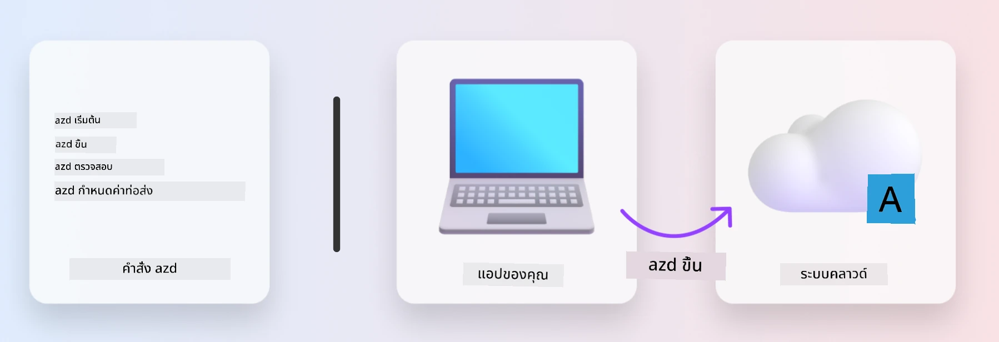
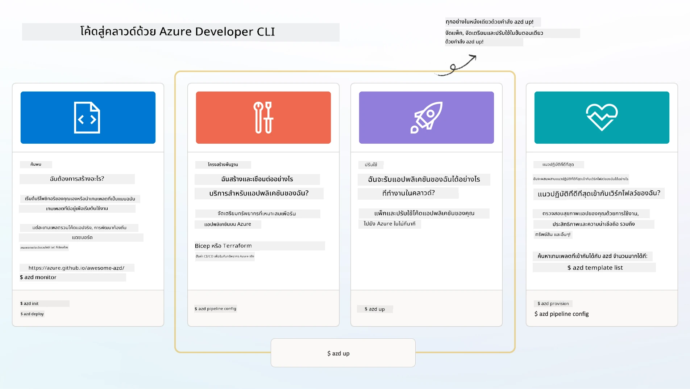

# 1. เลือกแม่แบบ

!!! tip "เมื่อจบบทนี้คุณจะสามารถ"

    - [ ] Describe what AZD templates are
    - [ ] Discover and use AZD templates for AI
    - [ ] Get started with the AI Agents template
    - [ ] **Lab 1:** AZD Quickstart in Codespaces or a dev container

---

## 1. อุปมาเรื่องผู้สร้าง

การสร้างแอปพลิเคชัน AI สำหรับองค์กรสมัยใหม่ _ตั้งแต่เริ่มต้น_ อาจดูน่ากลัว มันเหมือนกับการสร้างบ้านใหม่ของคุณเองทีละก้อน ใช่ มันทำได้! แต่ไม่ใช่วิธีที่มีประสิทธิภาพที่สุดที่จะได้ผลลัพธ์ที่ต้องการ!

แทนที่จะเริ่มแบบนั้น เรามักจะเริ่มด้วย _แผนผังออกแบบ_ ที่มีอยู่ และทำงานร่วมกับสถาปนิกเพื่อปรับแต่งให้เข้ากับความต้องการส่วนตัวของเรา และนี่คือวิธีที่ควรใช้ในการสร้างแอปพลิเคชันอัจฉริยะ ก่อนอื่นให้ค้นหาโครงสร้างออกแบบที่ดีที่เหมาะกับพื้นที่ปัญหาของคุณ จากนั้นทำงานร่วมกับสถาปนิกโซลูชันเพื่อปรับแต่งและพัฒนาโซลูชันให้ตรงกับสถานการณ์เฉพาะของคุณ

แต่เราจะหาแผนผังเหล่านี้จากที่ไหน? และเราจะหาสถาปนิกที่ยินดีสอนเราให้ปรับแต่งและปรับใช้แผนผังเหล่านี้ได้ด้วยตนเองได้อย่างไร? ในเวิร์กช็อปนี้ เราจะตอบคำถามเหล่านั้นโดยแนะนำคุณให้รู้จักกับเทคโนโลยีสามอย่าง:

1. [Azure Developer CLI](https://aka.ms/azd) - เครื่องมือโอเพนซอร์สที่ช่วยเร่งเส้นทางของนักพัฒนาในการเปลี่ยนจากการพัฒนาบนเครื่อง(local development) ไปสู่การนำขึ้นระบบคลาวด์ (deployment).
1. [Microsoft Foundry Templates](https://ai.azure.com/templates) - ที่เก็บโค้ดมาตรฐานแบบโอเพนซอร์สที่ประกอบด้วยโค้ดตัวอย่าง โครงสร้างพื้นฐาน และไฟล์กำหนดค่าต่างๆ สำหรับการวางโครงสร้างสถาปัตยกรรมโซลูชัน AI.
1. [GitHub Copilot Agent Mode](https://code.visualstudio.com/docs/copilot/chat/chat-agent-mode) - เอเย่นต์เขียนโค้ดที่มีความรู้จาก Azure ที่ช่วยแนะนำเราในการสำรวจฐานโค้ดและทำการเปลี่ยนแปลงต่างๆ โดยใช้ภาษาธรรมชาติ.

ด้วยเครื่องมือเหล่านี้ในมือ เราสามารถ _ค้นหา_ เทมเพลตที่เหมาะสม, _ปรับใช้_ เพื่อยืนยันว่าใช้งานได้ และ _ปรับแต่ง_ ให้เหมาะกับสถานการณ์เฉพาะของเราได้แล้ว ลองลุยและเรียนรู้ว่ามันทำงานอย่างไร


---

## 2. Azure Developer CLI

เครื่องมือบรรทัดคำสั่งโอเพนซอร์ส [Azure Developer CLI](https://learn.microsoft.com/en-us/azure/developer/azure-developer-cli/) (หรือ `azd`) สามารถเร่งกระบวนการจากโค้ดสู่คลาวด์ของคุณด้วยชุดคำสั่งที่เป็นมิตรกับนักพัฒนาซอฟต์แวร์ซึ่งทำงานอย่างสม่ำเสมอทั้งในสภาพแวดล้อม IDE (การพัฒนา) และ CI/CD (devops) ของคุณ

ด้วย `azd` การเดินทางในการปรับใช้ของคุณสามารถง่ายเหมือน:

- `azd init` - เริ่มต้นโครงการ AI ใหม่จากแม่แบบ AZD ที่มีอยู่
- `azd up` - จัดเตรียมโครงสร้างพื้นฐานและปรับใช้แอปพลิเคชันของคุณในขั้นตอนเดียว
- `azd monitor` - รับการตรวจสอบแบบเรียลไทม์และการวินิจฉัยสำหรับแอปพลิเคชันที่ปรับใช้ของคุณ
- `azd pipeline config` - ตั้งค่า pipeline CI/CD เพื่ออัตโนมัติการปรับใช้ไปยัง Azure

**🎯 | แบบฝึกหัด**: <br/> สำรวจเครื่องมือบรรทัดคำสั่ง `azd` ในสภาพแวดล้อมเวิร์กช็อปปัจจุบันของคุณตอนนี้ อาจเป็น GitHub Codespaces, dev container หรือโคลนในเครื่องที่ติดตั้งข้อกำหนดล่วงหน้าแล้ว เริ่มต้นด้วยการพิมพ์คำสั่งนี้เพื่อดูว่าเครื่องมือสามารถทำอะไรได้บ้าง:

```bash title="" linenums="0"
azd help
```



---

## 3. เทมเพลต AZD

เพื่อให้ `azd` ทำสิ่งนี้ได้ จำเป็นต้องรู้จักโครงสร้างพื้นฐานที่จะจัดเตรียม การตั้งค่าการกำหนดค่าที่จะบังคับใช้ และแอปพลิเคชันที่จะทำการปรับใช้งาน อันนี้คือจุดที่ [เทมเพลต AZD](https://learn.microsoft.com/en-us/azure/developer/azure-developer-cli/azd-templates?tabs=csharp) มีบทบาท

เทมเพลต AZD คือแหล่งเก็บข้อมูลแบบเปิดที่รวมตัวอย่างโค้ดกับไฟล์โครงสร้างพื้นฐานและการกำหนดค่าที่จำเป็นสำหรับการปรับใช้โซลูชันสถาปัตยกรรม
โดยใช้แนวทาง _Infrastructure-as-Code_ (IaC) เทมเพลตเหล่านี้ช่วยให้การกำหนดทรัพยากรและการตั้งค่าการกำหนดค่ามีการควบคุมเวอร์ชัน (เช่นเดียวกับโค้ดต้นทางของแอป) - สร้างเวิร์กโฟลว์ที่นำกลับมาใช้ซ้ำและสม่ำเสมอระหว่างผู้ใช้ในโครงการนั้น

เมื่อสร้างหรือใช้ซ้ำเทมเพลต AZD สำหรับสถานการณ์ _ของคุณ_ ให้พิจารณาคำถามเหล่านี้:

1. คุณกำลังสร้างอะไร? → มีเทมเพลตที่มีโค้ดเริ่มต้นสำหรับสถานการณ์นั้นหรือไม่?
1. โซลูชันของคุณถูกออกแบบอย่างไร? → มีเทมเพลตที่มีทรัพยากรที่จำเป็นหรือไม่?
1. โซลูชันของคุณถูกปรับใช้อย่างไร? → คิดถึง `azd deploy` ที่มีการทำงานเสริมก่อน/หลังการประมวลผล!
1. คุณสามารถปรับให้ดีขึ้นได้อย่างไร? → คิดถึงการตรวจสอบและท่อส่งงานอัตโนมัติในตัว!

**🎯 | แบบฝึกหัด**: <br/> 
เยี่ยมชมแกลเลอรี [Awesome AZD](https://azure.github.io/awesome-azd/) และใช้ตัวกรองเพื่อสำรวจเทมเพลตกว่า 250+ ที่มีอยู่ในขณะนี้ ดูว่าคุณสามารถหาที่ตรงกับข้อกำหนดสถานการณ์ _ของคุณ_ ได้หรือไม่



---

## 4. เทมเพลตแอป AI

สำหรับแอปพลิเคชันที่ขับเคลื่อนด้วย AI, Microsoft มีเทมเพลตเฉพาะที่แสดงถึง **Microsoft Foundry** และ **Foundry Agents** เทมเพลตเหล่านี้ช่วยเร่งเส้นทางของคุณในการสร้างแอปที่มีความฉลาดและพร้อมใช้งานในสภาพแวดล้อมการผลิต

### เทมเพลต Microsoft Foundry & Foundry Agents

เลือกเทมเพลตด้านล่างเพื่อนำไปใช้งาน แต่ละเทมเพลตมีให้ใช้งานบน [Awesome AZD](https://azure.github.io/awesome-azd/) และสามารถเริ่มต้นได้ด้วยคำสั่งเพียงคำสั่งเดียว

| เทมเพลต | คำอธิบาย | คำสั่งนำไปใช้ |
|----------|-------------|----------------|
| **[AI Chat with RAG](https://github.com/Azure-Samples/azure-search-openai-demo)** | แอปแชทที่มีพื้นฐานจากการค้นหา | `azd init -t Azure-Samples/azure-search-openai-demo .` |
| **[Get Started with AI Agents](https://github.com/Azure-Samples/get-started-with-ai-agents)** | แอปแชทสนับสนุนโดยตัวแทน; ใช้ในเวิร์กช็อปนี้ตลอด | `azd init -t Azure-Samples/get-started-with-ai-agents .` |
| **[Get Started with AI Chat](https://github.com/Azure-Samples/get-started-with-ai-chat)** | แอปแชท AI เริ่มต้น | `azd init -t Azure-Samples/get-started-with-ai-chat .` |

นี่คือทางเลือก: เริ่มต้น **หนึ่ง** เทมเพลตในไดเรกทอรีว่างของมันเอง ตัวเลือก `.` ที่ต่อท้ายเลือกไดเรกทอรีนี้; การไม่ใส่ใน AZD เวอร์ชันปัจจุบันจะสร้างไดเรกทอรีย่อยที่มีชื่อเป็นชื่อเทมเพลต การเริ่มต้นดาวน์โหลดโปรเจกต์; `azd up` ทำการนำไปใช้ที่มีค่าใช้จ่ายหลังจากคุณตรวจสอบข้อกำหนดล่วงหน้า, ทรัพยากร, การสนับสนุนภูมิภาค และโควต้า

### เริ่มต้นอย่างรวดเร็ว

1. **ดูเทมเพลต**: เยี่ยมชม [https://azure.github.io/awesome-azd/](https://azure.github.io/awesome-azd/) และกรองโดย `AI`, `Agents` หรือ `Microsoft Foundry`
2. **เลือกเทมเพลตของคุณ**: เลือกหนึ่งที่ตรงกับกรณีการใช้งานของคุณ
3. **เริ่มต้น**: รันคำสั่ง `azd init` สำหรับเทมเพลตที่คุณเลือก
4. **นำไปใช้**: รัน `azd up` เพื่อเตรียมและนำไปใช้

**🎯 | แบบฝึกหัด**: <br/>
เลือกหนึ่งในเทมเพลตข้างบนตามสถานการณ์ของคุณ:

- **กำลังดำเนินเวิร์กช็อปนี้ต่อ?** → เลือก **Get Started with AI Agents**
- **กำลังสร้างแชทที่มีพื้นฐานจากการค้นหา?** → สำรวจ **AI Chat with RAG** แยกต่างหาก
- **ต้องการสถาปัตยกรรมอื่นหรือ?** → ค้นหาในแกลเลอรีและตรวจสอบ repository จริง, สถานะการใช้งาน และข้อกำหนดล่วงหน้า

```bash title="Initialize the workshop template in an empty directory" linenums="0"
azd init -t Azure-Samples/get-started-with-ai-agents .
azd auth login
azd up
```

!!! info "สำรวจเทมเพลตเพิ่มเติม"
    แกลเลอรี [Awesome AZD Gallery](https://azure.github.io/awesome-azd/) มีเทมเพลตกว่า 250+ ใช้ตัวกรองเพื่อค้นหาเทมเพลตที่ตรงกับข้อกำหนดเฉพาะของคุณสำหรับภาษา, เฟรมเวิร์ก และบริการ Azure

---

<!-- CO-OP TRANSLATOR DISCLAIMER START -->
**ปฏิเสธความรับผิดชอบ**:
เอกสารนี้ได้รับการแปลโดยใช้บริการแปลภาษา AI [Co-op Translator](https://github.com/Azure/co-op-translator) ขณะที่เราพยายามให้ความถูกต้อง โปรดทราบว่าการแปลโดยอัตโนมัติอาจมีข้อผิดพลาดหรือความไม่ถูกต้อง เอกสารต้นฉบับในภาษาต้นทางควรถูกพิจารณาเป็นแหล่งข้อมูลที่เชื่อถือได้ สำหรับข้อมูลที่สำคัญ แนะนำให้ใช้การแปลโดยมนุษย์มืออาชีพ เราไม่รับผิดชอบต่อความเข้าใจผิดหรือการตีความที่ผิดพลาดที่เกิดขึ้นจากการใช้การแปลนี้
<!-- CO-OP TRANSLATOR DISCLAIMER END -->