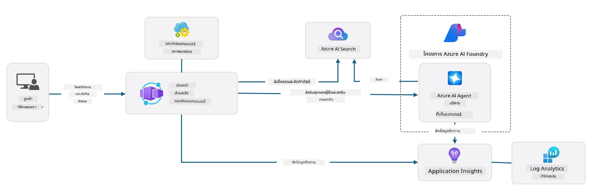

# 3. แยกวิเคราะห์เทมเพลต

!!! tip "เมื่อจบโมดูลนี้คุณจะสามารถ"

    - [ ] Use GitHub Copilot and optional MCP tools for Azure documentation and read-only exploration
    - [ ] Identify the template's application, infrastructure, configuration, and test entry points
    - [ ] Verify generated explanations against actual repository files
    - [ ] **Lab 3:** Trace one request and one configuration input through the project

---

## 1. เปิดใช้งาน GitHub Copilot

เปิดตัวอย่าง AI ที่สร้างขึ้นแล้วใน VS Code และเปิดใช้งาน [GitHub Copilot](https://code.visualstudio.com/docs/copilot/chat/chat-agent-mode) ลงชื่อเข้าใช้ด้วยบัญชีที่มีแผนที่เหมาะสม; ข้อจำกัดการใช้งานจะแตกต่างกัน ขอให้ Copilot อธิบาย repository ก่อนอนุมัติการเปลี่ยนแปลง

### เซิร์ฟเวอร์ MCP ที่เป็นทางเลือก

บริการเหล่านี้สามารถให้เครื่องมือเพิ่มเติม:

- [Azure MCP Server](https://learn.microsoft.com/azure/developer/azure-mcp-server/overview)
- [Microsoft Learn MCP Server](https://learn.microsoft.com/training/support/mcp)

ใน VS Code ทบทวน [คำแนะนำการกำหนดค่า MCP](https://code.visualstudio.com/docs/copilot/chat/mcp-servers) และสร้าง `.vscode/mcp.json` หากจำเป็น:

```json
{
  "servers": {
    "Azure MCP Server": {
      "type": "stdio",
      "command": "npx",
      "args": ["-y", "@azure/mcp@latest", "server", "start"]
    },
    "microsoft.docs.mcp": {
      "type": "http",
      "url": "https://learn.microsoft.com/api/mcp"
    }
  }
}
```

คำสั่ง `npx` ต้องการการติดตั้ง Node.js/npm ที่รองรับและดาวน์โหลดโค้ดที่ใช้ปฏิบัติการ ทบทวนแพ็กเกจและตรึงเวอร์ชันที่อนุมัติสำหรับการตั้งค่าทีมที่ทำซ้ำได้ เริ่มเซิร์ฟเวอร์โดยใช้คอนโทรล MCP ของ VS Code และตรวจสอบเครื่องมือที่มีให้; ชื่ออาจเปลี่ยนระหว่างเวอร์ชัน

**การพิสูจน์ตัวตนแยกต่างหาก** ใช้ `azd auth login` สำหรับ AZD ปฏิบัติตามขั้นตอนการพิสูจน์ตัวตนที่มีเอกสารของ Azure MCP สำหรับเครื่องมือของมัน; การเข้าสู่ระบบ AZD เพียงอย่างเดียวไม่สร้างเซสชัน MCP ใช้ `az login` แยกต่างหากเมื่อแบบฝึกหัดหรือตัวฮุกเรียกใช้ Azure CLI

ทดลองใช้พรอมต์แบบอ่านอย่างเดียว:

1. “ใช้ Microsoft Learn MCP เพื่อค้นหาคู่มือการกำหนดค่า Azure Developer CLI.”
2. “อธิบาย `azure.yaml` ของ repository นี้; อ้างอิงไฟล์ที่ใช้งานแต่ละตัวฮุก”
3. “โดยใช้เครื่องมือ Azure MCP ที่มีอยู่, แสดงรายการทรัพยากรที่ฉันปรับใช้อย่างไม่แก้ไขอะไร”

ตรวจสอบ tenant/subscription ที่เลือกและการเรียกเครื่องมือที่เสนอทุกครั้ง อย่าอนุมัติการสร้างทรัพยากร การลบ หรือการเปลี่ยนแปลงการเข้าถึงเพียงเพื่อสำรวจสถาปัตยกรรม

## 2. เข้าใจสถาปัตยกรรม

ตัวอย่างนี้โฮสต์ backend Python FastAPI และ frontend React/TypeScript ใน Azure Container Apps. backend สื่อสารกับ agent ในโครงการ Microsoft Foundry. การดึงข้อมูลและการสังเกตการณ์ขึ้นอยู่กับฟีเจอร์เทมเพลตที่เปิดใช้งานและการตั้งค่าที่สำเร็จ; ไม่ได้รับประกันเพียงเพราะแอปพลิเคชันถูกปรับใช้แล้ว



เปรียบเทียบแผนภาพนี้กับ [คู่มือการปรับใช้ต้นน้ำปัจจุบัน](https://github.com/Azure-Samples/get-started-with-ai-agents/blob/main/docs/deployment.md) และทรัพยากรของคุณเอง ตรวจสอบการกำหนดค่าการปรับใช้โมเดล, เครื่องมือ agent, managed identity, การกำหนดบทบาท และทรัพยากร AI Search/Application Insights ทางเลือก

**แบบฝึกหัด:** ขอให้ Copilot ติดตามคำขอแชทจาก frontend ผ่าน API ไปยัง Foundry พร้อมการอ้างอิงไฟล์และฟังก์ชัน เปิดดูการอ้างอิงเหล่านั้นและตรวจสอบคำอธิบาย อย่าสรุปการพิสูจน์ตัวตน การส่งเส้นทาง หรือการอนุญาตจากแผนภาพเพียงอย่างเดียว

## 3. โครงสร้าง repository

เส้นทางที่เลือกต่อไปนี้ได้รับการตรวจสอบกับตัวอย่างเมื่อวันที่ 4 พฤศจิกายน 2026. รุ่นที่สร้างของคุณยังคงเป็นแหล่งข้อมูลที่ถูกต้อง:

```text
get-started-with-ai-agents/
  azure.yaml
  docker-compose.yaml
  requirements-dev.txt
  .devcontainer/
  infra/
    main.bicep
    main.parameters.json
    api.bicep
    core/
  src/
    Dockerfile
    pyproject.toml
    requirements.txt
    api/
      main.py
      routes.py
      search_index_manager.py
    frontend/
      package.json
      src/
    files/
  scripts/
    validate_env_vars.sh
    validate_env_vars.ps1
    postdeploy.sh
    postdeploy.ps1
  tests/
    test_evaluation.py
    test_red_teaming.py
  docs/
    deployment.md
    deploy_customization.md
    ai_search.md
    observability.md
    local_development.md
    troubleshooting.md
```

### โครงสร้างพื้นฐานและการตั้งค่า

`infra/main.bicep` เป็นผู้จัดการทรัพยากร; `main.parameters.json` เชื่อมโยงอินพุตเทมเพลตกับค่าของสภาพแวดล้อม AZD. `azure.yaml` เลือกแอปพลิเคชันเซอร์วิสและตัวฮุกวงจรชีวิต แทรกตามอินพุตเช่น `USE_AZURE_AI_SEARCH_SERVICE` ผ่านไฟล์เหล่านี้เพื่อค้นหาสิ่งที่เปลี่ยนแปลงจริงๆ

### แอปพลิเคชันและตัวตน

อ่าน `src/api/` และ `src/frontend/` ร่วมกัน ระบุจุดที่สร้างหรือดึง agent, จุดที่กำหนดค่าเครื่องมือ/คำสั่ง, และตัวตนที่ใช้การเรียก Azure แต่ละครั้ง ไฟล์ตัวอย่างภายใต้ `src/files/` เป็นข้อมูลสาธิต ไม่ใช่แคตตาล็อกการผลิตหรือโมเดลการอนุญาต

### การทดสอบและการสังเกตการณ์

จุดเริ่มต้นการประเมินและ red-teaming ปัจจุบันอยู่ภายใต้ `tests/`; การอ้างอิงไดเรกทอรี `evals/` และ `airedteaming/` เก่ากว่าไม่ได้ใช้กับตัวอย่างนี้ อ่าน `docs/observability.md` สำหรับข้อกำหนดเบื้องต้นและค่าใช้จ่ายก่อนรันการทดสอบบนคลาวด์ การทดสอบ Python เหล่านี้แยกจากส่วนขยาย AZD `azure.ai.evaluations` ทางเลือก

## 4. ตรวจสอบสิ่งที่ค้นพบ

- ระบุเส้นทาง API, การโต้ตอบกับ agent, และโค้ดดึงข้อมูลสำหรับคำถามตัวอย่างหนึ่ง
- อธิบายว่าตัวตนใดเข้าถึง Foundry และการตั้งค่าใดเลือกจุดสิ้นสุดของมัน
- ค้นหาสคริปต์ pre-up และ post-deploy ที่แท้จริงและพฤติกรรมการจัดการข้อผิดพลาด
- ระบุการพึ่งพาหรือฟีเจอร์ทางเลือกใดที่ขาดหายไปจากการปรับใช้ของคุณ

ดำเนินการต่อไปที่ [กำหนดค่าเทมเพลต](4-Configure-AI-Template.md).

---

<!-- CO-OP TRANSLATOR DISCLAIMER START -->
**ปฏิเสธความรับผิดชอบ**:
เอกสารนี้ได้รับการแปลโดยใช้บริการแปลภาษา AI [Co-op Translator](https://github.com/Azure/co-op-translator) ขณะที่เราพยายามให้ความถูกต้อง โปรดทราบว่าการแปลโดยอัตโนมัติอาจมีข้อผิดพลาดหรือความไม่ถูกต้อง เอกสารต้นฉบับในภาษาต้นทางควรถูกพิจารณาเป็นแหล่งข้อมูลที่เชื่อถือได้ สำหรับข้อมูลที่สำคัญ แนะนำให้ใช้การแปลโดยมนุษย์มืออาชีพ เราไม่รับผิดชอบต่อความเข้าใจผิดหรือการตีความที่ผิดพลาดที่เกิดขึ้นจากการใช้การแปลนี้
<!-- CO-OP TRANSLATOR DISCLAIMER END -->