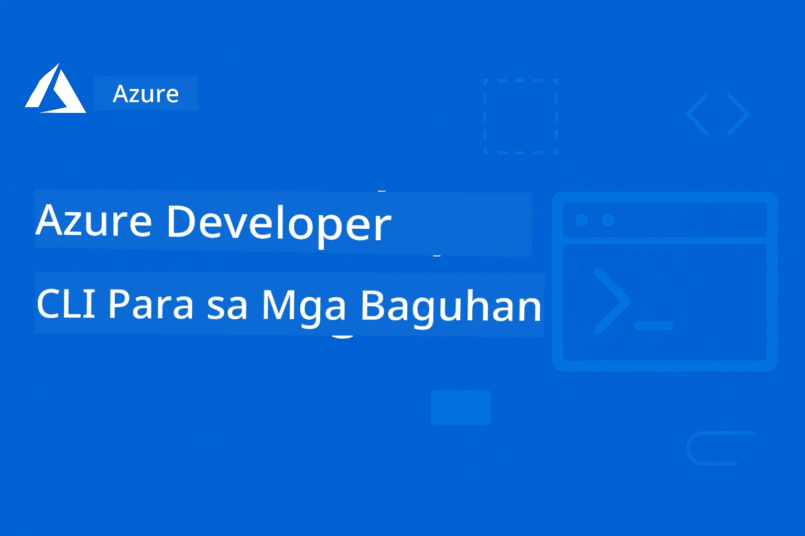

# AZD Para sa Mga Nagsisimula: Isang Istrakturadong Paglalakbay sa Pagkatuto

 

[](https://github.com/microsoft/AZD-for-beginners)
[](https://GitHub.com/microsoft/azd-for-beginners/network/)
[](https://github.com/microsoft/AZD-for-beginners)

[](https://discord.com/invite/nkVh3dp)
[](https://discord.gg/nTYy5BXMWG)

---

### Mga Automated na Pagsasalin (Laging Napapanahon)

<!-- CO-OP TRANSLATOR LANGUAGES TABLE START -->
[Arabic](../ar/README.md) | [Bengali](../bn/README.md) | [Bulgarian](../bg/README.md) | [Burmese (Myanmar)](../my/README.md) | [Chinese (Simplified)](../zh-CN/README.md) | [Chinese (Traditional, Hong Kong)](../zh-HK/README.md) | [Chinese (Traditional, Macau)](../zh-MO/README.md) | [Chinese (Traditional, Taiwan)](../zh-TW/README.md) | [Croatian](../hr/README.md) | [Czech](../cs/README.md) | [Danish](../da/README.md) | [Dutch](../nl/README.md) | [Estonian](../et/README.md) | [Finnish](../fi/README.md) | [French](../fr/README.md) | [German](../de/README.md) | [Greek](../el/README.md) | [Hebrew](../he/README.md) | [Hindi](../hi/README.md) | [Hungarian](../hu/README.md) | [Indonesian](../id/README.md) | [Italian](../it/README.md) | [Japanese](../ja/README.md) | [Kannada](../kn/README.md) | [Khmer](../km/README.md) | [Korean](../ko/README.md) | [Lithuanian](../lt/README.md) | [Malay](../ms/README.md) | [Malayalam](../ml/README.md) | [Marathi](../mr/README.md) | [Nepali](../ne/README.md) | [Nigerian Pidgin](../pcm/README.md) | [Norwegian](../no/README.md) | [Persian (Farsi)](../fa/README.md) | [Polish](../pl/README.md) | [Portuguese (Brazil)](../pt-BR/README.md) | [Portuguese (Portugal)](../pt-PT/README.md) | [Punjabi (Gurmukhi)](../pa/README.md) | [Romanian](../ro/README.md) | [Russian](../ru/README.md) | [Serbian (Cyrillic)](../sr/README.md) | [Slovak](../sk/README.md) | [Slovenian](../sl/README.md) | [Spanish](../es/README.md) | [Swahili](../sw/README.md) | [Swedish](../sv/README.md) | [Tagalog (Filipino)](./README.md) | [Tamil](../ta/README.md) | [Telugu](../te/README.md) | [Thai](../th/README.md) | [Turkish](../tr/README.md) | [Ukrainian](../uk/README.md) | [Urdu](../ur/README.md) | [Vietnamese](../vi/README.md)

> **Mas Gustong Mag-clone Lokal?**
>
> Kasama sa repositoryong ito ang mahigit 50 na pagsasalin ng wika na malaki ang dagdag sa laki ng pag-download. Para mag-clone nang walang mga pagsasalin, gamitin ang sparse checkout:
>
> **Bash / macOS / Linux:**
> ```bash
> git clone --filter=blob:none --sparse https://github.com/microsoft/AZD-for-beginners.git
> cd AZD-for-beginners
> git sparse-checkout set --no-cone '/*' '!translations' '!translated_images'
> ```
>
> **CMD (Windows):**
> ```cmd
> git clone --filter=blob:none --sparse https://github.com/microsoft/AZD-for-beginners.git
> cd AZD-for-beginners
> git sparse-checkout set --no-cone "/*" "!translations" "!translated_images"
> ```
>
> Bibigyan ka nito ng lahat ng kailangan mo para matapos ang kurso na may mas mabilis na pag-download.
<!-- CO-OP TRANSLATOR LANGUAGES TABLE END -->

## 🆕 Ano ang Bago sa azd Ngayon

> 📌 **Foundry GA update (2026-11-09):** Ang **`microsoft.foundry` 1.0 bundle ay pangkalahatang magagamit na**, anunsyado noong [Nobyembre 5, 2026](https://devblogs.microsoft.com/azure-sdk/microsoft-foundry-azure-developer-cli-ga/). Gamitin ang **`azd >= 1.37.0`** at i-install ito gamit ang `azd ext install microsoft.foundry`. Sundin ang [hosted-agent walkthrough](docs/chapter-02-ai-development/microsoft-foundry-integration.md#hosted-agent-walkthrough-ga) para sa setup, lokal na pagsubok, at deployment. Ang update na ito ay base sa inilathalang patnubay, hindi live na Azure deployment; ang bundle GA ay hindi awtomatikong ginagawang pangkalahatang available ang bawat opsyonal na tampok, extension, o SDK.

Sinusuportahan ng Azure Developer CLI ang maraming uri ng application, kabilang ang web apps, APIs, at AI agents, sa pamamagitan ng mga suportadong host, template, at extension.

Narito kung ano ang ibig sabihin nito para sa iyo:

- **Isang GA bundle para sa Foundry development.** Nag-i-install ang `microsoft.foundry` ng pitong pangunahing extension, kabilang ang mga agent, proyekto, at Agent Inspector. Pinananatiling magkasama sa `azure.yaml` ang code ng agent at mga setting ng deployment.
- **Magsagawa ng lokal na pagsubok, pagkatapos ay i-deploy ang iyong code.** Gamitin ang `azd ai agent init --deploy-mode code`, `azd provision`, at `azd ai agent run` para suriin ang mga lokal na kahilingan at tugon. Pagkatapos ay gamitin ang `azd deploy` para sa remote build sa Foundry, nang walang lokal na container build.
- **Sukatin nang hiwalay ang kalidad.** I-install ang **`azure.ai.evaluations`** para sa `azd ai eval generate`, `init`, at `run start`; hindi ito kasama sa bundle. Panatilihin ang mga nirebyuhang dataset at rubric kasama ang iyong code. Ang mga lumang proyekto ay dapat sumunod sa [evaluation and optimization migration guide](docs/chapter-08-production/production-ai-practices.md#evaluation-migration-and-quality-checks).
- **Gamitin muli ang configuration sa CI/CD.** Pagkatapos ng matagumpay na `azd up`, i-configure ang pipeline gamit ang `azd pipeline config`. I-install ang bundle sa runner at panatilihin ang mga nalikhang authentication at mga setting ng environment.
- **Mas maayos ang araw-araw na mga pangunahing gawain.** Ang mga kamakailang release ay ginawa ang `azd init` na idempotent (ligtas ulitin), awtomatikong nililinis ng `azd auth login` ang mga luma o stale na token, at nagdagdag ng magiliw na `azd tool` unang setup prompt.
- **Hindi nagbago ang pangunahing workflow.** Kahit nagde-deploy ka ng isang todo app, microservice, o multi-agent AI solution, pareho lang ang mga command.

> **Tandaan para sa mga gumagamit ng Aspire:** Tinatawag na lamang ng Microsoft ang produkto bilang **Aspire** (dati ".NET Aspire"). Hindi nagbago ang suporta ng azd para sa Aspire—pangunahin ang pangalan lang ang binago.

Kung ginamit mo na ang azd dati, ang AI support ay isang natural na extension—hindi isang hiwalay na tool o advanced track. Kung nagsisimula ka pa lang, matututo ka ng isang workflow na gumagana para sa lahat.

---

## 🚀 Ano ang Azure Developer CLI (azd)?

**Ang Azure Developer CLI (azd)** ay isang developer-friendly na command-line tool na nagpapadali sa pag-deploy ng mga aplikasyon sa Azure. Sa halip na mano-manong gumawa at mag-konekta ng dose-dosenang Azure resources, maaari mong i-deploy ang buong aplikasyon gamit ang isang utos lang.

### Ang Mahika ng `azd up`

```bash
# This single command does everything:
# ✅ Creates all Azure resources  
# ✅ Configures networking and security
# ✅ Builds your application code
# ✅ Deploys to Azure
# ✅ Gives you a working URL
azd up
```

Nagbibigay ang template ng configuration para sa aplikasyon at imprastraktura. Kinakailangan pa rin ng matagumpay na deployment ang suportadong mga serbisyo/modelo, sapat na quota at permiso, tamang inputs, at beripikasyon ng deployed na aplikasyon. Hindi awtomatikong ginagawa ng `azd up` ang template na ligtas, sumusunod sa mga patakaran, o handa para sa produksyon.

---

## ❓ Azure Developer CLI vs Azure CLI: Ano ang Kaibahan?

Ito ang pinakakaraniwang tanong ng mga baguhan. Narito ang simpleng sagot:

| Katangian | **Azure CLI (`az`)** | **Azure Developer CLI (`azd`)** |
|---------|---------------------|--------------------------------|
| **Layunin** | Pamahalaan ang indibidwal na Azure resources | Mag-deploy ng buong aplikasyon |
| **Pokus** | Nakatuon sa imprastraktura | Nakatuon sa aplikasyon |
| **Halimbawa** | `az webapp create --name myapp...` | `azd up` |
| **Dali ng Pagkatuto** | Kailangang alam ang mga Azure services | Kailangan lang malaman ang iyong app |
| **Pinakamaganda Para sa** | DevOps, Infrastructure | Mga Developer, Prototyping |

### Simpleng Paghahambing

- **Azure CLI** ay parang may kumpletong gamit sa paggawa ng bahay - martilyo, lagari, pako. Kaya mong gumawa ng kahit ano, pero kailangan mong marunong sa konstruksyon.
- **Azure Developer CLI** ay parang umarkila ng kontratista - isasabi mo kung ano ang gusto mo, siya na ang gagawa.

### Kailan Gamitin ang Bawat Isa

| Sitwasyon | Gamitin Ito |
|----------|----------|
| "Gusto kong mabilis na mag-deploy ng web app" | `azd up` |
| "Kailangan kong gumawa ng storage account lang" | `az storage account create` |
| "Gumagawa ako ng buong AI application" | `azd init --template azure-search-openai-demo` |
| "Kailangan kong i-debug ang isang Azure resource" | `az resource show` |
| "Gusto kong ideploy sa configured production environment ko" | Suriin ang configuration, access, cost, at operational gates bago ang `azd up --environment production` |

### Magkasama silang Gumagana!

Magkaibang authentication at configuration ang AZD at Azure CLI. Gamitin ang `azd auth login` para sa AZD, at `az login` kapag ang hook o diagnostic command ay kailangan talagang Azure CLI. Pwede mong gamitin pareho:
```bash
# Deploy your app with AZD
azd up

# Then fine-tune specific resources with Azure CLI
az webapp config set --name myapp --always-on true
```

---

## 🌟 Hanapin ang Mga Template sa Awesome AZD

Huwag mag-umpisa mula sa wala! Ang **Awesome AZD** ay koleksyon ng komunidad ng mga handang i-deploy na template:

| Resource | Paglalarawan |
|----------|-------------|
| 🔗 [**Awesome AZD Gallery**](https://azure.github.io/awesome-azd/) | Tumingin ng higit 200+ na template na may one-click deploy |
| 🔗 [**Isumite ang Template**](https://github.com/Azure/awesome-azd/issues) | Mag-ambag ng sarili mong template para sa komunidad |
| 🔗 [**GitHub Repository**](https://github.com/Azure/awesome-azd) | I-star at tuklasin ang source |

### Mga Popular AI Template mula sa Awesome AZD

Pumili ng isang template sa sarili nitong walang lamang direktoryo; ang mga command sa ibaba ay mga alternatibo. Ang huling `.` ay nag-i-initialize ng direktoryong iyon.

```bash
# RAG Chat with Microsoft Foundry Models + AI Search
azd init --template azure-search-openai-demo .

# Quick AI Chat Application
azd init --template openai-chat-app-quickstart .

# AI Agents with Foundry Agents
azd init --template get-started-with-ai-agents .
```

---

## 🎯 Pagsisimula sa 3 Hakbang

Bago ka magsimula, siguraduhing handa ang iyong makina para sa template na gusto mong i-deploy:

**Windows:**
```powershell
.\validate-setup.ps1
```

**macOS / Linux:**
```bash
bash ./validate-setup.sh
```

Kung may sinumang kinakailangang tsek na pumalya, ayusin muna iyon bago magpatuloy sa mabilis na pagsisimula.

### Hakbang 1: I-install ang AZD (2 minuto)

**Windows:**
```powershell
winget install microsoft.azd
```

**macOS:**
```bash
brew tap azure/azd && brew install azd
```

**Linux:**
```bash
curl -fsSL https://aka.ms/install-azd.sh | bash
```

### Hakbang 2: Mag-authenticate para sa AZD

```bash
# Optional if you plan to use Azure CLI commands directly in this course
az login

# Required for AZD workflows
azd auth login
```

Kung hindi ka sigurado kung alin ang kailangan mo, sundan ang buong flow ng setup sa [Installation & Setup](docs/chapter-01-foundation/installation.md#authentication-setup).

### Hakbang 3: I-deploy ang Iyong Unang App

```bash
# Initialize from a template
azd init --template todo-nodejs-mongo .

# Deploy to Azure (creates everything!)
azd up
```

**🎉 Iyon na!** Ang iyong app ay live na ngayon sa Azure.

### Linisin (Huwag Kalimutan!)

```bash
# Remove all resources when done experimenting
azd down --force --purge
```

---

## 📚 Paano Gamitin ang Kurso na Ito

Ang kursong ito ay dinisenyo para sa **progressive learning** - magsimula sa kung saan ka komportable at paunlarin mo ito:

| Ang Iyong Karanasan | Magsimula Dito |
|-----------------|------------|
| **Baguhan sa Azure** | [Kabanata 1: Pundasyon](#-chapter-1-foundation--quick-start) |
| **Alam ang Azure, bago sa AZD** | [Kabanata 1: Pundasyon](#-chapter-1-foundation--quick-start) |
| **Gusto mag-deploy ng AI apps** | [Kabanata 2: AI-First Development](#-chapter-2-ai-first-development-recommended-for-ai-developers) |
| **Gusto ng hands-on na pagsasanay** | [🎓 Interactive Workshop](workshop/README.md) - 3-4 na oras na guided lab |
| **Kailangan ng production patterns** | [Kabanata 8: Produksyon at Enterprise](#-chapter-8-production--enterprise-patterns) |

### Mabilis na Setup

1. **I-fork ang Repository na Ito**: [](https://GitHub.com/microsoft/azd-for-beginners/fork)
2. **I-clone Ito**: `git clone https://github.com/YOUR-USERNAME/azd-for-beginners.git`
3. **Humingi ng Tulong**: [Azure Discord Community](https://discord.com/invite/ByRwuEEgH4)

> **Mas Gustong Mag-clone Lokal?**

> Kasama sa repositoryong ito ang 50+ na pagsasalin sa wika na malaki ang nagpapalaki sa laki ng pag-download. Upang mag-clone nang walang mga pagsasalin, gamitin ang sparse checkout:
> ```bash
> git clone --filter=blob:none --sparse https://github.com/microsoft/AZD-for-beginners.git
> cd AZD-for-beginners
> git sparse-checkout set --no-cone '/*' '!translations' '!translated_images'
> ```
> Ibinibigay nito sa iyo ang lahat ng kailangan mo upang tapusin ang kurso nang mas mabilis ang pag-download.


## Pangkalahatang-ideya ng Kurso

Magsanay ng Azure Developer CLI (azd) sa pamamagitan ng mga istrukturadong kabanata na dinisenyo para sa progresibong pagkatuto. **Espesyal na pagtutok sa deployment ng AI application na may Microsoft Foundry integration.**

### Bakit Mahalaga ang Kursong Ito para sa Makabagong mga Developer

Kadalasang kailangan ng mga developer na nagde-deploy ng AI workloads ang gabay sa:
- Masalimuot na multi-service AI architectures
- Mga pinakamahusay na kasanayan sa production AI deployment  
- Integrasyon at konfigurasyon ng Azure AI service
- Pag-optimize ng gastos para sa AI workloads
- Pagsasaayos ng mga problema sa AI-specific na deployment

### Mga Layunin sa Pagkatuto

Sa pagsasagawa mo ng istrukturadong kurso na ito, ikaw ay:
- **Magsasanay sa Mga Pangunahing Kaalaman sa AZD**: Mga pangunahing konsepto, pag-install, at konfigurasyon
- **Magde-deploy ng AI Applications**: Gumamit ng AZD kasama ang Microsoft Foundry services
- **Magpatupad ng Infrastructure as Code**: Pamahalaan ang Azure resources gamit ang mga Bicep template
- **Ayusin ang mga Deployment**: Lutasin ang mga karaniwang isyu at i-debug ang mga problema
- **Mag-optimize para sa Produksyon**: Seguridad, scaling, monitoring, at pamamahala ng gastos
- **Gumawa ng Multi-Agent Solutions**: Mag-deploy ng masalimuot na AI architectures

## Bago Ka Magsimula: Mga Account, Access, at Mga Palagay

Bago ka magsimula sa Kabanata 1, tiyakin na mayroon kang mga sumusunod. Inaasahan ng mga hakbang sa pag-install sa gabay na ito na naayos na ang mga batayang ito.

- **Isang Azure subscription**: Maaari mong gamitin ang umiiral na subscription mula sa trabaho o sa sarili mong account, o gumawa ng [libreng trial](https://aka.ms/azurefreetrial) upang makapagsimula.
- **Pahintulot na gumawa ng Azure resources**: Para sa karamihang mga pagsasanay, dapat ay may at least **Contributor** access ka sa target na subscription o resource group. Ang ilang mga kabanata ay maaaring nangangailangan din na makakagawa ka ng mga resource group, managed identities, at RBAC assignments.
- [**Isang GitHub account**](https://github.com): Ito ay kapaki-pakinabang para sa pag-fork ng repositoryo, pagsubaybay ng iyong sariling mga pagbabago, at paggamit ng GitHub Codespaces para sa workshop.
- **Mga kinakailangan sa runtime ng template**: Kailangan ng ilang mga template ang lokal na mga tool tulad ng Node.js, Python, Java, o Docker. Patakbuhin ang setup validator bago magsimula upang maagang makita ang mga nawawalang tool.
- **Pangunahing kaalaman sa terminal**: Hindi mo kinakailangang maging eksperto, ngunit dapat kang kumportable sa pagpapatakbo ng mga command tulad ng `git clone`, `azd auth login`, at `azd up`.

> **Nagtatrabaho sa isang enterprise subscription?**
> Kung ang iyong Azure environment ay pinamamahalaan ng isang administrator, kumpirmahin nang maaga na maaari kang mag-deploy ng mga resources sa subscription o resource group na balak mong gamitin. Kung hindi, humiling ng isang sandbox subscription o Contributor access bago ka magsimula.

> **Bago ka sa Azure?**
> Magsimula gamit ang iyong sariling Azure trial o pay-as-you-go subscription sa https://aka.ms/azurefreetrial upang makumpleto mo ang mga pagsasanay nang buo nang hindi naghihintay ng mga aprobasyon sa tenant level.

## 🗺️ Mapa ng Kurso: Mabilisang Pag-navigate ayon sa Kabanata

Bawat kabanata ay may hiwalay na README na may mga layunin sa pagkatuto, mabilisang panimula, at mga pagsasanay:

| Kabanata | Paksa | Aralin | Tagal | Antas ng Kahirapan |
|---------|-------|---------|----------|------------|
| **[Kabanata 1: Pundasyon](docs/chapter-01-foundation/README.md)** | Pagsisimula | [Mga Pangunahing AZD](docs/chapter-01-foundation/azd-basics.md) &#124; [Pag-install](docs/chapter-01-foundation/installation.md) &#124; [Unang Proyekto](docs/chapter-01-foundation/first-project.md) | 30-45 min | ⭐ |
| **[Kabanata 2: AI Development](docs/chapter-02-ai-development/README.md)** | AI-First Apps | [Integrasyon ng Foundry](docs/chapter-02-ai-development/microsoft-foundry-integration.md) &#124; [AI Agents](docs/chapter-02-ai-development/agents.md) &#124; [Deployment ng Modelo](docs/chapter-02-ai-development/ai-model-deployment.md) &#124; [Workshop](docs/chapter-02-ai-development/ai-workshop-lab.md) | 1-2 hrs | ⭐⭐ |
| **[Kabanata 3: Konfigurasyon](docs/chapter-03-configuration/README.md)** | Auth at Seguridad | [Konfigurasyon](docs/chapter-03-configuration/configuration.md) &#124; [Auth at Seguridad](docs/chapter-03-configuration/authsecurity.md) | 45-60 min | ⭐⭐ |
| **[Kabanata 4: Infrastructure](docs/chapter-04-infrastructure/README.md)** | IaC at Deployment | [Deployment Guide](docs/chapter-04-infrastructure/deployment-guide.md) &#124; [Provisioning](docs/chapter-04-infrastructure/provisioning.md) | 1-1.5 hrs | ⭐⭐⭐ |
| **[Kabanata 5: Multi-Agent](docs/chapter-05-multi-agent/README.md)** | Mga AI Agent na Solusyon | [Senaryo ng Retail](examples/retail-scenario.md) &#124; [Mga Pattern ng Coordination](docs/chapter-06-pre-deployment/coordination-patterns.md) | 2-3 hrs | ⭐⭐⭐⭐ |
| **[Kabanata 6: Bago Deploy](docs/chapter-06-pre-deployment/README.md)** | Pagpaplano at Pag-validate | [Preflight Checks](docs/chapter-06-pre-deployment/preflight-checks.md) &#124; [Capacity Planning](docs/chapter-06-pre-deployment/capacity-planning.md) &#124; [Pagpili ng SKU](docs/chapter-06-pre-deployment/sku-selection.md) &#124; [App Insights](docs/chapter-06-pre-deployment/application-insights.md) | 1 hr | ⭐⭐ |
| **[Kabanata 7: Pagsasaayos ng Problema](docs/chapter-07-troubleshooting/README.md)** | Debug at Ayusin | [Mga Karaniwang Isyu](docs/chapter-07-troubleshooting/common-issues.md) &#124; [Debugging](docs/chapter-07-troubleshooting/debugging.md) &#124; [Mga Isyu ng AI](docs/chapter-07-troubleshooting/ai-troubleshooting.md) | 1-1.5 hrs | ⭐⭐ |
| **[Kabanata 8: Produksyon](docs/chapter-08-production/README.md)** | Mga Pattern ng Enterprise | [Mga Praktis sa Produksyon](docs/chapter-08-production/production-ai-practices.md) | 2-3 hrs | ⭐⭐⭐⭐ |
| **[🎓 Workshop](workshop/README.md)** | Hands-On Lab | [Panimula](workshop/docs/instructions/0-Introduction.md) &#124; [Pagpili](workshop/docs/instructions/1-Select-AI-Template.md) &#124; [Pag-validate](workshop/docs/instructions/2-Validate-AI-Template.md) &#124; [Pag-deconstruct](workshop/docs/instructions/3-Deconstruct-AI-Template.md) &#124; [Konfigurasyon](workshop/docs/instructions/4-Configure-AI-Template.md) &#124; [Pag-customize](workshop/docs/instructions/5-Customize-AI-Template.md) &#124; [Pag-alis](workshop/docs/instructions/6-Teardown-Infrastructure.md) &#124; [Pagtatapos](workshop/docs/instructions/7-Wrap-up.md) | 3-4 hrs | ⭐⭐ |

**Kabuuang Tagal ng Kurso:** ~10-14 oras | **Pagsulong ng Kasanayan:** Baguhan → Handa sa Produksyon

---

## 📚 Mga Kabanata ng Pagkatuto

*Pumili ng iyong landas ng pagkatuto batay sa antas ng karanasan at mga layunin*

### 🚀 Kabanata 1: Pundasyon at Mabilisang Pagsisimula
**Mga Kinakailangan**: Azure subscription, batayang kaalaman sa command line  
**Tagal**: 30-45 minuto  
**Kahirapan**: ⭐

#### Ano ang Iyong Matututunan
- Pag-unawa sa mga pangunahing kaalaman ng Azure Developer CLI
- Pag-install ng AZD sa iyong platform
- Iyong unang matagumpay na deployment

#### Mga Mapagkukunan sa Pagkatuto
- **🎯 Magsimula Dito**: [Ano ang Azure Developer CLI?](#-what-is-azure-developer-cli-azd)
- **📖 Teorya**: [Mga Pangunahing Kaalaman sa AZD](docs/chapter-01-foundation/azd-basics.md) - Mga pangunahing konsepto at terminolohiya
- **⚙️ Setup**: [Pag-install at Setup](docs/chapter-01-foundation/installation.md) - Mga gabay na pang-platform
- **🛠️ Hands-On**: [Iyong Unang Proyekto](docs/chapter-01-foundation/first-project.md) - Hakbang-hakbang na tutorial
- **📋 Mabilisang Sanggunian**: [Command Cheat Sheet](resources/cheat-sheet.md)

#### Mga Praktikal na Pagsasanay
```bash
# Quick installation check
azd version

# Deploy your first application
azd init --template todo-nodejs-mongo .
azd up
```

**💡 Kinalabasan ng Kabanata**: Matagumpay na mag-deploy ng isang simpleng web application sa Azure gamit ang AZD

**✅ Pagtibay ng Tagumpay:**
```bash
# After completing Chapter 1, you should be able to:
azd version              # Shows installed version
azd init --template todo-nodejs-mongo  # Initializes project
azd up                  # Deploys to Azure
azd show                # Displays running app URL
# Application opens in browser and works
azd down --force --purge  # Cleans up resources
```

**📊 Oras na Inilaan:** 30-45 minuto  
**📈 Antas ng Kasanayan Matapos:** Kayang mag-deploy ng mga pangunahing aplikasyon nang mag-isa

---

### 🤖 Kabanata 2: AI-First Development (Inirerekomenda para sa mga AI Developer)
**Mga Kinakailangan**: Nakumpleto ang Kabanata 1  
**Tagal**: 1-2 oras  
**Kahirapan**: ⭐⭐

#### Ano ang Iyong Matututunan
- Microsoft Foundry integration gamit ang AZD
- Pag-deploy ng mga AI-powered na aplikasyon
- Pag-unawa sa mga konfigurasyon ng AI service

#### Mga Mapagkukunan sa Pagkatuto
- **🎯 Magsimula Dito**: [Integrasyon ng Microsoft Foundry](docs/chapter-02-ai-development/microsoft-foundry-integration.md)
- **🤖 AI Agents**: [Gabayan sa AI Agents](docs/chapter-02-ai-development/agents.md) - Pag-deploy ng mga intelligent agents gamit ang AZD
- **📖 Mga Pattern**: [Deployment ng AI Model](docs/chapter-02-ai-development/ai-model-deployment.md) - Mag-deploy at pamahalaan ang mga AI models
- **🛠️ Workshop**: [AI Workshop Lab](docs/chapter-02-ai-development/ai-workshop-lab.md) - Gawing handa ang iyong mga AI solusyon sa AZD
- **🎥 Interactive Guide**: [Workshop Materials](workshop/README.md) - Learning sa browser gamit ang MkDocs * DevContainer Environment
- **📋 Templates**: [Mga Microsoft Foundry Templates](#featured-microsoft-foundry-templates)
- **📝 Mga Halimbawa**: [Mga Halimbawa ng Deployment gamit ang AZD](examples/README.md)

#### Mga Praktikal na Pagsasanay
```bash
# Deploy your first AI application
azd init --template azure-search-openai-demo .
azd up

# Try additional AI templates
azd init --template openai-chat-app-quickstart .
azd init --template agent-openai-python-prompty .
```

**💡 Kinalabasan ng Kabanata**: Mag-deploy at mag-configure ng AI-powered na chat application na may RAG capabilities

**✅ Pagtibay ng Tagumpay:**
```bash
# After Chapter 2, you should be able to:
azd init --template azure-search-openai-demo .
azd up
# Test the AI chat interface
# Ask questions and get AI-powered responses with sources
# Verify search integration works
azd monitor  # Check Application Insights shows telemetry
azd down --force --purge
```

**📊 Oras na Inilaan:** 1-2 oras  
**📈 Antas ng Kasanayan Matapos:** Kayang mag-deploy ng mga AI learning application at matukoy ang karagdagang mga pangangailangan para sa pagiging handa sa produksyon
**💰 Kamalayan sa Gastos:** Nauunawaan ang $80-150/buwan na gastusin sa dev, $300-3500/buwan na gastusin sa produksyon

#### 💰 Mga Pagsasaalang-alang sa Gastos para sa AI Deployments

**Development Environment (Tinatayang $80-150/buwan):**
- Mga Modelo ng Microsoft Foundry (Pay-as-you-go): $0-50/buwan (batay sa paggamit ng token)
- AI Search (Basic tier): $75/buwan
- Container Apps (Consumption): $0-20/buwan
- Storage (Standard): $1-5/buwan

**Production Environment (Tinatayang $300-3,500+/buwan):**
- Mga Modelo ng Microsoft Foundry (PTU para sa consistent performance): $3,000+/buwan O Pay-as-go na may mataas na volume
- AI Search (Standard tier): $250/buwan
- Container Apps (Dedicated): $50-100/buwan
- Application Insights: $5-50/buwan
- Storage (Premium): $10-50/buwan

**💡 Mga Tip sa Pag-optimize ng Gastos:**
- Suriin ang pagpepresyo ng model inference at account-specific credits; hindi kasama sa Azure OpenAI ang universal na 50,000-token na buwanang libreng allowance
- Patakbuhin ang `azd down` upang tanggalin ang mga resources kapag hindi na kailangan, pagkatapos suriin ang napiling environment
- Magsimula sa consumption-based billing, i-upgrade lamang sa PTU para sa produksyon
- Gamitin ang `azd provision --preview` upang inspeksyunin ang planadong imprastruktura, pagkatapos presyohan ang mga resultang resources gamit ang Azure Pricing Calculator
- Paganahin ang auto-scaling: magbayad lamang para sa aktwal na paggamit

**Pagsubaybay ng Gastos:**
```bash
# Inspect planned resources (this does not calculate prices)
azd provision --preview

# Monitor actual costs in Azure Portal
az consumption budget list --resource-group <your-rg>
```

---

### ⚙️ Kabanata 3: Konfigurasyon at Authentication
**Mga Kinakailangan**: Nakumpleto ang Kabanata 1  
**Tagal**: 45-60 minuto  
**Kahirapan**: ⭐⭐

#### Ano ang Iyong Matututunan
- Konfigurasyon at pamamahala ng environment
- Mga pinakamahusay na kasanayan sa authentication at seguridad
- Pangalan at organisasyon ng mga resources

#### Mga Mapagkukunan sa Pagkatuto
- **📖 Konfigurasyon**: [Configuration Guide](docs/chapter-03-configuration/configuration.md) - Pagsasaayos ng environment
- **🔐 Seguridad**: [Mga pattern ng authentication at managed identity](docs/chapter-03-configuration/authsecurity.md) - Mga pattern sa authentication
- **📝 Mga Halimbawa**: [Halimbawa ng Database App](examples/database-app/README.md) - Mga halimbawa ng AZD Database

#### Mga Praktikal na Pagsasanay
- I-configure ang maramihang mga environment (dev, staging, prod)
- I-set up ang managed identity authentication
- Magpatupad ng environment-specific na konfigurasyon

**💡 Kinalabasan ng Kabanata**: Pamahalaan ang maramihang environment na may tamang authentication at seguridad

---

### 🏗️ Kabanata 4: Infrastructure as Code at Deployment
**Mga Kinakailangan**: Nakumpleto ang Mga Kabanata 1-3  
**Tagal**: 1-1.5 oras  
**Kahirapan**: ⭐⭐⭐

#### Ano ang Iyong Matututunan
- Mga advanced na pattern ng deployment
- Infrastructure as Code gamit ang Bicep
- Mga stratehiya sa provisioning ng resources

#### Mga Mapagkukunan sa Pagkatuto
- **📖 Deployment**: [Deployment Guide](docs/chapter-04-infrastructure/deployment-guide.md) - Kumpletong workflow
- **🏗️ Provisioning**: [Provisioning Resources](docs/chapter-04-infrastructure/provisioning.md) - Pamamahala ng Azure resources
- **📝 Mga Halimbawa**: [Halimbawa ng Container App](../../examples/container-app) - Mga containerized na deployment

#### Mga Praktikal na Pagsasanay
- Gumawa ng custom na mga Bicep template
- Mag-deploy ng multi-service na mga application
- Magpatupad ng mga blue-green deployment na mga stratehiya

**💡 Kinalabasan ng Kabanata**: Mag-deploy ng kumplikadong multi-service na mga application gamit ang custom na mga template ng imprastruktura

---

### 🎯 Kabanata 5: Multi-Agent AI Solutions (Advanced)
**Mga Kinakailangan**: Nakumpleto ang Mga Kabanata 1-2  
**Tagal**: 2-3 oras  
**Kahirapan**: ⭐⭐⭐⭐

#### Ano ang Iyong Matututunan
- Mga pattern ng multi-agent architecture
- Orkestrasyon at koordinasyon ng agent
- Mga production-ready na deployment ng AI

#### Mga Mapagkukunan sa Pagkatuto
- **🤖 Tampok na Disenyo**: [Retail Multi-Agent Solution](examples/retail-scenario.md) - Blueprint ng arkitektura, hindi kumpletong aplikasyon
- **🛠️ ARM Templates**: [ARM Template Package](../../examples/retail-multiagent-arm-template) - Balangkas ng imprastruktura; suriin ang mga kinakailangan at mga nawawalang bahagi ng aplikasyon
- **📖 Arkitektura**: [Multi-agent coordination patterns](docs/chapter-06-pre-deployment/coordination-patterns.md) - Mga pattern

#### Praktikal na Mga Pagsasanay
```bash
# Inspect the retail infrastructure scaffold before choosing to deploy it
cd examples/retail-multiagent-arm-template
cat README.md

# After an intentional deployment, inspect infrastructure state
az deployment group show --resource-group <rg-name> --name <deployment-name>
```

**💡 Kinalabasan ng Kabanata**: Maunawaan ang multi-agent na disenyo at matukoy ang implementasyon, pagpapatunay, at gawaing operasyonal na kinakailangan bukod sa balangkas ng imprastruktura

---

### 🔍 Kabanata 6: Pre-Deployment Validation & Planning
**Mga Kinakailangan**: Natapos ang Kabanata 4  
**Tagal**: 1 oras  
**Kumplikado**: ⭐⭐

#### Ano ang Iyong Matututuhan
- Pagpaplano ng kapasidad at pagpapatunay ng mga resources
- Mga estratehiya sa pagpili ng SKU
- Mga pre-flight check at automation

#### Mga Sanggunian sa Pag-aaral
- **📊 Pagpaplano**: [Capacity Planning](docs/chapter-06-pre-deployment/capacity-planning.md) - Pagpapatunay ng resources
- **💰 Pagpili**: [SKU Selection](docs/chapter-06-pre-deployment/sku-selection.md) - Mga cost-effective na pagpipilian
- **✅ Pagpapatunay**: [Pre-flight Checks](docs/chapter-06-pre-deployment/preflight-checks.md) - Mga automated na script

#### Praktikal na Mga Pagsasanay
- Patakbuhin ang mga script para sa pagpapatunay ng kapasidad
- I-optimize ang pagpili ng SKU para sa gastos
- Ipatupad ang mga automated na pre-deployment check

**💡 Kinalabasan ng Kabanata**: Patunayan at i-optimize ang mga deployment bago isagawa

---

### 🚨 Kabanata 7: Troubleshooting & Debugging
**Mga Kinakailangan**: Nakumpleto na kahit anong kabanata ng deployment  
**Tagal**: 1-1.5 oras  
**Kumplikado**: ⭐⭐

#### Ano ang Iyong Matututuhan
- Sistematikong mga pamamaraan sa debugging
- Mga karaniwang isyu at solusyon
- AI-specific troubleshooting

#### Mga Sanggunian sa Pag-aaral
- **🔧 Karaniwang Isyu**: [Common Issues](docs/chapter-07-troubleshooting/common-issues.md) - FAQ at mga solusyon
- **🕵️ Debugging**: [Debugging Guide](docs/chapter-07-troubleshooting/debugging.md) - Mga estratehiya hakbang-hakbang
- **🤖 AI Isyu**: [AI-Specific Troubleshooting](docs/chapter-07-troubleshooting/ai-troubleshooting.md) - Mga problema sa serbisyo ng AI

#### Praktikal na Mga Pagsasanay
- Diagnosen ang mga pagkabigo sa deployment
- Lutasin ang mga isyu sa authentication
- I-debug ang konektibidad ng serbisyo ng AI

**💡 Kinalabasan ng Kabanata**: Makapagnasa at makalutas ng mga karaniwang isyu sa deployment nang mag-isa

---

### 🏢 Kabanata 8: Production & Enterprise Patterns
**Mga Kinakailangan**: Natapos ang Mga Kabanata 1-4  
**Tagal**: 2-3 oras  
**Kumplikado**: ⭐⭐⭐⭐

#### Ano ang Iyong Matututuhan
- Mga estratehiya sa production deployment
- Mga pattern ng seguridad sa enterprise
- Pagmomonitor at pag-optimize ng gastos

#### Mga Sanggunian sa Pag-aaral
- **🏭 Production**: [Production AI Best Practices](docs/chapter-08-production/production-ai-practices.md) - Mga pattern sa enterprise
- **📝 Mga Halimbawa**: [Microservices Example](../../examples/microservices) - Mga komplikadong arkitektura
- **📊 Monitoring**: [Application Insights integration](docs/chapter-06-pre-deployment/application-insights.md) - Pagmomonitor

#### Praktikal na Mga Pagsasanay
- Ipatupad ang mga pattern ng seguridad sa enterprise
- Mag-set up ng komprehensibong pagmomonitor
- Mag-deploy sa production na may wastong pamamahala

**💡 Kinalabasan ng Kabanata**: Mag-deploy ng mga aplikasyon na handa para sa enterprise na may kumpletong kakayahan sa production

---

## 🎓 Pangkalahatang-ideya ng Workshop: Karanasang Pampagkatuto ng Hands-On

> **⚠️ KALAGAYAN NG WORKSHOP: Aktibong Pag-develop**  
> Ang mga materyales ng workshop ay kasalukuyang dine-develop at pinaplantsa. Gumagana na ang mga pangunahing module, ngunit ang ilang mga advanced na bahagi ay hindi pa kumpleto. Aktibong nagtatrabaho kami upang makumpleto ang lahat ng nilalaman. [Subaybayan ang progreso →](workshop/README.md)

### Interaktibong Mga Materyales ng Workshop
**Komprehensibong hands-on na pag-aaral gamit ang mga browser-based na tool at mga gabay na pagsasanay**

Ang aming mga materyales sa workshop ay nag-aalok ng isang istrukturadong, interaktibong karanasan sa pag-aaral na sumusuporta sa kurikulum na nakabatay sa mga kabanata sa itaas. Dinisenyo ang workshop para sa parehong self-paced na pag-aaral at instructor-led na mga sesyon.

#### 🛠️ Mga Tampok ng Workshop
- **Browser-Based Interface**: Kumpletong MkDocs-powered na workshop na may mga tampok sa paghahanap, pagkopya, at tema
- **GitHub Codespaces Integration**: One-click na setup ng development environment
- **Istrukturadong Landas ng Pag-aaral**: 8-module na gabay na mga pagsasanay (kabuuang 3-4 na oras)
- **Progressive Methodology**: Panimula → Pagpili → Pagpapatunay → Deconstruction → Configuration → Customization → Teardown → Wrap-up
- **Interactive DevContainer Environment**: Mga pre-configured tool at mga dependencies

#### 📚 Istruktura ng Mga Module ng Workshop
Sinusunod ng workshop ang isang **8-module progressive methodology** na magsisimula sa pagtuklas hanggang sa pagiging bihasa sa deployment:

| Module | Paksa | Ano ang Gagawin Mo | Tagal |
|--------|-------|----------------|----------|
| **0. Panimula** | Pangkalahatang-ideya ng Workshop | Maunawaan ang mga layunin sa pag-aaral, mga kinakailangan, at istruktura ng workshop | 15 min |
| **1. Pagpili** | Pagtuklas ng Template | Tuklasin ang AZD templates at piliin ang tamang AI template para sa iyong senaryo | 20 min |
| **2. Pagpapatunay** | Deploy & Verify | I-deploy ang template gamit ang `azd up` at patunayan ang paggana ng imprastruktura | 30 min |
| **3. Deconstruction** | Unawain ang Istruktura | Gamitin ang GitHub Copilot para tuklasin ang arkitektura ng template, mga Bicep file, at organisasyon ng code | 30 min |
| **4. Configuration** | Malalim na Pagsusuri sa azure.yaml | Maging bihasa sa `azure.yaml` configuration, lifecycle hooks, at mga environment variable | 30 min |
| **5. Customization** | Gawing Iyo | Paganahin ang AI Search, tracing, evaluation, at i-customize para sa iyong senaryo | 45 min |
| **6. Teardown** | Linisin | Maingat na i-deprovision ang mga resources gamit ang `azd down --purge` | 15 min |
| **7. Wrap-up** | Mga Susunod na Hakbang | Suriin ang mga nagawa, mga pangunahing konsepto, at ipagpatuloy ang iyong paglalakbay sa pag-aaral | 15 min |

**Daloy ng Workshop:**
```
Introduction → Selection → Validation → Deconstruction → Configuration → Customization → Teardown → Wrap-up
     ↓            ↓           ↓              ↓               ↓              ↓            ↓           ↓
  Overview    Find the     Deploy &      Explore        Master         Customize     Clean up    Review &
             right        verify        code &        azure.yaml      for your      resources   next steps
             template                   structure                     scenario
```

#### 🚀 Pagsisimula sa Workshop
```bash
# Option 1: GitHub Codespaces (Recommended)
# Click "Code" → "Create codespace on main" in the repository

# Option 2: Local Development
git clone https://github.com/microsoft/azd-for-beginners.git
cd azd-for-beginners/workshop
# Follow the setup instructions in workshop/README.md
```

#### 🎯 Mga Kinalabasan sa Pag-aaral ng Workshop
Sa pagtatapos ng workshop, ang mga kalahok ay:
- **Mag-deploy ng Production AI Applications**: Gamitin ang AZD kasama ang Microsoft Foundry services
- **Maging Bihasa sa Multi-Agent Architectures**: Ipatupad ang mga coordinated AI agent solution
- **Ipatupad ang Pinakamahusay na Praktis sa Seguridad**: I-configure ang authentication at access control
- **I-optimize para sa Saklaw**: Disenyo ng cost-effective at performant na deployments
- **Mag-troubleshoot ng Deployments**: Lutasin ang mga karaniwang isyu nang mag-isa

#### 📖 Mga Sanggunian ng Workshop
- **🎥 Interactive Guide**: [Workshop Materials](workshop/README.md) - Browser-based na kapaligiran sa pag-aaral
- **📋 Mga Tagubilin Module-by-Module**:
  - [0. Panimula](workshop/docs/instructions/0-Introduction.md) - Pangkalahatang ideya at mga layunin ng workshop
  - [1. Pagpili](workshop/docs/instructions/1-Select-AI-Template.md) - Hanapin at piliin ang mga AI template
  - [2. Pagpapatunay](workshop/docs/instructions/2-Validate-AI-Template.md) - Deploy at patunayan ang mga template
  - [3. Deconstruction](workshop/docs/instructions/3-Deconstruct-AI-Template.md) - Tuklasin ang arkitektura ng template
  - [4. Configuration](workshop/docs/instructions/4-Configure-AI-Template.md) - Maging bihasa sa azure.yaml
  - [5. Customization](workshop/docs/instructions/5-Customize-AI-Template.md) - I-customize para sa iyong senaryo
  - [6. Teardown](workshop/docs/instructions/6-Teardown-Infrastructure.md) - Linisin ang mga resources
  - [7. Wrap-up](workshop/docs/instructions/7-Wrap-up.md) - Pagsusuri at mga susunod na hakbang
- **🛠️ AI Workshop Lab**: [AI Workshop Lab](docs/chapter-02-ai-development/ai-workshop-lab.md) - Mga pagsasanay na nakatuon sa AI
- **💡 Quick Start**: [Workshop Setup Guide](workshop/README.md#browser-based-guide) - Pag-configure ng kapaligiran

**Perpekto para sa**: Pagsasanay sa korporasyon, mga kursong pampamahalaan, self-paced na pag-aaral, at bootcamp ng mga developer.

---

## 📖 Malalim na Pagsisid: Mga Kakayahan ng AZD

Bukod sa mga batayang kaalaman, nag-aalok ang AZD ng makapangyarihang mga tampok para sa production deployments:

- **Template-based deployments** - Gamitin ang mga pre-built na template para sa mga karaniwang pattern ng aplikasyon
- **Infrastructure as Code** - Pamahalaan ang mga Azure resources gamit ang Bicep o Terraform  
- **Integrated workflows** - Walang putol na provision, deploy, at monitor ng mga aplikasyon
- **Developer-friendly** - Optimized para sa produktibidad at karanasan ng developer

### **AZD + Microsoft Foundry: Perpekto para sa AI Deployments**

**Bakit AZD para sa Mga Solusyon sa AI?** Tinatalakay ng AZD ang mga pangunahing hamon na kinakaharap ng mga AI developer:

- **AI-Ready Templates** - Mga pre-configured na template para sa Microsoft Foundry Models, Azure AI Services, at mga ML workload
- **Secure AI Deployments** - Mga built-in na pattern ng seguridad para sa mga AI service, API keys, at model endpoints  
- **Production AI Patterns** - Mga pinakamahusay na praktis para sa scalable, cost-effective na AI application deployments
- **End-to-End AI Workflows** - Mula sa pagbuo ng modelo hanggang sa production deployment na may wastong pagmomonitor
- **Cost Optimization** - Matalinong alokasyon ng resources at mga estratehiya sa scaling para sa mga AI workload
- **Microsoft Foundry Integration** - Walang putol na koneksyon sa Microsoft Foundry model catalog at mga endpoints

---

## 🎯 Mga Template at Halimbawa na Library

### Tampok: Mga Microsoft Foundry Templates
**Magsimula dito kung magde-deploy ka ng mga AI application!**

> **Tandaan:** Ipinapakita ng mga templong ito ang iba't ibang mga AI pattern. Ang ilan ay external Azure Samples, ang iba ay lokal na implementasyon.

| Template | Kabanata | Kumplikado | Mga Serbisyo | Uri |
|----------|---------|------------|----------|------|
| [**Get started with AI chat**](https://github.com/Azure-Samples/get-started-with-ai-chat) | Kabanata 2 | ⭐⭐ | AzureOpenAI + Azure AI Model Inference API + Azure AI Search + Azure Container Apps + Application Insights | External |
| [**Get started with AI agents**](https://github.com/Azure-Samples/get-started-with-ai-agents) | Kabanata 2 | ⭐⭐ | Foundry Agents + AzureOpenAI + Azure AI Search + Azure Container Apps + Application Insights| External |
| [**Azure Search + OpenAI Demo**](https://github.com/Azure-Samples/azure-search-openai-demo) | Kabanata 2 | ⭐⭐ | Azure OpenAI + Azure AI Search + Container Apps (default) + Storage | External |
| [**OpenAI Chat App Quickstart**](https://github.com/Azure-Samples/openai-chat-app-quickstart) | Kabanata 2 | ⭐ | AzureOpenAI + Container Apps + Application Insights | External |
| [**Agent OpenAI Python Prompty**](https://github.com/Azure-Samples/agent-openai-python-prompty) | Kabanata 5 | ⭐⭐⭐ | AzureOpenAI + Azure Functions + Prompty | External |
| [**Contoso Chat RAG**](https://github.com/Azure-Samples/contoso-chat) | Kabanata 8 | ⭐⭐⭐⭐ | AzureOpenAI + AI Search + Cosmos DB + Container Apps | External |
| [**Retail Multi-Agent Solution**](examples/retail-scenario.md) | Kabanata 5 | ⭐⭐⭐⭐ | Iminungkahing arkitektura at balangkas ng imprastruktura; kailangan ang implementasyon ng aplikasyon | **Lokal na blueprint** |

### Tampok: Kumpletong Learning Scenarios
**Mga template ng aplikasyon na handa para sa production na naka-map sa mga kabanata ng pag-aaral**

| Template | Kabanata sa Pag-aaral | Kumplikado | Pangunahing Natututuhan |
|----------|------------------|------------|--------------|
| [**openai-chat-app-quickstart**](https://github.com/Azure-Samples/openai-chat-app-quickstart) | Kabanata 2 | ⭐ | Mga pangunahing AI deployment pattern |
| [**azure-search-openai-demo**](https://github.com/Azure-Samples/azure-search-openai-demo) | Kabanata 2 | ⭐⭐ | Implementasyon ng RAG gamit ang Azure AI Search |
| [**get-started-with-ai-agents**](https://github.com/Azure-Samples/get-started-with-ai-agents) | Kabanata 2 | ⭐⭐ | Agent-backed chat at mga sample-specific na pagsusulit sa evaluation |
| [**agent-openai-python-prompty**](https://github.com/Azure-Samples/agent-openai-python-prompty) | Kabanata 5 | ⭐⭐⭐ | Agent framework at function calling |
| [**contoso-chat**](https://github.com/Azure-Samples/contoso-chat) | Kabanata 8 | ⭐⭐⭐ | Orkestrasyon ng enterprise AI |
| [**retail-multi-agent-solution**](examples/retail-scenario.md) | Kabanata 5 | ⭐⭐⭐⭐ | Multi-agent arkitektura na may Customer at Inventory agents |

### Pag-aaral sa Uri ng Halimbawa

> **📌 Lokal vs. External na Mga Halimbawa:**  
> **Lokal na Mga Halimbawa** (sa repo na ito) = Suriin ang README ng halimbawa para sa status ng implementasyon at mga kinakailangan
> **External na Mga Halimbawa** (Azure Samples) = I-clone mula sa mga naka-link na repositoryo

#### Lokal na Mga Halimbawa (Handa nang Gamitin)
- [**Retail Multi-Agent Solution**](examples/retail-scenario.md) - Blueprint ng arkitektura na may ARM infrastructure scaffold
  - Iminungkahing mga tungkulin ng Customer at Inventory agent
  - Kailangang ipatupad at mapatunayan ang pagmo-monitor, pagsusuri, at code ng aplikasyon
  - Ang pag-provision lamang ng mga resources ay hindi nagreresulta sa gumaganang retail application

#### Lokal na Mga Halimbawa - Container Applications (Mga Kabanata 2-5)
**Komprehensibong mga halimbawa ng deployment ng container sa repositoryong ito:**
- [**Container App Examples**](examples/container-app/README.md) - Kumpletong gabay sa mga containerized deployment
  - [Simple Flask API](../../examples/container-app/simple-flask-api) - Pangunahing REST API na may scale-to-zero
  - [Microservices Architecture](../../examples/container-app/microservices) - Dalawang-service learning sample; karagdagang trabaho ang production hardening
  - Mga Quick Start, Production, at Advanced deployment pattern
  - Mga gabay sa monitoring, seguridad, at pag-optimize ng gastos

#### External na Mga Halimbawa - Simpleng Aplikasyon (Mga Kabanata 1-2)
**I-clone ang mga Azure Samples repositoryong ito upang makapagsimula:**
- [Simple Web App - Node.js + MongoDB](https://github.com/Azure-Samples/todo-nodejs-mongo) - Mga pangunahing pattern ng deployment
- [Static Website - React SPA](https://github.com/Azure-Samples/todo-csharp-sql-swa-func) - Deployment ng static content
- [Container App - Python Flask](https://github.com/Azure-Samples/container-apps-store-api-microservice) - Deployment ng REST API

#### Mga Panlabas na Halimbawa - Database Integration (Kabanata 3-4)  
- [Database App - C# + SQL](https://github.com/Azure-Samples/todo-csharp-sql) - Mga pattern ng koneksyon sa database
- [Functions + Cosmos DB](https://github.com/Azure-Samples/todo-python-mongo-swa-func) - Serverless na daloy ng data

#### Mga Panlabas na Halimbawa - Advanced Patterns (Mga Kabanata 4-8)
- [Java Microservices](https://github.com/Azure-Samples/java-microservices-aca-lab) - Mga arkitekturang multi-serbisyo
- [Container Apps Jobs](https://github.com/Azure-Samples/container-apps-jobs) - Background processing  
- [Enterprise ML Pipeline](https://github.com/Azure/mlops-v2) - Mga reference pattern para sa MLOps; hindi template na drop-in sa AZD

### Mga Panlabas na Koleksyon ng Template
- [**Opisyal na AZD Template Gallery**](https://azure.github.io/awesome-azd/) - Curated na koleksyon ng opisyal at komunidad na mga template
- [**Azure Developer CLI Templates**](https://learn.microsoft.com/en-us/azure/developer/azure-developer-cli/azd-templates) - Dokumentasyon ng template sa Microsoft Learn
- [**Directory ng Mga Halimbawa**](examples/README.md) - Mga lokal na halimbawa sa pag-aaral na may detalyadong paliwanag

---

## 📚 Mga Mapagkukunan at Sanggunian sa Pag-aaral

### Mabilisang Sanggunian
- [**Command Cheat Sheet**](resources/cheat-sheet.md) - Mahahalagang azd commands ayon sa kabanata
- [**Glossary**](resources/glossary.md) - Terminolohiya ng Azure at azd  
- [**FAQ**](resources/faq.md) - Mga karaniwang tanong ayon sa kabanata ng pag-aaral
- [**Study Guide**](resources/study-guide.md) - Komprehensibong mga praktis na ehersisyo

### Hands-On Workshops
- [**AI Workshop Lab**](docs/chapter-02-ai-development/ai-workshop-lab.md) - Gawing AZD-deployable ang iyong mga solusyon sa AI (2-3 oras)
- [**Interactive Workshop**](workshop/README.md) - 8-module na gabay na ehersisyo gamit ang MkDocs at GitHub Codespaces
  - Kasunod: Panimula → Pagpili → Pagpapatunay → Pagde-deconstruct → Pag-configure → Pag-customize → Pagwawakas → Pagsasara

### Mga Panlabas na Mapagkukunan sa Pag-aaral
- [Azure Developer CLI Documentation](https://learn.microsoft.com/en-us/azure/developer/azure-developer-cli/)
- [Azure Architecture Center](https://learn.microsoft.com/en-us/azure/architecture/)
- [Azure Pricing Calculator](https://azure.microsoft.com/pricing/calculator/)
- [Azure Status](https://status.azure.com/)

### Mga Kasanayan ng AI Agent para sa Iyong Editor
- [**Microsoft Azure Skills on skills.sh**](https://skills.sh/microsoft/github-copilot-for-azure) - 37 open agent skills para sa Azure AI, Foundry, deployment, diagnostics, cost optimization, at iba pa. I-install ang mga ito sa GitHub Copilot, Cursor, Claude Code, o anumang suportadong agent:
  ```bash
  npx skills add microsoft/github-copilot-for-azure
  ```

---

## 🔧 Mabilisang Gabay sa Pag-troubleshoot

**Karaniwang mga isyu na kinahaharap ng mga nagsisimula at agarang solusyon:**

<details>
<summary><strong>❌ "azd: command not found"</strong></summary>

```bash
# Install AZD first
# Windows (PowerShell):
winget install microsoft.azd

# macOS:
brew tap azure/azd && brew install azd

# Linux:
curl -fsSL https://aka.ms/install-azd.sh | bash

# Verify installation
azd version
```
</details>

<details>
<summary><strong>❌ "No subscription found" or "Subscription not set"</strong></summary>

```bash
# List available subscriptions
az account list --output table

# Set default subscription
az account set --subscription "<subscription-id-or-name>"

# Set for AZD environment
azd env set AZURE_SUBSCRIPTION_ID "<subscription-id>"

# Verify
az account show
```
</details>

<details>
<summary><strong>❌ "InsufficientQuota" or "Quota exceeded"</strong></summary>

```bash
# Try different Azure region
azd env set AZURE_LOCATION "westus2"
azd up

# Or use smaller SKUs in development
# Edit infra/main.parameters.json:
{
  "sku": "B1"  // Instead of "P1V2"
}
```
</details>

<details>
<summary><strong>❌ "azd up" fails halfway through</strong></summary>

```bash
# Option 1: Inspect the error and retry after correcting its cause
azd show
azd up --debug

# Option 2: Just fix infrastructure
azd provision

# Option 3: Check detailed status
azd show

# Option 4: Check logs in Azure Monitor
azd monitor --logs
```
</details>

<details>
<summary><strong>❌ "Authentication failed" or "Token expired"</strong></summary>

```bash
# Re-authenticate for AZD
azd auth logout
azd auth login

# Optional: refresh Azure CLI too if you are running az commands
az logout
az login

# Verify authentication
az account show
```
</details>

<details>
<summary><strong>❌ "Resource already exists" or naming conflicts</strong></summary>

```bash
# Inspect the conflicting resource before changing or deleting anything.
# For an isolated new deployment, create a separate environment:
azd env new dev-v2
azd up
```
</details>

<details>
<summary><strong>❌ Template deployment taking too long</strong></summary>

**Normal na mga oras ng paghihintay:**
- Simpleng web app: 5-10 minuto
- App na may database: 10-15 minuto
- Mga AI application: 15-25 minuto (mabagal ang OpenAI provisioning)

```bash
# Check progress
azd show

# If stuck >30 minutes, check Azure Portal:
azd monitor --overview
# Look for failed deployments
```
</details>

<details>
<summary><strong>❌ "Permission denied" or "Forbidden"</strong></summary>

```bash
# Check your Azure role
az role assignment list --assignee $(az account show --query user.name -o tsv)

# You need at least "Contributor" role
# Ask your Azure admin to grant:
# - Contributor (for resources)
# - User Access Administrator (for role assignments)
```
</details>

<details>
<summary><strong>❌ Hindi makita ang URL ng deployed na application</strong></summary>

```bash
# Show all service endpoints
azd show

# Or open Azure Portal
azd monitor

# Check specific service
azd env get-values
# Look for *_URL variables
```
</details>

### 📚 Kumpletong Mga Mapagkukunan sa Pag-troubleshoot

- **Gabayan sa Mga Karaniwang Isyu:** [Detalyadong Mga Solusyon](docs/chapter-07-troubleshooting/common-issues.md)
- **Mga Isyu na AI-Specific:** [AI Troubleshooting](docs/chapter-07-troubleshooting/ai-troubleshooting.md)
- **Gabay sa Pag-debug:** [Hakbang-hakbang na Pag-debug](docs/chapter-07-troubleshooting/debugging.md)
- **Humingi ng Tulong:** [Azure Discord](https://discord.gg/microsoft-azure) #azure-developer-cli

---

## 🎓 Pagkumpleto ng Kurso at Sertipikasyon

### Pagsubaybay ng Progreso
Subaybayan ang iyong pag-unlad sa pag-aaral sa bawat kabanata:

- [ ] **Kabanata 1**: Pundasyon at Mabilisang Simula ✅
- [ ] **Kabanata 2**: AI-First Development ✅  
- [ ] **Kabanata 3**: Configuration at Authentication ✅
- [ ] **Kabanata 4**: Infrastructure as Code at Deployment ✅
- [ ] **Kabanata 5**: Mga Solusyong Multi-Agent AI ✅
- [ ] **Kabanata 6**: Pre-Deployment Validation at Pagpaplano ✅
- [ ] **Kabanata 7**: Pag-troubleshoot at Pag-debug ✅
- [ ] **Kabanata 8**: Production at Enterprise Patterns ✅

### Pagpapatunay sa Pagkatuto
Pagkatapos tapusin ang bawat kabanata, patunayan ang iyong kaalaman sa pamamagitan ng:
1. **Praktikal na Ehersisyo**: Kumpletuhin ang hands-on deployment ng kabanata
2. **Pagsusuri ng Kaalaman**: Reviewhin ang FAQ section para sa iyong kabanata
3. **Diskusyon sa Komunidad**: Ibahagi ang iyong karanasan sa Azure Discord
4. **Susunod na Kabanata**: Lumipat sa susunod na antas ng kumplikasyon

### Mga Benepisyo sa Pagkumpleto ng Kurso
Kapag natapos ang lahat ng kabanata, magkakaroon ka ng:
- **Karanasan sa Produksyon**: Nag-deploy ng totoong AI applications sa Azure
- **Propesyonal na Kasanayan**: Kakayahan sa enterprise-ready deployment  
- **Pagkilala sa Komunidad**: Aktibong miyembro ng Azure developer community
- **Pag-unlad sa Karera**: In-demand na kaalaman sa AZD at AI deployment

---

## 🤝 Komunidad at Suporta

### Kumuha ng Tulong at Suporta
- **Teknikal na Isyu**: [Iulat ang bugs at humiling ng features](https://github.com/microsoft/azd-for-beginners/issues)
- **Mga Tanong sa Pag-aaral**: [Microsoft Azure Discord Community](https://discord.gg/microsoft-azure) at [](https://discord.gg/nTYy5BXMWG)
- **Tulong na AI-Specific**: Sumali sa [](https://discord.gg/nTYy5BXMWG)
- **Dokumentasyon**: [Opisyal na Azure Developer CLI documentation](https://learn.microsoft.com/en-us/azure/developer/azure-developer-cli/)

### Mga Insight ng Komunidad mula sa Microsoft Foundry Discord

**Mga paksang tinalakay ng komunidad:**
- Mga deployment na multi-serbisyo, pamamahala ng kredensyal, at pagiging handa sa produksyon
- AI-specific na mga template, mga gabay sa pag-troubleshoot, at mga pinakamahusay na kasanayan

**Sumali sa aming komunidad para:**
- Ibahagi ang iyong mga karanasan sa AZD + AI at humingi ng tulong
- Makakuha ng maagang mga preview ng bagong mga AI template
- Mag-ambag sa mga pinakamahusay na kasanayan sa AI deployment
- Makaimpluwensya sa hinaharap na pag-unlad ng AI + AZD features

### Pag-aambag sa Kurso
Tinatanggap namin ang mga kontribusyon! Basahin ang aming [Contributing Guide](CONTRIBUTING.md) para sa mga detalye tungkol sa:
- **Pagpapahusay ng Nilalaman**: Pahusayin ang mga umiiral na kabanata at halimbawa
- **Bagong Mga Halimbawa**: Magdagdag ng mga totoong scenario at mga template  
- **Pagsasalin**: Tumulong sa pagpapanatili ng suporta sa maraming wika
- **Ulat ng Bug**: Pahusayin ang katumpakan at kalinawan
- **Mga Pamantayan ng Komunidad**: Sundin ang aming malinaw na gabay sa inklusibong komunidad

---

## 📄 Impormasyon ng Kurso

### Lisensya
Nakalicense ang proyektong ito sa ilalim ng MIT License - tingnan ang [LICENSE](../../LICENSE) file para sa mga detalye.

### Kaugnay na Mga Mapagkukunan ng Microsoft Learning

Gumagawa ang aming koponan ng iba pang komprehensibong mga kurso sa pag-aaral:

<!-- CO-OP TRANSLATOR OTHER COURSES START -->
### LangChain
[](https://aka.ms/langchain4j-for-beginners)
[](https://aka.ms/langchainjs-for-beginners?WT.mc_id=m365-94501-dwahlin)
[](https://github.com/microsoft/langchain-for-beginners?WT.mc_id=m365-94501-dwahlin)
---

### Azure / Edge / MCP / Agents
[](https://github.com/microsoft/AZD-for-beginners?WT.mc_id=academic-105485-koreyst)
[](https://github.com/microsoft/edgeai-for-beginners?WT.mc_id=academic-105485-koreyst)
[](https://github.com/microsoft/mcp-for-beginners?WT.mc_id=academic-105485-koreyst)
[](https://github.com/microsoft/ai-agents-for-beginners?WT.mc_id=academic-105485-koreyst)

---
 
### Generative AI Series
[](https://github.com/microsoft/generative-ai-for-beginners?WT.mc_id=academic-105485-koreyst)
[-9333EA?style=for-the-badge&labelColor=E5E7EB&color=9333EA)](https://github.com/microsoft/Generative-AI-for-beginners-dotnet?WT.mc_id=academic-105485-koreyst)
[-C084FC?style=for-the-badge&labelColor=E5E7EB&color=C084FC)](https://github.com/microsoft/generative-ai-for-beginners-java?WT.mc_id=academic-105485-koreyst)
[-E879F9?style=for-the-badge&labelColor=E5E7EB&color=E879F9)](https://github.com/microsoft/generative-ai-with-javascript?WT.mc_id=academic-105485-koreyst)

---
 
### Core Learning
[](https://aka.ms/ml-beginners?WT.mc_id=academic-105485-koreyst)
[](https://aka.ms/datascience-beginners?WT.mc_id=academic-105485-koreyst)
[](https://aka.ms/ai-beginners?WT.mc_id=academic-105485-koreyst)
[](https://github.com/microsoft/Security-101?WT.mc_id=academic-96948-sayoung)
[](https://aka.ms/webdev-beginners?WT.mc_id=academic-105485-koreyst)
[](https://aka.ms/iot-beginners?WT.mc_id=academic-105485-koreyst)
[](https://github.com/microsoft/xr-development-for-beginners?WT.mc_id=academic-105485-koreyst)

---
 
### Copilot Series
[](https://aka.ms/GitHubCopilotAI?WT.mc_id=academic-105485-koreyst)
[](https://github.com/microsoft/mastering-github-copilot-for-dotnet-csharp-developers?WT.mc_id=academic-105485-koreyst)
[](https://github.com/microsoft/CopilotAdventures?WT.mc_id=academic-105485-koreyst)
<!-- CO-OP TRANSLATOR OTHER COURSES END -->

---

## 🗺️ Navigasyon sa Kurso

**🚀 Handa Ka Na Bang Magsimulang Mag-aral?**

**Mga Nagsisimula**: Magsimula sa [Kabanata 1: Pundasyon at Mabilisang Simula](#-chapter-1-foundation--quick-start)  
**Mga AI Developer**: Tumalon sa [Kabanata 2: AI-First Development](#-chapter-2-ai-first-development-recommended-for-ai-developers)  
**Mga Bihasang Developer**: Magsimula sa [Kabanata 3: Configuration at Authentication](#️-chapter-3-configuration--authentication)

**Susunod na Hakbang**: [Simulan ang Kabanata 1 - AZD Basics](docs/chapter-01-foundation/azd-basics.md) →

---

<!-- CO-OP TRANSLATOR DISCLAIMER START -->
**Pagtatanggi**:
Ang dokumentong ito ay isinalin gamit ang serbisyo ng AI translation na [Co-op Translator](https://github.com/Azure/co-op-translator). Bagama't nagsusumikap kami para sa katumpakan, pakatandaan na ang awtomatikong pagsasalin ay maaaring maglaman ng mga pagkakamali o hindi pagkakatugma. Ang orihinal na dokumento sa orihinal nitong wika ang dapat ituring na pangunahing sanggunian. Para sa mahahalagang impormasyon, inirerekomenda ang propesyonal na pagsasalin ng tao. Hindi kami mananagot sa anumang maling pagkakaintindi o maling interpretasyon na nagmula sa paggamit ng pagsasaling ito.
<!-- CO-OP TRANSLATOR DISCLAIMER END -->