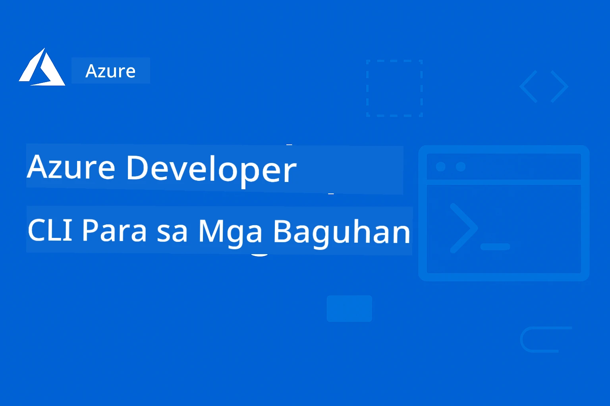

# AZD Para sa mga Nagsisimula: Isang Sistematikong Paglalakbay sa Pagkatuto

 

[](https://github.com/microsoft/AZD-for-beginners)
[](https://GitHub.com/microsoft/azd-for-beginners/network/)
[](https://github.com/microsoft/AZD-for-beginners)

[](https://discord.com/invite/nkVh3dp)
[](https://discord.gg/nTYy5BXMWG)

---

### Awtomatikong Mga Salin (Palaging Napapanahon)

<!-- CO-OP TRANSLATOR LANGUAGES TABLE START -->
[Arabic](../ar/README.md) | [Bengali](../bn/README.md) | [Bulgarian](../bg/README.md) | [Burmese (Myanmar)](../my/README.md) | [Chinese (Simplified)](../zh-CN/README.md) | [Chinese (Traditional, Hong Kong)](../zh-HK/README.md) | [Chinese (Traditional, Macau)](../zh-MO/README.md) | [Chinese (Traditional, Taiwan)](../zh-TW/README.md) | [Croatian](../hr/README.md) | [Czech](../cs/README.md) | [Danish](../da/README.md) | [Dutch](../nl/README.md) | [Estonian](../et/README.md) | [Finnish](../fi/README.md) | [French](../fr/README.md) | [German](../de/README.md) | [Greek](../el/README.md) | [Hebrew](../he/README.md) | [Hindi](../hi/README.md) | [Hungarian](../hu/README.md) | [Indonesian](../id/README.md) | [Italian](../it/README.md) | [Japanese](../ja/README.md) | [Kannada](../kn/README.md) | [Khmer](../km/README.md) | [Korean](../ko/README.md) | [Lithuanian](../lt/README.md) | [Malay](../ms/README.md) | [Malayalam](../ml/README.md) | [Marathi](../mr/README.md) | [Nepali](../ne/README.md) | [Nigerian Pidgin](../pcm/README.md) | [Norwegian](../no/README.md) | [Persian (Farsi)](../fa/README.md) | [Polish](../pl/README.md) | [Portuguese (Brazil)](../pt-BR/README.md) | [Portuguese (Portugal)](../pt-PT/README.md) | [Punjabi (Gurmukhi)](../pa/README.md) | [Romanian](../ro/README.md) | [Russian](../ru/README.md) | [Serbian (Cyrillic)](../sr/README.md) | [Slovak](../sk/README.md) | [Slovenian](../sl/README.md) | [Spanish](../es/README.md) | [Swahili](../sw/README.md) | [Swedish](../sv/README.md) | [Tagalog (Filipino)](./README.md) | [Tamil](../ta/README.md) | [Telugu](../te/README.md) | [Thai](../th/README.md) | [Turkish](../tr/README.md) | [Ukrainian](../uk/README.md) | [Urdu](../ur/README.md) | [Vietnamese](../vi/README.md)

> **Mas Gusto Mong Mag-clone Nang Lokal?**
>
> Ang repositoryong ito ay may kasamang mahigit 50 wika na mga pagsasalin na makabuluhang nagpapalaki sa laki ng pag-download. Upang i-clone nang walang mga pagsasalin, gamitin ang sparse checkout:
>
> **Bash / macOS / Linux:**
> ```bash
> git clone --filter=blob:none --sparse https://github.com/microsoft/AZD-for-beginners.git
> cd AZD-for-beginners
> git sparse-checkout set --no-cone '/*' '!translations' '!translated_images'
> ```
>
> **CMD (Windows):**
> ```cmd
> git clone --filter=blob:none --sparse https://github.com/microsoft/AZD-for-beginners.git
> cd AZD-for-beginners
> git sparse-checkout set --no-cone "/*" "!translations" "!translated_images"
> ```
>
> Bibigyan ka nito ng lahat ng kailangan mo para matapos ang kurso nang mas mabilis ang pag-download.
<!-- CO-OP TRANSLATOR LANGUAGES TABLE END -->

## 🆕 Ano'ng Bago sa azd Ngayon

> 📌 **AI CLI release review (2026-11-04):** Sinuri ang gabay laban sa inilathalang **`azd 1.37.2`**, **agents `1.0.0-beta.23`**, at **evaluations `1.0.0-beta.2`** dokumentasyon/source. Gamitin ang `azd >= 1.37.0` para sa pinagsamang workflow. Patakbuhin ang `azd version` at [i-update ang core CLI](https://learn.microsoft.com/azure/developer/azure-developer-cli/install-azd) bago ang mga extension. Tingnan ang [mga pagbabagong release at pag-aayos](docs/chapter-08-production/production-ai-practices.md#recent-release-changes-and-fixes). Ito ay hindi isang live na pag-validate ng deployment sa buong kurso.

Sinusuportahan ng Azure Developer CLI ang maraming uri ng aplikasyon, kabilang ang web apps, APIs, at AI agents, sa pamamagitan ng suportadong mga host, template, at extension.

Narito ang ibig sabihin nito para sa iyo:

- **Ang mga AI agent ay ngayon mga first-class na azd workload.** Maaari mong simulan, i-deploy, at pamahalaan ang mga proyekto ng AI agent gamit ang parehong `azd init` → `azd up` workflow na alam mo na.
- **Isang lifecycle ng agent sa dalawang extension.** Gamitin ang `azure.ai.agents` upang simulan, tawagin, i-optimize, at i-retire ang mga agent. I-install ang **`azure.ai.evaluations`** nang hiwalay para sa `azd ai eval init`, `generate`, at `run start`. Pinalitan ng Agents beta.22 ang legacy evaluation workflow at binago ang configuration ng optimization; sundin ang [migration guide](docs/chapter-08-production/production-ai-practices.md#evaluation-migration-and-quality-checks).
- **Mga bagong AI building blocks.** Ang mga bagong preview extension—`azure.ai.skills` at `azure.ai.connections`—ay nagpapahintulot sa pamamahala ng reusable na kakayahan ng agent at Foundry connections nang direkta sa azd.
- **Integrasyon ng Microsoft Foundry** na nagdadala ng model deployment, agent hosting, at AI service configuration direkta sa azd template ecosystem.
- **Mas maayos na pang-araw-araw na mga pangunahing gawain.** Ang mga kamakailang release ay ginawang idempotent ang `azd init` (ligtas na patakbuhin muli), awtomatikong nililinis ng `azd auth login` ang mga lumang token, at nagdagdag ng magiliw na unang-run setup prompt sa `azd tool`.
- **Hindi nagbago ang pangunahing workflow.** Kahit na nag-de-deploy ka ng todo app, microservice, o multi-agent AI solution, pareho lang ang mga utos.

> **Tandaan para sa mga gumagamit ng Aspire:** Tinatawag na lamang ngayon ng Microsoft ang produkto bilang **Aspire** (dati ".NET Aspire"). Hindi nagbago ang suporta ng azd para sa Aspire—ang pangalan lang ang na-update.

Kung nakagamit ka na ng azd dati, ang suporta para sa AI ay isang natural na extension—hindi isang hiwalay na tool o advanced na track. Kung nagsisimula ka pa lamang, matututuhan mo lang ang isang workflow na gumagana para sa lahat.

---

## 🚀 Ano ang Azure Developer CLI (azd)?

**Azure Developer CLI (azd)** ay isang kaibig-ibig sa developer na command-line tool na nagpapadali upang i-deploy ang mga aplikasyon sa Azure. Sa halip na manu-manong gumawa at mag-ugnay ng maraming Azure resources, maaari mong i-deploy ang buong aplikasyon gamit ang isang utos lamang.

### Ang Mahika ng `azd up`

```bash
# This single command does everything:
# ✅ Creates all Azure resources  
# ✅ Configures networking and security
# ✅ Builds your application code
# ✅ Deploys to Azure
# ✅ Gives you a working URL
azd up
```

Nagbibigay ang template ng configuration para sa aplikasyon at imprastraktura. Kinakailangan pa rin ang matagumpay na deployment ng mga suportadong serbisyo/mga modelo, sapat na quota at permiso, tamang input, at pag-verify ng na-deploy na aplikasyon. Hindi awtomatikong ginagawang secure, compliant, o production-ready ng `azd up` ang isang template.

---

## ❓ Azure Developer CLI vs Azure CLI: Ano ang Pagkakaiba?

Ito ang pinakakaraniwang tanong ng mga nagsisimula. Narito ang simpleng sagot:

| Katangian | **Azure CLI (`az`)** | **Azure Developer CLI (`azd`)** |
|---------|---------------------|--------------------------------|
| **Layunin** | Pamahalaan ang indibidwal na Azure resource | I-deploy ang mga kumpletong aplikasyon |
| **Panawagan** | Nakatuon sa imprastraktura | Nakatuon sa aplikasyon |
| **Halimbawa** | `az webapp create --name myapp...` | `azd up` |
| **Antas ng Pagkatuto** | Kailangang alam ang Azure services | Kailangan lang malaman ang iyong app |
| **Pinakamainam Para sa** | DevOps, Imprastraktura | Developers, Prototyping |

### Simpleng Paghahambing

- **Azure CLI** ay parang may sarili kang lahat ng kagamitan para magtayo ng bahay - martilyo, lagari, pako. Maaari kang gumawa ng kahit ano, ngunit kailangang marunong sa konstruksyon.
- **Azure Developer CLI** ay parang kumuha ng kontratista - ilalarawan mo kung ano ang gusto mo, at sila ang bahala sa pagtatayo.

### Kailan Gamitin Ang Bawat Isa

| Sitwasyon | Gamitin Ito |
|----------|----------|
| "Gusto kong mabilis na mag-deploy ng web app" | `azd up` |
| "Kailangan ko lang gumawa ng storage account" | `az storage account create` |
| "Gumagawa ako ng full AI application" | `azd init --template azure-search-openai-demo` |
| "Kailangan kong debug ang isang partikular na Azure resource" | `az resource show` |
| "Gusto kong mag-deploy sa aking naka-configure na production environment" | Suriin muna ang configuration, access, gastos, at operational gates bago `azd up --environment production` |

### Magkasama Silang Gumagana!

Magkaibang authentication at configuration ang AZD at Azure CLI. Gamitin ang `azd auth login` para sa AZD, at `az login` kapag ang isang hook o diagnostic command ay nangangailangan ng Azure CLI. Maaari mong gamitin ang pareho:
```bash
# Deploy your app with AZD
azd up

# Then fine-tune specific resources with Azure CLI
az webapp config set --name myapp --always-on true
```

---

## 🌟 Hanapin ang Mga Template sa Awesome AZD

Huwag magsimula sa wala! Ang **Awesome AZD** ay koleksyon ng komunidad ng mga handa nang i-deploy na mga template:

| Resource | Paglalarawan |
|----------|-------------|
| 🔗 [**Awesome AZD Gallery**](https://azure.github.io/awesome-azd/) | Mag-browse ng 200+ template na may isang-click na pag-deploy |
| 🔗 [**Isumite ang Template**](https://github.com/Azure/awesome-azd/issues) | Mag-ambag ng sarili mong template sa komunidad |
| 🔗 [**GitHub Repository**](https://github.com/Azure/awesome-azd) | I-star at tuklasin ang source |

### Mga Sikat na AI Template mula sa Awesome AZD

Pumili ng isang template sa sariling walang laman na direktoryo; ang mga utos sa ibaba ay mga alternatibo. Ang panghuling `.` ay ini-initialize ang direktoryong iyon.

```bash
# RAG Chat with Microsoft Foundry Models + AI Search
azd init --template azure-search-openai-demo .

# Quick AI Chat Application
azd init --template openai-chat-app-quickstart .

# AI Agents with Foundry Agents
azd init --template get-started-with-ai-agents .
```

---

## 🎯 Pagsisimula sa 3 Hakbang

Bago ka magsimula, tiyakin na handa ang iyong makina para sa templating na gusto mong i-deploy:

**Windows:**
```powershell
.\validate-setup.ps1
```

**macOS / Linux:**
```bash
bash ./validate-setup.sh
```

Kung mayroong anumang kinakailangang tseke na pumalya, ayusin iyon muna bago magpatuloy sa mabilis na pagsisimula.

### Hakbang 1: I-install ang AZD (2 minuto)

**Windows:**
```powershell
winget install microsoft.azd
```

**macOS:**
```bash
brew tap azure/azd && brew install azd
```

**Linux:**
```bash
curl -fsSL https://aka.ms/install-azd.sh | bash
```

### Hakbang 2: Mag-authenticate para sa AZD

```bash
# Optional if you plan to use Azure CLI commands directly in this course
az login

# Required for AZD workflows
azd auth login
```

Kung hindi ka sigurado kung alin ang kailangan mo, sundan ang buong setup na daloy sa [Installation & Setup](docs/chapter-01-foundation/installation.md#authentication-setup).

### Hakbang 3: I-deploy ang Iyong Unang App

```bash
# Initialize from a template
azd init --template todo-nodejs-mongo .

# Deploy to Azure (creates everything!)
azd up
```

**🎉 Tapos na!** Live na ang iyong app sa Azure.

### Linisin (Huwag Kalimutan!)

```bash
# Remove all resources when done experimenting
azd down --force --purge
```

---

## 📚 Paano Gamitin ang Kurso na Ito

Ang kurso na ito ay disenyo para sa **hala-hala na pagkatuto** - magsimula ka sa kung saan ka komportable at umangat papunta sa mas mahirap:

| Ang Iyong Karanasan | Magsimula Dito |
|-----------------|------------|
| **Baguhan sa Azure** | [Kabanata 1: Pundasyon](#-chapter-1-foundation--quick-start) |
| **Alam ang Azure, bago sa AZD** | [Kabanata 1: Pundasyon](#-chapter-1-foundation--quick-start) |
| **Gusto mag-deploy ng AI apps** | [Kabanata 2: AI-Unang Pag-unlad](#-chapter-2-ai-first-development-recommended-for-ai-developers) |
| **Gusto ng praktikal na pagsasanay** | [🎓 Interaktibong Workshop](workshop/README.md) - 3-4 oras na guided lab |
| **Kailangan ng mga pattern sa produksyon** | [Kabanata 8: Produksyon at Enterprise](#-chapter-8-production--enterprise-patterns) |

### Mabilis na Setup

1. **I-fork ang Repositoryo**: [](https://GitHub.com/microsoft/azd-for-beginners/fork)
2. **I-clone Ito**: `git clone https://github.com/YOUR-USERNAME/azd-for-beginners.git`
3. **Humingi ng Tulong**: [Azure Discord Community](https://discord.com/invite/ByRwuEEgH4)

> **Mas Gusto Mong Mag-clone Nang Lokal?**

> Ang repositoryong ito ay may kasamang mahigit 50 wika na mga pagsasalin na makabuluhang nagpapalaki sa laki ng pag-download. Upang i-clone nang walang mga pagsasalin, gamitin ang sparse checkout:
> ```bash
> git clone --filter=blob:none --sparse https://github.com/microsoft/AZD-for-beginners.git
> cd AZD-for-beginners
> git sparse-checkout set --no-cone '/*' '!translations' '!translated_images'
> ```
> Bibigyan ka nito ng lahat ng kailangan mo para matapos ang kurso nang mas mabilis ang pag-download.


## Pangkalahatang-ideya ng Kurso

Masterin ang Azure Developer CLI (azd) sa pamamagitan ng mga istrukturadong kabanata na dinisenyo para sa progresibong pagkatuto. **Espesyal na pokus sa deployment ng AI application kasama ang Microsoft Foundry integration.**

### Bakit Mahalagang Kursong Ito para sa mga Modernong Developer

Kadalasang kailangan ng mga developer na nagde-deploy ng AI workloads ang gabay sa:
- Kumplikadong multi-service AI architectures
- Pinakamahuhusay na kasanayan sa production AI deployment  
- Azure AI service integration at configuration
- Pag-optimize ng gastos para sa AI workloads
- Pagsosolusyon sa AI-specific deployment issues

### Mga Layunin sa Pagkatuto

Sa pagtatapos ng istrukturadong kursong ito, ikaw ay:
- **Magmamaster sa AZD Fundamentals**: Mga pangunahing konsepto, pag-install, at configuration
- **Magde-deploy ng AI Applications**: Gamitin ang AZD kasama ang Microsoft Foundry services
- **Magpapatupad ng Infrastructure as Code**: Pamahalaan ang mga Azure resources gamit ang Bicep templates
- **Magsanay sa Troubleshoot ng Deployments**: Ayusin ang mga karaniwang isyu at debug ng mga problema
- **Mag-optimize para sa Production**: Seguridad, scaling, monitoring, at pamamahala ng gastos
- **Bumuo ng Multi-Agent Solutions**: Mag-deploy ng kumplikadong AI architectures

## Bago Ka Magsimula: Mga Account, Access, at Mga Palagay

Bago simulan ang Kabanata 1, tiyaking mayroon ka ng mga sumusunod. Ang mga hakbang sa pag-install sa gabay na ito ay inaasahang mayroon ka na ng mga pangunahing ito.

- **Isang Azure subscription**: Maaari kang gumamit ng umiiral nang subscription mula sa trabaho o iyong sariling account, o gumawa ng [free trial](https://aka.ms/azurefreetrial) upang makapagsimula.
- **Pahintulot na gumawa ng Azure resources**: Para sa karamihan ng mga pagsasanay, dapat mayroon kang hindi bababa sa **Contributor** access sa target na subscription o resource group. Ang ilang kabanata ay maaaring mag-assume rin na kaya mong gumawa ng resource groups, managed identities, at RBAC assignments.
- [**Isang GitHub account**](https://github.com): Mahalaga ito para mag-fork ng repository, subaybayan ang sariling mga pagbabago, at gamitin ang GitHub Codespaces para sa workshop.
- **Mga kinakailangan sa runtime ng template**: May ilang templates na nangangailangan ng lokal na mga tool tulad ng Node.js, Python, Java, o Docker. Patakbuhin ang setup validator bago magsimula para matuklasan agad ang mga nawawalang tool.
- **Pangunahing pamilyar sa terminal**: Hindi mo kailangang maging eksperto, ngunit dapat kang komportable sa pagpapatakbo ng mga utos tulad ng `git clone`, `azd auth login`, at `azd up`.

> **Nagtatrabaho sa isang enterprise subscription?**
> Kung ang iyong Azure environment ay pinamamahalaan ng isang administrator, siguraduhing maaari kang mag-deploy ng mga resource sa subscription o resource group na balak mong gamitin. Kung hindi, humiling ng sandbox subscription o Contributor access bago ka magsimula.

> **Bago sa Azure?**
> Magsimula gamit ang sariling Azure trial o pay-as-you-go subscription sa https://aka.ms/azurefreetrial para makumpleto ang mga pagsasanay nang tuloy-tuloy nang walang paghihintay sa approval ng tenant-level.

## 🗺️ Mapa ng Kurso: Mabilis na Pag-navigate Ayon sa Kabanata

Bawat kabanata ay may nakalaang README na may mga layunin sa pagkatuto, mabilisang pagsisimula, at mga pagsasanay:

| Kabanata | Paksa | Mga Aralin | Tagal | Kompleksidad |
|---------|-------|---------|----------|------------|
| **[Ch 1: Foundation](docs/chapter-01-foundation/README.md)** | Pagsisimula | [AZD Basics](docs/chapter-01-foundation/azd-basics.md) &#124; [Installation](docs/chapter-01-foundation/installation.md) &#124; [First Project](docs/chapter-01-foundation/first-project.md) | 30-45 min | ⭐ |
| **[Ch 2: AI Development](docs/chapter-02-ai-development/README.md)** | AI-First Apps | [Foundry Integration](docs/chapter-02-ai-development/microsoft-foundry-integration.md) &#124; [AI Agents](docs/chapter-02-ai-development/agents.md) &#124; [Model Deployment](docs/chapter-02-ai-development/ai-model-deployment.md) &#124; [Workshop](docs/chapter-02-ai-development/ai-workshop-lab.md) | 1-2 hrs | ⭐⭐ |
| **[Ch 3: Configuration](docs/chapter-03-configuration/README.md)** | Auth & Security | [Configuration](docs/chapter-03-configuration/configuration.md) &#124; [Auth & Security](docs/chapter-03-configuration/authsecurity.md) | 45-60 min | ⭐⭐ |
| **[Ch 4: Infrastructure](docs/chapter-04-infrastructure/README.md)** | IaC & Deployment | [Deployment Guide](docs/chapter-04-infrastructure/deployment-guide.md) &#124; [Provisioning](docs/chapter-04-infrastructure/provisioning.md) | 1-1.5 hrs | ⭐⭐⭐ |
| **[Ch 5: Multi-Agent](docs/chapter-05-multi-agent/README.md)** | AI Agent Solutions | [Retail Scenario](examples/retail-scenario.md) &#124; [Coordination Patterns](docs/chapter-06-pre-deployment/coordination-patterns.md) | 2-3 hrs | ⭐⭐⭐⭐ |
| **[Ch 6: Pre-Deployment](docs/chapter-06-pre-deployment/README.md)** | Planning & Validation | [Preflight Checks](docs/chapter-06-pre-deployment/preflight-checks.md) &#124; [Capacity Planning](docs/chapter-06-pre-deployment/capacity-planning.md) &#124; [SKU Selection](docs/chapter-06-pre-deployment/sku-selection.md) &#124; [App Insights](docs/chapter-06-pre-deployment/application-insights.md) | 1 hr | ⭐⭐ |
| **[Ch 7: Troubleshooting](docs/chapter-07-troubleshooting/README.md)** | Debug & Fix | [Common Issues](docs/chapter-07-troubleshooting/common-issues.md) &#124; [Debugging](docs/chapter-07-troubleshooting/debugging.md) &#124; [AI Issues](docs/chapter-07-troubleshooting/ai-troubleshooting.md) | 1-1.5 hrs | ⭐⭐ |
| **[Ch 8: Production](docs/chapter-08-production/README.md)** | Enterprise Patterns | [Production Practices](docs/chapter-08-production/production-ai-practices.md) | 2-3 hrs | ⭐⭐⭐⭐ |
| **[🎓 Workshop](workshop/README.md)** | Hands-On Lab | [Introduction](workshop/docs/instructions/0-Introduction.md) &#124; [Selection](workshop/docs/instructions/1-Select-AI-Template.md) &#124; [Validation](workshop/docs/instructions/2-Validate-AI-Template.md) &#124; [Deconstruction](workshop/docs/instructions/3-Deconstruct-AI-Template.md) &#124; [Configuration](workshop/docs/instructions/4-Configure-AI-Template.md) &#124; [Customization](workshop/docs/instructions/5-Customize-AI-Template.md) &#124; [Teardown](workshop/docs/instructions/6-Teardown-Infrastructure.md) &#124; [Wrap-up](workshop/docs/instructions/7-Wrap-up.md) | 3-4 hrs | ⭐⭐ |

**Kabuuang Tagal ng Kurso:** ~10-14 na oras | **Pag-unlad ng Kasanayan:** Baguhan → Handang Production

---

## 📚 Mga Kabanata sa Pagkatuto

*Piliin ang iyong landas sa pagkatuto base sa antas ng karanasan at mga layunin*

### 🚀 Kabanata 1: Foundation & Quick Start
**Mga Kinakailangan**: Azure subscription, pangunahing kaalaman sa command line  
**Tagal**: 30-45 minuto  
**Kompleksidad**: ⭐

#### Ano ang Matututuhan Mo
- Pag-unawa sa mga pundasyon ng Azure Developer CLI
- Pag-install ng AZD sa iyong platform
- Ang iyong unang matagumpay na deployment

#### Mga Pinagkukunan ng Pagkatuto
- **🎯 Magsimula Dito**: [Ano ang Azure Developer CLI?](#-what-is-azure-developer-cli-azd)
- **📖 Teorya**: [AZD Basics](docs/chapter-01-foundation/azd-basics.md) - Mga pangunahing konsepto at terminolohiya
- **⚙️ Setup**: [Installation & Setup](docs/chapter-01-foundation/installation.md) - Mga gabay para sa partikular na platform
- **🛠️ Hands-On**: [Iyong Unang Proyekto](docs/chapter-01-foundation/first-project.md) - Sunud-sunod na tutorial
- **📋 Quick Reference**: [Command Cheat Sheet](resources/cheat-sheet.md)

#### Mga Praktikal na Pagsasanay
```bash
# Quick installation check
azd version

# Deploy your first application
azd init --template todo-nodejs-mongo .
azd up
```

**💡 Kinalabasan ng Kabanata**: Matagumpay na mag-deploy ng isang simpleng web application sa Azure gamit ang AZD

**✅ Pagpapatunay ng Tagumpay:**
```bash
# After completing Chapter 1, you should be able to:
azd version              # Shows installed version
azd init --template todo-nodejs-mongo  # Initializes project
azd up                  # Deploys to Azure
azd show                # Displays running app URL
# Application opens in browser and works
azd down --force --purge  # Cleans up resources
```

**📊 Oras na Inilaan:** 30-45 minuto  
**📈 Antas ng Kasanayan Pagkatapos:** Kayang mag-deploy ng mga batayang aplikasyon nang mag-isa

---

### 🤖 Kabanata 2: AI-First Development (Inirerekomenda para sa mga AI Developer)
**Mga Kinakailangan**: Natapos ang Kabanata 1  
**Tagal**: 1-2 oras  
**Kompleksidad**: ⭐⭐

#### Ano ang Matututuhan Mo
- Microsoft Foundry integration gamit ang AZD
- Pag-deploy ng AI-powered applications
- Pag-unawa sa AI service configurations

#### Mga Pinagkukunan ng Pagkatuto
- **🎯 Magsimula Dito**: [Microsoft Foundry Integration](docs/chapter-02-ai-development/microsoft-foundry-integration.md)
- **🤖 AI Agents**: [AI Agents Guide](docs/chapter-02-ai-development/agents.md) - Mag-deploy ng matatalinong ahente gamit ang AZD
- **📖 Mga Pattern**: [AI Model Deployment](docs/chapter-02-ai-development/ai-model-deployment.md) - Mag-deploy at pamahalaan ang mga AI modelo
- **🛠️ Workshop**: [AI Workshop Lab](docs/chapter-02-ai-development/ai-workshop-lab.md) - Gawing handa ang iyong AI solutions para sa AZD
- **🎥 Interaktibong Gabay**: [Workshop Materials](workshop/README.md) - Pagkatuto sa browser gamit ang MkDocs * DevContainer Environment
- **📋 Mga Template**: [Microsoft Foundry Templates](#featured-microsoft-foundry-templates)
- **📝 Mga Halimbawa**: [AZD Deployment Examples](examples/README.md)

#### Mga Praktikal na Pagsasanay
```bash
# Deploy your first AI application
azd init --template azure-search-openai-demo .
azd up

# Try additional AI templates
azd init --template openai-chat-app-quickstart .
azd init --template agent-openai-python-prompty .
```

**💡 Kinalabasan ng Kabanata**: Mag-deploy at mag-configure ng AI-powered chat application na may RAG capabilities

**✅ Pagpapatunay ng Tagumpay:**
```bash
# After Chapter 2, you should be able to:
azd init --template azure-search-openai-demo .
azd up
# Test the AI chat interface
# Ask questions and get AI-powered responses with sources
# Verify search integration works
azd monitor  # Check Application Insights shows telemetry
azd down --force --purge
```

**📊 Oras na Inilaan:** 1-2 oras  
**📈 Antas ng Kasanayan Pagkatapos:** Kayang mag-deploy ng AI learning applications at matukoy ang karagdagang production-readiness requirements
**💰 Kamalayan sa Gastos:** Nauunawaan ang $80-150/buwan na gastusing pang-develop, $300-3500/buwan na gastusing production

#### 💰 Mga Pagsasaalang-alang sa Gastos para sa AI Deployments

**Development Environment (Tinatayang $80-150/buwan):**
- Microsoft Foundry Models (Pay-as-you-go): $0-50/buwan (batay sa token usage)
- AI Search (Basic tier): $75/buwan
- Container Apps (Consumption): $0-20/buwan
- Storage (Standard): $1-5/buwan

**Production Environment (Tinatayang $300-3,500+/buwan):**
- Microsoft Foundry Models (PTU para sa consistent performance): $3,000+/buwan O Pay-as-go na may mataas na volume
- AI Search (Standard tier): $250/buwan
- Container Apps (Dedicated): $50-100/buwan
- Application Insights: $5-50/buwan
- Storage (Premium): $10-50/buwan

**💡 Mga Tip sa Pag-optimize ng Gastos:**
- Suriin ang presyo ng model inference at mga kredito base sa account; ang Azure OpenAI ay walang universal na 50,000-token buwanang libreng allowance
- Patakbuhin ang `azd down` para tanggalin ang mga resources kapag hindi na kailangan, pagkatapos suriin ang napiling environment
- Magsimula sa consumption-based billing, i-upgrade lamang sa PTU para sa production
- Gamitin ang `azd provision --preview` para inspeksyunin ang planadong infrastructure, pagkatapos kalkulahin ang presyo ng mga resultang resources gamit ang Azure Pricing Calculator
- I-enable ang auto-scaling: magbayad lamang para sa totoong paggamit

**Pagsubaybay sa Gastos:**
```bash
# Inspect planned resources (this does not calculate prices)
azd provision --preview

# Monitor actual costs in Azure Portal
az consumption budget list --resource-group <your-rg>
```

---

### ⚙️ Kabanata 3: Configuration & Authentication
**Mga Kinakailangan**: Natapos ang Kabanata 1  
**Tagal**: 45-60 minuto  
**Kompleksidad**: ⭐⭐

#### Ano ang Matututuhan Mo
- Configuration at pamamahala ng environment
- Pinakamahuhusay na kasanayan sa authentication at seguridad
- Pangalanan at organisahin ang mga resource

#### Mga Pinagkukunan ng Pagkatuto
- **📖 Configuration**: [Configuration Guide](docs/chapter-03-configuration/configuration.md) - Pagsasaayos ng environment
- **🔐 Seguridad**: [Authentication patterns and managed identity](docs/chapter-03-configuration/authsecurity.md) - Mga pattern ng authentication
- **📝 Mga Halimbawa**: [Database App Example](examples/database-app/README.md) - Mga halimbawa ng AZD Database

#### Mga Praktikal na Pagsasanay
- Mag-configure ng iba't ibang environment (dev, staging, prod)
- Mag-set up ng managed identity authentication
- Magpatupad ng mga configurations na partikular sa environment

**💡 Kinalabasan ng Kabanata**: Pamahalaan ang maraming environment na may tamang authentication at seguridad

---

### 🏗️ Kabanata 4: Infrastructure as Code & Deployment
**Mga Kinakailangan**: Natapos ang Kabanata 1-3  
**Tagal**: 1-1.5 oras  
**Kompleksidad**: ⭐⭐⭐

#### Ano ang Matututuhan Mo
- Mga advanced na pattern sa deployment
- Infrastructure as Code gamit ang Bicep
- Mga istratehiya sa provisioning ng resource

#### Mga Pinagkukunan ng Pagkatuto
- **📖 Deployment**: [Deployment Guide](docs/chapter-04-infrastructure/deployment-guide.md) - Mga kumpletong workflow
- **🏗️ Provisioning**: [Provisioning Resources](docs/chapter-04-infrastructure/provisioning.md) - Pamamahala ng mga Azure resource
- **📝 Mga Halimbawa**: [Container App Example](../../examples/container-app) - Containerized deployments

#### Mga Praktikal na Pagsasanay
- Gumawa ng custom na Bicep templates
- Mag-deploy ng multi-service applications
- Magpatupad ng mga blue-green deployment strategies

**💡 Kinalabasan ng Kabanata**: Mag-deploy ng kumplikadong multi-service applications gamit ang custom infrastructure templates

---

### 🎯 Kabanata 5: Multi-Agent AI Solutions (Advanced)
**Mga Kinakailangan**: Natapos ang Kabanata 1-2  
**Tagal**: 2-3 oras  
**Kompleksidad**: ⭐⭐⭐⭐

#### Ano ang Matututuhan Mo
- Mga pattern ng multi-agent architecture
- Orkestrasyon at koordinasyon ng mga ahente
- Production-ready AI deployments

#### Mga Pinagkukunan ng Pagkatuto
- **🤖 Tampok na Disenyo**: [Retail Multi-Agent Solution](examples/retail-scenario.md) - Blueprint ng arkitektura, hindi isang kumpletong aplikasyon
- **🛠️ ARM Templates**: [ARM Template Package](../../examples/retail-multiagent-arm-template) - Scaffold ng imprastruktura; suriin ang mga paunang kinakailangan at nawawalang mga bahagi ng aplikasyon
- **📖 Arkitektura**: [Mga pattern ng koordinasyon ng multi-ahente](docs/chapter-06-pre-deployment/coordination-patterns.md) - Mga pattern

#### Mga Praktikal na Ehersisyo
```bash
# Inspect the retail infrastructure scaffold before choosing to deploy it
cd examples/retail-multiagent-arm-template
cat README.md

# After an intentional deployment, inspect infrastructure state
az deployment group show --resource-group <rg-name> --name <deployment-name>
```

**💡 Kinalabasan ng Kabanata**: Maunawaan ang disenyo ng multi-ahente at tukuyin ang implementasyon, beripikasyon, at operasyonal na gawain na kailangan lampas sa scaffold ng imprastruktura

---

### 🔍 Kabanata 6: Pre-Deployment Validation at Pagpaplano
**Mga Paunang Kinakailangan**: Natapos ang Kabanata 4  
**Tagal**: 1 oras  
**Kompleksidad**: ⭐⭐

#### Mga Matututunan Mo
- Pagpaplano ng kapasidad at beripikasyon ng mga resources
- Mga estratehiya sa pagpili ng SKU
- Mga pre-flight check at awtomasyon

#### Mga Mapagkukunang Pampagkatuto
- **📊 Pagpaplano**: [Capacity Planning](docs/chapter-06-pre-deployment/capacity-planning.md) - Beripikasyon ng resources
- **💰 Pagpili**: [SKU Selection](docs/chapter-06-pre-deployment/sku-selection.md) - Mga cost-effective na pagpipilian
- **✅ Beripikasyon**: [Pre-flight Checks](docs/chapter-06-pre-deployment/preflight-checks.md) - Mga automated na script

#### Mga Praktikal na Ehersisyo
- Patakbuhin ang mga capacity validation script
- I-optimize ang mga pagpili ng SKU para sa gastos
- Ipatupad ang automated na mga pre-deployment check

**💡 Kinalabasan ng Kabanata**: Beripikahin at i-optimize ang mga deployment bago isagawa

---

### 🚨 Kabanata 7: Troubleshooting at Pag-debug
**Mga Paunang Kinakailangan**: Nakumpleto ang anumang kabanata ng deployment  
**Tagal**: 1-1.5 na oras  
**Kompleksidad**: ⭐⭐

#### Mga Matututunan Mo
- Sistematikong mga pamamaraan ng pag-debug
- Mga karaniwang isyu at mga solusyon
- Troubleshooting na tukoy sa AI

#### Mga Mapagkukunang Pampagkatuto
- **🔧 Karaniwang Mga Isyu**: [Common Issues](docs/chapter-07-troubleshooting/common-issues.md) - FAQ at mga solusyon
- **🕵️ Pag-debug**: [Debugging Guide](docs/chapter-07-troubleshooting/debugging.md) - Mga hakbang-hakbang na estratehiya
- **🤖 Mga Isyu sa AI**: [AI-Specific Troubleshooting](docs/chapter-07-troubleshooting/ai-troubleshooting.md) - Mga problema sa serbisyo ng AI

#### Mga Praktikal na Ehersisyo
- Suriin ang mga kabiguan sa deployment
- Lutasin ang mga isyu sa authentication
- I-debug ang konektibidad sa serbisyo ng AI

**💡 Kinalabasan ng Kabanata**: Mag-diagnose at mag-resolba nang mag-isa ng mga karaniwang problema sa deployment

---

### 🏢 Kabanata 8: Mga Pattern para sa Produksyon at Enterprise
**Mga Paunang Kinakailangan**: Natapos ang mga Kabanata 1-4  
**Tagal**: 2-3 oras  
**Kompleksidad**: ⭐⭐⭐⭐

#### Mga Matututunan Mo
- Mga estratehiya sa production deployment
- Mga pattern ng seguridad sa enterprise
- Monitoring at pag-optimize ng gastos

#### Mga Mapagkukunang Pampagkatuto
- **🏭 Produksyon**: [Production AI Best Practices](docs/chapter-08-production/production-ai-practices.md) - Mga pattern ng enterprise
- **📝 Mga Halimbawa**: [Microservices Example](../../examples/microservices) - Komplikadong mga arkitektura
- **📊 Monitoring**: [Application Insights integration](docs/chapter-06-pre-deployment/application-insights.md) - Monitoring

#### Mga Praktikal na Ehersisyo
- Ipatupad ang mga pattern ng seguridad sa enterprise
- Mag-set up ng komprehensibong monitoring
- Mag-deploy sa produksyon na may wastong pamamahala

**💡 Kinalabasan ng Kabanata**: Mag-deploy ng mga application na handa para sa enterprise na may buong kakayahan para sa produksyon

---

## 🎓 Pangkalahatang-ideya ng Workshop: Hands-On Learning Experience

> **⚠️ STATUS NG WORKSHOP: Aktibong Pag-unlad**  
> Ang mga materyales ng workshop ay kasalukuyang dine-develop at pinapaganda. Gumagana na ang mga pangunahing module, ngunit may ilang advanced na bahagi na hindi pa kumpleto. Aktibong ginagawa ang lahat ng nilalaman. [Subaybayan ang progreso →](workshop/README.md)

### Interactive Workshop Materials
**Komprehensibong hands-on learning gamit ang mga browser-based na tool at mga ginagabayang ehersisyo**

Ang aming mga materyales sa workshop ay nagbibigay ng isang estrukturadong, interactive na karanasan sa pag-aaral na nagsisilbing dagdag sa curriculum na naka-base sa mga kabanata sa itaas. Ang workshop ay dinisenyo para sa parehong self-paced learning at instructor-led na mga sesyon.

#### 🛠️ Mga Tampok ng Workshop
- **Browser-Based Interface**: Kumpletong MkDocs-powered na workshop na may paghahanap, pagkopya, at mga tema na tampok
- **GitHub Codespaces Integration**: Isang-click na pag-setup ng development environment
- **Structured Learning Path**: 8-module guided na mga ehersisyo (3-4 na oras kabuuan)
- **Progressive Methodology**: Panimula → Pagpili → Beripikasyon → Dekonstruksyon → Konfigurasyon → Pagpapasadya → Pag-aalis → Pagtatapos
- **Interactive DevContainer Environment**: Pre-configured na mga tool at dependencies

#### 📚 Estruktura ng Mga Module sa Workshop
Ang workshop ay sumusunod sa isang **8-module progressive methodology** na gagabay sa iyo mula sa pagtuklas hanggang sa mastery ng deployment:

| Module | Paksa | Ano ang Gagawin Mo | Tagal |
|--------|-------|----------------|----------|
| **0. Panimula** | Pangkalahatang-ideya ng Workshop | Unawain ang mga layunin ng pagkatuto, mga paunang kinakailangan, at estruktura ng workshop | 15 min |
| **1. Pagpili** | Pagtuklas ng Template | Galugarin ang mga AZD template at piliin ang tamang AI template para sa iyong sitwasyon | 20 min |
| **2. Beripikasyon** | Deployment at Pagberipika | I-deploy ang template gamit ang `azd up` at beripikahin na gumagana ang imprastruktura | 30 min |
| **3. Dekonstruksyon** | Unawain ang Estruktura | Gamitin ang GitHub Copilot para tuklasin ang arkitektura ng template, mga file ng Bicep, at organisasyon ng code | 30 min |
| **4. Konfigurasyon** | Malalim na Pagtingin sa azure.yaml | Maging dalubhasa sa konfigurasyon ng `azure.yaml`, lifecycle hooks, at mga environment variable | 30 min |
| **5. Pagpapasadya** | Gawing Iyo | Paganahin ang AI Search, tracing, evaluation, at i-customize para sa iyong sitwasyon | 45 min |
| **6. Pag-aalis** | Paglinis | Ligtas na i-deprovision ang mga resources gamit ang `azd down --purge` | 15 min |
| **7. Pagtatapos** | Mga Susunod na Hakbang | Balikan ang mga nagawa, mga pangunahing konsepto, at ipagpatuloy ang iyong paglalakbay sa pagkatuto | 15 min |

**Daloy ng Workshop:**
```
Introduction → Selection → Validation → Deconstruction → Configuration → Customization → Teardown → Wrap-up
     ↓            ↓           ↓              ↓               ↓              ↓            ↓           ↓
  Overview    Find the     Deploy &      Explore        Master         Customize     Clean up    Review &
             right        verify        code &        azure.yaml      for your      resources   next steps
             template                   structure                     scenario
```

#### 🚀 Pagsisimula sa Workshop
```bash
# Option 1: GitHub Codespaces (Recommended)
# Click "Code" → "Create codespace on main" in the repository

# Option 2: Local Development
git clone https://github.com/microsoft/azd-for-beginners.git
cd azd-for-beginners/workshop
# Follow the setup instructions in workshop/README.md
```

#### 🎯 Mga Kinalabasan ng Pagkatuto sa Workshop
Sa pagtatapos ng workshop, ang mga kalahok ay:
- **Mag-deploy ng Production AI Applications**: Gamitin ang AZD kasama ang Microsoft Foundry services
- **Maging Master sa Multi-Agent Architectures**: Ipatupad ang mga koordinadong solusyon ng AI agent
- **Ipatupad ang Mga Best Practice sa Seguridad**: I-configure ang authentication at access control
- **I-optimize para sa Sukat**: Disenyo ng cost-effective, mataas na performance na mga deployment
- **Mag-troubleshoot ng Deployments**: Malutas ang mga karaniwang isyu nang mag-isa

#### 📖 Mga Mapagkukunang Pampagkatuto sa Workshop
- **🎥 Interactive Guide**: [Workshop Materials](workshop/README.md) - Browser-based na learning environment
- **📋 Mga Tagubilin Module-by-Module**:
  - [0. Panimula](workshop/docs/instructions/0-Introduction.md) - Pangkalahatang-ideya ng workshop at mga layunin
  - [1. Pagpili](workshop/docs/instructions/1-Select-AI-Template.md) - Humanap at piliin ang AI templates
  - [2. Beripikasyon](workshop/docs/instructions/2-Validate-AI-Template.md) - Deployment at beripikasyon ng mga template
  - [3. Dekonstruksyon](workshop/docs/instructions/3-Deconstruct-AI-Template.md) - Tuklasin ang arkitektura ng template
  - [4. Konfigurasyon](workshop/docs/instructions/4-Configure-AI-Template.md) - Maging dalubhasa sa azure.yaml
  - [5. Pagpapasadya](workshop/docs/instructions/5-Customize-AI-Template.md) - I-customize para sa iyong sitwasyon
  - [6. Pag-aalis](workshop/docs/instructions/6-Teardown-Infrastructure.md) - Linisin ang mga resources
  - [7. Pagtatapos](workshop/docs/instructions/7-Wrap-up.md) - Balikan at mga susunod na hakbang
- **🛠️ AI Workshop Lab**: [AI Workshop Lab](docs/chapter-02-ai-development/ai-workshop-lab.md) - Mga ehersisyong nakatuon sa AI
- **💡 Quick Start**: [Workshop Setup Guide](workshop/README.md#browser-based-guide) - Konfigurasyon ng environment

**Tamang-tama para sa**: Corporate training, mga kurso sa unibersidad, self-paced learning, at developer bootcamps.

---

## 📖 Malalim na Pagsusuri: Mga Kakayahan ng AZD

Lampas sa mga batayan, nagbibigay ang AZD ng makapangyarihang mga tampok para sa production deployments:

- **Deployment gamit ang template** - Gamitin ang mga pre-built na template para sa mga karaniwang pattern ng aplikasyon
- **Infrastructure as Code** - Pamahalaan ang mga Azure resources gamit ang Bicep o Terraform  
- **Integrated workflows** - Tuluy-tuloy na pag-provision, deployment, at pag-monitor ng mga aplikasyon
- **Developer-friendly** - Na-optimize para sa produktibidad at karanasan ng developer

### **AZD + Microsoft Foundry: Perpekto para sa AI Deployments**

**Bakit AZD para sa mga Solusyon sa AI?** Tinatalakay ng AZD ang mga pangunahing hamon na hinaharap ng mga AI developer:

- **AI-Ready Templates** - Mga pre-configured na template para sa Microsoft Foundry Models, Azure AI Services, at mga ML workload
- **Secure AI Deployments** - Mga built-in na security pattern para sa AI services, mga API key, at mga endpoint ng modelo  
- **Production AI Patterns** - Mga best practice para sa scalable, cost-effective na AI application deployment
- **End-to-End AI Workflows** - Mula sa pag-develop ng modelo hanggang sa production deployment na may wastong monitoring
- **Cost Optimization** - Matalinong paglalaan ng resources at mga estratehiya sa scaling para sa mga AI workload
- **Microsoft Foundry Integration** - Tuluy-tuloy na koneksyon sa Microsoft Foundry model catalog at mga endpoint

---

## 🎯 Templates at Library ng mga Halimbawa

### Tampok: Microsoft Foundry Templates
**Magsimula dito kung magde-deploy ka ng mga AI application!**

> **Tandaan:** Ipinapakita ng mga templating ito ang iba’t ibang AI pattern. Ang ilan ay mga panlabas na Azure Samples, ang iba ay lokal na mga implementasyon.

| Template | Kabanata | Kompleksidad | Mga Serbisyo | Uri |
|----------|---------|------------|----------|------|
| [**Magsimula sa AI chat**](https://github.com/Azure-Samples/get-started-with-ai-chat) | Kabanata 2 | ⭐⭐ | AzureOpenAI + Azure AI Model Inference API + Azure AI Search + Azure Container Apps + Application Insights | Panlabas |
| [**Magsimula sa AI agents**](https://github.com/Azure-Samples/get-started-with-ai-agents) | Kabanata 2 | ⭐⭐ | Foundry Agents + AzureOpenAI + Azure AI Search + Azure Container Apps + Application Insights| Panlabas |
| [**Azure Search + OpenAI Demo**](https://github.com/Azure-Samples/azure-search-openai-demo) | Kabanata 2 | ⭐⭐ | Azure OpenAI + Azure AI Search + Container Apps (default) + Storage | Panlabas |
| [**OpenAI Chat App Quickstart**](https://github.com/Azure-Samples/openai-chat-app-quickstart) | Kabanata 2 | ⭐ | AzureOpenAI + Container Apps + Application Insights | Panlabas |
| [**Agent OpenAI Python Prompty**](https://github.com/Azure-Samples/agent-openai-python-prompty) | Kabanata 5 | ⭐⭐⭐ | AzureOpenAI + Azure Functions + Prompty | Panlabas |
| [**Contoso Chat RAG**](https://github.com/Azure-Samples/contoso-chat) | Kabanata 8 | ⭐⭐⭐⭐ | AzureOpenAI + AI Search + Cosmos DB + Container Apps | Panlabas |
| [**Retail Multi-Agent Solution**](examples/retail-scenario.md) | Kabanata 5 | ⭐⭐⭐⭐ | Iminungkahing arkitektura at scaffold ng imprastruktura; kinakailangan ang implementasyon ng aplikasyon | **Lokal na blueprints** |

### Tampok: Kumpletong Mga Scenario ng Pagkatuto
**Mga template ng aplikasyon na handa para sa produksyon na nakatugma sa mga kabanata ng pagkatuto**

| Template | Kabanata ng Pagkatuto | Kompleksidad | Pangunahing Natutunan |
|----------|------------------|------------|--------------|
| [**openai-chat-app-quickstart**](https://github.com/Azure-Samples/openai-chat-app-quickstart) | Kabanata 2 | ⭐ | Mga batayang pattern ng deployment ng AI |
| [**azure-search-openai-demo**](https://github.com/Azure-Samples/azure-search-openai-demo) | Kabanata 2 | ⭐⭐ | RAG implementation gamit ang Azure AI Search |
| [**get-started-with-ai-agents**](https://github.com/Azure-Samples/get-started-with-ai-agents) | Kabanata 2 | ⭐⭐ | Agent-backed chat at mga sample-specific na pagsusuri |
| [**agent-openai-python-prompty**](https://github.com/Azure-Samples/agent-openai-python-prompty) | Kabanata 5 | ⭐⭐⭐ | Agent framework at pagtawag sa mga function |
| [**contoso-chat**](https://github.com/Azure-Samples/contoso-chat) | Kabanata 8 | ⭐⭐⭐ | Enterprise AI orchestration |
| [**retail-multi-agent-solution**](examples/retail-scenario.md) | Kabanata 5 | ⭐⭐⭐⭐ | Multi-agent architecture na may Customer at Inventory agents |

### Pagkatuto sa Pamamagitan ng Uri ng Halimbawa

> **📌 Lokal vs. Panlabas na Mga Halimbawa:**  
> **Lokal na Mga Halimbawa** (sa repo na ito) = Suriin ang README ng halimbawa para sa status ng implementasyon at mga paunang kinakailangan
> **Panlabas na Mga Halimbawa** (Azure Samples) = I-clone mula sa mga naka-link na repositoryo

#### Lokal na Mga Halimbawa (Handa nang Gamitin)
- [**Retail Multi-Agent Solution**](examples/retail-scenario.md) - Blueprint ng arkitektura na may ARM infrastructure scaffold
  - Iminungkahing mga role ng Customer at Inventory agent
  - Kailangan ipatupad at beripikahin ang monitoring, evaluation, at application code
  - Ang pagprovision ng mga resources lamang ay hindi nagreresulta sa gumaganang retail application

#### Lokal na Mga Halimbawa - Container Applications (Mga Kabanata 2-5)
**Komprehensibong mga halimbawa ng deployment ng container sa repository na ito:**
- [**Container App Examples**](examples/container-app/README.md) - Kumpletong gabay sa containerized deployments
  - [Simple Flask API](../../examples/container-app/simple-flask-api) - Batayang REST API na may scale-to-zero
  - [Microservices Architecture](../../examples/container-app/microservices) - Two-service learning sample; karagdagang trabaho ang production hardening
  - Quick Start, Production, at Advanced na pattern ng deployment
  - Mga gabay sa monitoring, seguridad, at pag-optimize ng gastos

#### Panlabas na Mga Halimbawa - Simpleng Aplikasyon (Mga Kabanata 1-2)
**I-clone ang mga Azure Samples repository na ito para makapagsimula:**
- [Simple Web App - Node.js + MongoDB](https://github.com/Azure-Samples/todo-nodejs-mongo) - Mga batayang pattern ng deployment
- [Static Website - React SPA](https://github.com/Azure-Samples/todo-csharp-sql-swa-func) - Deployment ng static content
- [Container App - Python Flask](https://github.com/Azure-Samples/container-apps-store-api-microservice) - Deployment ng REST API

#### Panlabas na Mga Halimbawa - Integrasyon ng Database (Kabanata 3-4)  
- [Database App - C# + SQL](https://github.com/Azure-Samples/todo-csharp-sql) - Mga pattern sa konektividad ng database
- [Functions + Cosmos DB](https://github.com/Azure-Samples/todo-python-mongo-swa-func) - Serverless data workflow

#### Mga Panlabas na Halimbawa - Advanced na mga Pattern (Mga Kabanata 4-8)
- [Java Microservices](https://github.com/Azure-Samples/java-microservices-aca-lab) - Multi-service architectures
- [Container Apps Jobs](https://github.com/Azure-Samples/container-apps-jobs) - Background processing  
- [Enterprise ML Pipeline](https://github.com/Azure/mlops-v2) - Mga pattern ng MLOps na sanggunian; hindi isang drop-in AZD template

### Mga Panlabas na Koleksyon ng Template
- [**Opisyal na AZD Template Gallery**](https://azure.github.io/awesome-azd/) - Piniling koleksyon ng opisyal at community templates
- [**Azure Developer CLI Templates**](https://learn.microsoft.com/en-us/azure/developer/azure-developer-cli/azd-templates) - Dokumentasyon ng Microsoft Learn template
- [**Mga Halimbawa sa Direktoryo**](examples/README.md) - Mga lokal na halimbawa ng pagkatuto na may detalyadong paliwanag

---

## 📚 Mga Mapagkukunan sa Pagkatuto at Sanggunian

### Mga Mabilisang Sanggunian
- [**Command Cheat Sheet**](resources/cheat-sheet.md) - Mahahalagang utos ng azd na nakaayos ayon sa kabanata
- [**Glossary**](resources/glossary.md) - Terminolohiya ng Azure at azd  
- [**FAQ**](resources/faq.md) - Madalas itanong na mga tanong na nakaayos ayon sa kabanata ng pagkatuto
- [**Study Guide**](resources/study-guide.md) - Komprehensibong mga pagsasanay

### Mga Workshop na Hands-On
- [**AI Workshop Lab**](docs/chapter-02-ai-development/ai-workshop-lab.md) - Gawing maaari ang iyong AI solutions na ma-deploy gamit ang AZD (2-3 oras)
- [**Interactive Workshop**](workshop/README.md) - 8-module na gabay sa mga pagsasanay gamit ang MkDocs at GitHub Codespaces
  - Sumusunod: Panimula → Pagpili → Pagpapatunay → Pagbuwag → Pag-configure → Pag-customize → Pagwawakas → Pangwakas

### Mga Panlabas na Mapagkukunan sa Pagkatuto
- [Azure Developer CLI Documentation](https://learn.microsoft.com/en-us/azure/developer/azure-developer-cli/)
- [Azure Architecture Center](https://learn.microsoft.com/en-us/azure/architecture/)
- [Azure Pricing Calculator](https://azure.microsoft.com/pricing/calculator/)
- [Azure Status](https://status.azure.com/)

### Mga Kakayahan ng AI Agent para sa Iyong Editor
- [**Microsoft Azure Skills sa skills.sh**](https://skills.sh/microsoft/github-copilot-for-azure) - 37 bukas na kakayahan ng agent para sa Azure AI, Foundry, deployment, diagnostics, cost optimization, at iba pa. I-install sa GitHub Copilot, Cursor, Claude Code, o sa anumang suportadong agent:
  ```bash
  npx skills add microsoft/github-copilot-for-azure
  ```

---

## 🔧 Mabilis na Gabay sa Pag-aayos ng Problema

**Karaniwang mga isyu na kinahaharap ng mga baguhan at mga agarang solusyon:**

<details>
<summary><strong>❌ "azd: command not found"</strong></summary>

```bash
# Install AZD first
# Windows (PowerShell):
winget install microsoft.azd

# macOS:
brew tap azure/azd && brew install azd

# Linux:
curl -fsSL https://aka.ms/install-azd.sh | bash

# Verify installation
azd version
```
</details>

<details>
<summary><strong>❌ "No subscription found" or "Subscription not set"</strong></summary>

```bash
# List available subscriptions
az account list --output table

# Set default subscription
az account set --subscription "<subscription-id-or-name>"

# Set for AZD environment
azd env set AZURE_SUBSCRIPTION_ID "<subscription-id>"

# Verify
az account show
```
</details>

<details>
<summary><strong>❌ "InsufficientQuota" or "Quota exceeded"</strong></summary>

```bash
# Try different Azure region
azd env set AZURE_LOCATION "westus2"
azd up

# Or use smaller SKUs in development
# Edit infra/main.parameters.json:
{
  "sku": "B1"  // Instead of "P1V2"
}
```
</details>

<details>
<summary><strong>❌ "azd up" fails halfway through</strong></summary>

```bash
# Option 1: Inspect the error and retry after correcting its cause
azd show
azd up --debug

# Option 2: Just fix infrastructure
azd provision

# Option 3: Check detailed status
azd show

# Option 4: Check logs in Azure Monitor
azd monitor --logs
```
</details>

<details>
<summary><strong>❌ "Authentication failed" or "Token expired"</strong></summary>

```bash
# Re-authenticate for AZD
azd auth logout
azd auth login

# Optional: refresh Azure CLI too if you are running az commands
az logout
az login

# Verify authentication
az account show
```
</details>

<details>
<summary><strong>❌ "Resource already exists" or naming conflicts</strong></summary>

```bash
# Inspect the conflicting resource before changing or deleting anything.
# For an isolated new deployment, create a separate environment:
azd env new dev-v2
azd up
```
</details>

<details>
<summary><strong>❌ Template deployment taking too long</strong></summary>

**Normal na oras ng paghihintay:**
- Simpleng web app: 5-10 minuto
- App na may database: 10-15 minuto
- AI applications: 15-25 minuto (Mabagal ang pagproprovision ng OpenAI)

```bash
# Check progress
azd show

# If stuck >30 minutes, check Azure Portal:
azd monitor --overview
# Look for failed deployments
```
</details>

<details>
<summary><strong>❌ "Permission denied" or "Forbidden"</strong></summary>

```bash
# Check your Azure role
az role assignment list --assignee $(az account show --query user.name -o tsv)

# You need at least "Contributor" role
# Ask your Azure admin to grant:
# - Contributor (for resources)
# - User Access Administrator (for role assignments)
```
</details>

<details>
<summary><strong>❌ Hindi makita ang URL ng na-deploy na aplikasyon</strong></summary>

```bash
# Show all service endpoints
azd show

# Or open Azure Portal
azd monitor

# Check specific service
azd env get-values
# Look for *_URL variables
```
</details>

### 📚 Buong Mga Mapagkukunan sa Pag-aayos ng Problema

- **Gabayan sa Karaniwang Isyu:** [Detalyadong Mga Solusyon](docs/chapter-07-troubleshooting/common-issues.md)
- **AI-Partikular na Mga Isyu:** [Pag-aayos ng AI](docs/chapter-07-troubleshooting/ai-troubleshooting.md)
- **Gabayan sa Debugging:** [Hakbang-hakbang na Debugging](docs/chapter-07-troubleshooting/debugging.md)
- **Humingi ng Tulong:** [Azure Discord](https://discord.gg/microsoft-azure) #azure-developer-cli

---

## 🎓 Pagtatapos ng Kurso at Sertipikasyon

### Pagsubaybay sa Progreso
Subaybayan ang iyong pag-usad sa pagkatuto sa bawat kabanata:

- [ ] **Kabanata 1**: Foundation & Quick Start ✅
- [ ] **Kabanata 2**: AI-First Development ✅  
- [ ] **Kabanata 3**: Configuration & Authentication ✅
- [ ] **Kabanata 4**: Infrastructure as Code & Deployment ✅
- [ ] **Kabanata 5**: Multi-Agent AI Solutions ✅
- [ ] **Kabanata 6**: Pre-Deployment Validation & Planning ✅
- [ ] **Kabanata 7**: Troubleshooting & Debugging ✅
- [ ] **Kabanata 8**: Production & Enterprise Patterns ✅

### Pagpapatunay ng Pagkatuto
Matapos makumpleto ang bawat kabanata, patunayan ang iyong kaalaman sa pamamagitan ng:
1. **Praktikal na Pagsasanay**: Kumpletuhin ang hands-on deployment ng kabanata
2. **Pagsusuri ng Kaalaman**: Balikan ang FAQ na bahagi para sa iyong kabanata
3. **Diskusyon sa Komunidad**: Ibahagi ang iyong karanasan sa Azure Discord
4. **Susunod na Kabanata**: Lumipat sa susunod na antas ng kahirapan

### Mga Benepisyo ng Pagtatapos ng Kurso
Kapag nakumpleto mo ang lahat ng kabanata, magkakaroon ka ng:
- **Karanasan sa Produksyon**: Na-deploy na totoong AI applications sa Azure
- **Propesyonal na Kasanayan**: Kakayahang mag-deploy para sa enterprise  
- **Pagkilala sa Komunidad**: Aktibong miyembro ng Azure developer community
- **Pag-unlad ng Karera**: Hinahanap na kadalubhasaan sa AZD at AI deployment

---

## 🤝 Komunidad at Suporta

### Humingi ng Tulong at Suporta
- **Teknikal na Isyu**: [Iulat ang bug at humiling ng features](https://github.com/microsoft/azd-for-beginners/issues)
- **Mga Tanong sa Pagkatuto**: [Microsoft Azure Discord Community](https://discord.gg/microsoft-azure) at [](https://discord.gg/nTYy5BXMWG)
- **Tulong para sa AI**: Sumali sa [](https://discord.gg/nTYy5BXMWG)
- **Dokumentasyon**: [Opisyal na dokumentasyon ng Azure Developer CLI](https://learn.microsoft.com/en-us/azure/developer/azure-developer-cli/)

### Mga Insight ng Komunidad mula sa Microsoft Foundry Discord

**Mga paksa na tinalakay ng komunidad:**
- Multi-service deployments, pamamahala ng kredensyal, at kahandaan sa produksyon
- Mga template partikular sa AI, mga gabay sa pag-aayos ng problema, at mga pinakamahuhusay na gawa

**Sumali sa aming komunidad upang:**
- Ibahagi ang iyong karanasan sa AZD + AI at humingi ng tulong
- Makakuha ng maagang preview ng mga bagong AI template
- Mag-ambag sa mga pinakamahusay na gawain sa deployment ng AI
- Makaimpluwensya sa hinaharap na pag-unlad ng mga feature ng AI + AZD

### Pag-aambag sa Kurso
Malugod naming tinatanggap ang mga kontribusyon! Basahin ang aming [Contributing Guide](CONTRIBUTING.md) para sa mga detalye tungkol sa:
- **Pagpapabuti ng Nilalaman**: Pagandahin ang umiiral na mga kabanata at halimbawa
- **Bagong Halimbawa**: Magdagdag ng mga totoong scenario at template  
- **Pagsasalin**: Tumulong sa pagpapanatili ng multi-language support
- **Mga Ulat ng Bug**: Pahusayin ang katumpakan at kalinawan
- **Mga Pamantayan ng Komunidad**: Sundin ang aming inklusibong mga gabay sa komunidad

---

## 📄 Impormasyon sa Kurso

### Lisensya
Ang proyektong ito ay lisensyado sa ilalim ng MIT License - tingnan ang file na [LICENSE](../../LICENSE) para sa mga detalye.

### Mga Kaugnay na Microsoft Learning Resources

Gumagawa ang aming koponan ng iba pang komprehensibong mga kurso sa pagkatuto:

<!-- CO-OP TRANSLATOR OTHER COURSES START -->
### LangChain
[](https://aka.ms/langchain4j-for-beginners)
[](https://aka.ms/langchainjs-for-beginners?WT.mc_id=m365-94501-dwahlin)
[](https://github.com/microsoft/langchain-for-beginners?WT.mc_id=m365-94501-dwahlin)
---

### Azure / Edge / MCP / Agents
[](https://github.com/microsoft/AZD-for-beginners?WT.mc_id=academic-105485-koreyst)
[](https://github.com/microsoft/edgeai-for-beginners?WT.mc_id=academic-105485-koreyst)
[](https://github.com/microsoft/mcp-for-beginners?WT.mc_id=academic-105485-koreyst)
[](https://github.com/microsoft/ai-agents-for-beginners?WT.mc_id=academic-105485-koreyst)

---
 
### Generative AI Series
[](https://github.com/microsoft/generative-ai-for-beginners?WT.mc_id=academic-105485-koreyst)
[-9333EA?style=for-the-badge&labelColor=E5E7EB&color=9333EA)](https://github.com/microsoft/Generative-AI-for-beginners-dotnet?WT.mc_id=academic-105485-koreyst)
[-C084FC?style=for-the-badge&labelColor=E5E7EB&color=C084FC)](https://github.com/microsoft/generative-ai-for-beginners-java?WT.mc_id=academic-105485-koreyst)
[-E879F9?style=for-the-badge&labelColor=E5E7EB&color=E879F9)](https://github.com/microsoft/generative-ai-with-javascript?WT.mc_id=academic-105485-koreyst)

---
 
### Core Learning
[](https://aka.ms/ml-beginners?WT.mc_id=academic-105485-koreyst)
[](https://aka.ms/datascience-beginners?WT.mc_id=academic-105485-koreyst)
[](https://aka.ms/ai-beginners?WT.mc_id=academic-105485-koreyst)
[](https://github.com/microsoft/Security-101?WT.mc_id=academic-96948-sayoung)
[](https://aka.ms/webdev-beginners?WT.mc_id=academic-105485-koreyst)
[](https://aka.ms/iot-beginners?WT.mc_id=academic-105485-koreyst)
[](https://github.com/microsoft/xr-development-for-beginners?WT.mc_id=academic-105485-koreyst)

---
 
### Copilot Series
[](https://aka.ms/GitHubCopilotAI?WT.mc_id=academic-105485-koreyst)
[](https://github.com/microsoft/mastering-github-copilot-for-dotnet-csharp-developers?WT.mc_id=academic-105485-koreyst)
[](https://github.com/microsoft/CopilotAdventures?WT.mc_id=academic-105485-koreyst)
<!-- CO-OP TRANSLATOR OTHER COURSES END -->

---

## 🗺️ Pag-navigate sa Kurso

**🚀 Handa Ka Na Bang Magsimulang Matuto?**

**Mga Baguhan**: Magsimula sa [Kabanata 1: Foundation & Quick Start](#-chapter-1-foundation--quick-start)  
**Mga AI Developer**: Tumalon sa [Kabanata 2: AI-First Development](#-chapter-2-ai-first-development-recommended-for-ai-developers)  
**Mga May Karanasang Developer**: Magsimula sa [Kabanata 3: Configuration & Authentication](#️-chapter-3-configuration--authentication)

**Susunod na Mga Hakbang**: [Simulan ang Kabanata 1 - AZD Basics](docs/chapter-01-foundation/azd-basics.md) →

---

<!-- CO-OP TRANSLATOR DISCLAIMER START -->
**Pagtatanggi**:
Ang dokumentong ito ay isinalin gamit ang serbisyo ng AI translation na [Co-op Translator](https://github.com/Azure/co-op-translator). Bagama't nagsusumikap kami para sa katumpakan, pakatandaan na ang awtomatikong pagsasalin ay maaaring maglaman ng mga pagkakamali o hindi pagkakatugma. Ang orihinal na dokumento sa orihinal nitong wika ang dapat ituring na pangunahing sanggunian. Para sa mahahalagang impormasyon, inirerekomenda ang propesyonal na pagsasalin ng tao. Hindi kami mananagot sa anumang maling pagkakaintindi o maling interpretasyon na nagmula sa paggamit ng pagsasaling ito.
<!-- CO-OP TRANSLATOR DISCLAIMER END -->