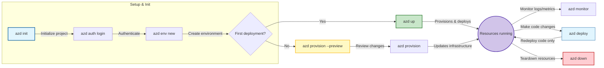
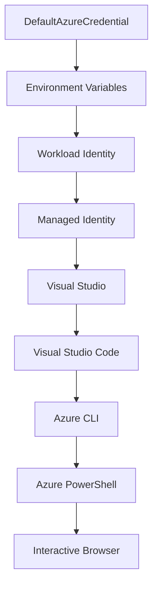

# AZD Mga Pangunahing Kaalaman - Mga Pangunahing Konsepto at Pundasyon

**Pag-navigate sa Kabanata:**
- **📚 Tahanan ng Kurso**: [AZD Para sa mga Baguhan](../../README.md)
- **📖 Kasalukuyang Kabanata**: Kabanata 1 - Pundasyon at Mabilis na Pagsisimula
- **⬅️ Nakaraan**: [Pangkalahatang-ideya ng Kurso](../../README.md#-chapter-1-foundation--quick-start)
- **➡️ Susunod**: [Pag-install at Setup](installation.md)
- **🚀 Susunod na Kabanata**: [Kabanata 2: AI-First Development](../chapter-02-ai-development/microsoft-foundry-integration.md)

## Panimula

> Sinuring laban sa `azd 1.37.2` (Nobyembre 2026). Ang mga command sa Bash ay gumagamit ng mga quoted na placeholder na dapat mong palitan. Ang mga template na workflow ay gumagamit ng `.` upang i-initialize ang kasalukuyang direktoryo; kung walang directory argument, ang template initialization ay lumilikha ng subdirectory at hindi binabago ang working directory ng iyong shell. Ang mga advanced snippets ay ilustratibo lamang, hindi mga kumpletong proyekto.

Ipinapakilala sa araling ito ang Azure Developer CLI (azd), isang makapangyarihang command-line tool na nagpapabilis ng iyong paglalakbay mula lokal na development hanggang Azure deployment. Matututuhan mo ang mga pangunahing konsepto, mga pangunahing tampok, at mauunawaan kung paano pinapasimple ng azd ang deployment ng cloud-native na aplikasyon.

## Mga Layunin sa Pagkatuto

Sa pagtatapos ng araling ito, ikaw ay:
- Mauunawaan kung ano ang Azure Developer CLI at ang pangunahing layunin nito
- Matututuhan ang mga pangunahing konsepto ng mga template, environment, at serbisyo
- Matutuklasan ang mga pangunahing tampok kabilang ang template-driven development at Infrastructure as Code
- Mauunawaan ang estruktura ng azd project at workflow nito
- Handa para mag-install at mag-configure ng azd para sa iyong development environment

## Mga Kinalabasan sa Pagkatuto

Matapos makumpleto ang araling ito, magagawa mong:
- Ipaliwanag ang papel ng azd sa mga modernong cloud development workflow
- Tukuyin ang mga bahagi ng estruktura ng azd project
- Ilahad kung paano nagtutulungan ang mga template, environment, at serbisyo
- Mauunawaan ang mga benepisyo ng Infrastructure as Code gamit ang azd
- Makilala ang iba't ibang mga utos ng azd at ang kanilang mga layunin

## Ano ang Azure Developer CLI (azd)?

Ang Azure Developer CLI (azd) ay isang command-line tool na idinisenyo upang pabilisin ang iyong paglalakbay mula lokal na development hanggang Azure deployment. Pinapasimple nito ang proseso ng pagbuo, pag-deploy, at pamamahala ng mga cloud-native na aplikasyon sa Azure.

### Ano ang Maa-deploy Mo gamit ang azd?

Sinusuportahan ng azd ang malawak na hanay ng mga workload—at patuloy itong lumalawak. Sa ngayon, magagamit mo ang azd upang mag-deploy ng:

| Uri ng Workload | Mga Halimbawa | Parehong Workflow? |
|---------------|----------|----------------|
| **Karaniwang mga aplikasyon** | Web apps, REST APIs, static sites | ✅ `azd up` |
| **Mga serbisyo at microservices** | Container Apps, Function Apps, multi-service backends | ✅ `azd up` |
| **Mga AI-powered na aplikasyon** | Chat apps gamit ang Microsoft Foundry Models, RAG solutions gamit ang AI Search | ✅ `azd up` |
| **Mga intelligent agents** | Foundry-hosted agents, multi-agent orchestrations | ✅ `azd up` |

Ang pangunahing pananaw ay **pareho ang lifecycle ng azd anuman ang iyong ide-deploy**. Nagsisimula ka ng proyekto, nagpo-provision ng infrastructure, nagde-deploy ng code, nagbabantay ng aplikasyon, at naglilinis—ito man ay simpleng website o isang sopistikadong AI agent.

Ito ay sinadya. Tinatrato ng azd ang AI capabilities bilang isang uri ng serbisyo na maaaring gamitin ng iyong aplikasyon, hindi bilang isang ganap na ibang bagay. Ang isang chat endpoint na suportado ng Microsoft Foundry Models ay mula sa perspektibo ng azd ay isa lamang pang serbisyo na kailangang i-configure at ideploy.

### 🎯 Bakit Gamitin ang AZD? Isang Paghahambing sa Tunay na Mundo

Ihahambing natin ang pag-deploy ng isang simpleng web app na may database:

#### ❌ KUNG WALANG AZD: Manwal na Azure Deployment (30+ minuto)

**Ilustratibong paghahambing sa Bash, hindi isang runnable na panimulang aplikasyon.** Ipinapalagay nito ang umiiral na application code, natatanging mga pangalan ng resources, Azure CLI authentication, at anumang kinakailangang CLI extensions. Gamitin ang template exercise sa ibaba para sa suportadong end-to-end na landas.

```bash
# Step 1: Create resource group
az group create --name myapp-rg --location eastus

# Step 2: Create App Service Plan
az appservice plan create --name myapp-plan \
  --resource-group myapp-rg \
  --sku B1 --is-linux

# Step 3: Create Web App
az webapp create --name myapp-web-unique123 \
  --resource-group myapp-rg \
  --plan myapp-plan \
  --runtime "NODE:22-lts"

# Step 4: Create Cosmos DB account (10-15 minutes)
az cosmosdb create --name myapp-cosmos-unique123 \
  --resource-group myapp-rg \
  --kind MongoDB

# Step 5: Create database
az cosmosdb mongodb database create \
  --account-name myapp-cosmos-unique123 \
  --resource-group myapp-rg \
  --name tododb

# Step 6: Create collection
az cosmosdb mongodb collection create \
  --account-name myapp-cosmos-unique123 \
  --resource-group myapp-rg \
  --database-name tododb \
  --name todos

# Step 7: Get connection string
CONN_STR=$(az cosmosdb keys list \
  --name myapp-cosmos-unique123 \
  --resource-group myapp-rg \
  --type connection-strings \
  --query "connectionStrings[0].connectionString" -o tsv)

# Step 8: Configure app settings
az webapp config appsettings set \
  --name myapp-web-unique123 \
  --resource-group myapp-rg \
  --settings MONGODB_URI="$CONN_STR"

# Step 9: Enable logging
az webapp log config --name myapp-web-unique123 \
  --resource-group myapp-rg \
  --application-logging filesystem \
  --detailed-error-messages true

# Step 10: Set up Application Insights
az monitor app-insights component create \
  --app myapp-insights \
  --location eastus \
  --resource-group myapp-rg

# Step 11: Link App Insights to Web App
INSTRUMENTATION_KEY=$(az monitor app-insights component show \
  --app myapp-insights \
  --resource-group myapp-rg \
  --query "instrumentationKey" -o tsv)

az webapp config appsettings set \
  --name myapp-web-unique123 \
  --resource-group myapp-rg \
  --settings APPINSIGHTS_INSTRUMENTATIONKEY="$INSTRUMENTATION_KEY"

# Step 12: Build application locally
npm install
npm run build

# Step 13: Create deployment package
zip -r app.zip . -x "*.git*" "node_modules/*"

# Step 14: Deploy application
az webapp deployment source config-zip \
  --resource-group myapp-rg \
  --name myapp-web-unique123 \
  --src app.zip

# Step 15: Wait and pray it works 🙏
# (No automated validation, manual testing required)
```

**Mga Problema:**
- ❌ 15+ na mga utos na kailangang tandaan at isagawa ayon sa pagkakasunod
- ❌ 30-45 minuto ng manwal na trabaho
- ❌ Madaling magkakamali (typos, maling parameters)
- ❌ Kinakailangang explicit na pangasiwaan ang kredensyal; maaari itong maitago ng debug logs at shell tracing
- ❌ Walang automated rollback kung may pumalpak
- ❌ Mahirap kopyahin sa mga miyembro ng team
- ❌ Iba-iba sa bawat pagkakataon (hindi reproducible)

#### ✅ GAMIT ANG AZD: Automated Deployment (5 utos, 10-15 minuto)

```bash
# Step 1: Initialize from template
azd init --template todo-nodejs-mongo .

# Step 2: Authenticate
azd auth login

# Step 3: Select the environment created during init
azd env select dev

# Step 4: Preview changes (optional but recommended)
azd provision --preview

# Step 5: Deploy everything
azd up

# ✨ Done! Everything is deployed, configured, and monitored
```

**Mga Benepisyo:**
- ✅ **5 utos** kumpara sa 15+ manwal na hakbang
- ✅ **10-15 minuto** na kabuuang oras (kadalasang naghihintay para sa Azure)
- ✅ **Mas kaunting manwal na pagkakamali** - tuloy-tuloy, template-driven workflow
- ✅ **Ligtas na pangangasiwa ng mga sikreto** - maraming mga template ang gumagamit ng Azure-managed secret storage
- ✅ **Mauulit-ulit na deployment** - pareho ang workflow sa bawat pagkakataon
- ✅ **Mauulit-ulit na mga depinisyon ng infrastructure** - nakadepende sa quota, availability ng rehiyon, at mga bersyon ng template
- ✅ **Handa para sa koponan** - kahit sino ay maaaring mag-deploy gamit ang parehong mga utos
- ✅ **Infrastructure bilang Code** - Bicep templates na version controlled
- ✅ **Monitoring na tinukoy ng template** - Application Insights kapag kasama sa template

### Oras at Katapatan

Ang mga oras na nabanggit ay mga pagtataya, hindi benchmark. Binabawasan ng azd ang mga utos na kailangang pamahalaan ngunit hindi nito ginagarantiyahan ang tagal ng deployment, inaalis ang mga error, o nagbibigay ng awtomatikong rollback ng application/database. Panatilihing naka-source control ang mga gumaganang bersyon at subukan ang mga recovery procedure.

## Mga Pangunahing Konsepto

### Mga Template
Ang mga template ang pundasyon ng azd. Naglalaman ito ng:
- **Application code** - Ang iyong source code at mga dependencies
- **Mga depinisyon ng infrastructure** - Mga Azure resource na tinukoy sa Bicep o Terraform
- **Mga configuration file** - Mga setting at mga environment variable
- **Mga deployment script** - Mga automated deployment workflow

### Mga Environment
Ang mga environment ay kumakatawan sa iba't ibang target ng deployment:
- **Development** - Para sa testing at development
- **Staging** - Pre-production environment
- **Production** - Live production environment

Bawat environment ay may sarili nitong:
- Pangalan ng environment at mga halaga; depende sa infrastructure template ang resource isolation
- Mga configuration setting
- Estado ng deployment

### Mga Serbisyo
Ang mga serbisyo sa `azure.yaml` ay naglalarawan ng mga deployable na bahagi ng aplikasyon:
- **Frontend** - Mga web application, SPAs
- **Backend** - Mga API, microservices

Karaniwan, ang mga database at storage ay ipinoprovision bilang mga infrastructure resource, hindi bilang mga imbensyong host ng serbisyo tulad ng `host: postgres`.

## Mga Pangunahing Tampok

### 1. Template-Driven Development
```bash
# Browse available templates
azd template list

# Initialize from a template
azd init --template "<template-name>" .
```

### 2. Infrastructure bilang Code
- **Bicep** - Domain-specific language ng Azure
- **Terraform** - Multi-cloud infrastructure tool
- Ang Bicep ay kino-compile sa ARM templates; ang raw ARM JSON ay hindi hiwalay na built-in na `infra.provider`.

### 3. Integrated Workflow
```bash
# Complete deployment workflow
azd up            # Provision + Deploy this is hands off for first time setup

# 🧪 NEW: Preview infrastructure changes before deployment (SAFE)
azd provision --preview    # Simulate infrastructure deployment without making changes

azd provision     # Create Azure resources if you update the infrastructure use this
azd deploy        # Deploy application code or redeploy application code once update
azd down          # Clean up resources
```

#### 🛡️ Ligtas na Pagpaplano ng Infrastructure gamit ang Preview
Ang `azd provision --preview` na utos ay isang game-changer para sa ligtas na mga deployment:
- **Dry-run analysis** - Ipinapakita kung ano ang lilikhain, babaguhin, o buburahin
- **Walang infrastructure apply** - Sinusuri ang mga pagbabago sa provider; suriin muna ang mga project hook, dahil ang mga hook ay maaaring magpatakbo ng mga command na may side effects
- **Pakikipagtulungan ng koponan** - Ibahagi ang mga resulta ng preview bago ang deployment
- **Input sa pagpaplano ng gastos** - Suriin ang mga iminungkahing SKU, pagkatapos ay presyo gamit ang Azure Pricing Calculator; hindi kinakalculate ng preview ang presyo

```bash
# Example preview workflow
azd provision --preview           # See what will change
# Review the output, discuss with team
azd provision                     # Apply changes with confidence
```

### 📊 Visual: AYD Development Workflow



**Paliwanag ng Workflow:**
1. **Init** - Simulan gamit ang template o bagong proyekto
2. **Auth** - Mag-authenticate sa Azure
3. **Environment** - Gumawa ng hiwalay na deployment environment
4. **Preview** - 🆕 Palaging i-preview muna ang mga pagbabago sa infrastructure (ligtas na gawain)
5. **Provision** - Gumawa o i-update ang mga Azure resource
6. **Deploy** - I-push ang iyong application code
7. **Monitor** - Bantayan ang performance ng aplikasyon
8. **Iterate** - Gumawa ng mga pagbabago at i-redeploy ang code
9. **Cleanup** - Alisin ang mga resource kapag tapos na

### 4. Pamamahala ng Environment
```bash
# Create and manage environments
azd env new "<environment-name>"
azd env select "<environment-name>"
azd env list
```

### 5. Mga Extension at AI Commands

Gumagamit ang azd ng extension system para magdagdag ng mga kakayahan lampas sa core CLI. Napaka-kapaki-pakinabang ito para sa mga AI workload:

```bash
# List available extensions
azd extension list

# Install the GA Foundry bundle (requires azd >= 1.37.0)
azd ext install microsoft.foundry

# Initialize an AI agent project interactively
azd ai agent init

# Test a deployed agent (shows latency and time-to-first-byte)
azd ai agent invoke

# Start the MCP server for AI-assisted development (Alpha)
azd mcp start
```

**Ang lifecycle ng agent, mula simula hanggang dulo.** Kasama sa GA `microsoft.foundry` bundle ang `azure.ai.agents` at anim pang iba pang core extension. I-install nang hiwalay ang `azure.ai.evaluations` para sa evaluation. Gamitin ang `azd >= 1.37.0` para sa workflow na ito. Hindi mo kailangan lahat ito sa unang araw:

| Yugto | Utos | Ano ang ginagawa nito |
|-------|---------|--------------|
| **Scaffold** | `azd ai agent init --template <path-to-azure.yaml>` | Gumamit ng template ng kasalukuyang agent project |
| **Patakbuhin nang lokal** | `azd ai agent run`, pagkatapos `azd ai agent invoke --local "Test prompt"` sa isa pang terminal | Suriin ang lokal na aktibidad sa Agent Inspector; ang mga tawag sa modelo ay patuloy na gumagamit ng Azure |
| **I-deploy** | `azd deploy` | Para sa mga code-mode hosted agent, i-upload ang source para sa remote Foundry build |
| **Subukan** | `azd ai agent invoke` | Tawagan ang agent at tingnan ang oras ng tugon |
| **Sukatin** | `azd ai eval init`, `generate`, `run start` | I-configure, i-deploy, at patakbuhin ang mga evaluation gamit ang hiwalay na extension |
| **Pagbutihin** | `azd ai agent optimize --eval <evaluation-name> --optimize-model <optimizer-deployment>` | Muling gamitin ang isang compatible evaluation para i-optimize ang agent |
| **Suriin** | `azd ai agent endpoint show` | Tingnan ang live na configuration ng endpoint |
| **Linisin** | `azd ai agent delete` | Tanggalin ang hosted agent at lahat ng mga bersyon nito |

> Magsimula sa [GA hosted-agent walkthrough](../chapter-02-ai-development/microsoft-foundry-integration.md#hosted-agent-walkthrough-ga), na sumasaklaw sa mga prerequisite, provisioning, at ligtas na paglilinis. Ang mga extension ay tinalakay pa nang husto sa [AZD AI CLI Commands](../chapter-08-production/production-ai-practices.md#azd-ai-cli-commands-and-extensions) na sanggunian.

## 📁 Estruktura ng Proyekto

Karaniwang estruktura ng azd project:
```
my-app/
├── .azure/                  # Local environments and selected-environment config
│   ├── config.json
│   └── dev/.env
├── .devcontainer/          # Development container config
├── .github/workflows/      # GitHub Actions
├── .vscode/               # VS Code settings
├── infra/                 # Infrastructure code
│   ├── main.bicep        # Main infrastructure template
│   ├── main.parameters.json
│   └── modules/          # Reusable modules
├── src/                  # Application source code
│   ├── api/             # Backend services
│   └── web/             # Frontend application
├── azure.yaml           # azd project configuration
└── README.md
```

## 🔧 Mga Configuration File

### azure.yaml
Pangunahing configuration file ng proyekto:
```yaml
name: my-awesome-app
metadata:
  template: my-template@1.0.0

services:
  web:
    project: ./src/web
    language: js
    host: appservice
  api:
    project: ./src/api
    language: js
    host: appservice

hooks:
  preprovision:
    shell: pwsh
    run: echo "Preparing to provision..."
```

### .azure/config.json
Lokal na pagpili ng default na environment ng proyekto (ilustratibo; pinamamahalaan ng azd):
```json
{
  "defaultEnvironment": "dev"
}
```

## 🎪 Karaniwang Workflow na may Praktikal na Ehersisyo

> **💡 Tip sa Pagkatuto:** Sundan ang mga ehersisyong ito nang sunud-sunod upang unti-unting mapahusay ang iyong kasanayan sa AZD.

### 🎯 Ehersisyo 1: I-initialize ang Iyong Unang Proyekto

**Layunin:** Lumikha ng isang proyekto sa AZD at tuklasin ang estruktura nito

**Mga Hakbang:**
```bash
# Use a proven template
mkdir azd-basics-practice
cd azd-basics-practice
# Choose "dev" for the environment name when prompted
azd init --template todo-nodejs-mongo .

# Explore the generated files
ls -la  # View all files including hidden ones

# Key files created:
# - azure.yaml (main config)
# - infra/ (infrastructure code)
# - src/ (application code)
```

**✅ Tagumpay:** Mayroon kang azure.yaml, infra/, at src/ na mga direktoryo

---

### 🎯 Ehersisyo 2: Mag-deploy sa Azure

**Layunin:** Kumpletuhin ang end-to-end deployment

**Mga Hakbang:**
```bash
# 1. Authenticate
azd auth login

# 2. Select the dev environment created in Exercise 1
azd env select dev
azd env set AZURE_LOCATION eastus

# 3. Preview changes (RECOMMENDED)
azd provision --preview

# 4. Deploy everything
azd up

# 5. Verify deployment
azd show    # View your app URL
```

**Inaasahang Oras:** 10-15 minuto  
**✅ Tagumpay:** Nabubuksan ang URL ng aplikasyon sa browser

---

### 🎯 Ehersisyo 3: Maraming Environment

**Layunin:** Mag-deploy sa dev at staging

**Mga Hakbang:**
```bash
# Already have dev, create staging
azd env new staging
azd env set AZURE_LOCATION westus2
azd up

# Switch between them
azd env list
azd env select dev
```

**✅ Tagumpay:** Dalawang hiwalay na resource group sa Azure Portal

**Paglilinis:** Lumilikha ang Ehersisyo 3 ng pangalawang billable deployment. Tanggalin ang dalawa kapag tapos na:

```bash
azd down --environment dev
azd down --environment staging
```

---

### 🛡️ Destructive Cleanup: `azd down --force --purge`

Kapag sinasadya mong tanggalin ang Azure resources ng napiling environment:

```bash
azd down --force --purge
```

**Ano ang ginagawa nito:**
- `--force`: Walang mga prompt na pag-kumpirma
- `--purge`: Permanently na rin tinatanggal ang mga suportadong soft-deleted resources (halimbawa Key Vaults), kung saan pinapayagan ng purge protection. Hindi nito tinatanggal ang lokal na `.azure/` na direktoryo.

**Gamitin kapag:** tapos na sa isang disposable na environment. Huwag ituring ang destructive cleanup bilang unang tugon sa mga error sa authentication, quota, o configuration.

---

## 🎪 Orihinal na Sanggunian ng Workflow

### Pagsisimula ng Bagong Proyekto
```bash
# Method 1: Use existing template
azd init --template todo-nodejs-mongo .

# Method 2: Start from scratch
azd init

# Method 3: Use current directory
azd init .
```

### Siklo ng Development
```bash
# Set up development environment
azd auth login
azd env new dev
azd env select dev

# Deploy everything
azd up

# Make changes and redeploy
azd deploy

# Clean up when done
azd down --force --purge # Deletes this environment's discovered Azure resources; review before forcing deletion.
```

## Pag-unawa sa `azd down --force --purge`
Ang `azd down --force --purge` na utos ay isang makapangyarihang paraan upang ganap na sirain ang iyong azd environment at lahat ng mga kaakibat nitong resources. Narito ang paliwanag ng bawat flag:
```
--force
```
- Laktawan ang mga prompt ng kumpirmasyon.
- Kapaki-pakinabang sa automation o scripting kung saan hindi posibleng manu-manong input.
- Hindi nilalampasan ang mga pahintulot, purge protection, o sinusuportahang mga pagkabigo sa pagtanggal.

```
--purge
```
Permanently deletes supported soft-deleted Azure resources without an additional confirmation. Purge protection and permissions still apply. It does **not** remove local environments or the `.azure/` folder.


### Bakit gamitin ang pareho?
Gamitin ang pareho kung balak mong tanggalin ang mga napiling Azure resources ng kapaligiran at linisin ang mga narecover na resources. Ito ay isang mapanirang paglilinis, hindi pangkalahatang pag-aayos o pag-reset ng local-state.

Ito ay lalong kapaki-pakinabang pagkatapos ng manu-manong pagtanggal ng resources sa Azure portal o kapag nagpapalit ng mga template, kapaligiran, o ng mga kahulugan ng pangalan ng resource group.


### Pamamahala ng Maramihang Kapaligiran
```bash
# Create staging environment
azd env new staging
azd env select staging
azd up

# Switch back to dev
azd env select dev

# Compare environments
azd env list
```

## 🔐 Pagpapatunay at Mga Kredensyal

Ihiwalay ang deployment authentication (`azd auth login`) mula sa application SDK authentication (`DefaultAzureCredential`). Magkaiba sila. Hindi ginagamit ng azd ang Azure CLI credentials bilang default.

### Azure CLI Authentication (`az login`)

Patakbuhin ang `azd auth login` para sa azd. Ang sumusunod na mga Azure CLI na utos ay opsyonal at nagpapatunay nang hiwalay sa mga `az` na utos:

```bash
# Interactive login (opens browser)
az login

# Login with specific tenant
az login --tenant "<tenant-id>"

# Login with service principal
az login --service-principal -u "<app-id>" -p "<password>" --tenant "<tenant-id>"

# Check current login status
az account show

# List available subscriptions
az account list --output table

# Set default subscription
az account set --subscription "<subscription-id>"
```

### Daloy ng Pagpapatunay
1. **Interactive Login**: Binubuksan ang iyong default browser para sa pagpapatunay
2. **Daloy ng Device Code**: Para sa mga kapaligiran na walang access sa browser
3. **Service Principal**: Para sa mga scenario ng automation at CI/CD
4. **Managed Identity**: Para sa mga application na naka-host sa Azure

### DefaultAzureCredential Chain

`DefaultAzureCredential` ay isang uri ng credential na nagbibigay ng pinasimpleng karanasan sa pagpapatotoo sa pamamagitan ng awtomatikong pagsubok ng maraming pinagmumulan ng credential sa isang partikular na pagkakasunod-sunod:

#### Application SDK Credential Chain

Ang eksaktong chain ay nakadepende sa wika ng Azure Identity SDK, bersyon, naka-install na mga plugin, at mga opsyon. Ang diagram na ito ay konseptwal, hindi isang nakapirming pagkakasunod-sunod ng azd authentication; maaari ring isama ng mga bagong SDK ang Azure Developer CLI credentials.


#### 1. Mga Environment Variable
```bash
# Set environment variables for service principal
export AZURE_CLIENT_ID="<app-id>"
export AZURE_CLIENT_SECRET="<password>"
export AZURE_TENANT_ID="<tenant-id>"
```

#### 2. Workload Identity (Kubernetes/GitHub Actions)
Awtomatikong ginagamit sa:
- Azure Kubernetes Service (AKS) gamit ang Workload Identity
- GitHub Actions gamit ang OIDC federation
- Iba pang mga scenario ng federated identity

#### 3. Managed Identity
Para sa mga Azure resources tulad ng:
- Virtual Machines
- App Service
- Azure Functions
- Container Instances

```bash
# Inspect a deployed Container App's configured identity (requires az login)
az containerapp show --name "<app-name>" --resource-group "<rg-name>" --query identity
```

#### 4. Integrasyon ng Developer Tools
- **Visual Studio**: Awtomatikong ginagamit ang naka-sign in na account
- **VS Code**: Depende ang suporta sa SDK at sa suportadong broker/plugin setup nito
- **Azure CLI**: Gumagamit ng `az login` credentials (pinakakaraniwan para sa lokal na pag-develop)

### Pagsasaayos ng AZD Authentication

```bash
# Method 1: Direct azd authentication (recommended)
azd auth login

# Method 2: Direct azd authentication
azd auth login --use-device-code  # For headless environments

# Method 3: Check authentication status
azd auth login --check-status

# Method 4: Logout and re-authenticate
azd auth logout
azd auth login
```

### Pinakamahusay na Kasanayan sa Authentication

#### Para sa Lokal na Pag-develop
```bash
# 1. Log in to azd
azd auth login

# 2. Select the subscription for this initialized environment
azd env set AZURE_SUBSCRIPTION_ID "<subscription-id>"

# 3. Check azd sign-in details (read the status message)
azd auth login --check-status
```

#### Para sa CI/CD Pipelines
```yaml
# Partial GitHub Actions steps: assumes checkout, azd installation,
# required AZURE_* environment values, and pipeline secret configuration.
- name: Deploy with azd
  run: |
    azd auth login --client-id ${{ secrets.AZURE_CLIENT_ID }} \
                    --client-secret ${{ secrets.AZURE_CLIENT_SECRET }} \
                    --tenant-id ${{ secrets.AZURE_TENANT_ID }}
    azd up --no-prompt
```

#### Para sa Mga Production Environment
- Gamitin ang **Managed Identity** kapag tumatakbo sa mga Azure resources
- Gamitin ang **Service Principal** para sa mga scenario ng automation
- Iwasang itago ang mga kredensyal sa code o mga configuration file
- Gamitin ang **Azure Key Vault** para sa sensitibong configuration

### Mga Karaniwang Isyu at Solusyon sa Authentication

#### Isyu: "Walang nahanap na subscription"
```bash
# Solution: Set default subscription
az account list --output table
az account set --subscription "<subscription-id>"
azd env set AZURE_SUBSCRIPTION_ID "<subscription-id>"
```

#### Isyu: "Kulang ang mga permiso"
```bash
# Solution: Check and assign required roles
az role assignment list --assignee $(az account show --query user.name --output tsv)

# Common required roles:
# - Contributor (for resource management)
# - User Access Administrator (for role assignments)
```

#### Isyu: "Expired ang token"
```bash
# Solution: Re-authenticate
az logout
az login
azd auth logout
azd auth login
```

### Authentication sa Iba't Ibang Scenario

#### Lokal na Pag-develop
```bash
# Personal development account
az login
azd auth login
```

#### Team Development
```bash
# Use specific tenant for organization
az login --tenant contoso.onmicrosoft.com
azd auth login --tenant-id "<tenant-id>"
```

#### Multi-tenant na mga Scenario
```bash
# Switch between tenants
az login --tenant tenant1.onmicrosoft.com
azd auth login --tenant-id "<tenant-1-id>"
# Select an environment configured with tenant 1's subscription
azd env select tenant1-dev
# Deploy to tenant 1
azd up

az login --tenant tenant2.onmicrosoft.com  
azd auth login --tenant-id "<tenant-2-id>"
azd env select tenant2-dev
# Deploy to tenant 2
azd up
```

### Mga Pagsasaalang-alang sa Seguridad

1. **Pag-iimbak ng Credential**: Huwag kailanman mag-imbak ng mga kredensyal sa source code
2. **Limitasyon ng Scope**: Gamitin ang prinsipyo ng least-privilege para sa mga service principal
3. **Pag-ikot ng Token**: Regular na palitan ang mga lihim ng service principal
4. **Audit Trail**: I-monitor ang mga gawain sa authentication at deployment
5. **Seguridad sa Network**: Gamitin ang private endpoints kapag posible

### Pag-troubleshoot ng Authentication

```bash
# Debug authentication issues
azd auth login --check-status
az account show
az account get-access-token

# Common diagnostic commands
whoami                          # Current user context
az ad signed-in-user show      # Microsoft Entra ID user details
az group list                  # Test resource access
```

## Pagtuklas ng Utos

### Pagtuklas
```bash
azd template list              # Browse templates
azd template list --help       # Template discovery options
azd init --help               # Initialization options
```

### Pamamahala ng Proyekto
```bash
azd show                     # Project overview
azd env list                # Available environments and selected default
azd config show            # Configuration settings
```

### Pagsubaybay
```bash
azd monitor                  # Open Azure portal monitoring
azd monitor --logs           # View application logs
azd monitor --live           # View live metrics
azd pipeline config          # Set up CI/CD
```

## Pinakamahusay na Kasanayan

### 1. Gumamit ng Makabuluhang Pangalan
```bash
# Good
azd env new production-east
azd init --template todo-nodejs-mongo .

# Avoid
azd env new env1
azd init --template template1 .
```

### 2. Gamitin ang Mga Template
- Magsimula sa mga umiiral na template
- I-customize ayon sa iyong mga pangangailangan
- Gumawa ng mga reusable na template para sa iyong organisasyon

### 3. Paghiwalay ng Kapaligiran
- Gumamit ng hiwalay na mga kapaligiran para sa dev/staging/prod
- Huwag kailanman mag-deploy nang direkta sa production mula sa lokal na makina
- Gumamit ng mga CI/CD pipeline para sa mga deployment sa production

### 4. Pamamahala ng Configuration
- Gamitin ang managed identity at Key Vault para sa mga lihim; ang mga ordinaryong `azd env set` na halaga ay lokal na plaintext
- Panatilihin ang configuration sa version control
- Idokumento ang mga environment-specific na setting

## Pag-aaral ng Progression

### Baguhan (Linggo 1-2)
1. I-install ang azd at mag-authenticate
2. Mag-deploy ng simpleng template
3. Unawain ang istraktura ng proyekto
4. Matutunan ang mga batayang utos (up, down, deploy)

### Intermediate (Linggo 3-4)
1. I-customize ang mga template
2. Pamahalaan ang maraming kapaligiran
3. Unawain ang infrastructure code
4. Isaayos ang CI/CD pipeline

### Advanced (Linggo 5+)
1. Gumawa ng custom na mga template
2. Mga advanced na pattern ng infrastructure
3. Multi-region na mga deployment
4. Mga enterprise-grade na configuration

## Mga Susunod na Hakbang

**📖 Ipagpatuloy ang Pag-aaral sa Kabanata 1:**
- [Pag-install at Pagsasaayos](installation.md) - I-install at i-configure ang azd
- [Ang Iyong Unang Proyekto](first-project.md) - Kumpletuhin ang hands-on na tutorial
- [Gabay sa Configuration](../chapter-03-configuration/configuration.md) - Mga advanced na opsyon sa configuration

**🎯 Handa Ka Na Ba Para sa Susunod na Kabanata?**
- [Kabanata 2: AI-First Development](../chapter-02-ai-development/microsoft-foundry-integration.md) - Magsimulang bumuo ng mga AI application

## Karagdagang Mga Mapagkukunan

- [Pangkalahatang-ideya ng Azure Developer CLI](https://learn.microsoft.com/en-us/azure/developer/azure-developer-cli/)
- [Template Gallery](https://azure.github.io/awesome-azd/)
- [Mga Sample ng Komunidad](https://github.com/Azure-Samples)

---

## 🙋 Madalas na Mga Tanong

### Pangkalahatang Mga Tanong

**Q: Ano ang pagkakaiba ng AZD at Azure CLI?**

A: Ang Azure CLI (`az`) ay para sa pamamahala ng indibidwal na mga Azure resource. Ang AZD (`azd`) ay para sa pamamahala ng buong mga application:

```bash
# Azure CLI - Low-level resource management
az webapp create --name myapp --resource-group rg
az sql server create --name myserver --resource-group rg
# ...many more commands needed

# AZD - Application-level management
azd up  # Deploys entire app with all resources
```

**Isipin ito sa ganitong paraan:**
- `az` = Nag-ooperate sa mga indibidwal na Lego bricks
- `azd` = Nagtatrabaho gamit ang kompletong Lego sets

---

**Q: Kailangan ko bang malaman ang Bicep o Terraform para gamitin ang AZD?**

A: Hindi! Magsimula sa mga template:
```bash
# Use existing template - no IaC knowledge needed
azd init --template todo-nodejs-mongo .
azd up
```

Maaari kang matuto ng Bicep pagkatapos upang i-customize ang infrastructure. Nagbibigay ang mga template ng mga gumaganang halimbawa na maaaring pag-aralan.

---

**Q: Magkano ang gastos sa pagpapatakbo ng mga AZD template?**

A: Nag-iiba ang gastos ayon sa rehiyon, SKU, uptime, mode ng database, at paggamit ng modelo. Ang isang development environment ay maaaring magkaroon ng malaking buwanang singil kahit na idle; huwag isipin na may unibersal na saklaw na $50-150:

```bash
# Preview resource changes (not prices)
azd provision --preview

# Always cleanup when not using
azd down --force --purge  # Removes all resources
```

**Pro tip:** Gamitin ang mga free tier kung available:
- App Service: F1 (Libre) tier
- Azure OpenAI: walang pangkalahatang garantisadong buwanang libreng token allowance; suriin ang kasalukuyang modelo at presyo ng alok
- Cosmos DB: ang mga kwalipikadong provisioned-throughput account ay maaaring mag-opt in sa isang free tier; hindi awtomatikong kwalipikado ang mga serverless template

---

**Q: Maaari ko bang gamitin ang AZD sa mga umiiral na Azure resource?**

A: Oo, pero mas madali magsimula mula sa simula. Pinakamainam ang AZD kapag pinamamahalaan nito ang buong lifecycle. Para sa mga umiiral na resource:

```bash
# Option 1: Import existing resources (advanced)
azd init
# Then modify infra/ to reference existing resources

# Option 2: Start fresh (recommended)
azd init --template "<verified-template-name>" .
azd up  # Creates new environment
```

---

**Q: Paano ko ibabahagi ang aking proyekto sa mga kasama sa team?**

A: I-commit ang proyekto sa AZD sa Git (ngunit HUWAG ang .azure folder):

```bash
# Already in .gitignore by default
.azure/        # Contains secrets and environment data
*.env          # Environment variables

# Team members then:
git clone "<your-repo>"
# Change into the cloned repository before running the remaining commands.
azd auth login
azd env new "<their-name>-dev"
azd up
```

Lahat ay makakakuha ng kaparehong infrastructure mula sa mga parehas na template.

---

### Mga Tanong sa Pag-troubleshoot

**Q: Nabigo ang "azd up" sa kalagitnaan. Ano ang gagawin ko?**

A: Tingnan ang error, ayusin ito, pagkatapos subukan muli:

```bash
# Capture detailed diagnostics (redact sensitive values before sharing)
azd up --debug

# Common fixes:

# 1. If quota exceeded:
azd env set AZURE_LOCATION "westus2"  # Try different region

# 2. If resource name conflict:
azd down --force --purge  # Clean slate
azd up  # Retry

# 3. If auth expired:
az login
azd auth login
azd up
```

**Pinakakaraniwang isyu:** Mali ang napiling Azure subscription
```bash
az account list --output table
az account set --subscription "<correct-subscription>"
azd env set AZURE_SUBSCRIPTION_ID "<correct-subscription-id>"
```

---

**Q: Paano ko ide-deploy lamang ang mga pagbabago sa code nang hindi nire-reprovision?**

A: Gamitin ang `azd deploy` sa halip na `azd up`:

```bash
azd up          # First time: provision + deploy (slow)

# Make code changes...

azd deploy      # Subsequent times: deploy only (fast)
```

Paghahambing ng bilis:
- `azd up`: 10-15 minuto (nagpoprovide ng infrastructure)
- `azd deploy`: 2-5 minuto (code lamang)

---

**Q: Maaari ko bang i-customize ang mga infrastructure template?**

A: Oo! I-edit ang mga Bicep file sa `infra/`:

```bash
# After azd init
cd infra/
code main.bicep  # Edit in VS Code

# Preview changes
azd provision --preview

# Apply changes
azd provision
```

**Tip:** Magsimula nang maliit - baguhin muna ang mga SKU:
```bicep
// infra/main.bicep
sku: {
  name: 'B1'  // Change to 'P1V2' for production
}
```

---

**Q: Paano ko buburahin ang lahat ng nilikha ng AZD?**

A: Isang utos lang ang mag-aalis ng lahat ng resource:

```bash
azd down --force --purge

# This deletes:
# - Azure resources/resource groups discovered for the selected environment
# - Supported soft-deleted resources, if purge protection allows
# Local .azure files remain; shared/external resources may remain too.
```

**Palaging patakbuhin ito kapag:**
- Natapos na ang testing ng isang template
- Lumilipat sa ibang proyekto
- Nais magsimula mula sa simula

**Suriin ang gastos:** Kumpirmahin ang pagtanggal sa Azure at tingnan kung may mga nanatili o pinagsaluhang resource. Ang mga dating nagastos ay nananatiling ipinatutupad.

---

**Q: Ano ang gagawin ko kung aksidenteng nabura ko ang mga resource sa Azure Portal?**

A: Maaring hindi mag-synchronize ang estado ng AZD. Pamamaraang malinis na slate:

```bash
# 1. Delete remaining resources only if that is your intent
azd down --force --purge

# 2. Start fresh
azd up

# Alternative: Let AZD detect and fix
azd provision  # Will create missing resources
```

---

### Mga Advanced na Tanong

**Q: Maaari ko bang gamitin ang AZD sa CI/CD pipeline?**

A: Oo! Halimbawa sa GitHub Actions:

```yaml
# .github/workflows/deploy.yml
name: Deploy with AZD

on:
  push:
    branches: [main]

jobs:
  deploy:
    runs-on: ubuntu-latest
    steps:
      - uses: actions/checkout@v4
      
      - name: Install azd
        run: curl -fsSL https://aka.ms/install-azd.sh | bash
      
      - name: Azure Login
        run: |
          azd auth login \
            --client-id ${{ secrets.AZURE_CLIENT_ID }} \
            --client-secret ${{ secrets.AZURE_CLIENT_SECRET }} \
            --tenant-id ${{ secrets.AZURE_TENANT_ID }}
      
      - name: Deploy
        env:
          AZURE_ENV_NAME: dev
          AZURE_LOCATION: ${{ vars.AZURE_LOCATION }}
          AZURE_SUBSCRIPTION_ID: ${{ vars.AZURE_SUBSCRIPTION_ID }}
        run: azd up --no-prompt
```

---

**Q: Paano ko pinamamahalaan ang mga lihim at sensitibong data?**

A: Gumamit ng Key Vault nang tahasan. Ang `azd env set` ay nagsusulat ng mga ordinaryong halaga sa lokal na environment file; hindi nito awtomatikong nililikha ang vault, nagtatalaga ng mga papel, o ini-inject ang mga lihim sa iyong application.

```bash
# Interactive: create/select a Key Vault secret and save its reference
azd env set-secret DATABASE_PASSWORD
```

Kailangan mo ng naaangkop na pahintulot sa vault. Ang iyong infrastructure/application ay kailangang i-wire pa rin ang lihim sa consumer nito at bigyan ang runtime identity ng access. Huwag i-print ang mga na-resolve na lihim sa mga log.

**Huwag kailanman i-commit:**
- `.azure/` folder (naglalaman ng environment data)
- `.env` files (lokal na mga lihim)
- Mga connection string

---

**Q: Maaari ba akong mag-deploy sa maraming rehiyon?**

A: Oo, lumikha ng kapaligiran para sa bawat rehiyon:

```bash
# East US environment
azd env new prod-eastus
azd env set AZURE_LOCATION eastus
azd up

# West Europe environment
azd env new prod-westeurope
azd env set AZURE_LOCATION westeurope
azd up

# Each environment is independent
azd env list
```

Para sa tunay na multi-region na mga app, i-customize ang mga Bicep template upang mag-deploy sa maraming rehiyon nang sabay-sabay.

---

**Q: Saan ako makakakuha ng tulong kung ako ay na-stuck?**

1. **Dokumentasyon ng AZD:** https://learn.microsoft.com/azure/developer/azure-developer-cli/
2. **GitHub Issues:** https://github.com/Azure/azure-dev/issues
3. **Discord:** [Azure Discord](https://discord.gg/microsoft-azure) - channel na #azure-developer-cli
4. **Stack Overflow:** Tag `azure-developer-cli`
5. **Kurso na ito:** [Gabay sa Pag-troubleshoot](../chapter-07-troubleshooting/common-issues.md)

**Pro tip:** Bago magtanong, patakbuhin:
```bash
azd show       # Shows current state
azd version    # Shows your version
```
Isama ang impormasyong ito sa iyong tanong para mas mabilis na tulong.

---

## 🎓 Ano ang Susunod?

Naiintindihan mo na ang mga pundasyon ng AZD. Piliin ang iyong landas:

### 🎯 Para sa mga Baguhan:
1. **Susunod:** [Pag-install at Pagsasaayos](installation.md) - I-install ang AZD sa iyong makina
2. **Pagkatapos:** [Ang Iyong Unang Proyekto](first-project.md) - I-deploy ang iyong unang app
3. **Magsanay:** Kumpletuhin ang lahat ng 3 pagsasanay sa araling ito

### 🚀 Para sa Mga AI Developer:
1. **Laktawan sa:** [Kabanata 2: AI-First Development](../chapter-02-ai-development/microsoft-foundry-integration.md)
2. **I-deploy:** Sa isang walang laman na direktoryo ng proyekto, magsimula gamit ang `azd init --template get-started-with-ai-chat .`
3. **Matuto:** Bumuo habang nagde-deploy

### 🏗️ Para sa Mga Batikang Developer:
1. **Suriin:** [Gabay sa Configuration](../chapter-03-configuration/configuration.md) - Mga advanced na setting
2. **Tuklasin:** [Infrastructure as Code](../chapter-04-infrastructure/provisioning.md) - Malalim na pag-aaral sa Bicep
3. **Bumuo:** Lumikha ng custom na mga template para sa iyong stack

---

**Pag-navigate ng Kabanata:**
- **📚 Home ng Kurso**: [AZD Para sa Mga Baguhan](../../README.md)
- **📖 Kasalukuyang Kabanata**: Kabanata 1 - Pundasyon at Mabilis na Pagsisimula  
- **⬅️ Nakaraang**: [Pangkalahatang-ideya ng Kurso](../../README.md#-chapter-1-foundation--quick-start)
- **➡️ Susunod**: [Pag-install at Pagsasaayos](installation.md)
- **🚀 Susunod na Kabanata**: [Kabanata 2: AI-First Development](../chapter-02-ai-development/microsoft-foundry-integration.md)

---

<!-- CO-OP TRANSLATOR DISCLAIMER START -->
**Pagtatanggi**:
Ang dokumentong ito ay isinalin gamit ang serbisyo ng AI translation na [Co-op Translator](https://github.com/Azure/co-op-translator). Bagama't nagsusumikap kami para sa katumpakan, pakatandaan na ang awtomatikong pagsasalin ay maaaring maglaman ng mga pagkakamali o hindi pagkakatugma. Ang orihinal na dokumento sa orihinal nitong wika ang dapat ituring na pangunahing sanggunian. Para sa mahahalagang impormasyon, inirerekomenda ang propesyonal na pagsasalin ng tao. Hindi kami mananagot sa anumang maling pagkakaintindi o maling interpretasyon na nagmula sa paggamit ng pagsasaling ito.
<!-- CO-OP TRANSLATOR DISCLAIMER END -->