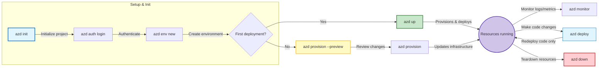
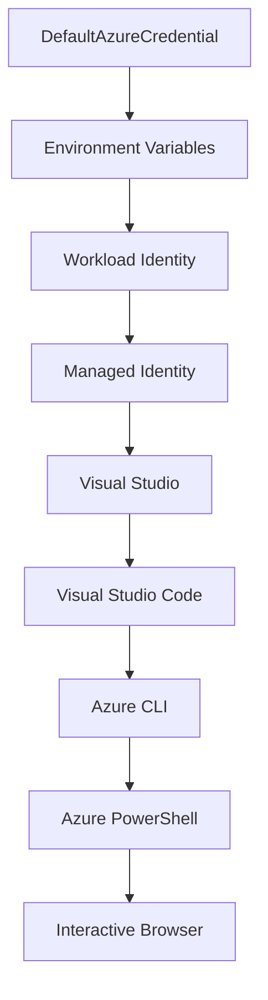

# AZD Mga Pangunahing Kaalaman - Mga Pangunahing Konsepto at Pundasyon

**Pag-navigate ng Kabanata:**
- **📚 Tahanan ng Kurso**: [AZD Para sa mga Baguhan](../../README.md)
- **📖 Kasalukuyang Kabanata**: Kabanata 1 - Pundasyon at Mabilis na Pagsisimula
- **⬅️ Nakaraang**: [Pangkalahatang-ideya ng Kurso](../../README.md#-chapter-1-foundation--quick-start)
- **➡️ Susunod**: [Pag-install at Setup](installation.md)
- **🚀 Susunod na Kabanata**: [Kabanata 2: AI-First Development](../chapter-02-ai-development/microsoft-foundry-integration.md)

## Panimula

> Na-review laban sa `azd 1.37.2` (Nobyembre 2026). Ang mga Bash na utos ay gumagamit ng mga naka-quote na placeholders na kailangan mong palitan. Ang mga template workflows ay gumagamit ng `.` upang simulan ang kasalukuyang direktoryo; kung walang direktoryo ang argumento, ang pagsisimula ng template ay lumilikha ng subdirectory at hindi binabago ang working directory ng iyong shell. Ang mga advanced na snippets ay ilustratibo lamang, hindi kumpletong proyekto.

Sa araling ito ipakikilala ang Azure Developer CLI (azd), isang makapangyarihang command-line tool na nagpapabilis ng iyong paglalakbay mula sa lokal na pag-develop hanggang sa pag-deploy sa Azure. Malalaman mo ang mga pangunahing konsepto, mga pangunahing tampok, at mauunawaan kung paano pinapasimple ng azd ang pag-deploy ng cloud-native na aplikasyon.

## Mga Layunin sa Pag-aaral

Sa pagtatapos ng araling ito, ikaw ay:
- Mauunawaan kung ano ang Azure Developer CLI at ang pangunahing layunin nito
- Matututuhan ang mga pangunahing konsepto ng mga template, kapaligiran, at mga serbisyo
- Susuriin ang mga pangunahing tampok kabilang ang template-driven development at Infrastructure as Code
- Mauunawaan ang istruktura ng proyekto at workflow ng azd
- Maging handa na mag-install at mag-configure ng azd para sa iyong development environment

## Mga Kinalabasan ng Pag-aaral

Pagkatapos makumpleto ang araling ito, magagawa mong:
- Ipaliwanag ang papel ng azd sa mga modernong workflow ng cloud development
- Tukuyin ang mga bahagi ng istruktura ng isang azd na proyekto
- Ilahad kung paano nagtutulungan ang mga template, kapaligiran, at mga serbisyo
- Mauunawaan ang mga benepisyo ng Infrastructure as Code gamit ang azd
- Kilalanin ang iba't ibang utos ng azd at ang kanilang mga layunin

## Ano ang Azure Developer CLI (azd)?

Ang Azure Developer CLI (azd) ay isang command-line tool na dinisenyo upang pabilisin ang iyong paglalakbay mula sa lokal na pag-develop hanggang sa pag-deploy sa Azure. Pinapasimple nito ang proseso ng pagbuo, pag-deploy, at pamamahala ng mga cloud-native na aplikasyon sa Azure.

### Ano ang Maaari Mong I-deploy gamit ang azd?

Sinusuportahan ng azd ang malawak na hanay ng mga workload—at patuloy pang lumalawak ang listahan. Ngayon, maaari mong gamitin ang azd upang mag-deploy ng:

| Uri ng Workload | Mga Halimbawa | Parehong Workflow? |
|---------------|----------|----------------|
| **Tradisyunal na mga aplikasyon** | Mga web app, REST API, mga static site | ✅ `azd up` |
| **Mga serbisyo at microservices** | Mga Container Apps, Function Apps, multi-service backends | ✅ `azd up` |
| **AI-powered na mga aplikasyon** | Chat apps gamit ang Microsoft Foundry Models, RAG na mga solusyon na may AI Search | ✅ `azd up` |
| **Intelligent agents** | Mga ahente na ina-host sa Foundry, multi-agent orchestrations | ✅ `azd up` |

Ang susi ay na **pareho ang lifecycle ng azd anuman ang iyong ide-deploy**. Mag-i-initialize ka ng proyekto, mag-pro-provision ng infrastructure, mag-de-deploy ng iyong code, magmo-monitor ng iyong app, at mag-cl-clean up—kahit na ito'y isang simpleng website o isang sopistikadong AI agent.

Ang patuloy na ito ay by design. Tinuturing ng azd ang mga kakayahan ng AI bilang isa pang uri ng serbisyo na maaaring gamitin ng iyong aplikasyon, hindi bilang isang bagay na lubhang iba. Ang chat endpoint na pinapagana ng Microsoft Foundry Models ay, mula sa perspektibo ng azd, isa lamang pang serbisyo na kailangang i-configure at ideploy.

### 🎯 Bakit Gamitin ang AZD? Isang Paghahambing sa Totoong Mundo

Ihambing natin ang pag-deploy ng isang simpleng web app na may database:

#### ❌ WALA ANG AZD: Manual na Pag-deploy sa Azure (30+ minuto)

**Ilustratibong paghahambing sa Bash, hindi isang tumatakbong panimulang aplikasyon.** Ito ay nangangailangan ng umiiral na code ng aplikasyon, natatanging mga pangalan ng resource, Azure CLI authentication, at anumang kinakailangang mga extension ng CLI. Gamitin ang template exercise sa ibaba para sa suportadong end-to-end na landas.

```bash
# Step 1: Create resource group
az group create --name myapp-rg --location eastus

# Step 2: Create App Service Plan
az appservice plan create --name myapp-plan \
  --resource-group myapp-rg \
  --sku B1 --is-linux

# Step 3: Create Web App
az webapp create --name myapp-web-unique123 \
  --resource-group myapp-rg \
  --plan myapp-plan \
  --runtime "NODE:22-lts"

# Step 4: Create Cosmos DB account (10-15 minutes)
az cosmosdb create --name myapp-cosmos-unique123 \
  --resource-group myapp-rg \
  --kind MongoDB

# Step 5: Create database
az cosmosdb mongodb database create \
  --account-name myapp-cosmos-unique123 \
  --resource-group myapp-rg \
  --name tododb

# Step 6: Create collection
az cosmosdb mongodb collection create \
  --account-name myapp-cosmos-unique123 \
  --resource-group myapp-rg \
  --database-name tododb \
  --name todos

# Step 7: Get connection string
CONN_STR=$(az cosmosdb keys list \
  --name myapp-cosmos-unique123 \
  --resource-group myapp-rg \
  --type connection-strings \
  --query "connectionStrings[0].connectionString" -o tsv)

# Step 8: Configure app settings
az webapp config appsettings set \
  --name myapp-web-unique123 \
  --resource-group myapp-rg \
  --settings MONGODB_URI="$CONN_STR"

# Step 9: Enable logging
az webapp log config --name myapp-web-unique123 \
  --resource-group myapp-rg \
  --application-logging filesystem \
  --detailed-error-messages true

# Step 10: Set up Application Insights
az monitor app-insights component create \
  --app myapp-insights \
  --location eastus \
  --resource-group myapp-rg

# Step 11: Link App Insights to Web App
INSTRUMENTATION_KEY=$(az monitor app-insights component show \
  --app myapp-insights \
  --resource-group myapp-rg \
  --query "instrumentationKey" -o tsv)

az webapp config appsettings set \
  --name myapp-web-unique123 \
  --resource-group myapp-rg \
  --settings APPINSIGHTS_INSTRUMENTATIONKEY="$INSTRUMENTATION_KEY"

# Step 12: Build application locally
npm install
npm run build

# Step 13: Create deployment package
zip -r app.zip . -x "*.git*" "node_modules/*"

# Step 14: Deploy application
az webapp deployment source config-zip \
  --resource-group myapp-rg \
  --name myapp-web-unique123 \
  --src app.zip

# Step 15: Wait and pray it works 🙏
# (No automated validation, manual testing required)
```

**Mga Suliranin:**
- ❌ 15+ na mga utos na kailangang matandaan at isagawa nang sunud-sunod
- ❌ 30-45 minutong manu-manong trabaho
- ❌ Madaling magkamali (mga typo, maling mga parameter)
- ❌ Kinakailangang i-handle nang hayagan ang mga kredensyal; ang mga debug log at shell tracing ay maaaring maglantad sa mga ito
- ❌ Walang awtomatikong rollback kung may pumalya
- ❌ Mahirap ulitin para sa mga kasapi ng koponan
- ❌ Iba-iba sa bawat pagkakataon (hindi reproducible)

#### ✅ GAMIT ANG AZD: Awtomatikong Pag-deploy (5 utos, 10-15 minuto)

```bash
# Step 1: Initialize from template
azd init --template todo-nodejs-mongo .

# Step 2: Authenticate
azd auth login

# Step 3: Select the environment created during init
azd env select dev

# Step 4: Preview changes (optional but recommended)
azd provision --preview

# Step 5: Deploy everything
azd up

# ✨ Done! Everything is deployed, configured, and monitored
```

**Mga Benepisyo:**
- ✅ **5 utos** kumpara sa 15+ na manu-manong hakbang
- ✅ **10-15 minuto** na kabuuang oras (karamihan ay paghihintay sa Azure)
- ✅ **Mas kaunting manu-manong pagkakamali** - pare-pareho, template-driven na workflow
- ✅ **Ligtas na paghawak ng mga sikreto** - maraming mga template ang gumagamit ng Azure-managed na storage para sa mga sikreto
- ✅ **Nauulit na mga pag-deploy** - pareho ang workflow bawat oras
- ✅ **Nauulit na mga depinisyon ng infrastructure** - nakadepende sa quotas, availability ng rehiyon, at mga bersyon ng template
- ✅ **Handa para sa koponan** - sinuman ay maaaring mag-deploy gamit ang parehong mga utos
- ✅ **Infrastructure as Code** - mga Bicep template na nakokontrol ang bersyon
- ✅ **Template-defined na monitoring** - Application Insights kapag kasama sa template

### Oras at Katiyakan

Ang mga nabanggit na oras ay tantya lamang, hindi benchmark. Binabawasan ng azd ang mga utos na kailangang i-coordinate, ngunit hindi ito naggagarantiya ng tagal ng pag-deploy, hindi nilalabas ang mga error, o nagbibigay ng awtomatikong rollback ng aplikasyon/database. Panatilihing nasa source control ang mga gumaganang bersyon at subukan ang mga pamamaraan ng pag-recover.

## Mga Pangunahing Konsepto

### Mga Template
Ang mga template ang pundasyon ng azd. Naglalaman ang mga ito ng:
- **Code ng aplikasyon** - Ang iyong source code at mga dependencies
- **Mga depinisyon ng infrastructure** - Mga Azure resource na inilalarawan gamit ang Bicep o Terraform
- **Mga configuration file** - Mga setting at mga environment variable
- **Mga script sa pag-deploy** - Awtomatikong workflow sa pag-deploy

### Mga Kapaligiran
Ang mga kapaligiran ay kumakatawan sa iba't ibang mga target ng pag-deploy:
- **Development** - Para sa testing at development
- **Staging** - Pre-production na kapaligiran
- **Production** - Live na production na kapaligiran

Ang bawat kapaligiran ay may sarili nitong:
- Pangalan ng kapaligiran at mga halaga; ang isolation ng resource ay nakadepende sa template ng infrastructure
- Mga setting ng configuration
- Estado ng pag-deploy

### Mga Serbisyo
Ang mga serbisyo sa `azure.yaml` ay naglalarawan ng mga deployable na bahagi ng aplikasyon:
- **Frontend** - Mga web application, SPA
- **Backend** - Mga API, microservices

Ang mga database at storage ay karaniwang pinoprovision bilang mga infrastructure resource, hindi bilang mga imbentong host ng serbisyo tulad ng `host: postgres`.

## Mga Pangunahing Tampok

### 1. Template-Driven na Pag-develop
```bash
# Browse available templates
azd template list

# Initialize from a template
azd init --template "<template-name>" .
```

### 2. Infrastructure bilang Code
- **Bicep** - Domain-specific na wika ng Azure
- **Terraform** - Multi-cloud na tool para sa infrastructure
- Ang Bicep ay nagko-compile sa mga ARM template; ang raw ARM JSON ay hindi hiwalay na built-in na `infra.provider`.

### 3. Pinagsamang Workflow
```bash
# Complete deployment workflow
azd up            # Provision + Deploy this is hands off for first time setup

# 🧪 NEW: Preview infrastructure changes before deployment (SAFE)
azd provision --preview    # Simulate infrastructure deployment without making changes

azd provision     # Create Azure resources if you update the infrastructure use this
azd deploy        # Deploy application code or redeploy application code once update
azd down          # Clean up resources
```

#### 🛡️ Ligtas na Pagpaplano ng Infrastructure gamit ang Preview
Ang utos na `azd provision --preview` ay isang game-changer para sa ligtas na mga pag-deploy:
- **Dry-run analysis** - Ipinapakita kung ano ang malilikha, mababago, o mabubura
- **Walang pag-aapply ng infrastructure** - Sinusuri ang mga pagbabago sa provider; inspeksyunin muna ang mga hooks ng proyekto, dahil maaaring magpatakbo ang mga hook ng mga utos na may side effects
- **Pakikipagtulungan ng koponan** - Ibahagi ang mga resulta ng preview bago mag-deploy
- **Input para sa pagpaplano ng gastusin** - Suriin ang mga iminungkahing SKU, pagkatapos presyo gamit ang Azure Pricing Calculator; ang preview ay hindi kinakalkula ang mga presyo

```bash
# Example preview workflow
azd provision --preview           # See what will change
# Review the output, discuss with team
azd provision                     # Apply changes with confidence
```

### 📊 Biswal: AZD Development Workflow



**Paliwanag ng Workflow:**
1. **Init** - Simulan gamit ang template o bagong proyekto
2. **Auth** - Mag-authenticate sa Azure
3. **Environment** - Gumawa ng hiwalay na kapaligiran para sa pag-deploy
4. **Preview** - 🆕 Laging i-preview muna ang mga pagbabago sa infrastructure (ligtas na gawi)
5. **Provision** - Lumikha o i-update ang mga resource ng Azure
6. **Deploy** - I-push ang iyong code ng aplikasyon
7. **Monitor** - Obserbahan ang performance ng aplikasyon
8. **Iterate** - Gumawa ng mga pagbabago at muling i-deploy ang code
9. **Cleanup** - Alisin ang mga resource kapag tapos na

### 4. Pamamahala ng Kapaligiran
```bash
# Create and manage environments
azd env new "<environment-name>"
azd env select "<environment-name>"
azd env list
```

### 5. Mga Extension at mga Utos ng AI

Gumagamit ang azd ng sistema ng extension upang magdagdag ng mga kakayahan lampas sa core CLI. Ito ay partikular na kapaki-pakinabang para sa mga workload ng AI:

```bash
# List available extensions
azd extension list

# Install the Foundry agents extension
azd extension install azure.ai.agents

# Initialize an AI agent project interactively
azd ai agent init

# Test a deployed agent (shows latency and time-to-first-byte)
azd ai agent invoke

# Start the MCP server for AI-assisted development (Alpha)
azd mcp start
```

**Ang lifecycle ng agent, mula simula hanggang wakas.** Gamitin ang `azure.ai.agents` para sa mga operasyon ng lifecycle ng agent at mag-install nang hiwalay ng `azure.ai.evaluations` para sa pagtatasa. Gamitin ang `azd >= 1.37.0` para sa pinagsamang workflow. Hindi mo kailangan lahat ng ito sa unang araw:

| Yugto | Utos | Ano ang ginagawa nito |
|-------|---------|--------------|
| **Scaffold** | `azd ai agent init --template <path-to-azure.yaml>` | Gamitin ang kasalukuyang template ng proyekto ng agent |
| **Test** | `azd ai agent invoke` | Tawagan ang agent at tingnan ang oras ng tugon |
| **Measure** | `azd ai eval init`, `generate`, `run start` | I-configure, ideploy, at patakbuhin ang mga pagtatasa gamit ang hiwalay na extension |
| **Improve** | `azd ai agent optimize --eval <evaluation-name> --optimize-model <optimizer-deployment>` | Gumamit muli ng isang compatible na pagtatasa upang i-optimize ang agent |
| **Inspect** | `azd ai agent endpoint show` | Tingnan ang live na configuration ng endpoint |
| **Clean up** | `azd ai agent delete` | Burahin ang isang hosted na agent at lahat ng mga bersyon nito |

> Ang mga extension ay tinalakay nang detalyado sa [Kabanata 2: AI-First Development](../chapter-02-ai-development/agents.md) at sa [AZD AI CLI Commands](../chapter-08-production/production-ai-practices.md#azd-ai-cli-commands-and-extensions) na sanggunian.

## 📁 Istruktura ng Proyekto

Isang tipikal na istruktura ng azd na proyekto:
```
my-app/
├── .azure/                  # Local environments and selected-environment config
│   ├── config.json
│   └── dev/.env
├── .devcontainer/          # Development container config
├── .github/workflows/      # GitHub Actions
├── .vscode/               # VS Code settings
├── infra/                 # Infrastructure code
│   ├── main.bicep        # Main infrastructure template
│   ├── main.parameters.json
│   └── modules/          # Reusable modules
├── src/                  # Application source code
│   ├── api/             # Backend services
│   └── web/             # Frontend application
├── azure.yaml           # azd project configuration
└── README.md
```

## 🔧 Mga Configuration File

### azure.yaml
Ang pangunahing configuration file ng proyekto:
```yaml
name: my-awesome-app
metadata:
  template: my-template@1.0.0

services:
  web:
    project: ./src/web
    language: js
    host: appservice
  api:
    project: ./src/api
    language: js
    host: appservice

hooks:
  preprovision:
    shell: pwsh
    run: echo "Preparing to provision..."
```

### .azure/config.json
Lokal na pagpili ng proyekto para sa default na kapaligiran (ilustratibo; pinangangasiwaan ng azd):
```json
{
  "defaultEnvironment": "dev"
}
```

## 🎪 Karaniwang Workflow na may Hands-On Exercises

> **💡 Tip sa Pag-aaral:** Sundan ang mga ehersisyong ito nang sunud-sunod upang unti-unting mapaunlad ang iyong mga kakayahan sa AZD.

### 🎯 Ehersisyo 1: Simulan ang Iyong Unang Proyekto

**Layunin:** Gumawa ng AZD na proyekto at suriin ang istruktura nito

**Mga Hakbang:**
```bash
# Use a proven template
mkdir azd-basics-practice
cd azd-basics-practice
# Choose "dev" for the environment name when prompted
azd init --template todo-nodejs-mongo .

# Explore the generated files
ls -la  # View all files including hidden ones

# Key files created:
# - azure.yaml (main config)
# - infra/ (infrastructure code)
# - src/ (application code)
```

**✅ Tagumpay:** Mayroon kang azure.yaml, infra/, at src/ na mga direktoryo

---

### 🎯 Ehersisyo 2: Mag-deploy sa Azure

**Layunin:** Kumpletuhin ang end-to-end na pag-deploy

**Mga Hakbang:**
```bash
# 1. Authenticate
azd auth login

# 2. Select the dev environment created in Exercise 1
azd env select dev
azd env set AZURE_LOCATION eastus

# 3. Preview changes (RECOMMENDED)
azd provision --preview

# 4. Deploy everything
azd up

# 5. Verify deployment
azd show    # View your app URL
```

**Inaasahang Oras:** 10-15 minuto  
**✅ Tagumpay:** Nabubuksan ang URL ng aplikasyon sa browser

---

### 🎯 Ehersisyo 3: Maramihang Kapaligiran

**Layunin:** Mag-deploy sa dev at staging

**Mga Hakbang:**
```bash
# Already have dev, create staging
azd env new staging
azd env set AZURE_LOCATION westus2
azd up

# Switch between them
azd env list
azd env select dev
```

**✅ Tagumpay:** Dalawang magkahiwalay na resource group sa Azure Portal

**Paglilinis:** Ang Ehersisyo 3 ay lumilikha ng pangalawang billable na pag-deploy. Burahin ang pareho kapag tapos na:

```bash
azd down --environment dev
azd down --environment staging
```

---

### 🛡️ Malubhang Paglilinis: `azd down --force --purge`

Kapag sadyang nais mong tanggalin ang mga Azure resource ng napiling kapaligiran:

```bash
azd down --force --purge
```

**Ano ang ginagawa nito:**
- `--force`: Walang mga prompt para sa kumpirmasyon
- `--purge`: Permanently din nitong binubura ang mga suportadong soft-deleted na mga resource (halimbawa Key Vaults), kung pinapayagan ng purge protection. Hindi nito binubura ang lokal na `.azure/` na direktoryo.

**Gamitin kung:** tapos ka na sa isang disposable na kapaligiran. Huwag ituring ang malubhang paglilinis bilang unang tugon sa isang error sa authentication, quota, o configuration.

---

## 🎪 Orihinal na Sanggunian ng Workflow

### Pagsisimula ng Bagong Proyekto
```bash
# Method 1: Use existing template
azd init --template todo-nodejs-mongo .

# Method 2: Start from scratch
azd init

# Method 3: Use current directory
azd init .
```

### Siklo ng Development
```bash
# Set up development environment
azd auth login
azd env new dev
azd env select dev

# Deploy everything
azd up

# Make changes and redeploy
azd deploy

# Clean up when done
azd down --force --purge # Deletes this environment's discovered Azure resources; review before forcing deletion.
```

## Pag-unawa sa `azd down --force --purge`
Ang utos na `azd down --force --purge` ay isang makapangyarihang paraan upang tuluyang tanggalin ang iyong azd na kapaligiran at lahat ng kaugnay na resource. Narito ang paliwanag kung ano ang ginagawa ng bawat flag:
```
--force
```
- Hindi nagpapakita ng mga prompt para sa kumpirmasyon.
- Kapaki-pakinabang para sa automation o scripting kung saan hindi posible ang manual na input.
- Hindi nilalampasan ang mga permiso, purge protection, o mga pagkabigo sa pagtanggal.

```
--purge
```
Permanently na binubura ang suportadong soft-deleted na mga resource ng Azure nang walang karagdagang kumpirmasyon. Ang purge protection at mga permiso ay nananatiling umiiral. Ito ay **hindi** nag-aalis ng mga lokal na kapaligiran o ang `.azure/` na folder.


### Bakit gamitin ang parehong dalawa?
Gamitin ang parehong dalawa lamang kapag nilayon mong burahin ang mga Azure resource ng napiling kapaligiran at alisin ang mga recoverable na resource. Ito ay isang mapanirang paglilinis, hindi pangkalahatang pag-aayos o pag-reset ng lokal na estado.

Lalo itong kapaki-pakinabang pagkatapos ng manu-manong pagtanggal ng mga resource sa Azure portal o kapag nagpapalit ng mga template, kapaligiran, o mga patakaran sa pag-ngalan ng grupo ng resource.


### Pamamahala ng Maramihang Kapaligiran
```bash
# Create staging environment
azd env new staging
azd env select staging
azd up

# Switch back to dev
azd env select dev

# Compare environments
azd env list
```

## 🔐 Pagpapatunay at Kredensyal

Ihiwalay ang deployment authentication (`azd auth login`) mula sa application SDK authentication (`DefaultAzureCredential`). Magkaiba ang mga ito. Hindi ginagamit ng azd ang Azure CLI credentials bilang default.

### Azure CLI Authentication (`az login`)

Patakbuhin ang `azd auth login` para sa azd. Ang mga sumusunod na Azure CLI commands ay opsyonal at nagpapatunay ng `az` commands nang hiwalay:

```bash
# Interactive login (opens browser)
az login

# Login with specific tenant
az login --tenant "<tenant-id>"

# Login with service principal
az login --service-principal -u "<app-id>" -p "<password>" --tenant "<tenant-id>"

# Check current login status
az account show

# List available subscriptions
az account list --output table

# Set default subscription
az account set --subscription "<subscription-id>"
```

### Daloy ng Pagpapatunay
1. **Interactive Login**: Nagbubukas ng iyong default browser para sa pagpapatunay
2. **Device Code Flow**: Para sa mga kapaligiran na walang access sa browser
3. **Service Principal**: Para sa mga automation at CI/CD na mga senaryo
4. **Managed Identity**: Para sa mga aplikasyong naka-host sa Azure

### DefaultAzureCredential Chain

`DefaultAzureCredential` ay isang uri ng kredensyal na nagbibigay ng pinasimpleng karanasan sa pagpapatunay sa pamamagitan ng awtomatikong pagsubok ng maramihang pinagkukunan ng kredensyal sa isang partikular na pagkakasunud-sunod:

#### Application SDK Credential Chain

Ang eksaktong chain ay nakadepende sa wika ng Azure Identity SDK, bersyon, naka-install na mga plugin, at mga opsyon. Ang diagram na ito ay konseptwal, hindi isang fixed azd authentication sequence; ang mga kamakailang SDK ay maaari ring maglaman ng mga kredensyal ng Azure Developer CLI.


#### 1. Mga Environment Variables
```bash
# Set environment variables for service principal
export AZURE_CLIENT_ID="<app-id>"
export AZURE_CLIENT_SECRET="<password>"
export AZURE_TENANT_ID="<tenant-id>"
```

#### 2. Workload Identity (Kubernetes/GitHub Actions)
Ginagamit nang awtomatiko sa:
- Azure Kubernetes Service (AKS) na may Workload Identity
- GitHub Actions na may OIDC federation
- Iba pang mga federated identity scenario

#### 3. Managed Identity
Para sa mga Azure resources tulad ng:
- Virtual Machines
- App Service
- Azure Functions
- Container Instances

```bash
# Inspect a deployed Container App's configured identity (requires az login)
az containerapp show --name "<app-name>" --resource-group "<rg-name>" --query identity
```

#### 4. Developer Tools Integration
- **Visual Studio**: Awtomatikong ginagamit ang naka-sign in na account
- **VS Code**: Ang suporta ay nakadepende sa SDK at sa suportadong broker/plugin setup nito
- **Azure CLI**: Ginagamit ang `az login` credentials (pinakakaraniwan para sa lokal na development)

### AZD Authentication Setup

```bash
# Method 1: Direct azd authentication (recommended)
azd auth login

# Method 2: Direct azd authentication
azd auth login --use-device-code  # For headless environments

# Method 3: Check authentication status
azd auth login --check-status

# Method 4: Logout and re-authenticate
azd auth logout
azd auth login
```

### Mga Pinakamahusay na Praktis sa Authentication

#### Para sa Lokal na Development
```bash
# 1. Log in to azd
azd auth login

# 2. Select the subscription for this initialized environment
azd env set AZURE_SUBSCRIPTION_ID "<subscription-id>"

# 3. Check azd sign-in details (read the status message)
azd auth login --check-status
```

#### Para sa CI/CD Pipelines
```yaml
# Partial GitHub Actions steps: assumes checkout, azd installation,
# required AZURE_* environment values, and pipeline secret configuration.
- name: Deploy with azd
  run: |
    azd auth login --client-id ${{ secrets.AZURE_CLIENT_ID }} \
                    --client-secret ${{ secrets.AZURE_CLIENT_SECRET }} \
                    --tenant-id ${{ secrets.AZURE_TENANT_ID }}
    azd up --no-prompt
```

#### Para sa Production Environments
- Gumamit ng **Managed Identity** kapag tumatakbo sa mga Azure resources
- Gumamit ng **Service Principal** para sa mga automation scenario
- Iwasang mag-imbak ng mga kredensyal sa code o mga configuration file
- Gumamit ng **Azure Key Vault** para sa sensitibong configuration

### Mga Karaniwang Isyu sa Authentication at Solusyon

#### Isyu: "No subscription found"
```bash
# Solution: Set default subscription
az account list --output table
az account set --subscription "<subscription-id>"
azd env set AZURE_SUBSCRIPTION_ID "<subscription-id>"
```

#### Isyu: "Insufficient permissions"
```bash
# Solution: Check and assign required roles
az role assignment list --assignee $(az account show --query user.name --output tsv)

# Common required roles:
# - Contributor (for resource management)
# - User Access Administrator (for role assignments)
```

#### Isyu: "Token expired"
```bash
# Solution: Re-authenticate
az logout
az login
azd auth logout
azd auth login
```

### Authentication sa Iba't Ibang Scenario

#### Lokal na Development
```bash
# Personal development account
az login
azd auth login
```

#### Team Development
```bash
# Use specific tenant for organization
az login --tenant contoso.onmicrosoft.com
azd auth login --tenant-id "<tenant-id>"
```

#### Multi-tenant Scenario
```bash
# Switch between tenants
az login --tenant tenant1.onmicrosoft.com
azd auth login --tenant-id "<tenant-1-id>"
# Select an environment configured with tenant 1's subscription
azd env select tenant1-dev
# Deploy to tenant 1
azd up

az login --tenant tenant2.onmicrosoft.com  
azd auth login --tenant-id "<tenant-2-id>"
azd env select tenant2-dev
# Deploy to tenant 2
azd up
```

### Mga Pagsasaalang-alang sa Seguridad

1. **Pag-iimbak ng Credential**: Huwag kailanman mag-imbak ng mga kredensyal sa source code
2. **Pagsasa-limit ng Saklaw**: Gamitin ang prinsipyo ng least-privilege para sa mga service principal
3. **Pag-ikot ng Token**: Regular na paikutin ang mga secret ng service principal
4. **Audit Trail**: Subaybayan ang mga aktibidad ng authentication at deployment
5. **Seguridad sa Network**: Gumamit ng mga private endpoint kung maaari

### Pag-troubleshoot ng Authentication

```bash
# Debug authentication issues
azd auth login --check-status
az account show
az account get-access-token

# Common diagnostic commands
whoami                          # Current user context
az ad signed-in-user show      # Microsoft Entra ID user details
az group list                  # Test resource access
```

## Pagdiskubre ng mga Utos

### Diskubre
```bash
azd template list              # Browse templates
azd template list --help       # Template discovery options
azd init --help               # Initialization options
```

### Pamamahala ng Proyekto
```bash
azd show                     # Project overview
azd env list                # Available environments and selected default
azd config show            # Configuration settings
```

### Pagmomonitor
```bash
azd monitor                  # Open Azure portal monitoring
azd monitor --logs           # View application logs
azd monitor --live           # View live metrics
azd pipeline config          # Set up CI/CD
```

## Pinakamahusay na Praktis

### 1. Gumamit ng Makahulugang Pangalan
```bash
# Good
azd env new production-east
azd init --template todo-nodejs-mongo .

# Avoid
azd env new env1
azd init --template template1 .
```

### 2. Samantalahin ang mga Template
- Magsimula gamit ang umiiral na mga template
- I-customize para sa iyong mga pangangailangan
- Gumawa ng mga reusable na template para sa iyong organisasyon

### 3. Paghiwalay ng Kapaligiran
- Gumamit ng hiwalay na mga kapaligiran para sa dev/staging/prod
- Huwag kailanman mag-deploy nang direkta sa production mula sa lokal na makina
- Gumamit ng CI/CD pipelines para sa pag-deploy sa production

### 4. Pamamahala ng Configuration
- Gumamit ng managed identity at Key Vault para sa mga lihim; ang ordinaryong `azd env set` na mga halaga ay local plaintext
- Panatilihin ang configuration sa version control
- Dokumentuhin ang mga setting na nakatalaga sa kapaligiran

## Pag-usad sa Pagkatuto

### Baguhan (Linggo 1-2)
1. I-install ang azd at mag-authenticate
2. Mag-deploy ng simpleng template
3. Unawain ang istruktura ng proyekto
4. Matutunan ang mga pangunahing utos (up, down, deploy)

### Intermediate (Linggo 3-4)
1. I-customize ang mga template
2. Pamahalaan ang maramihang mga kapaligiran
3. Unawain ang infrastructure code
4. Mag-set up ng CI/CD pipelines

### Advanced (Linggo 5+)
1. Gumawa ng mga custom na template
2. Mga advanced na pattern ng infrastructure
3. Mga multi-region deployment
4. Mga enterprise-grade na configuration

## Mga Susunod na Hakbang

**📖 Ipagpatuloy ang Pagkatuto sa Kabanata 1:**
- [Installation & Setup](installation.md) - I-install at i-configure ang azd
- [Your First Project](first-project.md) - Kumpletuhin ang hands-on na tutorial
- [Configuration Guide](../chapter-03-configuration/configuration.md) - Mga advanced na opsyon sa configuration

**🎯 Handa na ba para sa Susunod na Kabanata?**
- [Chapter 2: AI-First Development](../chapter-02-ai-development/microsoft-foundry-integration.md) - Simulan ang paggawa ng mga AI application

## Karagdagang Mga Mapagkukunan

- [Azure Developer CLI Overview](https://learn.microsoft.com/en-us/azure/developer/azure-developer-cli/)
- [Template Gallery](https://azure.github.io/awesome-azd/)
- [Community Samples](https://github.com/Azure-Samples)

---

## 🙋 Madalas Itanong na Mga Tanong

### Mga Pangkalahatang Tanong

**Q: Ano ang pagkakaiba ng AZD at Azure CLI?**

A: Ang Azure CLI (`az`) ay para sa pamamahala ng mga indibidwal na Azure resource. Ang AZD (`azd`) ay para sa pamamahala ng buong mga application:

```bash
# Azure CLI - Low-level resource management
az webapp create --name myapp --resource-group rg
az sql server create --name myserver --resource-group rg
# ...many more commands needed

# AZD - Application-level management
azd up  # Deploys entire app with all resources
```

**Isipin ito sa ganitong paraan:**
- `az` = Paggana sa mga indibidwal na Lego bricks
- `azd` = Paggana gamit ang kompletong Lego sets

---

**Q: Kailangan ko ba ng kaalaman sa Bicep o Terraform para gamitin ang AZD?**

A: Hindi! Magsimula sa mga template:
```bash
# Use existing template - no IaC knowledge needed
azd init --template todo-nodejs-mongo .
azd up
```

Maaari kang matuto ng Bicep sa kalaunan para i-customize ang infrastructure. Nagbibigay ang mga template ng mga gumaganang halimbawa na mapag-aaralan.

---

**Q: Magkano ang gastos sa pagpapatakbo ng mga AZD template?**

A: Nagkakaiba ang gastos depende sa rehiyon, SKU, uptime, mode ng database, at paggamit ng modelo. Ang isang development environment ay maaaring magdulot ng malalaking buwanang bayarin kahit naka-idle; huwag asahan ang isang unibersal na saklaw na $50-150:

```bash
# Preview resource changes (not prices)
azd provision --preview

# Always cleanup when not using
azd down --force --purge  # Removes all resources
```

**Pro tip:** Gumamit ng mga libreng tier kung mayroon:
- App Service: F1 (Free) tier
- Azure OpenAI: walang garantisadong libreng buwanang token allowance; suriin ang kasalukuyang modelo at presyo ng alok
- Cosmos DB: ang mga kwalipikadong provisioned-throughput account ay maaaring piliin ang free tier; hindi awtomatikong kwalipikado ang serverless template

---

**Q: Maaari ko bang gamitin ang AZD sa umiiral na mga Azure resource?**

A: Oo, ngunit mas madali ang magsimula ng bago. Mas maganda ang AZD kapag pinamamahalaan nito ang buong lifecycle. Para sa umiiral na mga resource:

```bash
# Option 1: Import existing resources (advanced)
azd init
# Then modify infra/ to reference existing resources

# Option 2: Start fresh (recommended)
azd init --template "<verified-template-name>" .
azd up  # Creates new environment
```

---

**Q: Paano ko maibabahagi ang aking proyekto sa mga kasamahan?**

A: I-commit ang proyekto ng AZD sa Git (ngunit HUWAG ang .azure folder):

```bash
# Already in .gitignore by default
.azure/        # Contains secrets and environment data
*.env          # Environment variables

# Team members then:
git clone "<your-repo>"
# Change into the cloned repository before running the remaining commands.
azd auth login
azd env new "<their-name>-dev"
azd up
```

Parehong makakakuha ang lahat ng magkaparehong infrastructure mula sa parehong mga template.

---

### Mga Tanong sa Pag-troubleshoot

**Q: Nabigo ang "azd up" sa kalagitnaan. Ano ang gagawin ko?**

A: Suriin ang error, ayusin ito, pagkatapos ay subukang muli:

```bash
# Capture detailed diagnostics (redact sensitive values before sharing)
azd up --debug

# Common fixes:

# 1. If quota exceeded:
azd env set AZURE_LOCATION "westus2"  # Try different region

# 2. If resource name conflict:
azd down --force --purge  # Clean slate
azd up  # Retry

# 3. If auth expired:
az login
azd auth login
azd up
```

**Pinakakaraniwang isyu:** Mali ang napiling Azure subscription
```bash
az account list --output table
az account set --subscription "<correct-subscription>"
azd env set AZURE_SUBSCRIPTION_ID "<correct-subscription-id>"
```

---

**Q: Paano ko i-deploy ang mga pagbabago sa code nang hindi nire-reprovision?**

A: Gamitin ang `azd deploy` sa halip na `azd up`:

```bash
azd up          # First time: provision + deploy (slow)

# Make code changes...

azd deploy      # Subsequent times: deploy only (fast)
```

Paghahambing ng bilis:
- `azd up`: 10-15 minuto (nagpo-provision ng infrastructure)
- `azd deploy`: 2-5 minuto (code lamang)

---

**Q: Maaari ko bang i-customize ang mga infrastructure template?**

A: Oo! I-edit ang mga Bicep file sa `infra/`:

```bash
# After azd init
cd infra/
code main.bicep  # Edit in VS Code

# Preview changes
azd provision --preview

# Apply changes
azd provision
```

**Tip:** Magsimula sa maliit - baguhin muna ang mga SKU:
```bicep
// infra/main.bicep
sku: {
  name: 'B1'  // Change to 'P1V2' for production
}
```

---

**Q: Paano ko idedelete lahat ng nilikha ng AZD?**

A: Isang utos lang ang nag-aalis ng lahat ng mga resource:

```bash
azd down --force --purge

# This deletes:
# - Azure resources/resource groups discovered for the selected environment
# - Supported soft-deleted resources, if purge protection allows
# Local .azure files remain; shared/external resources may remain too.
```

**Palaging patakbuhin ito kapag:**
- Nakumpleto na ang pagsubok ng isang template
- Lumilipat sa ibang proyekto
- Nais magsimula ng bago

**Pag-check ng gastos:** Kumpirmahin ang pagtanggal sa Azure at suriin ang mga napanatili/inilahok na resource. Ang mga nakaraang bayarin ay patuloy na nalalapat.

---

**Q: Ano kung aksidente kong nadelete ang mga resource sa Azure Portal?**

A: Maaaring mawala ang sync ng estado ng AZD. Para sa panibagong simula:

```bash
# 1. Delete remaining resources only if that is your intent
azd down --force --purge

# 2. Start fresh
azd up

# Alternative: Let AZD detect and fix
azd provision  # Will create missing resources
```

---

### Mga Advanced na Tanong

**Q: Maaari ko bang gamitin ang AZD sa CI/CD pipelines?**

A: Oo! Halimbawa sa GitHub Actions:

```yaml
# .github/workflows/deploy.yml
name: Deploy with AZD

on:
  push:
    branches: [main]

jobs:
  deploy:
    runs-on: ubuntu-latest
    steps:
      - uses: actions/checkout@v4
      
      - name: Install azd
        run: curl -fsSL https://aka.ms/install-azd.sh | bash
      
      - name: Azure Login
        run: |
          azd auth login \
            --client-id ${{ secrets.AZURE_CLIENT_ID }} \
            --client-secret ${{ secrets.AZURE_CLIENT_SECRET }} \
            --tenant-id ${{ secrets.AZURE_TENANT_ID }}
      
      - name: Deploy
        env:
          AZURE_ENV_NAME: dev
          AZURE_LOCATION: ${{ vars.AZURE_LOCATION }}
          AZURE_SUBSCRIPTION_ID: ${{ vars.AZURE_SUBSCRIPTION_ID }}
        run: azd up --no-prompt
```

---

**Q: Paano ko hahawakan ang mga lihim at sensitibong datos?**

A: Gumamit ng Key Vault nang tahasan. Ang `azd env set` ay nagsusulat ng ordinaryong mga halaga sa lokal na environment file; hindi nito awtomatikong ginagawa ang vault, nag-a-assign ng mga tungkulin, o nag-i-inject ng mga lihim sa iyong application.

```bash
# Interactive: create/select a Key Vault secret and save its reference
azd env set-secret DATABASE_PASSWORD
```

Kailangan mo ng angkop na mga permiso sa vault. Kailangang ikabit pa rin ng iyong infrastructure/application ang lihim sa consumer nito at bigyan ang runtime identity ng access. Huwag i-print ang mga naresolusyong lihim na halaga sa mga log.

**Huwag kailanman i-commit:**
- `.azure/` folder (naglalaman ng environment data)
- `.env` files (mga lokal na lihim)
- Mga connection string

---

**Q: Maaari ba akong mag-deploy sa maraming rehiyon?**

A: Oo, gumawa ng environment kada rehiyon:

```bash
# East US environment
azd env new prod-eastus
azd env set AZURE_LOCATION eastus
azd up

# West Europe environment
azd env new prod-westeurope
azd env set AZURE_LOCATION westeurope
azd up

# Each environment is independent
azd env list
```

Para sa tunay na multi-region apps, i-customize ang Bicep templates para mag-deploy sa maraming rehiyon nang sabay-sabay.

---

**Q: Saan ako pwedeng humingi ng tulong kung ako ay natigil?**

1. **AZD Documentation:** https://learn.microsoft.com/azure/developer/azure-developer-cli/
2. **GitHub Issues:** https://github.com/Azure/azure-dev/issues
3. **Discord:** [Azure Discord](https://discord.gg/microsoft-azure) - #azure-developer-cli channel
4. **Stack Overflow:** Tag `azure-developer-cli`
5. **Ang Kursong Ito:** [Troubleshooting Guide](../chapter-07-troubleshooting/common-issues.md)

**Pro tip:** Bago magtanong, patakbuhin muna:
```bash
azd show       # Shows current state
azd version    # Shows your version
```
Isama ang impormasyong ito sa iyong tanong para sa mas mabilis na tulong.

---

## 🎓 Ano ang Susunod?

Nauunawaan mo na ngayon ang mga pundasyon ng AZD. Piliin ang iyong landas:

### 🎯 Para sa mga Baguhan:
1. **Susunod:** [Installation & Setup](installation.md) - I-install ang AZD sa iyong makina
2. **Pagkatapos:** [Your First Project](first-project.md) - I-deploy ang iyong unang app
3. **Magsanay:** Kumpletuhin ang lahat ng 3 na pagsasanay sa leksyong ito

### 🚀 Para sa mga AI Developer:
1. **Laktawan sa:** [Chapter 2: AI-First Development](../chapter-02-ai-development/microsoft-foundry-integration.md)
2. **I-deploy:** Sa isang walang laman na direktoryo ng proyekto, magsimula sa `azd init --template get-started-with-ai-chat .`
3. **Matuto:** Gumawa habang nagde-deploy

### 🏗️ Para sa mga Bihasang Developer:
1. **Suriin:** [Configuration Guide](../chapter-03-configuration/configuration.md) - Mga advanced na setting
2. **Siyasatin:** [Infrastructure as Code](../chapter-04-infrastructure/provisioning.md) - Malalim na pagsisid sa Bicep
3. **Gumawa:** Lumikha ng mga custom na template para sa iyong stack

---

**Pag-navigate sa Kabanata:**
- **📚 Course Home**: [AZD For Beginners](../../README.md)
- **📖 Kasalukuyang Kabanata**: Kabanata 1 - Pundasyon at Mabilisang Simula  
- **⬅️ Nakaraan**: [Course Overview](../../README.md#-chapter-1-foundation--quick-start)
- **➡️ Susunod**: [Installation & Setup](installation.md)
- **🚀 Susunod na Kabanata**: [Chapter 2: AI-First Development](../chapter-02-ai-development/microsoft-foundry-integration.md)

---

<!-- CO-OP TRANSLATOR DISCLAIMER START -->
**Pagtatanggi**:
Ang dokumentong ito ay isinalin gamit ang serbisyo ng AI translation na [Co-op Translator](https://github.com/Azure/co-op-translator). Bagama't nagsusumikap kami para sa katumpakan, pakatandaan na ang awtomatikong pagsasalin ay maaaring maglaman ng mga pagkakamali o hindi pagkakatugma. Ang orihinal na dokumento sa orihinal nitong wika ang dapat ituring na pangunahing sanggunian. Para sa mahahalagang impormasyon, inirerekomenda ang propesyonal na pagsasalin ng tao. Hindi kami mananagot sa anumang maling pagkakaintindi o maling interpretasyon na nagmula sa paggamit ng pagsasaling ito.
<!-- CO-OP TRANSLATOR DISCLAIMER END -->