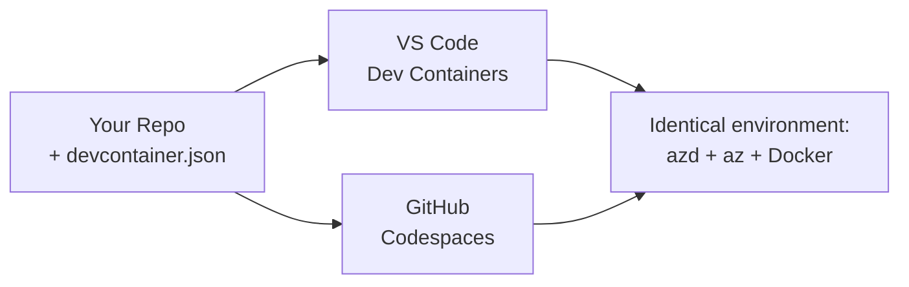

# Dev Containers & GitHub Codespaces para sa azd

**Pag-navigate sa Kabanata:**
- **📚 Bahay ng Kurso**: [AZD Para sa mga Nagsisimula](../../README.md)
- **📖 Kasalukuyang Kabanata**: Kabanata 1 - Pundasyon at Mabilis na Pagsisimula
- **⬅️ Nakaraan**: [Magdala ng Sariling App](bring-your-own-app.md)
- **🚀 Susunod na Kabanata**: [Kabanata 2: AI-First Development](../chapter-02-ai-development/README.md)

> Layunin sa pagsusuri ng utos at konfigurasiyon: `azd 1.37.2` (Nobyembre 2026). Hindi isinagawa ang mga container build at Azure deployment bilang bahagi ng pagsusuring ito.

## Panimula

Ang pag-install ng azd, tamang runtime ng wika, Docker, at Azure CLI sa bawat makina ay isang pasanin—at ito ang pangunahing dahilan kung bakit ang isang tutorial na "gumagana sa aking makina" ay nabibigo sa iba. Isang **dev container** ang nagsosolusyon dito sa pamamagitan ng paglalarawan sa buong toolchain sa isang file. Sinumang magbubukas ng proyekto sa VS Code o GitHub Codespaces ay magkakaroon ng eksaktong parehong kapaligiran, na may naka-install nang azd. Itinuturo sa araling ito kung paano magdagdag nito.

## Mga Layunin ng Pagkatuto

Sa pagtatapos ng araling ito, ikaw ay:
- Maiintindihan kung ano ang dev container at bakit ito nakakatulong sa azd
- Makakapagdagdag ng minimal na `.devcontainer/devcontainer.json` sa isang proyekto
- Maisasama ang azd, Azure CLI, at Docker sa pamamagitan ng Dev Container *features*
- Mabubuksan ang proyekto sa GitHub Codespaces o VS Code

## Mga Kinalabasan ng Pagkatuto

Matapos makumpleto ang araling ito, magagawa mo nang:
- Magsulat ng `devcontainer.json` para sa isang azd na proyekto
- Makapagdagdag ng azd at Azure tools nang hindi mano-mano ang pag-install
- Patakbuhin ang `azd up` mula sa loob ng container o Codespace

---

## Ano ang Dev Container?

Ang dev container ay isang Docker-based na environment sa pag-develop na tinutukoy ng isang `.devcontainer/devcontainer.json` na file sa iyong repository. Kapag binuksan mo ang proyekto:

- **VS Code** (kasama ang Dev Containers extension) ay nagtayo ng container at kumokonekta dito.
- **GitHub Codespaces** ay nagtatayo ng parehong container sa ulap at nagbibigay ng editor na browser-based.

Sa alinmang paraan, bawat contributor ay makakatanggap ng magkaparehong mga tool—walang tanong na "na-install mo na ba ang azd?" sa pag-troubleshoot.



---

## Hakbang 1: Gumawa ng devcontainer File

Gumawa ng `.devcontainer/devcontainer.json` sa ugat ng iyong proyekto:

```json
{
  "name": "azd-project",
  "image": "mcr.microsoft.com/devcontainers/base:bookworm",
  "features": {
    "ghcr.io/devcontainers/features/azure-cli:1": {},
    "ghcr.io/azure/azure-dev/azd:0": { "version": "1.37.2" },
    "ghcr.io/devcontainers/features/docker-in-docker:2": {},
    "ghcr.io/devcontainers/features/node:1": {}
  },
  "customizations": {
    "vscode": {
      "extensions": [
        "ms-azuretools.azure-dev",
        "ms-azuretools.vscode-bicep"
      ]
    }
  },
  "forwardPorts": [3000],
  "postCreateCommand": "azd version"
}
```

Ano ang ginagawa ng bawat bahagi:

| Susi | Layunin |
|-----|---------|
| `image` | Ang base OS para sa container |
| `features` | Mga prebuilt na installer—dito: Azure CLI, **azd**, Docker, at Node.js |
| `customizations.vscode.extensions` | Auto-install ng azd at Bicep VS Code extensions |
| `forwardPorts` | Inu-expose ang port ng iyong app sa browser |
| `postCreateCommand` | Nagpapatakbo ng isang beses matapos mabuo ang container (dito, isang sanity check) |

> Iba ang feature version (`azd:0`) at ang naka-installed na CLI version. Itakda ang `version` option ng feature sa `"1.37.2"` upang i-pin ang CLI; huwag gamitin ang CLI version bilang feature tag.

---

## Hakbang 2: Itugma ang Feature sa Wika ng Iyong App

Palitan ang `node` feature para sa anumang gamit ng iyong app:

```jsonc
// Python project
"ghcr.io/devcontainers/features/python:1": {},

// .NET project
"ghcr.io/devcontainers/features/dotnet:2": {},

// Java project
"ghcr.io/devcontainers/features/java:1": {},

// Go project
"ghcr.io/devcontainers/features/go:1": {}
```

Panatilihin ang `docker-in-docker` kapag gumagawa ng mga imahe nang lokal. Ang isang naka-configure na remote ACR build (`docker.remoteBuild: true`) ay alternatibo; ang uri ng host lamang ay hindi laging nangangailangan ng lokal na Docker.

---

## Hakbang 3: Buksan Ito

**Sa VS Code:**
1. I-install ang **Dev Containers** extension.
2. Buksan ang folder ng proyekto.
3. I-click ang **Reopen in Container** kapag may prompt (o patakbuhin ang *Dev Containers: Reopen in Container*).

**Sa GitHub Codespaces:**
1. I-push ang repo sa GitHub.
2. I-click ang **Code → Codespaces → Create codespace on main**.
3. Maghintay para mabuo ang container—handa na ang azd sa terminal.

---

## Hakbang 4: Mag-deploy Mula sa Loob ng Container

Ang container ay may preinstalled na azd, kaya ang normal na workflow ay gumagana na:

```bash
azd auth login --use-device-code   # device code is handy inside Codespaces
azd up
```

> **Bakit `--use-device-code`?** Sa remote container o Codespace walang lokal na browser na pwedeng i-redirect, kaya ang device-code login ang mapagkakatiwalaang paraan. Magp-paste ka ng code sa tab ng browser para makumpleto ang pag-sign in.

---

## Karaniwang mga Problema

| Problema | Solusyon |
|---------|----------|
| Hindi makabuo ng imahe si `azd up` | Magdagdag ng `docker-in-docker` feature |
| Nagtitigil ang browser login sa Codespaces | Gamitin ang `azd auth login --use-device-code` |
| Magkaiba ang mga tool sa pagitan ng mga kasamahan | I-pin ang CLI sa pamamagitan ng `version` option ng azd feature at i-pin ang mga runtime ng wika |
| Hindi ma-access ang app sa browser | Idagdag ang port sa `forwardPorts` |

---

## Buod

- Ginagawa ng dev container na reproducible ang iyong azd toolchain para sa lahat.
- Magdagdag ng azd, Azure CLI, at Docker gamit ang Dev Container *features*.
- Itugma ang feature ng wika sa iyong app at panatilihin ang `docker-in-docker` para sa mga container host.
- Gumamit ng device-code login kapag nasa loob ng Codespaces.

---

## 🔗 Pag-navigate

| Direksyon | Resource |
|-----------|----------|
| **Nakaraan** | [Magdala ng Sariling App](bring-your-own-app.md) |
| **Bahay ng Kabanata** | [Kabanata 1: Pundasyon at Mabilis na Pagsisimula](README.md) |
| **Susunod na Kabanata** | [Kabanata 2: AI-First Development](../chapter-02-ai-development/README.md) |

## 📖 Mga Kaugnay na Mapagkukunan

- [Pag-install at Setup](installation.md)
- [Command Cheat Sheet](../../resources/cheat-sheet.md)
- [Opisyal na Dev Containers specification](https://containers.dev/)
- [azd Dev Container feature](https://github.com/Azure/azure-dev/tree/main/ext/devcontainer)

---

<!-- CO-OP TRANSLATOR DISCLAIMER START -->
**Pagtatanggi**:
Ang dokumentong ito ay isinalin gamit ang serbisyo ng AI translation na [Co-op Translator](https://github.com/Azure/co-op-translator). Bagama't nagsusumikap kami para sa katumpakan, pakatandaan na ang awtomatikong pagsasalin ay maaaring maglaman ng mga pagkakamali o hindi pagkakatugma. Ang orihinal na dokumento sa orihinal nitong wika ang dapat ituring na pangunahing sanggunian. Para sa mahahalagang impormasyon, inirerekomenda ang propesyonal na pagsasalin ng tao. Hindi kami mananagot sa anumang maling pagkakaintindi o maling interpretasyon na nagmula sa paggamit ng pagsasaling ito.
<!-- CO-OP TRANSLATOR DISCLAIMER END -->