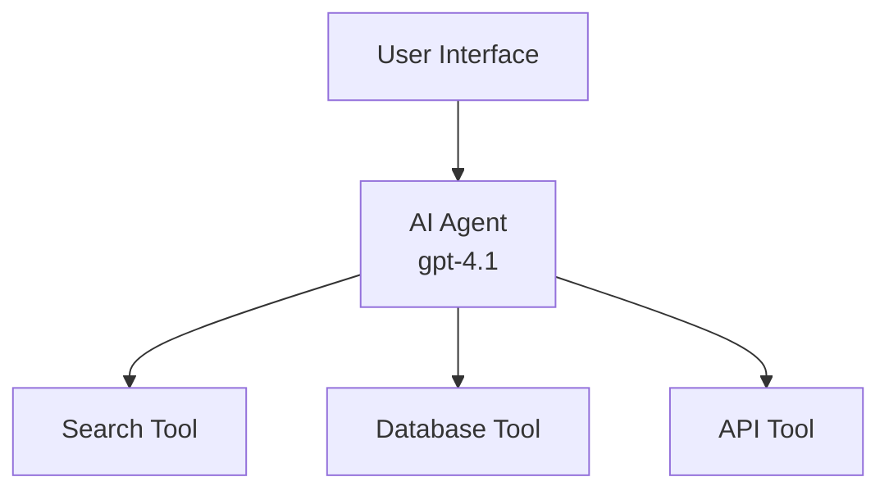
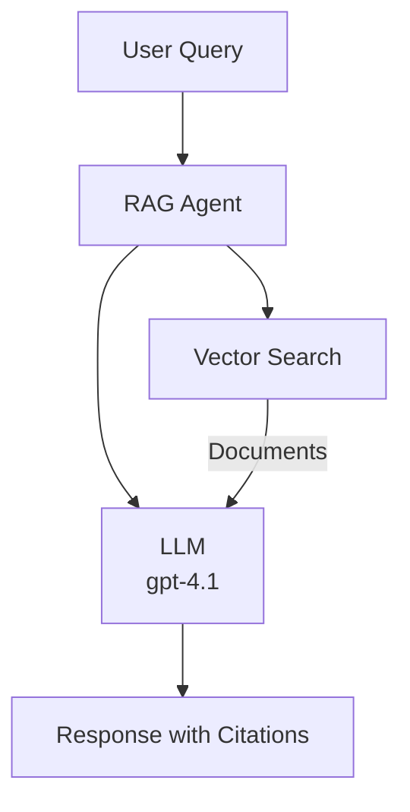
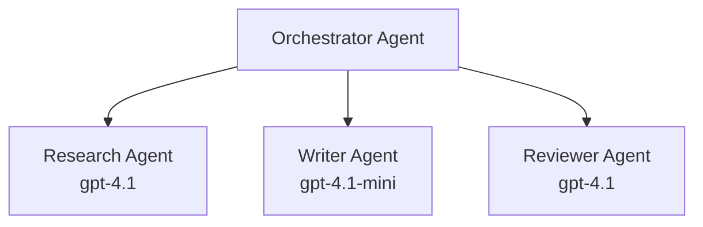

# Mga AI Agent gamit ang Azure Developer CLI

**Pag-navigate sa Kabanata:**
- **📚 Panimulang Kurso**: [AZD For Beginners](../../README.md)
- **📖 Kasalukuyang Kabanata**: Kabanata 2 - AI-First Development
- **⬅️ Nakaraan**: [Microsoft Foundry Integration](microsoft-foundry-integration.md)
- **➡️ Susunod**: [AI Model Deployment](ai-model-deployment.md)
- **🚀 Pahusayin**: [Multi-Agent Solutions](../../examples/retail-scenario.md)

---

## Panimula

Ang mga AI agent ay mga autonomous na programa na maaaring makaunawa sa kanilang kapaligiran, gumawa ng mga desisyon, at magsagawa ng mga aksyon upang makamit ang mga partikular na layunin. Hindi tulad ng simpleng mga chatbot na tumutugon lamang sa mga utos, ang mga agent ay maaaring:

- **Gumamit ng mga tool** - Tumawag ng mga API, maghanap ng mga database, magpatakbo ng code
- **Magplano at magrason** - Hatiin ang mga komplikadong gawain sa mga hakbang
- **Matuto mula sa konteksto** - Panatilihin ang memorya at iangkop ang pag-uugali
- **Makipagtulungan** - Makipagtulungan sa iba pang mga agent (multi-agent system)

Ipinapakita sa gabay na ito kung paano i-deploy ang mga AI agent sa Azure gamit ang Azure Developer CLI (azd).

Ang paggamit ng konteksto ng pag-uusap ay hindi pagsasanay ng modelo: ang persistent memory, control sa akses, at retention ay kailangang ipatupad/ikonpigura ng aplikasyon.

> **Foundry GA update (2026-11-09):** I-install ang pangkalahatang available na `microsoft.foundry` 1.0 bundle gamit ang `azd >= 1.37.0`. Ang mga pagsusuri ay nai-install nang hiwalay; ang opsyonal na mga preview na tampok at ang klasikong SDK fragment sa ibaba ay hindi na-promote sa GA sa pamamagitan ng anunsiyo ng bundle. Ang patnubay na ito ay batay sa [GA announcement](https://devblogs.microsoft.com/azure-sdk/microsoft-foundry-azure-developer-cli-ga/) at dokumentasyon, hindi sa isang live na Azure deployment.

## Mga Layunin sa Pagkatuto

Sa pagtapos ng gabay na ito, ikaw ay:
- Maiintindihan kung ano ang mga AI agent at paano sila naiiba sa mga chatbot
- Makakapag-deploy ng mga pre-built na template ng AI agent gamit ang AZD
- Makakapag-configure ng Foundry Agents para sa mga custom na agent
- Makakapagpatupad ng mga pangunahing pattern ng agent (paggamit ng tool, RAG, multi-agent)
- Makakapag-monitor at mag-debug ng mga deployed na agent

## Mga Kinalabasan ng Pagkatuto

Sa pagtapos, magagawa mong:
- Mag-deploy ng AI agent application sa Azure gamit ang isang utos lamang
- Mag-configure ng mga tool at kakayahan ng agent
- Magpatupad ng retrieval-augmented generation (RAG) gamit ang mga agent
- Magdisenyo ng mga multi-agent architecture para sa mga komplikadong workflow
- Mag-troubleshoot ng mga karaniwang isyu sa deployment ng agent

---

## 🤖 Ano ang Nagpapakaiba ng Agent sa Chatbot?

| Katangian | Chatbot | AI Agent |
|---------|---------|----------|
| **Pag-uugali** | Tumutugon sa mga utos | Kumikilos nang autonomous |
| **Mga Tool** | Maaaring gumamit ng retrieval o mga tool | Karaniwang gumagamit ng mga tool sa isang layuning nakatuon na loop |
| **Memorya** | Depende sa aplikasyon | Persistent memory lamang kung eksaktong ipinatupad |
| **Pagpaplano** | Isang tugon | Multi-step na pag-iisip |
| **Pakikipagtulungan** | Isang entidad lamang | Puwedeng makipagtulungan sa ibang mga agent |

### Simpleng Analogy

- **Chatbot** = Isang taong matulungin na sumasagot sa mga tanong sa isang information desk
- **AI Agent** = Isang personal assistant na maaaring tumawag, magbook ng appointment, at magawa ang mga gawain para sa iyo

---

## 🚀 Mabilisang Simula: I-deploy ang Iyong Unang Agent

Pumili ng isang opsyon sa isang **bagong walang laman na working directory**. Ang trailing `.` ay mag-i-initialize doon; kung walang tahasang destinasyon, ang kasalukuyang AZD ay maaaring lumikha ng isang template-named subdirectory at hindi babaguhin ang direktoryo ng iyong shell. Panatilihin ang mga hiwalay na template/environment sa mga hiwalay na direktoryo.

Ang mga tinatayang oras/gastos sa ibaba ay ilustratibo lamang, hindi opisyal na presyo. Suriin ang kasalukuyang mga kinakailangan, presyo, quota ng modelo, at opsyonal na serbisyo ng bawat halimbawa bago i-deploy.

### Opsyon 1: Foundry Agents Template (Inirerekomenda)

```bash
# Initialize the AI agents template
azd init --template get-started-with-ai-agents .

# Deploy to Azure
azd up
```

**Ano ang nade-deploy:** Ang kasalukuyang imprastraktura ng sample at mga piniling opsyon ang nagtatakda ng modelo, mga tool, hosting, at mga mapagkukunan para sa monitoring. Suriin ang README at `infra/` bago mag-provision; huwag ipagpalagay na lahat ng agent template ay may Search o web interface.

**Oras:** ~15-20 minuto
**Gastos:** ~$100-150/buwan (pag-develop)

### Opsyon 2: Creative Writing Agents gamit ang Prompty

```bash
# Initialize the Prompty-based agent template
azd init --template https://github.com/Azure-Samples/contoso-creative-writer .

# Deploy to Azure
azd up
```

**Ano ang nade-deploy:** Isang FastAPI/Prompty multi-agent writing sample gamit ang Azure OpenAI, Bing Grounding, at Azure AI Search. Ang dating `agent-openai-python-prompty` repository ay nag-redirect dito; ito ay hindi isang minimal na Azure Functions weather-agent template. Sundan ang kasalukuyang README nito para sa hosting, quota ng modelo, at mga kinakailangan sa Bing Grounding.

**Oras:** ~10-15 minuto
**Gastos:** ~$50-100/buwan (pag-develop)

### Opsyon 3: RAG Chat Agent

```bash
# Initialize RAG chat template
azd init --template azure-search-openai-demo .

# Deploy to Azure
azd up
```

**Ano ang nade-deploy:**
- ✅ Microsoft Foundry Models
- ✅ Azure AI Search na may sample data
- ✅ Document processing pipeline
- ✅ Chat interface na may mga citation

**Oras:** ~15-25 minuto
**Gastos:** ~$80-150/buwan (pag-develop)

### Opsyon 4: Hosted Agent gamit ang GA Foundry Bundle

Gamitin ang [kumpletong walkthrough para sa hosted-agent](microsoft-foundry-integration.md#hosted-agent-walkthrough-ga) para sa basic Python Agent Framework Responses API sample. Ang landas na ito ng pag-deploy ng kodigo ay nangangailangan ng Python 3.13+, kasalukuyang uv, mga permiso ng Foundry, at regional model quota. Mag-authenticate nang hiwalay sa mga local SDK call kapag gumagamit ng Azure CLI credentials.

```bash
azd auth login
azd ext install microsoft.foundry
```

Sa walang laman na direktoryo, i-initialize ang sample:

```text
azd ai agent init --template https://github.com/microsoft-foundry/foundry-samples/blob/main/samples/python/hosted-agents/agent-framework/responses/01-basic/azure.yaml --deploy-mode code --src .
```

Pumili ng bagong o umiiral na proyekto, suriin ang `azure.yaml`, at patakbuhin ang `azd provision`. Gamitin ang `azd ai agent run` upang buksan ang Agent Inspector at, mula sa ibang terminal sa parehong direktoryo, patakbuhin ang `azd ai agent invoke --local "Explain how this agent is hosted."`. Pagkatapos ng lokal na beripikasyon, gamitin ang `azd deploy` at `azd ai agent invoke "Explain how this agent is hosted."` para ihambing ang deployed na tugon. Binubuo ng Foundry ang na-upload na source nang remote; hindi kailangan ang lokal na container build.

**Kailan gagamitin ang `azd ai agent init` vs `azd init --template`:**

| Pamamaraan | Pinakamainam Para sa | Paano Ito Gumagana |
|----------|----------|------|
| `azd init --template` | Magsisimula mula sa gumaganang sample app | Kinokopya ang buong template repo na may code + infra |
| `azd ai agent init --template` | Ina-adopt ang kasalukuyang Foundry agent project | Ginagamit ang `azure.yaml` project document at mga depinisyon nito |

> **Tip:** Ang Mga Opsyon 1-3 ay nagsisimula mula sa mga buong application template; Ang Opsyon 4 ay nagtuturo ng GA hosted-agent workflow. Walang initialization command ang awtomatikong nagmi-migrate ng mga legacy agent manifest. Para magdagdag ng direktang depinisyon ng agent sa umiiral na proyekto, tingnan ang [patnubay sa initialization at migration](../chapter-08-production/production-ai-practices.md#initializing-agent-projects-with-azd-ai-agent-init).

Mag-install ng `azure.ai.evaluations` nang hiwalay upang makabuo at magsuri ng test data/rubric, mag-configure ng evaluasyon, at patakbuhin ito gamit ang `azd ai eval`. Maaaring gamitin muli ang compatible na evaluasyon para sa optimization; suriin ang mga kandidato bago tahasang i-deploy. Sundin ang [evaluation workflow](../chapter-08-production/production-ai-practices.md#evaluation-migration-and-quality-checks) at [optimization migration](../chapter-08-production/production-ai-practices.md#optimization-configuration-migration) bago muling gamitin ang mga lumang halimbawa. Para sa paglilinis, nananatili ang mga resource ng reused Foundry project pagkatapos ng `azd down`; ang newly created na project resource group ay nade-delete. Tingnan ang [patnubay sa paglilinis](microsoft-foundry-integration.md#7-clean-up-deliberately).

---

## 🏗️ Mga Arkitektura ng Agent

### Pattern 1: Isang Agent na May Mga Tool

Pinakasimpleng pattern ng agent - isang agent na maaaring gumamit ng maraming mga tool.



**Pinakamainam para sa:**
- Mga customer support bot
- Mga research assistant
- Mga data analysis agent

**Kaugnay na sample ng aplikasyon:** Ang `azure-search-openai-demo` ay nagpapakita ng RAG, hindi isang generic na arbitrary tool agent loop.

### Pattern 2: RAG Agent (Retrieval-Augmented Generation)

Isang agent na kumukuha ng mga kaugnay na dokumento bago gumawa ng mga tugon.



**Pinakamainam para sa:**
- Mga enterprise knowledge base
- Mga document Q&A system
- Pananaliksik sa pagsunod at legal

**AZD Template:** `azure-search-openai-demo`

### Pattern 3: Multi-Agent System

Maraming specialized agent na nagtutulungan sa mga komplikadong gawain.



**Pinakamainam para sa:**
- Komplikadong pagbuo ng nilalaman
- Multi-step na workflow
- Mga gawain na nangangailangan ng iba't ibang kakayahan

**Matuto Pa:** [Multi-Agent Coordination Patterns](../chapter-06-pre-deployment/coordination-patterns.md)

---

## ⚙️ Pagkokonpigura ng Mga Tool ng Agent

Nagiging makapangyarihan ang mga agent kapag kaya nilang gumamit ng mga tool. Narito kung paano mag-configure ng mga karaniwang tool:

### Pagkokonpigura ng Tool sa Foundry Agents

Ang **klasikong fragment ng Agent Service SDK** na ito ay nakatuon sa `azure-ai-projects==1.0.0` at `azure-ai-agents==1.1.0` gamit ang `azure-identity`. Hindi ito ang mas bagong versioned-agent/Responses API na ginagamit ng ilan sa kasalukuyang Foundry template, ni ang `azure.ai.agents` AZD extension (ibang package). Huwag paghaluin ang mga henerasyong API na ito. Itakda ang `PROJECT_ENDPOINT` sa klasikong endpoint ng Foundry project at `MODEL_DEPLOYMENT_NAME` sa umiiral ngunit suportadong deployment ng modelo; mag-authenticate gamit ang `az login` nang lokal at bigyan ng kinakailangang permiso ang proyekto.

```python
# agent_config.py
import os
from azure.ai.projects import AIProjectClient
from azure.ai.agents.models import FunctionTool
from azure.identity import DefaultAzureCredential

def search_knowledge_base(query: str) -> str:
    """Search the demonstration knowledge base.

    :param query: Search text.
    :return: Matching demonstration information.
    """
    # Local fixture only, not a production search implementation.
    return "Demo policy: returns are accepted within 30 days."

project_client = AIProjectClient(
    endpoint=os.environ["PROJECT_ENDPOINT"],
    credential=DefaultAzureCredential(),
)
search_tool = FunctionTool(functions={search_knowledge_base})
project_client.agents.enable_auto_function_calls(search_tool)
agent = project_client.agents.create_agent(
    model=os.environ["MODEL_DEPLOYMENT_NAME"],
    name="Support Agent",
    instructions="Use search_knowledge_base for policy questions. Label results as demo data.",
    tools=search_tool.definitions,
)
```

Ang pagrehistro ng function schema ay hindi nagpapatakbo ng Python sa serbisyo. Sa SDK na ito, ang `enable_auto_function_calls` kasama ang `agents.runs.create_and_process(...)` ay nagpapatakbo ng mga rehistradong callback sa iyong client process. Tingnan ang [released SDK example](https://github.com/Azure/azure-sdk-for-python/blob/azure-ai-agents_1.1.0/sdk/ai/azure-ai-agents/samples/agents_tools/sample_agents_auto_function_call.py). Isara ang client at tanggalin ang mga demonstration agents/threads kapag tapos na.

### Pagkokonpigura ng Kapaligiran

Ang mga sumusunod na pangalan ay **illustratibong custom-template inputs**, hindi mga built-in na switch ng AZD. Una, ipaandar bawat halaga sa pamamagitan ng `infra/main.parameters.json`, imprastraktura, at code ng aplikasyon. Ang `azd env set` mag-isa ay hindi nagbabago ng mga tool o instruksiyon ng agent.

```bash
# Set up agent-specific environment variables
azd env set AZURE_OPENAI_MODEL "gpt-4.1"
azd env set AGENT_INSTRUCTIONS "You are a helpful assistant..."
azd env set ENABLE_CODE_INTERPRETER "true"
azd env set ENABLE_FILE_SEARCH "true"

# Apply wired infrastructure and application changes
azd up
```

---

## 📊 Pagmo-monitor ng mga Agent

### Integrasyon ng Application Insights

Kung ang pinili mong template ay nagpo-provision ng Application Insights at nagkokonpigura ng instrumentation:

```bash
# Open monitoring dashboard
azd monitor --overview

# Open the Application Insights logs view (not a streaming log tail)
azd monitor --logs

# View live metrics
azd monitor --live
```

### Mga Pangunahing Sukatan na Subaybayan

| Sukatan | Paglalarawan | Target |
|--------|-------------|--------|
| Latency ng Tugon | Oras sa pagbuo ng tugon | < 5 segundo |
| Paggamit ng Token | Tokens kada request | Subaybayan para sa gastos |
| Tagumpay ng Tawag ng Tool | % ng matagumpay na pagpatakbo ng tool | > 95% |
| Rate ng Error | Mga nabigong request ng agent | < 1% |
| Kasiyahan ng User | Mga score ng puna | > 4.0/5.0 |

### Pagsusulat ng Custom Logging para sa Mga Agent

```python
import os
from azure.monitor.opentelemetry import configure_azure_monitor
from opentelemetry import trace

# Configure Azure Monitor with OpenTelemetry
configure_azure_monitor(
    connection_string=os.environ["APPLICATIONINSIGHTS_CONNECTION_STRING"]
)

tracer = trace.get_tracer(__name__)

def log_agent_interaction(user_query, agent_response, tools_used, latency_ms):
    with tracer.start_as_current_span("agent_interaction") as span:
        span.set_attributes({
            "query_length": len(user_query),  # Do not log raw prompts or personal data
            "response_length": len(agent_response),
            "tools_used": tools_used,
            "latency_ms": latency_ms
        })
```

> **Tandaan:** I-install ang kinakailangang package: `pip install azure-monitor-opentelemetry`. Nagdadala ito ng mga dependency ng OpenTelemetry; ang import namespace ay hindi isang kinakailangan para mag-install ng package na pinangalanang `opentelemetry`.

---

## 💰 Mga Pag-isip sa Gastos

### Tantyang Buwanang Gastos Ayon sa Pattern

Ito ay mga ilustratibong saklaw ng plano, hindi mga quote o limitasyon sa paggasta. Maaaring lumampas dito ang rehiyon, tokens ng modelo, Search/compute SKUs, sessions ng tool, storage, at trapiko. Suriin ang gabay sa gastos ng sample at Azure pricing bago mag-`azd up`.

| Pattern | Dev Environment | Production |
|---------|-----------------|------------|
| Isang Agent | $50-100 | $200-500 |
| RAG Agent | $80-150 | $300-800 |
| Multi-Agent (2-3 agents) | $150-300 | $500-1,500 |
| Enterprise Multi-Agent | $300-500 | $1,500-5,000+ |

### Mga Tip sa Pag-optimize ng Gastos

1. **Gamitin ang gpt-4.1-mini para sa mga simpleng gawain** (kung ginagawang input ito ng template mo)
   ```bash
   azd env set AZURE_OPENAI_MODEL "gpt-4.1-mini"
   ```

2. **Magpatupad ng scoped caching para sa ligtas at paulit-ulit na mga query.** Isama ang tenant/user authorization, deployment ng modelo, instruksiyon, at bersyon ng retrieval sa cache key; magtakda ng expiry. Huwag ibahagi ang mga pribadong tugon sa pag-uusap sa pamamagitan ng process-wide na query-only cache. Ang SDK agent object ay walang generic na `agent.run()` method.

3. **Itakda ang limitasyon ng token kada run**
   ```python
   # Set max_completion_tokens when running the agent, not during creation
   run = project_client.agents.runs.create_and_process(
       thread_id=thread.id,
       agent_id=agent.id,
       max_completion_tokens=1000  # Budget across the run; may finish as incomplete
   )
   ```

4. **I-scale ang angkop na Container Apps sa zero kapag hindi ginagamit**
   ```bash
   # Custom-template input: must map to template.scale.minReplicas
   azd env set MIN_REPLICAS "0"
   ```
   Ipatupad ang pagbabago ng imprastraktura gamit ang `azd provision` o `azd up`. Ang scaling to zero ay nangangailangan ng angkop na trigger at hindi humihinto sa Search, storage, o bayad sa modelo/tool.

---

## 🔧 Pag-aayos ng mga Problema sa Agents

### Mga Karaniwang Isyu at Solusyon

<details>
<summary><strong>❌ Hindi tumutugon ang agent sa mga tawag sa tool</strong></summary>

```bash
# Inspect the application deployment (not the agent's registered tools)
azd show

# Verify OpenAI deployment
az cognitiveservices account deployment list \
  --name $AZURE_OPENAI_NAME \
  --resource-group $RG_NAME

# Check agent logs
azd monitor --logs
```

**Mga Karaniwang sanhi:**
- Hindi tugmang function signature ng tool
- Kulang sa kinakailangang mga permiso
- Hindi ma-access ang API endpoint
</details>

<details>
<summary><strong>❌ Mataas na latency sa mga tugon ng agent</strong></summary>

```bash
# Check Application Insights for bottlenecks
azd monitor --live

# Consider using a faster model
azd env set AZURE_OPENAI_MODEL "gpt-4.1-mini"
azd up
```

**Mga tip sa optimization:**
- Gamitin ang streaming responses
- Magpatupad ng response caching
- Bawasan ang laki ng context window
</details>

<details>
<summary><strong>❌ Nagbabalik ng maling o hallucinated na impormasyon ang agent</strong></summary>

```python
# Improve with better system prompts
instructions = """
You are a helpful assistant. IMPORTANT:
- Only answer based on provided context
- If you don't know, say "I don't know"
- Always cite your sources
- Never make up information
"""

# Use these instructions in the agent definition.
# For classic file search, first upload/index documents in a vector store,
# then use FileSearchTool(vector_store_ids=[...]) and pass both its
# .definitions and .resources when creating the agent.
```
Ang mga instruksiyon at retrieval ay nagpapababa ng panganib; wala sa dalawa ang garantiya ng mga tumpak na sagot. Suriin ang grounded at out-of-scope na mga tanong laban sa mga kilalang sagot.
</details>

<details>
<summary><strong>❌ Mga error dahil lumabis sa token limit</strong></summary>

```python
# Implement context window management
def truncate_context(messages, max_tokens=8000, model="gpt-4.1"):
    """Approximate content-only budget for objects with .content strings."""
    import tiktoken
    encoding = tiktoken.encoding_for_model(model)
    total_tokens = 0
    truncated = []
    
    for msg in reversed(messages):
        msg_tokens = len(encoding.encode(msg.content))
        if total_tokens + msg_tokens > max_tokens:
            break
        truncated.insert(0, msg)
        total_tokens += msg_tokens
    
    return truncated
```
Ang tulong na ito ay hindi kasama ang role/tool schemas, mga instruksiyon ng system, mga token ng larawan, at overhead ng protocol. Magtabi ng espasyo para sa mga iyon at ang completion; huwag hatiin ang mga pares ng tawag ng tool/tugon o alisin ang kinakailangang mga instruksiyon ng system. Mag-install nang hiwalay ng `tiktoken`. Hindi ito pangkalahatang validator para sa context-window.
</details>

---

## 🎓 Gawain na Hands-On

### Gawain 1: Mag-deploy ng Basic Agent (20 minuto)

**Layunin:** Mag-deploy ng iyong unang AI agent gamit ang AZD

```bash
# Step 1: Initialize template
azd init --template get-started-with-ai-agents .

# Step 2: Login to Azure
azd auth login
# If you work across tenants, add --tenant-id <tenant-id>

# Step 3: Deploy
azd up

# Step 4: Test the agent
# Expected output after deployment:
#   Deployment Complete!
#   Endpoint: https://<app-name>.<region>.azurecontainerapps.io
# Open the URL shown in the output and try asking a question

# Step 5: View monitoring
azd monitor --overview

# Step 6: Review the listed resources and confirm cleanup
azd down
```

**Mga Pamantayan sa Tagumpay:**
- [ ] Tumutugon ang agent sa mga tanong
- [ ] Maaaring ma-access ang monitoring dashboard sa pamamagitan ng `azd monitor`
- [ ] Matagumpay na nalinis ang mga resources

### Ehersisyo 2: Magdagdag ng Pasadyang Tool (30 minuto)

**Layunin:** Palawakin ang isang agent gamit ang pasadyang tool

**Panimulang punto:** Gamitin ang klasikong SDK client mula sa [Tool Configuration](#tool-configuration-in-foundry-agents), hindi ang anumang template na may ibang henerasyon ng SDK.

1. Idagdag ang deterministic na fixture na ito sa `agent_config.py`:
   ```python
   def get_weather(location: str) -> str:
       """Return demonstration weather, not live conditions.

       :param location: City name.
       :return: A clearly labelled fixture.
       """
       print(f"TOOL_CALLED: {location}")
       return f"Demo weather in {location}: Sunny, 72°F (fixture, not live)"
   ```
2. Palitan ang rehistrasyon at bloke ng paglikha ng search-tool gamit ang:
   ```python
   weather_tool = FunctionTool(functions={get_weather})
   project_client.agents.enable_auto_function_calls(weather_tool)
   agent = project_client.agents.create_agent(
       model=os.environ["MODEL_DEPLOYMENT_NAME"],
       name="Weather Agent",
       instructions="Call get_weather for weather questions; explain that it returns demo data.",
       tools=weather_tool.definitions,
   )
   thread = project_client.agents.threads.create()
   try:
       project_client.agents.messages.create(
           thread_id=thread.id, role="user", content="Use get_weather for Seattle."
       )
       run = project_client.agents.runs.create_and_process(
           thread_id=thread.id, agent_id=agent.id
       )
       if run.status != "completed":
           raise RuntimeError(f"Run status: {run.status}; error: {run.last_error}")
       for message in project_client.agents.messages.list(thread_id=thread.id):
           for text in message.text_messages:
               print(text.text.value)
   finally:
       project_client.agents.threads.delete(thread.id)
       project_client.agents.delete_agent(agent.id)
       project_client.close()
   ```
3. Patakbuhin nang lokal (ito ay tatawag sa kasalukuyang Azure project at magkakaroon ng singil sa modelo):
   ```bash
   python agent_config.py
   # Expected: TOOL_CALLED: Seattle, then a completed answer labelled demo data.
   ```

**Mga Pamantayan sa Tagumpay:**
- [ ] Nakikilala ng agent ang mga tanong na may kinalaman sa panahon
- [ ] Tama ang pagtawag sa tool
- [ ] Kasama sa tugon ang impormasyon tungkol sa panahon

### Ehersisyo 3: Bumuo ng RAG Agent (45 minuto)

**Layunin:** Gumawa ng agent na sumasagot mula sa iyong mga dokumento

```bash
# Step 1: Deploy RAG template
azd init --template azure-search-openai-demo .
azd up

# Step 2: Upload your documents
# For the sample's local ingestion path, place supported files in data/.
# Run from the sample root after following its Python environment setup:
./scripts/prepdocs.sh
# Windows PowerShell equivalent: .\\scripts\\prepdocs.ps1

# Step 3: Test with domain-specific questions
# Open the web app URL from the azd up output
# Ask questions about your uploaded documents
# Responses should include citation references like [doc.pdf]
```

**Mga Pamantayan sa Tagumpay:**
- [ ] Sumagot ang agent mula sa mga na-upload na dokumento
- [ ] Kasama sa mga sagot ang mga sanggunian
- [ ] Ang mga tanong na labas sa saklaw ay hinaharap nang walang mga hindi suportadong pahayag (hindi garantiya para sa bawat susunod na tanong)

Kung `USE_CLOUD_INGESTION=true`, gamitin ang sample na cloud ingestion/upload workflow sa halip; sinasadya ng lokal na wrapper na hindi isali ang ingestion. Pagkatapos ng pagsubok, patakbuhin ang `azd down` sa RAG na kapaligiran at suriin ang mga resource na dapat tanggalin.

---

## 📚 Mga Susunod na Hakbang

Ngayon na nauunawaan mo na ang mga AI agent, tuklasin ang mga advanced na paksa na ito:

| Paksa | Paglalarawan | Link |
|-------|-------------|------|
| **Multi-Agent Systems** | Magbuo ng mga sistema na may maraming magkatulungang agent | [Retail Multi-Agent Example](../../examples/retail-scenario.md) |
| **Coordination Patterns** | Pag-aralan ang mga pattern ng orkestrasyon at komunikasyon | [Coordination Patterns](../chapter-06-pre-deployment/coordination-patterns.md) |
| **Production Deployment** | Enterprise-ready na deployment ng agent | [Production AI Practices](../chapter-08-production/production-ai-practices.md) |
| **Agent Evaluation** | Subukan at suriin ang performance ng agent | [AI Troubleshooting](../chapter-07-troubleshooting/ai-troubleshooting.md) |
| **AI Workshop Lab** | Hands-on: Gawing AZD-ready ang iyong AI solution | [AI Workshop Lab](ai-workshop-lab.md) |

---

## 📖 Karagdagang Mga Mapagkukunan

### Opisyal na Dokumentasyon
- [Microsoft Foundry Agent Service](https://learn.microsoft.com/azure/ai-services/agents/)
- [Microsoft Foundry Agent Service Quickstart](https://learn.microsoft.com/azure/ai-services/agents/quickstart)
- [Semantic Kernel Agent Framework](https://learn.microsoft.com/semantic-kernel/)

### AZD Templates para sa Mga Agent
- [Simulan ang AI Agents](https://github.com/Azure-Samples/get-started-with-ai-agents)
- [Creative Writing Agents gamit ang Prompty](https://github.com/Azure-Samples/contoso-creative-writer)
- [Azure Search OpenAI Demo](https://github.com/Azure-Samples/azure-search-openai-demo)

### Mga Mapagkukunan ng Komunidad
- [Awesome AZD - Agent Templates](https://azure.github.io/awesome-azd/?tags=ai-agents)
- [Azure AI Discord](https://discord.gg/microsoft-azure)
- [Microsoft Foundry Discord](https://discord.gg/nTYy5BXMWG)

### Kakayahan ng Agent para sa Iyong Editor
- [**Microsoft Azure Agent Skills**](https://skills.sh/microsoft/github-copilot-for-azure) - Mag-install ng reusable na AI agent skills para sa Azure development sa GitHub Copilot, Cursor, o anumang suportadong agent. Kasama ang mga kakayahan para sa [Azure AI](https://skills.sh/microsoft/github-copilot-for-azure/azure-ai), [Microsoft Foundry](https://skills.sh/microsoft/github-copilot-for-azure/microsoft-foundry), [deployment](https://skills.sh/microsoft/github-copilot-for-azure/azure-deploy), at [diagnostics](https://skills.sh/microsoft/github-copilot-for-azure/azure-diagnostics):
  ```bash
  npx skills add microsoft/github-copilot-for-azure
  ```

---

**Navigasyon**
- **Nakaraang Aralin**: [Microsoft Foundry Integration](microsoft-foundry-integration.md)
- **Susunod na Aralin**: [AI Model Deployment](ai-model-deployment.md)

---

<!-- CO-OP TRANSLATOR DISCLAIMER START -->
**Pagtatanggi**:
Ang dokumentong ito ay isinalin gamit ang serbisyo ng AI translation na [Co-op Translator](https://github.com/Azure/co-op-translator). Bagama't nagsusumikap kami para sa katumpakan, pakatandaan na ang awtomatikong pagsasalin ay maaaring maglaman ng mga pagkakamali o hindi pagkakatugma. Ang orihinal na dokumento sa orihinal nitong wika ang dapat ituring na pangunahing sanggunian. Para sa mahahalagang impormasyon, inirerekomenda ang propesyonal na pagsasalin ng tao. Hindi kami mananagot sa anumang maling pagkakaintindi o maling interpretasyon na nagmula sa paggamit ng pagsasaling ito.
<!-- CO-OP TRANSLATOR DISCLAIMER END -->