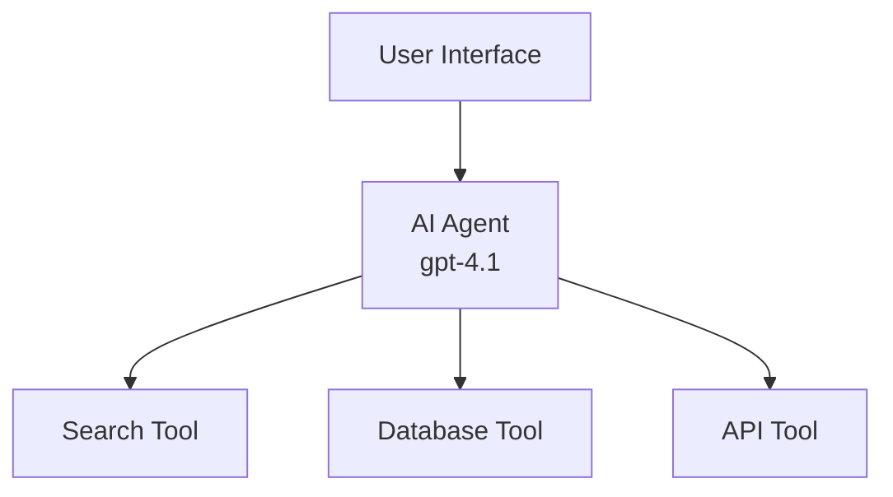
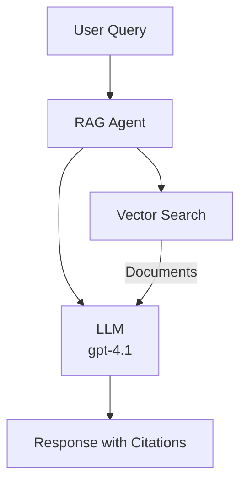
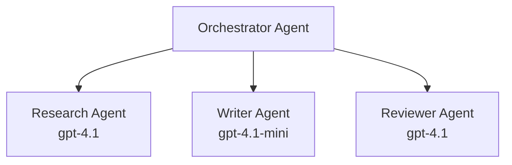

# AI Agents gamit ang Azure Developer CLI

**Pag-navigate sa Kabanata:**
- **📚 Home ng Kurso**: [AZD Para sa mga Baguhan](../../README.md)
- **📖 Kasalukuyang Kabanata**: Kabanata 2 - AI-First Development
- **⬅️ Dati**: [Microsoft Foundry Integration](microsoft-foundry-integration.md)
- **➡️ Susunod**: [AI Model Deployment](ai-model-deployment.md)
- **🚀 Advanced**: [Multi-Agent Solutions](../../examples/retail-scenario.md)

---

## Panimula

Ang mga AI agent ay mga autonomous na programa na kayang maramdaman ang kanilang kapaligiran, gumawa ng mga desisyon, at magsagawa ng mga aksyon upang makamit ang mga partikular na layunin. Hindi tulad ng mga simpleng chatbot na sumasagot lamang sa mga prompt, ang mga agent ay maaaring:

- **Gumamit ng mga kasangkapan** - Tumawag ng mga API, maghanap sa mga database, magpatakbo ng code
- **Magplano at mag-isip** - Hatiin ang mga komplikadong gawain sa mga hakbang
- **Matuto mula sa konteksto** - Panatilihin ang memorya at iakma ang pag-uugali
- **Makipagtulungan** - Makipagtrabaho sa ibang mga agent (multi-agent systems)

Ipinapakita ng gabay na ito kung paano mag-deploy ng mga AI agent sa Azure gamit ang Azure Developer CLI (azd).

Ang paggamit ng konteksto ng pag-uusap ay hindi pagsasanay ng modelo: ang persistent na memorya, kontrol sa access, at retention ay kailangang ipatupad/ikumpigura ng aplikasyon.

> **Review ng release (2026-11-04):** Ang mga halimbawa ng CLI ay sinuri laban sa dokumentasyon/source ng `azd` `1.37.2`, `azure.ai.agents` `1.0.0-beta.23`, at `azure.ai.evaluations` `1.0.0-beta.2`, hindi sa isang buhay na deployment ng Azure. Gumamit ng `azd >= 1.37.0` para sa pinagsamang workflow. Tingnan ang [mga kamakailang pagbabago at pag-aayos](../chapter-08-production/production-ai-practices.md#recent-release-changes-and-fixes) bago mag-upgrade ng mga lumang proyekto.

## Mga Layunin sa Pagkatuto

Sa pagtatapos ng gabay na ito, magagawa mong:
- Maunawaan kung ano ang mga AI agent at paano ito naiiba sa mga chatbot
- Mag-deploy ng mga pre-built na template ng AI agent gamit ang AZD
- I-configure ang Foundry Agents para sa mga custom na agent
- Magpatupad ng mga basic na pattern ng agent (paggamit ng mga kasangkapan, RAG, multi-agent)
- Mag-monitor at mag-debug ng mga na-deploy na agent

## Mga Kinalabasan ng Pagkatuto

Sa pagtatapos, magagawa mong:
- Mag-deploy ng mga application ng AI agent sa Azure gamit ang isang utos lang
- I-configure ang mga kasangkapan at kakayahan ng agent
- Magpatupad ng retrieval-augmented generation (RAG) gamit ang mga agent
- Magdisenyo ng multi-agent architectures para sa mga kumplikadong workflow
- Mag-troubleshoot ng karaniwang problema sa deployment ng agent

---

## 🤖 Ano ang Ginagawa ng Agent na Naiiba sa Chatbot?

| Katangian | Chatbot | AI Agent |
|---------|---------|----------|
| **Pag-uugali** | Sumusagot sa mga prompt | Gumagawa ng mga autonomous na aksyon |
| **Mga Kasangkapan** | Maaaring gumamit ng retrieval o mga kasangkapan | Karaniwang gumagamit ng mga kasangkapan sa isang goal-directed loop |
| **Memorya** | Nakasalalay sa aplikasyon | Persistent na memorya kung ito ay tahasang ipinatupad |
| **Pagpaplano** | Isang tugon lang | Maraming hakbang ng pag-iisip |
| **Pakikipagtulungan** | Isang entidad lang | Kayang makipagtulungan sa ibang mga agent |

### Simpleng Analohiya

- **Chatbot** = Isang matulunging tao na sumasagot sa mga tanong sa isang information desk
- **AI Agent** = Isang personal assistant na kayang tumawag, mag-book ng appointments, at tapusin ang mga gawain para sa iyo

---

## 🚀 Mabilisang Pagsisimula: I-deploy ang Iyong Unang Agent

Pumili ng isang opsyon sa isang **bagong walang laman na working directory**. Ang dulo ng `.` ay mag-i-initialize doon; kung walang tinukoy na destinasyon, ang kasalukuyang AZD ay maaaring gumawa ng subdirectory na naka-pangalan ng template at hindi binabago ang direktoryo ng iyong shell. Panatilihin ang magkahiwalay na mga template/kapaligiran sa magkahiwalay na mga direktoryo.

Ang mga saklaw ng oras/halaga sa ibaba ay ilustratibo, hindi pinatunayan na mga presyo. Suriin ang kasalukuyang mga kinakailangan, presyo, quota ng modelo, at opsyonal na mga serbisyo ng bawat halimbawa bago mag-deploy.

### Opsyon 1: Foundry Agents Template (Inirerekomenda)

```bash
# Initialize the AI agents template
azd init --template get-started-with-ai-agents .

# Deploy to Azure
azd up
```

**Ano ang ide-deploy:** Ang kasalukuyang imprastraktura ng sample at napiling mga opsyon ang nagtatakda ng modelo, mga kasangkapan, hosting, at monitoring na mga resources. Suriin ang README nito at `infra/` bago mag-provision; huwag ipagpalagay na bawat agent template ay may Search o web interface.

**Oras:** ~15-20 minuto
**Gastos:** ~$100-150/buwan (development)

### Opsyon 2: Creative Writing Agents gamit ang Prompty

```bash
# Initialize the Prompty-based agent template
azd init --template https://github.com/Azure-Samples/contoso-creative-writer .

# Deploy to Azure
azd up
```

**Ano ang ide-deploy:** Isang FastAPI/Prompty multi-agent writing sample na gumagamit ng Azure OpenAI, Bing Grounding, at Azure AI Search. Ang dating `agent-openai-python-prompty` repository ay nire-redirect dito; hindi ito isang minimal na Azure Functions weather-agent template. Sundan ang kasalukuyang README nito para sa hosting, quota ng modelo, at mga kinakailangan sa Bing Grounding.

**Oras:** ~10-15 minuto
**Gastos:** ~$50-100/buwan (development)

### Opsyon 3: RAG Chat Agent

```bash
# Initialize RAG chat template
azd init --template azure-search-openai-demo .

# Deploy to Azure
azd up
```

**Ano ang ide-deploy:**
- ✅ Microsoft Foundry Models
- ✅ Azure AI Search na may sample data
- ✅ Document processing pipeline
- ✅ Chat interface na may mga pagsipi

**Oras:** ~15-25 minuto
**Gastos:** ~$80-150/buwan (development)

### Opsyon 4: AZD AI Agent Init (Preview ng Project Template)

Gamitin ang `azd ai agent init` nang interactive, o gamitin ang kasalukuyang `azure.yaml` agent na proyekto gamit ang `--template`/`-t`. Ang lumang opsyon na `--manifest`/`-m` ay isang deprecated alias, hindi converter para sa legacy manifests.

```bash
# Install the AI agents extension
azd extension install azure.ai.agents

# Optional: verify the installed preview version
azd extension show azure.ai.agents

# Initialize from a current agent project template (supply your template path)
azd ai agent init --template ./templates/support-agent/azure.yaml

# Deploy to Azure
azd up

# Test the deployed agent (shows latency + time-to-first-byte)
azd ai agent invoke
```

**Kailan gagamit ng `azd ai agent init` kumpara sa `azd init --template`:**

| Paraan | Pinakamabuti Para Sa | Paano Ito Gumagana |
|----------|----------|------|
| `azd init --template` | Pagsisimula mula sa isang gumaganang sample app | Kinokopya ang buong template repo na may code + infra |
| `azd ai agent init --template` | Pagtanggap ng kasalukuyang Foundry agent na proyekto | Gumagamit ng `azure.yaml` na dokumento ng proyekto at mga depinisyon nito |

> **Tip:** Gumamit ng `azd init --template` kapag nag-aaral (Mga Opsyon 1-3 sa itaas). Gumamit ng `azd ai agent init` para sa workflow ng Foundry agent. Para magdagdag ng direktang depinisyon ng agent sa umiiral na proyekto, tingnan ang [patnubay sa initialization at migration](../chapter-08-production/production-ai-practices.md#initializing-agent-projects-with-azd-ai-agent-init).

Pagkatapos ng `azd up`, gamitin ang `azd ai agent invoke` para sa pagsubok, ang hiwalay na `azure.ai.evaluations` na extension (`azd ai eval init`, `generate`, at `run start`) para sukatin ang kalidad, at `azd ai agent optimize` upang pagbutihin ito gamit ang bagong evaluation configuration. Pinalitan ng agents beta.22 ang legacy evaluation workflow at binago ang format ng optimization na `--config`. Tingnan ang [evaluation migration](../chapter-08-production/production-ai-practices.md#evaluation-migration-and-quality-checks) at [optimization migration](../chapter-08-production/production-ai-practices.md#optimization-configuration-migration) bago gamitin muli ang mga lumang halimbawa.

---

## 🏗️ Mga Pattern ng Arkitektura ng Agent

### Pattern 1: Isang Agent na may Mga Kasangkapan

Ang pinakasimpleng pattern ng agent - isang agent na kayang gumamit ng maraming kasangkapan.



**Pinakamainam para sa:**
- Mga bot para sa customer support
- Mga research assistant
- Mga agent para sa data analysis

**Kaugnay na halimbawa ng aplikasyon:** Ipinapakita ng `azure-search-openai-demo` ang RAG, hindi isang generic arbitrary-tool na agent loop.

### Pattern 2: RAG Agent (Retrieval-Augmented Generation)

Isang agent na kumukuha ng mga kaugnay na dokumento bago bumuo ng mga tugon.



**Pinakamainam para sa:**
- Mga enterprise knowledge base
- Mga document Q&A system
- Pananaliksik para sa pagsunod at legal

**AZD Template:** `azure-search-openai-demo`

### Pattern 3: Multi-Agent System

Maraming espesyalistang agent na nagtutulungan sa mga kumplikadong gawain.



**Pinakamainam para sa:**
- Malalim na paglikha ng nilalaman
- Multi-step na workflows
- Mga gawain na nangangailangan ng iba't ibang espesyalisasyon

**Matuto pa:** [Mga Pattern ng Multi-Agent Coordination](../chapter-06-pre-deployment/coordination-patterns.md)

---

## ⚙️ Pag-configure ng Mga Kasangkapan ng Agent

Nagiging malakas ang mga agent kapag kaya nilang gumamit ng mga kasangkapan. Narito kung paano i-configure ang mga karaniwang kasangkapan:

### Pag-configure ng Kasangkapan sa Foundry Agents

Ang **classic Agent Service SDK fragment** na ito ay naka-target sa `azure-ai-projects==1.0.0` at `azure-ai-agents==1.1.0` gamit ang `azure-identity`. Hindi ito ang bagong versioned-agent/Responses API na ginagamit ng ilang kasalukuyang Foundry na mga template, ni ang `azure.ai.agents` AZD extension (ibang package). Huwag paghaluin ang mga henerasyon ng API na ito. Itakda ang `PROJECT_ENDPOINT` sa isang classic Foundry project endpoint at `MODEL_DEPLOYMENT_NAME` sa isang umiiral na suportadong model deployment; mag-authenticate gamit ang `az login` nang lokal at bigyan ng kinakailangang mga permiso ng proyekto.

```python
# agent_config.py
import os
from azure.ai.projects import AIProjectClient
from azure.ai.agents.models import FunctionTool
from azure.identity import DefaultAzureCredential

def search_knowledge_base(query: str) -> str:
    """Search the demonstration knowledge base.

    :param query: Search text.
    :return: Matching demonstration information.
    """
    # Local fixture only, not a production search implementation.
    return "Demo policy: returns are accepted within 30 days."

project_client = AIProjectClient(
    endpoint=os.environ["PROJECT_ENDPOINT"],
    credential=DefaultAzureCredential(),
)
search_tool = FunctionTool(functions={search_knowledge_base})
project_client.agents.enable_auto_function_calls(search_tool)
agent = project_client.agents.create_agent(
    model=os.environ["MODEL_DEPLOYMENT_NAME"],
    name="Support Agent",
    instructions="Use search_knowledge_base for policy questions. Label results as demo data.",
    tools=search_tool.definitions,
)
```

Ang pagrerehistro ng function schema ay hindi nagpapatakbo ng Python sa serbisyo. Sa SDK na ito, ang `enable_auto_function_calls` kasama ang `agents.runs.create_and_process(...)` ay nagpapatakbo ng mga rehistradong callback sa iyong client process. Tingnan ang [sample ng released SDK](https://github.com/Azure/azure-sdk-for-python/blob/azure-ai-agents_1.1.0/sdk/ai/azure-ai-agents/samples/agents_tools/sample_agents_auto_function_call.py). Isara ang client at tanggalin ang mga demonstration agent/thread kapag tapos na.

### Pag-configure ng Kapaligiran

Ang mga sumusunod na pangalan ay **illustratibong custom-template inputs**, hindi built-in na AZD switch. Una ipasa ang bawat halaga sa pamamagitan ng `infra/main.parameters.json`, imprastraktura, at application code. Ang `azd env set` lamang ay hindi nagbabago ng mga kasangkapan o mga instruksyon ng agent.

```bash
# Set up agent-specific environment variables
azd env set AZURE_OPENAI_MODEL "gpt-4.1"
azd env set AGENT_INSTRUCTIONS "You are a helpful assistant..."
azd env set ENABLE_CODE_INTERPRETER "true"
azd env set ENABLE_FILE_SEARCH "true"

# Apply wired infrastructure and application changes
azd up
```

---

## 📊 Pag-monitor ng Mga Agent

### Integrasyon ng Application Insights

Kung ang iyong napiling template ay nagpro-provision ng Application Insights at nag-configure ng instrumentation:

```bash
# Open monitoring dashboard
azd monitor --overview

# Open the Application Insights logs view (not a streaming log tail)
azd monitor --logs

# View live metrics
azd monitor --live
```

### Mga Susi na Metric na Dapat Subaybayan

| Metric | Paglalarawan | Target |
|--------|-------------|--------|
| Response Latency | Oras para makabuo ng tugon | < 5 segundo |
| Token Usage | Mga token bawat kahilingan | Subaybayan para sa gastos |
| Tool Call Success Rate | % ng matagumpay na pagpapatakbo ng kasangkapan | > 95% |
| Error Rate | Mga nabigong kahilingan sa agent | < 1% |
| User Satisfaction | Mga iskor ng feedback | > 4.0/5.0 |

### Pasadyang Pag-log para sa Mga Agent

```python
import os
from azure.monitor.opentelemetry import configure_azure_monitor
from opentelemetry import trace

# Configure Azure Monitor with OpenTelemetry
configure_azure_monitor(
    connection_string=os.environ["APPLICATIONINSIGHTS_CONNECTION_STRING"]
)

tracer = trace.get_tracer(__name__)

def log_agent_interaction(user_query, agent_response, tools_used, latency_ms):
    with tracer.start_as_current_span("agent_interaction") as span:
        span.set_attributes({
            "query_length": len(user_query),  # Do not log raw prompts or personal data
            "response_length": len(agent_response),
            "tools_used": tools_used,
            "latency_ms": latency_ms
        })
```

> **Tandaan:** I-install ang kinakailangang package: `pip install azure-monitor-opentelemetry`. Nagdadala ito ng mga dependency ng OpenTelemetry; ang import namespace ay hindi isang kinakailangan upang mag-install ng package na tinatawag na `opentelemetry`.

---

## 💰 Mga Pagsasaalang-alang sa Gastos

### Tinantiyang Buwanang Gastos ayon sa Pattern

Ito ay mga ilustratibong saklaw para sa pagpaplano, hindi mga presyo o limitasyon sa paggastos. Maaaring lumampas dito ang rehiyon, mga token ng modelo, Search/compute SKUs, mga session sa kasangkapan, storage, at trapiko. Suriin ang mga patnubay sa gastos ng sample at presyo ng Azure bago ang `azd up`.

| Pattern | Dev Environment | Produksyon |
|---------|-----------------|------------|
| Isang Agent | $50-100 | $200-500 |
| RAG Agent | $80-150 | $300-800 |
| Multi-Agent (2-3 agent) | $150-300 | $500-1,500 |
| Enterprise Multi-Agent | $300-500 | $1,500-5,000+ |

### Mga Tip para sa Pag-optimize ng Gastos

1. **Gumamit ng gpt-4.1-mini para sa mga simpleng gawain** (kung ginamit ng iyong template ang input na ito)
   ```bash
   azd env set AZURE_OPENAI_MODEL "gpt-4.1-mini"
   ```

2. **Magpatupad ng scoped caching para sa ligtas, paulit-ulit na mga query.** Isama ang tenant/user authorization, model deployment, mga instruksyon, at bersyon ng retrieval sa cache key; magtakda ng expiry. Huwag ibahagi ang mga pribadong tugon sa pag-uusap sa pamamagitan ng process-wide query-only cache. Ang SDK agent object ay walang generic na `agent.run()` na method.

3. **Magtakda ng mga limitasyon sa token bawat takbo**
   ```python
   # Set max_completion_tokens when running the agent, not during creation
   run = project_client.agents.runs.create_and_process(
       thread_id=thread.id,
       agent_id=agent.id,
       max_completion_tokens=1000  # Budget across the run; may finish as incomplete
   )
   ```

4. **I-scale ang mga kwalipikadong Container Apps sa zero kapag hindi ginagamit**
   ```bash
   # Custom-template input: must map to template.scale.minReplicas
   azd env set MIN_REPLICAS "0"
   ```
   Ipatupad ang pagbabago sa imprastraktura gamit ang `azd provision` o `azd up`. Ang pag-scale sa zero ay nangangailangan ng angkop na trigger at hindi humihinto sa Search, storage, o singil sa modelo/mga kasangkapan.

---

## 🔧 Pag-troubleshoot ng Mga Agent

### Karaniwang Mga Isyu at Solusyon

<details>
<summary><strong>❌ Hindi tumutugon ang agent sa mga tawag sa kasangkapan</strong></summary>

```bash
# Inspect the application deployment (not the agent's registered tools)
azd show

# Verify OpenAI deployment
az cognitiveservices account deployment list \
  --name $AZURE_OPENAI_NAME \
  --resource-group $RG_NAME

# Check agent logs
azd monitor --logs
```

**Karaniwang mga sanhi:**
- Hindi tugmang function signature ng kasangkapan
- Nawawalang mga kinakailangang permiso
- Hindi ma-access ang API endpoint
</details>

<details>
<summary><strong>❌ Mataas na latency sa mga tugon ng agent</strong></summary>

```bash
# Check Application Insights for bottlenecks
azd monitor --live

# Consider using a faster model
azd env set AZURE_OPENAI_MODEL "gpt-4.1-mini"
azd up
```

**Mga tip sa pag-optimize:**
- Gumamit ng streaming responses
- Magpatupad ng response caching
- Bawasan ang laki ng context window
</details>

<details>
<summary><strong>❌ Nagbabalik ang agent ng maling o hallucinated na impormasyon</strong></summary>

```python
# Improve with better system prompts
instructions = """
You are a helpful assistant. IMPORTANT:
- Only answer based on provided context
- If you don't know, say "I don't know"
- Always cite your sources
- Never make up information
"""

# Use these instructions in the agent definition.
# For classic file search, first upload/index documents in a vector store,
# then use FileSearchTool(vector_store_ids=[...]) and pass both its
# .definitions and .resources when creating the agent.
```
 Ang mga instruksyon at retrieval ay nagpapababa ng panganib; walang katiyakan na makatotohanang sagot. Suriin ang grounded at out-of-scope na mga tanong laban sa kilalang mga sagot.
</details>

<details>
<summary><strong>❌ Mga error dahil sa pag-lampas ng token limit</strong></summary>

```python
# Implement context window management
def truncate_context(messages, max_tokens=8000, model="gpt-4.1"):
    """Approximate content-only budget for objects with .content strings."""
    import tiktoken
    encoding = tiktoken.encoding_for_model(model)
    total_tokens = 0
    truncated = []
    
    for msg in reversed(messages):
        msg_tokens = len(encoding.encode(msg.content))
        if total_tokens + msg_tokens > max_tokens:
            break
        truncated.insert(0, msg)
        total_tokens += msg_tokens
    
    return truncated
```
 Ang tulong na ito ay nag-aalis ng role/tool schemas, mga instruksyon ng sistema, mga token ng larawan, at protocol overhead. Maglaan ng espasyo para sa mga iyon pati na rin sa completion; huwag hatiin ang mga pares ng tawag/resulta ng kasangkapan o itapon ang mga kinakailangang instruksyon ng sistema. Mag-install ng `tiktoken` nang hiwalay. Hindi ito pangkalahatang validator ng context-window.
</details>

---

## 🎓 Mga Hands-On na Ehersisyo

### Ehersisyo 1: Mag-deploy ng Basic Agent (20 minuto)

**Layunin:** I-deploy ang iyong unang AI agent gamit ang AZD

```bash
# Step 1: Initialize template
azd init --template get-started-with-ai-agents .

# Step 2: Login to Azure
azd auth login
# If you work across tenants, add --tenant-id <tenant-id>

# Step 3: Deploy
azd up

# Step 4: Test the agent
# Expected output after deployment:
#   Deployment Complete!
#   Endpoint: https://<app-name>.<region>.azurecontainerapps.io
# Open the URL shown in the output and try asking a question

# Step 5: View monitoring
azd monitor --overview

# Step 6: Clean up
azd down --force --purge
```

**Mga Pamantayan ng Tagumpay:**
- [ ] Tumutugon ang agent sa mga tanong
- [ ] Kayang i-access ang monitoring dashboard sa pamamagitan ng `azd monitor`
- [ ] Matagumpay na nalinis ang mga resources

### Ehersisyo 2: Magdagdag ng Custom na Kasangkapan (30 minuto)

**Layunin:** Palawakin ang isang agent gamit ang custom na kasangkapan

**Panimulang punto:** Gamitin ang classic SDK client mula sa [Tool Configuration](#tool-configuration-in-foundry-agents), hindi isang arbitraryong template na may ibang henerasyon ng SDK.

1. Idagdag ang deterministic fixture na ito sa `agent_config.py`:
   ```python
   def get_weather(location: str) -> str:
       """Return demonstration weather, not live conditions.

       :param location: City name.
       :return: A clearly labelled fixture.
       """
       print(f"TOOL_CALLED: {location}")
       return f"Demo weather in {location}: Sunny, 72°F (fixture, not live)"
   ```
2. Palitan ang block ng pagpaparehistro at paglikha ng search-tool sa:
   ```python
   weather_tool = FunctionTool(functions={get_weather})
   project_client.agents.enable_auto_function_calls(weather_tool)
   agent = project_client.agents.create_agent(
       model=os.environ["MODEL_DEPLOYMENT_NAME"],
       name="Weather Agent",
       instructions="Call get_weather for weather questions; explain that it returns demo data.",
       tools=weather_tool.definitions,
   )
   thread = project_client.agents.threads.create()
   try:
       project_client.agents.messages.create(
           thread_id=thread.id, role="user", content="Use get_weather for Seattle."
       )
       run = project_client.agents.runs.create_and_process(
           thread_id=thread.id, agent_id=agent.id
       )
       if run.status != "completed":
           raise RuntimeError(f"Run status: {run.status}; error: {run.last_error}")
       for message in project_client.agents.messages.list(thread_id=thread.id):
           for text in message.text_messages:
               print(text.text.value)
   finally:
       project_client.agents.threads.delete(thread.id)
       project_client.agents.delete_agent(agent.id)
       project_client.close()
   ```
3. Patakbuhin nang lokal (tinatawag nito ang umiiral na Azure project at may kasamang singil sa modelo):
   ```bash
   python agent_config.py
   # Expected: TOOL_CALLED: Seattle, then a completed answer labelled demo data.
   ```

**Kriteriya ng Tagumpay:**
- [ ] Nakikilala ng Agent ang mga tanong na may kinalaman sa panahon
- [ ] Tama ang pagtawag sa tool
- [ ] Kasama sa tugon ang impormasyon tungkol sa panahon

### Ehersisyo 3: Gumawa ng RAG Agent (45 minuto)

**Layunin:** Gumawa ng agent na sumasagot sa mga tanong mula sa iyong mga dokumento

```bash
# Step 1: Deploy RAG template
azd init --template azure-search-openai-demo .
azd up

# Step 2: Upload your documents
# For the sample's local ingestion path, place supported files in data/.
# Run from the sample root after following its Python environment setup:
./scripts/prepdocs.sh
# Windows PowerShell equivalent: .\\scripts\\prepdocs.ps1

# Step 3: Test with domain-specific questions
# Open the web app URL from the azd up output
# Ask questions about your uploaded documents
# Responses should include citation references like [doc.pdf]
```

**Kriteriya ng Tagumpay:**
- [ ] Sumagot ang agent mula sa nai-upload na mga dokumento
- [ ] Kasama sa mga tugon ang mga sanggunian
- [ ] Ang mga tanong na labas sa saklaw ay hinahawakan nang walang hindi suportadong pahayag (hindi ito garantiya para sa bawat tanong sa hinaharap)

Kung `USE_CLOUD_INGESTION=true`, gamitin ang sample na cloud ingestion/upload workflow; sinasadya nilalaktawan ng lokal na wrapper ang ingestion. Pagkatapos ng pagsubok, patakbuhin ang `azd down` sa kapaligiran ng RAG at suriin ang mga yaman na tatanggalin.

---

## 📚 Mga Susunod na Hakbang

Ngayon na naunawaan mo ang mga AI agent, tuklasin ang mga advanced na paksang ito:

| Paksa | Paglalarawan | Link |
|-------|-------------|------|
| **Multi-Agent Systems** | Bumuo ng mga sistema na may maraming nagtutulungan na agent | [Retail Multi-Agent Example](../../examples/retail-scenario.md) |
| **Coordination Patterns** | Matutunan ang mga pattern ng orkestrasyon at komunikasyon | [Coordination Patterns](../chapter-06-pre-deployment/coordination-patterns.md) |
| **Production Deployment** | Handang gamitin sa enterprise na deployment ng agent | [Production AI Practices](../chapter-08-production/production-ai-practices.md) |
| **Agent Evaluation** | Subukan at suriin ang performance ng agent | [AI Troubleshooting](../chapter-07-troubleshooting/ai-troubleshooting.md) |
| **AI Workshop Lab** | Praktikal: Gawing AZD-ready ang iyong AI solusyon | [AI Workshop Lab](ai-workshop-lab.md) |

---

## 📖 Karagdagang Mga Mapagkukunan

### Opisyal na Dokumentasyon
- [Microsoft Foundry Agent Service](https://learn.microsoft.com/azure/ai-services/agents/)
- [Microsoft Foundry Agent Service Quickstart](https://learn.microsoft.com/azure/ai-services/agents/quickstart)
- [Semantic Kernel Agent Framework](https://learn.microsoft.com/semantic-kernel/)

### Mga AZD Template para sa mga Agent
- [Magsimula sa AI Agents](https://github.com/Azure-Samples/get-started-with-ai-agents)
- [Creative Writing Agents gamit ang Prompty](https://github.com/Azure-Samples/contoso-creative-writer)
- [Azure Search OpenAI Demo](https://github.com/Azure-Samples/azure-search-openai-demo)

### Mga Community Resources
- [Awesome AZD - Agent Templates](https://azure.github.io/awesome-azd/?tags=ai-agents)
- [Azure AI Discord](https://discord.gg/microsoft-azure)
- [Microsoft Foundry Discord](https://discord.gg/nTYy5BXMWG)

### Mga Kasanayan ng Agent para sa Iyong Editor
- [**Microsoft Azure Agent Skills**](https://skills.sh/microsoft/github-copilot-for-azure) - Mag-install ng reusable AI agent skills para sa Azure development sa GitHub Copilot, Cursor, o anumang suportadong agent. Kasama dito ang mga kasanayan para sa [Azure AI](https://skills.sh/microsoft/github-copilot-for-azure/azure-ai), [Microsoft Foundry](https://skills.sh/microsoft/github-copilot-for-azure/microsoft-foundry), [deployment](https://skills.sh/microsoft/github-copilot-for-azure/azure-deploy), at [diagnostics](https://skills.sh/microsoft/github-copilot-for-azure/azure-diagnostics):
  ```bash
  npx skills add microsoft/github-copilot-for-azure
  ```

---

**Pag-navigate**
- **Nakaraang Aralin**: [Microsoft Foundry Integration](microsoft-foundry-integration.md)
- **Susunod na Aralin**: [AI Model Deployment](ai-model-deployment.md)

---

<!-- CO-OP TRANSLATOR DISCLAIMER START -->
**Pagtatanggi**:
Ang dokumentong ito ay isinalin gamit ang serbisyo ng AI translation na [Co-op Translator](https://github.com/Azure/co-op-translator). Bagama't nagsusumikap kami para sa katumpakan, pakatandaan na ang awtomatikong pagsasalin ay maaaring maglaman ng mga pagkakamali o hindi pagkakatugma. Ang orihinal na dokumento sa orihinal nitong wika ang dapat ituring na pangunahing sanggunian. Para sa mahahalagang impormasyon, inirerekomenda ang propesyonal na pagsasalin ng tao. Hindi kami mananagot sa anumang maling pagkakaintindi o maling interpretasyon na nagmula sa paggamit ng pagsasaling ito.
<!-- CO-OP TRANSLATOR DISCLAIMER END -->