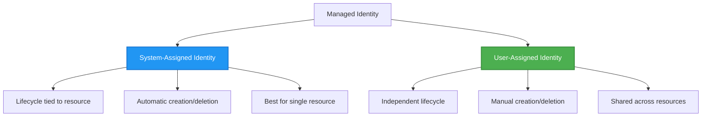

# Mga Pattern sa Pagpapatunay at Managed Identity

⏱️ **Tinatayang Oras**: 45-60 minuto ng pagbabasa; maglaan ng dagdag na oras para sa pagsasama ng mga gawain | 💰 **Epekto sa Gastos**: Libre ang Identity/RBAC; binabayaran ang na-deploy na compute, storage, at Key Vault | ⭐ **Kumplikasyon**: Intermediate

> Sinuri laban sa `azd 1.37.2` (Nobyembre 2026). Ang leksyon na ito ay naglalaman ng **mga ilustratibong fragment ng pagsasama, hindi isang kumpletong downloadable na `secure-app` template**. Gumawa ng mga sangguniang file, magbigay ng tugmang imprastraktura, at palitan ang mga placeholder bago i-deploy. Walang Azure na mga resources ang na-provision sa panahon ng pagsusuri.

**📚 Landas ng Pagkatuto:**
- ← Nakaraan: [Configuration Management](configuration.md) - Pamamahala ng mga environment variable at mga lihim
- 🎯 **Nandito Ka**: Authentication & Security (Managed Identity, Key Vault, ligtas na pattern)
- → Susunod: [Infrastructure as Code](../chapter-04-infrastructure/README.md) - Mag-provision at mag-deploy ng mga resources
- 🏠 [Course Home](../../README.md)

---

## Ano ang Iyong Matututunan

Sa pagtatapos ng leksyon na ito, malalaman mo:
- Mauunawaan ang Azure authentication patterns (keys, connection strings, managed identity)
- Magpatupad ng **Managed Identity** para sa passwordless authentication
- Siguraduhin ang mga lihim gamit ang integrasyon ng **Azure Key Vault**
- I-configure ang **role-based access control (RBAC)** para sa AZD deployments
- Mag-aplay ng mga pinakamahusay na paraan sa seguridad sa Container Apps at mga Azure service
- Mag-migrate mula sa key-based patungo sa identity-based authentication

## Bakit Mahalaga ang Managed Identity

### Ang Problema: Tradisyonal na Pagpapatunay

**Bago ang Managed Identity:**
```javascript
// ❌ SECURITY RISK: Hardcoded secrets in code
const connectionString = "Server=mydb.database.windows.net;User=admin;Password=P@ssw0rd123";
const storageKey = "xK7mN9pQ2wR5tY8uI0oP3aS6dF1gH4jK...";
const cosmosKey = "C2x7B9n4M1p8Q5w3E6r0T2y5U8i1O4p7...";
```

**Mga Problema:**
- 🔴 **Nalalantad na mga lihim** sa code, config files, environment variables
- 🔴 **Pag-ikot ng kredensyal** nangangailangan ng pagbabago sa code at muling pag-deploy
- 🔴 **Mga bangungot sa audit** - sino ang naka-access, kailan?
- 🔴 **Sprawl** - mga lihim na nakakalat sa maraming sistema
- 🔴 **Panganib sa pagsunod** - pumapalya sa mga security audit

### Ang Solusyon: Managed Identity

**Pagkatapos ng Managed Identity:**
```javascript
// ✅ SECURE: No secrets in code
const credential = new DefaultAzureCredential();
const client = new BlobServiceClient(
  "https://mystorageaccount.blob.core.windows.net",
  credential  // Azure automatically handles authentication
);
```

**Mga Benepisyo:**
- ✅ **Walang lihim** sa code o configuration
- ✅ **Awtomatikong pag-ikot** - Azure ang humahawak nito
- ✅ **Buong audit trail** sa Microsoft Entra ID logs
- ✅ **Pinagsama-samang seguridad** - pamahalaan sa Azure Portal
- ✅ **Handa para sa pagsunod** - sumusunod sa mga pamantayan ng seguridad

**Analohiya**: Ang tradisyonal na pagpapatunay ay parang pagdadala ng maraming pisikal na susi para sa iba't ibang pinto. Ang Managed Identity ay parang may security badge na awtomatikong nagbibigay ng access base sa kung sino ka—walang susi na mawawala, makokopya, o kailangang paikutan.

---

## Pangkalahatang Arkitektura

### Daloy ng Pagpapatunay gamit ang Managed Identity

```mermaid
sequenceDiagram
    participant App as Your Application<br/>(Container App)
    participant MI as Managed Identity<br/>(Microsoft Entra ID)
    participant KV as Key Vault
    participant Storage as Azure Storage
    participant DB as Azure SQL
    
    App->>MI: Request access token<br/>(automatic)
    MI->>MI: Verify identity<br/>(no password needed)
    MI-->>App: Return token for requested audience<br/>(lifetime varies)
    
    App->>KV: Get secret<br/>(using token)
    KV->>KV: Check RBAC permissions
    KV-->>App: Return secret value
    
    App->>Storage: Upload blob<br/>(using token)
    Storage->>Storage: Check RBAC permissions
    Storage-->>App: Success
    
    App->>DB: Query data<br/>(using token)
    DB->>DB: Check SQL permissions
    DB-->>App: Return results
    
    Note over App,DB: Request a separate token for each service audience;<br/>SDK credentials handle caching and renewal
```

### Mga Uri ng Managed Identities



| Tampok | System-Assigned | User-Assigned |
|---------|----------------|---------------|
| **Lifecycle** | Nakakabit sa resource | Independent |
| **Paglikha** | Awtomatik sa resource | Manual na paglikha |
| **Pag-delete** | Nai-delete kasabay ng resource | Nanatili pagkatapos ng pag-delete ng resource |
| **Pagbabahagi** | Isa lang na resource | Maraming mga resource |
| **Paggamit** | Mga simpleng senaryo | Mga komplikadong multi-resource na senaryo |
| **Pagpipilian sa Template** | Tinukoy sa imprastraktura | Tinukoy sa imprastraktura |

---

## Mga Kinakailangang Bago Magsimula

### Mga Kinakailangang Kasanayan

Dapat ay na-install mo na ito mula sa mga naunang leksyon:

```bash
# Verify Azure Developer CLI
azd version
# ✅ Expected: azd version 1.0.0 or higher

# Verify Azure CLI
az --version
# ✅ Expected: azure-cli 2.50.0 or higher
```

### Mga Kinakailangan sa Azure

- Aktibong Azure subscription
- Mga permiso para:
  - Gumawa ng managed identities
  - Magtalaga ng mga RBAC roles
  - Gumawa ng mga Key Vault resources
  - Mag-deploy ng Container Apps

### Mga Kinakailangang Kaalaman

Dapat ay natapos mo:
- [Installation Guide](../chapter-01-foundation/installation.md) - Pag-setup ng AZD
- [AZD Basics](../chapter-01-foundation/azd-basics.md) - Pangunahing mga konsepto
- [Configuration Management](configuration.md) - Mga environment variable

---

## Leksyon 1: Pag-unawa sa Mga Pattern ng Pagpapatunay

### Pattern 1: Connection Strings (Legacy - Iwasan)

**Paano ito gumagana:**
```bash
# Connection string contains credentials
STORAGE_CONNECTION_STRING="DefaultEndpointsProtocol=https;AccountName=myaccount;AccountKey=xK7mN9pQ2wR5..."
COSMOS_CONNECTION_STRING="AccountEndpoint=https://myaccount.documents.azure.com:443/;AccountKey=C2x7..."
SQL_CONNECTION_STRING="Server=myserver.database.windows.net;User=admin;Password=P@ssw0rd..."
```

**Mga Problema:**
- ❌ Nakikita ang mga lihim sa environment variables
- ❌ Naka-log sa deployment systems
- ❌ Mahirap iikot
- ❌ Walang audit trail ng access

**Kailan gagamitin:** Kapag ang target na serbisyo ay nangangailangan ng key-based authentication. Mas gusto ang identity kapag sinusuportahan; kung hindi, itago nang ligtas ang mga susi at iikot, pati na rin sa produksyon.

---

### Pattern 2: Mga Sanggunian sa Key Vault (Mas Mabuti)

**Paano ito gumagana:**
**Bahaging Bicep fragments:** kinakailangang vault fields, identity ng Container App, at ang `configuration.secrets` entry nito ay hindi isinama. Ang `secretRef` ay pangalan ng isang lihim ng Container App; **hindi ito** isang Key Vault URI. Para magamit ang Key Vault, tukuyin ang tinukoy na lihim gamit ang `keyVaultUrl` at isang awtorisadong `identity`.

```bicep
// Store secret in Key Vault
resource keyVault 'Microsoft.KeyVault/vaults@2023-02-01' = {
  name: 'mykv'
  properties: {
    enableRbacAuthorization: true
  }
}

// Reference in Container App
env: [
  {
    name: 'STORAGE_KEY'
    secretRef: 'storage-key'  // References Key Vault
  }
]
```

**Mga Benepisyo:**
- ✅ Mga lihim na itinatago nang ligtas sa Key Vault
- ✅ Sentralisadong pamamahala ng lihim
- ✅ Pag-ikot nang walang pagbabago sa code

**Mga Limitasyon:**
- ⚠️ Ginagamit pa rin ang mga susi/passwords
- ⚠️ Kailangang pamahalaan ang access sa Key Vault

**Kailan gagamitin:** Hakbang ng paglipat mula connection strings papuntang managed identity.

---

### Pattern 3: Managed Identity (Pinakamahusay na Prakisis)

**Paano ito gumagana:**
**Bahaging Bicep:** pag-merge ng identity block sa isang kumpletong Container App at ibigay ang `storageAccount` at ang role definition. Nangangailangan din ang role assignment ng isang deterministic na `name`.

```bicep
// Enable managed identity
resource containerApp 'Microsoft.App/containerApps@2023-05-01' = {
  name: 'myapp'
  identity: {
    type: 'SystemAssigned'  // Automatically creates identity
  }
}

// Grant permissions
resource roleAssignment 'Microsoft.Authorization/roleAssignments@2022-04-01' = {
  name: guid(storageAccount.id, containerApp.id, storageBlobDataContributorRole)
  scope: storageAccount
  properties: {
    roleDefinitionId: storageBlobDataContributorRole
    principalId: containerApp.identity.principalId
    principalType: 'ServicePrincipal'
  }
}
```

**Application code:**
```javascript
// No secrets needed!
const { DefaultAzureCredential } = require('@azure/identity');
const { BlobServiceClient } = require('@azure/storage-blob');

const credential = new DefaultAzureCredential();
const blobServiceClient = new BlobServiceClient(
  'https://mystorageaccount.blob.core.windows.net',
  credential
);
```

**Mga Benepisyo:**
- ✅ Walang lihim sa code/config
- ✅ Automatic credential rotation
- ✅ Buong audit trail
- ✅ Mga permiso batay sa RBAC
- ✅ Handa para sa pagsunod

**Kailan gagamitin:** Mas gusto para sa mga Azure-hosted application na kumukuha ng access sa mga serbisyong sumusuporta sa Microsoft Entra authentication.

---

### Pattern 4: Service Principals (CI/CD at Automation)

Ang managed identity ang pamantayang ginto *para sa mga resources na tumatakbo sa loob ng Azure*. Pero paano naman ang mga bagay na tumatakbo **labas** ng Azure—tulad ng isang CI/CD pipeline sa build agent, o isang script sa iyong laptop na hindi pwedeng gumamit ng interactive login? Dito pumapasok ang **service principal**: isang di-taong identity na may sariling kredensyal na maaaring gamitin ng isang automated process para mag-sign in.

**Paano ito gumagana:**

Gumawa ng service principal na naka-scope sa isang resource group (least privilege):

```bash
az ad sp create-for-rbac \
  --name "myapp-cicd" \
  --role contributor \
  --scopes "/subscriptions/<sub-id>/resourceGroups/<rg-name>"
```

Ito ay magpi-print ng client ID, client secret, at tenant ID. Ang azd ay maaaring mag-sign in gamit ito nang hindi interactive:

```bash
azd auth login \
  --client-id "<appId>" \
  --client-secret "<password>" \
  --tenant-id "<tenant>"
```

**Mas gusto ang federated credentials (OIDC) kaysa sa mga lihim.** Sa halip na pangmatagalang client secret, i-configure ang federated credential para magpalitan ang pipeline ng maikling-buhay na token—walang lihim na maipapasa o kailangang iikot:

```bash
azd auth login \
  --client-id "<appId>" \
  --federated-credential-provider "github" \
  --tenant-id "<tenant>"
```

> `azd pipeline config` ay awtomatikong nagse-setup nito para sa iyo. Tingnan ang mga walkthrough ng CI/CD sa [Kabanata 8](../chapter-08-production/production-ai-practices.md).

**Mga Benepisyo:**
- ✅ Gumagana sa labas ng Azure (build agents, on-prem, ibang ulap)
- ✅ Maaaring i-scope sa isang resource group na may isang role lamang
- ✅ Ang bersyon na federated (OIDC) ay walang nakatagalang lihim na nakaimbak

**Mga trade-offs:**
- ⚠️ Ang bersyon na batay sa lihim ay nangangailangan ng maingat na pag-iimbak at pag-ikot
- ⚠️ Ang isang nadurog na lihim ay nagbibigay ng anuman na magagawa ng SP—panatilihing masikip ang mga scope

**Kailan gagamitin:** Para sa mga CI/CD pipeline at automation na hindi pwedeng gumamit ng managed identity. Palaging mas gusto ang **federated/OIDC** na bersyon kaysa sa client secret, at mas gusto ang managed identity kung ang workload ay tumatakbo sa loob ng Azure.

**Ligtas na pag-iimbak ng kredensyal:**
- Huwag kailanman mag-commit ng lihim—gamitin ang secret store ng iyong pipeline (GitHub Actions secrets, Azure DevOps variable groups / Key Vault).
- Isaayos ang SP sa pinakamaliit na role at resource group na kailangan nito.
- Magtakda ng expiration at mag-ikot, o alisin ang lihim nang buo gamit ang OIDC.

---

## Leksyon 2: Pagpapatupad ng Managed Identity gamit ang AZD

### Hakbang-hakbang na Pagpapatupad

Ipinapakita ng mga sumusunod na fragment kung paano isasama ang managed identity sa isang proyekto ng Container App. Hindi ito isang copy-and-run starter: ang Storage module, kumpletong managed environment/registry infrastructure, Dockerfile, at parameter file ay hindi lahat kasama dito. Magsimula mula sa isang gumaganang Container Apps template at pagsamahin ang mga pattern na ito habang pinapanatili ang kanyang registry configuration at mga service tags.

### Estruktura ng Proyekto

```
secure-app/
├── azure.yaml                 # AZD configuration
├── infra/
│   ├── main.bicep            # Main infrastructure
│   ├── core/
│   │   ├── identity.bicep    # Managed identity setup
│   │   ├── keyvault.bicep    # Key Vault configuration
│   │   └── storage.bicep     # Storage with RBAC
│   └── app/
│       └── container-app.bicep
└── src/
    ├── app.js                # Application code
    ├── package.json
    └── Dockerfile
```

### 1. I-configure ang AZD (azure.yaml)

```yaml
name: secure-app
metadata:
  template: secure-app@1.0.0

services:
  api:
    project: ./src
    language: js
    host: containerapp

# Managed identity must be enabled in the infrastructure, not by this YAML.
```

### 2. Imprastraktura: I-enable ang Managed Identity

**File: `infra/main.bicep`**

```bicep
targetScope = 'subscription'

param environmentName string
param location string = 'eastus'
param containerAppsEnvironmentId string
param containerImage string

var tags = { 'azd-env-name': environmentName }

// Resource group
resource rg 'Microsoft.Resources/resourceGroups@2021-04-01' = {
  name: 'rg-${environmentName}'
  location: location
  tags: tags
}

// Storage Account
module storage './core/storage.bicep' = {
  name: 'storage'
  scope: rg
  params: {
    name: 'st${uniqueString(rg.id)}'
    location: location
    tags: tags
  }
}

// Key Vault
module keyVault './core/keyvault.bicep' = {
  name: 'keyvault'
  scope: rg
  params: {
    name: 'kv-${uniqueString(rg.id)}'
    location: location
    tags: tags
  }
}

// Container App with Managed Identity
module containerApp './app/container-app.bicep' = {
  name: 'container-app'
  scope: rg
  params: {
    name: 'ca-${environmentName}'
    location: location
    tags: tags
    storageAccountName: storage.outputs.name
    keyVaultName: keyVault.outputs.name
    containerAppsEnvironmentId: containerAppsEnvironmentId
    containerImage: containerImage
  }
}

// Grant Container App access to Storage
module storageRoleAssignment './core/role-assignment.bicep' = {
  name: 'storage-role'
  scope: rg
  params: {
    principalId: containerApp.outputs.identityPrincipalId
    roleDefinitionId: 'ba92f5b4-2d11-453d-a403-e96b0029c9fe'  // Storage Blob Data Contributor
    targetResourceType: 'storage'
    targetResourceName: storage.outputs.name
  }
}

// Grant Container App access to Key Vault
module kvRoleAssignment './core/role-assignment.bicep' = {
  name: 'kv-role'
  scope: rg
  params: {
    principalId: containerApp.outputs.identityPrincipalId
    roleDefinitionId: '4633458b-17de-408a-b874-0445c86b69e6'  // Key Vault Secrets User
    targetResourceType: 'keyvault'
    targetResourceName: keyVault.outputs.name
  }
}

// Outputs
output AZURE_STORAGE_ACCOUNT_NAME string = storage.outputs.name
output AZURE_KEY_VAULT_NAME string = keyVault.outputs.name
output APP_URL string = containerApp.outputs.url
```

### 3. Container App na may System-Assigned Identity

**File: `infra/app/container-app.bicep`**

```bicep
param name string
param location string
param tags object = {}
param storageAccountName string
param keyVaultName string
param containerAppsEnvironmentId string
param containerImage string

resource containerApp 'Microsoft.App/containerApps@2023-05-01' = {
  name: name
  location: location
  tags: union(tags, { 'azd-service-name': 'api' })
  identity: {
    type: 'SystemAssigned'  // 🔑 Enable managed identity
  }
  properties: {
    managedEnvironmentId: containerAppsEnvironmentId
    configuration: {
      ingress: {
        external: true
        targetPort: 3000
      }
    }
    template: {
      containers: [
        {
          name: 'api'
          image: containerImage // Must exist; configure registry credentials for private images
          resources: {
            cpu: json('0.5')
            memory: '1Gi'
          }
          env: [
            {
              name: 'AZURE_STORAGE_ACCOUNT_NAME'
              value: storageAccountName
            }
            {
              name: 'AZURE_KEY_VAULT_NAME'
              value: keyVaultName
            }
            // 🔑 No secrets - managed identity handles authentication!
          ]
        }
      ]
    }
  }
}

// Output the identity for RBAC assignments
output identityPrincipalId string = containerApp.identity.principalId
output id string = containerApp.id
output url string = 'https://${containerApp.properties.configuration.ingress.fqdn}'
```

### 4. Module sa RBAC Role Assignment

**File: `infra/core/role-assignment.bicep`**

```bicep
param principalId string
param roleDefinitionId string  // Azure built-in role ID
@allowed(['storage', 'keyvault'])
param targetResourceType string
param targetResourceName string

// Typed existing resources give Bicep a valid resource scope, not a string ID.
resource storageTarget 'Microsoft.Storage/storageAccounts@2023-01-01' existing = {
  name: targetResourceName
}
resource vaultTarget 'Microsoft.KeyVault/vaults@2023-02-01' existing = {
  name: targetResourceName
}

resource storageAssignment 'Microsoft.Authorization/roleAssignments@2022-04-01' = if (targetResourceType == 'storage') {
  name: guid(storageTarget.id, principalId, roleDefinitionId)
  scope: storageTarget
  properties: {
    roleDefinitionId: subscriptionResourceId('Microsoft.Authorization/roleDefinitions', roleDefinitionId)
    principalId: principalId
    principalType: 'ServicePrincipal'
  }
}

resource vaultAssignment 'Microsoft.Authorization/roleAssignments@2022-04-01' = if (targetResourceType == 'keyvault') {
  name: guid(vaultTarget.id, principalId, roleDefinitionId)
  scope: vaultTarget
  properties: {
    roleDefinitionId: subscriptionResourceId('Microsoft.Authorization/roleDefinitions', roleDefinitionId)
    principalId: principalId
    principalType: 'ServicePrincipal'
  }
}

// This module assigns at the target resource scope, not the whole resource group.
```

### 5. Application Code na may Managed Identity

**File: `src/app.js`**

```javascript
const express = require('express');
const { DefaultAzureCredential } = require('@azure/identity');
const { BlobServiceClient } = require('@azure/storage-blob');
const { SecretClient } = require('@azure/keyvault-secrets');

const app = express();
const PORT = process.env.PORT || 3000;

// 🔑 Initialize credential (works automatically with managed identity)
const credential = new DefaultAzureCredential();

// Azure Storage setup
const storageAccountName = process.env.AZURE_STORAGE_ACCOUNT_NAME;
const blobServiceClient = new BlobServiceClient(
  `https://${storageAccountName}.blob.core.windows.net`,
  credential  // No keys needed!
);

// Key Vault setup
const keyVaultName = process.env.AZURE_KEY_VAULT_NAME;
const secretClient = new SecretClient(
  `https://${keyVaultName}.vault.azure.net`,
  credential  // No keys needed!
);

// Health check
app.get('/health', (req, res) => {
  res.json({ status: 'healthy', authentication: 'managed-identity' });
});

// Upload file to blob storage
app.post('/upload', async (req, res) => {
  try {
    const containerClient = blobServiceClient.getContainerClient('uploads');
    await containerClient.createIfNotExists();
    
    const blobName = `file-${Date.now()}.txt`;
    const blockBlobClient = containerClient.getBlockBlobClient(blobName);
    
    const content = 'Hello from managed identity!';
    await blockBlobClient.upload(content, Buffer.byteLength(content));
    
    res.json({
      success: true,
      blobName: blobName,
      message: 'File uploaded using managed identity!'
    });
  } catch (error) {
    console.error('Upload error:', error);
    res.status(500).json({ error: error.message });
  }
});

// Get secret from Key Vault
app.get('/secret/:name', async (req, res) => {
  try {
    const secretName = req.params.name;
    const secret = await secretClient.getSecret(secretName);
    
    res.json({
      name: secretName,
      retrieved: secret.value !== undefined, // Never return the secret value to callers
      message: 'Secret retrieved using managed identity!'
    });
  } catch (error) {
    console.error('Secret error:', error);
    res.status(500).json({ error: error.message });
  }
});

// List blob containers (demonstrates read access)
app.get('/containers', async (req, res) => {
  try {
    const containers = [];
    for await (const container of blobServiceClient.listContainers()) {
      containers.push(container.name);
    }
    
    res.json({
      containers: containers,
      count: containers.length,
      message: 'Containers listed using managed identity!'
    });
  } catch (error) {
    console.error('List error:', error);
    res.status(500).json({ error: error.message });
  }
});

app.listen(PORT, () => {
  console.log(`Secure API listening on port ${PORT}`);
  console.log('Authentication: Managed Identity (passwordless)');
});
```

**File: `src/package.json`**

```json
{
  "name": "secure-app",
  "version": "1.0.0",
  "dependencies": {
    "express": "^4.18.2",
    "@azure/identity": "^4.0.0",
    "@azure/storage-blob": "^12.17.0",
    "@azure/keyvault-secrets": "^4.7.0"
  },
  "scripts": {
    "start": "node app.js"
  }
}
```

### 6. Mag-deploy at Subukan

Patakbuhin lamang ang mga command na ito **pagkatapos** makumpleto ang nawawalang imprastraktura, Dockerfile, at tugmang `main.parameters.json` sa iyong sariling proyekto. Mag-authenticate ang azd gamit ang `azd auth login`; mag-sign in din nang hiwalay gamit ang `az login` para sa mga Azure CLI na pagsusuri mamaya. Ang mga ipinakitang endpoint ay mga demonstrasyon at nangangailangan ng angkop na mga kontrol sa access bago gamitin nang publiko.

```bash
# Initialize AZD environment
azd init

# Deploy infrastructure and application
azd up

# Get the app URL
APP_URL=$(azd env get-value APP_URL)

# Test health check
curl $APP_URL/health
```

**✅ Inaasahang output:**
```json
{
  "status": "healthy",
  "authentication": "managed-identity"
}
```

**Subok sa pag-upload ng blob:**
```bash
curl -X POST $APP_URL/upload
```

**✅ Inaasahang output:**
```json
{
  "success": true,
  "blobName": "file-1700404800000.txt",
  "message": "File uploaded using managed identity!"
}
```

**Subok sa paglista ng container:**
```bash
curl $APP_URL/containers
```

**✅ Inaasahang output:**
```json
{
  "containers": ["uploads"],
  "count": 1,
  "message": "Containers listed using managed identity!"
}
```

---

## Karaniwang Azure RBAC Roles

### Mga Built-in Role ID para sa Managed Identity

| Serbisyo | Pangalan ng Role | ID ng Role | Mga Pahintulot |
|---------|------------------|------------|---------------|
| **Storage** | Storage Blob Data Reader | `2a2b9908-6ea1-4ae2-8e65-a410df84e7d1` | Basahin ang blobs at containers |
| **Storage** | Storage Blob Data Contributor | `ba92f5b4-2d11-453d-a403-e96b0029c9fe` | Basahin, isulat, tanggalin ang mga blobs |
| **Storage** | Storage Queue Data Contributor | `974c5e8b-45b9-4653-ba55-5f855dd0fb88` | Basahin, isulat, tanggalin ang mga queue/mensahe |
| **Key Vault** | Key Vault Secrets User | `4633458b-17de-408a-b874-0445c86b69e6` | Basahin ang mga lihim |
| **Key Vault** | Key Vault Secrets Officer | `b86a8fe4-44ce-4948-aee5-eccb2c155cd7` | Basahin, isulat, tanggalin ang mga lihim |
| **Cosmos DB** | Cosmos DB Built-in Data Reader | `00000000-0000-0000-0000-000000000001` | Basahin ang data sa Cosmos DB |
| **Cosmos DB** | Cosmos DB Built-in Data Contributor | `00000000-0000-0000-0000-000000000002` | Basahin, isulat ang data sa Cosmos DB |
| **SQL Database** | SQL DB Contributor | `9b7fa17d-e63e-47b0-bb0a-15c516ac86ec` | Pamahalaan ang mga database resources; hindi nagbibigay ng access sa data ng SQL |
| **Service Bus** | Azure Service Bus Data Owner | `090c5cfd-751d-490a-894a-3ce6f1109419` | Magpadala, tumanggap, pamahalaan ang mga mensahe |

### Paano Hanapin ang Role IDs

Ang dalawang ID sa itaas para sa Cosmos DB for NoSQL ay **native na mga Cosmos data-plane role definition**, hindi Azure RBAC subscription role IDs. Itakda ito gamit ang `az cosmosdb sql role assignment create` (o `Microsoft.DocumentDB/databaseAccounts/sqlRoleAssignments`), hindi `az role assignment create`. Nangangailangan ang SQL data access ng Entra database user at SQL mga pahintulot.

```bash
# List all built-in roles
az role definition list --query "[].{Name:roleName, ID:name}" --output table

# Search for specific role
az role definition list --query "[?contains(roleName, 'Storage Blob')].{Name:roleName, ID:name}" --output table

# Get role details
az role definition list --name "Storage Blob Data Contributor"
```

---

## Mga Praktikal na Ehersisyo

**Kinakailangang sangkap ng pagsasama para sa tatlong ehersisyo:** isang gumaganang Container App template sa iyong sariling proyekto, tugmang Bicep resources, Azure CLI/azd sign-in, at awtoridad na magtalaga ng kinakailangang mga role. Ito ay mga ginabayang adaptasyon, hindi standalone na panimulang hakbang sa lokal; palitan ang mga sample na pangalan ng resource sa mga na-deploy mong pangalan.

### Ehersisyo 1: I-enable ang Managed Identity para sa Umiiral na App ⭐⭐ (Katamtaman)

**Layunin**: Magdagdag ng managed identity sa umiiral na Container App deployment

**Senaryo**: Mayroon kang Container App na gumagamit ng connection strings. I-convert ito sa managed identity.

**Panimulang Punto**: Container App na may konfigurasyong ito:

```bicep
// ❌ Current: Using connection string
env: [
  {
    name: 'STORAGE_CONNECTION_STRING'
    secretRef: 'storage-connection'
  }
]
```

**Mga Hakbang**:

1. **I-enable ang managed identity sa Bicep:**

```bicep
resource containerApp 'Microsoft.App/containerApps@2023-05-01' = {
  name: 'myapp'
  identity: {
    type: 'SystemAssigned'  // Add this
  }
  // ... rest of configuration
}
```

2. **Bigyan ng Storage access:**

```bicep
// Get storage account reference
resource storageAccount 'Microsoft.Storage/storageAccounts@2023-01-01' existing = {
  name: storageAccountName
}

// Assign role
resource roleAssignment 'Microsoft.Authorization/roleAssignments@2022-04-01' = {
  name: guid(containerApp.id, 'ba92f5b4-2d11-453d-a403-e96b0029c9fe', storageAccount.id)
  scope: storageAccount
  properties: {
    roleDefinitionId: subscriptionResourceId('Microsoft.Authorization/roleDefinitions', 'ba92f5b4-2d11-453d-a403-e96b0029c9fe')
    principalId: containerApp.identity.principalId
    principalType: 'ServicePrincipal'
  }
}
```

3. **I-update ang application code:**

**Bago (connection string):**
```javascript
const { BlobServiceClient } = require('@azure/storage-blob');

const blobServiceClient = BlobServiceClient.fromConnectionString(
  process.env.STORAGE_CONNECTION_STRING
);
```

**Pagkatapos (managed identity):**
```javascript
const { DefaultAzureCredential } = require('@azure/identity');
const { BlobServiceClient } = require('@azure/storage-blob');

const credential = new DefaultAzureCredential();
const blobServiceClient = new BlobServiceClient(
  `https://${process.env.STORAGE_ACCOUNT_NAME}.blob.core.windows.net`,
  credential
);
```

4. **I-update ang mga environment variable:**

```bicep
env: [
  {
    name: 'STORAGE_ACCOUNT_NAME'
    value: storageAccountName  // Just the name, no secrets!
  }
  // Remove STORAGE_CONNECTION_STRING
]
```

5. **Mag-deploy at magsubok:**

```bash
# Redeploy
azd up

# Test that it still works
APP_URL=$(azd show --output json | jq -er '.services.api.ingressUrl')
curl --fail -X POST "$APP_URL/upload"
```

**✅ Tagumpay na Pamantayan:**
- ✅ Nagde-deploy ang application nang walang error
- ✅ Gumagana ang mga operasyon ng storage (upload, list, download)
- ✅ Walang connection strings sa environment variables
- ✅ Nakikita ang identity sa Azure Portal sa ilalim ng "Identity" blade

**Pagpapatunay:**

```bash
# Check managed identity is enabled
az containerapp show \
  --name myapp \
  --resource-group rg-myapp \
  --query "identity.type"
# ✅ Expected: "SystemAssigned"

# Check role assignment
az role assignment list \
  --assignee $(az containerapp show --name myapp --resource-group rg-myapp --query "identity.principalId" -o tsv) \
  --scope /subscriptions/{sub-id}/resourceGroups/rg-myapp/providers/Microsoft.Storage/storageAccounts/mystorageaccount
# ✅ Expected: Shows "Storage Blob Data Contributor" role
```

**Oras**: 20-30 minuto

---

### Ehersisyo 2: Multi-Service Access gamit ang User-Assigned Identity ⭐⭐⭐ (Advanced)

**Layunin**: Gumawa ng user-assigned identity na pinagsasaluhan ng maraming Container Apps

**Senaryo**: Mayroon kang 3 microservices na lahat ay kailangang mag-access sa parehong Storage account at Key Vault.

**Mga Hakbang**:

1. **Gumawa ng user-assigned identity:**

**File: `infra/core/identity.bicep`**

```bicep
param name string
param location string
param tags object = {}

resource userAssignedIdentity 'Microsoft.ManagedIdentity/userAssignedIdentities@2023-01-31' = {
  name: name
  location: location
  tags: tags
}

output id string = userAssignedIdentity.id
output principalId string = userAssignedIdentity.properties.principalId
output clientId string = userAssignedIdentity.properties.clientId
```

2. **Italaga ang mga role sa user-assigned identity:**

```bicep
// In main.bicep
module userIdentity './core/identity.bicep' = {
  name: 'user-identity'
  scope: rg
  params: {
    name: 'id-${environmentName}'
    location: location
    tags: tags
  }
}

// Grant Storage access
resource storageRoleAssignment 'Microsoft.Authorization/roleAssignments@2022-04-01' = {
  name: guid(storageAccount.id, environmentName, 'storage-contributor')
  scope: storageAccount
  properties: {
    roleDefinitionId: subscriptionResourceId('Microsoft.Authorization/roleDefinitions', 'ba92f5b4-2d11-453d-a403-e96b0029c9fe')
    principalId: userIdentity.outputs.principalId
    principalType: 'ServicePrincipal'
  }
}

// Grant Key Vault access
resource kvRoleAssignment 'Microsoft.Authorization/roleAssignments@2022-04-01' = {
  name: guid(keyVault.id, environmentName, 'kv-secrets-user')
  scope: keyVault
  properties: {
    roleDefinitionId: subscriptionResourceId('Microsoft.Authorization/roleDefinitions', '4633458b-17de-408a-b874-0445c86b69e6')
    principalId: userIdentity.outputs.principalId
    principalType: 'ServicePrincipal'
  }
}
```

3. **Mag-assign ng identity sa maraming Container Apps:**

```bicep
resource apiGateway 'Microsoft.App/containerApps@2023-05-01' = {
  name: 'api-gateway'
  identity: {
    type: 'UserAssigned'
    userAssignedIdentities: {
      '${userIdentity.outputs.id}': {}
    }
  }
  // ... rest of config
}

resource productService 'Microsoft.App/containerApps@2023-05-01' = {
  name: 'product-service'
  identity: {
    type: 'UserAssigned'
    userAssignedIdentities: {
      '${userIdentity.outputs.id}': {}
    }
  }
  // ... rest of config
}

resource orderService 'Microsoft.App/containerApps@2023-05-01' = {
  name: 'order-service'
  identity: {
    type: 'UserAssigned'
    userAssignedIdentities: {
      '${userIdentity.outputs.id}': {}
    }
  }
  // ... rest of config
}
```

4. **Application code (lahat ng serbisyo ay gumagamit ng parehong pattern):**

```javascript
const { ManagedIdentityCredential } = require('@azure/identity');
const { BlobServiceClient } = require('@azure/storage-blob');

// For user-assigned identity, specify the client ID
const credential = new ManagedIdentityCredential(
  process.env.AZURE_CLIENT_ID  // User-assigned identity client ID
);

// Alternative (choose ONE credential declaration):
// const { DefaultAzureCredential } = require('@azure/identity');
// const credential = new DefaultAzureCredential({
//   managedIdentityClientId: process.env.AZURE_CLIENT_ID
// });

const blobServiceClient = new BlobServiceClient(
  `https://${process.env.STORAGE_ACCOUNT_NAME}.blob.core.windows.net`,
  credential
);
```

Itakda ang bawat Container App's runtime `AZURE_CLIENT_ID` sa `userIdentity.outputs.clientId` at `STORAGE_ACCOUNT_NAME` sa iyong pangalan ng storage sa Bicep. Ang simpleng pag-assign ng identity o pagtakbo ng `azd env set` ay hindi nagsasaayos ng mga runtime values na ito.

5. **I-deploy at i-verify:**

```bash
azd up

# Test all services can access storage
# Replace with the actual ingress URLs reported for your three services
curl --fail -X POST "$API_GATEWAY_URL/upload"
curl --fail -X POST "$PRODUCT_SERVICE_URL/upload"
curl --fail -X POST "$ORDER_SERVICE_URL/upload"
```

**✅ Mga Pamantayan ng Tagumpay:**
- ✅ Isang identity na shared sa 3 serbisyo
- ✅ Lahat ng serbisyo ay maaaring ma-access ang Storage at Key Vault
- ✅ Ang identity ay nananatili kahit burahin ang isang serbisyo
- ✅ Sentralisadong pamamahala ng permiso

**Mga Benepisyo ng User-Assigned Identity:**
- Isang identity lang ang pamahalaan
- Konsistenteng mga permiso sa mga serbisyo
- Nakakaligtas sa pagtanggal ng serbisyo
- Mas mainam para sa kumplikadong mga arkitektura

**Oras**: 30-40 minuto

---

### Ehersisyo 3: Ipatupad ang Key Vault Secret Rotation ⭐⭐⭐ (Advanced)

**Layunin**: Itago ang third-party API keys sa Key Vault at i-access gamit ang managed identity

**Senaryo**: Kailangan ng iyong app na tumawag sa external na API (OpenAI, Stripe, SendGrid) na nangangailangan ng API keys.

**Mga Hakbang**:

1. **Gumawa ng Key Vault na may RBAC:**

**File: `infra/core/keyvault.bicep`**

```bicep
param name string
param location string
param tags object = {}

resource keyVault 'Microsoft.KeyVault/vaults@2023-02-01' = {
  name: name
  location: location
  tags: tags
  properties: {
    enableRbacAuthorization: true  // Use RBAC instead of access policies
    sku: {
      family: 'A'
      name: 'standard'
    }
    tenantId: subscription().tenantId
    enableSoftDelete: true
    softDeleteRetentionInDays: 90
  }
}

// Allow Container App to read secrets
output id string = keyVault.id
output name string = keyVault.name
output uri string = keyVault.properties.vaultUri
```

2. **Itago ang mga sikreto sa Key Vault:**

```bash
# Get Key Vault name
KV_NAME=$(azd env get-value AZURE_KEY_VAULT_NAME)

# Store third-party API keys
az keyvault secret set \
  --vault-name $KV_NAME \
  --name "OpenAI-ApiKey" \
  --value "sk-proj-xxxxxxxxxxxxx"

az keyvault secret set \
  --vault-name $KV_NAME \
  --name "Stripe-ApiKey" \
  --value "sk_live_xxxxxxxxxxxxx"

az keyvault secret set \
  --vault-name $KV_NAME \
  --name "SendGrid-ApiKey" \
  --value "SG.xxxxxxxxxxxxx"
```

3. **Application code para kunin ang mga sikreto:**

**File: `src/config.js`**

```javascript
const { DefaultAzureCredential } = require('@azure/identity');
const { SecretClient } = require('@azure/keyvault-secrets');

class Config {
  constructor() {
    this.credential = new DefaultAzureCredential();
    this.secretClient = new SecretClient(
      `https://${process.env.AZURE_KEY_VAULT_NAME}.vault.azure.net`,
      this.credential
    );
    this.cache = {};
  }

  async getSecret(secretName) {
    // Check cache first
    if (this.cache[secretName]) {
      return this.cache[secretName];
    }

    try {
      const secret = await this.secretClient.getSecret(secretName);
      this.cache[secretName] = secret.value;
      console.log(`✅ Retrieved secret: ${secretName}`);
      return secret.value;
    } catch (error) {
      console.error(`❌ Failed to get secret ${secretName}:`, error.message);
      throw error;
    }
  }

  async getOpenAIKey() {
    return this.getSecret('OpenAI-ApiKey');
  }

  async getStripeKey() {
    return this.getSecret('Stripe-ApiKey');
  }

  async getSendGridKey() {
    return this.getSecret('SendGrid-ApiKey');
  }
}

module.exports = new Config();
```

4. **Gamitin ang mga sikreto sa application:**

**File: `src/app.js`**

Ang **replacement application fragment** na ito ay nangangailangan ng `npm install openai`, isang tunay na third-party key, isang accessible na modelo, at ang imprastraktura mula sa iyong umiiral na proyekto. Direktang tumatawag ito sa OpenAI, hindi sa isang Azure OpenAI deployment. Ang mga placeholder na susi sa ibaba ay hindi nagbibigay ng awtorisasyon sa request.

```javascript
const express = require('express');
const config = require('./config');
const { OpenAI } = require('openai');

const app = express();

// Initialize OpenAI with key from Key Vault
let openaiClient;

async function initializeServices() {
  const openaiKey = await config.getOpenAIKey();
  openaiClient = new OpenAI({ apiKey: openaiKey });
  console.log('✅ Services initialized with secrets from Key Vault');
}

app.post('/chat', async (req, res) => {
  try {
    const completion = await openaiClient.chat.completions.create({
      model: 'gpt-4.1',
      messages: [{ role: 'user', content: 'Hello!' }]
    });
    
    res.json({
      response: completion.choices[0].message.content,
      authentication: 'Key from Key Vault via Managed Identity'
    });
  } catch (error) {
    res.status(500).json({ error: error.message });
  }
});

// Start listening only after initialization succeeds.
initializeServices().then(() => {
  app.listen(3000, () => console.log('Key Vault demo running'));
}).catch(error => {
  console.error('Initialization failed:', error.message);
  process.exitCode = 1;
});
```

5. **I-deploy at subukan:**

```bash
azd up

# Test that API keys work
curl -X POST https://myapp.azurecontainerapps.io/chat \
  -H "Content-Type: application/json" \
  -d '{"message":"Hello AI"}'
```

**✅ Mga Pamantayan ng Tagumpay:**
- ✅ Walang API keys sa code o environment variables
- ✅ Nakukuha ng application ang mga susi mula sa Key Vault
- ✅ Gumagana nang maayos ang third-party APIs
- ✅ Kayang i-rotate ang mga key nang walang pagbabago sa code

**I-rotate ang sikreto:**

```bash
# Update secret in Key Vault
az keyvault secret set \
  --vault-name $KV_NAME \
  --name "OpenAI-ApiKey" \
  --value "sk-proj-NEW_KEY_HERE"

# Find the active revision name, then restart it to clear the in-process cache
az containerapp revision list --name myapp --resource-group rg-myapp --output table
az containerapp revision restart \
  --name myapp \
  --resource-group rg-myapp \
  --revision "<active-revision-name>"
```

**Oras**: 25-35 minuto

---

## Knowledge Checkpoint

### 1. Mga Pattern ng Authentication ✓

Subukan ang iyong pang-unawa:

- [ ] **Q1**: Ano ang tatlong pangunahing authentication patterns? 
  - **Sagot**: Connection strings (legacy), Key Vault references (transition), Managed Identity (pinakamainam)

- [ ] **Q2**: Bakit mas mainam ang managed identity kaysa connection strings?
  - **Sagot**: Walang sikreto sa code, awtomatikong pag-rotate, kumpletong audit trail, RBAC na mga permiso

- [ ] **Q3**: Kailan ka gagamit ng user-assigned identity imbes na system-assigned?
  - **Sagot**: Kapag nagbabahagi ng identity sa maraming resources o kapag ang lifecycle ng identity ay hiwalay sa lifecycle ng resource

**Hands-On Verification:**
```bash
# Check what type of identity your app uses
az containerapp show \
  --name myapp \
  --resource-group rg-myapp \
  --query "identity.type"

# List all role assignments for the identity
az role assignment list \
  --assignee $(az containerapp show --name myapp --resource-group rg-myapp --query "identity.principalId" -o tsv)
```

---

### 2. RBAC at Mga Permiso ✓

Subukan ang iyong pang-unawa:

- [ ] **Q1**: Ano ang role ID para sa "Storage Blob Data Contributor"?
  - **Sagot**: `ba92f5b4-2d11-453d-a403-e96b0029c9fe`

- [ ] **Q2**: Anong mga permiso ang ibinibigay ng "Key Vault Secrets User"?
  - **Sagot**: Read-only na access sa mga sikreto (hindi makakagawa, makakabago, o makakabura)

- [ ] **Q3**: Paano mo bibigyan ng access ang isang Container App sa Azure SQL?
  - **Sagot**: I-configure ang Microsoft Entra authentication, gawin ang identity bilang database user, at bigyan ang kinakailangang mga permiso sa SQL. Ang "SQL DB Contributor" ay para lang sa pamamahala ng Azure resources; hindi ito nagbibigay ng awtorisasyon sa queries.

**Hands-On Verification:**
```bash
# Find specific role
az role definition list --name "Storage Blob Data Contributor"

# Check what roles are assigned to your identity
PRINCIPAL_ID=$(az containerapp show --name myapp --resource-group rg-myapp --query "identity.principalId" -o tsv)
az role assignment list --assignee $PRINCIPAL_ID --output table
```

---

### 3. Integrasyon ng Key Vault ✓

Subukan ang iyong pang-unawa:

- [ ] **Q1**: Paano mo i-enable ang RBAC para sa Key Vault imbes na access policies?
  - **Sagot**: Itakda ang `enableRbacAuthorization: true` sa Bicep

- [ ] **Q2**: Anong Azure SDK library ang humahawak sa managed identity authentication?
  - **Sagot**: `@azure/identity` gamit ang klase na `DefaultAzureCredential`

- [ ] **Q3**: Gaano katagal nananatili ang mga sikreto ng Key Vault sa cache?
  - **Sagot**: Depende sa application; ipatupad ang sarili mong caching strategy

**Hands-On Verification:**
```bash
# Test Key Vault access
az keyvault secret show \
  --vault-name $KV_NAME \
  --name "OpenAI-ApiKey" \
  --query "{name:name,enabled:attributes.enabled}"

# Check RBAC is enabled
az keyvault show \
  --name $KV_NAME \
  --query "properties.enableRbacAuthorization"
# ✅ Expected: true
```

---

## Pinakamahusay na Praktis sa Seguridad

### ✅ GAWIN:

1. **Palaging gamitin ang managed identity sa production**
   ```bicep
   identity: {
     type: 'SystemAssigned'
   }
   ```

2. **Gamitin ang least-privilege na mga RBAC role**
   - Gumamit ng "Reader" roles kapag maaari
   - Iwasan ang "Owner" o "Contributor" maliban kung kailangang-kailangan

3. **Itago ang mga third-party key sa Key Vault**
   ```javascript
   const apiKey = await secretClient.getSecret('ThirdPartyApiKey');
   ```

4. **I-enable ang audit logging** (partial resource fragment; i-merge sa iyong vault at workspace declarations)
   ```bicep
   resource vaultDiagnostics 'Microsoft.Insights/diagnosticSettings@2021-05-01-preview' = {
     name: 'vault-audit'
     scope: keyVault
     properties: {
       workspaceId: logAnalytics.id
       logs: [{ category: 'AuditEvent', enabled: true }]
     }
   }
   ```

5. **Gumamit ng magkakaibang identities para sa dev/staging/prod**
   ```bash
   azd env new dev
   azd env new staging
   azd env new prod
   ```

6. **Regular na i-rotate ang mga sikreto**
   - Magtakda ng expiration dates sa mga sikreto ng Key Vault
   - I-automate ang rotation gamit ang Azure Functions

### ❌ HUWAG GAWIN:

1. **Huwag kailanman mag-hardcode ng mga sikreto**
   ```javascript
   // ❌ BAD
   const apiKey = "sk-proj-xxxxxxxxxxxxx";
   ```

2. **Huwag gumamit ng connection strings sa production**
   ```javascript
   // ❌ BAD
   BlobServiceClient.fromConnectionString(process.env.STORAGE_CONNECTION_STRING)
   ```

3. **Huwag magbigay ng labis na mga permiso**
   ```bicep
   // ❌ BAD - too much access
   roleDefinitionId: subscriptionResourceId('Microsoft.Authorization/roleDefinitions', '8e3af657-a8ff-443c-a75c-2fe8c4bcb635')
   
   // ✅ GOOD - least privilege
   roleDefinitionId: subscriptionResourceId('Microsoft.Authorization/roleDefinitions', '2a2b9908-6ea1-4ae2-8e65-a410df84e7d1')
   ```

4. **Huwag mag-log ng mga sikreto**
   ```javascript
   // ❌ BAD
   console.log('API Key:', apiKey);
   
   // ✅ GOOD
   console.log('API Key retrieved successfully');
   ```

5. **Huwag magbahagi ng production identities sa iba't ibang environment**
   ```bicep
   // ❌ BAD - same identity for dev and prod
   // ✅ GOOD - separate identities per environment
   ```

---

## Gabay sa Pagsasaayos ng Problema

### Problema: "Unauthorized" kapag nag-aaccess sa Azure Storage

**Mga Sintomas:**
```
Error: Unauthorized (403)
AuthorizationPermissionMismatch: This request is not authorized to perform this operation
```

**Diagnosis:**

```bash
# Check if managed identity is enabled
az containerapp show \
  --name myapp \
  --resource-group rg-myapp \
  --query "identity.type"
# ✅ Expected: "SystemAssigned" or "UserAssigned"

# Check role assignments
PRINCIPAL_ID=$(az containerapp show --name myapp --resource-group rg-myapp --query "identity.principalId" -o tsv)
az role assignment list --assignee $PRINCIPAL_ID

# Expected: Should see "Storage Blob Data Contributor" or similar role
```

**Mga Solusyon:**

1. **Ibigay ang tamang RBAC role:**
```bash
STORAGE_ID=$(az storage account show --name mystorageaccount --resource-group rg-myapp --query "id" -o tsv)
az role assignment create \
  --assignee $PRINCIPAL_ID \
  --role "Storage Blob Data Contributor" \
  --scope $STORAGE_ID
```

2. **Maghintay para sa propagation (maaaring tumagal ng 5-10 minuto):**
```bash
# Check role assignment status
az role assignment list --assignee $PRINCIPAL_ID --scope $STORAGE_ID
```

3. **I-verify na ang application code ay gumagamit ng tamang credentials:**
```javascript
// Make sure you're using DefaultAzureCredential
const credential = new DefaultAzureCredential();
```

---

### Problema: Access Denied sa Key Vault

**Mga Sintomas:**
```
Error: Forbidden (403)
The user, group or application does not have secrets get permission
```

**Diagnosis:**

```bash
# Check Key Vault RBAC is enabled
az keyvault show \
  --name $KV_NAME \
  --query "properties.enableRbacAuthorization"
# ✅ Expected: true

# Check role assignments
az role assignment list \
  --assignee $PRINCIPAL_ID \
  --scope /subscriptions/{sub-id}/resourceGroups/rg-myapp/providers/Microsoft.KeyVault/vaults/$KV_NAME
```

**Mga Solusyon:**

1. **I-enable ang RBAC sa Key Vault:**
```bash
az keyvault update \
  --name $KV_NAME \
  --enable-rbac-authorization true
```

2. **Bigyan ng Key Vault Secrets User role:**
```bash
KV_ID=$(az keyvault show --name $KV_NAME --query "id" -o tsv)
az role assignment create \
  --assignee $PRINCIPAL_ID \
  --role "Key Vault Secrets User" \
  --scope $KV_ID
```

---

### Problema: Nag-fail ang DefaultAzureCredential locally

**Mga Sintomas:**
```
Error: DefaultAzureCredential failed to retrieve a token
CredentialUnavailableError: No credential available
```

**Diagnosis:**

```bash
# Check if you're logged in
az account show

# Check Azure CLI authentication
az ad signed-in-user show
```

**Mga Solusyon:**

1. **Mag-login sa Azure CLI:**
```bash
az login
```

2. **Itakda ang Azure subscription:**
```bash
az account set --subscription "Your Subscription Name"
```

3. **Para sa local development, gamitin ang environment variables:**
```bash
export AZURE_TENANT_ID="your-tenant-id"
export AZURE_CLIENT_ID="your-client-id"
export AZURE_CLIENT_SECRET="your-client-secret"
```

4. **O gumamit ng ibang credential locally:**
```javascript
const { DefaultAzureCredential, AzureCliCredential } = require('@azure/identity');

// Use AzureCliCredential for local dev
const credential = process.env.NODE_ENV === 'production' 
  ? new DefaultAzureCredential()
  : new AzureCliCredential();
```

---

### Problema: Matagal ang propagation ng role assignment

**Mga Sintomas:**
- Role na na-assign nang maayos
- Patuloy na nakakatanggap ng 403 errors
- Paminsang gumagana, paminsang hindi

**Paliwanag:**
Ang mga pagbabago sa Azure RBAC ay maaaring tumagal ng 5-10 minuto para ma-propagate sa buong mundo.

**Solusyon:**

```bash
# Wait and retry
echo "Waiting for RBAC propagation..."
sleep 300  # Wait 5 minutes

# Test access
curl --fail -X POST "$APP_URL/upload"

# If still failing, restart the app
az containerapp revision restart \
  --name myapp \
  --resource-group rg-myapp \
  --revision "<active-revision-name>"
```

---

## Mga Pagsasaalang-alang sa Gastos

### Mga Gastos ng Managed Identity

| Resource | Gastos |
|----------|--------|
| **Managed Identity** | 🆓 **LIBRE** - Walang bayad |
| **RBAC Role Assignments** | 🆓 **LIBRE** - Walang bayad |
| **Microsoft Entra ID Token Requests** | 🆓 **LIBRE** - Kasama na |
| **Key Vault Operations** | $0.03 kada 10,000 operasyon |
| **Key Vault secret storage** | Tingnan ang kasalukuyang presyo; huwag ipalagay na may buwanang bayad kada sikreto |

**Nakakatipid ang managed identity ng pera sa pamamagitan ng:**
- ✅ Pagtanggal ng Key Vault operations para sa service-to-service na authentication
- ✅ Pagbawas ng security incidents (walang na-leak na credentials)
- ✅ Pagbawas ng operational overhead (walang manual na pag-rotate)

Ang bilang ng request ng application ay hindi katumbas ng bilang ng operasyon sa Key Vault: ang caching at rotation patterns ang nagtatakda ng gastos sa secret-read. Hindi tinatanggal ng identity ang compute/storage charges. Tingnan ang [Key Vault pricing](https://azure.microsoft.com/pricing/details/key-vault/) at ang Azure Pricing Calculator para sa iyong rehiyon sa halip na manghula ng buwanang pagtitipid gamit lamang ang bilang ng request.

---

## Matuto Pa

### Opisyal na Dokumentasyon
- [Azure Managed Identity](https://learn.microsoft.com/entra/identity/managed-identities-azure-resources/overview)
- [Azure RBAC](https://learn.microsoft.com/azure/role-based-access-control/overview)
- [Azure Key Vault](https://learn.microsoft.com/azure/key-vault/general/overview)
- [DefaultAzureCredential](https://learn.microsoft.com/dotnet/api/azure.identity.defaultazurecredential)

### SDK Dokumentasyon
- [@azure/identity (Node.js)](https://www.npmjs.com/package/@azure/identity)
- [Azure.Identity (C#)](https://www.nuget.org/packages/Azure.Identity/)
- [azure-identity (Python)](https://pypi.org/project/azure-identity/)

### Mga Susunod na Hakbang sa Kursong Ito
- ← Nakaraang: [Configuration Management](configuration.md)
- → Susunod: [Infrastructure as Code](../chapter-04-infrastructure/README.md)
- 🏠 [Course Home](../../README.md)

### Mga Kaugnay na Halimbawa
- [Microsoft Foundry Models Chat Example](../../../../examples/azure-openai-chat) - Gumagamit ng managed identity para sa Microsoft Foundry Models
- [Microservices Example](../../../../examples/microservices) - Mga pattern ng authentication sa multi-service

---

## Buod

**Natutuhan mo:**
- ✅ Tatlong authentication patterns (connection strings, Key Vault, managed identity)
- ✅ Paano i-enable at i-configure ang managed identity sa AZD
- ✅ RBAC role assignments para sa mga Azure services
- ✅ Integrasyon ng Key Vault para sa mga third-party na sikreto
- ✅ User-assigned kumpara sa system-assigned identities
- ✅ Pinakamahusay na praktis sa seguridad at troubleshooting

**Mga Pangunahing Konklusyon:**
1. **Palaging gamitin ang managed identity sa production** - Walang sikreto, awtomatikong pag-rotate
2. **Gamitin ang least-privilege na mga RBAC role** - Bigyan lamang ng kinakailangang permiso
3. **Itago ang third-party key sa Key Vault** - Sentralisadong pamamahala ng sikreto
4. **Ihiwalay ang mga identity bawat environment** - Isolation para sa dev, staging, prod
5. **I-enable ang audit logging** - Subaybayan kung sino ang nag-access ng ano

**Mga Susunod na Hakbang:**
1. Tapusin ang mga praktikal na ehersisyo sa itaas
2. Ilipat ang umiiral na app mula sa connection strings papuntang managed identity
3. Balikan ang beginner deployment flow: [First Project](../chapter-01-foundation/first-project.md)

---

<!-- CO-OP TRANSLATOR DISCLAIMER START -->
**Pagtatanggi**:
Ang dokumentong ito ay isinalin gamit ang serbisyo ng AI translation na [Co-op Translator](https://github.com/Azure/co-op-translator). Bagama't nagsusumikap kami para sa katumpakan, pakatandaan na ang awtomatikong pagsasalin ay maaaring maglaman ng mga pagkakamali o hindi pagkakatugma. Ang orihinal na dokumento sa orihinal nitong wika ang dapat ituring na pangunahing sanggunian. Para sa mahahalagang impormasyon, inirerekomenda ang propesyonal na pagsasalin ng tao. Hindi kami mananagot sa anumang maling pagkakaintindi o maling interpretasyon na nagmula sa paggamit ng pagsasaling ito.
<!-- CO-OP TRANSLATOR DISCLAIMER END -->