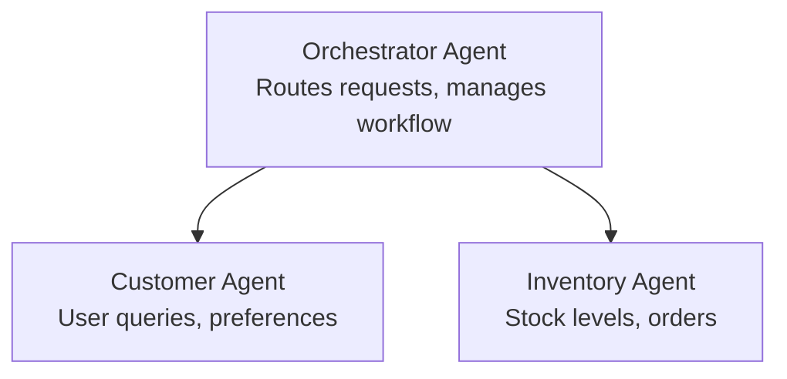

# Kabanata 5: Mga Solusyon sa Multi-Agent AI

**📚 Kurso**: [AZD Para sa Mga Nagsisimula](../../README.md) | **⏱️ Tagal**: 2-3 oras | **⭐ Kahirapan**: Advanced

---

## Pangkalahatang-ideya

Saklaw ng kabanatang ito ang mga advanced na pattern ng arkitektura ng multi-agent, pagsasaayos ng mga ahente, at production-ready na mga deployment ng AI para sa mga komplikadong sitwasyon.

> Sinuri ang mga gabay sa utos laban sa inilabas na `azd 1.37.2` reference. Hindi naisagawa ang mga deployment sa cloud.

## Mga Layunin sa Pagkatuto

Sa pagtatapos ng kabanatang ito, mauunawaan mo ang:
- Mga pattern sa arkitektura ng multi-agent
- Pag-deploy ng magkakaugnay na AI agent system
- Pagpapatupad ng komunikasyon mula ahente sa ahente
- Pagtatayo ng production-ready na mga solusyon ng multi-agent

---

## 📚 Mga Aralin

| # | Aralin | Paglalarawan | Oras |
|---|--------|-------------|------|
| 1 | [Mga Batayan ng Multi-Agent](multi-agent-basics.md) | Praktikal: mag-deploy ng gumaganang multi-agent app gamit ang `azd up` | 45 min |
| 2 | [Mga Pattern ng Koordinasyon](../chapter-06-pre-deployment/coordination-patterns.md) | Mga estratehiya ng pagsasaayos ng ahente (ipagpapatuloy sa Kabanata 6) | 30 min |
| 3 | [Pag-deploy ng ARM Template](../../examples/retail-multiagent-arm-template/README.md) | Halimbawa ng one-click deployment | 30 min |

> **Magsimula sa Aralin 1.** Ito lang ang ganap na hands-on, deployable na aralin sa kabanatang ito. Ang Aralin 2 ay nasa Kabanata 6 (kasama sa pre-deployment planning), at ang [Retail Multi-Agent Solution](../../examples/retail-scenario.md) ay isang blueprint ng arkitektura—isang disenyo ng sanggunian, hindi isang one-command template.

---

## 🚀 Mabilisang Pagsisimula

```bash
# Option 1: Deploy the multi-agent template used in Lesson 1
azd init --template Azure-Samples/contoso-creative-writer .
azd up

# Option 2: Initialize a Foundry agent interactively with the GA bundle
azd ext install microsoft.foundry
azd ai agent init
azd up
```

> **Anong pamamaraan?** Gamitin ang `azd init --template` para magsimula mula sa isang gumaganang sample. Gamitin ang `azd ai agent init` nang interactive, o `azd ai agent init --template <path-to-azure.yaml>` para i-adopt ang kasalukuyang proyekto ng ahente. Tingnan ang [AZD AI CLI reference](../chapter-08-production/production-ai-practices.md#azd-ai-cli-commands-and-extensions) para sa mga pangangailangan sa bersyon at paglipat ng ebalwasyon.

Patakbuhin ang mga alternatibong ito sa magkakahiwalay na mga walang laman na folder. Ang GA Foundry workflow ay nangangailangan ng `azd >= 1.37.0`; ang interactive na daloy nito ay hindi nag-generate ng custom na Service Bus pipeline sa aralin ng koordinasyon. Para sa lokal na pagsubok, pag-deploy ng code, at paglilinis ng bagong kontra-ginamit na proyekto, sundan ang [hosted-agent walkthrough](../chapter-02-ai-development/microsoft-foundry-integration.md#hosted-agent-walkthrough-ga).

---

## 🤖 Arkitektura ng Multi-Agent



---

## 🎯 Tampok na Solusyon: Retail Multi-Agent

Ang [Retail Multi-Agent Solution](../../examples/retail-scenario.md) ay nagpapakita ng:

- **Customer Agent**: Humahawak sa mga interaksyon at mga kagustuhan ng user
- **Inventory Agent**: Namamahala sa stock at proseso ng order
- **Orchestrator**: Nagsasaayos sa mga ahente
- **Shared Memory**: Pangangasiwa ng konteksto na tumatawid sa mga ahente

### Mga Serbisyong Ginamit

| Serbisyo | Layunin |
|---------|---------|
| Microsoft Foundry Models | Pag-unawa sa wika |
| Azure AI Search | Katalogo ng produkto |
| Cosmos DB | Estado at memorya ng ahente |
| Container Apps | Pagho-host ng ahente |
| Application Insights | Pagsubaybay |

---

## 🔗 Navigation

| Direksyon | Kabanata |
|-----------|---------|
| **Nauna** | [Kabanata 4: Imprastruktura](../chapter-04-infrastructure/README.md) |
| **Susunod** | [Kabanata 6: Pre-Deployment](../chapter-06-pre-deployment/README.md) |

---

## 📖 Kaugnay na Mga Mapagkukunan

- [Patnubay sa AI Agents](../chapter-02-ai-development/agents.md)
- [Mga Gawi sa Production AI](../chapter-08-production/production-ai-practices.md)
- [Troubleshooting sa AI](../chapter-07-troubleshooting/ai-troubleshooting.md)

---

<!-- CO-OP TRANSLATOR DISCLAIMER START -->
**Pagtatanggi**:
Ang dokumentong ito ay isinalin gamit ang serbisyo ng AI translation na [Co-op Translator](https://github.com/Azure/co-op-translator). Bagama't nagsusumikap kami para sa katumpakan, pakatandaan na ang awtomatikong pagsasalin ay maaaring maglaman ng mga pagkakamali o hindi pagkakatugma. Ang orihinal na dokumento sa orihinal nitong wika ang dapat ituring na pangunahing sanggunian. Para sa mahahalagang impormasyon, inirerekomenda ang propesyonal na pagsasalin ng tao. Hindi kami mananagot sa anumang maling pagkakaintindi o maling interpretasyon na nagmula sa paggamit ng pagsasaling ito.
<!-- CO-OP TRANSLATOR DISCLAIMER END -->