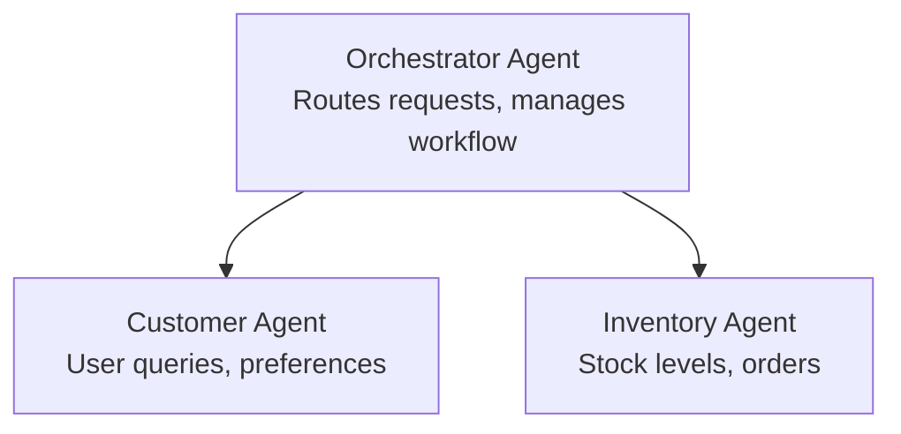

# Kabanata 5: Mga Solusyon ng Multi-Agent AI

**📚 Kurso**: [AZD For Beginners](../../README.md) | **⏱️ Tagal**: 2-3 oras | **⭐ Antas ng Kahirapan**: Advanced

---

## Pangkalahatang-ideya

Tinutugunan ng kabanatang ito ang mga advanced na pattern ng multi-agent architecture, agent orchestration, at production-ready na AI deployments para sa mga kumplikadong senaryo.

> Sinuri ang mga gabay sa utos laban sa inilabas na `azd 1.37.2` na reperensya. Hindi isinagawa ang mga cloud deployment.

## Mga Layunin sa Pag-aaral

Sa pagtatapos ng kabanatang ito, matututuhan mo ang:
- Mga pattern ng multi-agent architecture
- Pag-deploy ng magkakaugnay na mga sistema ng AI agent
- Pagpapatupad ng komunikasyon sa pagitan ng mga agent
- Pagtatayo ng production-ready na mga solusyon ng multi-agent

---

## 📚 Mga Aralin

| # | Aralin | Paglalarawan | Oras |
|---|--------|-------------|------|
| 1 | [Mga Pangunahing Kaalaman sa Multi-Agent](multi-agent-basics.md) | Hands-on: mag-deploy ng gumaganang multi-agent app gamit ang `azd up` | 45 min |
| 2 | [Mga Pattern ng Koordinasyon](../chapter-06-pre-deployment/coordination-patterns.md) | Mga estratehiya sa orchestrasyon ng agent (ipagpapatuloy sa Kabanata 6) | 30 min |
| 3 | [ARM Template Deployment](../../examples/retail-multiagent-arm-template/README.md) | Halimbawa ng isang click na deployment | 30 min |

> **Magsimula sa Aralin 1.** Ito lang ang ganap na hands-on, maide-deploy na aralin sa kabanatang ito. Ang Aralin 2 ay nasa Kabanata 6 (kasama sa pre-deployment planning), at ang [Retail Multi-Agent Solution](../../examples/retail-scenario.md) ay isang architectural blueprint—isang disenyo na reperensya, hindi isang one-command template.

---

## 🚀 Mabilis na Pagsisimula

```bash
# Option 1: Deploy the multi-agent template used in Lesson 1
azd init --template Azure-Samples/contoso-creative-writer .
azd up

# Option 2: Initialize a Foundry agent interactively (requires azure.ai.agents)
azd extension install azure.ai.agents
azd ai agent init
azd up
```

> **Aling pamamaraan?** Gamitin ang `azd init --template` upang magsimula mula sa isang gumaganang sample. Gamitin ang `azd ai agent init` nang interactive, o ang `azd ai agent init --template <path-to-azure.yaml>` upang gamitin ang kasalukuyang proyekto ng agent. Tingnan ang [AZD AI CLI reference](../chapter-08-production/production-ai-practices.md#azd-ai-cli-commands-and-extensions) para sa mga kinakailangang bersyon at paglipat sa evaluation.

Patakbuhin ang mga alternatibong ito sa magkakahiwalay na walang laman na mga folder. Ang extension ng Agents `1.0.0-beta.23` ay nangangailangan ng `azd >= 1.37.0`; ang interactive na daloy nito ay hindi gumagawa ng custom Service Bus pipeline sa leksyon ng koordinasyon.

---

## 🤖 Multi-Agent Architecture



---

## 🎯 Tampok na Solusyon: Retail Multi-Agent

Ang [Retail Multi-Agent Solution](../../examples/retail-scenario.md) ay nagpapakita ng:

- **Customer Agent**: Humahawak sa mga interaksyon at kagustuhan ng user
- **Inventory Agent**: Namamahala ng stock at pagproseso ng mga order
- **Orchestrator**: Nag-uugnay sa pagitan ng mga agent
- **Shared Memory**: Pamamahala ng konteksto sa pagitan ng mga agent

### Mga Serbisyong Ginamit

| Serbisyo | Layunin |
|---------|---------|
| Microsoft Foundry Models | Pag-unawa sa wika |
| Azure AI Search | Katalogo ng produkto |
| Cosmos DB | Kalagayan at memorya ng agent |
| Container Apps | Pagho-host ng agent |
| Application Insights | Pagmamanman |

---

## 🔗 Pag-navigate

| Direksyon | Kabanata |
|-----------|---------|
| **Nasa Nakaraan** | [Kabanata 4: Infrastructure](../chapter-04-infrastructure/README.md) |
| **Susunod** | [Kabanata 6: Pre-Deployment](../chapter-06-pre-deployment/README.md) |

---

## 📖 Kaugnay na Mga Mapagkukunan

- [AI Agents Guide](../chapter-02-ai-development/agents.md)
- [Production AI Practices](../chapter-08-production/production-ai-practices.md)
- [AI Troubleshooting](../chapter-07-troubleshooting/ai-troubleshooting.md)

---

<!-- CO-OP TRANSLATOR DISCLAIMER START -->
**Pagtatanggi**:
Ang dokumentong ito ay isinalin gamit ang serbisyo ng AI translation na [Co-op Translator](https://github.com/Azure/co-op-translator). Bagama't nagsusumikap kami para sa katumpakan, pakatandaan na ang awtomatikong pagsasalin ay maaaring maglaman ng mga pagkakamali o hindi pagkakatugma. Ang orihinal na dokumento sa orihinal nitong wika ang dapat ituring na pangunahing sanggunian. Para sa mahahalagang impormasyon, inirerekomenda ang propesyonal na pagsasalin ng tao. Hindi kami mananagot sa anumang maling pagkakaintindi o maling interpretasyon na nagmula sa paggamit ng pagsasaling ito.
<!-- CO-OP TRANSLATOR DISCLAIMER END -->