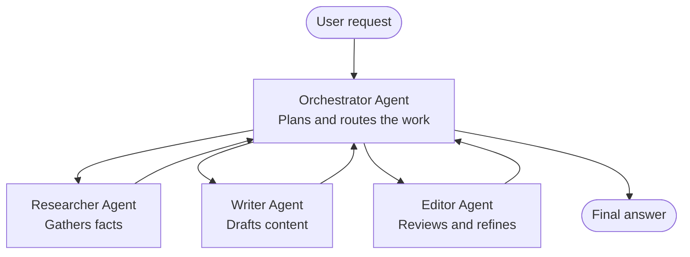

# Mga Pangunahing Kaalaman sa Multi-Agent - I-deploy ang Iyong Unang Naka-Koordina na AI System

**Pag-navigate sa Kabanata:**
- **📚 Tahanan ng Kurso**: [AZD For Beginners](../../README.md)
- **📖 Kasalukuyang Kabanata**: Kabanata 5 - Multi-Agent AI Solutions
- **⬅️ Nakaraang Kabanata**: [Kabanata 4: Infrastructure](../chapter-04-infrastructure/README.md)
- **➡️ Susunod**: [Mga Pattern ng Koordinasyon](../chapter-06-pre-deployment/coordination-patterns.md)

> Sinuri ang gabay sa utos laban sa inilabas na `azd 1.37.2` reference. Hindi naisagawa ang mga deployment sa cloud.

## Panimula

Sa mga naunang kabanata, nag-deploy ka ng isang application—at sa Kabanata 2, nag-deploy ka ng isang AI agent. Ang araling ito ay sumusulong: i-deploy ang **multi-agent system**, kung saan ilang mga espesyalistang agent ang nagtutulungan upang lutasin ang isang problema na hindi kaya ng isang agent nang mag-isa.

Ang magandang balita para sa mga nagsisimula: **hindi mo kailangan ng bagong mga utos.** Ang multi-agent solution ay isa pa ring azd project. Mag-`azd init`, `azd up`, susubok, at mag-`azd down` ka—eksaktong proseso na alam mo na. Ang nagbabago ay ang *hugis* ng app sa loob.

## Mga Layunin sa Pagkatuto

Sa katapusan ng araling ito, matututuhan mo ang mga sumusunod:
- Maunawaan kung ano ang ibig sabihin ng "multi-agent" at kung kailan sulit ang dagdag na komplikasyon
- Kilalanin ang mga karaniwang papel sa isang multi-agent system (orchestrator + mga espesyalista)
- Mag-deploy ng isang tunay at gumaganang multi-agent template gamit ang `azd up`
- Maunawaan ang mga Azure resources na sumusuporta sa isang multi-agent app
- Malaman kung paano i-verify, i-customize, at ligtas na i-tear down ang solusyon

## Mga Kinalabasan ng Pagkatuto

Pagkatapos makumpleto ang araling ito, magagawa mong:
- Ipaliwanag ang pagkakaiba ng isang single agent at isang multi-agent system
- Pumili sa pagitan ng isang single agent na may tools at isang tunay na multi-agent design
- Mag-deploy at subukan ang isang multi-agent template mula simula hanggang matapos gamit ang azd
- Tukuyin kung saan tumatakbo ang bawat agent at kung paano sila nagkakausap
- Linisin lahat ng resources upang maiwasan ang tuloy-tuloy na singil

---

## Ano ang Multi-Agent System?

Ang isang AI agent ay isang modelo na may set ng mga utos at (opsyonal) mga tools. Epektibo ito para sa mga tiyak na gawain. Ngunit habang lumalaki ang gawain—pananaliksik, pagsusulat, pag-edit, at pag-verify ng mga katotohanan—ang pagsiksik ng lahat sa isang prompt ay nagpapabagal sa agent, nagpapababa ng pagiging maaasahan, at nagpapahirap sa pag-debug.

Ang **multi-agent system** ay naghahati sa trabaho sa mga espesyalista na bawat isa ay mahusay sa isang gawain, na inaayos ng isang orchestrator:



### Ang dalawang papel na palaging makikita mo

| Papel | Trabaho | Halimbawa |
|------|-----|---------|
| **Orchestrator** | Nagpapasya *ano ang susunod na gagawin* at nagra-route ng trabaho sa mga agent | "Unang magsaliksik, pagkatapos magsulat, pagkatapos mag-edit" |
| **Espesyalista** | Gumagawa ng isang tiyak na gawain at nagbabalik ng resulta | Isang "mananaliksik" na nangongolekta lang ng mga katotohanan |

### Talaga bang kailangan mo ng maraming agent?

Magsimula sa simple. Gamitin ang multi-agent **kapag** totoo ang isa sa mga sumusunod:

- ✅ Ang gawain ay may **mga malinaw na yugto** na mas mainam kung may magkakaibang mga utos (pananaliksik vs pagsulat vs pag-review)
- ✅ Nais mong tumakbo ang mga espesyalista **ng sabay-sabay** upang makatipid ng oras
- ✅ Kailangan ng iba't ibang mga hakbang ang **ibang mga tools o pinanggagalingang data**
- ✅ Kailangan sabihin na ang bawat hakbang ay **maaari independiyenteng subukan at i-debug**

Kung ang gawain mo ay isang simpleng tanong-sagot o simpleng pagtawag ng tool, mas madali, mas mura, at mas madaling patakbuhin ang **isang single agent na may tools** (Kabanata 2).

> **Tip para sa baguhan:** "Maraming agents" ay hindi lagi "mas mabuti." Bawat agent ay nagdadagdag ng latency, gastos, at bagong bagay na kailangang bantayan. Magdagdag ng agents lamang kung malinaw na nahahati ang problema sa mga bahagi.

---

## Dalawang Paraan sa Paggawa ng Multi-Agent sa Azure

| Paraan | Ano ito | Pinakamainam para sa |
|----------|-----------|----------|
| **Single agent + tools** | Isang Foundry agent na tumatawag ng mga function/tools | Simple na workflows, panimulang pag-aaral |
| **Maramihang naka-koordinang agents** | Ilang agents na may orchestrator | Mga malinaw na yugto, sabayang trabaho, espesyalisasyon |

Ang araling ito ay nakatuon sa pangalawang paraan gamit ang isang **handa nang template**, upang makita mo ang isang tunay na multi-agent system na tumatakbo bago ka gumawa ng sarili mo.

---

## Hands-On: Mag-deploy ng Gumaganang Multi-Agent App

Mag-deploy tayo ng **Contoso Creative Writer**, isang opisyal na Azure sample na nagkokordina ng mga research, product, writing, at editing agents upang gumawa ng isang artikulo. Bago magpatuloy, tingnan ang [mga kinakailangan at gastos ng sample](https://github.com/Azure-Samples/contoso-creative-writer#azure-account-requirements): kailangan nito ng model quota, Azure AI Search, Bing Grounding access, Python, Docker, at mga Bash-compatible na hooks. Nakadepende sa iyong subscription ang availability ng model at rehiyon; hindi ginagarantiyahan ang deployment sa pamamagitan ng pagpili ng isang partikular na rehiyon.

### Hakbang 1: I-initialize ang template

```bash
# Create a working folder
mkdir creative-writer && cd creative-writer

# Initialize from the official multi-agent template
azd init --template Azure-Samples/contoso-creative-writer .
```

> Magsuri ng iba pang multi-agent templates anumang oras sa [Awesome AZD AI gallery](https://azure.github.io/awesome-azd/?tags=ai). Ang mga iba pang opsyon para sa mga baguhan ay kasama ang `get-started-with-ai-agents` at `azure-ai-travel-agents`.

### Hakbang 2: I-authenticate

```bash
# Required for azd workflows
azd auth login

# Also required by this sample's Azure CLI hooks
az login
```

### Hakbang 3: Suriin ang kapaligiran

```bash
# init normally creates/selects an environment; confirm it before proceeding
azd env list
# Only if you need an additional environment:
# azd env new dev
```

### Hakbang 4: Tingnan muna, pagkatapos ay mag-deploy

```bash
# See what will be created before spending anything (recommended)
azd provision --preview

# Provision infrastructure and deploy all agents in one step
azd up
```

Hinihiling ng `azd up` ang mga nawawalang subscription at region settings, pagkatapos ay magpo-provision ng mga resources at mag-deploy ng application. Ang preview ay hindi nagre-reserve ng quota o naggagarantiya ng tagumpay; maaaring tumakbo pa rin ang mga template hooks sa panahon ng provisioning preview kaya suriin muna ang mga iyon. Para pahabain kung gaano katagal maghihintay ang azd para sa bawat **service deployment** (hindi model provisioning):

```bash
azd deploy --timeout 1800
```

Humihinto ang timeout sa paghihintay ng azd; hindi nito kinakansela ang deployment sa Azure. Suriin ang estado ng resource bago muling subukan.

> **Babala sa gastos at kapasidad:** Ang mga multi-agent apps ay nag-de-deploy ng AI models na kumokonsumo ng quota at nagdudulot ng gastos. Kung nabigo ang `azd up` sa model quota, tingnan ang [AI Troubleshooting](../chapter-07-troubleshooting/ai-troubleshooting.md) para sa mga ayos sa rehiyon at quota, at Kabanata 6 [Capacity Planning](../chapter-06-pre-deployment/capacity-planning.md).

---

## Pag-unawa sa iyong na-deploy

Ang tipikal na multi-agent app tulad nito ay nagpo-provision ng mga Azure resources na diretsong tumutugma sa mga responsibilidad sa diagram sa itaas:

| Resource | Bakit ito nandiyan |
|----------|----------------|
| **Microsoft Foundry / Models** | Kung saan naka-host ang language models na ginagamit ng bawat agent |
| **Azure AI Search** | Nagbibigay sa researcher agent ng grounded na datos para sa paghahanap |
| **Container Apps** (o App Service) | Naka-host ang orchestrator at agent code |
| **Cosmos DB** (sa ilang samples) | Nagsisilbing shared state/memory na ipinapasa sa pagitan ng mga agent |
| **Application Insights** | Nag-track ng mga request *sa lahat* ng agents para mag-debug ng flow |

### Paano nagkukuwentuhan ang mga agent

Sa karamihan ng azd multi-agent samples, ang **orchestrator ay tumatakbo sa iyong application code** (halimbawa, gamit ang framework tulad ng Semantic Kernel o Microsoft Agent Framework). Tumatawag ang orchestrator sa bawat specialist agent nang sunud-sunod, ipinapasa ang mga resulta, at binubuo ang panghuling sagot. Nagbabahaginan ang mga agent ng konteksto sa pamamagitan ng:

- **Function/tool calls** — tinatawag ng orchestrator ang isang espesyalista at nakakakuha ng resulta
- **Shared memory** — isang database (madalas Cosmos DB) ang humahawak ng estado na mababasa ng dalawang agent
- **Messages/events** — para sa mas maluwag na koneksyon, nakikipag-ugnayan ang mga agent sa pamamagitan ng queue o Service Bus

> **Bakit mahalaga ito para sa pag-debug:** dahil hiwalay ang bawat hakbang, ipinapakita ng Application Insights kung aling agent ang mabagal o nabigo. Isang pangunahing dahilan ito para paghiwa-hiwalayin ang trabaho sa mga agent.

---

## I-verify ang Deployment

Kumpirmahin na gumagana ang system bago magpatuloy:

```bash
# Show the deployed endpoints
azd show

# Open the app's monitoring dashboard
azd monitor

# Open Application Insights Logs (not a terminal log stream)
azd monitor --logs
```

Pagkatapos buksan ang app URL mula sa `azd show` at humiling ng maikling artikulo. Gamitin ang debug view ng sample para suriin ang workflow ng mga agent nito. Maaaring ipakita ng Application Insights transaction search ang mga hiwalay na hakbang kung na-instrument at na-correlate ng sample; hindi awtomatikong nadadagdagan ng azd ang mga agent spans.

**Pangunahing tagumpay na mga batayan:**
- ✅ Ipinapakita ng `azd show` ang isang makukuhang endpoint
- ✅ Ang isang kahilingan ay nagbubunga ng resulta na malinaw na dumaan sa maraming yugto
- ✅ Ipinapakita ng debug view ang maraming hakbang ng agent; kung naka-enable ang tracing, i-verify ang kaukulang telemetry pagkatapos ng ingestion

---

## I-customize: Magdagdag o Ayusin ang isang Agent

Dahil ang bawat agent ay mga utos lang dagdag tools, madaling i-customize:

1. **Hanapin ang mga agent definitions** sa template (madalas sa isang hanay ng mga file tulad ng `prompts/`, `agents/`, o `*.prompty`).
2. **Ayusin ang mga utos ng agent** — halimbawa, utusan ang editor agent na ipatupad ang isang partikular na tono o bilang ng salita.
3. **I-redeploy lamang ang code** (hindi nagbabago ang imprastraktura):

   ```bash
   azd deploy
   ```

Para mas malalim sa sariling Foundry agent project, gamitin ang interactive initialization ng agent extension:

```bash
azd extension install azure.ai.agents
azd ai agent init
azd up
azd ai agent invoke      # test, with response timing
```

Tingnan ang [Kabanata 2: Agents](../chapter-02-ai-development/agents.md) at ang [AZD AI CLI reference](../chapter-08-production/production-ai-practices.md#azd-ai-cli-commands-and-extensions) para sa kumpletong lifecycle: agent `invoke`, ang hiwalay na evaluations extension na `azd ai eval` workflow, agent `optimize`, at agent `delete`.

---

## Linisin

Ang mga multi-agent apps ay nagpapatakbo ng maraming nasisingil na serbisyo. I-tear down ang lahat kapag tapos ka na:

```bash
# Review the resources and confirm deletion interactively
azd down
```

Nakapipinsala ang pagtanggal. Para sa disposable lab, nilalaktawan ng `azd down --force --purge` ang pagtanggal at suportadong mga kumpirmasyon ng soft-delete purge; ang pagpurga ay hindi na mababawi kung saan ito suportado at maaaring hadlangan ng purge protection. Ang soft deletion ay usapin ng recovery/pag-reuse ng pangalan, hindi patunay ng tuloy-tuloy na singil. Suriin ang mga natitirang resources at pagsingil pagkatapos ng paglilinis.

---

## Tala tungkol sa Production Multi-Agent Systems

Ang [Retail Multi-Agent Solution](../../examples/retail-scenario.md) sa repo na ito ay isang **arkitektural na blueprint**, hindi isang one-command template—dinodokumento nito kung paano *ipapagawa* ang isang production retail system (at malinaw na malaki ang trabaho para dito). Gamitin ito bilang sanggunian sa disenyo *pagkatapos* mong makapag-deploy ng gumaganang sample dito. Para sa mga usapin sa production (resilience, gastos, monitoring, pamamahala), magpatuloy sa [Kabanata 8: Mga Praktis ng Produksyon AI](../chapter-08-production/production-ai-practices.md).

---

## Buod

- Hinahati-hati ng multi-agent system ang trabaho sa mga espesyalista na inaayos ng isang orchestrator.
- Gamitin ito lamang kapag ang gawain ay may malinaw na mga yugto, sabayang proseso, o iba't ibang mga tools bawat hakbang—kung hindi, mas piliin ang isang single agent.
- Hindi nagbabago ang azd na proseso: `azd init` → `azd up` → test → `azd down`.
- Ang isang tunay na template tulad ng `contoso-creative-writer` ay nagbibigay-daan sa iyo upang makita at i-customize ang isang gumaganang multi-agent app ngayon.
- Ang Application Insights tracing sa pagitan ng mga agent ay isa sa pinakamalaking praktikal na benepisyo ng multi-agent design.

---

## 🔗 Pag-navigate

| Direksyon | Aralin |
|-----------|--------|
| **Nakaraan** | [Kabanata 4: Infrastructure](../chapter-04-infrastructure/README.md) |
| **Susunod** | [Mga Pattern ng Koordinasyon](../chapter-06-pre-deployment/coordination-patterns.md) |

## 📖 Mga Kaugnay na Mapagkukunan

- [Gabay sa AI Agents](../chapter-02-ai-development/agents.md)
- [Mga Pattern ng Koordinasyon](../chapter-06-pre-deployment/coordination-patterns.md)
- [Mga Praktis ng Produksyon AI](../chapter-08-production/production-ai-practices.md)
- [AI Troubleshooting](../chapter-07-troubleshooting/ai-troubleshooting.md)

---

<!-- CO-OP TRANSLATOR DISCLAIMER START -->
**Pagtatanggi**:
Ang dokumentong ito ay isinalin gamit ang serbisyo ng AI translation na [Co-op Translator](https://github.com/Azure/co-op-translator). Bagama't nagsusumikap kami para sa katumpakan, pakatandaan na ang awtomatikong pagsasalin ay maaaring maglaman ng mga pagkakamali o hindi pagkakatugma. Ang orihinal na dokumento sa orihinal nitong wika ang dapat ituring na pangunahing sanggunian. Para sa mahahalagang impormasyon, inirerekomenda ang propesyonal na pagsasalin ng tao. Hindi kami mananagot sa anumang maling pagkakaintindi o maling interpretasyon na nagmula sa paggamit ng pagsasaling ito.
<!-- CO-OP TRANSLATOR DISCLAIMER END -->