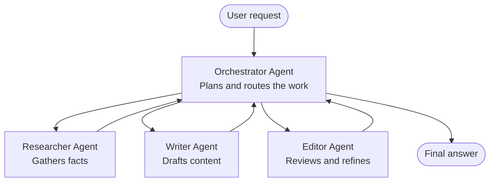

# Mga Pangunahing Kaalaman sa Multi-Agent - I-deploy ang Iyong Unang Nakoordinadong Sistema ng AI

**Pag-navigate ng Kabanata:**
- **📚 Tahanan ng Kurso**: [AZD Para sa mga Nagsisimula](../../README.md)
- **📖 Kasalukuyang Kabanata**: Kabanata 5 - Mga Solusyong Multi-Agent AI
- **⬅️ Nakaraan**: [Kabanata 4: Imprastraktura](../chapter-04-infrastructure/README.md)
- **➡️ Susunod**: [Mga Pattern ng Koordinasyon](../chapter-06-pre-deployment/coordination-patterns.md)

> Sinuri ang gabay sa utos laban sa inilabas na reperensiyang `azd 1.37.2`. Hindi isinagawa ang mga cloud deployment.

## Panimula

Sa mga naunang kabanata, nag-deploy ka ng isang aplikasyon—at sa Kabanata 2, nag-deploy ka ng isang AI agent. Ang araling ito ay sumusunod sa susunod na hakbang: pag-deploy ng isang **multi-agent system**, kung saan ang ilang mga espesyalistang agent ay nagtutulungan upang lutasin ang isang problema na hindi kayang gawin ng isang agent nang mag-isa nang mabuti.

Ang magandang balita para sa mga nagsisimula: **hindi mo kailangan ng mga bagong utos.** Ang multi-agent na solusyon ay isa pa ring azd project. Gagawa ka ng `azd init`, `azd up`, mag-tetest, at `azd down`—eksakto ang workflow na alam mo na. Ang nagbabago ay ang *hugis* ng app sa loob.

## Mga Layunin sa Pagkatuto

Sa pagtatapos ng araling ito,:
- Maiintindihan mo kung ano ang ibig sabihin ng "multi-agent" at kailan ito sulit sa karagdagang kumplikasyon
- Makikilala mo ang karaniwang mga papel sa multi-agent system (orchestrator + mga espesyalista)
- Magde-deploy ng totoong gumaganang multi-agent template gamit ang `azd up`
- Maiintindihan mo ang mga Azure resources na sumusuporta sa multi-agent app
- Malalaman mo kung paano beripikahin, baguhin, at ligtas na alisin ang solusyon

## Mga Kinalabasan ng Pagkatuto

Pagkatapos makumpleto ang araling ito, magagawa mo:
- Ipaliliwanag ang pagkakaiba sa pagitan ng isang solong agent at isang multi-agent system
- Pumili sa pagitan ng isang solong agent na may mga kagamitan at isang tunay na disenyo ng multi-agent
- Mag-deploy at mag-test ng multi-agent template mula umpisa hanggang dulo gamit ang azd
- Tukuyin kung saan tumatakbo ang bawat agent at kung paano sila nag-uusap
- Linisin ang lahat ng resources upang maiwasan ang tuloy-tuloy na singil

---

## Ano ang Multi-Agent System?

Isang AI agent ay isang modelo na may hanay ng mga utos at (opsyonal) ilang mga kagamitan. Maayos ito para sa mga nakatuong gawain. Ngunit habang lumalaki ang gawain—pananaliksik, pagsulat, pag-edit, pag-fact-check—ang pagsiksik ng lahat sa isang prompt ay nagpapabagal, nagpapababa ng katatagan, at nagpapahirap sa pag-debug ng agent.

Ang **multi-agent system** ay hinahati ang gawain sa mga espesiyalista na bawat isa ay mahusay sa isang gawain, na neko-coordinate ng isang orchestrator:



### Ang dalawang papel na palaging makikita mo

| Papel | Trabaho | Halimbawa |
|------|-----|---------|
| **Orchestrator** | Nagpapasiya kung *ano ang susunod na mangyayari* at nag-uugnay ng gawain sa mga agent | "Una magsaliksik, pagkatapos sumulat, pagkatapos mag-edit" |
| **Espesyalista** | Gumagawa ng isang nakatuong gawain at nagbabalik ng resulta | Isang "researcher" na nangongolekta lang ng mga katotohanan |

### Talaga bang kailangan mo ng maraming agent?

Magsimula sa simple. Gamitin ang multi-agent **lamang** kung alinman sa mga ito ay totoo:

- ✅ May **nagkakaibang mga yugto** ang gawain na nakikinabang sa iba't ibang mga utos (pananaliksik vs. pagsulat vs. pagrebisa)
- ✅ Gusto mong magpatakbo ng mga espesiyalista **kasabay** para makatipid ng oras
- ✅ Iba't ibang mga hakbang ang nangangailangan ng **ibang mga kagamitan o pinanggagalingan ng datos**
- ✅ Kailangan mong ang bawat hakbang ay **mabisang matetest at madadagdagan ang debugging**

Kung ang iyong gawain ay isang simpleng tanong-at-sagot o isang simpleng tawag sa kagamitan, ang **isang agent na may mga gamit** (Kabanata 2) ay mas simple, mas mura, at mas madaling patakbuhin.

> **Tip para sa nagsisimula:** "Maraming agent" ay hindi laging "mas mabuti." Bawat agent ay nagdadagdag ng latency, gastos, at bagong bagay na imonitor. Magdagdag lang ng mga agent kapag malinaw na nahahati ang problema sa mga bahagi.

---

## Dalawang Paraan ng Paggawa ng Multi-Agent sa Azure

| Paraan | Ano ito | Pinakamainam para sa |
|----------|-----------|----------|
| **Isang agent + mga gamit** | Isang Foundry agent na tumatawag ng mga function/kagamitan | Mga simpleng workflow, panimulang hakbang |
| **Maraming naka-koordinadong agent** | Maraming agent na may orchestrator | Nagkakaibang yugto, sabayang trabaho, espesyalisasyon |

Nakatuon ang araling ito sa pangalawang paraan gamit ang **handang template**, upang makita mo ang totoong multi-agent system na tumatakbo bago ka gumawa ng sarili mo.

---

## Praktikal: Mag-deploy ng Gumaganang Multi-Agent App

Magde-deploy tayo ng **Contoso Creative Writer**, isang opisyal na Azure sample na nagpapakordina ng research, produkto, pagsulat, at editing na mga agent upang makagawa ng isang artikulo. Bago magpatuloy, tingnan ang [mga kinakailangan at gastos ng sample](https://github.com/Azure-Samples/contoso-creative-writer#azure-account-requirements): kailangan nito ng model quota, Azure AI Search, access sa Bing Grounding, Python, Docker, at mga Bash-compatible na hook. Nakadepende sa iyong subscription ang pagkakaroon ng modelo at rehiyon; hindi ginagarantiyahan ang deployment sa pamamagitan lamang ng pagpili ng partikular na rehiyon.

### Hakbang 1: I-initialize ang template

```bash
# Create a working folder
mkdir creative-writer && cd creative-writer

# Initialize from the official multi-agent template
azd init --template Azure-Samples/contoso-creative-writer .
```

> Mag-browse ng iba pang multi-agent templates anumang oras sa [Awesome AZD AI gallery](https://azure.github.io/awesome-azd/?tags=ai). Kasama rin sa iba pang mga madaling gamitin para sa mga nagsisimula ang `get-started-with-ai-agents` at `azure-ai-travel-agents`.

### Hakbang 2: Mag-authenticate

```bash
# Required for azd workflows
azd auth login

# Also required by this sample's Azure CLI hooks
az login
```

### Hakbang 3: Suriin ang kapaligiran

```bash
# init normally creates/selects an environment; confirm it before proceeding
azd env list
# Only if you need an additional environment:
# azd env new dev
```

### Hakbang 4: I-preview, pagkatapos mag-deploy

```bash
# See what will be created before spending anything (recommended)
azd provision --preview

# Provision infrastructure and deploy all agents in one step
azd up
```

Ang `azd up` ay magtatanong para sa kulang na mga setting ng subscription at rehiyon, pagkatapos ay magbibigay ng resources at magde-deploy ng aplikasyon. Ang preview ay hindi nagtatabi ng quota o nagpapangako ng tagumpay; maaaring tumakbo pa rin ang mga hook ng template habang sa provisioning preview, kaya suriin muna ito. Para palawigin kung gaano katagal maghihintay ang azd para sa bawat **pag-deploy ng serbisyo** (hindi pag-provision ng modelo):

```bash
azd deploy --timeout 1800
```

Hihinto ang timeout sa paghihintay ng azd; hindi nito kinakansela ang deployment sa Azure. Suriin ang estado ng resource bago subukang muli.

> **Babala tungkol sa gastos at kapasidad:** Nagde-deploy ang multi-agent apps ng mga AI models na kumokonsumo ng quota at nagdudulot ng gastos. Kung mabigo ang `azd up` sa model quota, tingnan ang [AI Troubleshooting](../chapter-07-troubleshooting/ai-troubleshooting.md) para sa mga pag-aayos sa rehiyon at quota, at Kabanata 6 [Pagpaplano ng Kapasidad](../chapter-06-pre-deployment/capacity-planning.md).

---

## Pag-unawa sa Iyong Na-deploy

Ang isang tipikal na multi-agent app tulad nito ay nagpo-provision ng isang set ng mga Azure resources na direktang tumutugma sa mga responsibilidad sa diagram sa itaas:

| Resource | Bakit ito nandiyan |
|----------|----------------|
| **Microsoft Foundry / Mga Modelo** | Nagho-host ng mga language model na ginagamit ng bawat agent |
| **Azure AI Search** | Nagbibigay sa researcher agent ng grounded na data para hanapin |
| **Container Apps** (o App Service) | Nagho-host ng orchestrator at code ng agent |
| **Cosmos DB** (sa ilang sample) | Nagtatago ng shared state/memory na ipinapasa sa mga agent |
| **Application Insights** | Nagsusubaybay ng mga request *sa pagitan* ng mga agent para ma-debug ang daloy |

### Paano nag-uusap ang mga agent sa isa't isa

Sa karamihan ng mga azd multi-agent na sample, ang **orchestrator ay tumatakbo sa iyong application code** (halimbawa, gamit ang isang framework tulad ng Semantic Kernel o Microsoft Agent Framework). Tinatawag ng orchestrator ang bawat espesyalistang agent isa-isa, ipinapasa ang mga resulta, at pinagsasama-sama ang panghuling sagot. Ang mga agent ay nagbabahagi ng konteksto sa pamamagitan ng:

- **Mga tawag sa function/kagamitan** — tinatawag ng orchestrator ang isang espesyalistang agent at bumabalik ang resulta
- **Shared memory** — isang database (madalas Cosmos DB) ang naglalaman ng estado na pareho nilang mababasa
- **Mga mensahe/kaganapan** — para sa mas maluwag na ugnayan, nakikipag-ugnayan ang mga agent sa pamamagitan ng queue o Service Bus

> **Bakit mahalaga ito para sa debugging:** dahil ang bawat hakbang ay magkakahiwalay, ipinapakita ng Application Insights kung *alin* na agent ang mabagal o nabigo. Isa iyon sa mga pangunahing dahilan kung bakit hinahati ang gawain sa iba't ibang agent.

---

## Beripikahin ang Deployment

Kumpirmahin na aktwal na gumagana ang sistema bago magpatuloy:

```bash
# Show the deployed endpoints
azd show

# Open the app's monitoring dashboard
azd monitor

# Open Application Insights Logs (not a terminal log stream)
azd monitor --logs
```

Pagkatapos buksan ang URL ng app mula sa `azd show` at humiling ng maikling artikulo. Gamitin ang debug view ng sample upang siyasatin ang workflow ng agent. Maaari ipakita ng Application Insights transaction search ang mga indibidwal na hakbang kung na-instrument at na-correlate ang mga ito; hindi awtomatikong nagdadagdag ang azd ng agent spans.

**Mga pamantayan ng tagumpay:**
- ✅ Nagtatala ang `azd show` ng isang maaabot na endpoint
- ✅ Ang isang kahilingan ay gumagawa ng resulta na malinaw na dumaan sa maraming yugto
- ✅ Ipinapakita ng debug view ang maraming hakbang ng agent; kung nakabukas ang tracing, beripikahin ang kaukulang telemetry pagkatapos niya ingesyon

---

## I-customize: Magdagdag o Ayusin ang isang Agent

Dahil ang bawat agent ay mga utos lang na may mga ginawa, madaling i-customize:

1. **Hanapin ang mga definisyon ng agent** sa template (madalas isang set ng mga file na `prompts/`, `agents/`, o `*.prompty`).
2. **Iayos ang mga utos ng agent** — halimbawa, sabihin sa editor agent na ipatupad ang isang partikular na tono o bilang ng salita.
3. **I-redeploy ang code lamang** (hindi binabago ang imprastraktura):

   ```bash
   azd deploy
   ```

Para mas mapalawak gamit ang *sariling* Foundry agent project, gamitin ang GA bundle sa AZD 1.37.0+ sa hiwalay na walang laman na direktoryo:

```bash
azd ext install microsoft.foundry
azd ai agent init
azd up
azd ai agent invoke      # test, with response timing
```

Tingnan ang [GA hosted-agent walkthrough](../chapter-02-ai-development/microsoft-foundry-integration.md#hosted-agent-walkthrough-ga) para sa lokal na pagsusuri ng Agent Inspector, pag-deploy ng remote na code, at pag-aari ng paglilinis. Tinalakay din ng [AZD AI CLI reference](../chapter-08-production/production-ai-practices.md#azd-ai-cli-commands-and-extensions) ang mga hiwalay na evaluation extension, optimization, at pagtanggal ng agent.

---

## Paglilinis

Nagpapatakbo ang multi-agent apps ng maraming serbisyong pwedeng singilin. Alisin lahat kapag tapos ka na:

```bash
# Review the resources and confirm deletion interactively
azd down
```

Ang pagtanggal ay nakakasira. Para sa isang disposable na lab, nilalaktawan ng `azd down --force --purge` ang pagtanggal at ang mga suportadong kumpirmasyon ng soft-delete purge; irreversible ang purge kung suportado at maaaring hadlangan ng purge protection. Ang soft deletion ay usapin ng recovery/pag-reuse ng pangalan, hindi patunay ng patuloy na singil. Suriin ang natitirang mga resources at singil pagkatapos ng paglilinis.

Kung nag-initialize ka rin ng hosted agent laban sa umiiral na Foundry project, iniwan ng `azd down` ang agent ng project na iyon at iba pang mga resource sa lugar. Tanggalin lang ang mga hindi nais na resources na pag-aari mo nang hiwalay. Para sa bagong Foundry project na ginawa ng AZD environment nito, tinatanggal ng `azd down` ang resource group at lahat nang laman nito.

---

## Paalala tungkol sa Production Multi-Agent Systems

Ang [Retail Multi-Agent Solution](../../examples/retail-scenario.md) sa repo na ito ay isang **blueprint ng arkitektura**, hindi isang template na isang utos lang—dinodokumento nito kung paano *gagawa* ng isang production retail system (at malinaw na nagsasabing malaki ang kinakailangang effort para sa full build). Gamitin ito bilang sanggunian sa disenyo *pagkatapos* mong mag-deploy ng gumaganang sample dito. Para sa mga usaping production (resilience, gastos, monitoring, pamamahala), magpatuloy sa [Kabanata 8: Mga Praktis ng Production AI](../chapter-08-production/production-ai-practices.md).

---

## Buod

- Hinahati ng multi-agent system ang gawain sa mga espesiyalista na kinokordina ng isang orchestrator.
- Gamitin lang ito kapag ang gawain ay may iba't ibang yugto, parallelismo, o iba’t ibang gamit sa bawat hakbang—kung hindi, piliin ang isang agent lang.
- Hindi nagbabago ang azd workflow: `azd init` → `azd up` → test → `azd down`.
- Ang isang totoong template tulad ng `contoso-creative-writer` ay nagpapakita at nagpapahintulot sa pag-customize ng gumaganang multi-agent app ngayon.
- Malaking praktikal na benepisyo ng multi-agent design ang pag-trace ng Application Insights sa pagitan ng mga agent.

---

## 🔗 Pag-navigate

| Direksyon | Aralin |
|-----------|--------|
| **Nakaraan** | [Kabanata 4: Imprastraktura](../chapter-04-infrastructure/README.md) |
| **Susunod** | [Mga Pattern ng Koordinasyon](../chapter-06-pre-deployment/coordination-patterns.md) |

## 📖 Kaugnay na Mga Recursos

- [AI Agents Guide](../chapter-02-ai-development/agents.md)
- [Mga Pattern ng Koordinasyon](../chapter-06-pre-deployment/coordination-patterns.md)
- [Mga Praktis ng Production AI](../chapter-08-production/production-ai-practices.md)
- [AI Troubleshooting](../chapter-07-troubleshooting/ai-troubleshooting.md)

---

<!-- CO-OP TRANSLATOR DISCLAIMER START -->
**Pagtatanggi**:
Ang dokumentong ito ay isinalin gamit ang serbisyo ng AI translation na [Co-op Translator](https://github.com/Azure/co-op-translator). Bagama't nagsusumikap kami para sa katumpakan, pakatandaan na ang awtomatikong pagsasalin ay maaaring maglaman ng mga pagkakamali o hindi pagkakatugma. Ang orihinal na dokumento sa orihinal nitong wika ang dapat ituring na pangunahing sanggunian. Para sa mahahalagang impormasyon, inirerekomenda ang propesyonal na pagsasalin ng tao. Hindi kami mananagot sa anumang maling pagkakaintindi o maling interpretasyon na nagmula sa paggamit ng pagsasaling ito.
<!-- CO-OP TRANSLATOR DISCLAIMER END -->