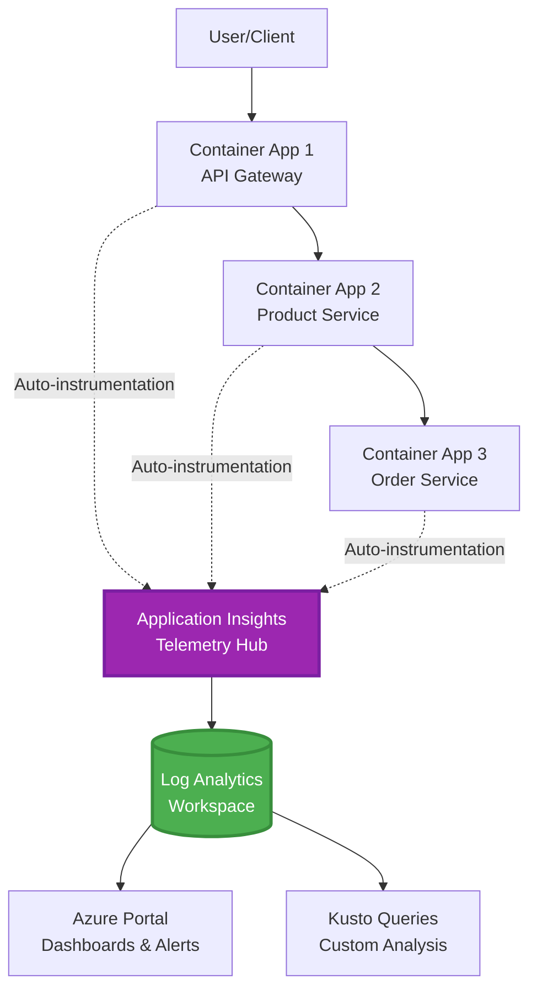
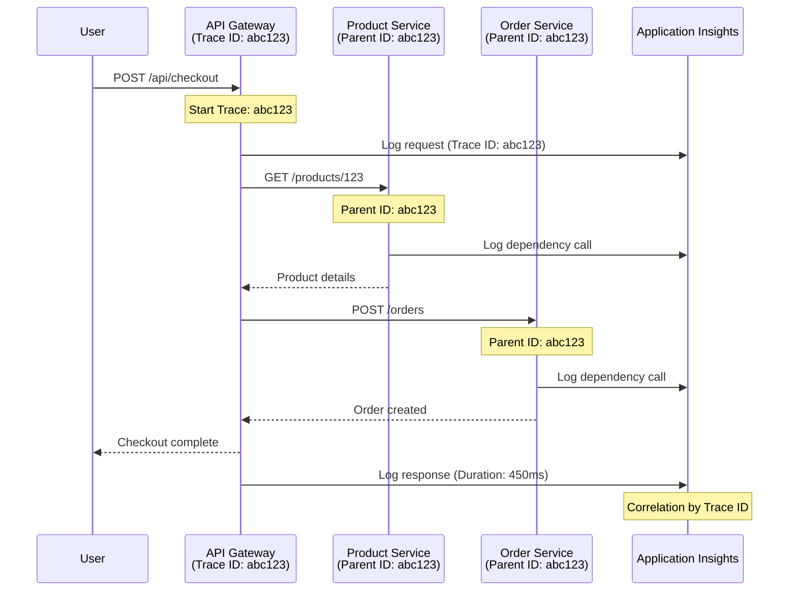

# Integrasyon ng Application Insights sa AZD

⏱️ **Tinatayang Oras**: 40-50 minuto | 💰 **Epekto sa Gastos**: ~$5-15/buwan | ⭐ **Kumplikado**: Intermediate

**📚 Landas ng Pagkatuto:**
- ← Nakaraang: [Preflight Checks](preflight-checks.md) - Pag-validate bago mag-deploy
- 🎯 **Nasa Dito Ka**: Integrasyon ng Application Insights (Pagmo-monitor, telemetry, pag-debug)
- → Susunod: [Deployment Guide](../chapter-04-infrastructure/deployment-guide.md) - Mag-deploy sa Azure
- 🏠 [Pangunahing Pahina ng Kurso](../../README.md)

---

## Ano ang Iyong Matututuhan

Sa pagtatapos ng araling ito, ikaw ay:
- Magde-deklara ng **Application Insights** sa infrastruktura ng AZD at i-configure ang SDK instrumentation
- Magse-set up ng **distributed tracing** para sa mga microservices
- Magpapatupad ng **custom telemetry** (metrics, events, dependencies)
- Mag-set up ng **live metrics** para sa real-time monitoring
- Lumikha ng **alerts at dashboards** mula sa mga AZD deployments
- Mag-debug ng mga isyu sa produksyon gamit ang **telemetry queries**
- Mag-optimize ng **mga gastos at sampling** strategies
- Mag-monitor ng **AI/LLM applications** (tokens, latency, gastos)

## Bakit Mahalaga ang Application Insights sa AZD

### Ang Hamon: Observability sa Produksyon

**Kung Wala ang Application Insights:**
```
❌ No visibility into production behavior
❌ Manual log aggregation across services
❌ Reactive debugging (wait for customer complaints)
❌ No performance metrics
❌ Cannot trace requests across services
❌ Unknown failure rates and bottlenecks
```

**Kung May Application Insights + AZD:**
```
✅ Automatic telemetry collection
✅ Centralized logs from all services
✅ Proactive issue detection
✅ End-to-end request tracing
✅ Performance metrics and insights
✅ Real-time dashboards
✅ AZD provisions the monitoring declared in your templates
```

**Paghahambing**: Ang Application Insights ay parang may "black box" flight recorder + dashboard ng cockpit para sa iyong application. Nakikita mo lahat ng nangyayari sa real-time at pwedeng i-replay ang anumang insidente.

---

## Pangkalahatang-ideya ng Arkitektura

### Application Insights sa AZD Arkitektura



### Ano ang Awtomatikong Nimo-monitor

Sinusuportahan ng auto-instrumentation ang pagkuha ng requests/dependencies para sa mga instrumentadong libraries. Ang custom na mga events at metrics ay nangangailangan ng application code; ang availability tests ay dapat i-configure nang hiwalay. Hindi nito kinokolekta ang bawat hilera sa ibaba dahil lang sa umiiral ang resource.

| Uri ng Telemetry | Anong Kinukuha | Gamit |
|----------------|------------------|----------|
| **Requests** | HTTP requests, status codes, tagal | Pagmo-monitor ng performance ng API |
| **Dependencies** | Mga external calls (DB, APIs, storage) | Tukuyin ang mga bottlenecks |
| **Exceptions** | Hindi na-handle na mga error na may stack traces | Pag-debug ng mga pagkabigo |
| **Custom Events** | Mga business events (signup, purchase) | Analytics at funnels |
| **Metrics** | Mga performance counters, custom metrics | Pagpaplano ng kapasidad |
| **Traces** | Mga log messages na may severity | Pag-debug at pag-audit |
| **Availability** | Mga uptime at response time tests | Pagmo-monitor ng SLA |

---

## Mga Kinakailangan

### Mga Kailangang Kasangkapan

```bash
# Verify Azure Developer CLI
azd version
# Command reference baseline: azd 1.37.2

# Verify Azure CLI
az --version
# ✅ Expected: azure-cli 2.50.0 or higher
```

### Mga Kinakailangan sa Azure

- Aktibong Azure subscription
- Mga permiso para gumawa ng:
  - Mga Application Insights resources
  - Mga Log Analytics workspace
  - Mga Container Apps
  - Mga resource groups

### Mga Prerequisite sa Kaalaman

Dapat ay nakatapos ka na ng:
- [AZD Basics](../chapter-01-foundation/azd-basics.md) - Mga pangunahing konsepto ng AZD
- [Configuration](../chapter-03-configuration/configuration.md) - Pagsasaayos ng kapaligiran
- [First Project](../chapter-01-foundation/first-project.md) - Pangunahing deployment

---

## Aralin 1: Awtomatikong Application Insights gamit ang AZD

### Paano Pinoprovision ng AZD ang Application Insights

Pinoprovision ng AZD ang Application Insights **kapag ideklara ito sa infrastruktura ng proyekto**. `azure.yaml` nang mag-isa ay hindi lumikha ng monitoring o hindi ini-instrument ang application code.

> **Halimbawa ng saklaw:** Ang araling ito ay naglalaman ng mga fragment ng integrasyon, hindi isang kumpletong `monitored-app` na proyekto sa repositoryong ito. Mag-supply ng main template at parameter mapping, isang Container Apps environment, registry/image at identity configuration, Dockerfile, at mga service tag bago mag-deploy. Ipapakita ng mga susunod na aralin ang mga alternatibo/extension na fragment, hindi mga file na maaaring pagsamahin nang hindi binabago. Simulan sa isang gumaganang [halimbawa ng microservices](../../../../examples/microservices) kung kailangan mo ng base na masasandalan.

### Estruktura ng Proyekto

```
monitored-app/
├── azure.yaml                     # AZD configuration
├── infra/
│   ├── main.bicep                # Main infrastructure
│   ├── core/
│   │   └── monitoring.bicep      # Application Insights + Log Analytics
│   └── app/
│       └── api.bicep             # Container App with monitoring
└── src/
    ├── app.py                    # Application with telemetry
    ├── requirements.txt
    └── Dockerfile
```

---

### Hakbang 1: I-configure ang AZD (azure.yaml)

**File: `azure.yaml`**

```yaml
name: monitored-app
metadata:
  template: monitored-app@1.0.0

services:
  api:
    project: ./src
    language: python
    host: containerapp

# Monitoring must be declared in infra/ and enabled in application code.
```

Ito ang nagdedeklara ng deployable na serbisyo. Ang sumusunod na Bicep at SDK configuration ay nagsisilbing monitoring; hindi ito awtomatikong idinadagdag ng azd.

---

### Hakbang 2: Infrastrukturang Monitoring (Bicep)

**File: `infra/core/monitoring.bicep`**

```bicep
param logAnalyticsName string
param applicationInsightsName string
param location string = resourceGroup().location
param tags object = {}

// Log Analytics Workspace (required for Application Insights)
resource logAnalytics 'Microsoft.OperationalInsights/workspaces@2022-10-01' = {
  name: logAnalyticsName
  location: location
  tags: tags
  properties: {
    sku: {
      name: 'PerGB2018'  // Pay-as-you-go pricing
    }
    retentionInDays: 30  // Keep logs for 30 days
    features: {
      enableLogAccessUsingOnlyResourcePermissions: true
    }
  }
}

// Application Insights
resource applicationInsights 'Microsoft.Insights/components@2020-02-02' = {
  name: applicationInsightsName
  location: location
  tags: tags
  kind: 'web'
  properties: {
    Application_Type: 'web'
    WorkspaceResourceId: logAnalytics.id
    IngestionMode: 'LogAnalytics'
    publicNetworkAccessForIngestion: 'Enabled'
    publicNetworkAccessForQuery: 'Enabled'
  }
}

// Outputs for Container Apps
output logAnalyticsWorkspaceId string = logAnalytics.id
output logAnalyticsWorkspaceName string = logAnalytics.name
output applicationInsightsConnectionString string = applicationInsights.properties.ConnectionString
output applicationInsightsInstrumentationKey string = applicationInsights.properties.InstrumentationKey
output applicationInsightsName string = applicationInsights.name
output applicationInsightsId string = applicationInsights.id
```

---

### Hakbang 3: I-connect ang Container App sa Application Insights

**File: `infra/app/api.bicep`**

```bicep
param name string
param location string
param tags object = {}
param containerAppsEnvironmentId string
param containerImage string
param applicationInsightsConnectionString string

resource containerApp 'Microsoft.App/containerApps@2023-05-01' = {
  name: name
  location: location
  tags: tags
  properties: {
    managedEnvironmentId: containerAppsEnvironmentId
    configuration: {
      ingress: {
        external: true
        targetPort: 8000
      }
      secrets: [
        {
          name: 'appinsights-connection-string'
          value: applicationInsightsConnectionString
        }
      ]
    }
    template: {
      containers: [
        {
          name: 'api'
          image: containerImage // Supply an accessible image and registry authentication
          resources: {
            cpu: json('0.5')
            memory: '1Gi'
          }
          env: [
            {
              name: 'APPLICATIONINSIGHTS_CONNECTION_STRING'
              secretRef: 'appinsights-connection-string'
            }
            {
              name: 'APPLICATIONINSIGHTS_ENABLED'
              value: 'true'
            }
          ]
        }
      ]
    }
  }
}

output uri string = 'https://${containerApp.properties.configuration.ingress.fqdn}'
```

---

### Hakbang 4: Application Code na may Telemetry

**File: `src/app.py`**

```python
from flask import Flask, request, jsonify
from azure.monitor.opentelemetry import configure_azure_monitor
import logging
import os

app = Flask(__name__)

# Get Application Insights connection string
connection_string = os.environ.get('APPLICATIONINSIGHTS_CONNECTION_STRING')

if connection_string:
    # Azure Monitor OpenTelemetry instruments supported libraries, including Flask.
    configure_azure_monitor(
        connection_string=connection_string,
        logger_name=__name__,
        enable_live_metrics=True
    )
    logger = logging.getLogger(__name__)
    logger.setLevel(logging.INFO)
    
    print("✅ Application Insights enabled")
else:
    logger = logging.getLogger(__name__)
    logger.setLevel(logging.INFO)
    print("⚠️ Application Insights not configured")

@app.route('/health')
def health():
    logger.info('Health check endpoint called')
    return jsonify({'status': 'healthy', 'monitoring': 'enabled' if connection_string else 'disabled'})

@app.route('/api/products')
def get_products():
    logger.info('Fetching products')
    
    # In-memory fixture: this is not a database dependency call.
    products = [
        {'id': 1, 'name': 'Laptop', 'price': 999.99},
        {'id': 2, 'name': 'Mouse', 'price': 29.99},
        {'id': 3, 'name': 'Keyboard', 'price': 79.99}
    ]
    
    logger.info(f'Returned {len(products)} products')
    return jsonify(products)

@app.route('/api/error-test')
def error_test():
    """Test error tracking"""
    logger.error('Testing error tracking')
    try:
        raise ValueError('This is a test exception')
    except Exception as e:
        logger.exception('Exception occurred in error-test endpoint')
        return jsonify({'error': str(e)}), 500

@app.route('/api/slow')
def slow_endpoint():
    """Test performance tracking"""
    import time
    logger.info('Slow endpoint called')
    time.sleep(3)  # Simulate slow operation
    logger.warning('Endpoint took 3 seconds to respond')
    return jsonify({'message': 'Slow operation completed'})

if __name__ == '__main__':
    app.run(host='0.0.0.0', port=8000)
```

**File: `src/requirements.txt`**

```txt
Flask
azure-monitor-opentelemetry
gunicorn
requests
openai
```

I-resolve ang mga dependencies na ito sa iyong proyekto, subukan nang sabay-sabay, at i-lock ang mga nagresultang bersyon. Dapat gumamit ang mga bagong proyekto ng Azure Monitor OpenTelemetry, hindi ng retired na OpenCensus Python exporters.

---

### Hakbang 5: Mag-deploy at I-verify

```bash
# Deploy only after completing and wiring the infrastructure fragments above
azd up

# Get app URL
APP_URL=$(azd env get-value API_URL) # Requires this output in main.bicep

# Generate telemetry
curl $APP_URL/health
curl $APP_URL/api/products
curl $APP_URL/api/error-test
curl $APP_URL/api/slow
```

**✅ Inaasahang output:**
```json
{
  "status": "healthy",
  "monitoring": "enabled"
}
```

---

### Hakbang 6: Tingnan ang Telemetry sa Azure Portal

```bash
# Get Application Insights details
azd env get-values | grep APPLICATIONINSIGHTS

# Open in Azure Portal
az monitor app-insights component show \
  --app $(azd env get-values | grep APPLICATIONINSIGHTS_NAME | cut -d '=' -f2 | tr -d '"') \
  --resource-group $(azd env get-values | grep AZURE_RESOURCE_GROUP | cut -d '=' -f2 | tr -d '"') \
  --query "appId" -o tsv
```

**Pumunta sa Azure Portal → Application Insights → Transaction Search**

Makikita mo:
- ✅ Mga HTTP request na may status codes
- ✅ Tagal ng request (3+ segundo para sa `/api/slow`)
- ✅ Mga detalye ng exception mula sa `/api/error-test`
- ✅ Mga custom na log message

---

## Aralin 2: Custom Telemetry at Mga Pangyayari

### Subaybayan ang Mga Business Event

Magdagdag tayo ng custom telemetry para sa mga mahahalagang business event.

**File: `src/telemetry.py`**

```python
from contextlib import contextmanager
from azure.monitor.opentelemetry import configure_azure_monitor
from opentelemetry import metrics, trace
from opentelemetry.trace import SpanKind
import logging
import os

class TelemetryClient:
    """Custom telemetry client for Application Insights"""
    
    def __init__(self, connection_string=None):
        self.connection_string = connection_string or os.environ.get('APPLICATIONINSIGHTS_CONNECTION_STRING')
        
        # Configure once per process. If app.py already calls this, keep only
        # one configure_azure_monitor call and use logger_name='telemetry'.
        if self.connection_string:
            configure_azure_monitor(
                connection_string=self.connection_string,
                logger_name=__name__,
                enable_live_metrics=True
            )
        self.logger = logging.getLogger(__name__)
        self.logger.setLevel(logging.INFO)
        self.tracer = trace.get_tracer(__name__)
        self.meter = metrics.get_meter(__name__)
        self.instruments = {}
    
    def track_event(self, event_name: str, properties: dict = None):
        """Track custom business event"""
        properties = properties or {}
        self.logger.info(
            f"CustomEvent: {event_name}",
            extra={
                # OTel log attributes become customDimensions in App Insights.
                    'event_name': event_name,
                    **properties
            }
        )
    
    def track_metric(self, metric_name: str, value: float, properties: dict = None):
        """Track custom metric"""
        properties = properties or {}
        if metric_name not in self.instruments:
            self.instruments[metric_name] = self.meter.create_histogram(metric_name)
        self.instruments[metric_name].record(value, attributes=properties)
    
    @contextmanager
    def track_dependency(self, name: str):
        """Time the real operation inside a client span; exceptions mark failure."""
        with self.tracer.start_as_current_span(name, kind=SpanKind.CLIENT) as span:
            yield span

# Global telemetry client
telemetry = TelemetryClient()
```

### I-update ang Application gamit ang Custom Events

**File: `src/app.py` (pinalawak)**

Idagdag ang mga ruta na ito sa umiiral na Flask application; panatilihin ang mga naunang health/test na ruta. Ipinapakita sa pinaikling bloke sa ibaba ang hiwalay na app para sa kalinawan. Ang telemetry initialization ay ngayon nasa `telemetry.py`—huwag i-initialize ang exporters nang dalawang beses.

```python
from flask import Flask, request, jsonify
from telemetry import telemetry
import time
import random
import os

app = Flask(__name__)

@app.route('/api/purchase', methods=['POST'])
def purchase():
    """Track purchase event with custom telemetry"""
    data = request.get_json(silent=True) or {}
    product_id = data.get('product_id')
    quantity = data.get('quantity', 1)
    price = data.get('price', 0)
    if not isinstance(quantity, int) or quantity < 1 or \
       not isinstance(price, (int, float)) or price < 0:
        return jsonify({'error': 'quantity and price must be non-negative numbers; quantity >= 1'}), 400
    
    # Track business event
    telemetry.track_event('Purchase', {
        'product_id': product_id,
        'quantity': quantity,
        'total_amount': price * quantity,
        'user_id': request.headers.get('X-User-Id', 'anonymous')
    })
    
    # Track revenue metric
    telemetry.track_metric('Revenue', price * quantity, {
        'product_id': product_id,
        'currency': 'USD'
    })
    
    return jsonify({
        'order_id': f'ORD-{random.randint(1000, 9999)}',
        'status': 'confirmed',
        'total': price * quantity
    })

@app.route('/api/search')
def search():
    """Track search queries"""
    query = request.args.get('q', '')
    
    start_time = time.time()
    
    # Simulate search (would be real database query)
    results = [{'id': 1, 'name': f'Result for {query}'}]
    
    duration = (time.time() - start_time) * 1000  # Convert to ms
    
    # Track search event
    telemetry.track_event('Search', {
        'query': query,
        'results_count': len(results),
        'duration_ms': duration
    })
    
    # Track search performance metric
    telemetry.track_metric('SearchDuration', duration, {
        'query_length': len(query)
    })
    
    return jsonify({'results': results, 'count': len(results)})

@app.route('/api/external-call')
def external_call():
    """Track external API dependency"""
    import requests
    
    try:
        # Set an actual test endpoint; api.example.com is not a working API.
        with telemetry.track_dependency('ExternalAPI'):
            response = requests.get(os.environ['EXTERNAL_API_URL'], timeout=5)
            response.raise_for_status()
            result = response.json()
    except Exception as e:
        return jsonify({'error': 'External dependency failed'}), 502
    
    return jsonify(result)

if __name__ == '__main__':
    app.run(host='0.0.0.0', port=8000)
```

### Subukan ang Custom Telemetry

```bash
# Track purchase event
curl -X POST $APP_URL/api/purchase \
  -H "Content-Type: application/json" \
  -H "X-User-Id: user123" \
  -d '{"product_id": 1, "quantity": 2, "price": 29.99}'

# Track search event
curl "$APP_URL/api/search?q=laptop"

# Track external dependency
curl $APP_URL/api/external-call
```

**Tingnan sa Azure Portal:**

Pumunta sa Application Insights → Logs, pagkatapos ay patakbuhin ang:

```kusto
// View purchase events
traces
| where customDimensions.event_name == "Purchase"
| project 
    timestamp,
    product_id = tostring(customDimensions.product_id),
    total_amount = todouble(customDimensions.total_amount),
    user_id = tostring(customDimensions.user_id)
| order by timestamp desc

// Revenue recorded in Purchase events (not a billing ledger)
traces
| where customDimensions.event_name == "Purchase"
| summarize TotalRevenue = sum(todouble(customDimensions.total_amount)) by bin(timestamp, 1h)
| render timechart

// View search performance
traces
| where customDimensions.event_name == "Search"
| summarize 
    AvgDuration = avg(todouble(customDimensions.duration_ms)),
    SearchCount = count()
  by bin(timestamp, 5m)
| render timechart
```

---

## Aralin 3: Distributed Tracing para sa Microservices

### Paganahin ang Cross-Service Tracing

Sa pamamagitan ng compatible na instrumentation at W3C trace-context propagation, nakakakonekta ang Application Insights ng mga request sa iba't ibang serbisyo. Ang simpleng pagbabahagi ng connection string ay hindi nagtatatag ng parent-child spans. Ang sumusunod na fragment ng arkitektura ay tumutukoy sa mga module na kailangang ipatupad.

**File: `infra/main.bicep`**

```bicep
targetScope = 'subscription'

param environmentName string
param location string = 'eastus'

var tags = { 'azd-env-name': environmentName }

resource rg 'Microsoft.Resources/resourceGroups@2021-04-01' = {
  name: 'rg-${environmentName}'
  location: location
  tags: tags
}

// Monitoring (shared by all services)
module monitoring './core/monitoring.bicep' = {
  name: 'monitoring'
  scope: rg
  params: {
    logAnalyticsName: 'log-${environmentName}'
    applicationInsightsName: 'appi-${environmentName}'
    location: location
    tags: tags
  }
}

// API Gateway
module apiGateway './app/api-gateway.bicep' = {
  name: 'api-gateway'
  scope: rg
  params: {
    name: 'ca-gateway-${environmentName}'
    location: location
    tags: union(tags, { 'azd-service-name': 'gateway' })
    applicationInsightsConnectionString: monitoring.outputs.applicationInsightsConnectionString
  }
}

// Product Service
module productService './app/product-service.bicep' = {
  name: 'product-service'
  scope: rg
  params: {
    name: 'ca-products-${environmentName}'
    location: location
    tags: union(tags, { 'azd-service-name': 'products' })
    applicationInsightsConnectionString: monitoring.outputs.applicationInsightsConnectionString
  }
}

// Order Service
module orderService './app/order-service.bicep' = {
  name: 'order-service'
  scope: rg
  params: {
    name: 'ca-orders-${environmentName}'
    location: location
    tags: union(tags, { 'azd-service-name': 'orders' })
    applicationInsightsConnectionString: monitoring.outputs.applicationInsightsConnectionString
  }
}

output APPLICATIONINSIGHTS_CONNECTION_STRING string = monitoring.outputs.applicationInsightsConnectionString
output GATEWAY_URL string = apiGateway.outputs.uri
```

### Tingnan ang End-to-End Transaction



**I-query ang end-to-end trace:**

```kusto
// Find complete request flow
let traceId = "abc123...";  // Copy operation_Id from a request in Application Insights
dependencies
| union requests
| where operation_Id == traceId
| project 
    timestamp,
    type = itemType,
    name,
    duration,
    success,
    cloud_RoleName
| order by timestamp asc
```

---

## Aralin 4: Live Metrics at Real-Time Monitoring

### Paganahin ang Live Metrics Stream

Ang Live Metrics ay nagbibigay ng halos real-time na telemetry kapag sinusuportahan at pinagana ng SDK. Hindi ito latency SLA. Ang Python OpenTelemetry setup sa itaas ay pumipili gamit ang `enable_live_metrics=True`.

**Paano ma-access ang Live Metrics:**

```bash
# Get Application Insights resource
APPI_NAME=$(azd env get-values | grep APPLICATIONINSIGHTS_NAME | cut -d '=' -f2 | tr -d '"')

# Get resource group
RG_NAME=$(azd env get-values | grep AZURE_RESOURCE_GROUP | cut -d '=' -f2 | tr -d '"')

echo "Navigate to: Azure Portal → Resource Groups → $RG_NAME → $APPI_NAME → Live Metrics"
```

**Ano ang makikita mo sa real-time:**
- ✅ Bilis ng papasok na request (requests/sec)
- ✅ Mga outgoing dependency calls
- ✅ Bilang ng exception
- ✅ Paggamit ng CPU at memorya
- ✅ Bilang ng aktibong server
- ✅ Sample telemetry

### Gumawa ng Load para sa Pagsubok

```bash
# Generate load to see live metrics
for i in {1..100}; do
  curl --silent --max-time 10 "$APP_URL/api/products"
  curl --silent --max-time 10 "$APP_URL/api/search?q=test$i"
done

# Watch live metrics in Azure Portal
# You should see request rate spike
```

---

## Mga Praktikal na Ehersisyo

### Ehersisyo 1: Mag-set up ng Alerts ⭐⭐ (Midyum)

**Layunin**: Gumawa ng alerts para sa mataas na rate ng error at mabagal na mga tugon.

**Mga Hakbang:**

1. **Gumawa ng alert para sa error rate:**

```bash
# Get Application Insights resource ID
APPI_ID=$(az monitor app-insights component show \
  --app $APPI_NAME \
  --resource-group $RG_NAME \
  --query "id" -o tsv)

# Create metric alert for failed requests
az monitor metrics alert create \
  --name "High-Error-Rate" \
  --resource-group $RG_NAME \
  --scopes $APPI_ID \
  --condition "count requests/failed > 10" \
  --window-size 5m \
  --evaluation-frequency 1m \
  --description "Alert when failed request count exceeds 10 per 5 minutes"
```

2. **Gumawa ng alert para sa mabagal na mga tugon:**

```bash
az monitor metrics alert create \
  --name "Slow-Responses" \
  --resource-group $RG_NAME \
  --scopes $APPI_ID \
  --condition "avg requests/duration > 3000" \
  --window-size 5m \
  --evaluation-frequency 1m \
  --description "Alert when average response time exceeds 3 seconds"
```

3. **Gumawa ng alert gamit ang Bicep (mas gusto para sa AZD):**

**File: `infra/core/alerts.bicep`**

```bicep
param applicationInsightsId string
param actionGroupId string = ''
param location string = resourceGroup().location

// High error rate alert
resource errorRateAlert 'Microsoft.Insights/metricAlerts@2018-03-01' = {
  name: 'high-error-rate'
  location: 'global'
  properties: {
    description: 'Alert when error rate exceeds threshold'
    severity: 2
    enabled: true
    scopes: [
      applicationInsightsId
    ]
    evaluationFrequency: 'PT1M'
    windowSize: 'PT5M'
    criteria: {
      'odata.type': 'Microsoft.Azure.Monitor.SingleResourceMultipleMetricCriteria'
      allOf: [
        {
          name: 'Error rate'
          metricName: 'requests/failed'
          operator: 'GreaterThan'
          threshold: 10
          timeAggregation: 'Count'
        }
      ]
    }
    actions: actionGroupId != '' ? [
      {
        actionGroupId: actionGroupId
      }
    ] : []
  }
}

// Slow response alert
resource slowResponseAlert 'Microsoft.Insights/metricAlerts@2018-03-01' = {
  name: 'slow-responses'
  location: 'global'
  properties: {
    description: 'Alert when response time is too high'
    severity: 3
    enabled: true
    scopes: [
      applicationInsightsId
    ]
    evaluationFrequency: 'PT1M'
    windowSize: 'PT5M'
    criteria: {
      'odata.type': 'Microsoft.Azure.Monitor.SingleResourceMultipleMetricCriteria'
      allOf: [
        {
          name: 'Response duration'
          metricName: 'requests/duration'
          operator: 'GreaterThan'
          threshold: 3000
          timeAggregation: 'Average'
        }
      ]
    }
  }
}

output errorAlertId string = errorRateAlert.id
output slowResponseAlertId string = slowResponseAlert.id
```

4. **Subukan ang mga alert:**

```bash
# Generate errors
for i in {1..20}; do
  curl $APP_URL/api/error-test
done

# Generate slow responses
for i in {1..10}; do
  curl $APP_URL/api/slow
done

# Check rule configuration (not fired/resolved alert-instance history)
az monitor metrics alert list \
  --resource-group $RG_NAME \
  --query "[].{Name:name, Enabled:enabled}" \
  --output table
```

**✅ Mga Sukatan ng Tagumpay:**
- ✅ Naitakda ang mga alert nang matagumpay
- ✅ Nagpa-fire ang mga alert kapag lumampas sa threshold
- ✅ Makita ang kasaysayan ng alert sa Azure Portal
- ✅ Nakapasok sa pagsasagawa ng deployment ng AZD

**Oras**: 20-25 minuto

---

### Ehersisyo 2: Gumawa ng Custom Dashboard ⭐⭐ (Midyum)

**Layunin**: Gumawa ng dashboard na nagpapakita ng mga pangunahing metric ng application.

**Mga Hakbang:**

1. **Gumawa ng dashboard sa Azure Portal:**

Pumunta sa: Azure Portal → Dashboards → New Dashboard

2. **Magdagdag ng tiles para sa mga pangunahing metric:**

- Bilang ng mga request (huling 24 na oras)
- Karaniwang oras ng tugon
- Rate ng error
- Nangungunang 5 na pinakamabagal na operasyon
- Heograpikong distribusyon ng mga gumagamit

3. **Gumawa ng dashboard gamit ang Bicep:**

**File: `infra/core/dashboard.bicep`**

```bicep
param dashboardName string
param applicationInsightsId string
param location string = resourceGroup().location

resource dashboard 'Microsoft.Portal/dashboards@2020-09-01-preview' = {
  name: dashboardName
  location: location
  properties: {
    lenses: [
      {
        order: 0
        parts: [
          // Request count
          {
            position: {
              x: 0
              y: 0
              rowSpan: 4
              colSpan: 6
            }
            metadata: {
              type: 'Extension/Microsoft_OperationsManagementSuite_Workspace/PartType/LogsDashboardPart'
              inputs: [
                {
                  name: 'resourceId'
                  value: applicationInsightsId
                }
                {
                  name: 'query'
                  value: '''
                    requests
                    | summarize RequestCount = count() by bin(timestamp, 1h)
                    | render timechart
                  '''
                }
              ]
            }
          }
          // Error rate
          {
            position: {
              x: 6
              y: 0
              rowSpan: 4
              colSpan: 6
            }
            metadata: {
              type: 'Extension/Microsoft_OperationsManagementSuite_Workspace/PartType/LogsDashboardPart'
              inputs: [
                {
                  name: 'resourceId'
                  value: applicationInsightsId
                }
                {
                  name: 'query'
                  value: '''
                    requests
                    | summarize 
                        Total = count(),
                        Failed = countif(success == false)
                    | extend ErrorRate = (Failed * 100.0) / Total
                    | project ErrorRate
                  '''
                }
              ]
            }
          }
        ]
      }
    ]
  }
}

output dashboardId string = dashboard.id
```

4. **I-deploy ang dashboard:**

```bicep
// Add to a subscription-scoped main.bicep with rg and monitoring declared
module dashboard './core/dashboard.bicep' = {
  name: 'dashboard'
  scope: rg
  params: {
    dashboardName: 'dashboard-${environmentName}'
    applicationInsightsId: monitoring.outputs.applicationInsightsId
    location: location
  }
}
```

```bash
# Deploy
azd up
```

**✅ Mga Sukatan ng Tagumpay:**
- ✅ Ipinapakita ng dashboard ang mga pangunahing metric
- ✅ Maaaring i-pin sa home ng Azure Portal
- ✅ Nag-a-update sa real-time
- ✅ Maaaring i-deploy gamit ang AZD

**Oras**: 25-30 minuto

---

### Ehersisyo 3: Mag-monitor ng AI/LLM Application ⭐⭐⭐ (Advanced)

**Layunin**: Subaybayan ang paggamit ng Microsoft Foundry Models (tokens, gastos, latency).

**Mga Hakbang:**

1. **Gumawa ng AI monitoring wrapper:**

**File: `src/ai_telemetry.py`**

```python
from telemetry import telemetry
from openai import AzureOpenAI
import time

class MonitoredAzureOpenAI:
    """Microsoft Foundry Models client with automatic telemetry"""
    
    def __init__(self, api_key, endpoint, input_usd_per_million,
                 output_usd_per_million, api_version="2024-10-21"):
        self.client = AzureOpenAI(
            api_key=api_key,
            api_version=api_version,
            azure_endpoint=endpoint
        )
        self.input_rate = input_usd_per_million
        self.output_rate = output_usd_per_million
    
    def chat_completion(self, model: str, messages: list, **kwargs):
        """Track chat completion with telemetry"""
        start_time = time.time()
        
        try:
            # Call Microsoft Foundry Models
            response = self.client.chat.completions.create(
                model=model,
                messages=messages,
                **kwargs
            )
            
            duration = (time.time() - start_time) * 1000  # ms
            
            # Extract usage
            usage = response.usage
            prompt_tokens = usage.prompt_tokens
            completion_tokens = usage.completion_tokens
            total_tokens = usage.total_tokens
            
            # Approximation: supply actual deployment/region/contract rates.
            # Cached input, batch, provisioned and other charges need separate accounting.
            prompt_cost = (prompt_tokens / 1_000_000) * self.input_rate
            completion_cost = (completion_tokens / 1_000_000) * self.output_rate
            total_cost = prompt_cost + completion_cost
            
            # Track custom event
            telemetry.track_event('OpenAI_Request', {
                'model': model,
                'prompt_tokens': prompt_tokens,
                'completion_tokens': completion_tokens,
                'total_tokens': total_tokens,
                'duration_ms': duration,
                'cost_usd': total_cost,
                'success': True
            })
            
            # Track metrics
            telemetry.track_metric('OpenAI_Tokens', total_tokens, {
                'model': model,
                'type': 'total'
            })
            
            telemetry.track_metric('OpenAI_Cost', total_cost, {
                'model': model,
                'currency': 'USD'
            })
            
            telemetry.track_metric('OpenAI_Duration', duration, {
                'model': model
            })
            
            return response
            
        except Exception as e:
            duration = (time.time() - start_time) * 1000
            
            telemetry.track_event('OpenAI_Request', {
                'model': model,
                'duration_ms': duration,
                'success': False,
                'error': str(e)
            })
            
            raise
```

2. **Gamitin ang na-monitor na client:**

```python
from flask import Flask, request, jsonify
from ai_telemetry import MonitoredAzureOpenAI
import os

app = Flask(__name__)

# Initialize monitored OpenAI client
openai_client = MonitoredAzureOpenAI(
    api_key=os.environ['AZURE_OPENAI_API_KEY'],
    endpoint=os.environ['AZURE_OPENAI_ENDPOINT'],
    input_usd_per_million=float(os.environ['INPUT_USD_PER_MILLION']),
    output_usd_per_million=float(os.environ['OUTPUT_USD_PER_MILLION'])
)

@app.route('/api/chat', methods=['POST'])
def chat():
    data = request.json
    user_message = data.get('message')
    
    # Call with automatic monitoring
    response = openai_client.chat_completion(
        model=os.environ['AZURE_OPENAI_DEPLOYMENT'], # Deployment name, not catalog ID
        messages=[
            {'role': 'user', 'content': user_message}
        ]
    )
    
    return jsonify({
        'response': response.choices[0].message.content,
        'tokens': response.usage.total_tokens
    })
```

3. **I-query ang AI metrics:**

```kusto
// Total AI spend over time
traces
| where customDimensions.event_name == "OpenAI_Request"
| where tobool(customDimensions.success) == true
| summarize TotalCost = sum(todouble(customDimensions.cost_usd)) by bin(timestamp, 1h)
| render timechart

// Token usage by model
traces
| where customDimensions.event_name == "OpenAI_Request"
| summarize 
    TotalTokens = sum(toint(customDimensions.total_tokens)),
    RequestCount = count()
  by Model = tostring(customDimensions.model)

// Average latency
traces
| where customDimensions.event_name == "OpenAI_Request"
| summarize AvgDuration = avg(todouble(customDimensions.duration_ms))
| project AvgDurationSeconds = AvgDuration / 1000

// Cost per request
traces
| where customDimensions.event_name == "OpenAI_Request"
| extend Cost = todouble(customDimensions.cost_usd)
| summarize 
    TotalCost = sum(Cost),
    RequestCount = count(),
    AvgCostPerRequest = avg(Cost)
```

**✅ Mga Sukatan ng Tagumpay:**
- ✅ Awtomatikong naitatala ang bawat OpenAI call
- ✅ Nakikita ang paggamit ng token at gastos
- ✅ Nami-monitor ang latency
- ✅ Maaaring magtakda ng budget alerts

**Oras**: 35-45 minuto

---

## Pag-optimize ng Gastos

### Mga Estratehiya sa Sampling

Kontrolin ang gastos sa pamamagitan ng sampling ng telemetry:

```python
import os

# Configure before the one configure_azure_monitor() call in your process.
os.environ["OTEL_TRACES_SAMPLER"] = "microsoft.fixed_percentage"
os.environ["OTEL_TRACES_SAMPLER_ARG"] = "0.1" # 10% trace sampling
```

Hindi babawasan ng trace sampling ng 90% ang bawat uri ng telemetry. Ang mga metrics at independencia na naipapadalang log ay nangangailangan ng sarili nilang control sa volume. Piliin ang rate base sa pangangailangan ng observability, hindi ng blanket production prohibition.

Itakda ang SDK sampling nang tahasan; ang component na `SamplingPercentage` na property ay hindi pamalit sa pag-configure ng Python OpenTelemetry sampler.

### Pagpapanatili ng Data

```bicep
resource logAnalytics 'Microsoft.OperationalInsights/workspaces@2022-10-01' = {
  name: logAnalyticsName
  properties: {
    retentionInDays: 30  // Minimum (cheapest)
    // Options: 30, 31, 60, 90, 120, 180, 270, 365, 550, 730
  }
}
```

### Tinatayang Gastos Bawat Buwan

| Dami ng Data | Retention | Gastos Buwan-buwan |
|-------------|-----------|-----------------|
| 1 GB/buwan | 30 araw | ~$2-5 |
| 5 GB/buwan | 30 araw | ~$10-15 |
| 10 GB/buwan | 90 araw | ~$25-40 |
| 50 GB/buwan | 90 araw | ~$100-150 |

Ang mga bilang na ito ay ilustratibo, hindi mga presyo. Suriing mabuti ang ingestion, retention, alert, at test pricing sa iyong rehiyon at kasunduan; ang mga libreng allowance ay pinaghahatian/nakabatay sa saklaw ayon sa Azure Monitor pricing, hindi isang garantisadong libreng SKU bawat Application Insights resource.

---

## Pagsusulit sa Kaalaman

### 1. Pangunahing Integrasyon ✓

Subukan ang iyong pag-unawa:

- [ ] **Q1**: Paano pinoprovision ng AZD ang Application Insights?
  - **Sagot**: Ini-deploy nito ang mga monitoring resources na tahasang dinideklara sa Bicep/Terraform templates ng proyekto.

- [ ] **Q2**: Anong environment variable ang nag-eenable ng Application Insights?
  - **Sagot**: `APPLICATIONINSIGHTS_CONNECTION_STRING`

- [ ] **Q3**: Ano ang tatlong pangunahing uri ng telemetry?
  - **Sagot**: Requests (HTTP calls), Dependencies (mga external calls), Exceptions (mga error)

**Pagsubok sa Kasanayang Praktikal:**
```bash
# Check if Application Insights is configured
azd env get-values | grep APPLICATIONINSIGHTS

# Verify telemetry is flowing
az monitor app-insights metrics show \
  --app $APPI_NAME \
  --resource-group $RG_NAME \
  --metric "requests/count"
```

---

### 2. Custom Telemetry ✓

Subukan ang iyong pag-unawa:

- [ ] **Q1**: Paano ka nagta-track ng custom business events?
  - **Sagot**: Ang wrapper ng araling ito ay sumusulat ng structured OTel logs na may mga `event_name` attributes, na pwedeng queryhin sa `traces`; hindi ito awtomatikong `customEvents`.

- [ ] **Q2**: Ano ang kaibahan ng events at metrics?
  - **Sagot**: Ang events ay discrete na mga pangyayari, ang metrics ay mga numerikal na sukat

- [ ] **Q3**: Paano mo kinokorelasyon ang telemetry sa iba't ibang serbisyo?
  - **Sagot**: Awtomatikong ginagamit ng Application Insights ang `operation_Id` para sa korelasyon

**Pagsubok sa Kasanayang Praktikal:**
```kusto
// Verify custom events
traces
| where customDimensions.event_name != ""
| summarize count() by tostring(customDimensions.event_name)
```

---

### 3. Monitoring sa Produksyon ✓

Subukan ang iyong pag-unawa:

- [ ] **Q1**: Ano ang sampling at bakit ito ginagamit?
  - **Sagot**: Pinabababa ng sampling ang dami ng data (at gastos) sa pamamagitan ng pagkuha lang ng porsyento ng telemetry

- [ ] **Q2**: Paano ka magse-set up ng alerts?
  - **Sagot**: Gumamit ng metric alerts sa Bicep o Azure Portal base sa mga metric ng Application Insights

- [ ] **Q3**: Ano ang kaibahan ng Log Analytics at Application Insights?
  - **Sagot**: Naka-store sa Log Analytics workspace ang data ng Application Insights; nagbibigay ang App Insights ng mga application-specific na view

**Pagsubok sa Kasanayang Praktikal:**
```bash
# Check the sampler configured for the running application, not only the ARM component.
az containerapp show --name "$APP_NAME" --resource-group "$RG_NAME" \
  --query "properties.template.containers[].env[?starts_with(name, 'OTEL_TRACES_SAMPLER')]"
```

---

## Mga Pinakamahusay na Gawain

### ✅ GAWIN:

1. **Gamitin ang mga correlation ID**
   ```python
   logger.info('Processing order', extra={
           'order_id': order_id,
           'user_id': user_id
   })
   ```

2. **Mag-set up ng mga alert para sa kritikal na metric**
   ```bicep
   // Error rate, slow responses, availability
   ```

3. **Gamitin ang structured logging**
   ```python
   # ✅ GOOD: Structured
   logger.info('User signup', extra={'user_id': 'pseudonymous-id'})
   
   # ❌ BAD: Unstructured
   logger.info(f'User 123 signed up')
   ```

4. **I-monitor ang mga dependency**
   ```python
   # Automatically track database calls, HTTP requests, etc.
   ```

5. **Gamitin ang Live Metrics habang nagde-deploy**

### ❌ HUWAG GAWIN:

1. **Huwag mag-log ng sensitibong data**
   ```python
   # ❌ BAD
   logger.info(f'Login: {username}:{password}')
   
   # ✅ GOOD
   logger.info('Login attempt', extra={'result': 'failed'})
   ```

2. **Huwag pumili ng sampling nang hindi sinusukat ang dami at mga pangangailangang pang-diagnostiko**
   ```python
   # ❌ Expensive
   # 100% traces may be appropriate for a small workload or investigation.
   
   # ✅ Cost-effective
   # A lower trace rate reduces visibility; validate coverage before enabling.
   ```

3. **Huwag balewalain ang mga dead letter queues**

4. **Huwag kalimutang itakda ang mga limitasyon sa pagpapanatili ng data**

---

## Pag-aayos ng Problema

### Problema: Walang lumalabas na telemetry

**Diagnosis:**
```bash
# Check connection string is set
azd env get-values | grep APPLICATIONINSIGHTS

# Check application logs via Azure Monitor
azd monitor --logs

# Or use Azure CLI for Container Apps:
az containerapp logs show --name $APP_NAME --resource-group $RG_NAME --tail 50
```

**Solusyon:**
```bash
# Verify connection string in Container App
az containerapp show \
  --name $APP_NAME \
  --resource-group $RG_NAME \
  --query "properties.template.containers[0].env" \
  | grep -i applicationinsights
```

---

### Problema: Mataas ang gastos

**Diagnosis:**
```bash
# Query ingestion volume in the linked Log Analytics workspace.
# WORKSPACE_ID is the workspace customer ID (GUID), not its ARM resource ID.
az monitor log-analytics query --workspace "$WORKSPACE_ID" \
  --analytics-query "Usage | where TimeGenerated > ago(30d) | where IsBillable == true | summarize IngestedMB=sum(Quantity) by DataType"
```

**Solusyon:**
- Bawasan ang sampling rate
- Paiksiin ang panahon ng pagpapanatili
- Alisin ang masyadong detalyadong pag-log

---

## Matuto Pa

### Opisyal na Dokumentasyon
- [Application Insights Overview](https://learn.microsoft.com/azure/azure-monitor/app/app-insights-overview)
- [Azure Monitor OpenTelemetry setup](https://learn.microsoft.com/azure/azure-monitor/app/opentelemetry-enable?tabs=python)
- [Kusto Query Language](https://learn.microsoft.com/azure/data-explorer/kusto/query/)
- [AZD Monitoring](https://learn.microsoft.com/azure/developer/azure-developer-cli/monitor-your-app)

### Susunod na Hakbang sa Kurso na Ito
- ← Nakaraan: [Preflight Checks](preflight-checks.md)
- → Susunod: [Deployment Guide](../chapter-04-infrastructure/deployment-guide.md)
- 🏠 [Course Home](../../README.md)

### Kaugnay na Mga Halimbawa
- [Microsoft Foundry Models Example](../../../../examples/azure-openai-chat) - AI telemetry
- [Microservices Example](../../../../examples/microservices) - Distributed tracing

---

## Buod

**Natutunan mo:**
- ✅ Awtomatikong Application Insights provisioning gamit ang AZD
- ✅ Custom telemetry (mga kaganapan, sukatan, dependensya)
- ✅ Distributed tracing sa buong microservices
- ✅ Live metrics at real-time monitoring
- ✅ Mga alerto at dashboard
- ✅ Pagsubaybay sa AI/LLM na aplikasyon
- ✅ Mga estratehiya sa pag-optimize ng gastos

**Pangunahing Mga Aral:**
1. **Ipahayag nang malinaw ang pagsubaybay** - Inideploy ng AZD ang iyong mga template; SDK instrumentation ang nagpapadala ng telemetry
2. **Gumamit ng structured logging** - Pinapalakas ang paghahanap ng query
3. **Subaybayan ang mga pangyayari sa negosyo** - Huwag lamang teknikal na sukatan
4. **Subaybayan ang mga gastusin sa AI** - Subaybayan ang mga token at paggastos
5. **Mag-set up ng mga alerto** - Maging maagap, hindi reaktibo
6. **I-optimize ang mga gastos** - Gamitin ang sampling at mga limitasyon sa pagpapanatili

**Susunod na mga Hakbang:**
1. Kumpletuhin ang mga praktikal na ehersisyo
2. Idagdag ang Application Insights sa iyong mga proyekto ng AZD
3. Gumawa ng mga custom dashboard para sa iyong koponan
4. Matutunan ang [Deployment Guide](../chapter-04-infrastructure/deployment-guide.md)

---

<!-- CO-OP TRANSLATOR DISCLAIMER START -->
**Pagtatanggi**:
Ang dokumentong ito ay isinalin gamit ang serbisyo ng AI translation na [Co-op Translator](https://github.com/Azure/co-op-translator). Bagama't nagsusumikap kami para sa katumpakan, pakatandaan na ang awtomatikong pagsasalin ay maaaring maglaman ng mga pagkakamali o hindi pagkakatugma. Ang orihinal na dokumento sa orihinal nitong wika ang dapat ituring na pangunahing sanggunian. Para sa mahahalagang impormasyon, inirerekomenda ang propesyonal na pagsasalin ng tao. Hindi kami mananagot sa anumang maling pagkakaintindi o maling interpretasyon na nagmula sa paggamit ng pagsasaling ito.
<!-- CO-OP TRANSLATOR DISCLAIMER END -->