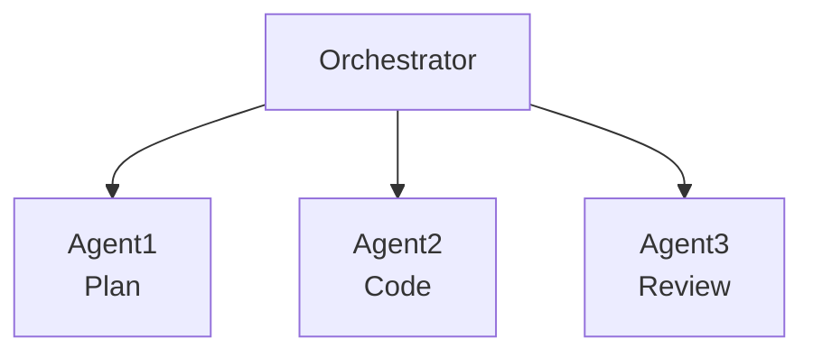
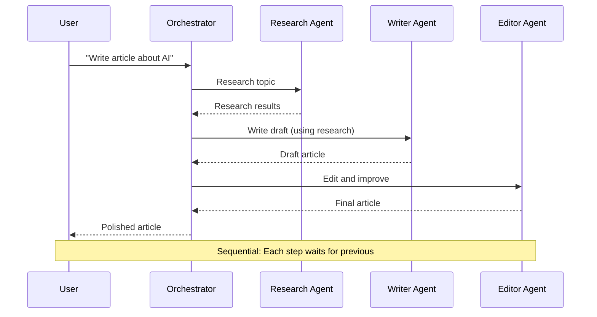
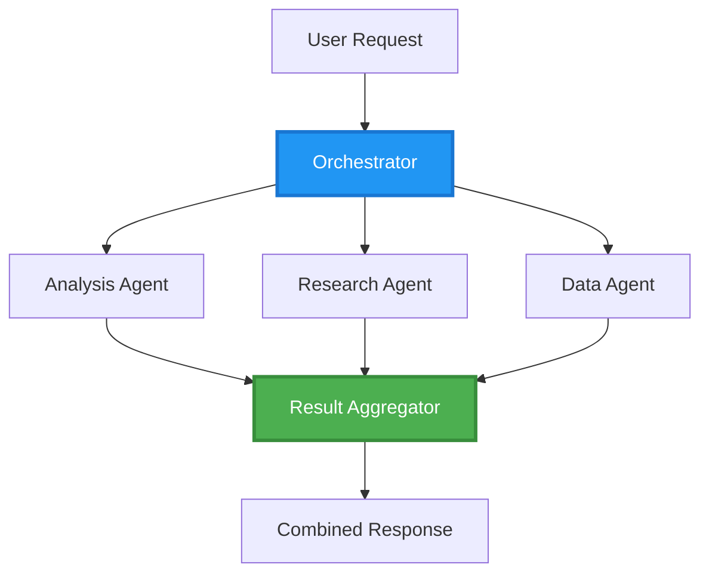
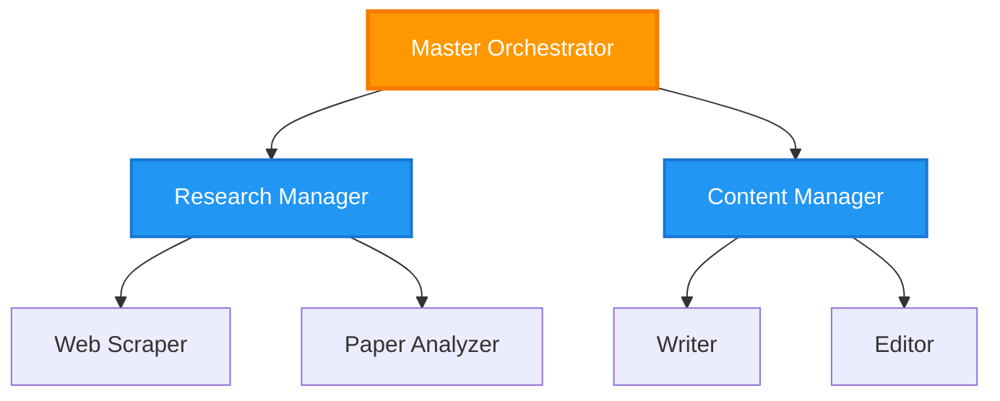
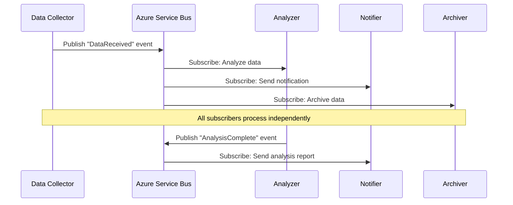
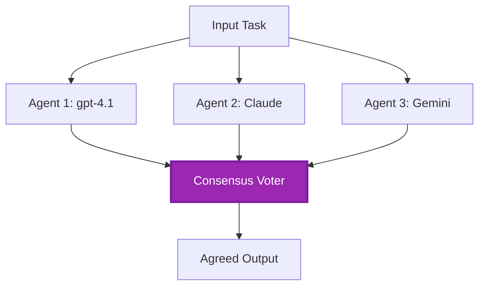
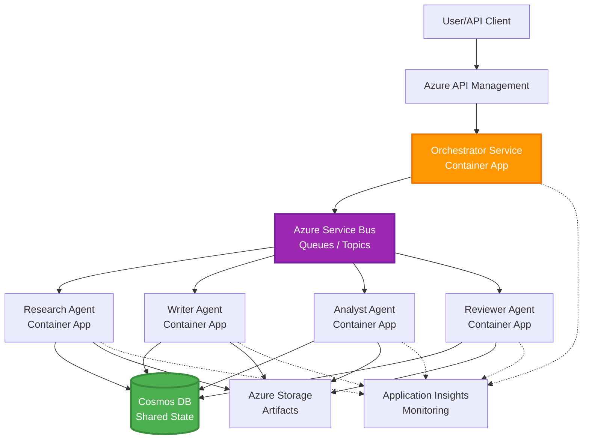

# Mga Pattern ng Koordinasyon ng Maramihang Ahente

⏱️ **Tinatayang Oras**: 60-75 minuto ng pagbabasa; ilang oras para magpatupad | 💰 **Tinatayang Gastos**: nakadepende sa gawain | ⭐ **Kahusayan**: Advanced

**📚 Landas ng Pagkatuto:**
- ← Nakaraan: [Capacity Planning](capacity-planning.md) - Mga estratehiya sa pagsukat at pagpapalawak ng resources
- 🎯 **Nandito Ka**: Mga Pattern ng Koordinasyon ng Maramihang Ahente (Orkestrasyon, komunikasyon, pamamahala ng estado)
- → Susunod: [SKU Selection](sku-selection.md) - Pagpili ng tamang mga serbisyo ng Azure
- 🏠 [Course Home](../../README.md)

---

## Ano ang iyong Matututuhan

Sa pagtatapos ng lektyon na ito, ikaw ay:
- Mauunawaan ang **arkitektura ng maramihang ahente** at kung kailan ito gagamitin
- Maipatupad ang **mga pattern ng orkestrasyon** (centralized, decentralized, hierarchical)
- Makakapagdisenyo ng **estratehiya ng komunikasyon ng ahente** (synchronous, asynchronous, event-driven)
- Mapamamahalaan ang **ibinahaging estado** ng mga distributed na ahente
- Maipapakalat ang **mga sistema ng maramihang ahente** sa Azure gamit ang AZD
- Maiaangkop ang **mga pattern ng koordinasyon** para sa totoong mga senaryo sa AI
- Mamomonitor at madedebug ang mga distributed na sistema ng ahente

## Bakit Mahalaga ang Koordinasyon ng Maramihang Ahente

### Ang Ebolusyon: Mula Single Agent hanggang Maramihang Ahente

**Isang Ahente (Simple):**
```
User → Agent → Response
```
- ✅ Madaling intindihin at ipatupad
- ✅ Mabilis para sa simpleng mga gawain
- ❌ Limitado ang kakayahan ng iisang modelo
- ❌ Hindi kayang gawing parallel ang mga komplikadong gawain
- ❌ Walang espesyalisasyon

**Sistema ng Maramihang Ahente (Advanced):**

- ✅ Mga espesyalisadong ahente para sa partikular na gawain
- ✅ Sabay-sabay na pagpapatupad para sa bilis
- ✅ Modular at madaling panatilihin
- ✅ Mas mahusay sa mga kumplikadong workflow
- ⚠️ Nangangailangan ng lohika sa koordinasyon

**Pagtutulad**: Ang isang ahente ay parang isang tao na gumagawa ng lahat ng gawain. Ang maramihang ahente ay parang isang koponan kung saan bawat kasapi ay may espesyalisadong kakayahan (mananaliksik, tagakodigo, tagasuri, manunulat) na nagtutulungan.

---

## Pangunahing Mga Pattern ng Koordinasyon

### Pattern 1: Sunod-sunod na Koordinasyon (Kadena ng Pananagutan)

**Kailan gagamitin**: Kailangan matapos ang mga gawain sa partikular na pagkakasunod-sunod, bawat ahente ay nagtatayo sa output ng naunang ahente.



**Mga Benepisyo:**
- ✅ Malinaw na daloy ng datos
- ✅ Madaling i-debug
- ✅ Maayos at predictable ang pagkakasunod ng pagpapatupad

**Mga Limitasyon:**
- ❌ Mabagal (walang parallelism)
- ❌ Isang pagkabigo ay humahadlang sa buong kadena
- ❌ Hindi kaya ang interdependent na mga gawain

**Mga Halimbawa ng Paggamit:**
- Pipeline ng paggawa ng nilalaman (pananaliksik → pagsusulat → pag-edit → pag-publish)
- Paggawa ng code (plano → implementasyon → pagsubok → deployment)
- Paggawa ng ulat (pagkolekta ng datos → pagsusuri → biswal na presentasyon → buod)

---

### Pattern 2: Sabay-sabay na Koordinasyon (Fan-Out/Fan-In)

**Kailan gagamitin**: Ang mga independiyenteng gawain ay maaaring isagawa nang sabay-sabay, ang mga resulta ay pinagsama sa huli.



**Mga Benepisyo:**
- ✅ Mabilis (parallel execution)
- ✅ Matatag kahit may bahagyang pagkabigo (partial results ay tinatanggap)
- ✅ Kayang mag-scale nang pahalang

**Mga Limitasyon:**
- ⚠️ Maaaring dumating ang mga resulta sa hindi inaasahang pagkakasunod-sunod
- ⚠️ Kailangan ng lohika para sa pagsasama-sama
- ⚠️ Kumplikadong pamamahala ng estado

**Mga Halimbawa ng Paggamit:**
- Pagkuha ng datos mula sa maraming pinagmulan (APIs + databases + web scraping)
- Pagsusuri ng kompetisyon (maraming modelo ang gumagawa ng solusyon, pinipili ang pinakamahusay)
- Serbisyo ng pagsasalin (sabayan ang pagsasalin sa maraming wika)

---

### Pattern 3: Hierarchical Coordination (Manager-Worker)

**Kailan gagamitin**: Mga kumplikadong workflow na may mga sub-gawain, kailangan ng delegasyon.



**Mga Benepisyo:**
- ✅ Kayang hawakan ang kumplikadong workflow
- ✅ Modular at madaling panatilihin
- ✅ Malinaw ang pagkakabahagi ng responsibilidad

**Mga Limitasyon:**
- ⚠️ Mas kumplikadong arkitektura
- ⚠️ Mas mataas na latency (maraming layer ng koordinasyon)
- ⚠️ Nangangailangan ng sopistikadong orkestrasyon

**Mga Halimbawa ng Paggamit:**
- Proseso ng dokumento sa enterprise (classify → ruta → proseso → archive)
- Multi-stage na pipeline ng datos (ingest → linisin → baguhin → suriin → ulat)
- Kumplikadong automation workflow (plano → alokasyon ng resources → pagpapatupad → pagmamanman)

---

### Pattern 4: Event-Driven Coordination (Publish-Subscribe)

**Kailan gagamitin**: Kailangan tumugon ang mga ahente sa mga kaganapan, nais ang maluwag na pagkakabit.



**Mga Benepisyo:**
- ✅ Maluwag ang pagkakabit sa pagitan ng mga ahente
- ✅ Madaling magdagdag ng bagong ahente (subscribe lang)
- ✅ Asynchronous na pagpoproseso
- ✅ Matatag (persistensya ng mensahe)

**Mga Limitasyon:**
- ⚠️ Pagsunod sa huli na konsistensi
- ⚠️ Kumplikadong pag-debug
- ⚠️ Hamon sa pag-aayos ng pagkakasunod ng mensahe

**Mga Halimbawa ng Paggamit:**
- Sistema ng realtime na pagmamanman (alerts, dashboard, logs)
- Multi-channel na notipikasyon (email, SMS, push, Slack)
- Pipeline ng pagproseso ng datos (maraming consumers ng parehong datos)

---

### Pattern 5: Consensus-Based Coordination (Voting/Quorum)

**Kailan gagamitin**: Kailangan ang kasunduan mula sa maraming ahente bago magpatuloy.



**Mga Benepisyo:**
- ✅ Mas mataas na katumpakan (maraming opinyon)
- ✅ Matatag kahit may minor na pagkabigo
- ✅ May nakapaloob na quality assurance

**Mga Limitasyon:**
- ❌ Magastos (maraming tawag sa modelo)
- ❌ Mabagal (naghihintay sa lahat ng ahente)
- ⚠️ Kailangan ng resolusyon sa konflikto

**Mga Halimbawa ng Paggamit:**
- Moderasyon ng nilalaman (maraming modelo ang nagsusuri ng nilalaman)
- Pagsusuri ng code (maraming linters/analyzers)
- Medikal na diagnosis (maraming AI model, pagsuri ng eksperto)

---

## Pangkalahatang Arkitektura

### Kumpletong Sistema ng Maramihang Ahente sa Azure



**Pangunahing mga Komponent:**

| Komponent | Layunin | Serbisyo ng Azure |
|-----------|---------|--------------------|
| **API Gateway** | Pasukan, paglimita ng rate, awtentikasyon | API Management |
| **Orchestrator** | Nagkokoordina ng workflow ng ahente | Container Apps |
| **Message Queue** | Asynchronous na komunikasyon | Service Bus / Event Hubs |
| **Mga Ahente** | Espesyal na mga tagatrabaho ng AI | Container Apps / Functions |
| **State Store** | Ibinahaging estado, pagsubaybay ng gawain | Cosmos DB |
| **Artifact Storage** | Mga dokumento, resulta, log | Blob Storage |
| **Monitoring** | Distributed na pagsubaybay, log | Application Insights |

Ang Service Bus queues/topics at Event Hubs ay magkaibang serbisyo na may magkaibang delivery/consumption models; ang Event Hubs ay hindi palitang pang-direct sa Service Bus worker code sa ibaba. Ang parallelism, persist na mga mensahe, at voting ng modelo ay hindi mismo nangangahulugan ng fault tolerance o mas mataas na katumpakan.

---

## Mga Kinakailangang Kagamitan

### Mga Kinakailangang Tool

```bash
# Verify Azure Developer CLI
azd version
# Command reference baseline: azd 1.37.2

# Verify Azure CLI
az --version
# ✅ Expected: azure-cli 2.50.0 or higher

# Verify Docker (for local testing)
docker --version
# ✅ Expected: Docker version 20.10 or higher
```

### Mga Kinakailangan sa Azure

- Aktibong Azure subscription
- Mga permiso para gumawa ng:
  - Container Apps
  - Service Bus namespaces
  - Cosmos DB accounts
  - Storage accounts
  - Application Insights

### Mga Kinakailangang Kaalaman

Dapat ay natapos mo na:
- [Configuration Management](../chapter-03-configuration/configuration.md)
- [Authentication & Security](../chapter-03-configuration/authsecurity.md)
- [Microservices Example](../../../../examples/microservices)

---

## Gabay sa Pagpapatupad

> **Mga disenyo ng bahagi, hindi isang deployable na lab:** Ang project tree at `File:` na mga label sa ibaba ay naglalarawan ng mga files na lilikha sa iyong sariling proyekto; ang repositoryong ito ay walang kumpletong aplikasyon ng `multi-agent-system`. Kulang pa ang mga pangunahing bahagi tulad ng main/parameter templates, Container Apps environment/registry, Dockerfiles at dependency locks, Cosmos database/container setup, deployment ng mga modelo, identity/role configuration, scaling rules, at parallel workers/queues. Huwag asahan na ang `azd init` ay bubuo ng mga files na ito o ang `azd up` ay mag-de-deploy ng mga snippets nang hindi binabago. Para sa isang maipapatupad na panimulang punto, kumpletuhin ang [Multi-Agent Basics](../chapter-05-multi-agent/multi-agent-basics.md).

**Mga palagay sa runtime:** Python 3.10+, `azure-servicebus`, `azure-cosmos`, `openai`, Flask, at (para sa monitoring) `azure-monitor-opentelemetry`; ilagay ang `shared` sa Python import path sa bawat service image. Ang Cosmos `agent-state/tasks` na container ay dapat na umiiral na may partition key `/id`. Ang mga pagkonekta gamit ang key ay nagpapadali sa mga fragment na ito, hindi ito gabay sa produksyon: mas mainam ang managed identities na may scope sa Service Bus/Cosmos/OpenAI data-plane roles. Huwag ipakilala ang mga key sa outputs o logs.

Ang paghahatid ng Service Bus ay **at least once**. Panatilihin ang idempotency para sa bawat gawain **at hakbang**, gumamit ng optimistic concurrency (ETags) para sa pagbabasa/pagbabago/pagsusulat ng estado, at i-renew ang mga lock ng mensahe sa panahon ng mahabang proseso. Ang simpleng state manager sa ibaba ay sunod-sunod lamang at hindi ipinatutupad ang mga garantiyang ito ng produksyon.

### Istraktura ng Proyekto

```
multi-agent-system/
├── azure.yaml                    # AZD configuration
├── infra/
│   ├── main.bicep               # Main infrastructure
│   ├── core/
│   │   ├── servicebus.bicep     # Message queue
│   │   ├── cosmos.bicep         # State store
│   │   ├── storage.bicep        # Artifact storage
│   │   └── monitoring.bicep     # Application Insights
│   └── app/
│       ├── orchestrator.bicep   # Orchestrator service
│       └── agent.bicep          # Agent template
└── src/
    ├── orchestrator/            # Orchestration logic
    │   ├── app.py
    │   ├── workflows.py
    │   └── Dockerfile
    ├── agents/
    │   ├── research/            # Research agent
    │   ├── writer/              # Writer agent
    │   ├── analyst/             # Analyst agent
    │   └── reviewer/            # Reviewer agent
    └── shared/
        ├── state_manager.py     # Shared state logic
        └── message_handler.py   # Message handling
```

---

## Leksyon 1: Pattern ng Sunod-sunod na Koordinasyon

### Pagpapatupad: Pipeline ng Paggawa ng Nilalaman

Disenyuhin natin ang isang sunod-sunod na pipeline: Pananaliksik → Pagsusulat → Pag-edit. Ang pag-publish ay wala sa halimbawang ito.

### 1. Konfigurasyon ng AZD

**File: `azure.yaml`**

```yaml
name: content-pipeline
metadata:
  template: multi-agent-sequential@1.0.0

services:
  orchestrator:
    project: ./src/orchestrator
    language: python
    host: containerapp
  
  research-agent:
    project: ./src/agents/research
    language: python
    host: containerapp
  
  writer-agent:
    project: ./src/agents/writer
    language: python
    host: containerapp
  
  editor-agent:
    project: ./src/agents/editor
    language: python
    host: containerapp
```

### 2. Impraestruktura: Service Bus para sa Koordinasyon

**File: `infra/core/servicebus.bicep`**

```bicep
param name string
param location string
param tags object = {}

resource serviceBusNamespace 'Microsoft.ServiceBus/namespaces@2022-10-01-preview' = {
  name: name
  location: location
  tags: tags
  sku: {
    name: 'Standard'
    tier: 'Standard'
  }
  properties: {
    minimumTlsVersion: '1.2'
  }
}

// Queue for orchestrator → research agent
resource researchQueue 'Microsoft.ServiceBus/namespaces/queues@2022-10-01-preview' = {
  parent: serviceBusNamespace
  name: 'research-tasks'
  properties: {
    maxDeliveryCount: 3
    lockDuration: 'PT5M'
    deadLetteringOnMessageExpiration: true
  }
}

// Queue for research agent → writer agent
resource writerQueue 'Microsoft.ServiceBus/namespaces/queues@2022-10-01-preview' = {
  parent: serviceBusNamespace
  name: 'writer-tasks'
  properties: {
    maxDeliveryCount: 3
    lockDuration: 'PT5M'
  }
}

// Queue for writer agent → editor agent
resource editorQueue 'Microsoft.ServiceBus/namespaces/queues@2022-10-01-preview' = {
  parent: serviceBusNamespace
  name: 'editor-tasks'
  properties: {
    maxDeliveryCount: 3
    lockDuration: 'PT5M'
  }
}

output namespace string = serviceBusNamespace.name
// Do not output RootManageSharedAccessKey. Resolve scoped credentials
// securely or use managed identity in the application and scale rules.
```

### 3. Manager ng Ibinahaging Estado

**File: `src/shared/state_manager.py`**

```python
from azure.cosmos import CosmosClient, PartitionKey
from datetime import datetime, timezone
import os

class StateManager:
    """Manages shared state across agents using Cosmos DB"""
    
    def __init__(self):
        endpoint = os.environ['COSMOS_ENDPOINT']
        key = os.environ['COSMOS_KEY']
        
        self.client = CosmosClient(endpoint, key)
        self.database = self.client.get_database_client('agent-state')
        self.container = self.database.get_container_client('tasks')
    
    def create_task(self, task_id: str, task_type: str, input_data: dict):
        """Create a new task"""
        task = {
            'id': task_id,
            'type': task_type,
            'status': 'pending',
            'input': input_data,
            'created_at': datetime.now(timezone.utc).isoformat(),
            'steps': []
        }
        self.container.create_item(task)
        return task
    
    def update_task_step(self, task_id: str, step_name: str, result: dict):
        """Update task with completed step"""
        task = self.container.read_item(task_id, partition_key=task_id)
        
        task['steps'].append({
            'name': step_name,
            'completed_at': datetime.now(timezone.utc).isoformat(),
            'result': result
        })
        
        self.container.replace_item(task_id, task)
        return task
    
    def complete_task(self, task_id: str, final_result: dict):
        """Mark task as complete"""
        task = self.container.read_item(task_id, partition_key=task_id)
        task['status'] = 'completed'
        task['result'] = final_result
        task['completed_at'] = datetime.now(timezone.utc).isoformat()
        self.container.replace_item(task_id, task)
        return task
    
    def get_task(self, task_id: str):
        """Retrieve task state"""
        return self.container.read_item(task_id, partition_key=task_id)
```

### 4. Serbisyo ng Orchestrator

**File: `src/orchestrator/app.py`**

```python
from flask import Flask, request, jsonify
from azure.servicebus import ServiceBusClient, ServiceBusMessage
import json
import uuid
import os
from shared.state_manager import StateManager

app = Flask(__name__)
state_manager = StateManager()

# Service Bus connection
servicebus_connection_str = os.environ['SERVICEBUS_CONNECTION_STRING']
servicebus_client = ServiceBusClient.from_connection_string(servicebus_connection_str)

@app.route('/health', methods=['GET'])
def health():
    return jsonify({'status': 'healthy', 'service': 'orchestrator'})

@app.route('/create-content', methods=['POST'])
def create_content():
    """
    Sequential workflow: Research → Write → Edit (returns a draft; no publishing)
    """
    data = request.get_json(silent=True) or {}
    topic = data.get('topic')
    
    if not topic:
        return jsonify({'error': 'Topic required'}), 400
    
    # Create task in state store
    task_id = str(uuid.uuid4())
    task = state_manager.create_task(
        task_id=task_id,
        task_type='content_creation',
        input_data={'topic': topic}
    )
    
    # Send message to research agent (first step)
    sender = servicebus_client.get_queue_sender('research-tasks')
    message = ServiceBusMessage(
        body=json.dumps({
            'task_id': task_id,
            'topic': topic,
            'next_queue': 'writer-tasks'  # Where to send results
        }),
        content_type='application/json'
    )
    
    with sender:
        sender.send_messages(message)
    
    return jsonify({
        'task_id': task_id,
        'status': 'started',
        'workflow': 'sequential',
        'steps': ['research', 'write', 'edit'],
        'message': 'Content creation pipeline initiated'
    }), 202

@app.route('/task/<task_id>', methods=['GET'])
def get_task_status(task_id):
    """Check task status"""
    try:
        task = state_manager.get_task(task_id)
        return jsonify(task)
    except Exception as e:
        return jsonify({'error': str(e)}), 404

if __name__ == '__main__':
    app.run(host='0.0.0.0', port=8080)
```

### 5. Ahente ng Pananaliksik

**File: `src/agents/research/app.py`**

```python
from azure.servicebus import ServiceBusClient, ServiceBusMessage
from openai import AzureOpenAI
import json
import os
import time
from shared.state_manager import StateManager

# Initialize clients
state_manager = StateManager()
servicebus_client = ServiceBusClient.from_connection_string(
    os.environ['SERVICEBUS_CONNECTION_STRING']
)

openai_client = AzureOpenAI(
    api_key=os.environ['AZURE_OPENAI_API_KEY'],
    api_version="2024-10-21",
    azure_endpoint=os.environ['AZURE_OPENAI_ENDPOINT']
)

def process_research_task(message_data):
    """Process research request and pass to writer"""
    task_id = message_data['task_id']
    topic = message_data['topic']
    next_queue = message_data['next_queue']
    
    print(f"🔬 Researching: {topic}")
    
    # Call Microsoft Foundry Models for research
    response = openai_client.chat.completions.create(
        model=os.environ['AZURE_OPENAI_DEPLOYMENT'],
        messages=[
            {"role": "system", "content": "You are a research assistant. Provide comprehensive research on the given topic."},
            {"role": "user", "content": f"Research this topic thoroughly: {topic}"}
        ],
        max_tokens=1500
    )
    
    research_results = response.choices[0].message.content
    
    # Update state
    state_manager.update_task_step(
        task_id=task_id,
        step_name='research',
        result={'research': research_results}
    )
    
    # Send to next agent (writer)
    sender = servicebus_client.get_queue_sender(next_queue)
    message = ServiceBusMessage(
        body=json.dumps({
            'task_id': task_id,
            'topic': topic,
            'research': research_results,
            'next_queue': 'editor-tasks'
        }),
        content_type='application/json'
    )
    
    with sender:
        sender.send_messages(message)
    
    print(f"✅ Research complete for task {task_id}")

def main():
    """Listen to research queue"""
    receiver = servicebus_client.get_queue_receiver('research-tasks')
    
    print("🔬 Research Agent started, listening for tasks...")
    
    with receiver:
        while True:
            messages = receiver.receive_messages(max_wait_time=5)
            for message in messages:
                try:
                    message_data = json.loads(str(message))
                    process_research_task(message_data)
                    receiver.complete_message(message)
                except Exception as e:
                    print(f"❌ Error processing message: {e}")
                    receiver.abandon_message(message)

if __name__ == '__main__':
    main()
```

### 6. Ahente ng Manunulat

**File: `src/agents/writer/app.py`**

```python
from azure.servicebus import ServiceBusClient, ServiceBusMessage
from openai import AzureOpenAI
import json
import os
from shared.state_manager import StateManager

state_manager = StateManager()
servicebus_client = ServiceBusClient.from_connection_string(
    os.environ['SERVICEBUS_CONNECTION_STRING']
)

openai_client = AzureOpenAI(
    api_key=os.environ['AZURE_OPENAI_API_KEY'],
    api_version="2024-10-21",
    azure_endpoint=os.environ['AZURE_OPENAI_ENDPOINT']
)

def process_writing_task(message_data):
    """Write article based on research"""
    task_id = message_data['task_id']
    topic = message_data['topic']
    research = message_data['research']
    next_queue = message_data['next_queue']
    
    print(f"✍️ Writing article: {topic}")
    
    # Call Microsoft Foundry Models to write article
    response = openai_client.chat.completions.create(
        model=os.environ['AZURE_OPENAI_DEPLOYMENT'],
        messages=[
            {"role": "system", "content": "You are a professional writer. Write engaging, well-structured articles."},
            {"role": "user", "content": f"Based on this research:\n\n{research}\n\nWrite a comprehensive article about: {topic}"}
        ],
        max_tokens=2000
    )
    
    article_draft = response.choices[0].message.content
    
    # Update state
    state_manager.update_task_step(
        task_id=task_id,
        step_name='writing',
        result={'draft': article_draft}
    )
    
    # Send to editor
    sender = servicebus_client.get_queue_sender(next_queue)
    message = ServiceBusMessage(
        body=json.dumps({
            'task_id': task_id,
            'topic': topic,
            'draft': article_draft
        }),
        content_type='application/json'
    )
    
    with sender:
        sender.send_messages(message)
    
    print(f"✅ Article draft complete for task {task_id}")

def main():
    """Listen to writer queue"""
    receiver = servicebus_client.get_queue_receiver('writer-tasks')
    
    print("✍️ Writer Agent started, listening for tasks...")
    
    with receiver:
        while True:
            messages = receiver.receive_messages(max_wait_time=5)
            for message in messages:
                try:
                    message_data = json.loads(str(message))
                    process_writing_task(message_data)
                    receiver.complete_message(message)
                except Exception as e:
                    print(f"❌ Error: {e}")
                    receiver.abandon_message(message)

if __name__ == '__main__':
    main()
```

### 7. Ahente ng Editor

**File: `src/agents/editor/app.py`**

```python
from azure.servicebus import ServiceBusClient
from openai import AzureOpenAI
import json
import os
from shared.state_manager import StateManager

state_manager = StateManager()
servicebus_client = ServiceBusClient.from_connection_string(
    os.environ['SERVICEBUS_CONNECTION_STRING']
)

openai_client = AzureOpenAI(
    api_key=os.environ['AZURE_OPENAI_API_KEY'],
    api_version="2024-10-21",
    azure_endpoint=os.environ['AZURE_OPENAI_ENDPOINT']
)

def process_editing_task(message_data):
    """Edit and finalize article"""
    task_id = message_data['task_id']
    topic = message_data['topic']
    draft = message_data['draft']
    
    print(f"📝 Editing article: {topic}")
    
    # Call Microsoft Foundry Models to edit
    response = openai_client.chat.completions.create(
        model=os.environ['AZURE_OPENAI_DEPLOYMENT'],
        messages=[
            {"role": "system", "content": "You are an expert editor. Improve grammar, clarity, and structure."},
            {"role": "user", "content": f"Edit and improve this article:\n\n{draft}"}
        ],
        max_tokens=2000
    )
    
    final_article = response.choices[0].message.content
    
    # Mark task as complete
    state_manager.complete_task(
        task_id=task_id,
        final_result={
            'topic': topic,
            'final_article': final_article,
            'word_count': len(final_article.split())
        }
    )
    
    print(f"✅ Article finalized for task {task_id}")

def main():
    """Listen to editor queue"""
    receiver = servicebus_client.get_queue_receiver('editor-tasks')
    
    print("📝 Editor Agent started, listening for tasks...")
    
    with receiver:
        while True:
            messages = receiver.receive_messages(max_wait_time=5)
            for message in messages:
                try:
                    message_data = json.loads(str(message))
                    process_editing_task(message_data)
                    receiver.complete_message(message)
                except Exception as e:
                    print(f"❌ Error: {e}")
                    receiver.abandon_message(message)

if __name__ == '__main__':
    main()
```

### 8. I-deploy at Subukan

Ang mga utos na ito ay ilalapat **pagkatapos mong maisakatuparan ang mga kulang na file ng proyekto**. Ang interactive na Foundry agent initialization ay hiwalay na workflow; hindi nito binubuo ang disenyo ng Service Bus na ito.

```bash
# In your completed custom project
azd up

# Alternative in a SEPARATE empty folder (agents beta.23 requires azd >= 1.37)
azd extension install azure.ai.agents
azd ai agent init
azd up
```

> Tingnan ang [AZD AI CLI Commands](../chapter-08-production/production-ai-practices.md#azd-ai-cli-commands-and-extensions) para sa lahat ng `azd ai` flag at opsyon.

```bash
# Get orchestrator URL
ORCHESTRATOR_URL=$(azd env get-values | grep ORCHESTRATOR_URL | cut -d '=' -f2 | tr -d '"')

# Create content
curl -X POST $ORCHESTRATOR_URL/create-content \
  -H "Content-Type: application/json" \
  -d '{"topic": "The Future of AI in Healthcare"}'
```

**✅ Inaasahang output:**
```json
{
  "task_id": "a1b2c3d4-e5f6-7890-abcd-ef1234567890",
  "status": "started",
  "workflow": "sequential",
  "steps": ["research", "write", "edit"],
  "message": "Content creation pipeline initiated"
}
```

**Tingnan ang progreso ng gawain:**
```bash
TASK_ID="a1b2c3d4-e5f6-7890-abcd-ef1234567890"
curl $ORCHESTRATOR_URL/task/$TASK_ID
```

**✅ Inaasahang output (kumpleto na):**
```json
{
  "id": "a1b2c3d4-e5f6-7890-abcd-ef1234567890",
  "type": "content_creation",
  "status": "completed",
  "steps": [
    {
      "name": "research",
      "completed_at": "2025-11-19T10:30:00Z",
      "result": {"research": "..."}
    },
    {
      "name": "writing",
      "completed_at": "2025-11-19T10:32:00Z",
      "result": {"draft": "..."}
    }
  ],
  "result": {
    "topic": "The Future of AI in Healthcare",
    "final_article": "...",
    "word_count": 1500
  }
}
```

---

## Leksyon 2: Pattern ng Sabay-sabay na Koordinasyon

### Pagpapatupad: Multi-Source Research Aggregator

Gumawa tayo ng parallel na sistema na kumukuha ng impormasyon mula sa maraming pinagmulan nang sabay-sabay.

### Parallel Orchestrator

**File: `src/orchestrator/parallel_workflow.py`**

```python
from flask import Flask, request, jsonify
from azure.servicebus import ServiceBusClient, ServiceBusMessage
import json
import uuid
import os
from shared.state_manager import StateManager

app = Flask(__name__)
state_manager = StateManager()

servicebus_client = ServiceBusClient.from_connection_string(
    os.environ['SERVICEBUS_CONNECTION_STRING']
)

@app.route('/research-parallel', methods=['POST'])
def research_parallel():
    """
    Parallel workflow: Multiple agents work simultaneously
    """
    data = request.json
    query = data.get('query')
    
    task_id = str(uuid.uuid4())
    task = state_manager.create_task(
        task_id=task_id,
        task_type='parallel_research',
        input_data={
            'query': query,
            'agents': ['web', 'academic', 'news', 'social']
        }
    )
    
    # Fan-out: publish sequentially; workers may process concurrently.
    agents = [
        ('web-research-queue', 'web'),
        ('academic-research-queue', 'academic'),
        ('news-research-queue', 'news'),
        ('social-research-queue', 'social')
    ]
    
    for queue_name, agent_type in agents:
        sender = servicebus_client.get_queue_sender(queue_name)
        message = ServiceBusMessage(
            body=json.dumps({
                'task_id': task_id,
                'query': query,
                'agent_type': agent_type,
                'result_queue': 'aggregation-queue'
            }),
            content_type='application/json'
        )
        
        with sender:
            sender.send_messages(message)
    
    return jsonify({
        'task_id': task_id,
        'status': 'started',
        'workflow': 'parallel',
        'agents_dispatched': 4,
        'message': 'Parallel research initiated'
    }), 202

if __name__ == '__main__':
    app.run(host='0.0.0.0', port=8080)
```

### Lohika ng Pag-aggrup

**File: `src/agents/aggregator/app.py`**

```python
from azure.servicebus import ServiceBusClient
import json
import os
from collections import defaultdict
from shared.state_manager import StateManager

state_manager = StateManager()
servicebus_client = ServiceBusClient.from_connection_string(
    os.environ['SERVICEBUS_CONNECTION_STRING']
)

# Single-process demo only: not durable or shared across replicas.
# Production: use durable unique (task_id, agent_type) result records.
task_results = defaultdict(dict)
expected_agents = 4  # web, academic, news, social

def process_result(message_data):
    """Aggregate results from parallel agents"""
    task_id = message_data['task_id']
    agent_type = message_data['agent_type']
    result = message_data['result']
    
    # Store result
    task_results[task_id][agent_type] = {
        'agent': agent_type,
        'data': result
    }
    
    print(f"📊 Received result from {agent_type} agent ({len(task_results[task_id])}/{expected_agents})")
    
    # Check if all agents completed (fan-in)
    if len(task_results[task_id]) == expected_agents:
        print(f"✅ All agents completed for task {task_id}. Aggregating...")
        
        # Combine results
        aggregated = {
            'query': message_data['query'],
            'sources': list(task_results[task_id].values()),
            'summary': generate_summary(list(task_results[task_id].values()))
        }
        
        # Mark complete
        state_manager.complete_task(task_id, aggregated)
        
        # Clean up
        del task_results[task_id]
        
        print(f"✅ Aggregation complete for task {task_id}")

def generate_summary(results):
    """Generate summary from all sources"""
    summaries = [r['data'].get('summary', '') for r in results]
    return '\n\n'.join(summaries)

def main():
    """Listen to aggregation queue"""
    receiver = servicebus_client.get_queue_receiver('aggregation-queue')
    
    print("📊 Aggregator started, listening for results...")
    
    with receiver:
        while True:
            messages = receiver.receive_messages(max_wait_time=5)
            for message in messages:
                try:
                    message_data = json.loads(str(message))
                    process_result(message_data)
                    receiver.complete_message(message)
                except Exception as e:
                    print(f"❌ Error: {e}")
                    receiver.abandon_message(message)

if __name__ == '__main__':
    main()
```

**Mga Benepisyo ng Parallel Pattern:**
- ⚡ **Maaaring mas mababang latency** (nababatasan ng pinakabagal na worker kasama ang overhead ng koordinasyon)
- 🔄 **Puwedeng suportahan ang bahagyang resulta** na may malinaw na deadline at patakaran sa pagkabigo (hindi ipinatupad sa basic aggregator)
- 📈 **Scalable** (madaling magdagdag ng mga ahente)

---

## Mga Praktikal na Ehersisyo

### Ehersisyo 1: Magdagdag ng Timeout Handling ⭐⭐ (Katamtaman)

**Layunin**: Ipatupad ang timeout logic upang hindi maghintay magpakailanman ang aggregator para sa mabagal na mga ahente.

**Panimulang punto:** Patakbuhin ang lokal na simulation ng deadline na ito bago isama sa queue worker. Ang timeout na sinusuri lamang kapag may ibang mensahe na dumating ay hindi tatakbo kung walang mensaheng ipinadala ang nawawalang worker.

**Mga Hakbang**:

1. **Magdagdag ng pagsunod sa timeout sa aggregator:**

```python
import asyncio

async def simulated_agent(name, delay):
    await asyncio.sleep(delay)
    return {'agent': name, 'result': 'done'}

async def main():
    tasks = [asyncio.create_task(simulated_agent(name, delay))
             for name, delay in [('web', 0.1), ('academic', 0.2),
                                 ('news', 0.3), ('social', 3)]]
    done, pending = await asyncio.wait(tasks, timeout=1)
    results = [task.result() for task in done]
    for task in pending:
        task.cancel()
    await asyncio.gather(*pending, return_exceptions=True)
    print({'completed_agents': len(results), 'timed_out': bool(pending)})
    assert len(results) == 3 and pending

asyncio.run(main())
```

2. **Inaasahang output:**

```text
{'completed_agents': 3, 'timed_out': True}
```

3. **Integrasyon sa sistema ng queue (design task):** Panatilihin ang deadline ng dispatch at inaasahang mga ahente sa oras ng paglikha ng gawain, patakbuhin ang pana-panahong pag-sweep ng deadline na independyente sa mga papasok na resulta, atomikong tapusin ang mga bahagyang resulta, at huwag pansinin ang mga huli/duplikadong mensahe para sa mga natapos na gawain. Ang lokal na timeout ay hindi kinakansela ang mga remote na worker.

Para lamang sa iyong ipinatupad na proyekto:

```bash
azd deploy aggregator

# Submit task
curl -X POST $ORCHESTRATOR_URL/research-parallel \
  -H "Content-Type: application/json" \
  -d '{"query": "AI safety research"}'

# Check results after 30 seconds
curl $ORCHESTRATOR_URL/task/$TASK_ID
```

**✅ Mga Pamantayan sa Tagumpay:**
- ✅ Bumabalik ang lokal na pagsubok pagkatapos ng isang segundong deadline kahit incomplete ang isang ahente
- ✅ Nagpapakita ng bahagyang resulta ang tugon (`"timed_out": true`)
- ✅ Ibinabalik ang mga available na resulta (3 sa 4 na ahente)

**Oras**: 20-25 minuto

---

### Ehersisyo 2: Ipatupad ang Retry Logic ⭐⭐⭐ (Advanced)

**Layunin**: Awtomatikong i-retry ang mga nabigong gawain ng ahente bago sumuko.

**Mga Hakbang**:

1. **Gamitin ang Service Bus delivery counts sa halip na muling pag-enqueue ng custom retry counters:**

```python
import json
import time
# Integration fragment: use a live peek-lock ServiceBusReceiver.
# Set queue maxDeliveryCount to 4 for one attempt + up to three retries.
```

2. **Magdagdag ng retry handler sa mga ahente:**

```python
def process_with_retry(message, receiver, process_func):
    """Process message with automatic retry on failure"""
    try:
        message_data = json.loads(str(message))
        
        # Process the message
        process_func(message_data)
        
        # Success - complete
        receiver.complete_message(message)
        
    except Exception as e:
        if message.delivery_count < 4:
            # Bounded exponential delay: 5s, 10s, 20s.
            # Renew the lock if processing + waiting can exceed its duration.
            time.sleep(5 * 2 ** (message.delivery_count - 1))
            receiver.abandon_message(message)
        else:
            # Max retries exceeded - move to dead letter queue
            print(f"❌ Max attempts exceeded for message {message.message_id}")
            receiver.dead_letter_message(
                message,
                reason="MaxRetriesExceeded",
                error_description=str(e)
            )
```

3. **I-monitor ang dead letter queue:**

```python
def monitor_dead_letters():
    """Check dead letter queue for failed messages"""
    receiver = servicebus_client.get_queue_receiver(
        'research-tasks',
        sub_queue='deadletter'
    )
    
    with receiver:
        messages = receiver.receive_messages(max_wait_time=5)
        for message in messages:
            print(f"☠️ Dead letter: {message.message_id}")
            print(f"Reason: {message.dead_letter_reason}")
            print(f"Description: {message.dead_letter_error_description}")
```

**✅ Mga Pamantayan sa Tagumpay:**
- ✅ Awtomatikong nirere-try ang mga nabigong gawain (hanggang 3 beses)
- ✅ Exponential backoff sa pagitan ng mga retry (5s, 10s, 20s), kasama ang pag-renew ng message-lock kung kinakailangan
- ✅ Pagkatapos ng max retries, pumupunta ang mga mensahe sa dead letter queue
- ✅ Maaari masuri ang mga dead letter message; ang replay ay nangangailangan ng hiwalay na idempotent na workflow sa recovery

**Oras**: 30-40 minuto

---

### Ehersisyo 3: Ipatupad ang Circuit Breaker ⭐⭐⭐ (Advanced)

**Layunin**: Pigilan ang pagkalat ng pagkabigo sa pamamagitan ng paghinto ng mga kahilingan sa mga nabigong ahente.

**Mga Hakbang**:

1. **Gumawa ng circuit breaker class:**

```python
from enum import Enum
from datetime import datetime, timedelta, timezone

class CircuitState(Enum):
    CLOSED = "closed"      # Normal operation
    OPEN = "open"          # Failing, reject requests
    HALF_OPEN = "half_open"  # Testing if recovered

class CircuitBreaker:
    def __init__(self, failure_threshold=5, timeout_seconds=60):
        self.failure_threshold = failure_threshold
        self.timeout_seconds = timeout_seconds
        self.failure_count = 0
        self.last_failure_time = None
        self.state = CircuitState.CLOSED
    
    def call(self, func):
        """Execute function with circuit breaker protection"""
        if self.state == CircuitState.OPEN:
            # Check if timeout expired
            if datetime.now(timezone.utc) - self.last_failure_time > timedelta(seconds=self.timeout_seconds):
                self.state = CircuitState.HALF_OPEN
                print("🔄 Circuit breaker: HALF_OPEN (testing)")
            else:
                raise Exception(f"Circuit breaker OPEN for agent. Try again in {self.timeout_seconds}s")
        
        try:
            result = func()
            
            # Success
            self.failure_count = 0 # Count consecutive failures only
            if self.state == CircuitState.HALF_OPEN:
                self.state = CircuitState.CLOSED
                self.failure_count = 0
                print("✅ Circuit breaker: CLOSED (recovered)")
            
            return result
            
        except Exception as e:
            self.failure_count += 1
            self.last_failure_time = datetime.now(timezone.utc)
            
            if self.failure_count >= self.failure_threshold:
                self.state = CircuitState.OPEN
                print(f"🔴 Circuit breaker: OPEN (too many failures)")
            
            raise
```

2. **I-apply ito sa mga tawag ng ahente:**

```python
# In orchestrator
agent_circuits = {
    'web': CircuitBreaker(failure_threshold=5, timeout_seconds=60),
    'academic': CircuitBreaker(failure_threshold=5, timeout_seconds=60),
    'news': CircuitBreaker(failure_threshold=5, timeout_seconds=60),
    'social': CircuitBreaker(failure_threshold=5, timeout_seconds=60)
}

def send_to_agent(agent_type, message_data):
    """Send with circuit breaker protection"""
    circuit = agent_circuits[agent_type]
    
    try:
        circuit.call(lambda: send_message(agent_type, message_data))
    except Exception as e:
        print(f"⚠️ Skipping {agent_type} agent: {e}")
        # Continue with other agents
```

Pinoprotektahan ng circuit na ito ang **send operation**, hindi ang pagkumpleto ng remote na worker: ang matagumpay na pag-enqueue ng isang mensahe ay hindi nagsasabi kung buhay pa ang isang agent. `send_message` ang sender function ng iyong aplikasyon. Para sa execution circuits, ilabas ang naobserbahang task failures/timeouts sa isang matibay na coordinator. Ang in-memory class na ito ay isang demonstration ng single-thread, hindi isang distributed circuit breaker.

3. **Subukan ang circuit breaker nang lokal:**

```python
# Run after the class definition; no Azure changes required.
circuit = CircuitBreaker(failure_threshold=5, timeout_seconds=0)
def fail():
    raise RuntimeError("simulated failure")
for _ in range(5):
    try:
        circuit.call(fail)
    except RuntimeError:
        pass
assert circuit.state == CircuitState.OPEN
assert circuit.call(lambda: "recovered") == "recovered"
assert circuit.state == CircuitState.CLOSED
print("Circuit breaker recovery verified")
```

**✅ Mga Success Criteria:**
- ✅ Pagkatapos ng 5 pagkabigo, bumubukas ang circuit (tinanggihan ang mga kahilingan)
- ✅ Pagkatapos ng 60 segundo, nagiging half-open ang circuit (sinusubok ang pagbawi)
- ✅ Patuloy na gumagana ang ibang mga agent nang normal
- ✅ Kusang nagsasara ang circuit kapag bumawi ang agent

**Oras**: 40-50 minuto

---

## Pagmo-monitor at Pag-debug

### Distributed Tracing gamit ang Application Insights

**File: `src/shared/tracing.py`**

```python
from azure.monitor.opentelemetry import configure_azure_monitor
from opentelemetry import trace
from opentelemetry.trace import SpanKind
import logging
import os

connection_string = os.environ.get('APPLICATIONINSIGHTS_CONNECTION_STRING')

# Configure once per process. Message send/receive trace-context propagation
# and agent attributes on exceptions need explicit instrumentation.
if connection_string:
    configure_azure_monitor(connection_string=connection_string, logger_name=__name__)
tracer = trace.get_tracer(__name__)

# Configure logging
logger = logging.getLogger(__name__)
logger.setLevel(logging.INFO)

def trace_agent_call(agent_name, task_id, operation_name, operation):
    """Trace agent operations"""
    with tracer.start_as_current_span(f'agent.{agent_name}.{operation_name}', kind=SpanKind.CLIENT) as span:
        span.set_attribute('agent', agent_name)
        span.set_attribute('task_id', task_id)
        span.set_attribute('operation', operation_name)
        
        try:
            result = operation()
            span.set_attribute('status', 'success')
            logger.info('Agent operation completed', extra={
                'agent': agent_name, 'task_id': task_id, 'operation': operation_name
            })
            return result
        except Exception as e:
            span.set_attribute('status', 'error')
            logger.exception('Agent operation failed', extra={
                'agent': agent_name, 'task_id': task_id, 'operation': operation_name
            })
            raise
```

### Mga Query sa Application Insights

**Subaybayan ang mga multi-agent workflow:**

```kusto
// Trace complete workflow for a task
traces
| where customDimensions.task_id == "a1b2c3d4-..."
| project timestamp, message, customDimensions.agent, customDimensions.operation
| order by timestamp asc
```

**Paghahambing ng performance ng agent:**

```kusto
// Compare agent execution times
dependencies
| where name contains "agent"
| summarize 
    avg_duration = avg(duration),
    p95_duration = percentile(duration, 95),
    count = count()
  by agent = tostring(customDimensions.agent)
| order by avg_duration desc
```

**Pagsusuri ng pagkabigo:**

```kusto
// Find which agents fail most
exceptions
| where customDimensions.agent != ""
| summarize 
    failure_count = count(),
    unique_errors = dcount(outerMessage)
  by agent = tostring(customDimensions.agent)
| order by failure_count desc
```

---

## Pagsusuri ng Gastos

### Mga Gastos ng Multi-Agent System (Tantyang Buwanang)

Mga ilustratibong numero lang sa pagpaplano, hindi mga quote: ang kabuuan sa ibaba ay **$240-565/buwan**. Suriin ang kasalukuyang mga regional rates, aktibo/hindi ginagamit na oras ng replicas, halo ng input/output token, storage, at telemetry. Walang minimum na provisioned-throughput ang serverless pero naniningil pa rin para sa mga kahilingan at storage.

| Component | Configuration | Cost |
|-----------|--------------|------|
| **Orchestrator** | 1 Container App (1 vCPU, 2GB) | $30-50 |
| **4 Agents** | 4 Container Apps (0.5 vCPU, 1GB bawat isa) | $60-120 |
| **Service Bus** | Standard tier, 10M messages | $10-20 |
| **Cosmos DB** | Serverless, 5GB storage, 1M RUs | $25-50 |
| **Blob Storage** | 10GB storage, 100K operations | $5-10 |
| **Application Insights** | 5GB ingestion | $10-15 |
| **Microsoft Foundry Models** | gpt-4.1, 10M tokens | $100-300 |
| **Kabuuan** | | **$240-565/buwan** |

### Mga Estratehiya sa Pag-optimize ng Gastos

1. **Gamitin ang serverless kung maaari:**
   ```bicep
   // Cosmos DB serverless (no minimum cost)
   properties: {
     databaseAccountOfferType: 'Standard'
     capabilities: [{ name: 'EnableServerless' }]
   }
   ```

2. **I-scale sa zero ang mga agent kapag idle:**
   ```bicep
   scale: {
     minReplicas: 0  // Requires a Service Bus/KEDA scale rule to wake workers
     maxReplicas: 10
   }
   ```

3. **Gamitin ang batching para sa Service Bus:**
   ```python
   # Send messages in batches (cheaper)
   sender.send_messages([message1, message2, message3])
   ```

4. **Mag-cache ng mga madalas gamitin na resulta:**
   ```python
   # Use Azure Cache for Redis
   if cache.exists(query_hash):
       return cache.get(query_hash)
   ```

---

## Pinakamahusay na Praktis

### ✅ GAWIN:

1. **Gamitin ang mga idempotent na operasyon**
   ```python
   # Pseudocode: implement a durable, atomic per-step deduplication claim.
   def process_task(task_id):
       raise NotImplementedError("Claim (task_id, step) atomically, execute, persist outcome")
   ```

2. **Magpatupad ng komprehensibong logging**
   ```python
   logger.info(f"Agent: {agent_name}, Task: {task_id}, Action: {action}")
   ```

3. **Gamitin ang correlation IDs**
   ```python
   # Pass task_id through entire workflow
   message_data = {
       'task_id': task_id,  # Correlation ID
       'timestamp': datetime.utcnow().isoformat()
   }
   ```

4. **Itakda ang TTL (time-to-live) ng mensahe**
   ```bicep
   properties: {
     defaultMessageTimeToLive: 'PT1H'  // 1 hour max
   }
   ```

5. **I-monitor ang mga dead letter queue**
   ```python
   # Regular monitoring of failed messages
   monitor_dead_letters()
   ```

### ❌ HUWAG GAWIN:

1. **Huwag gumawa ng circular dependencies**
   ```python
   # ❌ BAD: Agent A → Agent B → Agent A (infinite loop)
   # ✅ GOOD: Define clear directed acyclic graph (DAG)
   ```

2. **Huwag i-block ang mga thread ng agent**
   ```python
   # ❌ BAD: Synchronous wait
   while not task_complete:
       time.sleep(1)
   
   # ✅ GOOD: Use message queue callbacks
   ```

3. **Huwag balewalain ang mga partial failure**
   ```python
   # ❌ BAD: Fail entire workflow if one agent fails
   # ✅ GOOD: Return partial results with error indicators
   ```

4. **Huwag gumamit ng walang katapusang retries**
   ```python
   # ❌ BAD: retry forever
   # ✅ GOOD: max_retries = 3, then dead letter
   ```

---

## Gabay sa Pag-troubleshoot

### Problema: Mga mensaheng naipit sa queue

**Sintomas:**
- Dumadami ang mga mensahe sa queue
- Hindi nagpoproseso ang mga agent
- Naka-pending ang status ng task

**Diagnostiko:**
```bash
# Check queue depth
az servicebus queue show \
  --resource-group "$RG_NAME" \
  --namespace-name mybus \
  --name research-tasks \
  --query "countDetails"

# Check agent logs using Azure CLI
az containerapp logs show --name research-agent --resource-group $RG_NAME --tail 50
```

**Mga Solusyon:**

1. **Dagdagan ang mga replica ng agent:**
   ```bash
   az containerapp update \
     --resource-group "$RG_NAME" \
     --name research-agent \
     --min-replicas 3 \
     --max-replicas 10
   ```

2. **Suriin ang dead letter queue:**
   ```bash
   az servicebus queue show \
     --resource-group "$RG_NAME" \
     --namespace-name mybus \
     --name research-tasks \
     --query "countDetails.deadLetterMessageCount"
   ```

---

### Problema: Pag-timeout/ngunit hindi natatapos ang task

**Sintomas:**
- Nananatili ang status ng task sa "in_progress"
- May ilang agent na nakukumpleto, ang iba hindi
- Walang error messages

**Diagnostiko:**
```bash
# Check task state
curl $ORCHESTRATOR_URL/task/$TASK_ID

# Check Application Insights
# Run query: traces | where customDimensions.task_id == "..."
```

**Mga Solusyon:**

1. **Magpatupad ng timeout sa aggregator (Exercise 1)**

2. **Suriin ang mga pagkabigo ng agent gamit ang Azure Monitor:**
   ```bash
   # View logs via azd monitor
   azd monitor --logs
   
   # Or use Azure CLI to check specific container app logs
   az containerapp logs show --name <agent-name> --resource-group $RG_NAME --follow | grep "ERROR\|FAIL"
   ```

3. **Siguraduhin na tumatakbo ang lahat ng agent:**
   ```bash
   az containerapp list \
     --resource-group rg-agents \
     --query "[].{name:name, status:properties.runningStatus}"
   ```

---

## Matuto Pa

### Opisyal na Dokumentasyon
- [Azure Service Bus](https://learn.microsoft.com/azure/service-bus-messaging/service-bus-messaging-overview)
- [Cosmos DB](https://learn.microsoft.com/azure/cosmos-db/introduction)
- [Container Apps DAPR](https://learn.microsoft.com/azure/container-apps/dapr-overview)
- [AI Agent Orchestration Patterns](https://learn.microsoft.com/azure/architecture/ai-ml/guide/ai-agent-design-patterns)

### Mga Susunod na Hakbang sa Kursong Ito
- ← Nakaraan: [Capacity Planning](capacity-planning.md)
- → Susunod: [SKU Selection](sku-selection.md)
- 🏠 [Course Home](../../README.md)

### Mga Kaugnay na Halimbawa
- [Microservices Example](../../../../examples/microservices) - Mga pattern ng komunikasyon ng serbisyo
- [Microsoft Foundry Models Example](../../../../examples/azure-openai-chat) - AI integration

---

## Buod

**Natutunan mo:**
- ✅ Limang coordination pattern (sequential, parallel, hierarchical, event-driven, consensus)
- ✅ Multi-agent architecture sa Azure (Service Bus, Cosmos DB, Container Apps)
- ✅ Pamamahala ng estado sa mga distributed na agent
- ✅ Pag-handle ng timeout, retries, at circuit breakers
- ✅ Pagmo-monitor at pag-debug ng mga distributed system
- ✅ Mga estratehiya sa pag-optimize ng gastos

**Mga Pangunahing Aral:**
1. **Pumili ng tamang pattern** - Sequential para sa mga nakaayos na workflow, parallel para sa bilis, event-driven para sa kakayahang umangkop
2. **Maingat na pamahalaan ang estado** - Gamitin ang Cosmos DB o katulad para sa shared state
3. **Harapin ang mga pagkabigo nang maayos** - Timeout, retries, circuit breakers, dead letter queue
4. **I-monitor ang lahat** - Mahalaga ang distributed tracing para sa pag-debug
5. **I-optimize ang gastos** - I-scale sa zero, gamitin ang serverless, magpatupad ng caching

**Mga Susunod na Hakbang:**
1. Kumpletuhin ang mga praktikal na pagsasanay
2. Bumuo ng isang multi-agent system para sa iyong kaso ng paggamit
3. Pag-aralan ang [SKU Selection](sku-selection.md) para i-optimize ang performance at gastos

---

<!-- CO-OP TRANSLATOR DISCLAIMER START -->
**Pagtatanggi**:
Ang dokumentong ito ay isinalin gamit ang serbisyo ng AI translation na [Co-op Translator](https://github.com/Azure/co-op-translator). Bagama't nagsusumikap kami para sa katumpakan, pakatandaan na ang awtomatikong pagsasalin ay maaaring maglaman ng mga pagkakamali o hindi pagkakatugma. Ang orihinal na dokumento sa orihinal nitong wika ang dapat ituring na pangunahing sanggunian. Para sa mahahalagang impormasyon, inirerekomenda ang propesyonal na pagsasalin ng tao. Hindi kami mananagot sa anumang maling pagkakaintindi o maling interpretasyon na nagmula sa paggamit ng pagsasaling ito.
<!-- CO-OP TRANSLATOR DISCLAIMER END -->