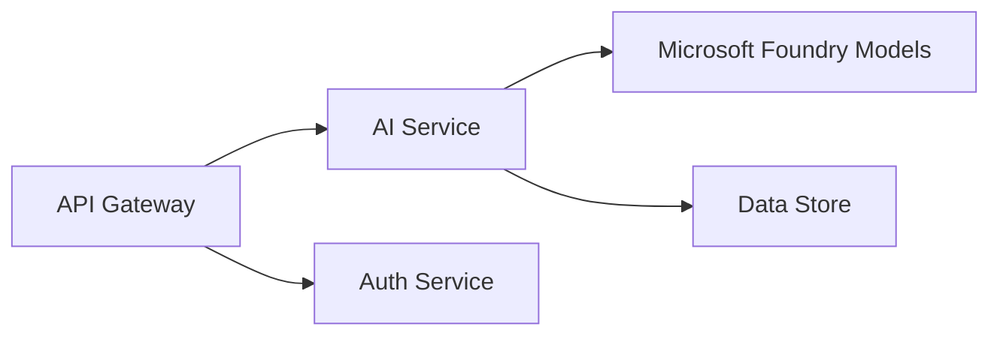

# Kabanata 8: Mga Pattern sa Produksyon at Negosyo

**📚 Kurso**: [AZD Para sa Mga Nagsisimula](../../README.md) | **⏱️ Tagal**: 2-3 oras | **⭐ Antas ng Kahirapan**: Advanced

---

## Pangkalahatang-ideya

Tinalakay sa kabanatang ito ang mga pattern ng pag-deploy na handa para sa negosyo, pagpapalakas ng seguridad, pagmamanman, at pag-optimize ng gastos para sa mga workload ng AI sa produksyon.

> Napatunayan gamit ang `azd 1.27.1` noong Hulyo 2026.

## Mga Layunin sa Pagkatuto

Sa pagkumpleto ng kabanatang ito, matututuhan mo:
- Mag-deploy ng mga multi-region resilient na aplikasyon
- Magpatupad ng mga pattern ng seguridad para sa negosyo
- Mag-ayos ng komprehensibong pagmamanman
- Mag-optimize ng mga gastos sa malaking sukat
- Mag-set up ng mga CI/CD pipeline gamit ang AZD

---

## 📚 Mga Aralin

| # | Aralin | Paglalarawan | Oras |
|---|--------|-------------|------|
| 1 | [Mga Praktis sa Produksyon ng AI](production-ai-practices.md) | Mga pattern ng pag-deploy sa negosyo | 90 min |

---

## 🚀 Checklist para sa Produksyon

- [ ] Multi-region deployment para sa resilience
- [ ] Managed identity para sa authentication (walang mga key)
- [ ] Application Insights para sa pagmamanman
- [ ] Mga nakatakdang badyet at mga alerto sa gastos
- [ ] Security scanning na naka-enable
- [ ] Integrasyon ng CI/CD pipeline
- [ ] Plano para sa disaster recovery

---

## 🏗️ Mga Pattern ng Arkitektura

### Pattern 1: Microservices AI



### Pattern 2: Event-Driven AI


---

## 🔐 Pinakamahusay na Praktis sa Seguridad

```bicep
// Use managed identity
identity: {
  type: 'SystemAssigned'
}

// Private endpoints for AI services
properties: {
  publicNetworkAccess: 'Disabled'
  networkAcls: {
    defaultAction: 'Deny'
  }
}
```

---

## 💰 Pag-optimize ng Gastos

| Strategy | Savings |
|----------|---------|
| Sukatin hanggang zero (Container Apps) | 60-80% |
| Gumamit ng consumption tiers para sa dev | 50-70% |
| Iskedyul na scaling | 30-50% |
| Reserved capacity | 20-40% |

```bash
# Set budget alerts
az consumption budget create \
  --budget-name "AI-Budget" \
  --amount 500 \
  --category Cost \
  --time-grain Monthly
```

---

## 📊 Setup ng Monitoring

```bash
# Stream logs
azd monitor --logs

# Check Application Insights
azd monitor --overview

# View metrics
az monitor metrics list --resource <resource-id>
```

---

## 🔗 Navigasyon

| Direction | Chapter |
|-----------|---------|
| **Nakaraan** | [Kabanata 7: Troubleshooting](../chapter-07-troubleshooting/README.md) |
| **Tapos na ang Kurso** | [Home ng Kurso](../../README.md) |

---

## 📖 Kaugnay na mga Resources

- [AI Agents Guide](../chapter-02-ai-development/agents.md)
- [Application Insights](../chapter-06-pre-deployment/application-insights.md)
- [Multi-Agent Solutions](../chapter-05-multi-agent/README.md)
- [Microservices Example](../../examples/microservices/README.md)

---

<!-- CO-OP TRANSLATOR DISCLAIMER START -->
**Pagtatanggi**:
Ang dokumentong ito ay isinalin gamit ang serbisyo ng AI translation na [Co-op Translator](https://github.com/Azure/co-op-translator). Bagama't nagsusumikap kami para sa katumpakan, pakatandaan na ang awtomatikong pagsasalin ay maaaring maglaman ng mga pagkakamali o hindi pagkakatugma. Ang orihinal na dokumento sa orihinal nitong wika ang dapat ituring na pangunahing sanggunian. Para sa mahahalagang impormasyon, inirerekomenda ang propesyonal na pagsasalin ng tao. Hindi kami mananagot sa anumang maling pagkakaintindi o maling interpretasyon na nagmula sa paggamit ng pagsasaling ito.
<!-- CO-OP TRANSLATOR DISCLAIMER END -->