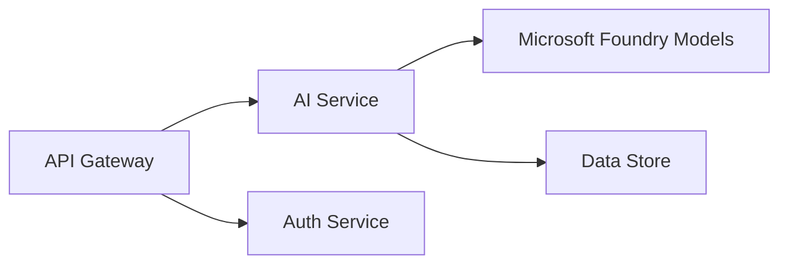

# Kabanata 8: Mga Pattern sa Produksyon at Enterprise

**📚 Kurso**: [AZD Para sa Mga Nagsisimula](../../README.md) | **⏱️ Tagal**: 2-3 oras | **⭐ Antas ng Hirap**: Advanced

---

## Pangkalahatang-ideya

Tinalakay sa kabanatang ito ang mga pattern para sa enterprise-ready deployment, pagpapalakas ng seguridad, pagmo-monitor, at pag-optimize ng gastos para sa mga AI na workload sa produksyon.

Ito ay isang arkitekturang sanggunian, hindi isang kumpletong template na maaaring direktang i-deploy sa produksyon. Ang mga halimbawa ay hindi kasama ang mga detalye ng integrasyon na kailangang ipasok at subukan sa iyong sariling aplikasyon; ang pagbabasa ng checklist ay hindi nangangahulugang sertipikadong handa para sa produksyon.

> **Pagsusuri ng release (2026-11-04):** Ang patnubay ng AI CLI ay sinuri laban sa dokumentasyon/source ng `azd 1.37.2`, mga ahente `1.0.0-beta.23`, at mga pagsusuri `1.0.0-beta.2`. Tingnan ang [mga pagbabago at pag-aayos sa release](production-ai-practices.md#recent-release-changes-and-fixes) para sa mga kinakailangan sa pagiging compatible at mga detalye ng migrasyon; hindi ito pagsusuri para sa aktwal na deployment.

## Mga Layunin sa Pagkatuto

Sa pagtatapos ng kabanatang ito, magagawa mong:
- Mag-deploy ng mga multi-region na resilient na aplikasyon
- Ipatupad ang mga pattern ng seguridad para sa enterprise
- I-configure ang komprehensibong pagmo-monitor
- I-optimize ang gastos sa malawakang sukat
- Mag-set up ng mga CI/CD pipeline gamit ang AZD

---

## 📚 Mga Aralin

| # | Aralin | Deskripsyon | Oras |
|---|--------|-------------|------|
| 1 | [Mga Kasanayan sa AI para sa Produksyon](production-ai-practices.md) | Mga pattern ng enterprise deployment | 90 min |

---

## 🚀 Checklist para sa Produksyon

- [ ] Multi-region deployment para sa katatagan
- [ ] Managed identity para sa pagpapatunay (walang mga susi)
- [ ] Application Insights para sa pagmo-monitor
- [ ] Nakakonfigyur na mga budget sa gastos at mga alerto
- [ ] Na-enable na pag-scan sa seguridad
- [ ] Integrasyon ng CI/CD pipeline
- [ ] Plano para sa disaster recovery

---

## 🏗️ Mga Pattern ng Arkitektura

### Pattern 1: Microservices AI



### Pattern 2: Event-Driven AI


---

## 🔐 Pinakamahusay na Kasanayan sa Seguridad

```bicep
// Illustrative properties from different resources, NOT a standalone Bicep file.
// Attach identity to the application host:
identity: {
  type: 'SystemAssigned'
}

// AI account properties (also require private endpoints, DNS and app connectivity):
properties: {
  publicNetworkAccess: 'Disabled'
  networkAcls: {
    defaultAction: 'Deny'
  }
}
```

---

## 💰 Pag-optimize ng Gastos

| Estratehiya | Pangunahing Limitasyon |
|----------|---------|
| Scale sa zero (Container Apps) | Nangangailangan ng angkop na trigger; ang ibang serbisyo ay patuloy na may gastos |
| Gumamit ng consumption tiers para sa dev | Ihambing ang presyo ng piniling serbisyo at workload |
| Scheduled scaling | Mag-scale gamit ang suportadong imprastraktura/automation |
| Reservations/provisioned capacity | Kapag sinusuportahan lamang; maaaring tumaas ang gastos ng idle kapag may commitments |

Gamitin ang [kumpletong budget resource pattern](production-ai-practices.md#2-cost-monitoring-and-budgets) na may balidong petsa ng pagsisimula, saklaw ng pagsingil, mga tatanggap, at mga permiso. Ang budget ay nagpapadala ng mga alerto; hindi ito nagsasaad ng limitasyon sa paggastos. Ang mga tipid ay nakadepende sa nasukatang paggamit at hindi garantisadong porsyento.

---

## 📊 Pag-setup ng Pagmo-monitor

```bash
# Open the Application Insights logs view (requires configured monitoring)
azd monitor --logs

# Check Application Insights
azd monitor --overview

# View metrics
az monitor metrics list --resource <resource-id>
```

---

## 🔗 Navigasyon

| Direksyon | Kabanata |
|-----------|---------|
| **Nakaraan** | [Kabanata 7: Pag-aayos ng Problema](../chapter-07-troubleshooting/README.md) |
| **Kumpleto na ang Kurso** | [Home ng Kurso](../../README.md) |

---

## 📖 Kaugnay na mga Mapagkukunan

- [Patnubay para sa mga AI Agents](../chapter-02-ai-development/agents.md)
- [Application Insights](../chapter-06-pre-deployment/application-insights.md)
- [Mga Solusyon sa Multi-Agent](../chapter-05-multi-agent/README.md)
- [Halimbawa ng Microservices](../../examples/microservices/README.md)

---

<!-- CO-OP TRANSLATOR DISCLAIMER START -->
**Pagtatanggi**:
Ang dokumentong ito ay isinalin gamit ang serbisyo ng AI translation na [Co-op Translator](https://github.com/Azure/co-op-translator). Bagama't nagsusumikap kami para sa katumpakan, pakatandaan na ang awtomatikong pagsasalin ay maaaring maglaman ng mga pagkakamali o hindi pagkakatugma. Ang orihinal na dokumento sa orihinal nitong wika ang dapat ituring na pangunahing sanggunian. Para sa mahahalagang impormasyon, inirerekomenda ang propesyonal na pagsasalin ng tao. Hindi kami mananagot sa anumang maling pagkakaintindi o maling interpretasyon na nagmula sa paggamit ng pagsasaling ito.
<!-- CO-OP TRANSLATOR DISCLAIMER END -->