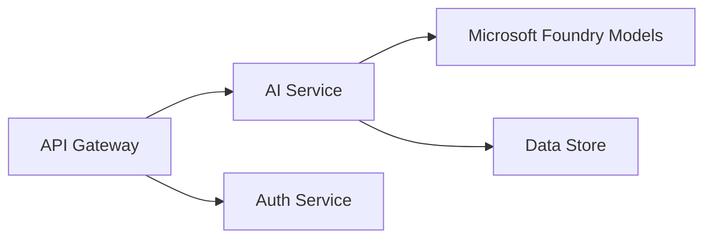

# Kabanata 8: Mga Pattern para sa Produksyon at Enterprise

**📚 Kurso**: [AZD Para sa mga Baguhan](../../README.md) | **⏱️ Tagal**: 2-3 oras | **⭐ Antas ng Kahirapan**: Advanced

---

## Pangkalahatang Pagsusuri

Sinasaklaw ng kabanatang ito ang mga pattern ng deployment na handa para sa enterprise, pagpapalakas ng seguridad, pagmamanman, at pag-optimize ng gastos para sa mga AI workload sa produksyon.

Ito ay isang sanggunian sa arkitektura, hindi isang kumpletong template na maaaring i-deploy nang diretso sa produksyon. Hindi isinama sa mga halimbawa ang mga detalye ng integrasyon na kailangang ibigay at subukan sa inyong sariling aplikasyon; ang pagbabasa ng checklist ay hindi nagpapatunay ng pagiging handa para sa produksyon.

> **Foundry GA update (2026-11-09):** Gamitin ang `azd >= 1.37.0` at ang pangkalahatang magagamit na bundle na `microsoft.foundry` 1.0 para sa workflow ng Foundry; ang mga pagsusuri ay ini-install nang hiwalay. Tingnan ang [saklaw ng release at migrasyon](production-ai-practices.md#recent-release-changes-and-fixes) at ang [authenticated pipeline example](production-ai-practices.md#cicd-pipeline-configuration). Ito ay isang pagsusuri ng dokumentasyon, hindi isang live na pag-validate ng deployment o pangkalahatang GA status para sa mga opsyonal na preview na feature.

## Mga Layunin sa Pagkatuto

Sa pagtatapos ng kabanatang ito, matututunan mo ang mga sumusunod:
- Mag-deploy ng mga matatag na aplikasyon sa maraming rehiyon
- Magpatupad ng mga pattern ng seguridad para sa enterprise
- I-configure ang malawak na pagmamanman
- I-optimize ang mga gastos sa malaking sukat
- Mag-set up ng mga CI/CD pipeline gamit ang AZD

---

## 📚 Mga Aralin

| # | Aralin | Paglalarawan | Oras |
|---|--------|-------------|------|
| 1 | [Mga Praktis sa Produksyon ng AI](production-ai-practices.md) | Mga pattern ng deployment para sa enterprise | 90 min |

---

## 🚀 Checklist para sa Produksyon

- [ ] Multi-region deployment para sa katatagan
- [ ] Managed identity para sa authentication (walang mga key)
- [ ] Application Insights para sa pagmamanman
- [ ] Na-configure ang mga budget sa gastos at alerto
- [ ] Ina-enable ang security scanning
- [ ] Integrasyon ng CI/CD pipeline
- [ ] Plano para sa disaster recovery

---

## 🏗️ Mga Pattern sa Arkitektura

### Pattern 1: Microservices AI



### Pattern 2: Event-Driven AI


---

## 🔐 Pinakamahuhusay na Praktis sa Seguridad

```bicep
// Illustrative properties from different resources, NOT a standalone Bicep file.
// Attach identity to the application host:
identity: {
  type: 'SystemAssigned'
}

// AI account properties (also require private endpoints, DNS and app connectivity):
properties: {
  publicNetworkAccess: 'Disabled'
  networkAcls: {
    defaultAction: 'Deny'
  }
}
```

---

## 💰 Pag-optimize ng Gastos

| Estratehiya | Pangunahing Limitasyon |
|----------|---------|
| Scale to zero (Container Apps) | Nangangailangan ng angkop na trigger; ang ibang serbisyo ay patuloy na nagkakaroon ng gastos |
| Gumamit ng consumption tiers para sa dev | Ihambing ang napiling presyo ng serbisyo at workload |
| Scheduled scaling | Mag-scale gamit ang suportadong imprastraktura/awtomasyon |
| Reservations/provisioned capacity | Kapag sinusuportahan lamang; ang mga commitment ay maaaring magpataas ng mga idle na gastos |

Gamitin ang [kumpletong pattern para sa budget resource](production-ai-practices.md#2-cost-monitoring-and-budgets) na may wastong petsa ng pagsisimula, saklaw ng pagsingil, mga tatanggap, at mga pahintulot. Ang budget ay nagpapadala ng mga alerto; hindi nito nililimitahan ang paggastos. Ang mga pagtitipid ay nakadepende sa nasukat na paggamit at hindi garantisadong porsyento.

---

## 📊 Setup ng Pagmamanman

```bash
# Open the Application Insights logs view (requires configured monitoring)
azd monitor --logs

# Check Application Insights
azd monitor --overview

# View metrics
az monitor metrics list --resource <resource-id>
```

---

## 🔗 Navigasyon

| Direksyon | Kabanata |
|-----------|---------|
| **Nakaraan** | [Kabanata 7: Pag-troubleshoot](../chapter-07-troubleshooting/README.md) |
| **Kumpletong Kurso** | [Home ng Kurso](../../README.md) |

---

## 📖 Mga Kaugnay na Mapagkukunan

- [AI Agents Guide](../chapter-02-ai-development/agents.md)
- [Application Insights](../chapter-06-pre-deployment/application-insights.md)
- [Multi-Agent Solutions](../chapter-05-multi-agent/README.md)
- [Microservices Example](../../examples/microservices/README.md)

---

<!-- CO-OP TRANSLATOR DISCLAIMER START -->
**Pagtatanggi**:
Ang dokumentong ito ay isinalin gamit ang serbisyo ng AI translation na [Co-op Translator](https://github.com/Azure/co-op-translator). Bagama't nagsusumikap kami para sa katumpakan, pakatandaan na ang awtomatikong pagsasalin ay maaaring maglaman ng mga pagkakamali o hindi pagkakatugma. Ang orihinal na dokumento sa orihinal nitong wika ang dapat ituring na pangunahing sanggunian. Para sa mahahalagang impormasyon, inirerekomenda ang propesyonal na pagsasalin ng tao. Hindi kami mananagot sa anumang maling pagkakaintindi o maling interpretasyon na nagmula sa paggamit ng pagsasaling ito.
<!-- CO-OP TRANSLATOR DISCLAIMER END -->