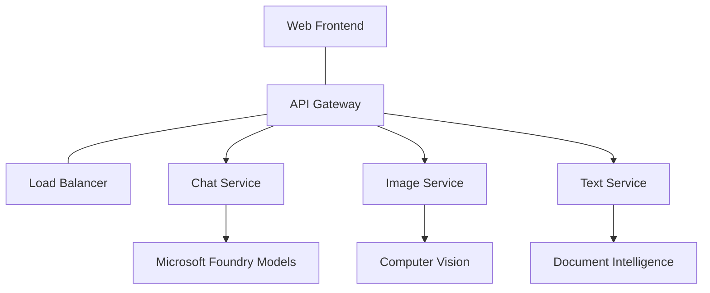

# Mga Pinakamahusay na Praktis para sa Production AI Workload gamit ang AZD

**Pag-navigate ng Kabanata:**
- **📚 Tahanan ng Kurso**: [AZD For Beginners](../../README.md)
- **📖 Kasalukuyang Kabanata**: Kabanata 8 - Mga Production & Enterprise na Pattern
- **⬅️ Nakaraang Kabanata**: [Kabanata 7: Pag-troubleshoot](../chapter-07-troubleshooting/debugging.md)
- **⬅️ Kaugnay din**: [AI Workshop Lab](../chapter-02-ai-development/ai-workshop-lab.md)
- **🎯 Kumpleto ang Kurso**: [AZD For Beginners](../../README.md)

## Pangkalahatang-ideya

Ang gabay na ito ay nagpapaliwanag ng mga design pattern para sa production AI gamit ang Azure Developer CLI (AZD). Ito ay isang sanggunian sa disenyo, hindi isang maaaring i-deploy na aplikasyon o sertipikasyon para sa production.

**Mga hangganan ng halimbawa:** Maliban kung tahasang inilalarawan bilang kumpleto, ang mga fragment ng Bicep ay nagpapalagay ng mga parameter at mga nirereferensiyang resources mula sa template na naglalaman nito. Hindi nito isinama ang host images/plans, mga identidad, mga role assignment, DNS, outputs, at iba pang kinakailangang integrasyon. Ang YAML service paths at hook/test scripts ay mga ilustratibong file upang likhain sa **sariling aplikasyon**; hindi ito ibinibigay ng kurso na ito. Gamitin ang isang gumaganang AZD sample bilang batayan, buuin ang kumpletong imprastruktura, at subukan ito sa isang hiwalay na kapaligiran bago ang production.

## Mga Pangunahing Hamon na Tinugunan

Kadalasang mga alalahanin sa production ay kinabibilangan ng multi-service deployments, pamamahala ng identidad at lihim, scaling, pagkontrol sa gastos, at pagmamanman. Walang sinasabing nasusukat na kalaganapan dito.

## Mga Pattern ng Arkitektura para sa Production AI

### Pattern 1: Microservices AI Architecture

**Kailan gamitin**: Masalimuot na AI na mga application na may maraming kakayahan



**Pagpapatupad sa AZD**:

```yaml
# azure.yaml
name: enterprise-ai-platform
services:
  web:
    project: ./web
    host: staticwebapp
  api-gateway:
    project: ./api-gateway
    host: containerapp
  chat-service:
    project: ./services/chat
    host: containerapp
  vision-service:
    project: ./services/vision
    host: containerapp
  text-service:
    project: ./services/text
    host: containerapp
```

### Pattern 2: Event-Driven AI Processing

**Kailan gamitin**: Batch processing, pagsusuri ng dokumento, async workflows

```bicep
// Event Hub for AI processing pipeline
resource eventHub 'Microsoft.EventHub/namespaces@2024-01-01' = {
  name: eventHubNamespaceName
  location: location
  sku: {
    name: 'Standard'
    tier: 'Standard'
    capacity: 1
  }
}

// Service Bus for reliable message processing
resource serviceBus 'Microsoft.ServiceBus/namespaces@2024-01-01' = {
  name: serviceBusNamespaceName
  location: location
  sku: {
    name: 'Premium'
    tier: 'Premium'
    capacity: 1
  }
}

// Function App for processing
resource functionApp 'Microsoft.Web/sites@2023-01-01' = {
  name: functionAppName
  location: location
  kind: 'functionapp,linux'
  properties: {
    siteConfig: {
      appSettings: [
        {
          name: 'FUNCTIONS_EXTENSION_VERSION'
          value: '~4'
        }
        {
          name: 'AZURE_OPENAI_ENDPOINT'
          value: '@Microsoft.KeyVault(VaultName=${keyVault.name};SecretName=openai-endpoint)'
        }
      ]
    }
  }
}
```

Lumilikha ito ng namespace fragments, hindi hubs, queues, subscriptions, o Function triggers. Ang isang patatakbong Function ay nangangailangan rin ng hosting plan, runtime/storage configuration, naka-attach na identidad, RBAC, at access sa network. Ang Key Vault reference ay nangangailangan ng permiso upang basahin ang lihim; ang endpoint URL mismo ay hindi isang pahintulot.

## Pag-iisip Tungkol sa Kalusugan ng AI Agent

Kapag nabigo ang isang tradisyonal na web app, pamilyar ang mga sintomas: hindi naglo-load ang pahina, nagbabalik ng error ang API, o nabigo ang deployment. Ang mga AI-powered na aplikasyon ay maaaring masira sa lahat ng mga paraang iyon—ngunit maaari rin silang kumilos nang masalimuot na hindi nagpapakita ng malinaw na mga mensahe ng error.

Tinutulungan ka ng seksyong ito na bumuo ng mental na modelo para sa pagmamanman ng AI workloads upang malaman mo kung saan titingin kapag may mga bagay na tila hindi tama.

### Paano Naiiba ang Kalusugan ng Agent mula sa Tradisyonal na Kalusugan ng App

Ang mga tradisyonal na app ay maaari ring magkaroon ng mga pinong pagkabigong tama. Ang isang AI agent ay nagdadagdag ng nondeterministic na kalidad ng tugon sa karaniwang mga alalahanin sa availability at correctness. Isipin ang kalusugan ng agent sa dalawang layer:

| Layer | Ano ang Dapat Bantayan | Saan Titignan |
|-------|--------------|---------------|
| **Kalusugan ng imprastruktura** | Tumakbo ba ang serbisyo? Na-provision ba ang mga resources? Naabot ba ang mga endpoint? | `azd monitor`, kalusugan ng resource sa Azure Portal, logs ng container/app |
| **Kalusugan ng pag-uugali** | Tama bang tumutugon ang agent? Napapanahon ba ang mga tugon? Tama bang tinatawagan ang modelo? | Mga traces ng Application Insights, metrics ng latency ng tawag sa modelo, mga log ng kalidad ng tugon |

Pamilyar ang kalusugan ng imprastruktura—pareho ito para sa anumang azd app. Ang kalusugan ng pag-uugali ang bagong layer na ipinakilala ng AI workloads.

### Saan Titignan Kapag Hindi Gumagana ng Maayos ang AI Apps

Kung ang iyong AI application ay hindi nagbibigay ng inaasahang resulta, narito ang isang konseptuwal na checklist:

1. **Simulan sa mga pangunahing bagay.** Tumakbo ba ang app? Maabot ba nito ang mga dependency? Suriin ang `azd monitor` at kalusugan ng resource tulad ng para sa anumang app.
2. **Suriin ang koneksyon sa modelo.** Tagumpay ba ang tawag ng iyong app sa AI model? Ang mga nabigong tawag o timeout ay karaniwang sanhi ng mga isyu sa AI app at makikita sa iyong mga log.
3. **I-inspeksyon nang ligtas ang input at grounding.** Ang maling mga sagot ay maaaring sanhi ng retrieval, instructions, limitasyon ng modelo, o pagpapatupad ng tool. Gumamit ng access-controlled, redacted diagnostic data; huwag paganahin ang walang pinipiling prompt/response logging sa production.
4. **Suriin ang latency ng tugon.** Mas mabagal ang mga tawag sa AI model kumpara sa karaniwang API call. Kung ang app mo ay mabagal, tingnan kung tumaas ang oras ng tugon ng modelo—ito ay maaaring palatandaan ng throttling, limitasyon sa kapasidad, o congestion sa antas ng rehiyon.
5. **Bantayan ang mga palatandaan ng gastos.** Ang hindi inaasahang pagtaas sa paggamit ng token o tawag sa API ay maaaring magpahiwatig ng loop, maling pagkokonfig ng prompt, o labis na retries.

Hindi mo kailangang maging eksperto agad sa observability tooling. Ang mahalagang takeaway ay may dagdag na layer ng pag-uugali na dapat bantayan ang AI applications, at ang built-in monitoring ng azd (`azd monitor`) ay nagbibigay ng panimulang punto para imbestigahan ang parehong mga layer.

---

## Mga Pinakamahusay na Praktis sa Seguridad

### 1. Zero-Trust Security Model

**Estratihiya ng Pagpapatupad**:
- Walang komunikasyong serbisyo-sa-serbisyo nang walang authentication
- Lahat ng API calls ay gumagamit ng managed identities
- Network isolation gamit ang private endpoints
- Kontrol sa access gamit ang least privilege

```bicep
// Managed Identity for each service
resource chatServiceIdentity 'Microsoft.ManagedIdentity/userAssignedIdentities@2023-01-31' = {
  name: 'chat-service-identity'
  location: location
}

// Role assignments with minimal permissions
resource openAIUserRole 'Microsoft.Authorization/roleAssignments@2022-04-01' = {
  scope: openAIAccount
  name: guid(openAIAccount.id, chatServiceIdentity.id, '5e0bd9bd-7b93-4f28-af87-19fc36ad61bd')
  properties: {
    roleDefinitionId: subscriptionResourceId('Microsoft.Authorization/roleDefinitions', '5e0bd9bd-7b93-4f28-af87-19fc36ad61bd')
    principalId: chatServiceIdentity.properties.principalId
    principalType: 'ServicePrincipal'
  }
}
```

### 2. Ligtas na Pamamahala ng Lihim

**Pattern ng Key Vault Integration**:

```bicep
// Key Vault with proper access policies
resource keyVault 'Microsoft.KeyVault/vaults@2023-02-01' = {
  name: keyVaultName
  location: location
  properties: {
    tenantId: tenant().tenantId
    sku: {
      family: 'A'
      name: 'standard' // Premium is needed for HSM-backed keys, not ordinary secrets
    }
    enableRbacAuthorization: true  // Use RBAC instead of access policies
    enablePurgeProtection: true    // Prevent accidental deletion
    enableSoftDelete: true
    softDeleteRetentionInDays: 90
  }
}

// Optional legacy key-auth alternative; omit when using Entra ID.
resource openAIKeySecret 'Microsoft.KeyVault/vaults/secrets@2023-02-01' = {
  parent: keyVault
  name: 'openai-api-key'
  properties: {
    value: openAIAccount.listKeys().key1
    attributes: {
      enabled: true
    }
  }
}
```

Italaga ang runtime identity `Key Vault Secrets User` sa angkop na scope at i-attach ito sa host; ang `enableRbacAuthorization` lamang ay hindi nagbibigay ng access. Mas mainam ang OpenAI managed identity authentication gamit ang `disableLocalAuth: true`. Ang opsyonal na susi ng lihim ay may katuturan lamang para sa account na sadyang pinagana para sa mga susi, at kailangan din ng provisioning principal ng permiso upang magsulat ng mga lihim.

### 3. Seguridad sa Network

**Kumpigurasyon ng Private Endpoint**:

```bicep
// Virtual Network for AI services
resource virtualNetwork 'Microsoft.Network/virtualNetworks@2023-04-01' = {
  name: vnetName
  location: location
  properties: {
    addressSpace: {
      addressPrefixes: ['10.0.0.0/16']
    }
    subnets: [
      {
        name: 'ai-services-subnet'
        properties: {
          addressPrefix: '10.0.1.0/24'
          privateEndpointNetworkPolicies: 'Disabled'
        }
      }
      {
        name: 'app-services-subnet'
        properties: {
          addressPrefix: '10.0.2.0/24'
          delegations: [
            {
              name: 'Microsoft.Web/serverFarms'
              properties: {
                serviceName: 'Microsoft.Web/serverFarms'
              }
            }
          ]
        }
      }
    ]
  }
}

// Private endpoints for all AI services
resource openAIPrivateEndpoint 'Microsoft.Network/privateEndpoints@2023-04-01' = {
  name: '${openAIAccountName}-pe'
  location: location
  properties: {
    subnet: {
      id: virtualNetwork.properties.subnets[0].id
    }
    privateLinkServiceConnections: [
      {
        name: 'openai-connection'
        properties: {
          privateLinkServiceId: openAIAccount.id
          groupIds: ['account']
        }
      }
    ]
  }
}
```

Nangangailangan din ang mga private endpoints ng mga private DNS zone groups/VNet links at application VNet integration. Hindi nito awtomatikong hinaharangan ang public access: tahasang i-disable ang public network access ng AI account pagkatapos mapatunayan ang pribadong konektibidad at deployment access.

## Performance at Scaling

### 1. Mga Estratehiya ng Auto-Scaling

**Auto-scaling para sa Container Apps**:

```bicep
resource containerApp 'Microsoft.App/containerApps@2023-05-01' = {
  name: containerAppName
  location: location
  properties: {
    configuration: {
      ingress: {
        external: true
        targetPort: 8000
        transport: 'http'
      }
    }
    template: {
      scale: {
        minReplicas: 2  // Always have 2 instances minimum
        maxReplicas: 50 // Scale up to 50 for high load
        rules: [
          {
            name: 'http-scaling'
            http: {
              metadata: {
                concurrentRequests: '20'  // Scale when >20 concurrent requests
              }
            }
          }
          {
            name: 'cpu-scaling'
            custom: {
              type: 'cpu'
              metadata: {
                type: 'Utilization'
                value: '70'  // Scale when CPU >70%
              }
            }
          }
        ]
      }
    }
  }
}
```

### 2. Mga Estratehiya sa Caching

**Redis Cache para sa AI Responses**:

```bicep
// Legacy Azure Cache for Redis example (not recommended for new deployments)
resource redisCache 'Microsoft.Cache/redis@2023-04-01' = {
  name: redisCacheName
  location: location
  properties: {
    sku: {
      name: 'Premium'
      family: 'P'
      capacity: 1
    }
    enableNonSslPort: false
    minimumTlsVersion: '1.2'
    redisConfiguration: {
      'maxmemory-policy': 'allkeys-lru'
    }
    // Sharding distributes data; replication/failover provides availability.
    shardCount: 2
  }
}

// Cache configuration in application
var cacheConnectionString = '${redisCache.properties.hostName}:6380,password=${redisCache.listKeys().primaryKey},ssl=True,abortConnect=False'
```

Ang Azure Cache for Redis Basic/Standard/Premium ay nasa [landas ng pagretiro](https://learn.microsoft.com/azure/azure-cache-for-redis/retirement-faq). Gamitin ang Azure Managed Redis para sa mga bagong disenyo at ang naidokumentong SKU, identidad, at TLS configuration nito, sa halip na kopyahin ang legacy resource na ito sa isang bagong production system. Ang connection-string na linya ay isang placeholder na walang functionality, hindi isang credential. Hatiin ang mga cache key ayon sa awtorisasyon, modelo/instructions, at bersyon ng retrieval, kasama ang expiry; ang isang shared na query-only cache ay maaaring magbunyag ng data ng ibang user.

### 3. Load Balancing at Traffic Management

**Application Gateway na may WAF**:

```bicep
// Application Gateway with Web Application Firewall
resource applicationGateway 'Microsoft.Network/applicationGateways@2023-04-01' = {
  name: appGatewayName
  location: location
  properties: {
    sku: {
      name: 'WAF_v2'
      tier: 'WAF_v2'
      capacity: 2
    }
    webApplicationFirewallConfiguration: {
      enabled: true
      firewallMode: 'Prevention'
      ruleSetType: 'OWASP'
      ruleSetVersion: '3.2'
    }
    // Backend pools for AI services
    backendAddressPools: [
      {
        name: 'ai-services-pool'
        properties: {
          backendAddresses: [
            {
              fqdn: '${containerApp.properties.configuration.ingress.fqdn}'
            }
          ]
        }
      }
    ]
  }
}
```

Ito ay isang bahagyang gateway resource: ang tunay na deployment ay nangangailangan din ng gateway subnet/IP configuration, frontend IPs at ports, TLS listeners/certificates, backend HTTP settings/probes, routing rules at priorities, at isang nirerepasong WAF policy. Kailangang tumapat ang TLS hostname/SNI at authentication sa Container App backend.

## 💰 Pag-optimize ng Gastos

### 1. Resource Right-Sizing

**Mga Configuration na Nakaayon sa Kapaligiran**:

Ang mga pangalang ito ay **ilustratibong custom-template inputs**, hindi awtomatikong mga setting ng AZD. I-map ang bawat isa sa `infra/main.parameters.json`/Bicep at host configuration muna. Halimbawa, ang RAG sample ay gumagamit ng `AZURE_SEARCH_SERVICE_SKU` at `AZURE_OPENAI_CHATGPT_DEPLOYMENT_CAPACITY`, hindi ang pangkalahatang mga pangalan sa ibaba. Bigyan ang memory ng Container Apps ng suportadong yunit tulad ng `1Gi` sa aktwal na resource. Ipatupad ang mga pagbabago sa imprastruktura gamit ang `azd up` o `azd provision`; ang `azd deploy` lamang ay hindi nagpapalit ng mga pagbabago sa Bicep.

```bash
# Development environment
azd env new development
azd env set AZURE_OPENAI_SKU "S0"
azd env set AZURE_OPENAI_CAPACITY 10
azd env set AZURE_SEARCH_SKU "basic"
azd env set CONTAINER_CPU 0.5
azd env set CONTAINER_MEMORY 1.0

# Production environment  
azd env new production
azd env set AZURE_OPENAI_SKU "S0"
azd env set AZURE_OPENAI_CAPACITY 100
azd env set AZURE_SEARCH_SKU "standard"
azd env set CONTAINER_CPU 2.0
azd env set CONTAINER_MEMORY 4.0
```

### 2. Pagmamanman ng Gastos at Badyet

```bicep
// Supply the first day of the current UTC month, e.g. 2026-11-01T00:00:00Z.
param budgetStartDate string

// Cost management and budgets
resource budget 'Microsoft.Consumption/budgets@2024-08-01' = {
  name: 'ai-workload-budget'
  properties: {
    timePeriod: {
      startDate: budgetStartDate
    }
    timeGrain: 'Monthly'
    amount: 2000  // In the billing currency, not necessarily USD
    category: 'Cost'
    notifications: {
      warning: {
        enabled: true
        operator: 'GreaterThan'
        threshold: 80
        contactEmails: [
          'finance@company.com'
          'engineering@company.com'
        ]
        contactRoles: [
          'Owner'
          'Contributor'
        ]
      }
      critical: {
        enabled: true
        operator: 'GreaterThan'
        threshold: 95
        contactEmails: [
          'cto@company.com'
        ]
      }
    }
  }
}
```

Palitan ang mga halimbawa ng tatanggap at suriin ang scope/permissions. Ang mga alert sa badyet ay gumagamit ng delayed billing data at hindi nagpapatupad ng spending cap.

### 3. Pag-optimize ng Paggamit ng Token

**Pamamahala ng Gastos sa OpenAI**:

Ito ay isang karakter-based heuristic lamang para sa UI preview, **hindi** isang validator ng limitasyon ng token ng modelo. Dapat gumamit ang production code ng tokenizer na angkop sa ipinambublikong modelo at isaalang-alang ang mga system instructions, schema ng tool, kasaysayan, at budget ng output. Itakwil ang user message na sobra ang laki kaysa basta tahimik na i-truncate ito.

```typescript
// Application-level token optimization
class TokenOptimizer {
  private readonly maxTokens = 4000;
  private readonly reserveTokens = 500;
  
  optimizePrompt(userInput: string, context: string): string {
    const availableTokens = this.maxTokens - this.reserveTokens;
    if (this.estimateTokens(userInput) + 8 >= availableTokens) {
      throw new Error("User input exceeds the illustrative prompt budget");
    }
    const estimatedTokens = this.estimateTokens(userInput + context) + 8;
    
    if (estimatedTokens > availableTokens) {
      // Truncate context, not user input
      context = this.truncateContext(context, Math.max(0, availableTokens - this.estimateTokens(userInput) - 8));
    }
    
    return `${context}\n\nUser: ${userInput}`;
  }
  
  private estimateTokens(text: string): number {
    // Rough estimation: 1 token ≈ 4 characters
    return Math.ceil(text.length / 4);
  }

  private truncateContext(text: string, estimatedBudget: number): string {
    return text.slice(0, Math.max(0, estimatedBudget) * 4);
  }
}
```

## Pagmamanman at Observability

### 1. Komprehensibong Application Insights

```bicep
// Application Insights with advanced features
resource applicationInsights 'Microsoft.Insights/components@2020-02-02' = {
  name: applicationInsightsName
  location: location
  kind: 'web'
  properties: {
    Application_Type: 'web'
    WorkspaceResourceId: logAnalyticsWorkspace.id
    SamplingPercentage: 100  // Ingestion setting; review cost and SDK sampling separately
    DisableIpMasking: false  // Retain IP masking
  }
}

// Custom metrics for AI operations
resource aiMetricAlerts 'Microsoft.Insights/metricAlerts@2018-03-01' = {
  name: 'ai-high-error-rate'
  location: 'global'
  properties: {
    description: 'Alert when failed request count exceeds 10 in five minutes'
    severity: 2
    enabled: true
    scopes: [
      applicationInsights.id
    ]
    evaluationFrequency: 'PT1M'
    windowSize: 'PT5M'
    criteria: {
      'odata.type': 'Microsoft.Azure.Monitor.SingleResourceMultipleMetricCriteria'
      allOf: [
        {
          name: 'high-error-rate'
          metricName: 'requests/failed'
          operator: 'GreaterThan'
          threshold: 10
          timeAggregation: 'Count'
        }
      ]
    }
  }
}
```

### 2. Monitoring na Tiyak para sa AI

**Custom Dashboards para sa AI Metrics**:

```json
{
  "dashboard": {
    "name": "AI Application Monitoring",
    "tiles": [
      {
        "name": "OpenAI Request Volume",
        "query": "dependencies | where target contains 'openai' | summarize count() by bin(timestamp, 5m)"
      },
      {
        "name": "AI Response Latency",
        "query": "dependencies | where target contains 'openai' | summarize avg(duration) by bin(timestamp, 5m)"
      },
      {
        "name": "Token Usage",
        "query": "customMetrics | where name == 'openai_tokens_used' | summarize sum(value) by bin(timestamp, 1h)"
      },
      {
        "name": "Cost per Hour",
        "query": "customMetrics | where name == 'openai_cost' | summarize sum(value) by bin(timestamp, 1h)"
      }
    ]
  }
}
```

Ang JSON na ito ay isang sketch na tinukoy ng aplikasyon, hindi isang importable Azure portal dashboard schema. Ang mga token/cost queries ay nangangailangan ng iyong app na maglabas ng eksaktong custom metrics; hindi ito nililikha ng AZD. Isaayos ang mga filter ng dependency para sa iyong tunay na pangalan ng endpoint/span ng modelo.

### 3. Mga Health Checks at Pagmamanman ng Uptime

```bicep
// Application Insights availability tests
resource availabilityTest 'Microsoft.Insights/webtests@2022-06-15' = {
  name: 'ai-app-availability-test'
  location: location
  tags: {
    'hidden-link:${applicationInsights.id}': 'Resource'
  }
  properties: {
    SyntheticMonitorId: 'ai-app-availability-test'
    Name: 'AI Application Availability Test'
    Description: 'Tests AI application endpoints'
    Enabled: true
    Frequency: 300  // 5 minutes
    Timeout: 120    // 2 minutes
    Kind: 'standard'
    Locations: [
      {
        Id: 'us-east-2-azr'
      }
      {
        Id: 'us-west-2-azr'
      }
    ]
    Request: {
      RequestUrl: 'https://${webApp.properties.defaultHostName}/health'
      HttpVerb: 'GET'
      FollowRedirects: true
      ParseDependentRequests: false
    }
    ValidationRules: {
      ExpectedHttpStatusCode: 200
      SSLCheck: true
      SSLCertRemainingLifetimeCheck: 7
    }
  }
}
```

## Disaster Recovery at Mataas na Availability

Ang naunang pagsubok ay nagpapalagay ng umiiral na App Service `webApp` at Application Insights resource. Ang mga karaniwang availability tests ay pabayaran at nangangailangan ng maabot na endpoint; ang mga private-only apps ay nangangailangan ng angkop na disenyo sa private monitoring. Deprecated na ang mga URL ping tests; gamitin ang [standard availability tests](https://learn.microsoft.com/azure/azure-monitor/app/availability).

### 1. Multi-Region Deployment

```yaml
# azure.yaml - Multi-region configuration
name: ai-app-multiregion
services:
  api-primary:
    project: ./api
    host: containerapp
    env:
      AZURE_REGION: eastus
  api-secondary:
    project: ./api
    host: containerapp
    env:
      AZURE_REGION: westus2
```

```bicep
// Separate App Service topology, not the Container Apps declarations above
resource trafficManager 'Microsoft.Network/trafficManagerProfiles@2022-04-01' = {
  name: trafficManagerProfileName
  location: 'global'
  properties: {
    profileStatus: 'Enabled'
    trafficRoutingMethod: 'Priority'
    dnsConfig: {
      relativeName: trafficManagerProfileName
      ttl: 30
    }
    monitorConfig: {
      protocol: 'HTTPS'
      port: 443
      path: '/health'
      intervalInSeconds: 30
      toleratedNumberOfFailures: 3
      timeoutInSeconds: 10
    }
    endpoints: [
      {
        name: 'primary-endpoint'
        type: 'Microsoft.Network/trafficManagerProfiles/azureEndpoints'
        properties: {
          targetResourceId: primaryAppService.id
          endpointStatus: 'Enabled'
          priority: 1
        }
      }
      {
        name: 'secondary-endpoint'
        type: 'Microsoft.Network/trafficManagerProfiles/azureEndpoints'
        properties: {
          targetResourceId: secondaryAppService.id
          endpointStatus: 'Enabled'
          priority: 2
        }
      }
    ]
  }
}
```

Hindi pinipili ng mga environment variable ang mga lokasyon ng resource. Dapat mag-provision ang IaC ng magkahiwalay na regional hosts at itali ang bawat serbisyo gamit ang `resourceName` o `azd-service-name` tags. Ang halimbawa ng Traffic Manager ay isang **hiwalay na topology ng App Service** (`primaryAppService`/`secondaryAppService`), hindi routing para sa mga deklarasyon ng Container Apps. Nangangailangan ang Container Apps ng angkop na naka-configure na external endpoint/front door, TLS/custom-domain routing, at health probes.

### 2. Backup ng Data at Pag-recover

```bicep
// Backup configuration for critical data
resource backupVault 'Microsoft.DataProtection/backupVaults@2023-05-01' = {
  name: backupVaultName
  location: location
  identity: {
    type: 'SystemAssigned'
  }
  properties: {
    storageSettings: [
      {
        datastoreType: 'VaultStore'
        type: 'LocallyRedundant'
      }
    ]
  }
}

```

Ang vault lamang ay hindi nagbabackup ng kahit ano. I-configure ang **workload-specific na suportadong polisiya at backup instance**, mga permiso ng source, retention, at mga pagsubok sa restore gamit ang [Azure Backup support matrices](https://learn.microsoft.com/azure/backup/backup-support-matrix). Walang generic Azure Backup policy para sa mga hosted Azure OpenAI model deployments. Panatilihin ang mga depinisyon ng imprastruktura/model deployment sa source control; protektahan ang mga na-upload na dokumento, data ng aplikasyon, at fine-tuning artifacts gamit ang suportadong mga backup/export features ng bawat backing service. Tukuyin at subukin nang tahasan ang RPO/RTO.

## Integrasyon ng DevOps at CI/CD

### 1. GitHub Actions Workflow

```yaml
# .github/workflows/deploy-ai-app.yml
name: Deploy AI Application

on:
  push:
    branches: [main]
  pull_request:
    branches: [main]

jobs:
  test:
    runs-on: ubuntu-latest
    steps:
      - uses: actions/checkout@v4
      
      - name: Setup Python
        uses: actions/setup-python@v4
        with:
          python-version: '3.11'
          
      - name: Install dependencies
        run: |
          pip install -r requirements.txt
          pip install pytest
          
      - name: Run tests
        run: pytest tests/
        
      - name: AI Safety Tests
        run: |
          python scripts/test_ai_safety.py
          python scripts/validate_prompts.py

```

Ito ang **bahagi lamang para sa pagsubok** ng isang workflow at ipinapalagay na nakalikha ka na ng `requirements.txt`, `tests/`, at ang dalawang safety scripts. Idagdag ang authenticated OIDC provisioning/deployment na mga trabaho mula sa [CI/CD Pipeline Configuration](#cicd-pipeline-configuration), gamit ang `needs: test`, isang pinagkakatiwalaang push/manual trigger, at protektadong mga kapaligiran ng GitHub. Huwag mag-deploy ng hindi pinagkakatiwalaang pull-request code na may mga kredensyal sa cloud. Ang bagong runner ay walang piniling lokal na kapaligiran ng AZD; ibigay ang environment/subscription/location na mga input at gamitin ang `azd auth login`, hindi lamang ang `azure/login`.

### 2. Pagpapatunay ng Imprastruktura

```bash
# scripts/validate_infrastructure.sh
#!/bin/bash
set -euo pipefail

echo "Validating AI infrastructure deployment..."

# Requires Azure CLI login and the resource group selected explicitly.
: "${AZURE_RESOURCE_GROUP:?Set AZURE_RESOURCE_GROUP}"
: "${AZURE_OPENAI_NAME:?Set AZURE_OPENAI_NAME}"
: "${AZURE_OPENAI_CHAT_DEPLOYMENT:?Set the actual deployment name}"

# A successful empty list is not proof that resources exist.
types=("Microsoft.CognitiveServices/accounts" "Microsoft.Search/searchServices"
       "Microsoft.Storage/storageAccounts" "Microsoft.KeyVault/vaults")
for resource_type in "${types[@]}"; do
    count=$(az resource list --resource-group "$AZURE_RESOURCE_GROUP" \
        --resource-type "$resource_type" --query "length(@)" -o tsv)
    if [[ "$count" -lt 1 ]]; then
        echo "ERROR: No $resource_type found in $AZURE_RESOURCE_GROUP"
        exit 1
    fi
done

# Validate OpenAI model deployments
echo "Validating OpenAI model deployments..."
state=$(az cognitiveservices account deployment show \
  --name "$AZURE_OPENAI_NAME" --resource-group "$AZURE_RESOURCE_GROUP" \
  --deployment-name "$AZURE_OPENAI_CHAT_DEPLOYMENT" \
  --query "properties.provisioningState" -o tsv)
if [[ "$state" != "Succeeded" ]]; then
    echo "ERROR: Required model deployment is not provisioned successfully"
    exit 1
fi

echo "Infrastructure validation completed successfully!"
```

Inaasahan: isang zero exit at ang mensahe ng pagkumpleto lamang kapag lahat ng inaasahang uri ay umiiral at ang pinangalanang deployment ng modelo ay na-provision. Sinusuri nito ang estado ng imbentaryo/pag-provision, **hindi** ang kalusugan ng resource, eksaktong topology, RBAC, pag-abot sa network, o pag-uugali ng modelo. Isaayos ang mga inaasahang uri ayon sa iyong arkitektura, pagkatapos magsagawa ng hiwalay na authenticated application readiness test.

## Checklist para sa Kahandaan sa Production

### Seguridad ✅
- [ ] Lahat ng serbisyo ay gumagamit ng managed identities
- [ ] Mga lihim ay nakaimbak sa Key Vault
- [ ] Na-configure ang mga private endpoints
- [ ] Naipatupad ang mga network security groups
- [ ] RBAC gamit ang least privilege
- [ ] Naka-enable ang WAF sa public endpoints

### Performance ✅
- [ ] Na-configure ang auto-scaling
- [ ] Naipatupad ang caching
- [ ] Naka-setup ang load balancing
- [ ] CDN para sa static content
- [ ] Connection pooling sa database
- [ ] Pag-optimize ng paggamit ng token

### Pagmamanman ✅
- [ ] Na-configure ang Application Insights
- [ ] Nai-defina ang custom metrics
- [ ] Na-setup ang mga alerting rule
- [ ] Nalikha ang dashboard
- [ ] Naipatupad ang mga health checks
- [ ] Mga polisiya sa pag-retain ng log

### Katatagan ✅
- [ ] Multi-region deployment
- [ ] Plano sa backup at recovery
- [ ] Naipatupad ang mga circuit breaker
- [ ] Na-configure ang mga retry policies
- [ ] Graceful degradation
- [ ] Mga endpoint para sa health check

### Pamamahala ng Gastos ✅
- [ ] Na-configure ang mga budget alert
- [ ] Resource right-sizing
- [ ] Na-apply ang diskwento para sa dev/test
- [ ] Nakabili ng reserved instances
- [ ] Dashboard para sa pagmamanman ng gastos
- [ ] Regular na pagsusuri ng gastos

### Pagsunod ✅
- [ ] Natugunan ang mga data residency requirements
- [ ] Na-enable ang audit logging
- [ ] Naipatupad ang mga compliance policy
- [ ] Naipatupad ang mga security baseline
- [ ] Regular na security assessments
- [ ] Plano para sa incident response

## Mga Benchmark sa Performance

### Mga Ilustratibong Target para sa Production

Ito ay mga halimbawa ng SLO para pag-usapan at pag-load-test, hindi nasusukat na benchmark o garantiya. Depende sa haba ng modelo/output ang latency ng tugon; ang buwanang paggasta sa token ay nakasalalay sa traffic at presyo, hindi sa bilang ng token lamang.

| Sukatan | Target | Pagmamanman |
|--------|--------|------------|
| **Oras ng Tugon** | < 2 segundo | Application Insights |
| **Availability** | 99.9% | Pagmamanman ng uptime |
| **Rate ng Error** | < 0.1% | Mga log ng aplikasyon |
| **Gastos sa Modelo** | < $500/buwan (halimbawa ng badyet) | Pamamahala sa gastos |
| **Sabay-sabay na Gumagamit** | 1000+ | Pag-load test |
| **Oras ng Pagbawi** | < 1 oras | Mga pagsubok sa pag-recover mula sa sakuna |

### Pagsubok ng Load

Ang sumusunod ay guhit ng interface para sa isang load-test script **na dapat mong ipatupad**; ang repositoryo na ito ay hindi nagbibigay ng `scripts/load_test.py`. Tukuyin ang mga kahilingan ng payload, awtentikasyon, kinatawan ng mga workload, mga persentil na latency/error na pagsasaalang-alang, at limitasyon sa gastos sa iyong napiling tool para sa load-test bago ito patakbuhin:

```bash
# Load testing script for AI applications
python scripts/load_test.py \
  --endpoint https://your-ai-app.azurewebsites.net \
  --concurrent-users 100 \
  --duration 300 \
  --ramp-up 60
```

## 🤝 Pinakamahusay na Praktis ng Komunidad

Batay sa puna ng Microsoft Foundry Discord community:

### Nangungunang mga Rekomendasyon mula sa Komunidad:

1. **Magsimula nang Maliit, Palakihin Nang Paunti-unti**: Magsimula sa mga pangunahing SKU at palakihin batay sa aktwal na paggamit
2. **Subaybayan ang Lahat**: Mag-set up ng komprehensibong monitoring mula pa sa unang araw
3. **I-automate ang Seguridad**: Gumamit ng infrastructure bilang code para sa consistent na seguridad
4. **Subukan nang Mabuti**: Isama ang AI-specific na pagsubok sa iyong pipeline
5. **Magplano para sa Mga Gastos**: Subaybayan ang paggamit ng token at mag-set ng mga alerto sa budget nang maaga

### Mga Karaniwang Pagkakamaling Iwasan:

- ❌ Hindi pagtanggal sa hardcoding ng mga API key sa code
- ❌ Hindi pag-set up ng maayos na monitoring
- ❌ Pagsuway sa pag-optimize ng gastos
- ❌ Hindi pagsubok sa mga senaryo ng pagkabigo
- ❌ Pag-deploy nang walang health checks

## Mga Utos at Extensions ng AZD AI CLI

Kasama sa AZD ang patuloy na lumalawak na set ng AI-specific na mga utos at mga extension na nagpapadali ng mga AI workflows para sa produksyon. Ang mga tool na ito ay nag-uugnay ng pagitan ng local na development at produksyon na deployment para sa mga workload ng AI.

> **Review ng release (2026-11-04):** Ang gabay sa CLI sa ibaba ay sinuri laban sa mga inilathalang release ng `azd` **1.37.2**, `azure.ai.agents` **1.0.0-beta.23**, at `azure.ai.evaluations` **1.0.0-beta.2**. Ang agents beta.23 ay nangangailangan ng `azd >= 1.37.0`; ang evaluations beta.2 ay nangangailangan ng `azd >= 1.33.0`. Gumamit ng hindi bababa sa 1.37.0 para sa pinagsamang workflow. Ito ay isang pagsusuri sa dokumentasyon/source, hindi isang live na pagpapatunay ng deployment sa Azure.

### Mga Extension ng AZD para sa AI

Gumagamit ang AZD ng isang sistema ng extension para magdagdag ng AI-specific na mga kakayahan. I-install at pamahalaan ang mga extension gamit ang:

```bash
# List all available extensions (including AI)
azd extension list

# Inspect installed extension details
azd version
azd extension show azure.ai.agents

# Install the Foundry agents extension
azd extension install azure.ai.agents

# Install the separate Foundry evaluations extension
azd extension install azure.ai.evaluations

# Install the fine-tuning extension
azd extension install azure.ai.finetune

# Install the custom models extension
azd extension install azure.ai.models

# Upgrade all installed extensions
azd extension upgrade --all
```

**Mga Available na AI extension:**

| Extension | Layunin | Kalagayan |
|-----------|---------|--------|
| `azure.ai.agents` | Pamamahala ng Foundry Agent Service | Preview |
| `azure.ai.evaluations` | Mga evaluation dataset, evaluator, eval group, at run | Preview |
| `azure.ai.skills` | Reusable na mga kasanayan ng agent | Preview |
| `azure.ai.connections` | Mga koneksyon sa Foundry (mga pinagmulan ng data, mga tool) | Preview |
| `azure.ai.finetune` | Fine-tuning ng Foundry model | Preview |
| `azure.ai.models` | Mga custom model ng Foundry | Preview |
| `azure.coding-agent` | Configuration ng coding agent | Available |

> Patakbuhin ang `azd extension list --installed` at `azd extension show azure.ai.evaluations` upang tingnan ang naka-install na mga bersyon. I-upgrade muna ang core CLI gamit ang [installation/update instructions](https://learn.microsoft.com/azure/developer/azure-developer-cli/install-azd) (para sa Windows winget installation: `winget upgrade Microsoft.Azd`), pagkatapos patakbuhin ang `azd extension upgrade --all`. Walang core `azd upgrade` na utos. Suriin muna ang mga breaking changes bago mag-upgrade ng production automation; huwag ipalagay na ang upgrade ng extension ay nagpapanatili ng mga lumang command o pormat ng configuration.

### Mga Kamakailang Pagbabago at Pag-aayos sa Release

| Release | Mga pagbabago para sa kursong ito |
|---------|------------------------------|
| `azd 1.37.0` | Nagdadagdag ng stable deployment-preview APIs at inaayos ang mga extension edits na nire-rewrite ang mga hindi kaugnay na `azure.yaml` na mga setting. |
| `azd 1.37.1` | Inaayos ang propagation ng Ctrl+C sa mga extension at inihihiwalay ang cancellation/timeouts mula sa generic na pagkabigo. |
| `azd 1.37.2` | Pinabuting provisioning validation: mga critical warnings ay default sa **No**, pumapalya nang walang kumpirmasyon sa unattended na mga run, at ang cancellation ay nilalaktawan ang post-provision hooks. Inaayos din ang mga unresolved na halaga ng environment sa Deployment Stacks deny lists kapag pinagana ang alpha na tampok na iyon. |
| Agents `beta.22` | Inililipat ang evaluation sa `azd ai eval`, binabago ang optimization sa GA v1 API, nangangailangan ng plural `toolboxes`, at inihihiwalay ang managed-harness, voice, at long-running preview opt-ins. Inaayos ang pagpili ng model na espesyal sa environment at ang authentication ng toolbox. |
| Agents `beta.23` | Ipinapakita ang `init --harness`; inaayos ang A2A 0.3 answer output, invalid prompt-agent paths/modules sa iba't ibang infrastructure layers, diagnostic ng activation-timeout, at mga na-retain na developer RBAC warnings. |
| Evaluations `beta.2` | Nangangailangan ng camelCase evaluation configuration, nagdaragdag ng static/simulated conversation authoring at explicit local-file sources, at inaayos ang dataset identity/version handling, bilang ng quality-gate, at diagnostic ng failed-run. |

Ang agent activation timeout ay **hindi** patunay ng pagkabigo ng deployment: suriin muna ang sinubukang bersyon at ang estado nito bago mag-retry. Ang mga developer RBAC warnings ay maaaring manatili kahit na matagumpay ang provisioning; ayusin ang kakulangan sa access bago gamitin bilang developer na iyon.

Mga Pinagmulan: [AZD releases](https://github.com/Azure/azure-dev/releases), [agents beta.23 release](https://github.com/Azure/azure-dev/releases/tag/azd-ext-azure-ai-agents_1.0.0-beta.23), [agents beta.22 migration](https://github.com/Azure/azure-dev/releases/tag/azd-ext-azure-ai-agents_1.0.0-beta.22), at [evaluations beta.2 release](https://github.com/Azure/azure-dev/releases/tag/azd-ext-azure-ai-evaluations_1.0.0-beta.2).

**Ano ang mga bagong extension na `skills` at `connections`?**

Dalawang preview na extension ang lumitaw kasabay ng agent tooling at mahalagang maunawaan kahit ikaw ay baguhan:

- **`azure.ai.skills`** — Isang **kasanayan** ay isang reusable na kakayahan (isang naka-package na tool o asal) na maaari mong ilakip sa isa o higit pang mga agent sa halip na muling ipatupad ito sa bawat pagkakataon. Isipin ito bilang isang shared building block: tukuyin ang "maghanap sa docs" o "tingnan ang order" na kasanayan isang beses, pagkatapos ay gamitin muli ito sa iba't ibang mga agent. Pinapanatili nito ang mga multi-agent systems (Kabanata 5) na pare-pareho at iniiwasan ang copy-paste.
- **`azure.ai.connections`** — Ang **connection** ay isang pinamamahalaang link mula sa iyong Foundry project papunta sa isang external na resource na kailangan ng iyong mga ahente—isang data source (tulad ng Azure AI Search), isang tool endpoint, o ibang serbisyo. Pinagsasama ng mga connection kung *saan* at *paano* naa-access ng mga ahente ang data, kaya't ang credentials at endpoints ay nasa isang lugar na pinangangasiwaan sa halip na kalat-kalat sa code.

Hindi mo kailangan ito para i-deploy ang iyong mga unang ahente—manatili muna sa `azure.ai.agents` habang nag-aaral. Gamitin ang `skills` kapag napapansin mong inuulit-ulit mo ang parehong tool sa iba't ibang ahente, at ang `connections` kapag maraming ahente ang magkakaparehong data source.

### Pag-initialize ng mga Agent Projects gamit ang `azd ai agent init`

Ang utos na `azd ai agent init` ay nagsa-scaffold ng isang Microsoft Foundry agent project. Gumamit ng kasalukuyang `azure.yaml` project template, hindi ng implicit legacy agent manifest:

```bash
# Initialize a new agent project from a local project template
azd ai agent init --template ./templates/support-agent/azure.yaml

# Initialize and target a specific Foundry project
azd ai agent init --template ./templates/support-agent/azure.yaml --project-id <foundry-project-id>

# Adopt the template into a different directory
azd ai agent init --template ./templates/support-agent/azure.yaml --src ./agents/my-agent
```

**Mga Pangunahing flag:**

| Flag | Paglalarawan |
|------|-------------|
| `-t, --template` | Path o suportadong GitHub URI sa isang `azure.yaml` project document |
| `-p, --project-id` | Umiiral na Microsoft Foundry Project ID para sa iyong azd environment |
| `-s, --src` | Source directory para sa mga generated na ahente, o target directory kapag ina-adopt ang isang proyekto |
| `--kind` | I-initialize ang isang `hosted`, `prompt`, o preview `prompt-voice` na ahente |
| `--harness` | Optional na execution harness para sa `--kind prompt`; nangangailangan ng preview opt-in nito |
| `-e, --environment` | Ang azd environment na gagamitin |

`--manifest`/`-m` ay isang deprecated alias para sa `--template`/`-t`; ang pagpalit ng pangalan ng flag ay hindi nagko-convert ng lumang manifest sa isang kasalukuyang project document. Ang `--host containerapp` ay hindi kasalukuyang agent-init flag. Para sa ordinaryong Container Apps application, gamitin ang `azd init --template` na may template na nagdedeklara ng `host: containerapp`.

Para sa umiiral na proyekto na may eksaktong isang `azure.ai.project` na serbisyo, ang `azd ai agent add support-agent --file ./agents/support-agent.yaml` ay nagdadagdag o nag-u-update ng direktang agent definition nang hindi nagpo-provision o nagde-deploy. Tinatanggihan ng mga runtime command ang legacy implicit `agent.yaml`/AgentManifest at mga nested na serbisyo na `config:` na mga depinisyon; ilipat ang mga ito sa kasalukuyang `azure.ai.agent` na serbisyo. Kapag nagpi-print ang init ng `cd` bilang susunod na hakbang, patakbuhin ito bago ang `azd up`: hindi binabago ng init ang iyong shell directory.

**Tip para sa produksyon**: Gamitin ang `--project-id` upang direktang kumonekta sa umiiral na Foundry project, pinapanatili ang iyong agent code at cloud resources na naka-link mula sa simula.

#### Opsyonal na Preview Features

Ang Managed harness, voice, at long-running invocation ay independiyenteng naka-disable bilang default. I-set lamang ang switch para sa tampok na kailangan mo sa **shell/CI process environment**, hindi gamit ang `azd env set`:

| Tampok | Variable ng process environment |
|---------|------------------------------|
| Managed harness (`init --kind prompt --harness ...`) | `AZD_ALPHA_ENABLE_AGENTS_MANAGED_HARNESS=true` |
| Voice (`init --kind prompt-voice`) | `AZD_ALPHA_ENABLE_AGENTS_VOICE=true` |
| Long-running invocation | `AZD_ALPHA_ENABLE_AGENTS_LONG_RUNNING=true` |

Halimbawa, gamitin ang `export AZD_ALPHA_ENABLE_AGENTS_MANAGED_HARNESS=true` sa Bash o `$env:AZD_ALPHA_ENABLE_AGENTS_MANAGED_HARNESS = "true"` sa PowerShell bago patakbuhin ang kaugnay na utos. Ang isang switch ay hindi nagpapa-enable ng iba. Tingnan ang [released agents README](https://github.com/Azure/azure-dev/blob/azd-ext-azure-ai-agents_1.0.0-beta.23/cli/azd/extensions/azure.ai.agents/README.md) para sa lahat ng preview switches at mga limitasyon.

### Pamamahala sa Lifecycle ng Agent

Gamitin ang `azure.ai.agents` upang subukan, suriin, i-optimize, at i-retire ang mga ahente, at ang hiwalay na `azure.ai.evaluations` extension para sukatin ang kalidad:

```bash
# Invoke a deployed agent and view server response timing
# (total latency and time to first byte)
azd ai agent invoke

# Show the live endpoint configuration before changing it
azd ai agent endpoint show

# Download the deployed source of a code-based hosted agent
# (with SHA-256 verification)
azd ai agent code download

# Delete a hosted agent and all of its versions
# (--force terminates active sessions)
azd ai agent delete --force
```

**Lifecycle sa isang sulyap:**

| Yugto | Utos | Paggamit sa produksyon |
|-------|---------|----------------|
| Subukan | `azd ai agent invoke` | I-validate ang mga sagot at sukatin ang latency bago ilabas |
| Suriin | `azd ai agent endpoint show` | Suriin ang endpoint auth/config; tuklasin ang mga breaking changes nang maaga |
| Sukatin | `azd ai eval init`, `generate`, `run start` | Tukuyin, i-deploy, at isagawa ang mga paulit-ulit na pagsusuri |
| Pagandahin | `azd ai agent optimize --eval <evaluation-name> --optimize-model <optimizer-deployment>` | Gamitin muli ang isang compatible na pagsusuri upang i-optimize ang ahente |
| I-recover | `azd ai agent code download` | Kunin ang eksaktong deployed source para sa audit/rollback |
| I-retire | `azd ai agent delete --force` | Sirain nang malinis ang isang ahente at ang mga bersyon nito |

> Ito ay mga preview command at maaaring magbago sa pagitan ng mga extension release. Patakbuhin ang `azd ai agent --help` upang makita ang eksaktong subcommands na available sa iyong naka-install na bersyon.

Ang `endpoint show` ay sumusuporta sa hosted, prompt, at voice agents, ngunit ang mga endpoint update ay para lamang sa hosted; hindi sinusuportahan ang workflow agents. Ang code download at ang hosted-agent retirement na halimbawa sa itaas ay hindi pangkalahatang operasyon para sa bawat uri ng ahente.

#### Migrasyon ng Pagsusuri at Mga Quality Check

Simula sa mga ahente **1.0.0-beta.22 (2026-10-23)**, ang legacy `azd ai agent eval` na mga utos ay nagbibigay ng gabay sa migrasyon sa halip na ang dating workflow ng pagsusuri. Huwag kopyahin ang mga lumang halimbawa ng `eval generate --dataset ...`: ang pagsusuri ay ngayo'y nasa ilalim ng **`azd ai eval`**.

Sa isang na-initialize na agent project, mag-authenticate gamit ang `azd auth login`, kumpirmahin ang napiling environment/Foundry project, at i-install ang `azure.ai.evaluations`. Kailangan ng judge model deployment para sa model-based scoring; ang generation at conversation simulation ay maaaring mangailangan ng kani-kanilang model selections at magdulot ng dagdag na bayad.

```bash
# Scaffold evals/ and wire an azure.ai.eval service into azure.yaml
azd ai eval init

# Optionally synthesize a rubric and dataset from the agent
azd ai eval generate

# Review generated files, then register datasets, evaluators, and eval groups
azd up

# Start an evaluation and wait for its results
azd ai eval run start --wait

# Inspect runs and available test-case output
azd ai eval run list
azd ai eval run show <run-id>
azd ai eval run output list <run-id>
```

Sundin ang interactive na mga pagpili at mga naka-print na susunod na hakbang sa halip na ipagpalagay na ang mga generated asset ay rehistrado na. Ang configuration ng pagsusuri ay karaniwang nasa `evals/azure.eval.yaml`, na tinutukoy ng `azure.ai.eval` na serbisyo sa `azure.yaml`. Ang mga susi ay **camelCase** (`evaluationLevel`, `maxSamples`, `initializationParameters`, `dataMapping`); tinatanggihan ang mga lumang snake_case na configuration keys. Ang mga path sa loob ng referenced configuration ay nagre-resolve relative sa file na iyon, hindi sa root ng repository.

Para sa mga pagsusuri ng pag-uusap, piliin ang **static** upang masukat ang mga natapos na transcript nang hindi tinatawag ang isang ahente, o ang **simulation** upang makabuo ng mga pag-uusap mula sa mga scenario seed. Ang simulation ay nangangailangan ng agent target, isang simulator model, at hiwalay na judge-model selection. Para sa unattended na mga utos, ibigay ang mga input na nakalista sa `azd ai eval init --help` at `azd ai eval generate --help`; huwag ipagpalagay na ang generation model ay siya ring judge o simulator.

Para sa CI, i-configure ang isang tahasang quality policy gamit ang `azd ai eval run start --help` (`--fail-on`) at ituring ang nonzero host exit bilang kabiguan. Ang isang kumpletong run ay hindi awtomatikong pasado sa kalidad. Suriin ang mga nabigong o may error na mga hilera at diagnostic; ang nawawala o di-pare-parehong bilang ng resulta ay hindi ebidensiya ng tagumpay. Pinananatili ng mga rehistradong dataset ang kanilang pagkakakilanlan/bersyon ng serbisyo; hindi maaaring i-subset ng `--max-samples` ang isang rehistradong dataset. Mag-publish ng mas maliit na dataset nang sinasadya, o gumamit ng suportadong lokal na file source.

```bash
# Example CI policy: at least 90% of all test cases must pass
azd ai eval run start --wait --fail-on "pass-rate=0.9"
```

Ang pass-rate gate ay gumagamit ng mga pumasa na test case na hinati sa kabuuang bilang ng test case; ang mga nabigo, may error, na-skip, at iba pang hindi pumasa ay bibilangin laban dito. Huwag paghaluin ang isang gate gamit ang `--no-wait`, na nagbabalik bago magkaroon ng pinal na hatol.

#### Migrasyon ng Configuration ng Optimization

Ang Optimization ay ngayon gumagamit ng GA v1 API. Upang muling gamitin ang isang compatible na **turn-level, dataset-backed** evaluasyon mula sa bagong workflow:

```bash
# Replace placeholders with the evaluation name and optimizer model deployment
azd ai agent optimize --eval-config ./evals/azure.eval.yaml --eval <evaluation-name> --optimize-model <optimizer-deployment>
```

Pinipili ng `--eval` ang isang pagsusuri; pinipili ng `--eval-config` ang file ng kanyang konfigurasyon (kasama na ang mga file-backed na definisyon). Sa halip, kumukuha ang `--config` ng isang **standalone na kahilingan sa optimization API** sa YAML o JSON. Huwag ipasa ang lumang ahente na `eval.yaml` o ang bagong `azure.eval.yaml` sa `--config`, at huwag pagsamahin ang `--config` sa `--eval`/`--eval-config`. Hindi maaaring palitan ang mga pagsusuri na batay sa pag-uusap, trace-backed, o simulation ng dataset-backed optimization shortcut; gamitin ang suportadong format ng kahilingan sa optimization para sa mga senaryong iyon. Suriin ang mga kandidato bago ito ipatupad o i-deploy.

Tingnan ang [referensiya ng mga pagsusuri para sa nirebyuwang release](https://github.com/Azure/azure-dev/blob/azd-ext-azure-ai-evaluations_1.0.0-beta.2/cli/azd/extensions/azure.ai.evaluations/README.md) at [pinagmulan ng utos para sa optimization ng nirebyuwang release](https://github.com/Azure/azure-dev/blob/azd-ext-azure-ai-agents_1.0.0-beta.23/cli/azd/extensions/azure.ai.agents/internal/cmd/optimize.go) para sa eksaktong mga opsyon.

#### Preview ng Read-Only Hosted-Agent Deployment

Para sa umiiral na Foundry-bound na kapaligiran na may pinagsamang `azure.ai.agent` serbisyo ng `kind: hosted`, ikumpara ang suportadong konfigurasyon bago i-deploy:

```bash
azd deploy <service-name> --preview --no-prompt
```

Hindi nagde-deploy ng ahente ang preview na ito. Hindi ito kumpletong pagkakaiba sa imprastraktura/sekuridad: ang mga prompt/voice/workflow agents, legacy na layout ng konfigurasyon, at ilang naka-host na mga setting ay wala sa saklaw nito. Ang resulta ng `unknown` ay hindi pahintulot para sa deployment. Walang standalone na `azd ai agent deploy` o utos ng ahente na `--dry-run`; gamitin ang core deployment workflow.

### Model Context Protocol (MCP) gamit ang `azd mcp`

Kasama sa AZD ang built-in na suporta para sa MCP server (Alpha), na nagpapahintulot sa mga AI agent at tool na makisalamuha sa iyong Azure resources sa pamamagitan ng isang standardized na protocol:

```bash
# Start the MCP server for your project
azd mcp start

# Review current Copilot consent rules for tool execution
azd copilot consent list
```

Inilalantad ng MCP server ang konteksto ng iyong proyekto sa azd—mga kapaligiran, serbisyo, at mga Azure resource—sa mga AI-powered na development tool. Pinapagana nito:

- **AI-assisted deployment**: Hayaan ang mga coding agent na magtanong tungkol sa estado ng proyekto at mag-trigger ng deployments
- **Resource discovery**: Maaaring tuklasin ng mga AI tool kung anong mga Azure resource ang ginagamit ng iyong proyekto
- **Pamamahala ng kapaligiran**: Maaaring lumipat ang mga agent sa pagitan ng dev/staging/production na mga kapaligiran

### Infrastructure Generation gamit ang `azd infra generate`

Para sa production AI workloads, maaari kang gumawa at mag-customize ng Infrastructure as Code sa halip na umasa sa awtomatikong provisioning:

```bash
# Generate supported infrastructure for this project type
azd infra generate
```

Nakadepende ang suporta sa proyekto/host at naka-install na mga provider; ito ay hindi pangkalahatang utos para sa reverse-engineering ng anumang Azure resource o isang pangakong gagawa ng parehong Bicep at Terraform. Patakbuhin ang `azd infra generate --help` at tingnan ang nabuo nitong format. Kung saan suportado, ang pagsulat ng IaC sa disk ay nagpapahintulot sa iyo na:
- Suriin at i-audit ang imprastraktura bago mag-deploy
- Magdagdag ng custom na mga security policy (network rules, private endpoints)
- Isama sa umiiral na proseso ng pag-review ng IaC
- I-version control ang mga pagbabago sa imprastraktura nang hiwalay mula sa application code

### Production Lifecycle Hooks

Pinapahintulutan ka ng mga hook ng AZD na mag-inject ng custom na lohika sa bawat yugto ng deployment lifecycle—mahalaga para sa production AI workflows:

```yaml
# azure.yaml - Production hooks example
name: ai-production-app
hooks:
  preprovision:
    shell: sh
    run: scripts/validate-quotas.sh    # Check AI model quota before provisioning
  postprovision:
    shell: sh
    run: scripts/verify-networking.sh  # Verify IaC-provisioned private connectivity
  predeploy:
    shell: sh
    run: scripts/run-ai-safety-tests.sh  # Run prompt safety checks
  postdeploy:
    shell: sh
    run: scripts/smoke-test.sh           # Verify agent responses post-deploy
services:
  agent-api:
    project: ./src/agent
    host: containerapp
    hooks:
      predeploy:
        shell: sh
        run: scripts/validate-model-access.sh  # Per-service hook
```

```bash
# Run a specific hook manually during development
azd hooks run predeploy
```

**Inirerekomendang production hooks para sa AI workloads:**

| Hook | Gamit |
|------|----------|
| `preprovision` | Suriin ang mga quota ng subscription para sa kapasidad ng AI model |
| `postprovision` | Beripikahin ang private connectivity at mga kinakailangang output ng resource |
| `predeploy` | Patakbuhin ang mga AI safety test, suriin ang mga prompt template |
| `postdeploy` | Smoke test ng mga tugon ng ahente, beripikahin ang konektibidad ng modelo |

### CI/CD Pipeline Configuration

Gamitin ang `azd pipeline config` upang ikonekta ang iyong proyekto sa GitHub Actions o Azure Pipelines na may secure na Azure authentication:

```bash
# Configure CI/CD pipeline (interactive)
azd pipeline config

# Configure with a specific provider
azd pipeline config --provider github
```

Ang utos na ito ay:
- Gumagawa o nagkokonpigura ng pipeline identity; suriin ang na-generate nitong role scope/permissions sa halip na ilagay na least privilege na ito
- Nagkokonpigura ng federated credentials (walang nakaimbak na mga sikreto)
- Nagge-generate o nag-a-update ng pipeline definition file mo
- Nagse-set ng kinakailangang environment variables sa iyong CI/CD system

#### Step-by-step: ang iyong unang GitHub Actions pipeline

Heto ang buong walkthrough mula sa isang gumaganang azd project hanggang sa automated deployments sa bawat push.

**1. Siguraduhing naka-GitHub ang iyong proyekto**

```bash
git init
git add .
git commit -m "Initial azd project"
gh repo create my-ai-app --private --source=. --push
```

**2. Patakbuhin ang pipeline config**

```bash
azd pipeline config --provider github
```

Gagawin ng azd, nang interaktibo:
- Itatanong kung aling Azure subscription at environment ang tutuksuhin
- Lilikha ng Entra **app registration + service principal** para sa pipeline
- Magse-set up ng **federated credentials (OIDC)**—kaya mag-authenticate ang GitHub sa Azure gamit ang short-lived tokens at **walang nakaimbak na sikreto**
- Itutulak ang kinakailangang **variables** sa iyong GitHub repo (`AZURE_CLIENT_ID`, `AZURE_TENANT_ID`, `AZURE_SUBSCRIPTION_ID`, `AZURE_ENV_NAME`, `AZURE_LOCATION`)

**3. Intindihin ang nabuo na workflow**

Para sa isang suportadong template, i-configure/suriin ang `.github/workflows/azure-dev.yml`. Ganito ang hitsura ng mga pangunahing bahagi (dapat ibigay ng template ang toolchain ng app at mga environment parameter):

```yaml
# .github/workflows/azure-dev.yml
on:
  push:
    branches: [ main ]
  workflow_dispatch:        # lets you run it manually too

permissions:
  id-token: write           # required for OIDC federated login
  contents: read

jobs:
  build:
    runs-on: ubuntu-latest
    env:
      AZURE_CLIENT_ID: ${{ vars.AZURE_CLIENT_ID }}
      AZURE_TENANT_ID: ${{ vars.AZURE_TENANT_ID }}
      AZURE_SUBSCRIPTION_ID: ${{ vars.AZURE_SUBSCRIPTION_ID }}
      AZURE_ENV_NAME: ${{ vars.AZURE_ENV_NAME }}
      AZURE_LOCATION: ${{ vars.AZURE_LOCATION }}
    steps:
      - uses: actions/checkout@v4
      - name: Install azd
        uses: Azure/setup-azd@v2
      - name: Log in with OIDC
        run: azd auth login --client-id "$AZURE_CLIENT_ID" --federated-credential-provider "github" --tenant-id "$AZURE_TENANT_ID"
      - name: Provision infrastructure
        run: azd provision --no-prompt
      - name: Deploy application
        run: azd deploy --no-prompt
```

**4. Suriin kung gumagana ito**

```bash
# Push a change to trigger the pipeline
git commit -am "Trigger pipeline" --allow-empty
git push
```

Buksan ang tab na **Actions** sa iyong GitHub repo at panoorin ang workflow na magpatakbo ng `azd provision` at `azd deploy` nang awtomatiko.

> **Bakit mahalaga ang federated credentials:** Ang mga lumang pipeline ay nag-iimbak ng client secret sa GitHub. Tinatanggal ng OIDC federated credentials ang sikreto na iyon nang buo—humihiling ang GitHub ng short-lived token sa runtime, na mas ligtas at walang kailangang i-rotate o matapon. Ito ang default na isinetup ng `azd pipeline config`.

> **Sikreto laban sa mga variable:** Ang mga non-sensitive identifier (`AZURE_CLIENT_ID`, atbp.) ay inilalagay sa repo **variables**. Kung totoong kailangan ng app mo ng sikreto sa build time, idagdag ito bilang isang GitHub **secret** at i-refer ito gamit ang `${{ secrets.NAME }}`—ngunit mas mainam na gumamit ng Key Vault + managed identity sa runtime (tingnan ang [Chapter 3](../chapter-03-configuration/authsecurity.md)).

**Production workflow gamit ang pipeline config:**

```bash
# 1. Set up production environment
azd env new production
azd env set AZURE_OPENAI_CAPACITY 100

# 2. Configure the pipeline
azd pipeline config --provider github

# 3. Review the generated trigger, provisioning/deployment steps, and approvals
```

#### Step-by-step: Azure DevOps Pipelines

Mas gusto mo ba ang Azure DevOps kaysa GitHub Actions? Sinusuportahan ng azd ito nang native gamit ang `azdo` provider. Halos pareho lang ang daloy—gumagawa ang azd ng pipeline file, lumilikha ng service connection, at inaayos ang authentication.

**1. Siguraduhing may Azure DevOps project ka**

Kailangan mo ng organisasyon at proyekto sa `https://dev.azure.com/<your-org>`. Gumawa ng Personal Access Token (PAT) na may mga scope na **Build (Read & execute)**, **Code (Read & write)**, at **Service Connections (Read, query & manage)**—tatanungin ka ng azd para dito.

**2. I-configure ang pipeline**

```bash
azd pipeline config --provider azdo
```

Gagawin ng azd:
- Itatanong ang iyong Azure DevOps organisasyon at proyekto
- Lilikha (o gagamitin muli) ng **service connection** sa Azure gamit ang isang service principal
- Magkokonpigura ng **workload identity federation (OIDC)** kaya walang nakaimbak na client secret
- Magkokonpigura ng pipeline definition file (karaniwang `.azdo/pipelines/azure-dev.yml`) mula sa template ng pipeline ng proyekto

**3. Suriin ang nabuo na pipeline**

Gamitin ang nabuo ng proyekto na pipeline, kasama ang **Azure service connection at mga hakbang ng AZD authentication**. Ipinapakita ng opisyal na [Azure Pipelines setup guide](https://learn.microsoft.com/azure/developer/azure-developer-cli/pipeline-azure-pipelines) ang installer fragment sa ibaba; ito ay **installation lamang**, hindi isang runnable authenticated deployment workflow:

```yaml
# .azdo/pipelines/azure-dev.yml (installer fragment only)
trigger:
  - main

pool:
  vmImage: ubuntu-latest

steps:
  - task: setup-azd@0
    displayName: Install azd
```

I-install ang AZD Azure DevOps extension kung wala ang task na iyon sa iyong organisasyon. Huwag kopyahin ang bare `azd provision`/`azd deploy` shell steps nang walang authentication: ang pagkakaroon ng configured na service connection ay hindi awtomatikong nagla-log ng bawat proseso sa AZD. Sundin ang OIDC login at authorized task context ng nabuo na template, at ilagay ang napiling environment/subscription/location.

**4. Saan nanggagaling ang mga variable**

Iniimbak ng azd ang mga halaga ng environment (`AZURE_ENV_NAME`, `AZURE_LOCATION`, `AZURE_SUBSCRIPTION_ID`) bilang isang **variable group** sa Azure DevOps para mabasa ng pipeline. Maaari mo itong tingnan at i-edit sa ilalim ng **Pipelines → Library**.

> **Kaparehong benepisyo ng OIDC gaya ng GitHub:** inako rin ng `azdo` provider ang workload identity federation bilang default, kaya walang client secret na nakaimbak sa service connection—nagpapalitan ang Azure DevOps ng short-lived token sa runtime. Ipasok lang ang `--auth-type client-credentials` kung hindi pa maaaring gumamit ng OIDC ang iyong organisasyon.

**5. Patakbuhin ito**

```bash
git commit -am "Add Azure DevOps pipeline" --allow-empty
git push
```

Buksan ang **Pipelines** sa Azure DevOps para panoorin ang `azd provision` at `azd deploy` na tumakbo.

### Pagdaragdag ng mga Komponent gamit ang `azd add`

Unti-unting magdagdag ng Azure services sa isang umiiral na proyekto:

```bash
# Add a new service component interactively
azd add
```

Napaka-kapaki-pakinabang nito para sa pagpapalawak ng mga production AI application—halimbawa, pagdaragdag ng vector search service, bagong agent endpoint, o monitoring component sa umiiral na deployment.

## Karagdagang Mga Mapagkukunan

- **Azure Well-Architected Framework**: [Patnubay sa AI workload](https://learn.microsoft.com/azure/well-architected/ai/)
- **Microsoft Foundry Documentation**: [Opisyal na dokumentasyon](https://learn.microsoft.com/azure/ai-studio/)
- **Community Templates**: [Azure Samples](https://github.com/Azure-Samples)
- **Discord Community**: [#Azure channel](https://discord.gg/microsoft-azure)
- **Agent Skills for Azure**: [microsoft/github-copilot-for-azure on skills.sh](https://skills.sh/microsoft/github-copilot-for-azure) - Mga reusable agent skills para sa Azure AI, Foundry, deployment, cost optimization, at diagnostics. I-install sa iyong editor:
  ```bash
  npx skills add microsoft/github-copilot-for-azure
  ```

---

**Pag-navigate sa Kabanata:**
- **📚 Course Home**: [AZD Para sa mga Baguhan](../../README.md)
- **📖 Kasalukuyang Kabanata**: Chapter 8 - Production & Enterprise Patterns
- **⬅️ Nakaraang Kabanata**: [Kabanata 7: Pagsasaayos ng Problema](../chapter-07-troubleshooting/debugging.md)
- **⬅️ May Kaugnayan din**: [AI Workshop Lab](../chapter-02-ai-development/ai-workshop-lab.md)
- **🎯 Kumpletong Kurso**: [AZD Para sa mga Baguhan](../../README.md)

**Tandaan**: Nangangailangan ng maingat na pagpaplano, pagmamanman, at tuloy-tuloy na optimization ang mga production AI workload. Magsimula sa mga pattern na ito at iakma ang mga ito sa iyong mga partikular na pangangailangan.

---

<!-- CO-OP TRANSLATOR DISCLAIMER START -->
**Pagtatanggi**:
Ang dokumentong ito ay isinalin gamit ang serbisyo ng AI translation na [Co-op Translator](https://github.com/Azure/co-op-translator). Bagama't nagsusumikap kami para sa katumpakan, pakatandaan na ang awtomatikong pagsasalin ay maaaring maglaman ng mga pagkakamali o hindi pagkakatugma. Ang orihinal na dokumento sa orihinal nitong wika ang dapat ituring na pangunahing sanggunian. Para sa mahahalagang impormasyon, inirerekomenda ang propesyonal na pagsasalin ng tao. Hindi kami mananagot sa anumang maling pagkakaintindi o maling interpretasyon na nagmula sa paggamit ng pagsasaling ito.
<!-- CO-OP TRANSLATOR DISCLAIMER END -->