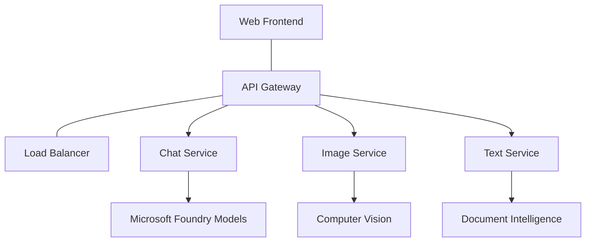

# Mga Pinakamahusay na Praktis sa Production AI Workload gamit ang AZD

**Pag-navigate sa Kabanata:**
- **📚 Tahanan ng Kurso**: [AZD For Beginners](../../README.md)
- **📖 Kasalukuyang Kabanata**: Kabanata 8 - Mga Pattern para sa Produksyon at Enterprise
- **⬅️ Nakaraang Kabanata**: [Kabanata 7: Pag-troubleshoot](../chapter-07-troubleshooting/debugging.md)
- **⬅️ Konektado rin**: [AI Workshop Lab](../chapter-02-ai-development/ai-workshop-lab.md)
- **🎯 Kumpletong Kurso**: [AZD For Beginners](../../README.md)

## Pangkalahatang-ideya

Ipinaliliwanag ng gabay na ito ang mga production AI design pattern gamit ang Azure Developer CLI (AZD). Ito ay isang sanggunian sa disenyo, hindi isang deployable na aplikasyon o sertipikasyon para sa produksyon.

**Mga halimbawa ng hangganan:** Maliban kung tahasang inilalarawan bilang kumpleto, ang mga bahagi ng Bicep ay nagpapalagay ng mga parameter at mga pinagkukunan na tinutukoy mula sa isang naglalaman na template. Hindi nila isinama ang mga host na imahe/plan, mga identidad, pagtalaga ng tungkulin, DNS, outputs, at iba pang kinakailangang integrasyon. Ang mga YAML na landas ng serbisyo at mga hook/test script ay mga ilustratibong file upang malikha sa **sariling aplikasyon mo**; hindi ito ibinibigay ng kurso na ito. Gumamit ng gumaganang AZD sample bilang basehan, pagsamahin ang kumpletong imprastruktura, at subukin ito sa isang hiwalay na kapaligiran bago magsimula sa produksyon.

## Mga Pangunahing Hamon na Tinugunan

Karaniwang mga alalahanin sa produksyon ay kinabibilangan ang multi-service deployments, pamamahala ng identidad at mga sikreto, scaling, control sa gastos, at pagsubaybay. Walang sinasabing na sukatang paglaganap dito.

## Mga Pattern ng Arkitektura para sa Production AI

### Pattern 1: Microservices AI Architecture

**Kailan gagamitin**: Kumplikadong mga AI application na may maraming kakayahan



**Implementasyon sa AZD**:

```yaml
# azure.yaml
name: enterprise-ai-platform
services:
  web:
    project: ./web
    host: staticwebapp
  api-gateway:
    project: ./api-gateway
    host: containerapp
  chat-service:
    project: ./services/chat
    host: containerapp
  vision-service:
    project: ./services/vision
    host: containerapp
  text-service:
    project: ./services/text
    host: containerapp
```

### Pattern 2: Event-Driven AI Processing

**Kailan gagamitin**: Batch processing, pagsusuri ng dokumento, mga async workflow

```bicep
// Event Hub for AI processing pipeline
resource eventHub 'Microsoft.EventHub/namespaces@2024-01-01' = {
  name: eventHubNamespaceName
  location: location
  sku: {
    name: 'Standard'
    tier: 'Standard'
    capacity: 1
  }
}

// Service Bus for reliable message processing
resource serviceBus 'Microsoft.ServiceBus/namespaces@2024-01-01' = {
  name: serviceBusNamespaceName
  location: location
  sku: {
    name: 'Premium'
    tier: 'Premium'
    capacity: 1
  }
}

// Function App for processing
resource functionApp 'Microsoft.Web/sites@2023-01-01' = {
  name: functionAppName
  location: location
  kind: 'functionapp,linux'
  properties: {
    siteConfig: {
      appSettings: [
        {
          name: 'FUNCTIONS_EXTENSION_VERSION'
          value: '~4'
        }
        {
          name: 'AZURE_OPENAI_ENDPOINT'
          value: '@Microsoft.KeyVault(VaultName=${keyVault.name};SecretName=openai-endpoint)'
        }
      ]
    }
  }
}
```

Gumagawa ito ng mga fragment ng namespace, hindi hub, queue, subscription, o Function trigger. Ang isang tumatakbong Function ay nangangailangan din ng hosting plan, runtime/storage configuration, kalakip na identidad, RBAC, at network access. Ang reference ng Key Vault ay nangangailangan ng pahintulot na basahin ang sikreto; ang isang endpoint URL mismo ay hindi kredensyal.

## Pag-iisip Tungkol sa Kalusugan ng AI Agent

Kapag nasira ang isang tradisyunal na web app, pamilyar ang mga sintomas: hindi naglo-load ang pahina, nagbabalik ng error ang API, o nabibigo ang deployment. Ang mga AI-powered na aplikasyon ay maaaring masira sa parehong mga paraan—ngunit maaari ring magpakita ng mga subtler na pag-uugali na hindi nagpapakita ng malinaw na mga error.

Tinutulungan ka ng seksyong ito na bumuo ng mental model para sa pagsubaybay ng AI workloads upang malaman mo kung saan hahanapin kapag may mali.

### Paano Naiiba ang Kalusugan ng Agent mula sa Tradisyunal na Kalusugan ng App

Ang mga tradisyunal na app ay maaari ring magkaroon ng mga subtle correctness failure. Nagdadagdag ang AI agent ng nondeterministic na kalidad ng tugon sa mga karaniwang alalahanin sa availability at correctness. Isipin ang kalusugan ng agent sa dalawang layer:

| Layer | Ano ang Bantayan | Saan Tumingin |
|-------|------------------|---------------|
| **Kalusugan ng imprastruktura** | Tumatakbo ba ang serbisyo? Na-provision ba ang mga pinagkukunan? Maaabot ba ang mga endpoint? | `azd monitor`, Azure Portal resource health, container/app logs |
| **Kalusugan ng pag-uugali** | Tumatugon ba ng tumpak ang agent? Mabilis ba ang mga tugon? Tama bang tinatawag ang modelo? | Application Insights traces, mga sukatan ng latensya sa pagtawag ng modelo, mga log sa kalidad ng tugon |

Pamilyar ang kalusugan ng imprastruktura—pareho ito sa anumang azd app. Ang kalusugan ng pag-uugali ang bagong layer na idinadagdag ng AI workloads.

### Saan Tumingin Kapag Hindi Gumagana nang Inaasahan ang AI Apps

Kung ang iyong AI application ay hindi naglalabas ng inaasahang resulta, narito ang konseptuwal na checklist:

1. **Magsimula sa mga batayan.** Tumatakbo ba ang app? Maaabot ba nito ang mga kinakailangang serbisyo? Suriin ang `azd monitor` at kalusugan ng resources tulad ng gagawin mo sa anumang app.
2. **Suriin ang koneksyon sa modelo.** Matagumpay bang tinatawag ng iyong aplikasyon ang AI model? Ang mga nabigong o na-timeout na tawag sa modelo ang pinakamadalas na sanhi ng isyu sa AI app at makikita sa iyong application logs.
3. **Mahigpit na suriin ang input at grounding.** Maaaring magresulta sa maling sagot mula sa retrieval, mga tagubilin, limitasyon sa modelo, o pagpapatupad ng tool. Gumamit ng access-controlled, na-redact na diagnostic data; huwag paganahin ang indiscriminate na prompt/response logging sa produksyon.
4. **Suriin ang response latency.** Mas mabagal ang mga pagtawag sa AI model kesa sa karaniwang API calls. Kung mabagal ang app, tingnan kung tumataas ang model response times—maaaring ito ay indikasyon ng throttling, limitasyon sa kapasidad, o congestion sa region.
5. **Bantayan ang mga senyales ng gastos.** Hindi inaasahang pagtaas sa paggamit ng token o API calls ay maaaring indikasyon ng loop, maling naka-configure na prompt, o labis na pag-ulit.

Hindi mo kailangang maging eksperto agad sa observability tooling. Ang mahalagang aral ay may dagdag na layer ng pag-uugali na kailangang bantayan ang mga AI application, at nagbibigay ang azd ng built-in monitoring (`azd monitor`) bilang panimulang punto para sa pagsisiyasat sa parehong mga layer.

---

## Mga Pinakamahusay na Praktis sa Seguridad

### 1. Zero-Trust Security Model

**Estratehiya sa Implementasyon**:
- Walang komunikasyon ng serbisyo-sa-serbisyo kung walang authentication
- Lahat ng API calls ay gumagamit ng managed identities
- Network isolation gamit ang mga private endpoint
- Access controls na may least privilege

```bicep
// Managed Identity for each service
resource chatServiceIdentity 'Microsoft.ManagedIdentity/userAssignedIdentities@2023-01-31' = {
  name: 'chat-service-identity'
  location: location
}

// Role assignments with minimal permissions
resource openAIUserRole 'Microsoft.Authorization/roleAssignments@2022-04-01' = {
  scope: openAIAccount
  name: guid(openAIAccount.id, chatServiceIdentity.id, '5e0bd9bd-7b93-4f28-af87-19fc36ad61bd')
  properties: {
    roleDefinitionId: subscriptionResourceId('Microsoft.Authorization/roleDefinitions', '5e0bd9bd-7b93-4f28-af87-19fc36ad61bd')
    principalId: chatServiceIdentity.properties.principalId
    principalType: 'ServicePrincipal'
  }
}
```

### 2. Secure Secret Management

**Pattern ng Key Vault Integration**:

```bicep
// Key Vault with proper access policies
resource keyVault 'Microsoft.KeyVault/vaults@2023-02-01' = {
  name: keyVaultName
  location: location
  properties: {
    tenantId: tenant().tenantId
    sku: {
      family: 'A'
      name: 'standard' // Premium is needed for HSM-backed keys, not ordinary secrets
    }
    enableRbacAuthorization: true  // Use RBAC instead of access policies
    enablePurgeProtection: true    // Prevent accidental deletion
    enableSoftDelete: true
    softDeleteRetentionInDays: 90
  }
}

// Optional legacy key-auth alternative; omit when using Entra ID.
resource openAIKeySecret 'Microsoft.KeyVault/vaults/secrets@2023-02-01' = {
  parent: keyVault
  name: 'openai-api-key'
  properties: {
    value: openAIAccount.listKeys().key1
    attributes: {
      enabled: true
    }
  }
}
```

Italaga ang runtime identity `Key Vault Secrets User` sa angkop na saklaw at ikabit ito sa host; ang `enableRbacAuthorization` lamang ay hindi nagbibigay ng access. Mas gusto ang OpenAI managed identity authentication gamit ang `disableLocalAuth: true`. Ang opsyonal na key secret ay may katuturan lamang para sa isang account na sadyang pinagana para sa keys, at kailangan din ng provisioning principal ng pahintulot na magsulat ng mga sikreto.

### 3. Seguridad sa Network

**Configuration ng Private Endpoint**:

```bicep
// Virtual Network for AI services
resource virtualNetwork 'Microsoft.Network/virtualNetworks@2023-04-01' = {
  name: vnetName
  location: location
  properties: {
    addressSpace: {
      addressPrefixes: ['10.0.0.0/16']
    }
    subnets: [
      {
        name: 'ai-services-subnet'
        properties: {
          addressPrefix: '10.0.1.0/24'
          privateEndpointNetworkPolicies: 'Disabled'
        }
      }
      {
        name: 'app-services-subnet'
        properties: {
          addressPrefix: '10.0.2.0/24'
          delegations: [
            {
              name: 'Microsoft.Web/serverFarms'
              properties: {
                serviceName: 'Microsoft.Web/serverFarms'
              }
            }
          ]
        }
      }
    ]
  }
}

// Private endpoints for all AI services
resource openAIPrivateEndpoint 'Microsoft.Network/privateEndpoints@2023-04-01' = {
  name: '${openAIAccountName}-pe'
  location: location
  properties: {
    subnet: {
      id: virtualNetwork.properties.subnets[0].id
    }
    privateLinkServiceConnections: [
      {
        name: 'openai-connection'
        properties: {
          privateLinkServiceId: openAIAccount.id
          groupIds: ['account']
        }
      }
    ]
  }
}
```

Nangangailangan din ang mga private endpoint ng mga grupong DNS zone/VNet links at integrasyon ng application VNet. Hindi nito awtomatikong pinipigilan ang pampublikong access: tahasang i-disable ang pampublikong network access ng AI account pagkatapos kumpirmahin ang pribadong connectivity at access sa deployment.

## Performance at Scaling

### 1. Mga Estratehiya ng Auto-Scaling

**Auto-scaling sa Container Apps**:

```bicep
resource containerApp 'Microsoft.App/containerApps@2023-05-01' = {
  name: containerAppName
  location: location
  properties: {
    configuration: {
      ingress: {
        external: true
        targetPort: 8000
        transport: 'http'
      }
    }
    template: {
      scale: {
        minReplicas: 2  // Always have 2 instances minimum
        maxReplicas: 50 // Scale up to 50 for high load
        rules: [
          {
            name: 'http-scaling'
            http: {
              metadata: {
                concurrentRequests: '20'  // Scale when >20 concurrent requests
              }
            }
          }
          {
            name: 'cpu-scaling'
            custom: {
              type: 'cpu'
              metadata: {
                type: 'Utilization'
                value: '70'  // Scale when CPU >70%
              }
            }
          }
        ]
      }
    }
  }
}
```

### 2. Mga Estratehiya sa Caching

**Redis Cache para sa AI Responses**:

```bicep
// Legacy Azure Cache for Redis example (not recommended for new deployments)
resource redisCache 'Microsoft.Cache/redis@2023-04-01' = {
  name: redisCacheName
  location: location
  properties: {
    sku: {
      name: 'Premium'
      family: 'P'
      capacity: 1
    }
    enableNonSslPort: false
    minimumTlsVersion: '1.2'
    redisConfiguration: {
      'maxmemory-policy': 'allkeys-lru'
    }
    // Sharding distributes data; replication/failover provides availability.
    shardCount: 2
  }
}

// Cache configuration in application
var cacheConnectionString = '${redisCache.properties.hostName}:6380,password=${redisCache.listKeys().primaryKey},ssl=True,abortConnect=False'
```

Ang Azure Cache para sa Redis Basic/Standard/Premium ay nasa [retirement path](https://learn.microsoft.com/azure/azure-cache-for-redis/retirement-faq). Gumamit ng Azure Managed Redis para sa mga bagong disenyo at ang dokumentadong SKU, identidad, at TLS configuration nito, sa halip na kopyahin ang legacy resource na ito sa bagong production system. Ang linya ng connection-string ay placeholder lamang at hindi kredensyal. I-partition ang mga cache key batay sa authorization, modelo/tagubilin, at bersyon ng retrieval, kasama ang expiry; ang shared na query-only cache ay maaaring maglantad ng data ng ibang user.

### 3. Load Balancing at Pamamahala ng Trapiko

**Application Gateway na may WAF**:

```bicep
// Application Gateway with Web Application Firewall
resource applicationGateway 'Microsoft.Network/applicationGateways@2023-04-01' = {
  name: appGatewayName
  location: location
  properties: {
    sku: {
      name: 'WAF_v2'
      tier: 'WAF_v2'
      capacity: 2
    }
    webApplicationFirewallConfiguration: {
      enabled: true
      firewallMode: 'Prevention'
      ruleSetType: 'OWASP'
      ruleSetVersion: '3.2'
    }
    // Backend pools for AI services
    backendAddressPools: [
      {
        name: 'ai-services-pool'
        properties: {
          backendAddresses: [
            {
              fqdn: '${containerApp.properties.configuration.ingress.fqdn}'
            }
          ]
        }
      }
    ]
  }
}
```

Ito ay isang bahagi lamang ng gateway resource: kailangan din ng tunay na deployment ng gateway subnet/IP configuration, frontend IPs at ports, TLS listeners/certificates, backend HTTP settings/probes, mga patakaran sa pag-ruruta at mga priority, at isang nasuring WAF policy. Dapat mag-tugma ang TLS hostname/SNI at authentication sa backend ng Container App.

## 💰 Pag-optimize ng Gastos

### 1. Tamang Sukat ng Resource

**Mga Configurasyon na Nakaangkop sa Kapaligiran**:

Ang mga pangalang ito ay mga **ilustratibong custom-template inputs**, hindi awtomatikong setting ng AZD. Unang i-map bawat isa sa `infra/main.parameters.json`/Bicep at host configuration. Halimbawa, ang RAG sample ay gumagamit ng `AZURE_SEARCH_SERVICE_SKU` at `AZURE_OPENAI_CHATGPT_DEPLOYMENT_CAPACITY`, hindi ang generic na mga pangalan sa ibaba. Bigyan ang Container Apps memory ng suportadong unit gaya ng `1Gi` sa aktwal na resource. Ipatupad ang mga pagbabago sa imprastruktura gamit ang `azd up` o `azd provision`; ang `azd deploy` lamang ay hindi nagpapatupad ng mga pagbabago sa Bicep.

```bash
# Development environment
azd env new development
azd env set AZURE_OPENAI_SKU "S0"
azd env set AZURE_OPENAI_CAPACITY 10
azd env set AZURE_SEARCH_SKU "basic"
azd env set CONTAINER_CPU 0.5
azd env set CONTAINER_MEMORY 1.0

# Production environment  
azd env new production
azd env set AZURE_OPENAI_SKU "S0"
azd env set AZURE_OPENAI_CAPACITY 100
azd env set AZURE_SEARCH_SKU "standard"
azd env set CONTAINER_CPU 2.0
azd env set CONTAINER_MEMORY 4.0
```

### 2. Pagsubaybay sa Gastos at Budget

```bicep
// Supply the first day of the current UTC month, e.g. 2026-11-01T00:00:00Z.
param budgetStartDate string

// Cost management and budgets
resource budget 'Microsoft.Consumption/budgets@2024-08-01' = {
  name: 'ai-workload-budget'
  properties: {
    timePeriod: {
      startDate: budgetStartDate
    }
    timeGrain: 'Monthly'
    amount: 2000  // In the billing currency, not necessarily USD
    category: 'Cost'
    notifications: {
      warning: {
        enabled: true
        operator: 'GreaterThan'
        threshold: 80
        contactEmails: [
          'finance@company.com'
          'engineering@company.com'
        ]
        contactRoles: [
          'Owner'
          'Contributor'
        ]
      }
      critical: {
        enabled: true
        operator: 'GreaterThan'
        threshold: 95
        contactEmails: [
          'cto@company.com'
        ]
      }
    }
  }
}
```

Palitan ang mga halimbawa ng tatanggap at suriin ang scope/permission. Ang mga alert sa budget ay gumagamit ng delayed billing data at hindi nagpapatupad ng spending cap.

### 3. Pag-optimize ng Paggamit ng Token

**Pamamahala sa Gastos ng OpenAI**:

Ito ay isang character-based heuristic lamang para sa UI preview, **hindi** isang validator ng modelo para sa token limit. Dapat gamitin ng production code ang tokenizer na angkop sa naka-deploy na modelo at isaalang-alang ang system instructions, tool schemas, history, at output budget. Tanggihan ang user message na sobra ang laki sa halip na tahimik na putulin ito.

```typescript
// Application-level token optimization
class TokenOptimizer {
  private readonly maxTokens = 4000;
  private readonly reserveTokens = 500;
  
  optimizePrompt(userInput: string, context: string): string {
    const availableTokens = this.maxTokens - this.reserveTokens;
    if (this.estimateTokens(userInput) + 8 >= availableTokens) {
      throw new Error("User input exceeds the illustrative prompt budget");
    }
    const estimatedTokens = this.estimateTokens(userInput + context) + 8;
    
    if (estimatedTokens > availableTokens) {
      // Truncate context, not user input
      context = this.truncateContext(context, Math.max(0, availableTokens - this.estimateTokens(userInput) - 8));
    }
    
    return `${context}\n\nUser: ${userInput}`;
  }
  
  private estimateTokens(text: string): number {
    // Rough estimation: 1 token ≈ 4 characters
    return Math.ceil(text.length / 4);
  }

  private truncateContext(text: string, estimatedBudget: number): string {
    return text.slice(0, Math.max(0, estimatedBudget) * 4);
  }
}
```

## Pagsubaybay at Observability

### 1. Komprehensibong Application Insights

```bicep
// Application Insights with advanced features
resource applicationInsights 'Microsoft.Insights/components@2020-02-02' = {
  name: applicationInsightsName
  location: location
  kind: 'web'
  properties: {
    Application_Type: 'web'
    WorkspaceResourceId: logAnalyticsWorkspace.id
    SamplingPercentage: 100  // Ingestion setting; review cost and SDK sampling separately
    DisableIpMasking: false  // Retain IP masking
  }
}

// Custom metrics for AI operations
resource aiMetricAlerts 'Microsoft.Insights/metricAlerts@2018-03-01' = {
  name: 'ai-high-error-rate'
  location: 'global'
  properties: {
    description: 'Alert when failed request count exceeds 10 in five minutes'
    severity: 2
    enabled: true
    scopes: [
      applicationInsights.id
    ]
    evaluationFrequency: 'PT1M'
    windowSize: 'PT5M'
    criteria: {
      'odata.type': 'Microsoft.Azure.Monitor.SingleResourceMultipleMetricCriteria'
      allOf: [
        {
          name: 'high-error-rate'
          metricName: 'requests/failed'
          operator: 'GreaterThan'
          threshold: 10
          timeAggregation: 'Count'
        }
      ]
    }
  }
}
```

### 2. AI-Specific na Pagsubaybay

**Custom Dashboards para sa Mga Sukatan ng AI**:

```json
{
  "dashboard": {
    "name": "AI Application Monitoring",
    "tiles": [
      {
        "name": "OpenAI Request Volume",
        "query": "dependencies | where target contains 'openai' | summarize count() by bin(timestamp, 5m)"
      },
      {
        "name": "AI Response Latency",
        "query": "dependencies | where target contains 'openai' | summarize avg(duration) by bin(timestamp, 5m)"
      },
      {
        "name": "Token Usage",
        "query": "customMetrics | where name == 'openai_tokens_used' | summarize sum(value) by bin(timestamp, 1h)"
      },
      {
        "name": "Cost per Hour",
        "query": "customMetrics | where name == 'openai_cost' | summarize sum(value) by bin(timestamp, 1h)"
      }
    ]
  }
}
```

Ang JSON na ito ay isang sketch na itinakda ng aplikasyon, hindi isang importable na Azure portal dashboard schema. Kinakailangan ng token/cost queries na maglabas ang app mo ng eksaktong custom metrics na iyon; hindi ito nilikha ng AZD. I-adapt ang dependency filters para sa aktwal na pangalan ng model endpoint/span.

### 3. Mga Health Check at Pagsubaybay sa Uptime

```bicep
// Application Insights availability tests
resource availabilityTest 'Microsoft.Insights/webtests@2022-06-15' = {
  name: 'ai-app-availability-test'
  location: location
  tags: {
    'hidden-link:${applicationInsights.id}': 'Resource'
  }
  properties: {
    SyntheticMonitorId: 'ai-app-availability-test'
    Name: 'AI Application Availability Test'
    Description: 'Tests AI application endpoints'
    Enabled: true
    Frequency: 300  // 5 minutes
    Timeout: 120    // 2 minutes
    Kind: 'standard'
    Locations: [
      {
        Id: 'us-east-2-azr'
      }
      {
        Id: 'us-west-2-azr'
      }
    ]
    Request: {
      RequestUrl: 'https://${webApp.properties.defaultHostName}/health'
      HttpVerb: 'GET'
      FollowRedirects: true
      ParseDependentRequests: false
    }
    ValidationRules: {
      ExpectedHttpStatusCode: 200
      SSLCheck: true
      SSLCertRemainingLifetimeCheck: 7
    }
  }
}
```

## Disaster Recovery at Mataas na Availability

Inilalagay ng naunang pagsubok ang pagsusuri sa umiiral na App Service `webApp` at Application Insights resource. Ang mga standard availability tests ay may bayad at nangangailangan ng maaabot na endpoint; ang mga private-only app ay nangangailangan ng angkop na disenyo para sa private monitoring. Hindi na inirerekomenda ang URL ping tests; gamitin ang [standard availability tests](https://learn.microsoft.com/azure/azure-monitor/app/availability).

### 1. Multi-Region Deployment

```yaml
# azure.yaml - Multi-region configuration
name: ai-app-multiregion
services:
  api-primary:
    project: ./api
    host: containerapp
    env:
      AZURE_REGION: eastus
  api-secondary:
    project: ./api
    host: containerapp
    env:
      AZURE_REGION: westus2
```

```bicep
// Separate App Service topology, not the Container Apps declarations above
resource trafficManager 'Microsoft.Network/trafficManagerProfiles@2022-04-01' = {
  name: trafficManagerProfileName
  location: 'global'
  properties: {
    profileStatus: 'Enabled'
    trafficRoutingMethod: 'Priority'
    dnsConfig: {
      relativeName: trafficManagerProfileName
      ttl: 30
    }
    monitorConfig: {
      protocol: 'HTTPS'
      port: 443
      path: '/health'
      intervalInSeconds: 30
      toleratedNumberOfFailures: 3
      timeoutInSeconds: 10
    }
    endpoints: [
      {
        name: 'primary-endpoint'
        type: 'Microsoft.Network/trafficManagerProfiles/azureEndpoints'
        properties: {
          targetResourceId: primaryAppService.id
          endpointStatus: 'Enabled'
          priority: 1
        }
      }
      {
        name: 'secondary-endpoint'
        type: 'Microsoft.Network/trafficManagerProfiles/azureEndpoints'
        properties: {
          targetResourceId: secondaryAppService.id
          endpointStatus: 'Enabled'
          priority: 2
        }
      }
    ]
  }
}
```

Hindi pinipili ng environment variables ang lokasyon ng resources. Dapat magprovision ng magkakaibang regional hosts ang IaC at i-bind ang bawat serbisyo gamit ang `resourceName` o `azd-service-name` tags. Ang halimbawa ng Traffic Manager ay isang **hiwalay na topolohiya ng App Service** (`primaryAppService`/`secondaryAppService`), hindi routing para sa mga deklarasyon ng Container Apps. Nangangailangan ang Container Apps ng angkop na naka-configure na external endpoint/front door, TLS/custom-domain routing, at health probes.

### 2. Backup at Recovery ng Data

```bicep
// Backup configuration for critical data
resource backupVault 'Microsoft.DataProtection/backupVaults@2023-05-01' = {
  name: backupVaultName
  location: location
  identity: {
    type: 'SystemAssigned'
  }
  properties: {
    storageSettings: [
      {
        datastoreType: 'VaultStore'
        type: 'LocallyRedundant'
      }
    ]
  }
}

```

Ang vault mismo ay hindi nagba-backup ng anumang bagay. I-configure ang **workload-specific na suportadong polisiya at backup instance**, mga permission sa source, retention, at mga test sa restore gamit ang [Azure Backup support matrices](https://learn.microsoft.com/azure/backup/backup-support-matrix). Walang generic na Azure Backup policy para sa hosted Azure OpenAI model deployments. Panatilihin ang mga kahulugan ng imprastruktura/model deployment sa source control; protektahan ang mga na-upload na dokumento, data ng aplikasyon, at fine-tuning artifacts gamit ang mga suportadong backup/export features ng bawat backing service. Tiyakin at subukan nang malinaw ang RPO/RTO.

## DevOps at CI/CD Integration

### 1. Workflow ng GitHub Actions

```yaml
# .github/workflows/deploy-ai-app.yml
name: Deploy AI Application

on:
  push:
    branches: [main]
  pull_request:
    branches: [main]

jobs:
  test:
    runs-on: ubuntu-latest
    steps:
      - uses: actions/checkout@v4
      
      - name: Setup Python
        uses: actions/setup-python@v4
        with:
          python-version: '3.11'
          
      - name: Install dependencies
        run: |
          pip install -r requirements.txt
          pip install pytest
          
      - name: Run tests
        run: pytest tests/
        
      - name: AI Safety Tests
        run: |
          python scripts/test_ai_safety.py
          python scripts/validate_prompts.py

```

Ito ang **test-only na bahagi** ng workflow at ipinapalagay na nakagawa ka na ng `requirements.txt`, `tests/`, at ang dalawang safety script. Idagdag ang authenticated OIDC provisioning/deployment jobs mula sa [CI/CD Pipeline Configuration](#cicd-pipeline-configuration), gamit ang `needs: test`, isang pinagkakatiwalaang push/manual trigger, at mga protektadong GitHub environment. Huwag mag-deploy ng hindi pinagkakatiwalaang pull-request code gamit ang cloud credentials. Walang napiling lokal na AZD environment ang bagong runner; ibigay ang environment/subscription/location inputs at gamitin ang `azd auth login`, hindi lang `azure/login`.

### 2. Pagpapatunay ng Imprastruktura

```bash
# scripts/validate_infrastructure.sh
#!/bin/bash
set -euo pipefail

echo "Validating AI infrastructure deployment..."

# Requires Azure CLI login and the resource group selected explicitly.
: "${AZURE_RESOURCE_GROUP:?Set AZURE_RESOURCE_GROUP}"
: "${AZURE_OPENAI_NAME:?Set AZURE_OPENAI_NAME}"
: "${AZURE_OPENAI_CHAT_DEPLOYMENT:?Set the actual deployment name}"

# A successful empty list is not proof that resources exist.
types=("Microsoft.CognitiveServices/accounts" "Microsoft.Search/searchServices"
       "Microsoft.Storage/storageAccounts" "Microsoft.KeyVault/vaults")
for resource_type in "${types[@]}"; do
    count=$(az resource list --resource-group "$AZURE_RESOURCE_GROUP" \
        --resource-type "$resource_type" --query "length(@)" -o tsv)
    if [[ "$count" -lt 1 ]]; then
        echo "ERROR: No $resource_type found in $AZURE_RESOURCE_GROUP"
        exit 1
    fi
done

# Validate OpenAI model deployments
echo "Validating OpenAI model deployments..."
state=$(az cognitiveservices account deployment show \
  --name "$AZURE_OPENAI_NAME" --resource-group "$AZURE_RESOURCE_GROUP" \
  --deployment-name "$AZURE_OPENAI_CHAT_DEPLOYMENT" \
  --query "properties.provisioningState" -o tsv)
if [[ "$state" != "Succeeded" ]]; then
    echo "ERROR: Required model deployment is not provisioned successfully"
    exit 1
fi

echo "Infrastructure validation completed successfully!"
```

Inaasahan: zero exit at mensahe ng pagkumpleto lamang kapag lahat ng inaasahang uri ay naroroon at naka-provision ang tinukoy na model deployment. Sinusuri nito ang estado ng imbentaryo/provisioning, **hindi** ang kalusugan ng resource, eksaktong topolohiya, RBAC, network reachability, o pag-uugali ng modelo. I-adapt ang inaasahang mga uri ayon sa iyong arkitektura, pagkatapos magsagawa ng hiwalay na authenticated na pagsubok sa kahandaan ng aplikasyon.

## Checklist sa Kahandaan para sa Produksyon

### Seguridad ✅
- [ ] Lahat ng serbisyo ay gumagamit ng managed identities
- [ ] Mga sikreto ay nakaimbak sa Key Vault
- [ ] Naka-configure ang mga private endpoint
- [ ] Nailapat ang mga network security group
- [ ] RBAC na may least privilege
- [ ] Nakabukas ang WAF sa mga public endpoint

### Performance ✅
- [ ] Nailagay ang auto-scaling
- [ ] Naipatupad ang caching
- [ ] Naka-set up ang load balancing
- [ ] CDN para sa static na nilalaman
- [ ] Pooling ng koneksyon sa database
- [ ] Pag-optimize ng paggamit ng token

### Pagsubaybay ✅
- [ ] Naka-configure ang Application Insights
- [ ] Naitakda ang custom metrics
- [ ] Naka-set up ang mga alerting rules
- [ ] Nakagawa ng dashboard
- [ ] Naipatupad ang health checks
- [ ] Patakaran sa pag-retain ng mga log

### Reliability ✅
- [ ] Multi-region na deployment
- [ ] Plano para sa backup at recovery
- [ ] Naitakda ang circuit breakers
- [ ] Naka-configure ang retry policies
- [ ] Graceful degradation
- [ ] Mga endpoint para sa health check

### Pamamahala ng Gastos ✅
- [ ] Naka-configure ang budget alerts
- [ ] Tamang sukat ng resources
- [ ] Naiaplay ang diskwento para sa dev/test
- [ ] Nakabili ng reserved instances
- [ ] Dashboard sa pagsubaybay ng gastos
- [ ] Regular na pagsusuri ng gastos

### Pagsunod ✅
- [ ] Natugunan ang mga kinakailangan sa data residency
- [ ] Naka-enable ang audit logging
- [ ] Naaaplay ang mga compliance policy
- [ ] Naitakda ang mga security baseline
- [ ] Regular na security assessment
- [ ] Plano para sa incident response

## Mga Benchmark sa Performance

### Ilustratibong Mga Target sa Produksyon

Ito ay mga halimbawa ng SLO para sa negosasyon at load-testing, hindi sukat na benchmark o garantiya. Nakadepende ang latency ng tugon sa haba ng modelo/output; ang buwanang paggastos sa token ay nakabatay sa trapiko at presyo, hindi lang sa bilang ng token.

| Sukatan | Target | Pagsubaybay |
|--------|--------|------------|
| **Oras ng Tugon** | < 2 segundo | Application Insights |
| **Availability** | 99.9% | Uptime monitoring |
| **Rate ng Error** | < 0.1% | Application logs |
| **Gastusin sa Modelo** | < $500/buwan (halimbawa ng budget) | Pamamahala ng gastos |
| **Kasalukuyang mga User** | 1000+ | Load testing |
| **Panahon ng Pagbawi** | < 1 oras | Mga pagsubok sa pagbawi mula sa sakuna |

### Pagsubok ng Load

Ang sumusunod ay isang disenyo ng interface para sa isang script ng load-test **na dapat mong ipatupad**; ang repositoryong ito ay hindi nagsisilbi ng `scripts/load_test.py`. Tukuyin ang mga payload ng kahilingan, pagpapatunay, kinatawan ng mga workload, mga pag-assert ng latency/error na porsyento, at isang limitasyon sa paggastos sa napili mong load-test tool bago ito patakbuhin:

```bash
# Load testing script for AI applications
python scripts/load_test.py \
  --endpoint https://your-ai-app.azurewebsites.net \
  --concurrent-users 100 \
  --duration 300 \
  --ramp-up 60
```

## 🤝 Pinakamahuhusay na Gawi ng Komunidad

Batay sa puna ng Microsoft Foundry Discord community:

### Nangungunang Mga Rekomendasyon mula sa Komunidad:

1. **Magsimula sa Maliit, Palakihin Nang Dahan-dahan**: Simulan sa mga pangunahing SKU at palakihin batay sa aktwal na paggamit
2. **Subaybayan Lahat**: Mag-set up ng komprehensibong pagmamanman mula sa unang araw
3. **I-automate ang Seguridad**: Gumamit ng infrastructure bilang code para sa tuloy-tuloy na seguridad
4. **Masusing Subukan**: Isama ang AI-specific na pagsubok sa iyong pipeline
5. **Magplano para sa Mga Gastos**: Subaybayan ang paggamit ng token at magtakda ng mga alerto ng badyet nang maaga

### Mga Karaniwang Pagkakamaling Iwasan:

- ❌ Hardcoding ng mga API key sa code
- ❌ Hindi pag-set up ng wastong pagmamanman
- ❌ Pagpapabaya sa pag-optimize ng gastos
- ❌ Hindi pagsubok ng mga senaryo ng pagkabigo
- ❌ Pag-deploy nang walang mga health check

## Mga Utos at Extension ng AZD AI CLI

Kasama sa AZD ang lumalaking hanay ng mga AI-specific na utos at mga extension na nagpapadali ng mga workflow ng production AI. Pinag-uugnay ng mga tool na ito ang pagitan ng lokal na pag-develop at production deployment para sa mga workload ng AI.

> **Foundry GA update (2026-11-09):** Naabot ng bundle na `microsoft.foundry` ang **1.0 / general availability** noong [Nobyembre 5, 2026](https://devblogs.microsoft.com/azure-sdk/microsoft-foundry-azure-developer-cli-ga/). Gamitin ang **`azd >= 1.37.0`** para sa workflow na ito. Ang naunang `azd 1.37.2`, agents beta.23, at evaluations beta.2 review ay nananatili sa ibaba bilang kasaysayan ng migration, hindi ang kasalukuyang bersyon ng bundle. Ito ay pagsusuri ng dokumentasyon/source, hindi isang live na pag-validate ng deployment o isang pahayag na lahat ng opsyonal na extension, API, o preview feature ay GA.

### Mga Extension ng AZD para sa AI

Gumagamit ang AZD ng sistema ng extension upang magdagdag ng mga kakayahang AI-specific. Mag-install at mag-manage ng mga extension gamit ang:

```bash
# List all available extensions (including AI)
azd extension list

# Inspect installed versions
azd version
azd ext list --installed

# Install the GA Foundry bundle
azd ext install microsoft.foundry

# Install the separate Foundry evaluations extension
azd extension install azure.ai.evaluations

# Install the fine-tuning extension
azd extension install azure.ai.finetune

# Install the custom models extension
azd extension install azure.ai.models

# Upgrade the Foundry bundle
azd ext upgrade microsoft.foundry
```

**Mga Magagamit na AI extension:**

| Extension | Layunin | Katayuan |
|-----------|---------|--------|
| `microsoft.foundry` | Meta-package na nag-i-install ng pitong pangunahing extension sa ibaba; walang sariling grupo ng utos | GA bundle 1.0 |
| `azure.ai.agents` | `azd ai agent`: pagsasaayos ng agent, lokal na pagpapatupad, at mga operasyon | Kasama; independently versioned |
| `azure.ai.connections` | `azd ai connection`: mga koneksyon ng proyekto | Kasama; independently versioned |
| `azure.ai.inspector` | `azd ai inspector`: lokal na Agent Inspector UI | Kasama; independently versioned |
| `azure.ai.projects` | `azd ai project`: mga resources ng proyekto at model deployments | Kasama; independently versioned |
| `azure.ai.routines` | `azd ai routine`: mga schedule at trigger | Kasama; independently versioned |
| `azure.ai.skills` | `azd ai skill`: reusable na mga behavioral guideline | Kasama; independently versioned |
| `azure.ai.toolboxes` | `azd ai toolbox`: versioned na mga koleksyon ng tool | Kasama; independently versioned |
| `azure.ai.evaluations` | Evaluation datasets, evaluators, eval groups, at runs | Hiwalay na pag-install/release |
| `azure.ai.dataset` | Pagpaparehistro at versioning ng dataset | Hiwalay na pag-install/release |
| `azure.ai.finetune` | Foundry model fine-tuning | Hiwalay na pag-install/release |
| `azure.ai.models` | Foundry custom models | Hiwalay na pag-install/release |

Suportado pa rin ang pag-install nang paisa-isa ng `azure.ai.agents` at ini-install nito ang mga dependencies; ang bundle ay ang default ng kurso para sa GA workflow. Ang GA bundle ay hindi pangkalahatang garantiya ng release-status para sa mga opsyonal na tampok ng mga bahagi nito. Tingnan ang [extension packaging and verification](https://learn.microsoft.com/azure/foundry/agents/how-to/install-cli-foundry-extensions) at suriin ang tulong ng mga naka-install na utos bago gamitin ang mga ito.

> I-upgrade muna ang core CLI gamit ang `azd update` o ang naaangkop na [installation/update method](https://learn.microsoft.com/azure/developer/azure-developer-cli/install-azd), pagkatapos patakbuhin ang `azd ext upgrade microsoft.foundry`. I-update ang mga hiwalay na naka-install na evaluations kung kailangan gamit ang `azd ext upgrade azure.ai.evaluations`. Walang core na utos na `azd upgrade`. Itala at repasuhin ang mga independently versioned na extension sa production automation; ang pag-upgrade ay hindi awtomatikong nagmi-migrate ng lumang configuration.

### Mga Kamakailang Pagbabago at Pag-ayos ng Release

| Release | Mga pagbabagong para sa kursong ito |
|---------|------------------------------|
| `microsoft.foundry` 1.0 GA (2026-11-05) | Default sa pitong-extension bundle, panatilihin ang agent/deployment settings sa `azure.yaml`, subukan nang lokal gamit ang Agent Inspector, at i-upload ang code para sa remote Foundry build. Mag-install ng evaluations nang hiwalay at i-install muli ang mga kinakailangang extension sa CI runners. |
| `azd 1.37.0` | Nagdaragdag ng stable deployment-preview APIs at inaayos ang extension edits na nagrerewrite ng mga hindi kaugnay na setting ng `azure.yaml`. |
| `azd 1.37.1` | Inaayos ang Ctrl+C propagation sa mga extension at binibigyang-diin ang pagkakaiba ng cancellation/timeouts mula sa generic failures. |
| `azd 1.37.2` | Pinahusay ang provisioning validation: ang mga kritikal na babala ay default na **Hindi**, pumapalya nang walang kumpirmasyon sa unattended runs, at nilalaktawan ng cancellation ang mga post-provision hook. Inaayos din ang hindi nalutas na mga halaga ng environment sa Deployment Stacks deny lists kapag naka-enable ang alpha feature na iyon. |
| Agents `beta.22` | Migrahe ang evaluation sa `azd ai eval`, binago ang optimization sa GA v1 API, nangangailangan ng plural na `toolboxes`, at hiwalay na managed-harness, voice, at long-running preview opt-in. Inaayos ang environment-specific na pagpili ng modelo at authentication ng toolbox. |
| Agents `beta.23` | Inilalantad ang `init --harness`; inaayos ang A2A 0.3 answer output, invalid na prompt-agent paths/modules sa across infrastructure layers, diagnostic ng activation-timeout, at mga retained developer RBAC warnings. |
| Evaluations `beta.2` | Nangangailangan ng camelCase evaluation configuration, nagdaragdag ng static/simulated na authoring ng pag-uusap at mga explicit na lokal na source ng file, at inaayos ang dataset identity/version handling, quality-gate counts, at failed-run diagnostics. |

Ang timeout ng activation ng agent ay **hindi** patunay ng pagkabigo ng deployment: siyasatin ang sinubukang bersyon at ang estado nito bago subukang muli. Maaaring manatili ang mga developer RBAC warnings kahit na matagumpay ang provisioning; ayusin ang nawawalang access bago gamitin bilang developer na iyon.

Ang mga beta na hilera sa itaas ay naglalarawan ng mga naunang pag-aayos at mga hangganan ng migration, hindi isang requirement na i-pin ang mga bagong proyekto sa mga bersyong iyon.

Mga Pinagmulan: [Foundry GA announcement](https://devblogs.microsoft.com/azure-sdk/microsoft-foundry-azure-developer-cli-ga/), [AZD releases](https://github.com/Azure/azure-dev/releases), [agents beta.23 release](https://github.com/Azure/azure-dev/releases/tag/azd-ext-azure-ai-agents_1.0.0-beta.23), [agents beta.22 migration](https://github.com/Azure/azure-dev/releases/tag/azd-ext-azure-ai-agents_1.0.0-beta.22), at [evaluations beta.2 release](https://github.com/Azure/azure-dev/releases/tag/azd-ext-azure-ai-evaluations_1.0.0-beta.2).

**Ano ang mga bundled na `skills` at `connections` na mga extension?**

Ito ay naka-install kasama ng core bundle ngunit nagsisilbi ng iba't ibang layunin:

- **`azure.ai.skills`** — Isang **skill** na nag-i-package ng mga reusable na behavioral guideline para sa mga agent. Ibahagi ang mga narepasong instruksyon sa mga agent sa halip na kopyahin ang mga ito. Ang skill ay hindi mismo nag-iimplementa ng isang tool o nagbibigay ng access sa data; gamitin ang mga toolbox at application code para sa pagpapatupad ng tool.
- **`azure.ai.connections`** — Ang isang **connection** ay isang pinamamahalaang link mula sa iyong proyekto sa Foundry patungo sa isang panlabas na pinagkukunan na kailangan ng iyong mga ahente—isang data source (tulad ng Azure AI Search), isang tool endpoint, o iba pang serbisyo. Pinagsasama ng mga koneksyon kung *saan* at *paano* nakakakuha ng data ang mga ahente, kaya ang mga kredensyal at mga endpoint ay naninirahan sa isang pinamamahalaang lugar sa halip na nagkalat sa loob ng code.

Hindi mo kailangang i-configure ang bawat kasama na kakayahan upang mai-deploy ang iyong unang ahente. Gumamit ng mga kakayahan kapag ang mga ahente ay nagbabahagi ng mga panuntunan sa pag-uugali at mga koneksyon kapag nagbabahagi sila ng mga panlabas na pinagmumulan.

### Pagsisimula ng Mga Proyekto ng Ahente gamit ang `azd ai agent init`

Ang utos na `azd ai agent init` ay nagtatayo ng isang Microsoft Foundry agent project. Para sa isang halimbawa ng runnable code-deployment gamit ang Python 3.13+ at kasalukuyang uv, sundan ang [GA hosted-agent walkthrough](../chapter-02-ai-development/microsoft-foundry-integration.md#hosted-agent-walkthrough-ga). Ang mga utos sa ibaba ay nagpapakita naman ng pag-aampon ng **sariling** kasalukuyang `azure.yaml` project template; ang pangalan ng lokal na template ay hindi kasama ng kurso na ito:

```bash
# Initialize a new agent project from a local project template
azd ai agent init --template ./templates/support-agent/azure.yaml

# Initialize and target a specific Foundry project
azd ai agent init --template ./templates/support-agent/azure.yaml --project-id <foundry-project-id>

# Adopt the template into a different directory
azd ai agent init --template ./templates/support-agent/azure.yaml --src ./agents/my-agent
```

**Mga Pangunahing flag:**

| Flag | Paglalarawan |
|------|-------------|
| `-t, --template` | Path o suportadong GitHub URI ng isang `azure.yaml` na dokumento ng proyekto |
| `-p, --project-id` | Umiiral na Microsoft Foundry Project ID para sa iyong azd environment |
| `-s, --src` | Pinanggalingang direktoryo para sa mga nabuo na ahente, o target na direktoryo kapag inaampon ang isang proyekto |
| `--deploy-mode code` | I-upload ang pinagmulan para sa isang remote Foundry build sa halip na magtayo ng lokal na container |
| `--model-deployment` | Gamitin muli ang pangalan ng umiiral na model deployment sa panahon ng pagsisimula |
| `--kind` | Simulan ang isang `hosted`, `prompt`, o preview `prompt-voice` na ahente |
| `--harness` | Opsyonal na execution harness para sa `--kind prompt`; kailangan ang preview opt-in nito |
| `-e, --environment` | Ang azd environment na gagamitin |

Ang `--manifest`/`-m` ay isang deprecated na alias para sa `--template`/`-t`; ang pagpapalit ng pangalan ng flag ay hindi nagko-convert ng lumang manifest sa isang kasalukuyang dokumento ng proyekto. Ang `--host containerapp` ay hindi isang kasalukuyang agent-init na flag. Para sa isang ordinaryong Container Apps na aplikasyon, gamitin ang `azd init --template` na may isang template na naghahayag ng `host: containerapp`.

Para sa isang umiiral na proyekto na may eksaktong isang `azure.ai.project` na serbisyo, idinadagdag o ina-update ng `azd ai agent add support-agent --file ./agents/support-agent.yaml` ang isang direktang kahulugan ng ahente nang hindi nagpo-provision o nagdedepoly. Tinanggihan ng mga runtime na utos ang mga legacy implicit na `agent.yaml`/AgentManifest at mga nested na serbisyo ng `config:`; ilipat ang mga ito sa kasalukuyang serbisyo ng `azure.ai.agent`. Kapag nag-print ang init ng isang `cd` na susunod na hakbang, isagawa ito bago ang `azd up`: hindi binabago ng init ang iyong shell directory.

**Tip sa produksyon**: Gamitin ang `--project-id` upang kumonekta nang direkta sa isang umiiral na proyekto sa Foundry, kung saan nananatiling magkakaugnay ang iyong agent code at mga cloud resource mula sa simula.

#### Opsyonal na Tampok sa Preview

Ang pinamamahalaang harness, boses, at matagal na pagpapatupad ay naka-disable nang nakapag-iisa bilang default. Itakda lamang ang switch para sa tampok na kailangan mo sa **shell/CI process environment**, hindi sa pamamagitan ng `azd env set`:

| Tampok | Variable sa process environment |
|---------|------------------------------|
| Pinamamahalaang harness (`init --kind prompt --harness ...`) | `AZD_ALPHA_ENABLE_AGENTS_MANAGED_HARNESS=true` |
| Boses (`init --kind prompt-voice`) | `AZD_ALPHA_ENABLE_AGENTS_VOICE=true` |
| Matagal na pagpapatupad | `AZD_ALPHA_ENABLE_AGENTS_LONG_RUNNING=true` |

Halimbawa, gamitin ang `export AZD_ALPHA_ENABLE_AGENTS_MANAGED_HARNESS=true` sa Bash o `$env:AZD_ALPHA_ENABLE_AGENTS_MANAGED_HARNESS = "true"` sa PowerShell bago patakbuhin ang kaukulang utos. Ang isang switch ay hindi nagpapagana ng iba pang mga switch. Tingnan ang [released agents README](https://github.com/Azure/azure-dev/blob/azd-ext-azure-ai-agents_1.0.0-beta.23/cli/azd/extensions/azure.ai.agents/README.md) para sa lahat ng preview switches at mga limitasyon.

### Pamamahala sa Biyolohiya ng Ahente

Sinusuportahan ng bundle's `azure.ai.agents` extension ang lokal na pagsusuri at mga operasyon ng deployed agent. I-install nang hiwalay ang `azure.ai.evaluations` para sukatin ang kalidad:

```bash
# Start the local agent and Agent Inspector (leave running)
azd ai agent run

# From a second terminal in the project directory
azd ai agent invoke --local "Explain how this agent is deployed."

# Invoke a deployed agent and view server response timing
# (total latency and time to first byte)
azd ai agent invoke

# Show the live endpoint configuration before changing it
azd ai agent endpoint show

# Download the deployed source of a code-based hosted agent
# (with SHA-256 verification)
azd ai agent code download

# Delete a hosted agent and all of its versions
# (--force terminates active sessions)
azd ai agent delete --force
```

**Buod ng lifecycle:**

| Yugto | Utos | Paggamit sa produksyon |
|-------|---------|----------------|
| Lokal na pagsubok | `azd ai agent run`, pagkatapos `azd ai agent invoke --local "Test prompt"` | Suriin ang mga kahilingan at tugon bago ang deployment; ang mga tawag sa Azure model ay naniningil pa rin |
| Deploy | `azd deploy` | Sa code mode, itayo ang na-upload na pinagmulan nang remote sa Foundry |
| Subukan | `azd ai agent invoke` | Patunayan ang mga tugon at sukatin ang latency bago ang paglabas |
| Diagnosen | `azd ai agent doctor`, `azd ai agent monitor --follow` | Suriin ang setup/permissions at stream ng mga log ng ahente |
| Suriin | `azd ai agent endpoint show` | Suriin ang endpoint auth/config; makita agad ang mga breaking changes |
| Sukatin | `azd ai eval init`, `generate`, `run start` | Tukuyin, ideploy, at isagawa ang mga paulit-ulit na pagsusuri |
| Pagbutihin | `azd ai agent optimize --eval <evaluation-name> --optimize-model <optimizer-deployment>` | Gamitin muli ang isang compatible na pagsusuri upang i-optimize ang ahente |
| Ibalik | `azd ai agent code download` | Kunin ang eksaktong deployed source para sa audit/rollback |
| Retire | `azd ai agent delete --force` | Malinis na alisin ang isang ahente at ang mga bersyon nito |

> Patakbuhin ang `azd ai agent --help` upang suriin ang mga utos sa iyong naka-install na bersyon. Ang bundle ay GA; ang mga independently gated preview features ay kailangang opt-in pa rin. Bago ang paglilinis, pag-ibahin ang pagtanggal ng ahente mula sa pagtanggal ng proyekto: ang `azd down` ay nagtatanggal ng resource group ng isang bagong nilikhang proyekto, ngunit iniiwan ang mga resource ng reusable-proyekto. Sundin ang [cleanup guidance](../chapter-02-ai-development/microsoft-foundry-integration.md#7-clean-up-deliberately).

Sinusuportahan ng `endpoint show` ang mga hosted, prompt, at voice agent, ngunit ang mga pag-update sa endpoint ay para lamang sa hosted; hindi suportado ang mga workflow agent. Ang pag-download ng code at ang hosted-agent retirement example sa itaas ay hindi pangkalahatang mga operasyon para sa bawat uri ng ahente.

#### Paglipat ng Evaluation at Mga Pagsusuri sa Kalidad

Simula sa mga ahente **1.0.0-beta.22 (2026-10-23)**, nagbibigay ang mga lumang `azd ai agent eval` na utos ng gabay sa paglipat sa halip na ang dating workflow ng pagsusuri. Huwag kopyahin ang mga lumang halimbawa ng `eval generate --dataset ...`: ngayon ay nasa ilalim na ng **`azd ai eval`** ang pagsusuri.

Sa isang na-initialize na proyekto ng ahente, mag-authenticate gamit ang `azd auth login`, kumpirmahin ang napiling environment/Foundry proyekto, at i-install ang `azure.ai.evaluations`. Kinakailangan ang deployment ng judge model para sa model-based scoring; ang generation at conversation simulation ay maaaring mangailangan ng kanilang sariling mga pagpili ng modelo at magdulot ng karagdagang bayad.

```bash
# Generate a draft rubric and dataset from the deployed agent
azd ai eval generate

# After reviewing the assets, configure a named evaluation
azd ai eval init --name quality

# Review generated files, then register datasets, evaluators, and eval groups
azd up

# Start an evaluation and wait for its results
azd ai eval run start --eval quality --wait

# Inspect runs and available test-case output
azd ai eval run list
azd ai eval run show <run-id>
azd ai eval run output list <run-id>
```

Para sa halimbawa ng anunsyo ng GA, piliin ang **Dataset and evaluator** at **Turn** sa panahon ng generation, pagkatapos piliin ang mga na-review na assets at isang judge model sa panahon ng initialization. Sundin ang mga naka-print na susunod na hakbang sa halip na ipalagay na rehistrado na ang mga generated asset. Maaari ka ring mag-initialize laban sa umiiral na na-review na dataset/rubric nang hindi gumagawa ng bagong data. Karaniwang nakatira ang evaluation configuration sa `evals/azure.eval.yaml`, na tinutukoy ng `azure.ai.eval` na serbisyo sa `azure.yaml`. Ang mga susi ay **camelCase** (`evaluationLevel`, `maxSamples`, `initializationParameters`, `dataMapping`); tinatanggihan ang mga lumang snake_case na mga susi ng configuration. Ang mga path sa loob ng isang tinukoy na configuration ay tumutukoy nang relative sa file na iyon, hindi sa ugat ng repository.

Para sa mga conversation evaluations, piliin ang **static** upang i-score ang mga natapos na transcript nang hindi tumatawag ng ahente, o **simulation** upang bumuo ng mga pag-uusap mula sa mga scenario seed. Nangangailangan ang simulation ng agent target, simulator model, at hiwalay na pagpili ng judge-model. Para sa unattended na mga command, ibigay ang mga input na nakalista sa `azd ai eval init --help` at `azd ai eval generate --help`; huwag ipalagay na ang generation model ay siya ring judge o simulator.

Para sa CI, mag-configure ng isang tahasang quality policy gamit ang `azd ai eval run start --help` (`--fail-on`) at ituring ang hindi zero na host exit bilang pagkabigo. Ang isang natapos na pagtakbo ay hindi awtomatikong isang quality pass. Suriin ang mga nabigong/nag-error na mga hilera at mga diagnostic; ang nawawala o hindi magkatugmang bilang ng resulta ay hindi ebidensya ng tagumpay. Pinananatili ng mga rehistradong dataset ang kanilang pagkakakilanlan/pagbabantay ng serbisyo; hindi maaaring suriin ng `--max-samples` ang isang rehistradong dataset. Maglathala ng mas maliit na dataset nang sinasadya, o gumamit ng suportadong lokal na pinagmumulan ng file.

```bash
# Example CI policy: at least 90% of all test cases must pass
azd ai eval run start --eval quality --wait --no-prompt --fail-on "pass-rate=0.9"
```

Ginagamit ng pass-rate gate ang mga pumasa na test case na hinati sa kabuuang test cases; ang mga nabigo, nag-error, nilaktawan, at iba pang hindi pumasa na hilera ay binibilang laban dito. Huwag pagsamahin ang isang gate sa `--no-wait`, na umaalis bago magagamit ang hatol.

#### Paglilipat ng Optimization Configuration

Ngayon ay gumagamit ang Optimization ng GA v1 API. Upang muling gamitin ang tugmang **turn-level, dataset-backed** evaluation mula sa bagong workflow:

```bash
# Replace placeholders with the evaluation name and optimizer model deployment
azd ai agent optimize --eval-config ./evals/azure.eval.yaml --eval <evaluation-name> --optimize-model <optimizer-deployment>
```

Pinipili ng `--eval` ang evaluation; pinipili naman ng `--eval-config` ang configuration file nito (kabilang ang mga file-backed na depinisyon). Sa halip, tumatanggap ang `--config` ng isang **standalone optimization API request** sa YAML o JSON. Huwag ipasa ang lumang agent `eval.yaml` o ang bagong `azure.eval.yaml` sa `--config`, at huwag pagsamahin ang `--config` sa `--eval`/`--eval-config`. Hindi maaaring palitan ang conversation, trace-backed, o simulation evaluations ng dataset-backed optimization shortcut; gamitin ang suportadong optimization request format para sa mga scenario na iyon. Suriin muna ang mga kandidato bago sila ilapat o ideploy.

Tingnan ang [evaluations reference para sa na-review na pagpapatakbo](https://github.com/Azure/azure-dev/blob/azd-ext-azure-ai-evaluations_1.0.0-beta.2/cli/azd/extensions/azure.ai.evaluations/README.md) at [optimization command source para sa na-review na pagpapatakbo](https://github.com/Azure/azure-dev/blob/azd-ext-azure-ai-agents_1.0.0-beta.23/cli/azd/extensions/azure.ai.agents/internal/cmd/optimize.go) para sa eksaktong mga opsyon.

#### Preview ng Read-Only Hosted-Agent Deployment

Para sa umiiral na Foundry-bound na environment na may pinag-isang `azure.ai.agent` na serbisyo ng `kind: hosted`, ikumpara ang suportadong configuration bago mag-deploy:

```bash
azd deploy <service-name> --preview --no-prompt
```

Ang preview na ito ay hindi nagde-deploy ng ahente. Hindi ito isang kumpletong infrastructure/security diff: ang mga prompt/voice/workflow agents, legacy configuration layouts, at ilang hosted settings ay wala sa saklaw nito. Ang resulta ng `unknown` ay hindi pahintulot para mag-deploy. Walang standalone na `azd ai agent deploy` o command ng ahente na `--dry-run`; gamitin ang core deployment workflow.

### Model Context Protocol (MCP) gamit ang `azd mcp`

Kasama sa AZD ang built-in MCP server support (Alpha), nagpapahintulot sa mga AI agent at tool na makipag-ugnayan sa iyong mga Azure resources sa pamamagitan ng isang standardized na protocol:

```bash
# Start the MCP server for your project
azd mcp start

# Review current Copilot consent rules for tool execution
azd copilot consent list
```

Ipinapakita ng MCP server ang iyong azd project context—mga environment, serbisyo, at mga Azure resource—sa mga AI-powered na development tool. Ito ay nagpapahintulot sa:

- **AI-assisted deployment**: Hayaan ang mga coding agent na mag-query sa estado ng proyekto mo at mag-trigger ng deployments
- **Resource discovery**: Maaaring tuklasin ng mga AI tool kung ano ang mga Azure resource na ginagamit ng iyong proyekto
- **Environment management**: Maaaring lumipat ang mga agent sa pagitan ng dev/staging/production environments

### Infrastructure Generation gamit ang `azd infra generate`

Para sa mga production AI workload, maaari kang gumawa at mag-customize ng Infrastructure as Code sa halip na umasa sa awtomatikong provisioning:

```bash
# Generate supported infrastructure for this project type
azd infra generate
```

Depende ang suporta sa proyekto/host at naka-install na mga provider; hindi ito isang pangkalahatang reverse-engineering command para sa mga arbitrary Azure resource o isang pangako na gagawa ng parehong Bicep at Terraform. Patakbuhin ang `azd infra generate --help` at suriin ang generated na format. Sa kung saan suportado, ang pagsulat ng IaC sa disk ay nagpapahintulot sa iyo na:
- Suriin at i-audit ang infrastructure bago mag-deploy
- Magdagdag ng custom security policy (mga patakaran sa network, mga private endpoint)
- Isama sa umiiral na mga proseso ng pag-review ng IaC
- I-version control ang mga pagbabago sa infrastructure nang hiwalay mula sa application code

### Production Lifecycle Hooks

Pinapayagan ka ng AZD hooks na mag-inject ng custom logic sa bawat yugto ng deployment lifecycle—kritikal para sa mga production AI workflow:

```yaml
# azure.yaml - Production hooks example
name: ai-production-app
hooks:
  preprovision:
    shell: sh
    run: scripts/validate-quotas.sh    # Check AI model quota before provisioning
  postprovision:
    shell: sh
    run: scripts/verify-networking.sh  # Verify IaC-provisioned private connectivity
  predeploy:
    shell: sh
    run: scripts/run-ai-safety-tests.sh  # Run prompt safety checks
  postdeploy:
    shell: sh
    run: scripts/smoke-test.sh           # Verify agent responses post-deploy
services:
  agent-api:
    project: ./src/agent
    host: containerapp
    hooks:
      predeploy:
        shell: sh
        run: scripts/validate-model-access.sh  # Per-service hook
```

```bash
# Run a specific hook manually during development
azd hooks run predeploy
```

**Inirerekomendang production hook para sa AI workload:**

| Hook | Gamitin |
|------|----------|
| `preprovision` | Suriin ang subscription quotas para sa kapasidad ng AI model |
| `postprovision` | Patunayan ang private connectivity at kinakailangang outputs ng resource |
| `predeploy` | Patakbuhin ang AI safety tests, suriin ang mga prompt template |
| `postdeploy` | Magsagawa ng smoke test sa mga sagot ng ahente, patunayan ang koneksyon ng modelo |

### CI/CD Pipeline Configuration

Unang patunayan ang proyekto nang lokal at kumpletuhin ang isang matagumpay na `azd up`. Pagkatapos gamitin ang `azd pipeline config` upang ikonekta ito sa GitHub Actions o Azure Pipelines na may secure na Azure authentication:

```bash
# Configure CI/CD pipeline (interactive)
azd pipeline config

# Configure with a specific provider
azd pipeline config --provider github
```

Ang command na ito:
- Gumagawa o nagkokonfigura ng pagkakakilanlan ng pipeline; suriin ang na-generate na role scope/permissions kaysa ipalagay ang pinakamababang pribilehiyo
- Nagkokonfigura ng federated credentials (walang naka-store na lihim)
- Nag-generate o nag-a-update ng iyong pipeline definition file
- Nagseset ng mga kinakailangang environment variable sa iyong CI/CD system

#### Hakbang-hakbang: ang iyong unang GitHub Actions pipeline

Narito ang buong walkthrough mula sa isang gumaganang azd proyekto hanggang sa automated deployments sa bawat push.

**1. Siguraduhin na ang iyong proyekto ay nasa GitHub**

```bash
git init
git add .
git commit -m "Initial azd project"
gh repo create my-ai-app --private --source=. --push
```

**2. Patakbuhin ang pipeline config**

```bash
azd pipeline config --provider github
```

Interaktibong gagawin ng azd:
- Tatanungin kung aling Azure subscription at environment ang target
- Gumawa ng Entra **app registration + service principal** para sa pipeline
- Nagseset up ng **federated credentials (OIDC)**—kaya nag-aauthenticate ang GitHub sa Azure gamit ang mga short-lived token at **walang lihim na iniimbak**
- Itinutulak ang kinakailangang **mga variable** sa iyong GitHub repo (`AZURE_CLIENT_ID`, `AZURE_TENANT_ID`, `AZURE_SUBSCRIPTION_ID`, `AZURE_ENV_NAME`, `AZURE_LOCATION`)

**3. Unawain ang generated workflow**

Para sa isang suportadong template, i-configure/suriin ang `.github/workflows/azure-dev.yml`. Pinapanatili ng sumusunod na halimbawa ng Foundry ang checkout, OIDC sign-in, at mga target environment setting at ini-install ang GA bundle pati na rin ang evaluations sa runner. Idagdag ang toolchain at mga kinakailangang infrastructure-provider ng iyong app; para sa Terraform, panatilihin ang na-generate nitong setup, remote-state, at mga authentication na hakbang. Pumili at i-pin ang na-review na bersyon ng AZD na nasa o lampas sa 1.37.0; ang excerpt na ito ay gumagamit ng minimum mula sa anunsyo.

```yaml
# .github/workflows/azure-dev.yml
on:
  push:
    branches: [ main ]
  workflow_dispatch:        # lets you run it manually too

permissions:
  id-token: write           # required for OIDC federated login
  contents: read

concurrency:
  group: foundry-production-deployment
  cancel-in-progress: false

jobs:
  build:
    runs-on: ubuntu-latest
    env:
      AZURE_CLIENT_ID: ${{ vars.AZURE_CLIENT_ID }}
      AZURE_TENANT_ID: ${{ vars.AZURE_TENANT_ID }}
      AZURE_SUBSCRIPTION_ID: ${{ vars.AZURE_SUBSCRIPTION_ID }}
      AZURE_ENV_NAME: ${{ vars.AZURE_ENV_NAME }}
      AZURE_LOCATION: ${{ vars.AZURE_LOCATION }}
    steps:
      - uses: actions/checkout@v4
      - name: Install azd
        uses: Azure/setup-azd@v2
        with:
          version: 1.37.0
      - name: Install Foundry extensions
        run: azd ext install microsoft.foundry azure.ai.evaluations
      - name: Log in with OIDC
        run: azd auth login --client-id "$AZURE_CLIENT_ID" --federated-credential-provider "github" --tenant-id "$AZURE_TENANT_ID"
      - name: Provision infrastructure
        run: azd provision --no-prompt
      - name: Deploy application
        run: azd deploy --no-prompt
      - name: Evaluate deployed agent
        run: azd ai eval run start --eval quality --wait --no-prompt --fail-on "pass-rate=0.9"
```

Kinakailangan ng hakbang ng evaluation ang isang na-commit na `evals/azure.eval.yaml`, ang reference ng serbisyo nito sa `azure.yaml`, mga na-review na hindi lihim na test asset, at access ng pipeline sa mga tinutukoy na dataset, evaluator, at model deployment. I-configure ang `quality` evaluation bago paganahin ang hakbang na ito; huwag isama ang parehong hakbang at installation ng evaluations kung hindi ito ginagamit ng iyong proyekto. Ang isang natapos na pagtakbo lamang ay hindi isang quality gate: ang halimbawa na ito ay nangangailangan ng hindi bababa sa 90% ng lahat ng kaso na pumasa.

Gumamit ng hiwalay na AZD environment at angkop na pag-apruba para sa bawat yugto. Ina-serialize lamang ng concurrency group ang workflow na ito, hindi ang iba pang mga tool o repository na nag-a-update ng parehong ahente. Bigyan ng kinakailangang resource at Foundry na mga pahintulot ang pagkakakilanlan ng pipeline at itago ang anumang kinakailangang runtime credentials sa mga sekretong hindi naka-commit na configuration. Tingnan ang [kumpletong Foundry CI/CD guide](https://learn.microsoft.com/azure/foundry/agents/how-to/set-up-ci-cd-cli) para sa mga partikular na pangangailangan ng provider.

**4. Patunayan na ito ay gumagana**

```bash
# Push a change to trigger the pipeline
git commit -am "Trigger pipeline" --allow-empty
git push
```

Buksan ang **Actions** tab sa iyong GitHub repo at panoorin ang workflow na tumakbo nang awtomatiko sa `azd provision` at `azd deploy`.

> **Bakit mahalaga ang federated credentials:** ang mga lumang pipeline ay nag-iimbak ng client secret sa GitHub. Tinatanggal ng OIDC federated credentials ang lihim na iyon nang buo—humihiling ang GitHub ng short-lived token sa runtime, na mas ligtas at walang kailangang i-rotate o mag-leak. Ito ang default na isinusulong ng `azd pipeline config`.

> **Mga sikreto laban sa mga variable:** ang mga hindi sensitibong identifier (`AZURE_CLIENT_ID`, atbp.) ay napupunta sa repo **variables**. Kung tunay na kailangan ng iyong app ang isang lihim sa build time, idagdag ito bilang isang GitHub **secret** at tukuyin gamit ang `${{ secrets.NAME }}`—ngunit mas mainam ang Key Vault + managed identity sa runtime (tingnan ang [Kabanata 3](../chapter-03-configuration/authsecurity.md)).

**Production workflow gamit ang pipeline config:**

```bash
# 1. Set up production environment
azd env new production
azd env set AZURE_OPENAI_CAPACITY 100

# 2. Configure the pipeline
azd pipeline config --provider github

# 3. Review the generated trigger, provisioning/deployment steps, and approvals
```

#### Hakbang-hakbang: Azure DevOps Pipelines

Mas gusto mo ba ang Azure DevOps kaysa GitHub Actions? Sinusuportahan ito ng azd nang native gamit ang `azdo` provider. Halos magkapareho ang daloy—ang azd ang bumubuo ng pipeline file, lumilikha ng service connection, at nag-aayos ng authentication.

**1. Siguraduhin na mayroon kang Azure DevOps proyekto**

Kailangan mo ng isang organisasyon at isang proyekto sa `https://dev.azure.com/<your-org>`. Gumawa ng Personal Access Token (PAT) na may mga scope na **Build (Read & execute)**, **Code (Read & write)**, at **Service Connections (Read, query & manage)**—tatanungin ka ng azd para dito.

**2. I-configure ang pipeline**

```bash
azd pipeline config --provider azdo
```

Gagawin ng azd:
- Tatanungin ang iyong Azure DevOps organization at proyekto
- Gumawa (o muling gagamit) ng **service connection** sa Azure gamit ang service principal
- I-configure ang **workload identity federation (OIDC)** kaya walang naka-store na client secret
- I-configure ang pipeline definition (karaniwang `.azdo/pipelines/azure-dev.yml`) mula sa pipeline template ng proyekto

**3. Suriin ang generated pipeline**

Gamitin ang generated pipeline ng proyekto, kasama ang mga **Azure service connection at AZD authentication steps** nito. Ipinapakita ng opisyal na [Azure Pipelines setup guide](https://learn.microsoft.com/azure/developer/azure-developer-cli/pipeline-azure-pipelines) ang installer fragment sa ibaba; ito ay para sa **installation lamang**, hindi para sa isang runnable authenticated deployment workflow:

```yaml
# .azdo/pipelines/azure-dev.yml (installer fragment only)
trigger:
  - main

pool:
  vmImage: ubuntu-latest

steps:
  - task: setup-azd@0
    displayName: Install azd
```

I-install ang AZD Azure DevOps extension kung hindi available ang task na iyon sa iyong organisasyon. Para sa mga Foundry job, tiyakin ang AZD 1.37.0+ at i-install ang `microsoft.foundry` sa runner, pati na rin ang `azure.ai.evaluations` kapag kinakailangan ang evaluations. Huwag kopyahin ang mga bare `azd provision`/`azd deploy` shell steps nang walang authentication: ang pagkakaroon ng service connection na naka-configure ay hindi awtomatikong nagla-login sa AZD ng bawat proseso. Sundin ang OIDC login at authorized task context mula sa generated template, at ibigay ang napiling environment/subscription/location.

**4. Saan nagmumula ang mga variable**

Iniimbak ng azd ang mga halaga ng environment (`AZURE_ENV_NAME`, `AZURE_LOCATION`, `AZURE_SUBSCRIPTION_ID`) bilang isang **variable group** sa Azure DevOps para mabasa ito ng pipeline. Maaari mo itong tingnan at i-edit sa ilalim ng **Pipelines → Library**.

> **Parehong benepisyo ng OIDC gaya ng GitHub:** ang `azdo` provider ay nagko-configure rin ng workload identity federation bilang default, kaya walang client secret na iniimbak sa service connection—nagsasagawa ang Azure DevOps ng palitan ng short-lived token sa runtime. Ipatuloy lamang ang `--auth-type client-credentials` kung hindi pa magagamit ng iyong organisasyon ang OIDC.

**5. Patakbuhin ito**

```bash
git commit -am "Add Azure DevOps pipeline" --allow-empty
git push
```

Buksan ang **Pipelines** sa Azure DevOps upang panoorin ang `azd provision` at `azd deploy` na tumatakbo.

### Pagdaragdag ng mga Komponent gamit ang `azd add`

Paunti-unting idagdag ang mga Azure serbisyo sa umiiral na proyekto:

```bash
# Add a new service component interactively
azd add
```

Ito ay lalong kapaki-pakinabang para sa pagpapalawak ng mga production AI application—halimbawa, pagdaragdag ng vector search service, bagong endpoint ng ahente, o monitoring component sa umiiral na deployment.

## Karagdagang Mapagkukunan

- **Azure Well-Architected Framework**: [AI workload guidance](https://learn.microsoft.com/azure/well-architected/ai/)
- **Microsoft Foundry Documentation**: [Opisyal na dokumentasyon](https://learn.microsoft.com/azure/ai-studio/)
- **Community Templates**: [Azure Samples](https://github.com/Azure-Samples)
- **Discord Community**: [#Azure channel](https://discord.gg/microsoft-azure)
- **Agent Skills para sa Azure**: [microsoft/github-copilot-for-azure sa skills.sh](https://skills.sh/microsoft/github-copilot-for-azure) - Mga reusable na kakayahan ng ahente para sa Azure AI, Foundry, deployment, cost optimization, at diagnostics. I-install sa iyong editor:
  ```bash
  npx skills add microsoft/github-copilot-for-azure
  ```

---

**Pag-navigate sa Kabanata:**
- **📚 Home ng Kurso**: [AZD Para sa Mga Nagsisimula](../../README.md)
- **📖 Kasalukuyang Kabanata**: Kabanata 8 - Production at Enterprise Patterns
- **⬅️ Nakaraang Kabanata**: [Kabanata 7: Pag-aayos ng Problema](../chapter-07-troubleshooting/debugging.md)
- **⬅️ Kaugnay Din**: [AI Workshop Lab](../chapter-02-ai-development/ai-workshop-lab.md)
- **🎯 Kumpletong Kurso**: [AZD Para sa Mga Nagsisimula](../../README.md)

**Tandaan**: Ang mga production AI workload ay nangangailangan ng maingat na pagpaplano, pagmamanman, at tuloy-tuloy na pagpapaayos. Magsimula gamit ang mga pattern na ito at iangkop ang mga ito sa iyong mga partikular na pangangailangan.

---

<!-- CO-OP TRANSLATOR DISCLAIMER START -->
**Pagtatanggi**:
Ang dokumentong ito ay isinalin gamit ang serbisyo ng AI translation na [Co-op Translator](https://github.com/Azure/co-op-translator). Bagama't nagsusumikap kami para sa katumpakan, pakatandaan na ang awtomatikong pagsasalin ay maaaring maglaman ng mga pagkakamali o hindi pagkakatugma. Ang orihinal na dokumento sa orihinal nitong wika ang dapat ituring na pangunahing sanggunian. Para sa mahahalagang impormasyon, inirerekomenda ang propesyonal na pagsasalin ng tao. Hindi kami mananagot sa anumang maling pagkakaintindi o maling interpretasyon na nagmula sa paggamit ng pagsasaling ito.
<!-- CO-OP TRANSLATOR DISCLAIMER END -->