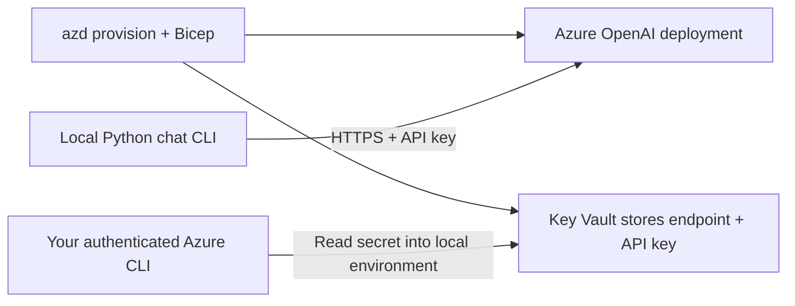

# Azure OpenAI Chat — Lokal na CLI at AZD Infrastructure

**Antas:** Intermediate · **Oras:** 35–60 minuto kabilang ang setup

Ang halimbawang ito ay nagpoprovide ng **Azure OpenAI resource at Key Vault**, pagkatapos ay nagpapatakbo ng
interactive Python chat CLI **sa iyong makina**. Hindi ito nagho-host ng web application
o Container App. Ang default na modelo ay `gpt-4.1`, bersyon `2025-04-14`, na may
`GlobalStandard` deployment capacity na 20. Suriin ang kasalukuyang availability at quota sa
napiling rehiyon bago mag-provide; maaaring magbago ang mga petsa ng lifecycle ng modelo.

## Mga layunin sa pag-aaral

- Magprovision ng infrastructure ng modelo gamit ang Bicep at azd.
- Kunin ang API key mula sa Key Vault nang hindi inilalagay sa deployment outputs.
- Magpadala ng mga Chat Completions request at panatilihin ang kasaysayan ng pag-uusap.
- I-interpret ang bilang ng token at mga limitasyon ng pagtatantiya ng gastos.



Walang managed-identity runtime integration, multi-region failover, custom
rate limiter, streaming mode, o hosted compute sa halimbawang ito. Ang OpenAI SDK
ay nagsasagawa ng hanggang dalawang retries para sa mga retryable failures; ang CLI ay nag-uulat ng natitirang mga error.

## Mga kinakailangan

- Isang kasalukuyang stable na [azd](https://learn.microsoft.com/azure/developer/azure-developer-cli/install-azd)
  (naka-publish na release sa oras ng review: 1.37.2).
- [Azure CLI](https://learn.microsoft.com/cli/azure/install-azure-cli).
- Python **3.10+** (inirerekomenda ang 3.11) at isang virtual environment.
- Isang Azure subscription na may pahintulot na gumawa ng Cognitive Services at Key Vault
  resources, mag-deploy ng mga modelo, at magbasa ng mga sikreto ng vault.
- Regional availability at `GlobalStandard` quota para sa `gpt-4.1`. Ang mga kinakailangan sa pag-access
  ay nakadepende sa subscription at feature; walang garantiya sa oras ng pag-apruba.

```bash
azd version
az version
python --version
azd auth login
az login
```

Ito ay magkahiwalay na mga sesyon ng authentication. Piliin ang parehong subscription sa parehong
mga tool bago patakbuhin ang mga command sa ibaba.

## Mabilis na pagsisimula (Bash)

Patakbuhin mula sa root ng repositoryo:

```bash
cd examples/azure-openai-chat
azd env new myopenai
azd provision
```

Pumili ng suportadong rehiyon. Ang provisioning ay lumikha ng resource group, OpenAI account,
model deployment, Key Vault, at ang `openai-endpoint`/`openai-api-key` na mga sikreto.
Walang **mga serbisyo na kailangang ideploy** sa `azure.yaml`.

I-load ang mga non-secret outputs at kunin ang sikreto sa kasalukuyang shell:

```bash
export AZURE_OPENAI_ENDPOINT="$(azd env get-value AZURE_OPENAI_ENDPOINT)"
export AZURE_OPENAI_MODEL="$(azd env get-value AZURE_OPENAI_MODEL)"
KV_NAME="$(azd env get-value AZURE_KEY_VAULT_NAME)"
export AZURE_OPENAI_API_KEY="$(az keyvault secret show \
  --vault-name "$KV_NAME" --name openai-api-key --query value --output tsv)"

python -m venv .venv
source .venv/bin/activate
python -m pip install -r src/requirements.txt
python src/chat.py
```

Sa PowerShell, i-activate gamit ang `.\.venv\Scripts\Activate.ps1` at itakda ang mga environment
variable gamit ang `$env:AZURE_OPENAI_ENDPOINT = azd env get-value AZURE_OPENAI_ENDPOINT`
(at gayundin para sa modelo). Kunin ang API key gamit ang
`$env:AZURE_OPENAI_API_KEY = az keyvault secret show --vault-name $KV_NAME --name openai-api-key --query value -o tsv`.
Itakda muna ang `$KV_NAME = azd env get-value AZURE_KEY_VAULT_NAME`.

Huwag i-print, i-commit, o i-paste ang API key sa mga ulat ng isyu. Ang CLI ay nagbabasa ng process
environment variables; ito ay **hindi** kumukuha ng mga sikreto mula sa Key Vault o naglo-load ng mga `.env` na files.
Ang `config.py` ay nagva-validate ng endpoint, token limit, at temperature sa simula.

Inaasahang output (nagkakaiba ang nilalaman at paggamit):

```text
Azure OpenAI Chat Application
Model: gpt-4.1
...
You: Say hello in one sentence.
Assistant: Hello! How can I help you today?
[Tokens: ... | Cost: $...]
```

Mga command: `stats` ay nagpapakita ng kabuuan, `clear` ay naglilinis ng kasaysayan ng pag-uusap, at
`quit`/`exit` ay nagtatapos ng sesyon. Walang mga command na `--stream`, `--show-tokens`, `tokens`,
o `cost`.

## Beripikahin ang deployment

Pagkatapos i-load ang mga shell variable sa itaas:

```bash
curl --fail-with-body \
  "${AZURE_OPENAI_ENDPOINT%/}/openai/deployments/${AZURE_OPENAI_MODEL}/chat/completions?api-version=2024-10-21" \
  -H "Content-Type: application/json" \
  -H "api-key: $AZURE_OPENAI_API_KEY" \
  -d '{"messages":[{"role":"user","content":"Say hello!"}],"max_tokens":50}'

az keyvault secret list --vault-name "$KV_NAME" --query "[].name" -o table
```

Tagumpay: ang API ay nagbabalik ng HTTP 200 kasama ang `choices[0].message.content` at `usage`;
ang vault ay naglilista ng `openai-api-key` at `openai-endpoint`. Ang matagumpay na ARM deployment
ay hindi naninigurong gumagana ang inference.

## Mga file at configuration

```text
azure.yaml                         # Infrastructure-only AZD project
infra/main.bicep                   # Subscription deployment
infra/main.parameters.json         # Environment, location, principal ID
infra/resources/openai.bicep       # Account + model
infra/resources/keyvault.bicep     # Vault + deploying user's secret access policy
infra/resources/secrets.bicep      # Writes secrets, no key output
src/chat.py                        # Interactive CLI
src/config.py                      # Environment validation
src/requirements.txt               # Python packages
```

Upang baguhin ang provisioned na modelo/bersyon/kapasidad, i-edit ang mga default sa
`infra/main.bicep` at patakbuhin ang `azd provision`. Ang pagtatakda ng `AZURE_OPENAI_MODEL` sa iyong
shell ay pumipili lamang ng **existing deployment name**; hindi ito nagde-deploy ng isa pang modelo.

| Runtime variable | Default / pinanggalingan |
|---|---|
| `AZURE_OPENAI_ENDPOINT` | Kinakailangan; azd non-secret output |
| `AZURE_OPENAI_API_KEY` | Kinakailangan; kunin mula sa Key Vault |
| `AZURE_OPENAI_MODEL` | `gpt-4.1`; pangalan ng Azure deployment |
| `AZURE_OPENAI_MAX_TOKENS` | 800 (saklaw ng validation 1–4096) |
| `AZURE_OPENAI_TEMPERATURE` | 0.7 (saklaw 0–2) |
| `AZURE_OPENAI_INPUT_PRICE_PER_1K` | 0.002 USD; halimbawa ng uncached input rate |
| `AZURE_OPENAI_OUTPUT_PRICE_PER_1K` | 0.008 USD; halimbawa ng output rate |

## Mga gastos at limitasyon sa seguridad

Ang pagpapakita ng gastos ay isang **tantya** (estimate), hindi Azure billing. Minumultiply nito ang paggamit ng API token
sa mga itinalagang rates at hindi isinasaalang-alang ang mga cached input discount,
regional/SKU na pagkakaiba, buwis, pagbabago ng presyo, o mga nabigong/tinangkang ulitin na tawag.
Palitan ang **parehong rate** kapag gumagamit ng ibang modelo o SKU at siguraduhing tingnan ang kasalukuyang
[Azure OpenAI pricing](https://azure.microsoft.com/pricing/details/cognitive-services/openai-service/).

Bilang halimbawa, 100 na kahilingan gamit ang 500 uncached input at 200 output tokens bawat isa
sa default na mga rate ay nagkakahalaga ng `100 × (500/1000 × .002 + 200/1000 × .008) = $0.26`.
Ang mga operasyon at storage ng Key Vault ay may hiwalay na singil. Walang fixed na $50/buwan
na singil para sa lokal na CLI na ito at walang hosted compute sa template.

Ang vault ay gumagamit ng access policy para sa principal na nagde-deploy; hindi ito halimbawa ng RBAC o
managed-identity application. Ang mga pampublikong endpoint at API-key authentication
ay ginagamit para sa pagtuturo. Limitahan ang mga pahintulot at magdagdag ng angkop na identity/network
control bago ito gamitin para sa produksiyon.

## Mga praktikal na pagsasanay

### 1. Beripikahin ang konteksto at i-reset ito

**Simula:** tumatakbong CLI. **Layunin:** obserbahan ang kasaysayan.
Sabihin “Remember the word cedar,” pagkatapos itanong “Anong salita ang sinabi mong tandaan?”
Patakbuhin ang `stats`; dalawang matagumpay na turn ay dapat bilangin bilang dalawang palitang mensahe.
Patakbuhin ang `clear` at `stats`; ang mga palitang mensahe ay dapat zero (nananatili ang kabuuan ng token).
Ang eksaktong salita ng modelo ay hindi deterministic.

### 2. Baguhin ang limitasyon ng sagot

**Simula:** lumabas sa CLI, panatilihin ang parehong shell.
Patakbuhin ang `export AZURE_OPENAI_MAX_TOKENS=100`, i-restart ang `python src/chat.py`, at humiling ng
maikling paliwanag tungkol sa azd. Tingnan na ang banner ay nagpapakita ng 100.
I-restore gamit ang `unset AZURE_OPENAI_MAX_TOKENS`. Ang mas maliit na response limit ay hindi
nagpapabawas ng naipadalang kasaysayan ng mga token.

### Mga karaniwang isyu

- **Nawawalang environment variables:** hindi nag-export ng shell values ang provisioning;
  ulitin ang mga hakbang ng pag-export. Kailangan ulit ito sa bagong terminal.
- **403 error sa pagbabasa ng Key Vault:** tiyaking tama ang Azure CLI subscription/login at ang
  principal sa access policy ng vault. Ang mga pagbabago sa policy ay nangangailangan ng oras para magkabisa.
- **404 error sa inference:** suriin ang pangalan ng deployment, endpoint, at status ng deployment.
- **429 error sa inference:** maghintay na ma-reset ang rate limits; suriin ang regional model quota.
  Tinatanggal ng CLI ang mga failed turns sa kasaysayan kaya ang pag-retry ay hindi nagpapadoble.
- **Haba ng konteksto:** walang trimming ng mahabang pag-uusap sa sample; gamitin ang `clear`.
- **Model na hindi available/retired:** konsultahin ang kasalukuyang availability ng modelo at i-update
  model/version/SKU nang sabay; magkaibang settings ang API version at model version.

## Paglilinis at mga susunod na hakbang

```bash
azd down
unset AZURE_OPENAI_API_KEY
```

Ang soft-delete retention ng Key Vault ay pitong araw; ang purge ay nangangailangan ng hiwalay na pahintulot.
Walang nakapangakong test suite; huwag patakbuhin ang hindi umiiral na `pytest tests/` na command.
Magdagdag ng mocked API tests bago palawakin ang code.

[Mga halimbawa ng Container](../../../../examples/container-app) · [Retail architecture blueprint](../retail-scenario.md) ·
[Home ng kurso](../../README.md) · [Mag-ulat ng isyu](https://github.com/microsoft/AZD-for-beginners/issues)

---

<!-- CO-OP TRANSLATOR DISCLAIMER START -->
**Pagtatanggi**:
Ang dokumentong ito ay isinalin gamit ang serbisyo ng AI translation na [Co-op Translator](https://github.com/Azure/co-op-translator). Bagama't nagsusumikap kami para sa katumpakan, pakatandaan na ang awtomatikong pagsasalin ay maaaring maglaman ng mga pagkakamali o hindi pagkakatugma. Ang orihinal na dokumento sa orihinal nitong wika ang dapat ituring na pangunahing sanggunian. Para sa mahahalagang impormasyon, inirerekomenda ang propesyonal na pagsasalin ng tao. Hindi kami mananagot sa anumang maling pagkakaintindi o maling interpretasyon na nagmula sa paggamit ng pagsasaling ito.
<!-- CO-OP TRANSLATOR DISCLAIMER END -->