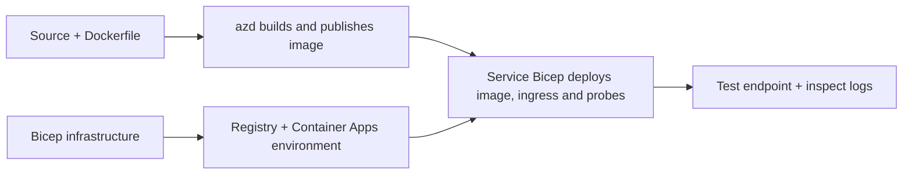

# Mga Halimbawa ng Pag-deploy ng Container App gamit ang AZD

Naglalaman ang direktoryong ito ng dalawang halimbawa sa pag-aaral na may source code, Dockerfiles,
Bicep infrastructure, at `azure.yaml`. Wala sa mga ito ang handa para sa produksyon.

## Pumili ng halimbawa

| Halimbawa | Ano ang naipatupad | Mga Kinakailangan |
|---|---|---|
| [Simple Flask API](../../../../examples/container-app/simple-flask-api) | Isang Python CRUD API, mga in-memory item, health probes, HTTP scaling | Pangunahing kaalaman sa CLI at HTTP |
| [Two-service microservices](../../../../examples/container-app/microservices) | Node.js gateway, internal na read-only Python product service, telemetry at scaling | Kumpletuhin muna ang single-service sample |

Maglaan ng 30–60 minuto kasama na ang setup at beripikasyon. Nagkakaiba-iba ang oras ng provisioning sa Azure.

## Mga Kinakailangan

- [Azure Developer CLI](https://learn.microsoft.com/azure/developer/azure-developer-cli/install-azd)
- [Azure CLI](https://learn.microsoft.com/cli/azure/install-azure-cli) para sa mga utos ng beripikasyon
- Docker na may tumatakbong daemon para sa paggawa ng mga container images na ito
- Isang Azure subscription na may mga pahintulot sa paglikha ng resources at sapat na regional quota
- Bash para sa mga halimbawa ng shell, o katumbas na mga utos sa PowerShell

```bash
azd version
az version
docker info
azd auth login
az login
```

Magkaiba ang mga session ng pag-login para sa dalawang tool. Gumamit ng kasalukuyang matatag na azd; ang kasalukuyang
inilathalang bersyon sa oras ng pagrepaso ay 1.37.2. Ang mga lumang minimum na claim ng bersyon ay hindi garantiya ng
pagiging compatible.

## Mabilisang pagsisimula

Mula sa root ng repository:

```bash
cd examples/container-app/simple-flask-api
azd env new flask-demo
azd up
API_URL=$(azd env get-value API_ENDPOINT)
curl --fail-with-body "${API_URL}/health"
```

Inaasahan: HTTP 200 na may `"status": "healthy"`. Sundin ang README ng sample para gumawa,
magbasa, mag-update, at mag-delete ng isang item, at para suriin ang mga log.



Ang unang provisioning ay gumagamit ng isang public hello-world image sa port 80. Pinapayagan ng mga service-specific
Bicep parameter files ang `azd deploy` na palitan ito ng built application image
at ang tamang app port/probes (8000 para sa Flask/product, 8080 para sa gateway).
Panatilihin ang mga file na ito kasama ang kanilang `azure.yaml` `module` settings.

## Pagkonpigurasyon: ano ang nagbabago ng ano

Pinipili ng `azure.yaml` ang mga source directory, mga wika, mga host, at mga deployment module.
Ang CPU/memory ng container, ingress, mga probe, bilang ng replica, at mga scale rule ay tinutukoy
sa **Bicep**, hindi sa mga arbitraryong `resources`, `scale`, o `regions` service properties.

Nagtatago ang `azd env set SOME_VALUE ...` ng isang halaga nang lokal. Binabago lamang nito ang isang na-deploy
na resource kapag ang isang parameter, environment mapping, o hook ay tahasang kumokonsumo ng halagang iyon.
Hindi kumokonsumo ang mga halimbawang ito ng `MAX_REPLICAS`, `SCALE_TO_ZERO_TIMEOUT`,
`CONTAINER_APP_REPLICA_TYPE`, o custom na canary settings mula sa mga halaga ng azd environment.
I-edit ang kaukulang Bicep at patakbuhin ang `azd up` para muling mag-provision at mag-deploy.

Huwag ilagay ang source ng application sa ilalim ng `infra/`. Dapat ituro ng `project` ang source
directory na naglalaman ng Dockerfile at dependency manifest.

## Monitoring at gastos

- Nagbubukas ang `azd monitor --logs` ng portal view; hindi ito terminal log stream.
  Gamitin ang `az containerapp logs show --follow` gamit ang aktwal na pangalan ng resource.
- Ang simpleng API ay nagsusulat ng stdout logs na nakolekta sa pamamagitan ng Container Apps/Log Analytics.
  Hindi awtomatikong na-instrument ang provisioned Application Insights resource nito.
- Ginagamit ng microservices gateway ang Node.js Application Insights SDK; ang Python
  service ay nag-e-export ng application log traces. Hindi naka-configure ang buong Python request/dependency tracing.

- Makakatulong ang scale-to-zero na pababain ang compute charges, pero ang registry at log ingestion/storage
  ay maaari pa ring magdulot ng gastos. Pinapanatili ng mga microservices default na tumatakbo ang mga replica.
  Tantiyahin ang iyong rehiyon at paggamit sa
  [Azure pricing calculator](https://azure.microsoft.com/pricing/calculator/).

## Mga Advanced na pattern — hindi kabilang ang mga implementasyon

Ito ay mga direksyon sa disenyo, hindi mga karagdagang lokal na proyekto o copy-and-run snippets:

- **Persistent data at authentication:** palitan ang in-memory stores at magdagdag
  ng Microsoft Entra ID authentication/authorization bago ang produksyon.
- **Blue-green/canary:** gamitin ang Container Apps multiple-revision mode, revision
  labels, traffic weights, health verification, at rollback procedures.
  Walang `deploymentStrategy: canary` azd configuration sa mga halimbawang ito.
  Tingnan ang [revision management](https://learn.microsoft.com/azure/container-apps/revisions).
- **Multi-region:** lumikha ng hiwalay na environment at apps sa Bicep at idisenyo ang
  global routing at data consistency. Ang listahan ng serbisyo na `regions` ay hindi isang azd
  deployment mechanism.
- **Queue workers:** magdagdag ng worker source, dependencies, queue resources, isang managed
  identity na may mga data-plane roles, at isang authenticated scale rule. Huwag kopyahin
  ang isang walang laman na `src/worker` path at asahan ang isang tumatakbong proyekto.
- **Dapr:** mag-provision ng mga component, i-configure ang sidecar, i-install ang angkop na SDK,
  at ipatupad ang state/pub-sub error handling.
- **Secrets:** gumamit ng managed identity at role assignments kung maaari. Ang simpleng
  paggawa ng Key Vault ay hindi awtomatikong nagbibigay ng access sa mga application o naglo-load ng mga lihim.

## Paglilinis

Mula sa sample directory:

```bash
azd down
```

Suriin ang mga prompt ng pagtanggal at kumpirmahin na natanggal ang dedikadong resource group.
Huwag gamitin ang mga halimbawang ito bilang baseline sa produksyon nang walang karagdagang disenyo at pagsusuri.

[Index ng mga halimbawa](../README.md) · [Bahay ng kurso](../../README.md) ·
[Dokumentasyon ng Container Apps](https://learn.microsoft.com/azure/container-apps/) ·
[I-report ang isang isyu](https://github.com/microsoft/AZD-for-beginners/issues)

---

<!-- CO-OP TRANSLATOR DISCLAIMER START -->
**Pagtatanggi**:
Ang dokumentong ito ay isinalin gamit ang serbisyo ng AI translation na [Co-op Translator](https://github.com/Azure/co-op-translator). Bagama't nagsusumikap kami para sa katumpakan, pakatandaan na ang awtomatikong pagsasalin ay maaaring maglaman ng mga pagkakamali o hindi pagkakatugma. Ang orihinal na dokumento sa orihinal nitong wika ang dapat ituring na pangunahing sanggunian. Para sa mahahalagang impormasyon, inirerekomenda ang propesyonal na pagsasalin ng tao. Hindi kami mananagot sa anumang maling pagkakaintindi o maling interpretasyon na nagmula sa paggamit ng pagsasaling ito.
<!-- CO-OP TRANSLATOR DISCLAIMER END -->