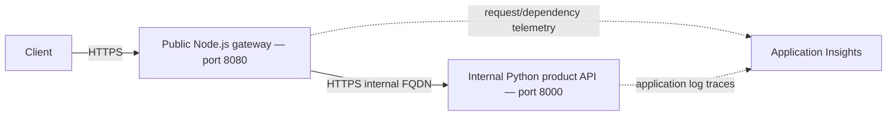

# Dalawang-Serbisyo na Microservices — Azure Container Apps

**Antas:** Intermediate · **Oras:** 45–60 minuto kabilang ang setup

Ang learning sample na ito ay nagpapatupad ng **Node.js API Gateway** at isang **read-only na Python
Product Service**. Kasama ang source, Dockerfiles, Bicep, at azd configuration.
Hindi ito isang production-hardened na sistema.

## Ano ang matututuhan mo

- Mag-deploy ng dalawang serbisyo nang independente.
- Gumamit ng internal backend FQDN sa HTTPS.
- Patunayan ang success, not-found, at unavailable-service na mga tugon.
- Unawain ang telemetry at mga hangganan ng independent scaling.



Ang katalogo ng produkto ay naglalaman ng limang fixed na produkto sa memorya. Walang **POST,
PUT, o DELETE handlers**, database, Service Bus, order/user/notification service,
C#, o Go code. Ang mga iyon ay mga ideya para sa hinaharap na development, hindi kabilang sa mga feature.
Hindi ina-authenticate ng gateway ang mga user; ang internal ingress ay hindi kapalit ng
aplikasyon ng authorization.

## Mga Kinakailangan

Kumpletuhin muna ang [single Flask API](../../../../../examples/container-app/simple-flask-api).
Mag-install ng kasalukuyang stable na azd (published release sa oras ng review: 1.37.2), Azure CLI,
at Docker na may running daemon. Kailangan mo ng Azure subscription, permiso para gumawa ng resource,
at quota para sa Container Apps regional.

```bash
azd version
az version
docker info
azd auth login
az login
```

Gamitin ang parehong subscription sa dalawang CLI tools. Ang mga command sa ibaba ay gamit ang Bash.

## I-deploy at i-verify

Mula sa root ng repository:

```bash
cd examples/container-app/microservices
azd env new microservices-demo
azd up
GATEWAY_URL=$(azd env get-value API_GATEWAY_URL)
RG_NAME=$(azd env get-value AZURE_RESOURCE_GROUP)
GATEWAY_NAME=$(azd env get-value API_GATEWAY_NAME)
PRODUCT_NAME=$(azd env get-value PRODUCT_SERVICE_NAME)

curl --fail-with-body "${GATEWAY_URL}/health"
curl --fail-with-body "${GATEWAY_URL}/api/products"
curl --fail-with-body "${GATEWAY_URL}/api/products/1"
curl -i "${GATEWAY_URL}/api/products/999"
```

**Tagumpay:** health 200; list 200 na may **limang** produkto; ang produkto 1 ay isang Laptop
na may presyo na 999.99 at stock na 50; ang hindi kilalang produkto ay bumabalik ng 404.
Kasama ang mga deskripsyon sa mga tugon; nag-iiba ang mga timestamp.

Ang paunang provision ay gumagamit ng public hello-world images sa port 80 kaya hindi nito sinusubukang
i-pull ang mga non-existent na imahe mula sa walang laman na registry. Ang Bicep modules na specific sa serbisyo
at mga parameter files ay pumapalit sa kanila gamit ang mga built images at app ports/probes habang
`azd deploy`. Pinananatili ng pangunahing mga parameter ang mga pangalan ng published image para sa susunod na provisioning.

## Mga Serbisyo at Networking

| Serbisyo | Mga exposed na endpoint | Default na resources |
|---|---|---|
| Gateway | GET `/`, `/health`, `/api/products`, `/api/products/:id` | 1 vCPU, 2 GiB, 2–20 replicas |
| Product | GET `/`, `/health`, `/products`, `/products/<id>` | 0.5 vCPU, 1 GiB, 1–10 replicas |

Ang ingress ng Product ay may `external: false` at `allowInsecure: false`. Ini-inject ng Bicep
`PRODUCT_SERVICE_URL=https://<actual-internal-fqdn>` sa gateway. Ang HTTP ay
redirect; Ang HTTPS ay tumutugma sa naka-configure na ingress. Ang isang maikling DNS name ay dapat tumugma sa
**aktwal na Pangalan ng Container App**, hindi ang lohikal na susi ng serbisyo `product-service`.
Huwag subukan na tawagan nang direkta ang internal na URL mula sa iyong laptop.

Ang gateway ay may limang segundong timeout para sa mga tawag ng produkto. Ang nawawalang mga product ID
ay nagdudulot ng 404; ang mga pagkabigo sa transportasyon/iba pang pagkabigo sa backend ay nagbabalik ng 503. Ang Gateway
`/health` ay sumusuri lamang sa gateway, hindi ang availability ng backend.

## Mga File at konfigurasyon

```text
azure.yaml
infra/main.bicep
infra/main.parameters.json
infra/abbreviations.json
infra/core/container-apps-environment.bicep
infra/core/monitor.bicep
infra/app/api-gateway.bicep
infra/app/api-gateway.parameters.json
infra/app/product-service.bicep
infra/app/product-service.parameters.json
src/api-gateway/{app.js,package.json,Dockerfile}
src/product-service/{main.py,requirements.txt,Dockerfile}
```

Ang Scaling, CPU/memory, ports, at probes ay nakatakda sa `infra/app/*.bicep`. Baguhin ang mga
file na iyon at patakbuhin ang `azd up` upang i-apply ang infrastructure at i-redeploy. Walang
`GATEWAY_MAX_REPLICAS` environment-variable parameter sa sample na ito.

Para sa mga pagbabago na code lang:

```bash
azd deploy product-service
azd deploy api-gateway
```

Ang Node image ay gumagamit ng Node 22; ang Python image ay gumagamit ng Python 3.11. Pareho silang naka-bind sa
`0.0.0.0`. Ang Ingress/probes ay gumagamit ng port 8080 (gateway) at 8000 (product), ayon sa pagkakabanggit.

## Lokal na pag-develop gamit ang Docker

Patakbuhin mula sa direktoryong ito ng halimbawa. Gumamit ng user-defined na network, **hindi ang `localhost`
mula sa isang container upang maabot ang isa pa**:

```bash
docker network create azd-microservices-demo
docker build -t local-product ./src/product-service
docker build -t local-gateway ./src/api-gateway
docker run -d --name azd-product --network azd-microservices-demo local-product
docker run -d --name azd-gateway --network azd-microservices-demo \
  -p 8080:8080 -e PRODUCT_SERVICE_URL=http://azd-product:8000 local-gateway
curl --fail-with-body http://localhost:8080/api/products
```

Inaasahan: limang produkto. HTTP ay ginagamit lamang para sa lokal na Docker network na ito.

```bash
docker stop azd-product azd-gateway
docker rm azd-product azd-gateway
docker network rm azd-microservices-demo
```

## Pagmomonitor

```bash
az containerapp logs show --name "$GATEWAY_NAME" --resource-group "$RG_NAME" --follow
# In a separate terminal:
az containerapp logs show --name "$PRODUCT_NAME" --resource-group "$RG_NAME" --tail 100
```

`azd monitor --logs` ay nagbubukas ng portal view; hindi ito nag-stream ng mga terminal log.
Nakakalap ang Node SDK ng mga gateway requests/dependencies. Ang `AzureLogHandler` ng Python ay
nag-e-export ng **log traces**, hindi ang awtomatikong Flask requests, SQL dependencies, o buong
distributed traces. Ang OpenCensus ay isang legacy na SDK; mas piliin ang Azure Monitor OpenTelemetry
kapag pinalalawig ang sample na ito.

Sa Application Insights Logs, gumawa ng mga requests at siyasatin:

```kusto
requests
| where timestamp > ago(1h)
| where name contains "products"
| summarize RequestCount=count(), AvgDuration=avg(duration) by bin(timestamp, 5m)
```

Para sa mga mensahe ng Python application:

```kusto
traces
| where timestamp > ago(1h)
| where message contains "products"
| project timestamp, message, severityLevel
```

Pahintulutan ang delay sa ingesting at sampling; huwag asahan ang eksaktong bilang ng request o isang
garantisadong latency. Walang mga custom na alerto o dashboard na naka-configure.

## Mga Praktikal na Ehersisyo

### Ehersisyo 1: Baguhin ang katalogo

**Panimulang punto:** `src/product-service/main.py`.
**Layunin:** patunayan ang independiyenteng deployment ng serbisyo.
Palitan ang stock ng Laptop mula 50 papuntang 49 sa naka-fix na listahan ng `products`, patakbuhin ang
`azd deploy product-service`, tapos mag-request ng `${GATEWAY_URL}/api/products/1`.

**Pamantayan ng tagumpay / solusyon:** HTTP 200 na may `"stock":49`. Ibalik sa 50 at i-redeploy.
**Karaniwang isyu:** pagbabago sa gateway imbis sa serbisyong nagmamay-ari ng katalogo.
Binabago nito ang pinanggalingang data, hindi isang persistent na inventory database.

### Ehersisyo 2: Suriin ang replica configuration

**Panimulang punto:** `infra/app/product-service.bicep`.
**Layunin:** obserbahan ang pagbabago sa infrastructure nang hindi hinuhulaang autoscaling.
Palitan ang `minReplicas: 1` sa `minReplicas: 2`, patakbuhin ang `azd up`, tapos:

```bash
az containerapp show --name "$PRODUCT_NAME" --resource-group "$RG_NAME" \
  --query properties.template.scale -o json
```

**Pamantayan ng tagumpay:** naka-configure ang minimum na 2 at ang maximum ay nananatiling 10.
Ibalik ang minimum sa 1 at patakbuhin ang `azd up`.
**Karaniwang isyu:** `azd deploy` lang ay hindi nag-aapply ng mga pagbabago sa mga hindi kaugnay na shared
infrastructure. Huwag itakda ang `maxReplicas` sa zero bilang simulation ng pagkabigo.
Ipinapakita nito ang configuration, hindi isang load-test o garantisadong agarang bilang ng replica.

### Ehersisyo 3: Subukan ang paghawak sa unavailable-service nang lokal

**Panimulang punto:** pareho ang tumatakbong lokal na Docker containers sa itaas.
**Layunin:** pag-iba sa pagkabigo ng backend mula sa nawawalang produkto.
Patigilin lamang ang product container:

```bash
docker stop azd-product
curl -i http://localhost:8080/api/products
docker start azd-product
curl --fail-with-body http://localhost:8080/api/products
```

**Pamantayan ng tagumpay:** habang nakahinto, ang gateway ay nagbabalik ng 503 na may
`"error":"Product service unavailable"`; pagkatapos ng restart, ang listahan ay nagbabalik ng 200.
Subukang muli pagkatapos ng maikling startup delay kung kinakailangan.
**Karaniwang isyu:** ang pagtigil sa gateway ay sumusubok ng ibang pagkabigo (walang HTTP response).

## Mga gastos at kakulangan sa produksyon

Ang default na minimum replicas ay nagpapatakbo ng compute. Ang registry at monitoring ay nagdudulot din ng
singil. Walang pinagbatayan na fixed $50/buwan sa kabuuan: tantyahin ang rehiyonal na CPU/memory,
replica hours, requests, registry, at log retention sa
[Azure pricing calculator](https://azure.microsoft.com/pricing/calculator/).
Agad na burahin ang mga learning resources.

Kasama sa trabaho sa produksyon ang authentication/authorization, scoped managed identities,
persistent data, pagsuri sa input/response, suportadong observability instrumentation,
load/failure testing, CI/CD, alerts, at mga proseso ng recovery. Ang pagdaragdag ng order
service, queue, o database ay hiwalay na gawain sa implementasyon, hindi isang tapos na
ehersisyo o tampok na mayroon na dito.

## Pag-troubleshoot at paglilinis

- **Image na hindi makita sa unang provision:** ang bootstrap ay dapat gumamit ng public image;
  suriin ang mga main image parameter default at deployment module mappings.
- **503 products:** suriin ang mga product logs, image revision, at ang injected internal HTTPS URL.
- **404 unexpected path:** ang product API ay read-only; suriin ang ruta, hindi ang nonexistent CRUD handler.
- **Walang telemetry:** suriin ang mga runtime connection strings nang hindi ito inilalantad at
  pahintulutan ang ingestion delay. Ang mga request tables ng Python ay hindi napupuno ng log handler nito.

Mula sa direktoryong ito ng sample:

```bash
azd down
```

Suriin ang mga prompt ng pagtanggal at tiyaking tinanggal ang dedikadong resource group.

[Nakaraan: Flask API](../../../../../examples/container-app/simple-flask-api) · [Susunod: Database app](../../../../../examples/database-app) ·
[AI development](../../../docs/chapter-02-ai-development/README.md) ·
[Home ng Kurso](../../../README.md) · [Iulat ang isang isyu](https://github.com/microsoft/AZD-for-beginners/issues)

---

<!-- CO-OP TRANSLATOR DISCLAIMER START -->
**Pagtatanggi**:
Ang dokumentong ito ay isinalin gamit ang serbisyo ng AI translation na [Co-op Translator](https://github.com/Azure/co-op-translator). Bagama't nagsusumikap kami para sa katumpakan, pakatandaan na ang awtomatikong pagsasalin ay maaaring maglaman ng mga pagkakamali o hindi pagkakatugma. Ang orihinal na dokumento sa orihinal nitong wika ang dapat ituring na pangunahing sanggunian. Para sa mahahalagang impormasyon, inirerekomenda ang propesyonal na pagsasalin ng tao. Hindi kami mananagot sa anumang maling pagkakaintindi o maling interpretasyon na nagmula sa paggamit ng pagsasaling ito.
<!-- CO-OP TRANSLATOR DISCLAIMER END -->