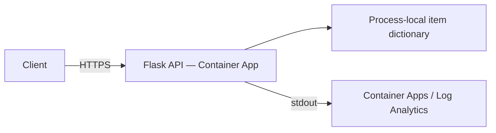

# Simpleng Flask API — Azure Container Apps

**Antas:** Panimulang · **Oras:** 30–45 minuto kasama ang setup

Mag-deploy ng Python Flask CRUD API gamit ang Azure Developer CLI (azd). Kasama ang Source, Dockerfile,
Bicep, at mga parameter ng deployment. Ito ay isang **pansamantalang halimbawa ng pag-aaral**, hindi
isang API na handa para sa produksyon.

## Ano ang matututunan mo

- Bumuo at mag-publish ng container gamit ang azd.
- I-configure ang ingress at liveness/readiness probes.
- Suriin ang mga tugon sa CRUD at tingnan ang mga log ng aplikasyon.
- Unawain kung bakit hindi angkop ang in-memory data para sa pangmatagalang aplikasyon.



**Mahalaga:** ang mga item ay hawak sa iisang proseso. Ang default ay **isang Gunicorn worker,
0–1 replicas**, na sadyang iniiwasan ang hindi pagkakatugma ng data sa pagitan ng mga worker/replica.
Nawala ang mga item sa pag-restart, pagbabago ng bersyon, o scale-to-zero. Ang pagtaas ng mga replica
ay nangangailangan ng shared persistent storage. Walang authentication o authorization ang API.

## Mga Kinakailangan

- [Kasalukuyang stable na azd](https://learn.microsoft.com/azure/developer/azure-developer-cli/install-azd)
  (pinakabagong release sa oras ng pagsusuri: 1.37.2).
- [Azure CLI](https://learn.microsoft.com/cli/azure/install-azure-cli) para sa pagbibigay-tiwala.
- Docker na may tumatakbong daemon; kinakailangan ito para sa default na local image build.
- Azure subscription, mga permiso sa paglikha ng resource, at Container Apps regional quota.
- Bash para sa mga utos sa ibaba (o katumbas na PowerShell).
- Python 3.11 para sa optional na lokal na pag-develop.

```bash
azd version
az version
docker info
azd auth login
az login
```

May hiwalay na login session ang mga CLI tool. Gamitin ang parehong subscription sa dalawa.

## Mabilisang pagsisimula

Mula sa root directory ng repository:

```bash
cd examples/container-app/simple-flask-api
azd env new flask-demo
azd up
API_URL=$(azd env get-value API_ENDPOINT)
RG_NAME=$(azd env get-value AZURE_RESOURCE_GROUP)
API_NAME=$(azd env get-value API_NAME)
curl --fail-with-body "${API_URL}/health"
```

Inaasahan: HTTP 200 at JSON na may `"status":"healthy"`,
`"service":"simple-flask-api"`, at kasalukuyang UTC timestamp.
Karaniwang tumatagal ng ilang minuto ang provisioning at pagbuo ng imahe; nagkakaiba-iba ang oras.

Ang unang provisioning ay gumagamit ng pampublikong hello-world image na nakikinig sa port 80.
Pinipili ng `azure.yaml` ang `infra/app/api.bicep` at ang katugmang parameter file nito para sa
deployment ng serbisyo, na nagpapalit ng imahe, ingress, at mga probe sa port 8000.
Huwag tanggalin ang mga parameter ng deployment na iyon.

## Suriin ang CRUD

Patakbuhin ang mga sumusunod nang sunud-sunod habang aktibo ang parehong replica:

```bash
# Create: HTTP 201; note the returned id (1 for a fresh process).
curl -i -X POST "${API_URL}/api/items" \
  -H "Content-Type: application/json" \
  -d '{"name":"Test Item","description":"My first item"}'

# Read list: HTTP 200, total 1 in a fresh process.
curl --fail-with-body "${API_URL}/api/items"

# Replace 1 if your create response returned another id.
curl --fail-with-body "${API_URL}/api/items/1"
curl -i -X PUT "${API_URL}/api/items/1" \
  -H "Content-Type: application/json" -d '{"name":"Updated Item"}'
curl -i -X DELETE "${API_URL}/api/items/1"
curl -i "${API_URL}/api/items/1"
```

Tagumpay: POST 201, reads/PUT 200, DELETE 204 na walang katawan, pagkatapos missing item 404.
Nagbabalik ng 400 ang malformed/hindi object na JSON o walang laman na pangalan.
Kung nawawala ang item sa pagitan ng mga kahilingan, suriin kung may pag-restart o scale-to-zero;
ito ay isang sadyang limitasyon ng in-memory, hindi persistence.

| Endpoint | Mga Metodo |
|---|---|
| `/` | GET — impormasyon ng serbisyo |
| `/health` | GET — liveness/readiness |
| `/api/items` | GET, POST |
| `/api/items/{id}` | GET, PUT, DELETE |

## Mga log at konfigurasyon

```bash
az containerapp logs show --name "$API_NAME" --resource-group "$RG_NAME" --follow
```

Inaasahan: Gunicorn startup, mga request access log, at mga mensahe ng aplikasyon.
Binubuksan ng `azd monitor --logs` ang portal view; hindi nito pinapadaloy sa terminal.
Na-provision ang Application Insights pero **hindi iniinstrument ng Flask code na ito**;
gamitin ang Container Apps/Log Analytics para sa stdout logs.

I-edit ang `infra/app/api.bicep` para sa CPU/memory, limitasyon ng replica, o scale rules, pagkatapos
patakbuhin ang `azd up`. Ang default ay 0.5 vCPU, 1 GiB, minimum 0 / maximum 1 replica, at
HTTP threshold na 50 concurrent requests. Ang scale-to-zero ay maaaring magdagdag ng cold-start latency.

Ang arbitrary `azd env set MAX_REPLICAS`, `API_KEY`, `LOG_LEVEL`, o
`SCALE_TO_ZERO_TIMEOUT` na mga halaga ay **hindi naka-wire sa template o app na ito**.
Ang pagtatakda ng halaga ay hindi awtomatikong nagiging runtime environment variable.
Nakabind ang imahe sa port 8000 nang hayagan; i-update ang Dockerfile, Bicep ingress, at mga probe
nang sabay kung babaguhin ang port.

## Mga files

```text
azure.yaml
infra/main.bicep
infra/main.parameters.json
infra/app/container-apps.bicep       # Environment, registry, monitoring
infra/app/api.bicep                  # App, ingress, probes, scale settings
infra/app/api.parameters.json        # Image and resource values for azd deploy
src/app.py
src/Dockerfile
src/requirements.txt
```

## Lokal na pag-develop

Mula sa direktoryo ng halimbawa na ito:

```bash
python -m venv .venv
source .venv/bin/activate  # PowerShell: .\.venv\Scripts\Activate.ps1
python -m pip install -r src/requirements.txt
python src/app.py
```

Sa isa pang terminal, subukan ang `http://localhost:8000/health` at ang mga CRUD endpoints.
O bumuo at patakbuhin ang aktwal na imahe:

```bash
docker build -t flask-api:local ./src
docker run --rm -p 8000:8000 flask-api:local
```

Para sa mga pagbabago sa code lang pagkatapos ng unang deployment, patakbuhin ang `azd deploy api`.
Para sa mga pagbabago sa Bicep, patakbuhin ang `azd up` upang muling mag-provision at mag-deploy.

## Mga praktikal na ehersisyo

### 1. Patunayan ang pagtanggi sa maling input

**Panimulang punto:** deployed na API, `API_URL` nasa itaas.
**Layunin:** tiyakin na tinatanggihan ng API ang mga invalid JSON na hugis at nawawalang pangalan.

```bash
curl -i -X POST "${API_URL}/api/items" \
  -H "Content-Type: application/json" -d '[]'
curl -i -X POST "${API_URL}/api/items" \
  -H "Content-Type: application/json" -d '{"name":""}'
```

**Pangunahing sukatan / solusyon:** parehong nagbabalik ng 400 na may JSON error, hindi 500.
**Karaniwang problema:** hindi paglalagay ng JSON content-type header.

### 2. Magdagdag ng read-only na version endpoint

**Panimulang punto:** `src/app.py`. **Layunin:** palawakin at iredeploy ang API.
Idagdag ito bago ang `if __name__ == '__main__':` na block:

```python
@app.route('/version', methods=['GET'])
def version():
    return jsonify({'version': '1.0.0'})
```

Patakbuhin ang `azd deploy api`, pagkatapos ang `curl --fail-with-body "${API_URL}/version"`.
**Sukatan ng tagumpay:** HTTP 200 at `{"version":"1.0.0"}`.
**Karaniwang problema:** ilalagay ang ruta pagkatapos ng blocking na `app.run()` call kapag
sinusubukan gamit ang `python src/app.py`.

### Pagsusulit sa kaalaman

Bakit hindi sapat ang isang worker para sa durable data? Dahil kahit isang proseso ay nawawala
ang dictionary nito sa restart. Kailangan ng production na bersyon ng persistent shared storage,
authentication, authorization, migrations, tests, at operational monitoring.

## Gastos at pag-troubleshoot

Ito ay hindi garantisadong $0 deployment: maaaring magkaroon ng singil ang Basic registry at log storage/ingestion
kahit zero ang app compute. Gamitin ang
[pricing calculator](https://azure.microsoft.com/pricing/calculator/) para sa iyong rehiyon.

- **Docker build failure:** tiyakin ang `docker info`, network access, at dependencies.
- **Hindi malusog na app:** suriin ang console/system logs at tiyakin na tugma ang port ng imahe, ingress,
  at mga probes. Hindi dapat i-probe ang placeholder sa Flask port.
- **403/permissions:** tiyakin ang subscription at mga permiso sa paglikha ng resource.
- **Nawawala ang mga item:** nagre-reset ang in-memory state sa restart/scale-to-zero; magdagdag ng database
  para sa durable na pag-uugali.

## Paglilinis at mga susunod na hakbang

```bash
azd down
```

Suriin ang prompt sa pagtanggal at tiyakin na natanggal ang nakalaang resource group.
Huwag gumamit ng destructive cleanup laban sa resource group na may hindi kaugnay na data.

[Sumunod: Database app](../../../../../examples/database-app) · [Microservices](../../../../../examples/container-app/microservices) ·
[Pangkalahatang-ideya ng Container](../README.md) · [Home ng Kurso](../../../README.md) ·
[I-report ang isyu](https://github.com/microsoft/AZD-for-beginners/issues)

---

<!-- CO-OP TRANSLATOR DISCLAIMER START -->
**Pagtatanggi**:
Ang dokumentong ito ay isinalin gamit ang serbisyo ng AI translation na [Co-op Translator](https://github.com/Azure/co-op-translator). Bagama't nagsusumikap kami para sa katumpakan, pakatandaan na ang awtomatikong pagsasalin ay maaaring maglaman ng mga pagkakamali o hindi pagkakatugma. Ang orihinal na dokumento sa orihinal nitong wika ang dapat ituring na pangunahing sanggunian. Para sa mahahalagang impormasyon, inirerekomenda ang propesyonal na pagsasalin ng tao. Hindi kami mananagot sa anumang maling pagkakaintindi o maling interpretasyon na nagmula sa paggamit ng pagsasaling ito.
<!-- CO-OP TRANSLATOR DISCLAIMER END -->