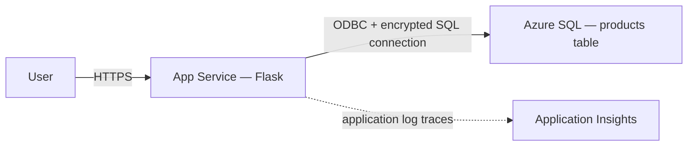

# Flask at Azure SQL sa App Service

**Antas:** Intermediate · **Oras:** 30–60 minuto kasama ang mga kinakailangang paghahanda

Ang halimbawa na ito ay nagde-deploy ng isang Python Flask read API sa **Linux App Service** at isang Basic
Azure SQL database. Kasama ang Source, Bicep, at azd configuration. Ito ay isang
learning application, hindi isang production-ready na arkitektura para sa database.

## Ano ang iyong matututunan

- Mag-provision ng App Service, SQL, at monitoring resources gamit ang Bicep.
- I-configure ang encrypted SQL connectivity nang hindi nagsasama ng credentials.
- I-initialize ang isang schema bago simulan ang mga Gunicorn worker.
- I-verify ang seeded data, not-found responses, at kalusugan ng database.



Mga Resources: nakatalagang resource group, B1 Linux App Service plan, Python 3.11 Web
App, SQL server at Basic 2-GB database, Application Insights, at Log Analytics.
Ginagamit ng Web App ang **source/ZIP deployment at Oryx dependency installation**;
`azd deploy` ay hindi nagbuo o nag-deploy ng optional Dockerfile.

## Mga Kinakailangan

- Kasalukuyang stable na [azd](https://learn.microsoft.com/azure/developer/azure-developer-cli/install-azd)
  (pinakabagong release sa oras ng pagsusuri: 1.37.2).
- [Azure CLI](https://learn.microsoft.com/cli/azure/install-azure-cli) para sa beripikasyon.
- Azure subscription, mga pahintulot na lumikha ng mga nakalistang resources, at regional quota.
- Python **3.11** para sa lokal na pag-develop; ang nakakomit na `pyodbc==5.0.1` ay maaaring mangailangan
  ng native build tools sa mas bagong mga bersyon ng Python.
- Microsoft ODBC Driver 18 (o 17) para sa SQL Server sa lokal na mga makina. `pip install
  pyodbc` ay hindi nag-iinstall ng system driver. Tingnan
  [Pag-install ng ODBC](https://learn.microsoft.com/sql/connect/odbc/download-odbc-driver-for-sql-server).
- Docker lamang kung sinusubukan ang opsyonal na container nang lokal.

```bash
azd version
az version
azd auth login
az login
```

Gamitin ang parehong subscription sa dalawang tools. Ang mga command sa ibaba ay gamit ang Bash.

## Mag-deploy

Mula sa root ng repository:

```bash
cd examples/database-app
azd env new sql-demo
azd provision
azd deploy
WEB_URL=$(azd env get-value WEB_APP_URI)
WEB_NAME=$(azd env get-value WEB_APP_NAME)
RG_NAME=$(azd env get-value AZURE_RESOURCE_GROUP)
```

Pumili ng suportadong rehiyon. `sqlAdminLogin` ay default sa `sqladmin`; ang kinakailangang
`sqlAdminPassword` ay isang secure na parameter. Magbigay ng malakas na password kapag naitatanong.
Panatilihing lihim ang deployment credentials mula sa Git at mga ulat ng isyu. Ang kasalukuyang string interpolation ng koneksyon
ay inaasahan ang password nang walang mga delimiter sa connection-string tulad ng
`;`; baguhin ang escaping bago gamitin ang mga ganitong halaga.

Ang Bicep ay nagse-set ng startup command na nagpapagana ng `init_database()` **bago** magsimula ang Gunicorn
na mga worker. Mahalaga ito dahil ang pag-import ng `app:app` ay hindi nagpapatakbo ng
Python na `if __name__ == '__main__'` block. Sa isang bagong database, ang initialization
ay lumilikha ng `products` at naglalagay ng limang row. Ito ay simpleng teaching seed, hindi isang
concurrent migration framework; gamitin ang tamang migration bago mag-scale ng mga instance.

Pinipili ng app ang naka-install na Microsoft ODBC Driver 18, pagkatapos ay 17, kung ang connection
string ay hindi tahasang nagsasaad ng driver. Kung wala ni isa, mabibigo ang startup na may
actionable installation error. Siguraduhin ang availability ng driver sa napiling
App Service runtime sa halip na mag-assume lang.

## Beripikahin

```bash
curl --fail-with-body "${WEB_URL}/"
curl --fail-with-body "${WEB_URL}/health"
curl --fail-with-body "${WEB_URL}/products"
curl --fail-with-body "${WEB_URL}/products/1"
curl -i "${WEB_URL}/products/999"
```

Inaasahan:

- Ang `/` ay nagbabalik ng impormasyon ng endpoint.
- Ang `/health` ay nagbabalik ng 200 at `{"status":"healthy","database":"connected"}`.
- Ang `/products` ay nagbabalik ng limang seeded na produkto sa bagong database.
- Ang `/products/1` ay nagbabalik ng Laptop na may presyong 1299.99.
- Ang isang hindi umiiral na produkto ay nagbabalik ng 404 na may `{"error":"Product not found"}`.

Ang API ay read-only. Walang POST/PUT/DELETE route o UI sa browser.
Ang pagkabigo sa koneksyon sa database ay nagbabalik ng 503 mula sa `/health`; hindi ito success.

## Mga file at configuration

```text
azure.yaml                         # Python App Service source deployment
infra/main.bicep
infra/main.parameters.json
infra/abbreviations.json
infra/resources/sql-server.bicep
infra/resources/sql-database.bicep
infra/resources/app-service-plan.bicep
infra/resources/web-app.bicep       # Settings + initialization/startup command
infra/resources/app-insights.bicep
src/web/app.py
src/web/requirements.txt
src/web/Dockerfile                 # Optional local container, not the azd target
.env.sample
```

Ang `SQL_CONNECTION_STRING` ay ipinapasa bilang isang secure na Bicep parameter sa Web App module
at iniimbak sa App Service settings, hindi sa deployment outputs.
Ang `APPLICATIONINSIGHTS_CONNECTION_STRING` ay nagko-configure ng log export.
Ang `SCM_DO_BUILD_DURING_DEPLOYMENT=true` ay nagpapagana ng server-side dependency installation.
Ang pagtatakda ng arbitraryong `azd env` na mga halaga ay hindi awtomatikong nagbabago ng app settings.

Ang SQL firewall rule na `0.0.0.0` ay nagpapahintulot ng mga koneksyon mula sa **Azure services,
kabilang ang mga subscription ng ibang customers**, na may pagsunod sa SQL authentication. Ito ay
hindi limitado sa app o subscription na ito lang. Naka-enable ang SQL public network access.
Gumamit ng scoped networking at non-admin application identity bago sa production.

## Lokal na development

Gamitin ang Python 3.11 at naka-install na Microsoft SQL ODBC driver:

```bash
python -m venv .venv
source .venv/bin/activate  # PowerShell: .\.venv\Scripts\Activate.ps1
python -m pip install -r src/web/requirements.txt
export SQL_CONNECTION_STRING='Server=tcp:YOUR_SERVER.database.windows.net,1433;Database=YOUR_DATABASE;UID=YOUR_USER;PWD=YOUR_PASSWORD;Encrypt=yes;TrustServerCertificate=no;Connection Timeout=30;'
python src/web/app.py
```

Palitan nang ligtas ang mga placeholder. Ang kinopyang `.env` file ay **hindi awtomatikong niloload**
ng application na ito. I-export ang mga variable sa iyong kasalukuyang shell.
Para sa Azure SQL mula sa laptop, pansamantalang payagan lamang ang iyong sariling public IP:

```bash
SQL_SERVER=$(azd env get-value SQL_SERVER_NAME)
MY_IP=YOUR_PUBLIC_IP
az sql server firewall-rule create -g "$RG_NAME" -s "$SQL_SERVER" \
  -n AllowMyLearningIP --start-ip-address "$MY_IP" --end-ip-address "$MY_IP"
```

Alisin ang rule pagkatapos ng pagsubok:

```bash
az sql server firewall-rule delete -g "$RG_NAME" -s "$SQL_SERVER" -n AllowMyLearningIP
```

Opsyonal na pagsubok ng container mula sa halimbawa ng direktoryo:

```bash
docker build -t sql-flask:local src/web
docker run --rm -p 8000:8000 -e SQL_CONNECTION_STRING sql-flask:local
```

Ang image na ito ay nag-iinstall ng Driver 18 gamit ang Debian 12 package repository na tumutugma sa
Bookworm base nito, ini-initialize ang database isang beses, pagkatapos ay pinapatakbo ang Gunicorn.

## Pagsubaybay at pag-troubleshoot

Paganahin/tail ang App Service filesystem application logs kapag diniagnose ang startup:

```bash
az webapp log config --name "$WEB_NAME" --resource-group "$RG_NAME" \
  --application-logging filesystem --level information
az webapp log tail --name "$WEB_NAME" --resource-group "$RG_NAME"
```

Ang code na ito ay nag-eexport ng application **log traces** gamit ang legacy OpenCensus handler.
Hindi nito kino-configure ang automatic Flask request/dependency tracing, Live Metrics,
SQL auditing, diagnostic settings, o alerts. Kailangan ng hiwalay na setup ang mga iyon.
Para sa bagong instrumentation, mas gusto ang Azure Monitor OpenTelemetry.

Sa Application Insights Logs, pagkatapos gumawa ng mga API request:

```kusto
traces
| where timestamp > ago(1h)
| where message contains "products" or message contains "Health check"
| project timestamp, message, severityLevel
```

Maglaan ng oras para sa ingestion delay. Ang activity sa request-table o Live Metrics ay hindi
sukatan ng pagkumpleto para sa log-only instrumentation na ito.

- **Nawawalang driver:** suriin ang `pyodbc.drivers()` sa runtime at mag-install ng
  suportadong Microsoft ODBC driver. Hindi sapat ang isang Python package lamang.
- **Pagkabigo sa koneksyon:** tingnan ang mga setting ng SQL, credentials, firewall, at napiling
  subscription. Huwag patayin ang encryption upang laktawan ang error.
- **Nawawalang products table:** kumpirmahin na na-deploy ang Bicep startup command;
  ang pagsisimula ng `gunicorn app:app` nang mag-isa ay nagpapalaktaw sa initialization.
- **Pagkabigo sa pagbuo ng package:** gamitin ang Python 3.11 o magbigay ng mga prerequisite para sa native build.
- **Data na may zero-price:** ang zero ay valid na decimal price; dapat ay ma-serialize ito bilang 0.0,
  hindi `null`.

## Praktikal na Mga Ehersisyo

### Ehersisyo 1: Beripikahin ang behavior sa nawawalang produkto

**Panimulang punto:** naka-deploy na API at `WEB_URL` sa itaas.
**Layunin:** maiba ang nawawalang row sa sirang database.
Hilingin ang `/health` at `/products/999` gamit ang mga command sa itaas.
**Tagumpay na pamantayan / sagot:** health 200, wala nang produkto 404 (hindi 500 o 503).
**Karaniwang isyu:** iniisip na ang not-found response ay nagpapatunay na sirang ang SQL connection.

### Ehersisyo 2: Baguhin ang isang seeded na halaga

**Panimulang punto:** Azure SQL Query Editor, nakakonekta sa sample database.
**Layunin:** ipakita na ang data ng API ay naka-imbak sa SQL at hindi sa memorya ng proseso.

```sql
UPDATE products SET price = 0 WHERE id = 1;
SELECT id, name, price FROM products WHERE id = 1;
```

Hilingin ang `${WEB_URL}/products/1`. **Pamantayan ng tagumpay:** presyo ay `0.0`, hindi `null`.
Ibalik ang halaga:

```sql
UPDATE products SET price = 1299.99 WHERE id = 1;
```

**Karaniwang isyu:** ang pag-edit ng Python seed list ay hindi nag-a-update ng mga row na nasa SQL na.
Huwag gawin ang mga schema/data na ehersisyo laban sa production database.

### Ehersisyo 3: Magdagdag ng read-only count endpoint

**Panimulang punto:** `src/web/app.py`.
**Layunin:** palawakin ang API gamit ang parameter-free aggregate query.
Idagdag ito bago ang block na `if __name__ == '__main__':`:

```python
@app.route('/product-count')
def product_count():
    from contextlib import closing
    with closing(get_db_connection()) as conn, closing(conn.cursor()) as cursor:
        cursor.execute("SELECT COUNT(*) FROM products")
        return jsonify({'count': cursor.fetchone()[0]})
```

Patakbuhin ang `azd deploy web`, pagkatapos hilingin ang `${WEB_URL}/product-count`.
**Pamantayan ng tagumpay:** 200 na may `{"count":5}` sa hindi nabagong seeded database.
**Karaniwang isyu:** pagbabago ng ruta ngunit nakalimutang mag-redeploy.
Para sa production, magdagdag ng error handling/tests; ang maikling ehersisyong ito ay naka-focus sa query.

## Mga Gastos, kakulangan sa production, at paglilinis

Ang B1 App Service at Basic database ay binabayaran habang naka-provision. Hindi tumitigil ang
pagbabayad ng App Service plan kapag hinarang ang Web App. Maaaring dagdagan ng logs at storage ang mga gastos.
Gamitin ang [Azure pricing calculator](https://azure.microsoft.com/pricing/calculator/)
para sa kasalukuyang presyo sa rehiyon. Ang paglipat sa F1 ay nangangailangan din ng pag-disable sa `alwaysOn`;
hindi ito one-line drop-in replacement. Hindi awtomatikong libre ang SQL serverless.

Ang trabaho sa production ay kinabibilangan ng least-privilege app identity (hindi SQL admin),
authentication/authorization, pribadong networking, ligtas na mga migration, connection
pooling/lifecycle review, telemetry, auditing, alerts, tests, at mga pamamaraan sa recovery.
Ang Redis caching at karagdagang mga tabla ay mga ideya sa development, hindi pa nai-implement na mga ehersisyo.

Mula sa halimbawa ng direktoryo na ito:

```bash
azd down
```

Suriin ang prompt sa pagtanggal at tiyakin na natanggal ang dedikadong resource group.
Huwag tanggalin ang mga grupo na may mga hindi kaugnay na data.

[Mga halimbawa ng Container](../../../../examples/container-app) ·
[Pag-develop ng AI](../../docs/chapter-02-ai-development/README.md) ·
[Home ng Kurso](../../README.md) · [Mag-ulat ng isyu](https://github.com/microsoft/AZD-for-beginners/issues)

---

<!-- CO-OP TRANSLATOR DISCLAIMER START -->
**Pagtatanggi**:
Ang dokumentong ito ay isinalin gamit ang serbisyo ng AI translation na [Co-op Translator](https://github.com/Azure/co-op-translator). Bagama't nagsusumikap kami para sa katumpakan, pakatandaan na ang awtomatikong pagsasalin ay maaaring maglaman ng mga pagkakamali o hindi pagkakatugma. Ang orihinal na dokumento sa orihinal nitong wika ang dapat ituring na pangunahing sanggunian. Para sa mahahalagang impormasyon, inirerekomenda ang propesyonal na pagsasalin ng tao. Hindi kami mananagot sa anumang maling pagkakaintindi o maling interpretasyon na nagmula sa paggamit ng pagsasaling ito.
<!-- CO-OP TRANSLATOR DISCLAIMER END -->