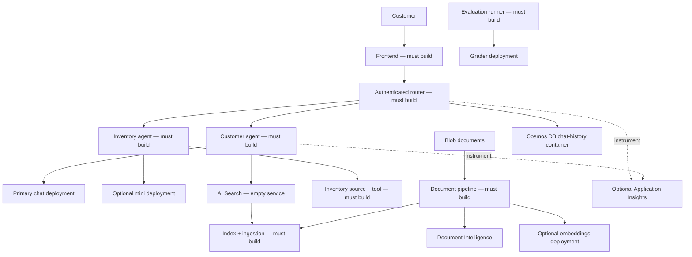

# Multi-Agent Customer Support — Retail Architecture Blueprint

**Kabanata 5: Mga Solusyong Multi-Agent AI**

- [Bahay ng Kurso](../README.md)
- [Kabanata 5](../docs/chapter-05-multi-agent/README.md)
- [Pangangailangan: Integrasyon ng AI](../docs/chapter-02-ai-development/microsoft-foundry-integration.md)
- [Susunod: Pagpaplano ng Kakayanan](../docs/chapter-06-pre-deployment/capacity-planning.md)
- [ARM infrastructure scaffold](retail-multiagent-arm-template/README.md)

> **Gabay sa Arkitektura, hindi isang gumaganang aplikasyon.** Ang mga nag-iisang retail na implementasyon
> na mga file ay ang `azuredeploy.json`, `azuredeploy.parameters.json`, at `deploy.sh` sa
> `retail-multiagent-arm-template/`. Ang mga router/frontend containers ay mga hello-world
> placeholder lamang. Walang retail agent, UI, ingestion pipeline, evaluator, scanner, o
> aplikasyon test suite na umiiral lokal.

## Pangkalahatang-ideya

**Layunin:** magdisenyo ng isang customer-support system na may customer agent at inventory
agent, tukuyin kung ano ang ibinibigay ng imprastraktura, at planuhin ang mga nawawalang application
contract at beripikasyon.

**Tagapakinig:** mga developer na nakatapos na ng lokal na
[chat sample](../../../examples/azure-openai-chat) at [two-service container sample](../../../examples/container-app/microservices).
Maglaan ng 2–3 oras para sa pag-aaral ng arkitektura. Ang paggawa ng aplikasyon ay isang hiwalay na
proyekto: 80–120 oras ng pag-develop ay isang ilustratibong pagtataya sa pagpaplano para sa
mga karanasang developer, **hindi isang pangakong paghahatid**; kailangan ang karagdagang trabaho para sa production hardening, tests,
security review, at operations.

### Mga Kinalabasan sa Pag-aaral

- Ipaliwanag ang routing, grounding, mga permiso ng tool, at pagmamay-ari ng pag-uusap.
- Pag-iba-iba ng mga model identifier, deployment name, API version, at ARM version.
- Disenyo ng pag-ingest at retrieval ng dokumento na may tumutugmang vector dimensions.
- Tukuyin ang nasusuring functional, evaluation, at failure-recovery requirements.
- Paghiwalayin ang opsyonal na layunin sa arkitektura mula sa mga totoong pinagkukunang ibinigay.

## Arkitektura ng Solusyon



Ito ay isang **target na arkitektura ng aplikasyon**, hindi isang diagram ng tumatakbong serbisyo ng ahente.
Ang ARM scaffold ay lumilikha lamang ng mga pangunahing serbisyo at dalawang placeholder
na container. Hindi kasama ang Front Door, registry, managed identities, role assignments,
private endpoints, failover, application instrumentation, at alerts.

### Mga Responsibilidad at Kontrata

| Komponent | Kinakailangang pag-uugali | Katibayan bago tawaging kumpleto |
|---|---|---|
| Frontend | Mag-authenticate ng mga user, mag-render ng chat, mag-upload ng mga dokumento ng ligtas | UI at upload tests, accessible na error |
| Router | Mag-authorize ng mga request, pumili ng ahente, limitahan ang pagtawag sa tool/timeout | Routing tests, authorization checks, failure tests |
| Customer agent | I-base ang mga sagot sa polisiya/produkto sa mga aprubadong pinagmulan | Tamang pagsipi, pag-abstain kung walang data |
| Inventory tool | Basahin ang opisyal na stock na may nakatalagang permiso | Deterministikong stock tests; walang imbentong availability |
| Document pipeline | I-extract, chunk, embed, index, update/delete | Indexed fixtures at retry/dead-letter behavior |
| Conversation storage | Ihiwalay ang mga user, ipatupad ang retention | Cross-user authorization at TTL tests |
| Evaluation runner | Ihambing ang mga output sa ground truth at rubric | Coverage, bilang ng pagkabigo, reproducible reports |

Isipin ang router bilang reception desk at ang mga tool bilang mga limitadong internal na sistema:
ang pagpili ng espesyalista ay hindi awtorisasyon upang ma-access ang lahat ng talaan ng customer.
Ipatupad ang pagkakakilanlan at permiso sa application code at data services, hindi sa mga prompt.

## Imprastruktura vs. Aplikasyon

Basahin ang [scaffold README](retail-multiagent-arm-template/README.md) bago mag-provision.
Nakatala dito ang eksaktong mga resource, mode, gastos, at limitasyon.

| Loohikal na gamit | Pangalan ng ARM deployment | Modelo / bersyon | Default na rehiyon |
|---|---|---|---|
| Customer chat | `gpt-4.1-chat` | `gpt-4.1` / `2025-04-14` | `eastus2` |
| Inventory | `gpt-4.1-mini-inventory` | `gpt-4.1-mini` / `2025-04-14` | `westus2`, opsyonal |
| Embeddings | `text-embedding-ada-002` | `text-embedding-ada-002` / `2` | `francecentral`, opsyonal |
| Evaluation | `gpt-4.1-grader` | `gpt-4.1` / `2025-04-14` | Pangunahing rehiyon bilang default |

Suriin ang availability ng model/bersyon/SKU at quota sa **bawat rehiyon**. Ang Chat/mini/grader
ay gumagamit ng `GlobalStandard`; embeddings gumagamit ng `Standard`. Ang mga kapasidad-unit para sa TPM ay
natatangi sa bawat modelo. Huwag magdagdag ng hindi kaparehong kapasidad-unit bilang pangkalahatang garantiya ng quota.

Ang `model` argument ng isang Azure OpenAI request ay ang **pangalan ng deployment**, hindi
palaging ang catalog model identifier. Ang data-plane API version `2024-10-21`
ay iba sa model version `2025-04-14` at sa ARM resource `apiVersion`.
Hindi maitatama ang unavailable na modelo sa pamamagitan lamang ng pagpapalit ng data-plane API version.

`--no-multi-region` ay nilalaktawan ang secondary at embeddings account. May natitirang pangunahing chat at
independent grader account. Ang magkahiwalay na account ng modelo ay hindi nagbibigay ng awtomatikong
failover; kailangan nito ng routing ng aplikasyon, compatible na deployment, health checks,
retry limits, at pagsusuri ng data residency.

## Roadmap ng Implementasyon

### 1. Magsimula sa isang nasubok na interaksyon

Bago mag-provision ng malaking scaffold, gamitin ang lokal na chat sample upang maitaguyod
ang inference connectivity. Tukuyin ang isang kinatawang tanong ng customer, ang aprubadong
pinagmumulan ng sagot, inaasahang pagsipi, at pag-uugali kapag nawawala ang pinagmulan.

### 2. Tukuyin ang routing at mga hangganan ng tool

Gumawa ng sarili mong router source, dependency manifest, Dockerfile, at mga test. Isang
halimbawa ng kontrata ay `POST /chat` kasama ang `{"message":"...","conversation_id":"..."}`.
**Ang endpoint na iyon ay isang disenyo lamang; hindi ito ipinatupad ng ARM template.**

Patunayan ang mga uri/limitasyon ng body, kunin ang pagkakakilanlan ng user mula sa authentication, ipatupad
ang pagmamay-ari ng pag-uusap, maglagay ng request timeout, at magbalik ng makahulugang mga error code.
Huwag tratuhin ang mga HTTP failure o walang mga sagot bilang matagumpay na resulta ng agent.

### 3. Ipatupad ang grounding at ingestion

Hindi lumilikha ang ARM template ng search index. Ito ay isang **reference JSON
fragment para iakma sa sarili mong index definition**, hindi isang file na nasa repo:

```json
{
  "name": "retail-product-index",
  "fields": [
    {"name": "id", "type": "Edm.String", "key": true},
    {"name": "title", "type": "Edm.String", "searchable": true},
    {"name": "content", "type": "Edm.String", "searchable": true},
    {"name": "category", "type": "Edm.String", "filterable": true},
    {
      "name": "content_vector",
      "type": "Collection(Edm.Single)",
      "searchable": true,
      "dimensions": 1536,
      "vectorSearchProfile": "retail-profile"
    }
  ],
  "vectorSearch": {
    "algorithms": [{"name": "retail-hnsw", "kind": "hnsw"}],
    "profiles": [{"name": "retail-profile", "algorithm": "retail-hnsw"}]
  }
}
```

Ang profile ay nag-uugnay ng vector field sa algoritmong ginagamit. Dapat tugma ang dimension
sa aktwal na output ng embedding (1536 para sa `ada-002` deployment na ito). Para sa Python retrieval,
gamitin ang `azure.search.documents.models.VectorizedQuery` sa halip na isang hindi kumpletong
diksyunaryo na walang vector query kind:

```python
# Reference function only: supply an authenticated async SearchClient and an embedding.
from azure.search.documents.models import VectorizedQuery

async def retrieve(search_client, embedding):
    results = await search_client.search(
        search_text=None,
        vector_queries=[VectorizedQuery(
            vector=embedding,
            k_nearest_neighbors=5,
            fields="content_vector"
        )],
        select=["id", "title", "content"]
    )
    return [document async for document in results]
```

Gumawa ng hiwalay na implementasyon sa ingestion na:

1. Nagpapahintulot ng upload access at nagtse-check ng content type at laki.
2. Nagbabasa ng private blobs gamit ang authenticated SDK calls. Ang isang private blob URL nang mag-isa
   ay **hindi** isang nababasang input ng Document Intelligence; ipadala ang na-download na bytes gamit ang
   `AnalyzeDocumentRequest(bytes_source=...)` o gumamit ng angkop na scoped,
   short-lived SAS pagkatapos suriin ang access requirements.
3. I-extract ang teksto, i-chunk upang magkasya sa limitasyon ng embedding, at gumawa ng embeddings.
4. Gumawa ng matibay at valid na mga susi ng dokumento at mag-upload ng mga chunk na may tumutugmang vector.
5. Suriin ang resulta ng per-document indexing, pangasiwaan ang mga retry, at i-update/delete ang luma o lumang data.

Huwag ipasok ang arbitraryong user keys/values sa OData filters. Gumamit ng allowlist ng mga field,
patunayan ang uri ng value, at i-escape ang mga string quote. Ang mga boolean at numeric filter ay nangangailangan
ng typed literals, hindi mga naka-quote na string.

### 4. Web grounding

**Ang Bing Search v7 ay na-retire noong Agosto 11, 2025.** Ang lumang `Microsoft.Bing/accounts`
resource at mga halimbawa ng `api.bing.microsoft.com/v7.0/search` ay hindi suportadong
landas ng implementasyon. Suriin ang kasalukuyang suportadong grounding integration sa
Microsoft Foundry at ang SDK nito, permiso, billing, at mga pangangailangan sa pagsipi;
wala pa itong implementasyon dito. Hindi ito maaaring diretsong kapalit ng na-retire na endpoint.

### 5. Magdagdag ng telemetry at pagsusuri

Ang paglikha ng Application Insights ay hindi nag-iinstrument ng code. Gumamit ng suportadong Azure Monitor
OpenTelemetry instrumentation kapag gumagawa ng bagong aplikasyon, ipasa ang trace
context sa pagitan ng mga serbisyo, at iwasan ang pag-log ng mga customer prompt, dokumento, o sikreto.
Ang pag-truncate ng query ay **hindi** nag-aanonimisa nito.

Sukatin ang tagal ng request, pagkapalpak ng routing/tool, kaugnayan ng retrieval, katumpakan ng pagsipi,
paggamit ng token, at pag-abstain. Itago ang ground-truth inventory/policy facts
kasama ang evaluation cases: isang grader ay hindi maaasahang matutukoy ang katotohanan
mula sa tanong at sagot lamang.

Ang grader deployment ay hindi isang evaluation runner. Ipatupad ang versioned rubric,
nakabalangkas na output/schema validation, pag-check ng score range, bilang ng pagkabigo sa transport,
at mga kaso na nire-review ng tao. I-report ang incomplete/error cases nang hiwalay; huwag gawing matagumpay na grado
o tahimik itong isama bilang zero-quality model responses.

Gayundin, ang isang maliit na bilang ng keyword checks ay hindi sertipikasyon ng seguridad. Ang nabigong HTTP
request, nawawalang test strategy, o walang sagot ay dapat gawing **inconclusive o nag-fail na test**,
hindi magbigay ng score na “100% secure.” Gawin ang authorized testing gamit ang angkop na
kagamitan at pagsusuring pang-tao bago ang anumang paghahabol sa pagiging handa para sa produksyon.

### 6. I-deploy ang iyong aplikasyon

Gumawa ng sarili mong source directories, manifest, mga test, registry, at image-pull
permission. Palitan ang mga placeholder ng mga built image at i-update ang ingress/probes upang
tumugma sa port na pinapakinggan ng bawat app. I-configure ang runtime environment variables sa Bicep
o sa isang tahasang suportadong azd environment mapping.

Walang generic na `config` dictionary sa ilalim ng azd service na awtomatikong
lumilikha ng runtime environment variables. Ang `azd env set` ay binabago lamang ang mga resource na
tahasang kumokonsumo ng mga iyon. Walang canary, regions list, o fine-tuning hook
na ipinatupad sa scaffold na ito.

## Mga Praktikal na Ehersisyo sa Disenyo

Ito ay mga **ehersisyo sa arkitektura**, hindi mga pahayag ng executable retail starter code.

### Ehersisyo 1: Beripikahin ang hangganan

**Pangunahing punto:** ang tatlong file sa `retail-multiagent-arm-template/`.
**Layunin:** pag-ibahin ang provisioning mula sa functionality ng aplikasyon.
Buksan ang `azuredeploy.json`, hanapin ang parehong container images at `targetPort` na mga halaga,
pagkatapos ay ilista ang mga bahagi ng aplikasyon na wala sa repositoryo.

**Mga pamantayan ng tagumpay / sagot:** parehong mga imahe ay mga placeholder na hello-world na nakikinig
sa port 80; mga ahente, chat UI, router handler, index/ingestion, evaluator, at scanner
ay wala. Ang matagumpay na placeholder na root request ay hindi nagpapatunay ng `/chat`.
**Karaniwang isyu:** ang pag-interpret ng mga pangalan ng resource gaya ng `retail-router` bilang gumaganang code.

### Ehersisyo 2: Sundan ang vector configuration

**Pangunahing punto:** index JSON sa itaas.
**Layunin:** unawain ang ugnayan ng field → profile → algorithm.
Tukuyin kung aling mga halaga ang kailangang baguhin kapag lumilipat sa embedding model na may
ibang output dimension, pagkatapos ay suriin ang `retrieve` function.

**Mga pamantayan ng tagumpay / sagot:** baguhin ang field `dimensions` sa totoong haba ng vector;
panatilihing naka-align ang `vectorSearchProfile` sa idineklara na profile at ang algorithm nito;
ang query na `fields` ay dapat pangalanan ang vector field. Muling likhain ang umiiral na mga vector ng dokumento
kapag nagbago ang embedding model.
**Karaniwang isyu:** pagpapaikli lang ng pangalan ng modelo habang pinananatiling hindi compatible ang mga vector.

### Ehersisyo 3: Tukuyin ang failure test

**Pangunahing punto:** talahanayan ng mga responsibilidad.
**Layunin:** pigilan ang maling tagumpay.
Isulat ang inaasahang pag-uugali para sa isang unavailable na inventory API, isang search index na walang
tumutugmang dokumento, at isang evaluation request na nagbabalik ng HTTP 503.

**Mga pamantayan ng tagumpay / sagot:** walang imbentong halaga ng imbentaryo; malinaw na pag-abstain o
pag-escalate kapag nawawala ang konteksto; ang evaluation ay nag-uulat ng transport failure kaysa
sa pagdaan sa kalidad o seguridad. Magdagdag ng executable tests kapag ginagawa ang aplikasyon.
**Karaniwang isyu:** mahuli ang bawat exception at ipagpatuloy na may walang sagot.

## Mga Gastos, Pag-aayos ng Problema, at Paglilinis

- Patuloy ang gastos ng imprastruktura kahit walang laman ang search index at placeholder
  apps. Gamitin ang kasalukuyang presyo sa rehiyon; ang “minimal” o multi-region ay hindi nangangahulugang libre.
- Depende ang gastos ng token sa modelo, cached/uncached na input, output, at deployment SKU.
  Makakatipid sa routing kung nasusukat ang workload at kalidad ng resulta;
  hindi garantisado ang fixed 60–80% savings.
- Suriin ang availability ng modelo at quota bago mag-provision; i-iba ang permission,
  deployment-name, rehiyon, model-version, at API-version na mga error.
- Huwag patakbuhin ang mga nawawalang `setup-data.sh`, evaluator CLI, o `pytest tests/` na mga command.
  Parte ng iyong development backlog ang kanilang implementasyon.
- Ang scaffold ay para sa ARM lang: sundin ang
  [mga tagubilin sa beripikasyon at paglilinis](retail-multiagent-arm-template/README.md).
  Hindi pinamamahalaan ng `azd down` ang mga resource na iyon.

## Mga Kaugnay na Resource

- [Gumaganang lokal na chat sample](../../../examples/azure-openai-chat)
- [Gumaganang two-service container sample](../../../examples/container-app/microservices)
- [AI Search vector indexes](https://learn.microsoft.com/azure/search/vector-search-how-to-create-index)
- [Container Apps documentation](https://learn.microsoft.com/azure/container-apps/)
- [Pag-aayos ng problema](../docs/chapter-07-troubleshooting/common-issues.md)
- [Mag-ulat ng isyu](https://github.com/microsoft/AZD-for-beginners/issues)

---

<!-- CO-OP TRANSLATOR DISCLAIMER START -->
**Pagtatanggi**:
Ang dokumentong ito ay isinalin gamit ang serbisyo ng AI translation na [Co-op Translator](https://github.com/Azure/co-op-translator). Bagama't nagsusumikap kami para sa katumpakan, pakatandaan na ang awtomatikong pagsasalin ay maaaring maglaman ng mga pagkakamali o hindi pagkakatugma. Ang orihinal na dokumento sa orihinal nitong wika ang dapat ituring na pangunahing sanggunian. Para sa mahahalagang impormasyon, inirerekomenda ang propesyonal na pagsasalin ng tao. Hindi kami mananagot sa anumang maling pagkakaintindi o maling interpretasyon na nagmula sa paggamit ng pagsasaling ito.
<!-- CO-OP TRANSLATOR DISCLAIMER END -->