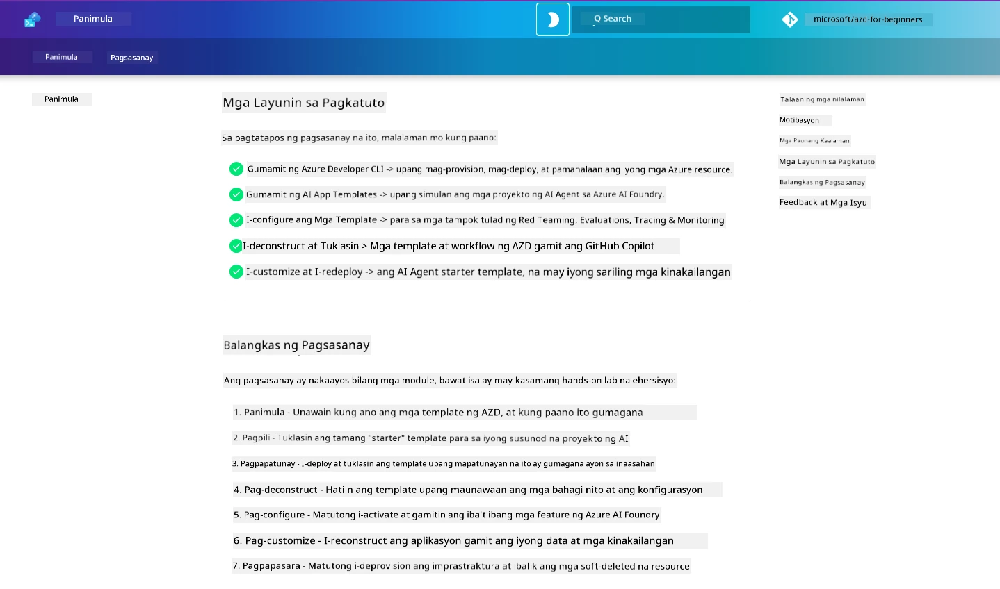

<div align="center">
  <div style="background: linear-gradient(135deg, #0078d4, #106ebe); border-radius: 10px; padding: 20px; margin: 20px 0; box-shadow: 0 4px 15px rgba(0, 120, 212, 0.3); border: 2px solid #005a9e;">
    <h2 style="color: white; margin: 0; font-size: 24px; text-shadow: 1px 1px 2px rgba(0,0,0,0.3);">
      🎯 AZD para sa Mga AI Developer Workshop
    </h2>
    <p style="color: white; margin: 10px 0 0 0; font-size: 16px; text-shadow: 1px 1px 2px rgba(0,0,0,0.3);">
      <strong>Isang hands-on na workshop para sa paggawa ng mga AI application gamit ang Azure Developer CLI.</strong><br>
      Kumpletuhin ang 7 modules para maging eksperto sa AZD templates at AI deployment workflows.
    </p>
    <div style="margin-top: 15px;">
      <span style="background: rgba(255,255,255,0.2); padding: 5px 10px; border-radius: 15px; color: white; font-size: 14px;">
        📅 Na-review ang panggagalingan: Nobyembre 2026
      </span>
    </div>
  </div>
</div>

# AZD para sa Mga AI Developer Workshop

Maligayang pagdating sa hands-on na workshop para sa pag-aaral ng Azure Developer CLI (AZD) na nakatuon sa deployment ng AI application. Tutulungan ka ng workshop na ito na magkaroon ng praktikal na pag-unawa sa AZD templates sa 3 hakbang:

1. **Diskubre** - hanapin ang tamang template para sa iyo.
1. **Deployment** - i-deploy at i-validate na gumagana ito
1. **Pag-customize** - baguhin at ulitin para maging sarili mo ito!

Sa kabuuan ng workshop na ito, ipakikilala rin sa iyo ang mga pangunahing developer tools at workflows, upang matulungan kang maging mas epektibo sa iyong proseso ng end-to-end development.

<br/>

## Gabay sa Browser

Ang mga leksyon sa workshop ay nasa Markdown. Maaari mong direktang i-browse sa GitHub - o ilunsad ang preview ng browser gaya ng ipinapakita sa screenshot sa ibaba.



Para magamit ang opsyong ito - i-fork ang repository sa iyong profile, at ilunsad ang GitHub Codespaces. Kapag aktibo na ang terminal ng VS Code, i-type ang command na ito:

Gumagana ang browser preview na ito sa GitHub Codespaces, dev containers, o lokal na kopya na may naka-install na Python at MkDocs.

```bash title="" linenums="0"
python -m pip install -r requirements-dev.txt
python -m mkdocs serve --config-file workshop/mkdocs.yml
```

Patakbuhin ang mga command na ito mula sa **ugat ng repository ng kurso**, hindi mula sa hiwalay na na-initialize na AI sample. Panatilihing bukas ang preview para makita agad ang mga error; itigil ito gamit ang Ctrl+C. Para tingnan ang site nang hindi nag-se-serve, patakbuhin ang `python -m mkdocs build --strict --config-file workshop/mkdocs.yml`.

Sa loob ng ilang segundo, makikita mo ang isang pop-up dialog. Piliin ang opsyong `Open in browser`. Bubukas na ngayon ang web-based na gabay sa isang bagong tab ng browser. Ilan sa mga benepisyo ng preview na ito:

1. **Built-in search** - mabilis na hanapin ang mga keyword o aralin.
1. **Copy icon** - i-hover ang mouse sa mga codeblock para makita ang opsyon
1. **Theme toggle** - magpalit sa pagitan ng dark at light na tema
1. **Kumuha ng tulong** - i-click ang Discord icon sa footer para sumali!

<br/>

## Pangkalahatang-ideya ng Workshop

**Tagal:** 3-4 na oras  
**Antas:** Baguhan hanggang Intermediate  
**Mga Paunang Kinakailangan:** Pamilyar sa Azure, mga konsepto ng AI, VS Code at command-line tools.

Isang hands-on na workshop ito kung saan natututo ka sa pamamagitan ng paggawa. Pagkatapos mong makumpleto ang mga ehersisyo, inirerekomenda namin na balikan mo ang AZD For Beginners na kurikulum para ipagpatuloy ang iyong pagkatuto sa mga pinakamahusay na kasanayan sa Seguridad at Produktibidad.

| Oras | Module  | Layunin |
|:---|:---|:---|
| 15 mins | [Panimula](docs/instructions/0-Introduction.md) | Itakda ang pundasyon, unawain ang mga layunin |
| 30 mins | [Piliin ang AI Template](docs/instructions/1-Select-AI-Template.md) | Tuklasin ang mga opsyon at pumili ng panimula | 
| 30 mins | [I-validate ang AI Template](docs/instructions/2-Validate-AI-Template.md) | I-deploy ang default na solusyon sa Azure |
| 30 mins | [I-deconstruct ang AI Template](docs/instructions/3-Deconstruct-AI-Template.md) | Tuklasin ang istruktura at configuration |
| 30 mins | [I-configure ang AI Template](docs/instructions/4-Configure-AI-Template.md) | I-activate at subukan ang mga available na feature |
| 30 mins | [I-customize ang AI Template](docs/instructions/5-Customize-AI-Template.md) | Iangkop ang template sa iyong pangangailangan |
| 30 mins | [I-teardown ang Infrastructure](docs/instructions/6-Teardown-Infrastructure.md) | Linisin at palayain ang mga resources |
| 15 mins | [Pagtatapos at Mga Susunod na Hakbang](docs/instructions/7-Wrap-up.md) | Mga learning resource, hamon sa workshop |

<br/>

## Ano ang Iyong Matututunan

Isipin ang AZD Template bilang isang learning sandbox upang tuklasin ang iba't ibang kakayahan at mga tools para sa end-to-end development sa Microsoft Foundry. Sa pagtatapos ng workshop na ito, dapat mayroon kang intuitive na pag-unawa sa iba't ibang tools at konsepto sa kontekstong ito.

| Konsepto  | Layunin |
|:---|:---|
| **Azure Developer CLI** | Unawain ang mga command ng tool at workflows|
| **AZD Templates**| Unawain ang istruktura ng proyekto at config|
| **Azure AI Agent**| Mag-provision at mag-deploy ng Microsoft Foundry na proyekto  |
| **Azure AI Search**| Paganahin ang context engineering gamit ang mga agent |
| **Observability**| Tuklasin ang tracing, monitoring at evaluations |
| **Red Teaming**| Tuklasin ang adversarial testing at mitigations |

<br/>

## Istruktura ng Workshop

Ang workshop ay nakaayos upang dalhin ka sa isang paglalakbay mula sa pagtuklas ng template, hanggang sa deployment, deconstruction, at customization - gamit ang opisyal na [Getting Started with AI Agents](https://github.com/Azure-Samples/get-started-with-ai-agents) na starter template bilang batayan.

### [Module 1: Piliin ang AI Template](docs/instructions/1-Select-AI-Template.md) (30 mins)

- Ano ang mga AI Template?
- Saan ako makakahanap ng AI Template?
- Paano ako makakapagsimula sa paggawa ng AI Agents?
- **Lab**: Quickstart sa Codespaces o dev container

### [Module 2: I-validate ang AI Template](docs/instructions/2-Validate-AI-Template.md) (30 mins)

- Ano ang AI Template Architecture?
- Ano ang AZD Development Workflow?
- Paano ako makakakuha ng tulong sa AZD Development?
- **Lab**: Deploy at I-validate ang AI Agents template

### [Module 3: I-deconstruct ang AI Template](docs/instructions/3-Deconstruct-AI-Template.md) (30 mins)

- Tuklasin ang iyong kapaligiran sa `.azure/` 
- Tuklasin ang iyong resource setup sa `infra/` 
- Tuklasin ang iyong AZD configuration sa `azure.yaml`s
- **Lab**: Baguhin ang Environment Variables & I-redeploy

### [Module 4: I-configure ang AI Template](docs/instructions/4-Configure-AI-Template.md) (30 mins)
- Tuklasin: Retrieval Augmented Generation
- Tuklasin: Agent Evaluation & Red Teaming
- Tuklasin: Tracing & Monitoring
- **Lab**: Tuklasin ang AI Agent + Observability 

### [Module 5: I-customize ang AI Template](docs/instructions/5-Customize-AI-Template.md) (30 mins)
- Tukuyin: PRD na may mga Scenario Requirements
- I-configure: Environment Variables para sa AZD
- Ipatupad: Lifecycle Hooks para sa dagdag na mga gawain
- **Lab**: I-customize ang template para sa aking scenario

### [Module 6: I-teardown ang Infrastructure](docs/instructions/6-Teardown-Infrastructure.md) (30 mins)
- Balikan: Ano ang AZD Templates?
- Balikan: Bakit gamitin ang Azure Developer CLI?
- Mga Susunod na Hakbang: Subukan ang ibang template!
- **Lab**: I-deprovision ang infrastructure at paglilinis

<br/>

## Hamon sa Workshop

Gusto mo bang hamunin ang sarili na gumawa pa ng higit? Narito ang ilang mungkahing proyekto - o ibahagi ang iyong mga ideya sa amin!!

| Proyekto | Deskripsyon |
|:---|:---|
|1. **I-deconstruct ang Isang Kumplikadong AI Template** | Gamitin ang workflow at mga tool na inilatag namin at tingnan kung kaya mong i-deploy, i-validate, at i-customize ang ibang AI solution template. _Ano ang iyong natutunan?_|
|2. **I-customize Ayon sa Iyong Scenario**  | Subukang gumawa ng PRD (Product Requirements Document) para sa ibang scenario. Pagkatapos, gamitin ang GitHub Copilot sa iyong template repo sa Agent Model - at hilingin na gumawa ng customization workflow para sa iyo. _Ano ang iyong natutunan? Paano mo mapapabuti ang mga mungkahing ito?_|
| | |

## May feedback?

1. Mag-post ng isyu sa repo na ito - lagyan tag ang `Workshop` para sa kaginhawaan.
1. Sumali sa Microsoft Foundry Discord - makipag-ugnayan sa iyong mga kapwa!


| | | 
|:---|:---|
| **📚 Home ng Kurso**| [AZD For Beginners](../README.md)|
| **📖 Dokumentasyon** | [Simulan sa AI templates](https://learn.microsoft.com/en-us/azure/ai-foundry/how-to/develop/ai-template-get-started)|
| **🛠️AI Templates** | [Microsoft Foundry Templates](https://ai.azure.com/templates) |
|**🚀 Mga Susunod na Hakbang** | [Simulan ang Workshop](#workshop-overview) |
| | |

<br/>

---

**Pag-navigate:** [Pangunahing Kurso](../README.md) | [Panimula](docs/instructions/0-Introduction.md) | [Module 1: Piliin ang Template](docs/instructions/1-Select-AI-Template.md)

**Handa ka na bang magsimulang gumawa ng mga AI application gamit ang AZD?**

[Simulan ang Workshop: Panimula →](docs/instructions/0-Introduction.md)

---

<!-- CO-OP TRANSLATOR DISCLAIMER START -->
**Pagtatanggi**:
Ang dokumentong ito ay isinalin gamit ang serbisyo ng AI translation na [Co-op Translator](https://github.com/Azure/co-op-translator). Bagama't nagsusumikap kami para sa katumpakan, pakatandaan na ang awtomatikong pagsasalin ay maaaring maglaman ng mga pagkakamali o hindi pagkakatugma. Ang orihinal na dokumento sa orihinal nitong wika ang dapat ituring na pangunahing sanggunian. Para sa mahahalagang impormasyon, inirerekomenda ang propesyonal na pagsasalin ng tao. Hindi kami mananagot sa anumang maling pagkakaintindi o maling interpretasyon na nagmula sa paggamit ng pagsasaling ito.
<!-- CO-OP TRANSLATOR DISCLAIMER END -->