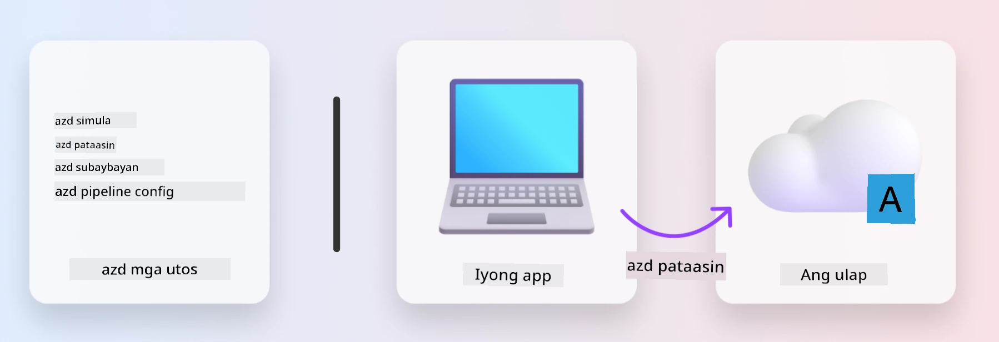
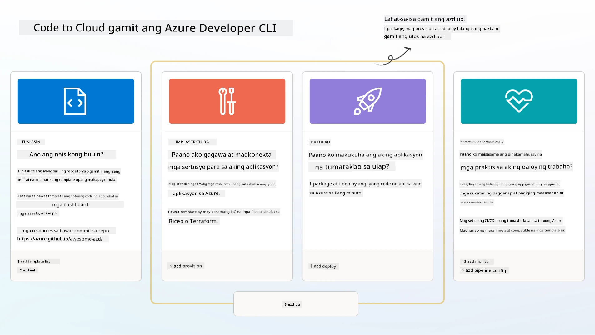

# 1. Pumili ng Template

!!! tip "SA PAGTATAPOS NG MODULONG ITO MAAARI MO NG"

    - [ ] Describe what AZD templates are
    - [ ] Discover and use AZD templates for AI
    - [ ] Get started with the AI Agents template
    - [ ] **Lab 1:** AZD Quickstart in Codespaces or a dev container

---

## 1. Isang Anolohiya ng Tagapagtayo

Ang paggawa ng isang modernong enterprise-ready na AI application _mula sa simula_ ay maaaring maging nakakatakot. Kagaya ito ng pagbuo ng iyong bagong bahay nang mag-isa, bato-bato. Oo, kaya ito! Ngunit ito ay hindi ang pinakaepektibong paraan upang makuha ang nais na resulta!

Sa halip, madalas tayong nagsisimula sa isang umiiral na _disenyo blueprint_, at nagtatrabaho kasama ang isang arkitekto upang i-customize ito ayon sa ating mga personal na pangangailangan. At iyon talaga ang tamang paraan sa paggawa ng mga matatalinong aplikasyon. Una, humanap ng magandang disenyo ng arkitektura na angkop sa iyong problema. Pagkatapos ay makipagtulungan sa isang solution architect upang i-customize at paunlarin ang solusyon para sa iyong partikular na sitwasyon.

Pero saan natin mahahanap ang mga disenyo blueprint na ito? At paano tayo makakahanap ng arkitekto na handang turuan tayo kung paano i-customize at i-deploy ang mga blueprint na ito nang mag-isa? Sa workshop na ito, sasagutin namin ang mga tanong na iyon sa pamamagitan ng pagpapakilala sa iyo sa tatlong teknolohiya:

1. [Azure Developer CLI](https://aka.ms/azd) - isang open-source na kasangkapan na nagpapabilis ng landas ng developer mula sa lokal na development (build) hanggang cloud deployment (ship).
1. [Microsoft Foundry Templates](https://ai.azure.com/templates) - mga standardized open-source na repositoryo na naglalaman ng sample na code, imprastruktura at mga configuration file para sa pag-deploy ng AI solution architecture.
1. [GitHub Copilot Agent Mode](https://code.visualstudio.com/docs/copilot/chat/chat-agent-mode) - isang coding agent na nakabatay sa kaalaman ng Azure, na makakatulong sa atin na mag-navigate sa codebase at gumawa ng mga pagbabago gamit ang natural na wika.

Sa mga kasangkapang ito, maaari na nating _matuklasan_ ang tamang template, _i-deploy_ ito upang patunayan na gumagana, at _i-customize_ ito upang umangkop sa ating mga partikular na senaryo. Sige, simulan natin at alamin kung paano ito gumagana.


---

## 2. Azure Developer CLI

Ang [Azure Developer CLI](https://learn.microsoft.com/en-us/azure/developer/azure-developer-cli/) (o `azd`) ay isang open-source na commandline na kasangkapan na maaaring pabilisin ang iyong code-to-cloud na paglalakbay gamit ang mga utos na friendly sa developer na gumagana nang pare-pareho sa iyong IDE (development) at CI/CD (devops) na mga kapaligiran.

Sa tulong ng `azd`, maaaring maging kasing simple ng:

- `azd init` - Nagpapasimula ng bagong AI project mula sa umiiral na AZD template.
- `azd up` - Nagpapasigla ng imprastruktura at nagde-deploy ng iyong aplikasyon sa isang hakbang.
- `azd monitor` - Nakakakuha ng real-time monitoring at diagnostics para sa iyong na-deploy na aplikasyon.
- `azd pipeline config` - Nagse-set up ng CI/CD pipelines upang i-automate ang deployment sa Azure.

**🎯 | PAGSASANAY**: <br/> Siyasatin ang `azd` commandline tool sa iyong kasalukuyang kapaligiran ng workshop ngayon. Maaaring ito ay GitHub Codespaces, isang dev container, o isang lokal na kopya na may naka-install na mga kinakailangan. Simulan sa pamamagitan ng pag-type ng utos na ito upang makita kung ano ang kaya ng tool:

```bash title="" linenums="0"
azd help
```



---

## 3. Ang AZD Template

Para maisakatuparan ito ng `azd`, kailangan nitong malaman ang imprastrukturang ipapatupad, ang mga setting ng konfigurasyon na ipatutupad, at ang aplikasyon na ide-deploy. Dito pumapasok ang [mga AZD template](https://learn.microsoft.com/en-us/azure/developer/azure-developer-cli/azd-templates?tabs=csharp).

Ang mga AZD template ay mga open-source na repositoryo na pinagsasama ang sample na code kasama ang imprastruktura at mga konfigurasyon na file na kinakailangan para sa pag-deploy ng solution architecture.
Sa pamamagitan ng paggamit ng _Infrastructure-as-Code_ (IaC) na pamamaraan, pinapayagan nila ang mga template resource definitions at mga setting ng konfigurasyon na ma-version-control (katulad ng source code ng app) - na lumilikha ng mga reusable at konsistent na workflow sa mga gumagamit ng proyektong iyon.

Kapag lumilikha o muling ginagamit ang isang AZD template para sa _iyong_ senaryo, isaalang-alang ang mga tanong na ito:

1. Ano ang iyong binubuo? → Mayroon bang template na may starter code para sa senaryong iyon?
1. Paano na-arkitekto ang iyong solusyon? → Mayroon bang template na may mga kinakailangang resources?
1. Paano na-deploy ang iyong solusyon? → Isipin ang `azd deploy` na may pre/post-processing hooks!
1. Paano mo pa ito mapapa-optimize? → Isipin ang built-in monitoring at automation pipelines!

**🎯 | PAGSASANAY**: <br/> 
Bisitahin ang [Awesome AZD](https://azure.github.io/awesome-azd/) na gallery at gamitin ang mga filter upang tuklasin ang 250+ templates na kasalukuyang magagamit. Tingnan kung makakahanap ka ng angkop para sa _iyong_ mga pangangailangan ng senaryo.



---

## 4. Mga AI App Template

Para sa mga AI-powered na aplikasyon, nagbibigay ang Microsoft ng espesyal na mga template na nagtatampok ng **Microsoft Foundry** at **Foundry Agents**. Pinapalakas ng mga template na ito ang iyong landas sa paggawa ng matatalinong, production-ready na mga aplikasyon.

### Mga Template ng Microsoft Foundry at Foundry Agents

Pumili ng isang template sa ibaba upang i-deploy. Ang bawat template ay makikita sa [Awesome AZD](https://azure.github.io/awesome-azd/) at maaaring simulan gamit ang isang utos lamang.

| Template | Deskripsyon | Deploy Command |
|----------|-------------|----------------|
| **[AI Chat with RAG](https://github.com/Azure-Samples/azure-search-openai-demo)** | Chat application na naka-base sa paghahanap | `azd init -t Azure-Samples/azure-search-openai-demo .` |
| **[Get Started with AI Agents](https://github.com/Azure-Samples/get-started-with-ai-agents)** | Agent-supported na chat application; ginagamit sa buong workshop na ito | `azd init -t Azure-Samples/get-started-with-ai-agents .` |
| **[Get Started with AI Chat](https://github.com/Azure-Samples/get-started-with-ai-chat)** | Panimulang AI chat application | `azd init -t Azure-Samples/get-started-with-ai-chat .` |

Ito ang mga alternatibo: i-initialize ang **isang** template sa sarili nitong walang laman na direktoryo. Ang trailing na `.` ay pumipili ng direktoryong iyon; kung hindi ito isasama sa kasalukuyang mga bersyon ng AZD, lilikha ito ng subdirectory na may pangalan ng template. Ang initialization ay nagda-download ng proyekto; ang `azd up` ay nagsasagawa ng bayad na deployment pagkatapos mong suriin ang mga kinakailangan, resources, suporta sa rehiyon, at quota.

### Mabilis na Simula

1. **Mag-browse ng mga template**: Bisitahin ang [https://azure.github.io/awesome-azd/](https://azure.github.io/awesome-azd/) at gamitin ang mga filter sa pamamagitan ng `AI`, `Agents`, o `Microsoft Foundry`
2. **Pumili ng iyong template**: Piliin ang angkop sa iyong kaso ng paggamit
3. **I-initialize**: Patakbuhin ang utos na `azd init` para sa napili mong template
4. **I-deploy**: Patakbuhin ang `azd up` upang ipatupad at i-deploy

**🎯 | PAGSASANAY**: <br/>
Pumili ng isa sa mga template sa itaas batay sa iyong senaryo:

- **Nagpapatuloy sa workshop na ito?** → Piliin ang **Get Started with AI Agents**
- **Gumagawa ng search-grounded na chat?** → Tuklasin ang **AI Chat with RAG** nang hiwalay
- **Kailangan ng ibang arkitektura?** → Hanapin sa gallery at beripikahin ang aktwal na repository, katayuan ng implementasyon, at mga kinakailangan

```bash title="Initialize the workshop template in an empty directory" linenums="0"
azd init -t Azure-Samples/get-started-with-ai-agents .
azd auth login
azd up
```

!!! info "Tuklasin pa ang mga Template"
    Ang [Awesome AZD Gallery](https://azure.github.io/awesome-azd/) ay naglalaman ng 250+ templates. Gamitin ang mga filter upang hanapin ang mga template na tumutugma sa iyong partikular na mga pangangailangan para sa wika, framework, at mga serbisyo ng Azure.

---

<!-- CO-OP TRANSLATOR DISCLAIMER START -->
**Pagtatanggi**:
Ang dokumentong ito ay isinalin gamit ang serbisyo ng AI translation na [Co-op Translator](https://github.com/Azure/co-op-translator). Bagama't nagsusumikap kami para sa katumpakan, pakatandaan na ang awtomatikong pagsasalin ay maaaring maglaman ng mga pagkakamali o hindi pagkakatugma. Ang orihinal na dokumento sa orihinal nitong wika ang dapat ituring na pangunahing sanggunian. Para sa mahahalagang impormasyon, inirerekomenda ang propesyonal na pagsasalin ng tao. Hindi kami mananagot sa anumang maling pagkakaintindi o maling interpretasyon na nagmula sa paggamit ng pagsasaling ito.
<!-- CO-OP TRANSLATOR DISCLAIMER END -->