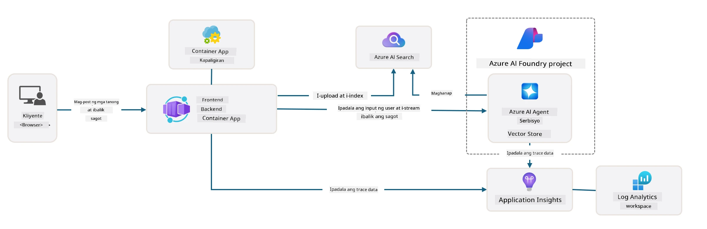
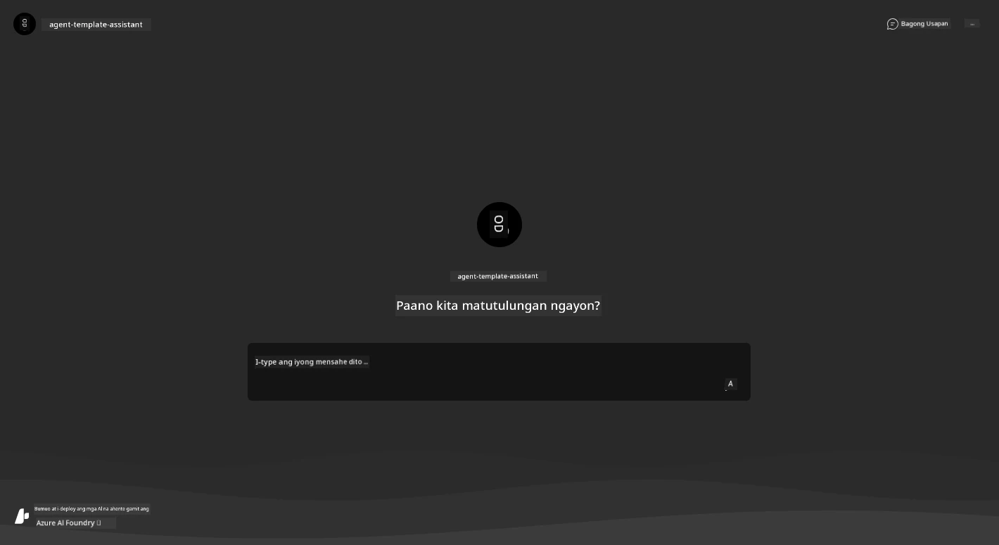

# 2. I-validate ang isang Template

> Pinag-aralang gabay sa pinanggalingan laban sa AZD 1.37.2 at ang kasalukuyang halimbawa noong Nobyembre 4, 2026. Ang mga screenshot ay pampaliwanag lamang; maaaring magbago ang pag-navigate sa portal, mga default ng template, at pagkakaroon ng serbisyo. Hindi isinagawa ng pagsusuring ito ang isang live na deployment sa Azure.

!!! tip "PAGKATAPOS NG MODULONG ITO, MAGAGAWA MO NA"

    - [ ] Identify the sample's prerequisites and intended resources
    - [ ] Deploy the selected template into an intentional environment
    - [ ] Verify the application and agent behavior separately from deployment success
    - [ ] **Lab 2:** Record evidence of a working baseline, or an actionable deployment blocker

---

## 1. Suriin ang mga kinakailangan

Pinamamahalaan ng [Azure Developer CLI](https://learn.microsoft.com/azure/developer/azure-developer-cli/) ang deployment ng aplikasiyon gamit ang konfigurasyon, imprastruktura, at kodigo ng template. Suriin ang naka-install mong bersyon:

```bash
azd version
```

Gamitin ang [kasalukuyang mga tagubilin sa pag-install/pag-update](https://learn.microsoft.com/azure/developer/azure-developer-cli/install-azd) kung kinakailangan. Ipinapahayag ng pinag-aralang halimbawa ang AZD `>=1.14.0`, ngunit inirerekomenda ang isang kasalukuyang suportadong release. Ang mga opsyonal na AI extensions ay may hiwalay na mga kinakailangan sa bersyon; ang karaniwang `azd up` workflow ng halimbawang ito ay hindi kinakailangan ang agents extension.

Bago mag-provision, basahin ang [Azure account setup](https://github.com/Azure-Samples/get-started-with-ai-agents/blob/main/docs/azure_account_setup.md) at [deployment guide](https://github.com/Azure-Samples/get-started-with-ai-agents/blob/main/docs/deployment.md) ng halimbawa. Tiyakin ang iyong subscription, mga permiso, pagkakaroon ng modelo, quota sa rehiyon, at inaasahang singil. Hindi ginagarantiya ng Azure free account ang access o libreng paggamit para sa bawat kinakailangang serbisyo.

## 2. Buksan ang napiling halimbawa

Gamitin ang repositoryo ng [Get Started with AI Agents](https://github.com/Azure-Samples/get-started-with-ai-agents) na inisyalisado sa Module 1. Kung hindi mo pa ito na-inisyalis, piliin ang isa sa mga alternatibong ito:

- Buksan ang isang [Codespace para sa halimbawa](https://github.com/codespaces/new/Azure-Samples/get-started-with-ai-agents).
- I-clone ang halimbawa at sundin ang lokal/dev-container na setup nito.
- Sa isang **walang laman na direktoryo**, patakbuhin:

```bash
azd init --template Azure-Samples/get-started-with-ai-agents .
```

Huwag mag-inisyalisa ng pangalawang template sa ibabaw ng umiiral na proyekto. Patakbuhin ang mga susunod na command mula sa root ng halimbawa na naglalaman ng `azure.yaml`, hindi mula sa root ng repository ng kurso.

Pinangungunahan ng halimbawa ang isang chat application na suportado ng agent sa Container Apps at nagpo-provision ng mga sumusuportang Foundry resources. Suriin ang kasalukuyang arkitektura at opsyonal na mga serbisyo sa halip na ituring ang isang lumang screenshot bilang eksaktong imbentaryo ng resource.



## 3. Mag-deploy nang may intensyon

```bash
azd auth login
azd up
```

Suriin ang mga prompt:

1. Pumili ng natatanging pangalan para sa AZD environment.
2. Piliin ang nilalayong subscription, hindi lang ang unang lalabas na subscription.
3. Piliin ang rehiyon na suportado ng kinakailangang modelo/bersyon/SKU at ang iyong quota.
4. Basahin ang output ng provisioning, deployment, at post-deployment hook.

Kasama sa nasuring default ang `gpt-5-mini`, bersyon `2025-08-07`, at `GlobalStandard`. Suriin ang iyong inisyal na template at ang [supported model/region combinations](https://learn.microsoft.com/azure/ai-services/agents/concepts/model-region-support). Walang rehiyon na garantisadong laging gagana para sa lahat.

Nag-iiba ang tagal ng deployment. Kung mabigo ang provisioning, itago ang error at ayusin ang sanhi nito bago subukang muli. Huwag tanggalin ang deployment o tuluyang burahin ang mga resources bilang pangkalahatang hakbang sa pag-troubleshoot.

## 4. I-validate ang aplikasiyon

```bash
azd show
```

Buksan ang endpoint para sa `api_and_frontend`, o hanapin ang Container App sa resource group ng deployment sa [Azure portal](https://portal.azure.com/). Sundin ang access/authentication na mga tagubilin ng halimbawa kung kinakailangan ang pag-sign in; huwag i-disable ang authentication upang mapasa ang isang smoke test.



Subukan ang ilang [sample questions](https://github.com/Azure-Samples/get-started-with-ai-agents/blob/main/docs/sample_questions.md):

- Isang pangkalahatang tanong na patusok sa katotohanan.
- Isang tanong na ang sagot ay dapat naroroon sa mga na-upload na dokumento ng halimbawa.
- Isang tanong na hindi masagot mula sa mga dokumentong iyon.

Tiyaking naglo-load ang UI, tumutugon ang API, gumagamit ang retrieval ng inaasahang data, tumutugma ang mga citations sa pinanggalingang nilalaman, at ang mga hindi suportadong tanong ay hinahawakan nang naaangkop. Ang matagumpay na `azd up` na mensahe lamang ay hindi nagpapatunay ng mga kinalabasang ito.

## 5. Suriin ang na-deploy na agent

Buksan ang iyong proyekto sa [Foundry portal](https://ai.azure.com/). Sa napag-aralang daloy ng portal, piliin ang **Build**, pagkatapos ay **Agents**, at hanapin ang agent na nilikha ng halimbawa. Maaaring magbago ang mga label ng pag-navigate.

Irekord ang mga sumusunod:

- Pangalan at bersyon ng agent.
- Nakapag-configure nitong model deployment.
- Ang aktwal na mga instruksiyon at mga pinapaganang tools.
- Aling mga file o search index ang konektado, at kung matagumpay na natapos ang setup.

Ginagamit ng halimbawa ang agent identifier sa anyo ng `agent_name:agent_version` para sa mga pagsusuring pang-evaluate. Huwag kopyahin ang classic agent/thread identifier mula sa lumang screenshot papunta sa mas bagong API workflow.

Ihambing ang mga na-upload na dokumento sa `src/files/` sa iyong inisyal na bersyon. Ipinakita ng mga naunang screenshot ang 32 file; hindi ito garantisadong kasalukuyang default. Suriin ang anumang sagot tungkol sa mga customer/produkto ng halimbawa laban sa aktwal na synthetic source data, at huwag mag-upload ng totoong data ng customer para sa pagsasanay na ito.

## 6. Ihambing sa playground

Buksan ang playground ng napiling agent sa Foundry at itanong ang parehong tanong sa retrieval. Ihambing ang configured na bersyon ng agent, mga tools, citations, at kalidad ng sagot sa na-deploy na aplikasiyon.

Ang mga tugon ay probabilistic; hindi batayan ang eksaktong pagkakatugma ng salita-sa-salita. Kung malaki ang pagkakaiba ng mga resulta, suriin na ang app at playground ay tumutukoy sa parehong proyekto, agent/bersyon, at pinagkukunan ng kaalaman.

## 7. Suriin ang mga kinakailangan sa observability

Ang [observability guide](https://github.com/Azure-Samples/get-started-with-ai-agents/blob/main/docs/observability.md) ng halimbawa ay ang pinanggagalingan ng katotohanan para sa pagsubaybay, pagsusuri, at set-up ng red-teaming.

Sa napag-aralang mga default ng imprastruktura, naka-enable ang Application Insights ngunit **hindi pinagana ang client tracing** (`ENABLE_AZURE_MONITOR_TRACING=false`). Ang paglikha ng monitoring resource ay hindi nagpapatunay na nag-e-export ang aplikasiyon ng mga traces. Tinatalakay sa Module 5 ang pag-enable ng tracing at paggawa ng test request.

Gamitin ang application logs ng Container App para siyasatin ang mga startup/API errors. Sa Foundry, suriin ang tracing at monitoring views ng agent. Nangangailangan ang mga evaluation entries ng kaukulang konfigurasyon, suportadong evaluators/rehiyon, at aktwal na mga request; hindi garantisadong lalabas ang mga ito nang awtomatiko sa bawat pagpapatakbo.

Panatilihing naka-disable ang prompt/response content capture maliban kung nasuri ang privacy, retention, access, at redaction na mga kinakailangan nito.

## 8. Unawain ang mga halaga ng environment

Tinatago ng AZD ang napiling environment sa ilalim ng `.azure/<environment-name>/`. Maaaring basahin ang mga persistent input at deployment output gamit ang:

```bash
azd env list
azd env get-value AZURE_ENV_NAME
azd env get-value AZURE_LOCATION
```

Ipinapakita ng `azd env get-values` ang lahat ng halaga, na maaaring magsama ng sensitibong konfigurasyon. Huwag ipaskil ang output na iyon sa mga pampublikong isyu o logs.

Ginagamit ng AZD ang napiling environment kapag nagpapagana ng mga command/hooks nito, habang maaaring makaimpluwensya rin ang mga process environment variables sa mga command at template. Hindi nito **iin-export** ang mga halaga sa iyong parent shell o sa bawat independently na pinaandar na Python process. Sundin ang mga [local development instructions](https://github.com/Azure-Samples/get-started-with-ai-agents/blob/main/docs/local_development.md) ng halimbawa.

Maaari ring i-apply ang mga default ng template sa `infra/main.parameters.json` nang hindi lumalabas bilang tahasang mga lokal na halaga. Ang pagtatakda ng arbitraryong variable ay hindi nagbabago ng imprastruktura maliban kung kinakain ito ng template.

Halimbawa, upang tahasang piliin ang nasuring model defaults:

```bash
azd env set AZURE_AI_AGENT_MODEL_NAME gpt-5-mini
azd env set AZURE_AI_AGENT_MODEL_VERSION 2025-08-07
azd env set AZURE_AI_AGENT_DEPLOYMENT_SKU GlobalStandard
azd provision --preview
azd up
```

Suriin muna ang compatibility, kapasidad, availability, at ang mga planadong pagbabago. Nangangailangan ang mga update sa imprastruktura ng provisioning; hindi sapat ang `azd deploy` lamang. Karaniwan, hindi kinakailangang gibain ang buong aplikasiyon para sa mga suportadong pagbabago ng modelo.

Kinukuha ng `azd env refresh` ang deployment outputs para sa isang accessible na environment; hindi nito nire-reconstruct ang lahat ng custom input, nagsi-synchronize ng mga secrets, o pumapalit sa configuration management.

## 9. Itala ang iyong baseline

- [ ] Na-verify ang tamang environment, subscription, rehiyon, at modelo.
- Natapos nang walang unresolved errors ang provisioning, deployment, at mga kinakailangang setup hooks.
- Nasuri ang access sa aplikasiyon, chat, retrieval, at citations.
- Natukoy ang agent/bersyon at pinagkukunan ng kaalaman.
- Naitala ang mga kinakailangan sa observability at anumang natitirang blockers.

Magpatuloy sa [Deconstruct a Template](3-Deconstruct-AI-Template.md).

---

<!-- CO-OP TRANSLATOR DISCLAIMER START -->
**Pagtatanggi**:
Ang dokumentong ito ay isinalin gamit ang serbisyo ng AI translation na [Co-op Translator](https://github.com/Azure/co-op-translator). Bagama't nagsusumikap kami para sa katumpakan, pakatandaan na ang awtomatikong pagsasalin ay maaaring maglaman ng mga pagkakamali o hindi pagkakatugma. Ang orihinal na dokumento sa orihinal nitong wika ang dapat ituring na pangunahing sanggunian. Para sa mahahalagang impormasyon, inirerekomenda ang propesyonal na pagsasalin ng tao. Hindi kami mananagot sa anumang maling pagkakaintindi o maling interpretasyon na nagmula sa paggamit ng pagsasaling ito.
<!-- CO-OP TRANSLATOR DISCLAIMER END -->