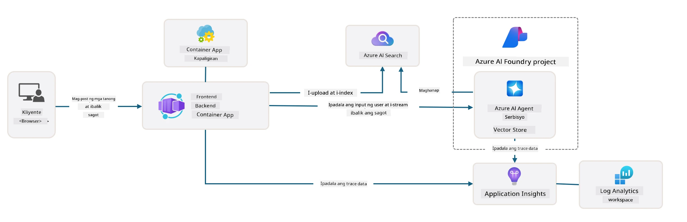

# 3. I-deconstruct ang isang Template

!!! tip "PAGKATAPOS NG MODULONG ITO, MAGAGAWA MO NA"

    - [ ] Use GitHub Copilot and optional MCP tools for Azure documentation and read-only exploration
    - [ ] Identify the template's application, infrastructure, configuration, and test entry points
    - [ ] Verify generated explanations against actual repository files
    - [ ] **Lab 3:** Trace one request and one configuration input through the project

---

## 1. I-activate ang GitHub Copilot

Buksan ang na-initialize na AI sample sa VS Code at i-enable ang [GitHub Copilot](https://code.visualstudio.com/docs/copilot/chat/chat-agent-mode). Mag-sign in gamit ang account na may karapat-dapat na plano; nagkakaiba-iba ang mga limitasyon sa paggamit. Hilingin sa Copilot na ipaliwanag ang repository bago payagan ang mga pagbabago.

### Opsyonal na MCP servers

Maaaring magbigay ang mga serbisyong ito ng karagdagang mga kagamitan:

- [Azure MCP Server](https://learn.microsoft.com/azure/developer/azure-mcp-server/overview)
- [Microsoft Learn MCP Server](https://learn.microsoft.com/training/support/mcp)

Sa VS Code, suriin ang [MCP configuration guidance](https://code.visualstudio.com/docs/copilot/chat/mcp-servers) at gumawa ng `.vscode/mcp.json` kung kinakailangan:

```json
{
  "servers": {
    "Azure MCP Server": {
      "type": "stdio",
      "command": "npx",
      "args": ["-y", "@azure/mcp@latest", "server", "start"]
    },
    "microsoft.docs.mcp": {
      "type": "http",
      "url": "https://learn.microsoft.com/api/mcp"
    }
  }
}
```

Ang utos na `npx` ay nangangailangan ng suportadong Node.js/npm na pag-install at nagda-download ng executable na code. Suriin ang package at i-pin ang aprubadong bersyon para sa reproducible na setup ng grupo. Simulan ang mga server gamit ang MCP controls ng VS Code at suriin ang kanilang mga magagamit na kagamitan; maaaring magbago ang mga pangalan sa pagitan ng mga bersyon.

**Hiwalay ang authentication.** Gamitin ang `azd auth login` para sa AZD. Sundin ang naitala na authentication flow ng Azure MCP para sa mga kagamitan nito; ang AZD login lamang ay hindi nagtatatag ng MCP session. Gumamit ng `az login` nang hiwalay kapag isang ehersisyo o hook ang tumatawag sa Azure CLI.

Subukan ang mga read-only na prompt:

1. “Gamitin ang Microsoft Learn MCP upang hanapin ang dokumentasyon ng Azure Developer CLI configuration.”
2. “Ipaliwanag ang `azure.yaml` ng repositoryong ito; tukuyin ang mga file na nagpapatupad ng bawat hook.”
3. “Gamit ang magagamit na Azure MCP na kagamitan, ilista ang aking mga deployed na resource nang hindi binabago ang anumang bagay.”

Suriin ang napiling tenant/subscription at bawat iminungkahing tawag sa kagamitan. Huwag aprubahan ang paggawa, pagbura, o pagbabago ng access sa resource para lamang mag-explore sa arkitektura.

## 2. Unawain ang arkitektura

Nagho-host ang sample ng Python FastAPI backend at React/TypeScript frontend sa Azure Container Apps. Nakikipag-ugnayan ang backend sa isang agent sa proyekto ng Microsoft Foundry. Nakadepende ang retrieval at observability sa mga pinagana na tampok ng template at matagumpay na setup; hindi ito garantisadong mangyayari dahil lang na-deploy ang application.



Ihambing ang diagram na ito sa [kasalukuyang upstream deployment guide](https://github.com/Azure-Samples/get-started-with-ai-agents/blob/main/docs/deployment.md) at sa iyong aktwal na mga resource. Suriin ang nakakonfig na model deployment, agent tools, managed identity, role assignments, at mga opsyonal na AI Search/Application Insights na resource.

**Ehersisyo:** Hilingin sa Copilot na subaybayan ang isang chat request mula sa frontend papunta sa API hanggang sa Foundry, na may mga reference sa file at function. Buksan ang mga reference na iyon at beripikahin ang paliwanag. Huwag manghula ng ipinatupad na authentication, routing, o authorization base lang sa diagram.

## 3. Istruktura ng repositoryo

Ang mga napiling path sa ibaba ay sinuri laban sa sample noong Nobyembre 4, 2026. Ang iyong na-initialize na bersyon ang nananatiling pinagmumulan ng katotohanan:

```text
get-started-with-ai-agents/
  azure.yaml
  docker-compose.yaml
  requirements-dev.txt
  .devcontainer/
  infra/
    main.bicep
    main.parameters.json
    api.bicep
    core/
  src/
    Dockerfile
    pyproject.toml
    requirements.txt
    api/
      main.py
      routes.py
      search_index_manager.py
    frontend/
      package.json
      src/
    files/
  scripts/
    validate_env_vars.sh
    validate_env_vars.ps1
    postdeploy.sh
    postdeploy.ps1
  tests/
    test_evaluation.py
    test_red_teaming.py
  docs/
    deployment.md
    deploy_customization.md
    ai_search.md
    observability.md
    local_development.md
    troubleshooting.md
```

### Impraestruktura at konfigurasyon

Pinangangasiwaan ng `infra/main.bicep` ang mga resource; iniuugnay ng `main.parameters.json` ang mga input ng template sa mga halaga ng AZD environment. Pinipili ng `azure.yaml` ang application service at lifecycle hooks. Subaybayan ang isang input tulad ng `USE_AZURE_AI_SEARCH_SERVICE` sa mga file na ito upang alamin kung ano talaga ang nagbabago.

### Aplikasyon at identidad

Basahin nang magkasama ang `src/api/` at `src/frontend/`. Tukuyin kung saan nilikha o kinuha ang agent, saan kinonfigura ang mga instruksyon/kagamitang, at aling identidad ang ginagamit ng bawat Azure call. Ang mga sample file sa ilalim ng `src/files/` ay demonstrasyon ng datos, hindi isang production catalog o authorization model.

### Pagsusulit at observability

Ang kasalukuyang entry point para sa pagsusuri at red-teaming ay nasa ilalim ng `tests/`; ang mga lumang direktoryo ng `evals/` at `airedteaming/` ay lipas na para sa sample na ito. Basahin ang `docs/observability.md` para sa mga kinakailangan at gastos bago magpatakbo ng mga pagsusulit sa cloud. Ang mga pagsusulit na ito sa Python ay hiwalay mula sa opsyonal na `azure.ai.evaluations` AZD extension.

## 4. Beripikahin ang iyong mga natuklasan

- Tukuyin ang API route, agent interaction, at retrieval code para sa isang sample na tanong.
- Ipaliwanag kung aling identidad ang nag-a-access sa Foundry at kung aling konfigurasyon ang pumipili sa endpoint nito.
- Hanapin ang aktwal na pre-up at post-deploy scripts at ang kanilang paghawak sa error.
- Ilahad ang anumang mga dependencies o opsyonal na tampok na wala sa iyong deployment.

Magpatuloy sa [I-configure ang isang Template](4-Configure-AI-Template.md).

---

<!-- CO-OP TRANSLATOR DISCLAIMER START -->
**Pagtatanggi**:
Ang dokumentong ito ay isinalin gamit ang serbisyo ng AI translation na [Co-op Translator](https://github.com/Azure/co-op-translator). Bagama't nagsusumikap kami para sa katumpakan, pakatandaan na ang awtomatikong pagsasalin ay maaaring maglaman ng mga pagkakamali o hindi pagkakatugma. Ang orihinal na dokumento sa orihinal nitong wika ang dapat ituring na pangunahing sanggunian. Para sa mahahalagang impormasyon, inirerekomenda ang propesyonal na pagsasalin ng tao. Hindi kami mananagot sa anumang maling pagkakaintindi o maling interpretasyon na nagmula sa paggamit ng pagsasaling ito.
<!-- CO-OP TRANSLATOR DISCLAIMER END -->