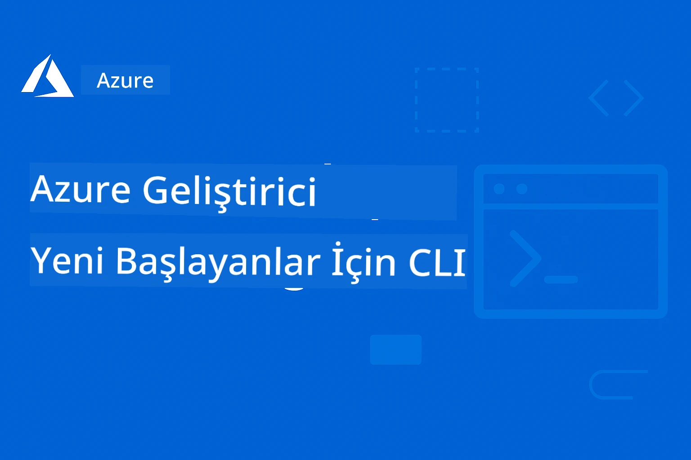

# Azd Yeni Başlayanlar İçin: Yapılandırılmış Bir Öğrenme Yolculuğu

 

[](https://github.com/microsoft/AZD-for-beginners)
[](https://GitHub.com/microsoft/azd-for-beginners/network/)
[](https://github.com/microsoft/AZD-for-beginners)

[](https://discord.com/invite/nkVh3dp)
[](https://discord.gg/nTYy5BXMWG)

---

### Otomatik Çeviriler (Her Zaman Güncel)

<!-- CO-OP TRANSLATOR LANGUAGES TABLE START -->
[Arabic](../ar/README.md) | [Bengali](../bn/README.md) | [Bulgarian](../bg/README.md) | [Burmese (Myanmar)](../my/README.md) | [Chinese (Simplified)](../zh-CN/README.md) | [Chinese (Traditional, Hong Kong)](../zh-HK/README.md) | [Chinese (Traditional, Macau)](../zh-MO/README.md) | [Chinese (Traditional, Taiwan)](../zh-TW/README.md) | [Croatian](../hr/README.md) | [Czech](../cs/README.md) | [Danish](../da/README.md) | [Dutch](../nl/README.md) | [Estonian](../et/README.md) | [Finnish](../fi/README.md) | [French](../fr/README.md) | [German](../de/README.md) | [Greek](../el/README.md) | [Hebrew](../he/README.md) | [Hindi](../hi/README.md) | [Hungarian](../hu/README.md) | [Indonesian](../id/README.md) | [Italian](../it/README.md) | [Japanese](../ja/README.md) | [Kannada](../kn/README.md) | [Khmer](../km/README.md) | [Korean](../ko/README.md) | [Lithuanian](../lt/README.md) | [Malay](../ms/README.md) | [Malayalam](../ml/README.md) | [Manipuri (Meitei Mayek)](../mni/README.md) | [Marathi](../mr/README.md) | [Nepali](../ne/README.md) | [Nigerian Pidgin](../pcm/README.md) | [Norwegian](../no/README.md) | [Persian (Farsi)](../fa/README.md) | [Polish](../pl/README.md) | [Portuguese (Brazil)](../pt-BR/README.md) | [Portuguese (Portugal)](../pt-PT/README.md) | [Punjabi (Gurmukhi)](../pa/README.md) | [Romanian](../ro/README.md) | [Russian](../ru/README.md) | [Serbian (Cyrillic)](../sr/README.md) | [Slovak](../sk/README.md) | [Slovenian](../sl/README.md) | [Spanish](../es/README.md) | [Swahili](../sw/README.md) | [Swedish](../sv/README.md) | [Tagalog (Filipino)](../tl/README.md) | [Tamil](../ta/README.md) | [Telugu](../te/README.md) | [Thai](../th/README.md) | [Turkish](./README.md) | [Ukrainian](../uk/README.md) | [Urdu](../ur/README.md) | [Vietnamese](../vi/README.md)

> **Yerel olarak klonlamayı mı tercih edersiniz?**
>
> Bu depo, indirme boyutunu önemli ölçüde artıran 50'den fazla dil çevirisi içerir. Çeviriler olmadan klonlamak için, az sayıda dosya ile klonlama (sparse checkout) kullanın:
>
> **Bash / macOS / Linux:**
> ```bash
> git clone --filter=blob:none --sparse https://github.com/microsoft/AZD-for-beginners.git
> cd AZD-for-beginners
> git sparse-checkout set --no-cone '/*' '!translations' '!translated_images'
> ```
>
> **CMD (Windows):**
> ```cmd
> git clone --filter=blob:none --sparse https://github.com/microsoft/AZD-for-beginners.git
> cd AZD-for-beginners
> git sparse-checkout set --no-cone "/*" "!translations" "!translated_images"
> ```
>
> Bu, kursu tamamlamanız için gereken her şeyi çok daha hızlı bir indirme ile sağlar.
<!-- CO-OP TRANSLATOR LANGUAGES TABLE END -->

## 🆕 azd'deki Bugün Neler Yeni

> 📌 **AI CLI sürüm incelemesi (2026-11-04):** Rehber, yayımlanmış **`azd 1.37.2`**, **agents `1.0.0-beta.23`** ve **evaluations `1.0.0-beta.2`** belgeleri/kaynakları ile kontrol edildi. Birleşik iş akışı için `azd >= 1.37.0` kullanın. Uzantılardan önce `azd version` çalıştırın ve [core CLI'yi güncelleyin](https://learn.microsoft.com/azure/developer/azure-developer-cli/install-azd). [sürüm değişiklikleri ve düzeltmeleri](docs/chapter-08-production/production-ai-practices.md#recent-release-changes-and-fixes) bakınız. Bu, tüm kursun canlı dağıtım doğrulaması değildir.

Azure Developer CLI, desteklenen hostlar, şablonlar ve uzantılar yoluyla web uygulamaları, API'ler ve AI ajanlar gibi birçok uygulama türünü destekler.

Bu sizin için şu anlama gelir:

- **AI ajanları artık asli azd iş yükleridir.** Halihazırda bildiğiniz aynı `azd init` → `azd up` iş akışı ile AI ajan projelerini başlatabilir, dağıtabilir ve yönetebilirsiniz.
- **İki uzantı boyunca bir ajan yaşam döngüsü.** Ajanları başlatmak, çağırmak, optimize etmek ve emekliye ayırmak için `azure.ai.agents` kullanın. **`azure.ai.evaluations`**’i `azd ai eval init`, `generate` ve `run start` için ayrı ayrı kurun. Ajanlar beta.22, eski değerlendirme iş akışının yerini aldı ve optimizasyon yapılandırmasını değiştirdi; [göç rehberini](docs/chapter-08-production/production-ai-practices.md#evaluation-migration-and-quality-checks) takip edin.
- **Daha fazla AI yapı taşı.** Yeni önizleme uzantıları — `azure.ai.skills` ve `azure.ai.connections` — yeniden kullanılabilir ajan becerilerini ve Foundry bağlantılarını doğrudan azd ile yönetmenizi sağlar.
- **Microsoft Foundry entegrasyonu** modeli dağıtımını, ajan barındırmayı ve AI hizmet yapılandırmasını doğrudan azd şablon ekosistemine getirir.
- **Günlük temel işlemler daha sorunsuz.** Son sürümler `azd init`’ü idempotent hale getirdi (yeniden çalıştırmak güvenli), `azd auth login`’in eski belirteçleri otomatik temizlemesini sağladı ve dostane bir `azd tool` ilk çalıştırma kurulum istemi ekledi.
- **Temel iş akışı değişmedi.** İster todo uygulaması, ister mikro hizmet, ister çok ajanlı AI çözümü dağıtıyor olun, komutlar aynıdır.

> **Aspire kullanıcıları için not:** Microsoft artık ürüne basitçe **Aspire** diyor (eski adı ".NET Aspire"). azd’nin Aspire desteği değişmedi — yalnızca isim güncellendi.

Daha önce azd kullandıysanız, AI desteği doğal bir uzantıdır — ayrı bir araç veya ileri seviye bir yol değil. Sıfırdan başlıyorsanız, her şey için geçerli tek bir iş akışını öğrenirsiniz.

---

## 🚀 Azure Developer CLI (azd) Nedir?

**Azure Developer CLI (azd)**, Azure’a uygulama dağıtmayı basitleştiren geliştirici dostu bir komut satırı aracıdır. Düzinecece Azure kaynağı manuel oluşturup bağlamak yerine, tek bir komutla tüm uygulamaları dağıtabilirsiniz.

### `azd up` Büyüsü

```bash
# This single command does everything:
# ✅ Creates all Azure resources  
# ✅ Configures networking and security
# ✅ Builds your application code
# ✅ Deploys to Azure
# ✅ Gives you a working URL
azd up
```

Şablon, uygulama ve altyapı yapılandırmasını temin eder. Başarılı dağıtım için desteklenen hizmetler/modeller, yeterli kota ve izinler, doğru girdiler ve dağıtılan uygulamanın doğrulanması gereklidir. `azd up` şablonu otomatik olarak güvenli, uyumlu veya üretime hazır hale getirmez.

---

## ❓ Azure Developer CLI ve Azure CLI Arasındaki Fark Nedir?

Bu, yeni başlayanların en sık sorduğu sorudur. İşte basit cevap:

| Özellik | **Azure CLI (`az`)** | **Azure Developer CLI (`azd`)** |
|---------|---------------------|--------------------------------|
| **Amaç** | Bireysel Azure kaynaklarını yönetmek | Tam uygulamaları dağıtmak |
| **Bakış açısı** | Altyapı odaklı | Uygulama odaklı |
| **Örnek** | `az webapp create --name myapp...` | `azd up` |
| **Öğrenme Eğrisi** | Azure hizmetlerini bilmek gerekir | Uygulamanızı bilmek yeterli |
| **En Uygun** | DevOps, Altyapı | Geliştiriciler, Prototip oluşturma |

### Basit Benzetme

- **Azure CLI** ev inşa etmek için tüm aletlere sahip olmak gibidir - çekiçler, testereler, çiviler. Her şeyi inşa edebilirsiniz, ancak inşaat bilmeniz gerekir.
- **Azure Developer CLI** ise müteahhit kiralamak gibidir — ne istediğinizi söylersiniz, onlar inşaatı halleder.

### Ne Zaman Hangisi Kullanılır

| Senaryo | Şunu Kullanın |
|----------|----------|
| "Web uygulamamı hızlıca dağıtmak istiyorum" | `azd up` |
| "Sadece bir depolama hesabı oluşturmalıyım" | `az storage account create` |
| "Tam bir AI uygulaması inşa ediyorum" | `azd init --template azure-search-openai-demo` |
| "Belirli bir Azure kaynağını hata ayıklamam lazım" | `az resource show` |
| "Yapılandırılmış üretim ortamıma dağıtım yapmak istiyorum" | `azd up --environment production`’dan önce yapılandırma, erişim, maliyet ve operasyonel denetimleri gözden geçirin |

### Birlikte Çalışırlar!

AZD ve Azure CLI’nin kimlik doğrulama ve yapılandırmaları ayrıdır. AZD için `azd auth login` kullanın, Azure CLI’yi açıkça gerektiren kanca veya teşhis komutları için `az login` kullanın. İkisini birlikte kullanabilirsiniz:
```bash
# Deploy your app with AZD
azd up

# Then fine-tune specific resources with Azure CLI
az webapp config set --name myapp --always-on true
```

---

## 🌟 Awesome AZD’de Şablonlar Bulun

Baştan başlamak zorunda değilsiniz! **Awesome AZD**, dağıtıma hazır şablonlardan oluşan topluluk koleksiyonudur:

| Kaynak | Açıklama |
|----------|-------------|
| 🔗 [**Awesome AZD Galerisi**](https://azure.github.io/awesome-azd/) | Tek tıkla 200+ şablona göz atın |
| 🔗 [**Şablon Gönderin**](https://github.com/Azure/awesome-azd/issues) | Kendi şablonunuzu topluluğa katkıda bulunun |
| 🔗 [**GitHub Deposu**](https://github.com/Azure/awesome-azd) | Kaynağa yıldız verin ve keşfedin |

### Awesome AZD’den Popüler AI Şablonları

Her biri kendi boş dizininde bir şablon seçin; aşağıdaki komutlar alternatiflerdir. Sonundaki `.` o dizini başlatır.

```bash
# RAG Chat with Microsoft Foundry Models + AI Search
azd init --template azure-search-openai-demo .

# Quick AI Chat Application
azd init --template openai-chat-app-quickstart .

# AI Agents with Foundry Agents
azd init --template get-started-with-ai-agents .
```

---

## 🎯 3 Adımda Başlangıç

Başlamadan önce, dağıtmak istediğiniz şablon için makinenizin hazır olduğundan emin olun:

**Windows:**
```powershell
.\validate-setup.ps1
```

**macOS / Linux:**
```bash
bash ./validate-setup.sh
```

Gerekli herhangi bir kontrol başarısız olursa, önce onu düzeltin ve sonra hızlı başlangıca devam edin.

### Adım 1: AZD Kurulumu (2 dakika)

**Windows:**
```powershell
winget install microsoft.azd
```

**macOS:**
```bash
brew tap azure/azd && brew install azd
```

**Linux:**
```bash
curl -fsSL https://aka.ms/install-azd.sh | bash
```

### Adım 2: AZD için Kimlik Doğrulama

```bash
# Optional if you plan to use Azure CLI commands directly in this course
az login

# Required for AZD workflows
azd auth login
```

Hangi kimlik doğrulamanın gerektiğinden emin değilseniz, [Kurulum ve Ayar](docs/chapter-01-foundation/installation.md#authentication-setup) bölümündeki tam kurulumu takip edin.

### Adım 3: İlk Uygulamanızı Dağıtın

```bash
# Initialize from a template
azd init --template todo-nodejs-mongo .

# Deploy to Azure (creates everything!)
azd up
```

**🎉 Hepsi bu kadar!** Uygulamanız artık Azure'da canlı.

### Temizleme (Unutmayın!)

```bash
# Remove all resources when done experimenting
azd down --force --purge
```

---

## 📚 Bu Kurs Nasıl Kullanılır

Bu kurs **kademeli öğrenme** için tasarlanmıştır - kendinizi rahat hissettiğiniz yerden başlayın ve yukarı doğru ilerleyin:

| Deneyiminiz | Buradan Başlayın |
|-----------------|------------|
| **Azure'a tamamen yeni** | [Bölüm 1: Temel](#-chapter-1-foundation--quick-start) |
| **Azure biliyor, AZD yeniyim** | [Bölüm 1: Temel](#-chapter-1-foundation--quick-start) |
| **AI uygulamaları dağıtmak istiyorum** | [Bölüm 2: AI-Öncelikli Geliştirme](#-chapter-2-ai-first-development-recommended-for-ai-developers) |
| **Uygulamalı pratik istiyorum** | [🎓 Etkileşimli Atölye](workshop/README.md) - 3-4 saat rehberli laboratuvar |
| **Üretim örüntülerine ihtiyacım var** | [Bölüm 8: Üretim ve Kurumsal](#-chapter-8-production--enterprise-patterns) |

### Hızlı Kurulum

1. **Bu Depoyu Çatallayın**: [](https://GitHub.com/microsoft/azd-for-beginners/fork)
2. **Klonlayın**: `git clone https://github.com/YOUR-USERNAME/azd-for-beginners.git`
3. **Yardım Alın**: [Azure Discord Topluluğu](https://discord.com/invite/ByRwuEEgH4)

> **Yerel Klonlamayı mı Tercih Edersiniz?**

> Bu depo 50+ dil çevirisi içerir ve indirilen boyutu önemli ölçüde artırır. Çeviriler olmadan klonlamak için seyrek checkout kullanın:
> ```bash
> git clone --filter=blob:none --sparse https://github.com/microsoft/AZD-for-beginners.git
> cd AZD-for-beginners
> git sparse-checkout set --no-cone '/*' '!translations' '!translated_images'
> ```
> Bu, kursu tamamlamak için ihtiyacınız olan her şeyi çok daha hızlı bir indirme ile sağlar.


## Kurs Genel Bakışı

Kademeli öğrenme için tasarlanmış yapılandırılmış bölümlerle Azure Developer CLI (azd) ustalığı kazanın. **Microsoft Foundry entegrasyonu ile AI uygulama dağıtımına özel odak.**

### Bu Kurs Modern Geliştiriciler İçin Neden Önemlidir

AI iş yüklerini dağıtan geliştiriciler genellikle şu konularda rehberliğe ihtiyaç duyarlar:
- Karmaşık çok servisli AI mimarileri
- Üretim AI dağıtım en iyi uygulamaları  
- Azure AI hizmet entegrasyonu ve yapılandırması
- AI iş yüklerinde maliyet optimizasyonu
- AI'ya özgü dağıtım sorunlarının giderilmesi

### Öğrenme Hedefleri

Bu yapılandırılmış kursu tamamlayarak:
- **AZD Temellerinde Ustalaşın**: Temel kavramlar, kurulum ve yapılandırma
- **AI Uygulamaları Dağıtın**: AZD ile Microsoft Foundry hizmetlerini kullanın
- **Altyapıyı Kod Olarak Uygulayın**: Azure kaynaklarını Bicep şablonlarıyla yönetin
- **Dağıtımları Hata Ayıklayın**: Yaygın sorunları çözümlerin ve hataları giderin
- **Üretim İçin Optimize Edin**: Güvenlik, ölçeklendirme, izleme ve maliyet yönetimi
- **Çok Agentlı Çözümler Kurun**: Karmaşık AI mimarilerini dağıtın

## Başlamadan Önce: Hesaplar, Erişim ve Varsayımlar

Bölüm 1'e başlamadan önce aşağıdakilerin hazır olduğundan emin olun. Bu rehberdeki kurulum adımları, bu temel gereksinimlerin halledilmesini varsayar.

- **Bir Azure aboneliği**: İş yerinizden veya kendi hesabınızdan mevcut bir aboneliği kullanabilir ya da başlamak için bir [ücretsiz deneme](https://aka.ms/azurefreetrial) oluşturabilirsiniz.
- **Azure kaynakları oluşturma izni**: Çoğu uygulama için hedef abonelik ya da kaynak grubunda en az **Katılımcı** erişimine sahip olmalısınız. Bazı bölümlerde kaynak grupları, yönetilen kimlikler ve RBAC atamaları yaratabilmeniz de varsayılır.
- [**Bir GitHub hesabı**](https://github.com): Depoyu çatallamak, değişikliklerinizi takip etmek ve atölye çalışması için GitHub Codespaces kullanmak açısından faydalıdır.
- **Şablon çalışma zamanı gereksinimleri**: Bazı şablonlar Node.js, Python, Java veya Docker gibi yerel araçları gerektirir. Başlamadan önce eksik araçları yakalamak için kurulum doğrulayıcısını çalıştırın.
- **Temel terminal bilgisi**: Uzman olmanız gerekmez, ancak `git clone`, `azd auth login` ve `azd up` gibi komutları rahatça çalıştırabilmelisiniz.

> **Bir kurumsal abonelikte mi çalışıyorsunuz?**
> Azure ortamınız bir yönetici tarafından yönetiliyorsa, planladığınız abonelik veya kaynak grubunda kaynak dağıtabileceğinizi önceden doğrulayın. Değilse başlamadan önce bir sandbox aboneliği veya Katılımcı erişimi isteyin.

> **Azure'da yeni misiniz?**
> Egzersizleri baştan sona tamamlayabilmeniz için, https://aka.ms/azurefreetrial adresinden kendi Azure deneme aboneliğinizi veya öde-kullandıkça öde aboneliğinizi kullanarak başlayın.

## 🗺️ Kurs Haritası: Bölümlere Göre Hızlı Gezinme

Her bölüm, öğrenme hedefleri, hızlı başlatma ve egzersizler içeren özel bir README dosyasına sahiptir:

| Bölüm | Konu | Dersler | Süre | Karmaşıklık |
|---------|-------|---------|----------|------------|
| **[Bölüm 1: Temel](docs/chapter-01-foundation/README.md)** | Başlangıç | [AZD Temelleri](docs/chapter-01-foundation/azd-basics.md) &#124; [Kurulum](docs/chapter-01-foundation/installation.md) &#124; [İlk Proje](docs/chapter-01-foundation/first-project.md) | 30-45 dk | ⭐ |
| **[Bölüm 2: AI Geliştirme](docs/chapter-02-ai-development/README.md)** | AI-Öncelikli Uygulamalar | [Foundry Entegrasyonu](docs/chapter-02-ai-development/microsoft-foundry-integration.md) &#124; [AI Agentleri](docs/chapter-02-ai-development/agents.md) &#124; [Model Dağıtımı](docs/chapter-02-ai-development/ai-model-deployment.md) &#124; [Atölye Çalışması](docs/chapter-02-ai-development/ai-workshop-lab.md) | 1-2 saat | ⭐⭐ |
| **[Bölüm 3: Yapılandırma](docs/chapter-03-configuration/README.md)** | Kimlik Doğrulama & Güvenlik | [Yapılandırma](docs/chapter-03-configuration/configuration.md) &#124; [Kimlik Doğrulama & Güvenlik](docs/chapter-03-configuration/authsecurity.md) | 45-60 dk | ⭐⭐ |
| **[Bölüm 4: Altyapı](docs/chapter-04-infrastructure/README.md)** | IaC & Dağıtım | [Dağıtım Rehberi](docs/chapter-04-infrastructure/deployment-guide.md) &#124; [Provisioning](docs/chapter-04-infrastructure/provisioning.md) | 1-1.5 saat | ⭐⭐⭐ |
| **[Bölüm 5: Çok Agentlı](docs/chapter-05-multi-agent/README.md)** | AI Agent Çözümleri | [Perakende Senaryosu](examples/retail-scenario.md) &#124; [Koordinasyon Kalıpları](docs/chapter-06-pre-deployment/coordination-patterns.md) | 2-3 saat | ⭐⭐⭐⭐ |
| **[Bölüm 6: Ön Dağıtım](docs/chapter-06-pre-deployment/README.md)** | Planlama & Doğrulama | [Preflight Kontrolleri](docs/chapter-06-pre-deployment/preflight-checks.md) &#124; [Kapasite Planlama](docs/chapter-06-pre-deployment/capacity-planning.md) &#124; [SKU Seçimi](docs/chapter-06-pre-deployment/sku-selection.md) &#124; [Uygulama Insights](docs/chapter-06-pre-deployment/application-insights.md) | 1 saat | ⭐⭐ |
| **[Bölüm 7: Sorun Giderme](docs/chapter-07-troubleshooting/README.md)** | Hata Ayıklama & Düzeltme | [Yaygın Sorunlar](docs/chapter-07-troubleshooting/common-issues.md) &#124; [Debugging](docs/chapter-07-troubleshooting/debugging.md) &#124; [AI Sorunları](docs/chapter-07-troubleshooting/ai-troubleshooting.md) | 1-1.5 saat | ⭐⭐ |
| **[Bölüm 8: Üretim](docs/chapter-08-production/README.md)** | Kurumsal Kalıplar | [Üretim Uygulamaları](docs/chapter-08-production/production-ai-practices.md) | 2-3 saat | ⭐⭐⭐⭐ |
| **[🎓 Atölye](workshop/README.md)** | Uygulamalı Laboratuvar | [Tanıtım](workshop/docs/instructions/0-Introduction.md) &#124; [Seçim](workshop/docs/instructions/1-Select-AI-Template.md) &#124; [Doğrulama](workshop/docs/instructions/2-Validate-AI-Template.md) &#124; [Parçalama](workshop/docs/instructions/3-Deconstruct-AI-Template.md) &#124; [Yapılandırma](workshop/docs/instructions/4-Configure-AI-Template.md) &#124; [Özelleştirme](workshop/docs/instructions/5-Customize-AI-Template.md) &#124; [Söktürme](workshop/docs/instructions/6-Teardown-Infrastructure.md) &#124; [Kapanış](workshop/docs/instructions/7-Wrap-up.md) | 3-4 saat | ⭐⭐ |

**Toplam Kurs Süresi:** ~10-14 saat | **Yetenek İlerlemesi:** Başlangıç → Üretim Hazır

---

## 📚 Öğrenme Bölümleri

*Deneyim seviyesi ve hedeflerinize göre öğrenme yolunu seçin*

### 🚀 Bölüm 1: Temel & Hızlı Başlangıç
**Önkoşullar**: Azure aboneliği, temel komut satırı bilgisi  
**Süre**: 30-45 dakika  
**Karmaşıklık**: ⭐

#### Neler Öğreneceksiniz
- Azure Developer CLI'nin temellerini anlama
- AZD'yi platformunuza kurma
- İlk başarılı dağıtımınız

#### Öğrenme Kaynakları
- **🎯 Buradan Başlayın**: [Azure Developer CLI Nedir?](#-what-is-azure-developer-cli-azd)
- **📖 Kuramsal Bilgi**: [AZD Temelleri](docs/chapter-01-foundation/azd-basics.md) - Temel kavramlar ve terminoloji
- **⚙️ Kurulum**: [Kurulum & Ayarlar](docs/chapter-01-foundation/installation.md) - Platforma özel rehberler
- **🛠️ Uygulamalı**: [İlk Projeniz](docs/chapter-01-foundation/first-project.md) - Adım adım öğretici
- **📋 Hızlı Referans**: [Komut Hile Sayfası](resources/cheat-sheet.md)

#### Pratik Egzersizler
```bash
# Quick installation check
azd version

# Deploy your first application
azd init --template todo-nodejs-mongo .
azd up
```

**💡 Bölüm Sonucu**: AZD kullanarak Azure'a basit bir web uygulamasını başarıyla dağıtın

**✅ Başarı Doğrulaması:**
```bash
# After completing Chapter 1, you should be able to:
azd version              # Shows installed version
azd init --template todo-nodejs-mongo  # Initializes project
azd up                  # Deploys to Azure
azd show                # Displays running app URL
# Application opens in browser and works
azd down --force --purge  # Cleans up resources
```

**📊 Zaman Yatırımı:** 30-45 dakika  
**📈 Bölüm Sonrası Yetenek Seviyesi:** Temel uygulamaları bağımsız olarak dağıtabilir

---

### 🤖 Bölüm 2: AI-Öncelikli Geliştirme (AI Geliştiricileri İçin Tavsiye Edilen)
**Önkoşullar**: Bölüm 1 tamamlanmış  
**Süre**: 1-2 saat  
**Karmaşıklık**: ⭐⭐

#### Neler Öğreneceksiniz
- Microsoft Foundry entegrasyonu ile AZD kullanımı
- AI destekli uygulamaların dağıtımı
- AI hizmet yapılandırmalarının anlaşılması

#### Öğrenme Kaynakları
- **🎯 Buradan Başlayın**: [Microsoft Foundry Entegrasyonu](docs/chapter-02-ai-development/microsoft-foundry-integration.md)
- **🤖 AI Agentleri**: [AI Agentleri Rehberi](docs/chapter-02-ai-development/agents.md) - AZD ile akıllı agentleri dağıtın
- **📖 Kalıplar**: [AI Model Dağıtımı](docs/chapter-02-ai-development/ai-model-deployment.md) - AI modellerini dağıtın ve yönetin
- **🛠️ Atölye Çalışması**: [AI Atölyesi Laboratuvarı](docs/chapter-02-ai-development/ai-workshop-lab.md) - AI çözümlerinizi AZD uyumlu hale getirin
- **🎥 Etkileşimli Rehber**: [Atölye Materyalleri](workshop/README.md) - MkDocs * DevContainer ortamı ile tarayıcı tabanlı öğrenme
- **📋 Şablonlar**: [Microsoft Foundry Şablonları](#featured-microsoft-foundry-templates)
- **📝 Örnekler**: [AZD Dağıtım Örnekleri](examples/README.md)

#### Pratik Egzersizler
```bash
# Deploy your first AI application
azd init --template azure-search-openai-demo .
azd up

# Try additional AI templates
azd init --template openai-chat-app-quickstart .
azd init --template agent-openai-python-prompty .
```

**💡 Bölüm Sonucu**: RAG özellikli AI destekli bir chat uygulaması dağıtın ve yapılandırın

**✅ Başarı Doğrulaması:**
```bash
# After Chapter 2, you should be able to:
azd init --template azure-search-openai-demo .
azd up
# Test the AI chat interface
# Ask questions and get AI-powered responses with sources
# Verify search integration works
azd monitor  # Check Application Insights shows telemetry
azd down --force --purge
```

**📊 Zaman Yatırımı:** 1-2 saat  
**📈 Bölüm Sonrası Yetenek Seviyesi:** AI öğrenme uygulamalarını dağıtabilir ve ek üretim hazır olma gereksinimlerini tanıyabilir
**💰 Maliyet Bilinci:** Aylık $80-150 gelişim maliyetleri, $300-3500 üretim maliyetlerini anlayın

#### 💰 AI Dağıtımları İçin Maliyet Dikkatleri

**Geliştirme Ortamı (Tahmini $80-150/ay):**
- Microsoft Foundry Modelleri (Kullandıkça öde): Token kullanımına bağlı olarak $0-50/ay
- AI Arama (Temel katman): $75/ay
- Container Uygulamaları (Tüketim): $0-20/ay
- Depolama (Standart): $1-5/ay

**Üretim Ortamı (Tahmini $300-3,500+/ay):**
- Microsoft Foundry Modelleri (Tutarlı performans için PTU): $3,000+/ay YA DA yüksek hacimli Kullandıkça Öde
- AI Arama (Standart katman): $250/ay
- Container Uygulamaları (Ayrılmış): $50-100/ay
- Uygulama Insights: $5-50/ay
- Depolama (Premium): $10-50/ay

**💡 Maliyet Optimizasyon İpuçları:**
- Model çıkarma fiyatlarını ve hesap özel kredilerini kontrol edin; Azure OpenAI evrensel aylık 50.000 token ücretsiz sınırı içermez
- Artık kullanılmayan kaynakları silmek için `azd down` çalıştırın, seçilen ortamı gözden geçirdikten sonra
- Başlangıçta tüketim bazlı faturalandırma ile başlayın, üretim için sadece PTU'ya yükseltin
- Planlanan altyapıyı incelemek için `azd provision --preview` kullanın, ardından Azure Fiyat Hesaplayıcı ile kaynakların maliyetini hesaplayın
- Otomatik ölçeklendirmeyi etkinleştirin: sadece gerçek kullanım için ödeme yapın

**Maliyet İzleme:**
```bash
# Inspect planned resources (this does not calculate prices)
azd provision --preview

# Monitor actual costs in Azure Portal
az consumption budget list --resource-group <your-rg>
```

---

### ⚙️ Bölüm 3: Yapılandırma & Kimlik Doğrulama
**Önkoşullar**: Bölüm 1 tamamlanmış  
**Süre**: 45-60 dakika  
**Karmaşıklık**: ⭐⭐

#### Neler Öğreneceksiniz
- Ortam yapılandırması ve yönetimi
- Kimlik doğrulama ve güvenlik en iyi uygulamaları
- Kaynak adlandırma ve organizasyon

#### Öğrenme Kaynakları
- **📖 Yapılandırma**: [Yapılandırma Rehberi](docs/chapter-03-configuration/configuration.md) - Ortam kurulumu
- **🔐 Güvenlik**: [Kimlik Doğrulama kalıpları ve yönetilen kimlik](docs/chapter-03-configuration/authsecurity.md) - Kimlik doğrulama kalıpları
- **📝 Örnekler**: [Veritabanı Uygulaması Örneği](examples/database-app/README.md) - AZD Veritabanı Örnekleri

#### Pratik Egzersizler
- Birden çok ortamı yapılandırın (geliştirme, test, prod)
- Yönetilen kimlik kimlik doğrulaması kurun
- Ortama özgü yapılandırmaları uygulayın

**💡 Bölüm Sonucu**: Uygun kimlik doğrulama ve güvenlik ile çoklu ortamları yönetin

---

### 🏗️ Bölüm 4: Altyapıyı Kod Olarak Yönetme ve Dağıtım
**Önkoşullar**: Bölümler 1-3 tamamlanmış  
**Süre**: 1-1.5 saat  
**Karmaşıklık**: ⭐⭐⭐

#### Neler Öğreneceksiniz
- İleri dağıtım kalıpları
- Bicep ile Altyapı Kodlama
- Kaynak sağlama stratejileri

#### Öğrenme Kaynakları
- **📖 Dağıtım**: [Dağıtım Rehberi](docs/chapter-04-infrastructure/deployment-guide.md) - Tam iş akışları
- **🏗️ Sağlama**: [Kaynak Sağlama](docs/chapter-04-infrastructure/provisioning.md) - Azure kaynak yönetimi
- **📝 Örnekler**: [Container Uygulaması Örneği](../../examples/container-app) - Konteyner dağıtımları

#### Pratik Egzersizler
- Özel Bicep şablonları oluşturun
- Çok servisli uygulamalar dağıtın
- Mavi-yeşil dağıtım stratejilerini uygulayın

**💡 Bölüm Sonucu**: Özel altyapı şablonları kullanarak karmaşık çok servisli uygulamalar dağıtın

---

### 🎯 Bölüm 5: Çok Agentlı AI Çözümleri (İleri Seviye)
**Önkoşullar**: Bölümler 1-2 tamamlanmış  
**Süre**: 2-3 saat  
**Karmaşıklık**: ⭐⭐⭐⭐

#### Neler Öğreneceksiniz
- Çok agentlı mimari kalıplar
- Agent orkestrasyonu ve koordinasyonu
- Üretime hazır AI dağıtımları

#### Öğrenme Kaynakları
- **🤖 Öne Çıkan Tasarım**: [Perakende Çok Agentlı Çözüm](examples/retail-scenario.md) - Mimari plan, tam bir uygulama değil
- **🛠️ ARM Şablonları**: [ARM Şablon Paketi](../../examples/retail-multiagent-arm-template) - Altyapı iskelesi; ön koşullar ve eksik uygulama bileşenlerini inceleyin
- **📖 Mimari**: [Çoklu ajan koordinasyon desenleri](docs/chapter-06-pre-deployment/coordination-patterns.md) - Desenler

#### Pratik Alıştırmalar
```bash
# Inspect the retail infrastructure scaffold before choosing to deploy it
cd examples/retail-multiagent-arm-template
cat README.md

# After an intentional deployment, inspect infrastructure state
az deployment group show --resource-group <rg-name> --name <deployment-name>
```

**💡 Bölüm Sonucu**: Çoklu ajan tasarımını anlayın ve altyapı iskelesinin ötesinde gereken uygulama, doğrulama ve operasyonel çalışmaları tespit edin

---

### 🔍 Bölüm 6: Dağıtım Öncesi Doğrulama ve Planlama
**Ön Koşullar**: Bölüm 4 tamamlandı  
**Süre**: 1 saat  
**Zorluk Seviyesi**: ⭐⭐

#### Öğrenecekleriniz
- Kapasite planlaması ve kaynak doğrulaması
- SKU seçimi stratejileri
- Ön kontrol ve otomasyon

#### Öğrenim Kaynakları
- **📊 Planlama**: [Kapasite Planlaması](docs/chapter-06-pre-deployment/capacity-planning.md) - Kaynak doğrulaması
- **💰 Seçim**: [SKU Seçimi](docs/chapter-06-pre-deployment/sku-selection.md) - Maliyet etkin seçimler
- **✅ Doğrulama**: [Ön Kontroller](docs/chapter-06-pre-deployment/preflight-checks.md) - Otomatik betikler

#### Pratik Alıştırmalar
- Kapasite doğrulama betiklerini çalıştırın
- Maliyet için SKU seçimlerini optimize edin
- Otomatik ön dağıtım kontrolleri uygulayın

**💡 Bölüm Sonucu**: Dağıtımları yürütmeden önce doğrulayın ve optimize edin

---

### 🚨 Bölüm 7: Sorun Giderme ve Hata Ayıklama
**Ön Koşullar**: Herhangi bir dağıtım bölümü tamamlandı  
**Süre**: 1-1.5 saat  
**Zorluk Seviyesi**: ⭐⭐

#### Öğrenecekleriniz
- Sistematik hata ayıklama yöntemleri
- Yaygın sorunlar ve çözümleri
- Yapay zekaya özgü sorun giderme

#### Öğrenim Kaynakları
- **🔧 Yaygın Sorunlar**: [Yaygın Sorunlar](docs/chapter-07-troubleshooting/common-issues.md) - SSS ve çözümler
- **🕵️ Hata Ayıklama**: [Hata Ayıklama Kılavuzu](docs/chapter-07-troubleshooting/debugging.md) - Adım adım stratejiler
- **🤖 AI Sorunları**: [Yapay Zekaya Özgü Sorun Giderme](docs/chapter-07-troubleshooting/ai-troubleshooting.md) - Yapay zeka servis problemleri

#### Pratik Alıştırmalar
- Dağıtım hatalarını teşhis edin
- Kimlik doğrulama problemlerini çözün
- Yapay zeka servis bağlantısını hata ayıklayın

**💡 Bölüm Sonucu**: Yaygın dağıtım sorunlarını bağımsız olarak teşhis edin ve çözün

---

### 🏢 Bölüm 8: Üretim ve Kurumsal Desenler
**Ön Koşullar**: Bölümler 1-4 tamamlandı  
**Süre**: 2-3 saat  
**Zorluk Seviyesi**: ⭐⭐⭐⭐

#### Öğrenecekleriniz
- Üretim dağıtım stratejileri
- Kurumsal güvenlik desenleri
- İzleme ve maliyet optimizasyonu

#### Öğrenim Kaynakları
- **🏭 Üretim**: [Üretim AI En İyi Uygulamaları](docs/chapter-08-production/production-ai-practices.md) - Kurumsal desenler
- **📝 Örnekler**: [Mikroservis Örneği](../../examples/microservices) - Karmaşık mimariler
- **📊 İzleme**: [Application Insights entegrasyonu](docs/chapter-06-pre-deployment/application-insights.md) - İzleme

#### Pratik Alıştırmalar
- Kurumsal güvenlik desenlerini uygulayın
- Kapsamlı izleme kurulumu yapın
- Doğru yönetişim ile üretime dağıtın

**💡 Bölüm Sonucu**: Tam üretim özellikleriyle kurumsal hazır uygulamalar dağıtın

---

## 🎓 Atölye Genel Bakışı: Uygulamalı Öğrenme Deneyimi

> **⚠️ ATÖLYE DURUMU: Aktif Geliştirme**  
> Atölye materyalleri şu anda geliştiriliyor ve iyileştiriliyor. Temel modüller çalışır durumda, ancak bazı ileri bölümler tamamlanmadı. Tüm içeriği tamamlamak için aktif olarak çalışıyoruz. [İlerlemeyi takip et →](workshop/README.md)

### Etkileşimli Atölye Materyalleri
**Tarayıcı tabanlı araçlar ve rehberli alıştırmalar ile kapsamlı uygulamalı öğrenme**

Atölye materyallerimiz, yukarıdaki bölüm tabanlı müfredata tamamlayıcı, yapılandırılmış ve etkileşimli bir öğrenme deneyimi sunar. Atölye, hem kendi hızınızda öğrenme hem de eğitmen liderliğinde oturumlar için tasarlanmıştır.

#### 🛠️ Atölye Özellikleri
- **Tarayıcı Tabanlı Arayüz**: Arama, kopyalama ve tema özellikleriyle tam MkDocs destekli atölye
- **GitHub Codespaces Entegrasyonu**: Tek tıklamayla geliştirme ortamı kurulumu
- **Yapılandırılmış Öğrenme Yolu**: 8 modüllü rehberli alıştırmalar (toplam 3-4 saat)
- **Kademeli Metodoloji**: Giriş → Seçim → Doğrulama → Ayrıştırma → Yapılandırma → Özelleştirme → Kaldırma → Özet
- **Etkileşimli DevContainer Ortamı**: Ön yapılandırılmış araçlar ve bağımlılıklar

#### 📚 Atölye Modül Yapısı
Atölye, keşiften dağıtım ustalığına götüren **8 modüllü kademeli metodoloji** izler:

| Modül | Konu | Yapacaklarınız | Süre |
|--------|-------|----------------|----------|
| **0. Giriş** | Atölye Genel Bakışı | Öğrenme hedeflerini, ön koşulları ve atölye yapısını anlayın | 15 dk |
| **1. Seçim** | Şablon Keşfi | AZD şablonlarını keşfedin ve senaryonuza uygun AI şablonunu seçin | 20 dk |
| **2. Doğrulama** | Dağıtım ve Doğrulama | `azd up` ile şablonu dağıtın ve altyapının çalıştığını doğrulayın | 30 dk |
| **3. Ayrıştırma** | Yapıyı Anlama | GitHub Copilot kullanarak şablon mimarisi, Bicep dosyaları ve kod organizasyonunu inceleyin | 30 dk |
| **4. Yapılandırma** | azure.yaml Derinlemesine | `azure.yaml` yapılandırması, yaşam döngüsü kancaları ve ortam değişkenlerini öğrenin | 30 dk |
| **5. Özelleştirme** | Kendi İhtiyacınıza Göre | AI Arama, izleme, değerlendirme özelliklerini etkinleştirin ve senaryonuza göre özelleştirin | 45 dk |
| **6. Kaldırma** | Temizleme | `azd down --purge` ile kaynakları güvenle kaldırın | 15 dk |
| **7. Özet** | Sonraki Adımlar | Kazanımları ve temel kavramları gözden geçirin, öğrenmeye devam edin | 15 dk |

**Atölye Akışı:**
```
Introduction → Selection → Validation → Deconstruction → Configuration → Customization → Teardown → Wrap-up
     ↓            ↓           ↓              ↓               ↓              ↓            ↓           ↓
  Overview    Find the     Deploy &      Explore        Master         Customize     Clean up    Review &
             right        verify        code &        azure.yaml      for your      resources   next steps
             template                   structure                     scenario
```

#### 🚀 Atölyeye Başlarken
```bash
# Option 1: GitHub Codespaces (Recommended)
# Click "Code" → "Create codespace on main" in the repository

# Option 2: Local Development
git clone https://github.com/microsoft/azd-for-beginners.git
cd azd-for-beginners/workshop
# Follow the setup instructions in workshop/README.md
```

#### 🎯 Atölye Öğrenme Hedefleri
Atölyeyi tamamlayan katılımcılar:
- **Üretim AI Uygulamaları Dağıtma**: Microsoft Foundry servisleri ile AZD kullanarak
- **Çoklu Ajan Mimarilerinde Ustalaşma**: Koordine AI ajan çözümleri uygulama
- **Güvenlik En İyi Uygulamalarını Uygulama**: Kimlik doğrulama ve erişim kontrolünü yapılandırma
- **Ölçek İçin Optimize Etme**: Maliyet-etkin ve performanslı dağıtımlar tasarlama
- **Dağıtımları Sorun Giderme**: Yaygın sorunları bağımsız olarak çözme

#### 📖 Atölye Kaynakları
- **🎥 Etkileşimli Kılavuz**: [Atölye Materyalleri](workshop/README.md) - Tarayıcı tabanlı öğrenme ortamı
- **📋 Modül Bazında Talimatlar**:
  - [0. Giriş](workshop/docs/instructions/0-Introduction.md) - Atölye genel bakışı ve hedefler
  - [1. Seçim](workshop/docs/instructions/1-Select-AI-Template.md) - AI şablonlarını bulma ve seçme
  - [2. Doğrulama](workshop/docs/instructions/2-Validate-AI-Template.md) - Şablonları dağıtma ve doğrulama
  - [3. Ayrıştırma](workshop/docs/instructions/3-Deconstruct-AI-Template.md) - Şablon mimarisini keşfetme
  - [4. Yapılandırma](workshop/docs/instructions/4-Configure-AI-Template.md) - azure.yaml yönetimi
  - [5. Özelleştirme](workshop/docs/instructions/5-Customize-AI-Template.md) - Senaryonuza göre özelleştirme
  - [6. Kaldırma](workshop/docs/instructions/6-Teardown-Infrastructure.md) - Kaynak temizliği
  - [7. Özet](workshop/docs/instructions/7-Wrap-up.md) - Değerlendirme ve sonraki adımlar
- **🛠️ AI Atölye Laboratuvarı**: [AI Atölye Laboratuvarı](docs/chapter-02-ai-development/ai-workshop-lab.md) - Yapay zeka odaklı alıştırmalar
- **💡 Hızlı Başlangıç**: [Atölye Kurulum Kılavuzu](workshop/README.md#browser-based-guide) - Ortam yapılandırması

**Uygun Kitle**: Kurumsal eğitimler, üniversite dersleri, kendi hızında öğrenme ve geliştirici kampüsleri.

---

## 📖 Derinlemesine İnceleme: AZD Yetenekleri

Temellerin ötesinde, AZD üretim dağıtımları için güçlü özellikler sunar:

- **Şablon tabanlı dağıtımlar** - Yaygın uygulama desenleri için hazır şablonları kullanın
- **Kod olarak Altyapı** - Azure kaynaklarını Bicep veya Terraform ile yönetin  
- **Entegre iş akışları** - Sorunsuz kaynak sağlama, dağıtım ve uygulama izlemesi
- **Geliştirici dostu** - Geliştirici üretkenliği ve deneyimine optimize edilmiş

### **AZD + Microsoft Foundry: AI Dağıtımları için Mükemmel**

**Neden AZD AI Çözümleri için?** AZD, AI geliştiricilerin karşılaştığı en büyük zorlukları ele alır:

- **AI Hazır Şablonlar** - Microsoft Foundry Modelleri, Azure AI Servisleri ve ML iş yükleri için ön yapılandırılmış şablonlar
- **Güvenli AI Dağıtımları** - AI servisleri, API anahtarları ve model uç noktaları için yerleşik güvenlik desenleri  
- **Üretim AI Desenleri** - Ölçeklenebilir, maliyet-etkin AI uygulama dağıtımları için en iyi uygulamalar
- **Uçtan Uca AI İş Akışları** - Model geliştirmeden üretim dağıtımına kadar tam izleme ile
- **Maliyet Optimizasyonu** - AI iş yükleri için akıllı kaynak tahsisi ve ölçeklendirme stratejileri
- **Microsoft Foundry Entegrasyonu** - Microsoft Foundry model kataloğu ve uç noktalarına sorunsuz bağlantı

---

## 🎯 Şablonlar ve Örnekler Kütüphanesi

### Öne Çıkan: Microsoft Foundry Şablonları
**AI uygulamaları dağıtıyorsanız buradan başlayın!**

> **Not:** Bu şablonlar çeşitli AI desenlerini gösterir. Bazıları harici Azure Örnekleri, diğerleri yerel uygulamalardır.

| Şablon | Bölüm | Zorluk | Servisler | Tür |
|----------|---------|------------|----------|------|
| [**AI sohbetine başla**](https://github.com/Azure-Samples/get-started-with-ai-chat) | Bölüm 2 | ⭐⭐ | AzureOpenAI + Azure AI Model Çıkarımı API + Azure AI Arama + Azure Container Apps + Application Insights | Harici |
| [**AI ajanları ile başla**](https://github.com/Azure-Samples/get-started-with-ai-agents) | Bölüm 2 | ⭐⭐ | Foundry Ajanları + AzureOpenAI + Azure AI Arama + Azure Container Apps + Application Insights| Harici |
| [**Azure Arama + OpenAI Demo**](https://github.com/Azure-Samples/azure-search-openai-demo) | Bölüm 2 | ⭐⭐ | Azure OpenAI + Azure AI Arama + Container Apps (varsayılan) + Depolama | Harici |
| [**OpenAI Chat Uygulaması Hızlı Başlangıç**](https://github.com/Azure-Samples/openai-chat-app-quickstart) | Bölüm 2 | ⭐ | AzureOpenAI + Container Apps + Application Insights | Harici |
| [**Agent OpenAI Python Prompty**](https://github.com/Azure-Samples/agent-openai-python-prompty) | Bölüm 5 | ⭐⭐⭐ | AzureOpenAI + Azure Functions + Prompty | Harici |
| [**Contoso Chat RAG**](https://github.com/Azure-Samples/contoso-chat) | Bölüm 8 | ⭐⭐⭐⭐ | AzureOpenAI + AI Arama + Cosmos DB + Container Apps | Harici |
| [**Perakende Çoklu Ajan Çözümü**](examples/retail-scenario.md) | Bölüm 5 | ⭐⭐⭐⭐ | Önerilen mimari ve altyapı iskelesi; uygulama uygulanması gerekli | **Yerel plan** |

### Öne Çıkan: Tam Öğrenme Senaryoları
**Üretim hazır uygulama şablonları öğrenme bölümlerine eşlenmiştir**

| Şablon | Öğrenme Bölümü | Zorluk | Ana Öğrenim Konusu |
|----------|------------------|------------|--------------|
| [**openai-sohbet-uygulama-hizlibaslangic**](https://github.com/Azure-Samples/openai-chat-app-quickstart) | Bölüm 2 | ⭐ | Temel AI dağıtım desenleri |
| [**azure-arama-openai-demo**](https://github.com/Azure-Samples/azure-search-openai-demo) | Bölüm 2 | ⭐⭐ | Azure AI Arama ile RAG uygulaması |
| [**ai-ajanlari-ile-basla**](https://github.com/Azure-Samples/get-started-with-ai-agents) | Bölüm 2 | ⭐⭐ | Ajan destekli sohbet ve örnek özgü değerlendirme testleri |
| [**ajan-openai-python-prompty**](https://github.com/Azure-Samples/agent-openai-python-prompty) | Bölüm 5 | ⭐⭐⭐ | Ajan çatısı ve fonksiyon çağırma |
| [**contoso-sohbet**](https://github.com/Azure-Samples/contoso-chat) | Bölüm 8 | ⭐⭐⭐ | Kurumsal AI orkestrasyonu |
| [**perakende-coklu-ajan-cozumu**](examples/retail-scenario.md) | Bölüm 5 | ⭐⭐⭐⭐ | Müşteri ve Envanter ajanları ile çoklu ajan mimarisi |

### Örnek Türüne Göre Öğrenme

> **📌 Yerel ve Harici Örnekler:**  
> **Yerel Örnekler** (bu depoda) = Uygulama durumu ve ön koşullar için örneğin README dosyasını inceleyin
> **Harici Örnekler** (Azure Örnekleri) = Bağlantılı depolardan klonlayın

#### Hazır Kullanım İçin Yerel Örnekler
- [**Perakende Çoklu Ajan Çözümü**](examples/retail-scenario.md) - ARM altyapı iskelesi ile mimari taslak
  - Önerilen Müşteri ve Envanter ajan rolleri
  - İzleme, değerlendirme ve uygulama kodu uygulanmalı ve doğrulanmalı
  - Sadece kaynak sağlamak çalışan bir perakende uygulaması üretmez

#### Yerel Örnekler - Konteyner Uygulamaları (Bölümler 2-5)
**Bu depoda kapsamlı konteyner dağıtım örnekleri:**
- [**Konteyner Uygulama Örnekleri**](examples/container-app/README.md) - Konteynerleştirilmiş dağıtımlar için tam rehber
  - [Basit Flask API](../../examples/container-app/simple-flask-api) - Ölçeklendirme özellikli temel REST API
  - [Mikroservis Mimari](../../examples/container-app/microservices) - İki servisli öğrenme örneği; üretimde sağlamlaştırma ekstra çalışma gerektirir
  - Hızlı Başlangıç, Üretim ve İleri dağıtım desenleri
  - İzleme, güvenlik ve maliyet optimizasyonu rehberliği

#### Harici Örnekler - Basit Uygulamalar (Bölümler 1-2)
**Başlamak için bu Azure Örnekleri depolarını klonlayın:**
- [Basit Web Uygulaması - Node.js + MongoDB](https://github.com/Azure-Samples/todo-nodejs-mongo) - Temel dağıtım desenleri
- [Statik Web Sitesi - React SPA](https://github.com/Azure-Samples/todo-csharp-sql-swa-func) - Statik içerik dağıtımı
- [Konteyner Uygulaması - Python Flask](https://github.com/Azure-Samples/container-apps-store-api-microservice) - REST API dağıtımı

#### Harici Örnekler - Veritabanı Entegrasyonu (Bölümler 3-4)  
- [Veritabanı Uygulaması - C# + SQL](https://github.com/Azure-Samples/todo-csharp-sql) - Veritabanı bağlantı kalıpları
- [Fonksiyonlar + Cosmos DB](https://github.com/Azure-Samples/todo-python-mongo-swa-func) - Sunucusuz veri iş akışı

#### Harici Örnekler - Gelişmiş Kalıplar (Bölümler 4-8)
- [Java Mikroservisleri](https://github.com/Azure-Samples/java-microservices-aca-lab) - Çok servisli mimariler
- [Kapsayıcı Uygulama İşleri](https://github.com/Azure-Samples/container-apps-jobs) - Arka plan işlemleri  
- [Kurumsal ML Boru Hattı](https://github.com/Azure/mlops-v2) - MLOps referans kalıpları; doğrudan AZD şablonu değil

### Harici Şablon Koleksiyonları
- [**Resmi AZD Şablon Galerisi**](https://azure.github.io/awesome-azd/) - Resmi ve topluluk şablonlarının seçilmiş koleksiyonu
- [**Azure Developer CLI Şablonları**](https://learn.microsoft.com/en-us/azure/developer/azure-developer-cli/azd-templates) - Microsoft Learn şablon belgeleri
- [**Örnekler Dizini**](examples/README.md) - Ayrıntılı açıklamalı yerel öğrenme örnekleri

---

## 📚 Öğrenme Kaynakları & Referanslar

### Hızlı Başvurular
- [**Komut Hızlı Referansı**](resources/cheat-sheet.md) - Bölümlere göre düzenlenmiş temel azd komutları
- [**Terimler Sözlüğü**](resources/glossary.md) - Azure ve azd terimleri  
- [**SSS**](resources/faq.md) - Öğrenme bölümüne göre düzenlenmiş yaygın sorular
- [**Çalışma Rehberi**](resources/study-guide.md) - Kapsamlı pratik egzersizler

### Uygulamalı Atölyeler
- [**AI Atölye Laboratuvarı**](docs/chapter-02-ai-development/ai-workshop-lab.md) - AI çözümlerinizi AZD dağıtıma uygun hale getirin (2-3 saat)
- [**Etkileşimli Atölye**](workshop/README.md) - MkDocs ve GitHub Codespaces ile 8 modüllü rehberli egzersizler
  - İzlenen sıra: Giriş → Seçim → Doğrulama → Parçalama → Yapılandırma → Özelleştirme → Kaldırma → Sonuç

### Harici Öğrenme Kaynakları
- [Azure Developer CLI Dokümantasyonu](https://learn.microsoft.com/en-us/azure/developer/azure-developer-cli/)
- [Azure Mimari Merkezi](https://learn.microsoft.com/en-us/azure/architecture/)
- [Azure Fiyatlandırma Hesaplayıcısı](https://azure.microsoft.com/pricing/calculator/)
- [Azure Durumu](https://status.azure.com/)

### Editörünüz için AI Ajan Yetenekleri
- [**Microsoft Azure Yetenekleri skills.sh üzerinde**](https://skills.sh/microsoft/github-copilot-for-azure) - Azure AI, Foundry, dağıtım, tanılama, maliyet optimizasyonu ve daha fazlası için 37 açık ajan yeteneği. GitHub Copilot, Cursor, Claude Code veya desteklenen herhangi bir ajana kurabilirsiniz:
  ```bash
  npx skills add microsoft/github-copilot-for-azure
  ```

---

## 🔧 Hızlı Sorun Giderme Rehberi

**Yeni başlayanların karşılaştığı yaygın sorunlar ve hızlı çözümler:**

<details>
<summary><strong>❌ "azd: komut bulunamadı"</strong></summary>

```bash
# Install AZD first
# Windows (PowerShell):
winget install microsoft.azd

# macOS:
brew tap azure/azd && brew install azd

# Linux:
curl -fsSL https://aka.ms/install-azd.sh | bash

# Verify installation
azd version
```
</details>

<details>
<summary><strong>❌ "Abonelik bulunamadı" veya "Abonelik ayarlanmadı"</strong></summary>

```bash
# List available subscriptions
az account list --output table

# Set default subscription
az account set --subscription "<subscription-id-or-name>"

# Set for AZD environment
azd env set AZURE_SUBSCRIPTION_ID "<subscription-id>"

# Verify
az account show
```
</details>

<details>
<summary><strong>❌ "Yetersiz Kota" veya "Kota aşıldı"</strong></summary>

```bash
# Try different Azure region
azd env set AZURE_LOCATION "westus2"
azd up

# Or use smaller SKUs in development
# Edit infra/main.parameters.json:
{
  "sku": "B1"  // Instead of "P1V2"
}
```
</details>

<details>
<summary><strong>❌ "azd up" yarıda başarısız oluyor</strong></summary>

```bash
# Option 1: Inspect the error and retry after correcting its cause
azd show
azd up --debug

# Option 2: Just fix infrastructure
azd provision

# Option 3: Check detailed status
azd show

# Option 4: Check logs in Azure Monitor
azd monitor --logs
```
</details>

<details>
<summary><strong>❌ "Kimlik doğrulama başarısız oldu" veya "Jeton süresi doldu"</strong></summary>

```bash
# Re-authenticate for AZD
azd auth logout
azd auth login

# Optional: refresh Azure CLI too if you are running az commands
az logout
az login

# Verify authentication
az account show
```
</details>

<details>
<summary><strong>❌ "Kaynak zaten mevcut" veya adlandırma çakışmaları</strong></summary>

```bash
# Inspect the conflicting resource before changing or deleting anything.
# For an isolated new deployment, create a separate environment:
azd env new dev-v2
azd up
```
</details>

<details>
<summary><strong>❌ Şablon dağıtımı çok uzun sürüyor</strong></summary>

**Normal bekleme süreleri:**
- Basit web uygulaması: 5-10 dakika
- Veritabanlı uygulama: 10-15 dakika
- AI uygulamaları: 15-25 dakika (OpenAI sağlama işlemi yavaş)

```bash
# Check progress
azd show

# If stuck >30 minutes, check Azure Portal:
azd monitor --overview
# Look for failed deployments
```
</details>

<details>
<summary><strong>❌ "İzin reddedildi" veya "Yasaklandı"</strong></summary>

```bash
# Check your Azure role
az role assignment list --assignee $(az account show --query user.name -o tsv)

# You need at least "Contributor" role
# Ask your Azure admin to grant:
# - Contributor (for resources)
# - User Access Administrator (for role assignments)
```
</details>

<details>
<summary><strong>❌ Dağıtılan uygulama URL'si bulunamadı</strong></summary>

```bash
# Show all service endpoints
azd show

# Or open Azure Portal
azd monitor

# Check specific service
azd env get-values
# Look for *_URL variables
```
</details>

### 📚 Tam Sorun Giderme Kaynakları

- **Yaygın Sorunlar Kılavuzu:** [Detaylı Çözümler](docs/chapter-07-troubleshooting/common-issues.md)
- **AI-Özel Sorunlar:** [AI Sorun Giderme](docs/chapter-07-troubleshooting/ai-troubleshooting.md)
- **Hata Ayıklama Kılavuzu:** [Adım adım hata ayıklama](docs/chapter-07-troubleshooting/debugging.md)
- **Yardım Al:** [Azure Discord](https://discord.gg/microsoft-azure) #azure-developer-cli

---

## 🎓 Kurs Tamamlama & Sertifikasyon

### İlerleme Takibi
Her bölümde öğrenme ilerlemenizi takip edin:

- [ ] **Bölüm 1**: Temel & Hızlı Başlangıç ✅
- [ ] **Bölüm 2**: AI-Öncelikli Geliştirme ✅  
- [ ] **Bölüm 3**: Yapılandırma & Kimlik Doğrulama ✅
- [ ] **Bölüm 4**: Kod Olarak Altyapı & Dağıtım ✅
- [ ] **Bölüm 5**: Çok Ajanlı AI Çözümleri ✅
- [ ] **Bölüm 6**: Ön-Dağıtım Doğrulama & Planlama ✅
- [ ] **Bölüm 7**: Sorun Giderme & Hata Ayıklama ✅
- [ ] **Bölüm 8**: Üretim & Kurumsal Kalıplar ✅

### Öğrenme Doğrulaması
Her bölümü tamamladıktan sonra bilginizi doğrulayın:
1. **Pratik Egzersiz**: Bölümün uygulamalı dağıtımını tamamlayın
2. **Bilgi Kontrolü**: Bölümün SSS kısmını gözden geçirin
3. **Topluluk Tartışması**: Deneyiminizi Azure Discord’da paylaşın
4. **Sonraki Bölüm**: Bir sonraki zorluk seviyesine geçin

### Kurs Tamamlama Avantajları
Tüm bölümleri tamamladığınızda aşağıdakilere sahip olacaksınız:
- **Üretim Deneyimi**: Gerçek AI uygulamalarını Azure'a dağıttınız
- **Profesyonel Beceriler**: Kurumsal dağıtıma hazır yetkinlikler  
- **Topluluk Tanınması**: Aktif Azure geliştirici topluluğu üyesi
- **Kariyer İlerlemesi**: Talep gören AZD ve AI dağıtım uzmanlığı

---

## 🤝 Topluluk & Destek

### Yardım & Destek Alın
- **Teknik Sorunlar**: [Hata bildir ve özellik iste](https://github.com/microsoft/azd-for-beginners/issues)
- **Öğrenme Soruları**: [Microsoft Azure Discord Topluluğu](https://discord.gg/microsoft-azure) ve [](https://discord.gg/nTYy5BXMWG)
- **AI-Özel Yardım**: Katılın [](https://discord.gg/nTYy5BXMWG)
- **Dokümantasyon**: [Resmi Azure Developer CLI dokümantasyonu](https://learn.microsoft.com/en-us/azure/developer/azure-developer-cli/)

### Microsoft Foundry Discord’dan Topluluk Görüşleri

**Topluluk tarafından tartışılan konular:**
- Çok servisli dağıtımlar, kimlik bilgisi yönetimi ve üretime hazır olma
- AI-özel şablonlar, sorun giderme rehberleri ve en iyi uygulamalar

**Topluluğumuza katılarak:**
- AZD + AI deneyimlerinizi paylaşın ve yardım alın
- Yeni AI şablonlarının erken önizlemelerine erişin
- AI dağıtım en iyi uygulamalarına katkıda bulunun
- Gelecekteki AI + AZD özellik geliştirmelerini etkileyin

### Kursa Katkıda Bulunma
Katkılarınızı memnuniyetle karşılıyoruz! Detaylar için [Katkı Rehberimizi](CONTRIBUTING.md) okuyun:
- **İçerik İyileştirmeleri**: Mevcut bölümleri ve örnekleri geliştirin
- **Yeni Örnekler**: Gerçek dünya senaryoları ve şablonlar ekleyin  
- **Çeviri**: Çok dillilik desteğine yardımcı olun
- **Hata Bildirimleri**: Doğruluk ve netlik artırın
- **Topluluk Standartları**: Kapsayıcı topluluk kurallarımıza uyun

---

## 📄 Kurs Bilgisi

### Lisans
Bu proje MIT Lisansı altında lisanslanmıştır - ayrıntılar için [LICENSE](../../LICENSE) dosyasına bakın.

### İlgili Microsoft Öğrenme Kaynakları

Ekibimiz diğer kapsamlı öğrenme kursları üretmektedir:

<!-- CO-OP TRANSLATOR OTHER COURSES START -->
### LangChain
[](https://aka.ms/langchain4j-for-beginners)
[](https://aka.ms/langchainjs-for-beginners?WT.mc_id=m365-94501-dwahlin)
[](https://github.com/microsoft/langchain-for-beginners?WT.mc_id=m365-94501-dwahlin)
---

### Azure / Edge / MCP / Ajanlar
[](https://github.com/microsoft/AZD-for-beginners?WT.mc_id=academic-105485-koreyst)
[](https://github.com/microsoft/edgeai-for-beginners?WT.mc_id=academic-105485-koreyst)
[](https://github.com/microsoft/mcp-for-beginners?WT.mc_id=academic-105485-koreyst)
[](https://github.com/microsoft/ai-agents-for-beginners?WT.mc_id=academic-105485-koreyst)

---
 
### Üretken AI Serisi
[](https://github.com/microsoft/generative-ai-for-beginners?WT.mc_id=academic-105485-koreyst)
[-9333EA?style=for-the-badge&labelColor=E5E7EB&color=9333EA)](https://github.com/microsoft/Generative-AI-for-beginners-dotnet?WT.mc_id=academic-105485-koreyst)
[-C084FC?style=for-the-badge&labelColor=E5E7EB&color=C084FC)](https://github.com/microsoft/generative-ai-for-beginners-java?WT.mc_id=academic-105485-koreyst)
[-E879F9?style=for-the-badge&labelColor=E5E7EB&color=E879F9)](https://github.com/microsoft/generative-ai-with-javascript?WT.mc_id=academic-105485-koreyst)

---
 
### Temel Öğrenim
[](https://aka.ms/ml-beginners?WT.mc_id=academic-105485-koreyst)
[](https://aka.ms/datascience-beginners?WT.mc_id=academic-105485-koreyst)
[](https://aka.ms/ai-beginners?WT.mc_id=academic-105485-koreyst)
[](https://github.com/microsoft/Security-101?WT.mc_id=academic-96948-sayoung)
[](https://aka.ms/webdev-beginners?WT.mc_id=academic-105485-koreyst)
[](https://aka.ms/iot-beginners?WT.mc_id=academic-105485-koreyst)
[](https://github.com/microsoft/xr-development-for-beginners?WT.mc_id=academic-105485-koreyst)

---
 
### Copilot Serisi
[](https://aka.ms/GitHubCopilotAI?WT.mc_id=academic-105485-koreyst)
[](https://github.com/microsoft/mastering-github-copilot-for-dotnet-csharp-developers?WT.mc_id=academic-105485-koreyst)
[](https://github.com/microsoft/CopilotAdventures?WT.mc_id=academic-105485-koreyst)
<!-- CO-OP TRANSLATOR OTHER COURSES END -->

---

## 🗺️ Kurs Navigasyonu

**🚀 Öğrenmeye Başlamaya Hazır mısınız?**

**Yeni Başlayanlar**: Şuradan başlayın [Bölüm 1: Temel ve Hızlı Başlangıç](#-chapter-1-foundation--quick-start)  
**Yapay Zeka Geliştiricileri**: Şuraya atlayın [Bölüm 2: Yapay Zeka Öncelikli Geliştirme](#-chapter-2-ai-first-development-recommended-for-ai-developers)  
**Deneyimli Geliştiriciler**: Şuradan başlayın [Bölüm 3: Yapılandırma ve Doğrulama](#️-chapter-3-configuration--authentication)

**Sonraki Adımlar**: [Bölüm 1 - AZD Temellerine Başlayın](docs/chapter-01-foundation/azd-basics.md) →

---

<!-- CO-OP TRANSLATOR DISCLAIMER START -->
**Feragatname**:
Bu belge, AI çeviri hizmeti [Co-op Translator](https://github.com/Azure/co-op-translator) kullanılarak çevrilmiştir. Doğruluk için çaba sarf etsek de, otomatik çevirilerin hata veya yanlışlık içerebileceğini lütfen unutmayınız. Orijinal belge, kendi dilinde yetkili kaynak olarak kabul edilmelidir. Kritik bilgiler için profesyonel insan çevirisi önerilir. Bu çevirinin kullanımı sonucu ortaya çıkabilecek yanlış anlamalardan veya yanlış yorumlamalardan sorumlu değiliz.
<!-- CO-OP TRANSLATOR DISCLAIMER END -->