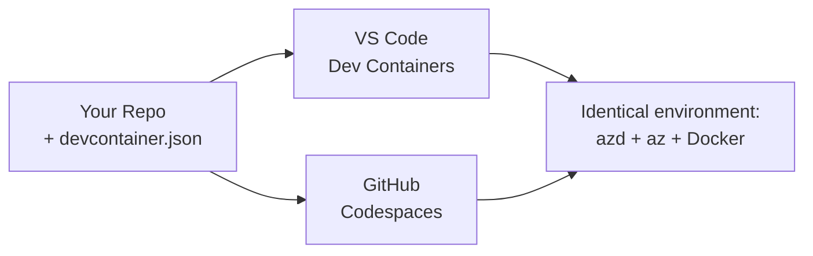

# azd için Dev Konteynerleri ve GitHub Codespaces

**Bölüm Gezinme:**
- **📚 Kurs Ana Sayfası**: [Yeni Başlayanlar için AZD](../../README.md)
- **📖 Mevcut Bölüm**: Bölüm 1 - Temel ve Hızlı Başlangıç
- **⬅️ Önceki**: [Kendi Uygulamanı Getir](bring-your-own-app.md)
- **🚀 Sonraki Bölüm**: [Bölüm 2: AI-Öncelikli Geliştirme](../chapter-02-ai-development/README.md)

> Komut ve yapılandırma inceleme hedefi: `azd 1.37.2` (Kasım 2026). Konteyner derlemeleri ve Azure dağıtımları bu incelemenin parçası olarak gerçekleştirilmedi.

## Giriş

azd, doğru dil çalışma zamanı, Docker ve Azure CLI'yi her makineye kurmak zahmetlidir—ve "makinemde çalışıyor" diyen bir öğreticinin başkası için başarısız olmasının bir numaralı sebebidir. **dev konteyner**, tüm araç zincirinizi bir dosyada tanımlayarak bunu çözer. Projeyi VS Code veya GitHub Codespaces'te açan herkes, azd önceden kurulmuş tam olarak aynı ortamı alır. Bu ders size nasıl bir tane ekleyeceğinizi gösterir.

## Öğrenme Hedefleri

Bu dersin sonunda:
- Dev konteynerin ne olduğunu ve azd ile neden faydalı olduğunu anlayacaksınız
- Bir projeye minimal `.devcontainer/devcontainer.json` ekleyeceksiniz
- azd, Azure CLI ve Docker'ı Dev Konteyneri *özellikleri* ile dahil edeceksiniz
- Projeyi GitHub Codespaces veya VS Code'da açacaksınız

## Öğrenme Kazanımları

Bu dersi tamamladıktan sonra:
- Bir azd projesi için `devcontainer.json` yazabileceksiniz
- Azd ve Azure araçları elle yüklemeden ekleyebileceksiniz
- `azd up`'ü konteyner veya Codespace içinden çalıştırabileceksiniz

---

## Dev Konteyner Nedir?

Dev konteyner, deponuzda bir `.devcontainer/devcontainer.json` dosyası ile tanımlanan Docker tabanlı bir geliştirme ortamıdır. Projeyi açtığınızda:

- **VS Code** (Dev Containers eklentisi ile) konteyneri oluşturur ve ona bağlanır.
- **GitHub Codespaces** aynı konteyneri bulutta oluşturur ve size tarayıcı tabanlı bir editör sunar.

Her iki durumda da, her katkıda bulunan herkes aynı araçlara sahip olur—"azd'yi yükledin mi?" sorun giderme yok.



---

## 1. Adım: devcontainer Dosyasını Oluştur

Projenizin kök dizininde `.devcontainer/devcontainer.json` dosyasını oluşturun:

```json
{
  "name": "azd-project",
  "image": "mcr.microsoft.com/devcontainers/base:bookworm",
  "features": {
    "ghcr.io/devcontainers/features/azure-cli:1": {},
    "ghcr.io/azure/azure-dev/azd:0": { "version": "1.37.2" },
    "ghcr.io/devcontainers/features/docker-in-docker:2": {},
    "ghcr.io/devcontainers/features/node:1": {}
  },
  "customizations": {
    "vscode": {
      "extensions": [
        "ms-azuretools.azure-dev",
        "ms-azuretools.vscode-bicep"
      ]
    }
  },
  "forwardPorts": [3000],
  "postCreateCommand": "azd version"
}
```

Her bölümün ne yaptığı:

| Anahtar | Amaç |
|-----|---------|
| `image` | Konteyner için temel işletim sistemi |
| `features` | Önceden hazırlanmış yükleyiciler—burada: Azure CLI, **azd**, Docker ve Node.js |
| `customizations.vscode.extensions` | azd ve Bicep VS Code eklentilerini otomatik yükler |
| `forwardPorts` | Uygulamanızın portunu tarayıcınıza açar |
| `postCreateCommand` | Konteyner oluşturulduktan sonra bir kez çalışır (burada, bir kontrol testi) |

> Özellik sürümü (`azd:0`) ve kurulu CLI sürümü farklıdır. CLI'yı sabitlemek için özelliğin `version` seçeneğini `"1.37.2"` olarak ayarlayın; CLI sürümünü özellik etiketi olarak kullanmayın.

---

## 2. Adım: Özelliği Uygulamanızın Diline Uydurun

`node` özelliğini uygulamanız ne kullanıyorsa onunla değiştirin:

```jsonc
// Python project
"ghcr.io/devcontainers/features/python:1": {},

// .NET project
"ghcr.io/devcontainers/features/dotnet:2": {},

// Java project
"ghcr.io/devcontainers/features/java:1": {},

// Go project
"ghcr.io/devcontainers/features/go:1": {}
```

Yerel olarak imaj oluştururken `docker-in-docker` tutun. Yapılandırılmış uzak ACR yapımı (`docker.remoteBuild: true`) bir alternatiftir; sadece ana bilgisayar türü her zaman yerel Docker gerektirmez.

---

## 3. Adım: Açın

**VS Code'da:**
1. **Dev Containers** eklentisini yükleyin.
2. Proje klasörünü açın.
3. İstek üzerine **Konteynerde Yeniden Aç** seçeneğine tıklayın (veya *Dev Containers: Reopen in Container* komutunu çalıştırın).

**GitHub Codespaces'te:**
1. Depoyu GitHub'a gönderin.
2. **Code → Codespaces → main üzerinde codespace oluştur** seçeneğine tıklayın.
3. Konteynerin oluşturulmasını bekleyin—azd terminalde hazır olacak.

---

## 4. Adım: Konteyner İçinden Dağıtım Yapın

Konteyner azd önceden kurulu olduğu için normal iş akışı sorunsuz çalışır:

```bash
azd auth login --use-device-code   # device code is handy inside Codespaces
azd up
```

> **Neden `--use-device-code`?** Uzak bir konteyner veya Codespace içinde yerel bir tarayıcı olmadığından, cihaz kodu girişi güvenilir yoldur. Girişi tamamlamak için verilen kodu bir tarayıcı sekmesine yapıştırırsınız.

---

## Yaygın Tuzaklar

| Tuzak | Çözüm |
|---------|-----|
| `azd up` imaj oluşturamıyor | `docker-in-docker` özelliğini ekleyin |
| Codespaces'te tarayıcı girişi takılıyor | `azd auth login --use-device-code` kullanın |
| Takım arkadaşları arasında araçlar farklı | azd özelliğinin `version` seçeneğiyle CLI'yı sabitleyin ve dil çalışma zamanlarını sabitleyin |
| Uygulama tarayıcıda erişilemez | `forwardPorts` portunu ekleyin |

---

## Özet

- Bir dev konteyner, azd araç zincirinizi herkes için tekrar üretilebilir yapar.
- azd, Azure CLI ve Docker'ı Dev Konteyneri *özellikleri*yle ekleyin.
- Dil özelliğini uygulamanıza uygun seçin ve konteyner ana bilgisayarları için `docker-in-docker` tutun.
- Codespaces içinde çalışırken cihaz kodu girişi kullanın.

---

## 🔗 Gezinme

| Yön | Kaynak |
|-----------|----------|
| **Önceki** | [Kendi Uygulamanı Getir](bring-your-own-app.md) |
| **Bölüm Ana Sayfası** | [Bölüm 1: Temel ve Hızlı Başlangıç](README.md) |
| **Sonraki Bölüm** | [Bölüm 2: AI-Öncelikli Geliştirme](../chapter-02-ai-development/README.md) |

## 📖 İlgili Kaynaklar

- [Kurulum ve Ayarlar](installation.md)
- [Komut Hızlı Başvuru](../../resources/cheat-sheet.md)
- [Resmi Dev Konteynerleri spesifikasyonu](https://containers.dev/)
- [azd Dev Konteyner özelliği](https://github.com/Azure/azure-dev/tree/main/ext/devcontainer)

---

<!-- CO-OP TRANSLATOR DISCLAIMER START -->
**Feragatname**:
Bu belge, AI çeviri hizmeti [Co-op Translator](https://github.com/Azure/co-op-translator) kullanılarak çevrilmiştir. Doğruluk için çaba sarf etsek de, otomatik çevirilerin hata veya yanlışlık içerebileceğini lütfen unutmayınız. Orijinal belge, kendi dilinde yetkili kaynak olarak kabul edilmelidir. Kritik bilgiler için profesyonel insan çevirisi önerilir. Bu çevirinin kullanımı sonucu ortaya çıkabilecek yanlış anlamalardan veya yanlış yorumlamalardan sorumlu değiliz.
<!-- CO-OP TRANSLATOR DISCLAIMER END -->