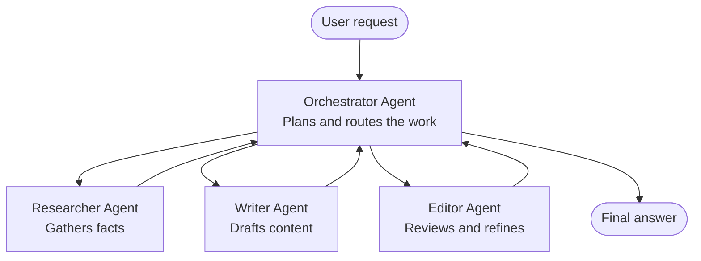

# Çoklu Ajan Temelleri - İlk Koordine Edilmiş Yapay Zeka Sisteminizin Dağıtımı

**Bölüm Gezinme:**
- **📚 Kurs Anasayfa**: [Yeni Başlayanlar için AZD](../../README.md)
- **📖 Güncel Bölüm**: Bölüm 5 - Çoklu Ajan Yapay Zeka Çözümleri
- **⬅️ Önceki**: [Bölüm 4: Altyapı](../chapter-04-infrastructure/README.md)
- **➡️ Sonraki**: [Koordinasyon Desenleri](../chapter-06-pre-deployment/coordination-patterns.md)

> Komut rehberi yayımlanan `azd 1.37.2` referansına karşı gözden geçirildi. Bulut dağıtımları gerçekleştirilmedi.

## Giriş

Önceki bölümlerde tek bir uygulama dağıttınız—ve 2. Bölümde tek bir yapay zeka ajanı dağıttınız. Bu ders bir sonraki adımı atıyor: bir **çoklu ajan sistemi** dağıtmak, burada birkaç uzman ajan birlikte çalışarak tek bir ajanın kendi başına iyi başa çıkamayacağı bir problemi çözüyor.

Yeni başlayanlar için iyi haber: **yeni komutlara ihtiyacınız yok.** Çoklu ajan çözümü hala bir azd projesidir. `azd init`, `azd up` yapacak, test edecek ve `azd down` — tam olarak zaten bildiğiniz iş akışı. Değişen, uygulamanın içindeki *şekildir*.

## Öğrenme Hedefleri

Bu dersin sonunda:
- "Çoklu ajan" ne anlama gelir ve ne zaman ek karmaşıklığa değer olduğunu anlayacaksınız
- Çoklu ajan sistemindeki yaygın rolleri (orchestrator + uzmanlar) tanıyacaksınız
- `azd up` ile gerçek, çalışan bir çoklu ajan şablonu dağıtacaksınız
- Çoklu ajan uygulamasını destekleyen Azure kaynaklarını anlayacaksınız
- Çözümü güvenli şekilde doğrulama, özelleştirme ve kaldırmayı öğreneceksiniz

## Öğrenme Sonuçları

Bu dersi tamamladıktan sonra şunları yapabileceksiniz:
- Tek bir ajan ile çoklu ajan sistem arasındaki farkı açıklamak
- Araçlara sahip tek bir ajan ile gerçek çoklu ajan tasarımı arasında seçim yapmak
- Bir çoklu ajan şablonunu baştan sona azd ile dağıtmak ve test etmek
- Her ajanın nerede çalıştığını ve nasıl iletişim kurduklarını belirlemek
- Sürekli ücretlendirmeyi önlemek için tüm kaynakları temizlemek

---

## Çoklu Ajan Sistemi Nedir?

Tek bir yapay zeka ajanı, bir model ve talimatlar setinden (isteğe bağlı bazı araçlarla) ibarettir. Bu odaklanmış görevler için iyidir. Ancak görev büyüdükçe—araştırma, ardından yazma, ardından düzenleme, ardından doğrulama—her şeyi tek bir komuta sığdırmak ajanı yavaşlatır, daha az güvenilir yapar ve hatalarını bulmayı zorlaştırır.

Bir **çoklu ajan sistemi**, işi her biri bir işi iyi yapan uzmanlara ayırır ve bir düzenleyici tarafından koordine edilir:



### Her zaman göreceğiniz iki rol

| Rol | Görev | Örnek |
|------|-----|---------|
| **Orchestrator** | *Sonraki ne olacağını* belirler ve ajanlar arasında işi yönlendirir | "Önce araştır, sonra yaz, ardından düzenle" |
| **Uzman** | Belirli bir işi yapar ve sonuç döner | Sadece gerçekleri toplayan "araştırmacı" |

### Gerçekten birden fazla ajana ihtiyacınız var mı?

Basit başlayın. Çoklu ajan **yalnızca** şu durumlarda uygulanır:

- ✅ Görev, farklı talimatlardan faydalanan **ayrık aşamalara** sahiptir (araştırma vs. yazma vs. inceleme)
- ✅ Uzmanların **paralel** çalışmasını isteyerek zaman kazanabilirsiniz
- ✅ Farklı adımlar **farklı araçlar veya veri kaynakları** gerektirir
- ✅ Her adım **bağımsız olarak test edilebilir ve hata ayıklanabilir** olmalıdır

Göreviniz tek bir soru-cevap veya basit bir araç çağrısı ise, **araçlara sahip tek bir ajan** (2. Bölüm) daha basit, daha ucuz ve işletmesi daha kolaydır.

> **Yeni başlayan tavsiyesi:** "Daha fazla ajan" "daha iyi" değildir. Her ajan gecikme, maliyet ve izleme gereksinimi ekler. Ajanları ancak sorun net olarak parçalara ayrıldığında ekleyin.

---

## Azure'da Çoklu Ajan Yapmanın İki Yolu

| Yaklaşım | Nedir | En İyi Kullanım Alanı |
|----------|-----------|----------|
| **Tek ajan + araçlar** | Fonksiyonlar/araçlar çağıran tek Foundry ajanı | Basit iş akışları, başlangıç için |
| **Birden fazla koordine edilmiş ajan** | Birden çok ajan ve bir düzenleyici | Ayrık aşamalar, paralel iş, uzmanlaşma |

Bu ders, kendi çoklu ajan sisteminizi oluşturmadan önce gerçek bir çoklu ajan sistemini görebilmeniz için **hazır bir şablon** kullanarak ikinci yaklaşıma odaklanmaktadır.

---

## Uygulamalı: Çalışan Bir Çoklu Ajan Uygulaması Dağıtımı

Resmi bir Azure örneği olan **Contoso Creative Writer**'ı dağıtacağız; bu sistem araştırma, ürün, yazım ve düzenleme ajanlarını koordine ederek bir makale oluşturur. İlerlemeye başlamadan önce, [örneğin ön koşullarını ve maliyetlerini](https://github.com/Azure-Samples/contoso-creative-writer#azure-account-requirements) kontrol edin: model kotası, Azure AI Arama, Bing Grounding erişimi, Python, Docker ve Bash uyumlu kancalar gerektirir. Model ve bölge kullanılabilirliği aboneliğinize bağlıdır; belirli bir bölge seçmek dağıtımı garanti etmez.

### Adım 1: Şablonu Başlatın

```bash
# Create a working folder
mkdir creative-writer && cd creative-writer

# Initialize from the official multi-agent template
azd init --template Azure-Samples/contoso-creative-writer .
```

> Her zaman [Harika AZD AI galerisinde](https://azure.github.io/awesome-azd/?tags=ai) daha fazla çoklu ajan şablonuna göz atabilirsiniz. Diğer yeni başlayan dostu seçenekler arasında `get-started-with-ai-agents` ve `azure-ai-travel-agents` bulunur.

### Adım 2: Kimlik Doğrulama

```bash
# Required for azd workflows
azd auth login

# Also required by this sample's Azure CLI hooks
az login
```

### Adım 3: Ortamı Kontrol Et

```bash
# init normally creates/selects an environment; confirm it before proceeding
azd env list
# Only if you need an additional environment:
# azd env new dev
```

### Adım 4: Ön izleme ve ardından dağıtım

```bash
# See what will be created before spending anything (recommended)
azd provision --preview

# Provision infrastructure and deploy all agents in one step
azd up
```

`azd up`, eksik abonelik ve bölge ayarları için istemde bulunacak, ardından kaynakları sağlayacak ve uygulamayı dağıtacaktır. Ön izleme kota ayırmaz veya başarıyı garanti etmez; şablon kancaları yine de sağlayıcı ön izlemesi sırasında çalışabilir, bu yüzden önce onları inceleyin. Her **hizmet dağıtımı** (model sağlama değil) için azd'nin bekleme süresini uzatmak için:

```bash
azd deploy --timeout 1800
```

Bir zaman aşımı azd'nin beklemesini durdurur; Azure'daki dağıtımı iptal etmez. Tekrar denemeden önce kaynak durumunu inceleyin.

> **Maliyet ve kapasite uyarısı:** Çoklu ajan uygulamaları kota tüketen ve maliyete yol açan AI modelleri dağıtır. Eğer `azd up` model kotasında başarısız olursa, bölge ve kota düzeltmeleri için [AI Sorun Giderme](../chapter-07-troubleshooting/ai-troubleshooting.md) ve 6. Bölüm [Kapasite Planlama](../chapter-06-pre-deployment/capacity-planning.md)'yı inceleyin.

---

## Dağıttığınız Şeyi Anlamak

Bu tür tipik bir çoklu ajan uygulaması, yukarıdaki diyagramdaki sorumluluklara doğrudan karşılık gelen bir dizi Azure kaynağı sağlar:

| Kaynak | Oradaki Sebep |
|----------|----------------|
| **Microsoft Foundry / Modeller** | Her ajanın kullandığı dil modellerini barındırır |
| **Azure AI Arama** | Araştırmacı ajana arama yapması için somut veri sağlar |
| **Container Apps** (veya App Service) | Orchestrator ve ajan kodunu barındırır |
| **Cosmos DB** (bazı örneklerde) | Ajanlar arasında paylaşılan durum/belleği depolar |
| **Application Insights** | İstekleri *ajanlar arasında* takip eder, böylece akışı hata ayıklayabilirsiniz |

### Ajanların birbirleriyle nasıl iletişim kurduğu

Çoğu azd çoklu ajan örneğinde, **orchestrator uygulama kodunuzda çalışır** (örneğin, Semantic Kernel veya Microsoft Agent Framework gibi bir çerçeveyle). Orchestrator sırasıyla her uzman ajana çağrı yapar, sonuçları iletir ve son cevabı oluşturur. Ajanlar bağlamı şu yollarla paylaşır:

- **Fonksiyon/araç çağrıları** — orchestrator bir uzmana çağrı yapar ve sonuç alır
- **Paylaşılan bellek** — genellikle Cosmos DB olan bir veritabanı hem ajanların okuyabileceği durumu tutar
- **Mesajlar/olaylar** — daha gevşek bağlantı için ajanlar kuyruk veya Service Bus üzerinden iletişim kurar

> **Hata ayıklamada neden bu önemli:** her adım ayrı olduğu için Application Insights hangi ajanın yavaş veya başarısız olduğunu gösterir. Bu, işi ajanlar arasında bölmenin temel nedenlerinden biridir.

---

## Dağıtımı Doğrula

Sistemin gerçekten çalıştığını ileri gitmeden önce doğrulayın:

```bash
# Show the deployed endpoints
azd show

# Open the app's monitoring dashboard
azd monitor

# Open Application Insights Logs (not a terminal log stream)
azd monitor --logs
```

Sonra `azd show` adresinden uygulama URL'sini açın ve kısa bir makale isteyin. Örneğin hata ayıklama görünümünü kullanarak ajan iş akışını inceleyin. Application Insights işlem araması yalnızca örnek uygun şekilde enstrümanlanmış ve ilişkilendirilmişse bireysel adımları gösterebilir; azd ajan aralığı otomatik olarak eklemez.

**Başarı kriterleri:**
- ✅ `azd show` ulaşılabilir bir uç noktayı listeler
- ✅ Bir istek açıkça birden fazla aşamadan geçmiş bir sonuç üretir
- ✅ Hata ayıklama görünümü birden fazla ajan adımını gösterir; izleme etkinse, alım sonrası ilgili telemetriyi doğrulayın

---

## Özelleştir: Bir Ajan Ekle veya Ayarla

Çünkü her ajan sadece talimatlar ve araçlar içerir, özelleştirme yaklaşılabilir:

1. **Ajan tanımlarını bulun** şablonda (çoğunlukla `prompts/`, `agents/` veya `*.prompty` dosya setinde).
2. **Bir ajanın talimatlarını ayarlayın** — örneğin, editör ajana belirli bir ton veya kelime sayısı uygulanmasını söyleyin.
3. **Yalnızca kodu yeniden dağıtın** (altyapı değişmeden kalır):

   ```bash
   azd deploy
   ```

Kendi *Foundry* ajan projenizle ilerlemek için, GA paketini AZD 1.37.0+ ile ayrı boş bir dizinde kullanın:

```bash
azd ext install microsoft.foundry
azd ai agent init
azd up
azd ai agent invoke      # test, with response timing
```

Ajan Denetleyici yerel test, uzak kod dağıtımı ve temizlik sahipliği için [GA hosted-agent yürütülmesini](../chapter-02-ai-development/microsoft-foundry-integration.md#hosted-agent-walkthrough-ga) inceleyin. [AZD AI CLI referansı](../chapter-08-production/production-ai-practices.md#azd-ai-cli-commands-and-extensions) ayrıca ayrı değerlendirmeler eklentisi, optimizasyon ve ajan silme konularını kapsamaktadır.

---

## Temizlik

Çok ajanlı uygulamalar birden fazla faturalandırılabilir hizmet çalıştırır. İşiniz bittiğinde her şeyi kapatın:

```bash
# Review the resources and confirm deletion interactively
azd down
```

Silme işlemi geri dönülmezdir. Geçici bir laboratuvar için, `azd down --force --purge` silmeyi atlar ve desteklenen soft-delete temizleme onaylarını atlar; temizleme desteklenen durumlarda geri alınamaz ve temizleme korumasıyla engellenebilir. Yumuşak silme, kurtarma/isim yeniden kullanımıyla alakalıdır, kendi başına devam eden ücretlerin kanıtı değildir. Temizlik sonrası tutulan kaynaklar ve faturalandırmayı kontrol edin.

Ayrıca var olan bir Foundry projesine karşı barındırılan bir ajan başlattıysanız, `azd down` o projenin ajanını ve diğer kaynaklarını yerinde bırakır. Sahip olduğunuz istemediğiniz kaynakları ayrı ayrı kaldırın. AZD ortamı tarafından oluşturulmuş yeni bir Foundry projesi için, `azd down` kaynak grubunu ve içindekilerin tamamını siler.

---

## Üretim Çok Ajanlı Sistemler Hakkında Bir Not

Bu depo içindeki [Perakende Çok Ajan Çözümü](../../examples/retail-scenario.md) bir **mimari şablon**dur, tek komutla uygulanabilir bir şablon değildir—bir üretim perakende sisteminin *nasıl* inşa edileceğini belgelendirir (ve tam bir yapının büyük bir çaba olduğunu açıklar). Burada çalışan bir örneği dağıttıktan *sonra* tasarım referansı olarak kullanın. Üretimle ilgili konular (dayanıklılık, maliyet, izleme, yönetişim) için [Bölüm 8: Üretim AI Uygulamaları](../chapter-08-production/production-ai-practices.md) bölümüne devam edin.

---

## Özet

- Çok ajanlı sistem, işleri bir orkestratör tarafından koordine edilen uzmanlar arasında böler.
- Görev belirgin aşamalara, paralelliğe veya her adım için farklı araçlara sahip olduğunda kullanın—aksi takdirde tek bir ajan tercih edin.
- azd iş akışı değişmez: `azd init` → `azd up` → test → `azd down`.
- Gerçek bir şablon olan `contoso-creative-writer`, bugün çalışan çok ajanlı bir uygulamayı görmenizi ve özelleştirmenizi sağlar.
- Ajanlar arasında Application Insights izleme, çok ajanlı tasarımın en büyük pratik faydalarından biridir.

---

## 🔗 Navigasyon

| Yön | Ders |
|-----------|--------|
| **Önceki** | [Bölüm 4: Altyapı](../chapter-04-infrastructure/README.md) |
| **Sonraki** | [Koordinasyon Desenleri](../chapter-06-pre-deployment/coordination-patterns.md) |

## 📖 İlgili Kaynaklar

- [AI Ajanları Rehberi](../chapter-02-ai-development/agents.md)
- [Koordinasyon Desenleri](../chapter-06-pre-deployment/coordination-patterns.md)
- [Üretim AI Uygulamaları](../chapter-08-production/production-ai-practices.md)
- [Yapay Zeka Sorun Giderme](../chapter-07-troubleshooting/ai-troubleshooting.md)

---

<!-- CO-OP TRANSLATOR DISCLAIMER START -->
**Feragatname**:
Bu belge, AI çeviri hizmeti [Co-op Translator](https://github.com/Azure/co-op-translator) kullanılarak çevrilmiştir. Doğruluk için çaba sarf etsek de, otomatik çevirilerin hata veya yanlışlık içerebileceğini lütfen unutmayınız. Orijinal belge, kendi dilinde yetkili kaynak olarak kabul edilmelidir. Kritik bilgiler için profesyonel insan çevirisi önerilir. Bu çevirinin kullanımı sonucu ortaya çıkabilecek yanlış anlamalardan veya yanlış yorumlamalardan sorumlu değiliz.
<!-- CO-OP TRANSLATOR DISCLAIMER END -->