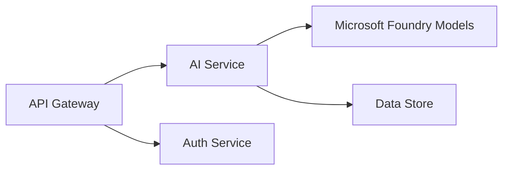
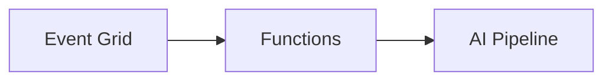

# Bölüm 8: Üretim & Kurumsal Modeller

**📚 Kurs**: [Başlangıç İçin AZD](../../README.md) | **⏱️ Süre**: 2-3 saat | **⭐ Zorluk Seviyesi**: İleri

---

## Genel Bakış

Bu bölüm, kurumsal kullanılabilirlikte dağıtım modellerini, güvenlik sertleştirme, izleme ve üretim AI iş yükleri için maliyet optimizasyonunu kapsar.

Bu, tam dağıtılabilir bir üretim şablonu değil, mimari bir referanstır. Örnekler, kendi uygulamanızda sağlanması ve test edilmesi gereken entegrasyon detaylarını atlar; kontrol listesini okumak üretim hazır olma sertifikası vermez.

> **Sürüm incelemesi (2026-11-04):** AI CLI rehberi `azd 1.37.2`, ajanlar `1.0.0-beta.23` ve değerlendirmeler `1.0.0-beta.2` belgeleri/kaynakları ile karşılaştırıldı. Uyum gereksinimleri ve taşıma detayları için [sürüm değişiklikleri ve düzeltmeler](production-ai-practices.md#recent-release-changes-and-fixes) bakınız; bu canlı bir dağıtım doğrulaması değildir.

## Öğrenme Hedefleri

Bu bölümü tamamladığınızda:
- Çok bölgeli dayanıklı uygulamaları dağıtacaksınız
- Kurumsal güvenlik modellerini uygulayacaksınız
- Kapsamlı izleme yapılandıracaksınız
- Ölçekli maliyetleri optimize edeceksiniz
- AZD ile CI/CD boru hatları kuracaksınız

---

## 📚 Dersler

| # | Ders | Açıklama | Süre |
|---|--------|-------------|------|
| 1 | [Üretim AI Uygulamaları](production-ai-practices.md) | Kurumsal dağıtım modelleri | 90 dk |

---

## 🚀 Üretim Kontrol Listesi

- [ ] Dayanıklılık için çok bölgeli dağıtım
- [ ] Kimlik doğrulama için yönetilen kimlik (anahtar yok)
- [ ] İzleme için Application Insights
- [ ] Maliyet bütçeleri ve uyarılar yapılandırıldı
- [ ] Güvenlik taraması etkinleştirildi
- [ ] CI/CD boru hattı entegrasyonu
- [ ] Felaket kurtarma planı

---

## 🏗️ Mimari Modeller

### Model 1: Mikroservisler AI



### Model 2: Olay Tabanlı AI



---

## 🔐 Güvenlik En İyi Uygulamaları

```bicep
// Illustrative properties from different resources, NOT a standalone Bicep file.
// Attach identity to the application host:
identity: {
  type: 'SystemAssigned'
}

// AI account properties (also require private endpoints, DNS and app connectivity):
properties: {
  publicNetworkAccess: 'Disabled'
  networkAcls: {
    defaultAction: 'Deny'
  }
}
```

---

## 💰 Maliyet Optimizasyonu

| Strateji | Ana Kısıtlama |
|----------|---------|
| Sıfıra ölçekleme (Container Apps) | Uygun bir tetikleyici gerekir; diğer servisler hala maliyet oluşturur |
| Geliştirici için tüketim katmanları kullanımı | Seçilen hizmet fiyatlandırması ve iş yükü karşılaştırması |
| Planlı ölçeklendirme | Desteklenen altyapı/otomasyon ile ölçeklendirme |
| Rezervasyonlar/ayrılmış kapasite | Sadece desteklendiğinde; taahhütler boşta kalan maliyetleri artırabilir |

Geçerli bir başlangıç tarihi, faturalama kapsamı, alıcılar ve izinler ile [tam bütçe kaynak modeli](production-ai-practices.md#2-cost-monitoring-and-budgets) kullanın. Bir bütçe uyarılar gönderir; harcamayı sınırlandırmaz. Tasarruflar ölçülen kullanıma bağlıdır ve garanti edilen yüzdeler değildir.

---

## 📊 İzleme Ayarları

```bash
# Open the Application Insights logs view (requires configured monitoring)
azd monitor --logs

# Check Application Insights
azd monitor --overview

# View metrics
az monitor metrics list --resource <resource-id>
```

---

## 🔗 Navigasyon

| Yön | Bölüm |
|-----------|---------|
| **Önceki** | [Bölüm 7: Sorun Giderme](../chapter-07-troubleshooting/README.md) |
| **Kurs Tamamlandı** | [Kurs Ana Sayfa](../../README.md) |

---

## 📖 İlgili Kaynaklar

- [AI Ajanları Kılavuzu](../chapter-02-ai-development/agents.md)
- [Application Insights](../chapter-06-pre-deployment/application-insights.md)
- [Çok Ajanlı Çözümler](../chapter-05-multi-agent/README.md)
- [Mikroservisler Örneği](../../examples/microservices/README.md)

---

<!-- CO-OP TRANSLATOR DISCLAIMER START -->
**Feragatname**:
Bu belge, AI çeviri hizmeti [Co-op Translator](https://github.com/Azure/co-op-translator) kullanılarak çevrilmiştir. Doğruluk için çaba sarf etsek de, otomatik çevirilerin hata veya yanlışlık içerebileceğini lütfen unutmayınız. Orijinal belge, kendi dilinde yetkili kaynak olarak kabul edilmelidir. Kritik bilgiler için profesyonel insan çevirisi önerilir. Bu çevirinin kullanımı sonucu ortaya çıkabilecek yanlış anlamalardan veya yanlış yorumlamalardan sorumlu değiliz.
<!-- CO-OP TRANSLATOR DISCLAIMER END -->