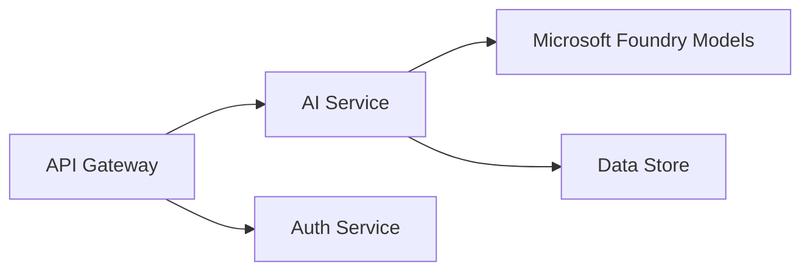
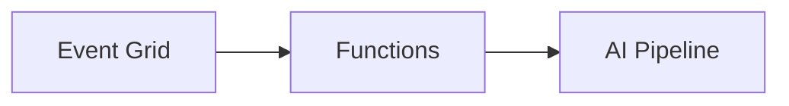

# Bölüm 8: Üretim ve Kurumsal Desenler

**📚 Kurs**: [Yeni Başlayanlar için AZD](../../README.md) | **⏱️ Süre**: 2-3 saat | **⭐ Zorluk**: İleri Seviye

---

## Genel Bakış

Bu bölüm, kurumsal seviyede dağıtım desenlerini, güvenlik güçlendirmesini, izlemeyi ve üretim yapay zeka iş yükleri için maliyet optimizasyonunu ele almaktadır.

Bu bir mimari referanstır, tam bir dağıtılabilir üretim şablonu değildir. Örnekler, kendi uygulamanızda sağlanması ve test edilmesi gereken entegrasyon detaylarını içermemektedir; kontrol listesini okumak üretim hazır olduğunu garanti etmez.

> **Foundry GA güncellemesi (2026-11-09):** Foundry iş akışı için `azd >= 1.37.0` ve genel kullanıma açık `microsoft.foundry` 1.0 paketini kullanın; değerlendirmeler ayrı olarak yüklenir. [Sürüm kapsamı ve geçiş](production-ai-practices.md#recent-release-changes-and-fixes) ve [doğrulanmış işlem hattı örneğine](production-ai-practices.md#cicd-pipeline-configuration) bakınız. Bu bir dokümantasyon incelemesidir, canlı dağıtım doğrulaması veya isteğe bağlı önizleme özellikleri için genel GA statüsü değildir.

## Öğrenme Hedefleri

Bu bölümü tamamlayarak:
- Çok bölgeli dayanıklı uygulamalar dağıtacaksınız
- Kurumsal güvenlik desenlerini uygulayacaksınız
- Kapsamlı izlemeyi yapılandıracaksınız
- Ölçekli maliyet optimizasyonu yapacaksınız
- AZD ile CI/CD işlem hatları kuracaksınız

---

## 📚 Dersler

| # | Ders | Açıklama | Süre |
|---|--------|-------------|------|
| 1 | [Üretim Yapay Zeka Uygulamaları](production-ai-practices.md) | Kurumsal dağıtım desenleri | 90 dk |

---

## 🚀 Üretim Kontrol Listesi

- [ ] Dayanıklılık için çok bölgeli dağıtım
- [ ] Kimlik doğrulama için yönetilen kimlik (anahtarsız)
- [ ] İzleme için Application Insights
- [ ] Maliyet bütçeleri ve uyarılar yapılandırıldı
- [ ] Güvenlik taraması etkinleştirildi
- [ ] CI/CD işlem hattı entegrasyonu
- [ ] Felaket kurtarma planı

---

## 🏗️ Mimari Desenler

### Desen 1: Mikroservisler AI



### Desen 2: Olay Tabanlı AI



---

## 🔐 Güvenlik En İyi Uygulamaları

```bicep
// Illustrative properties from different resources, NOT a standalone Bicep file.
// Attach identity to the application host:
identity: {
  type: 'SystemAssigned'
}

// AI account properties (also require private endpoints, DNS and app connectivity):
properties: {
  publicNetworkAccess: 'Disabled'
  networkAcls: {
    defaultAction: 'Deny'
  }
}
```

---

## 💰 Maliyet Optimizasyonu

| Strateji | Ana Kısıtlama |
|----------|---------|
| Sıfıra ölçekleme (Container Apps) | Uygun tetikleyici gerekir; diğer hizmetler yine maliyet oluşturur |
| Geliştirme için tüketim katmanlarını kullan | Seçilen hizmet fiyatlandırması ve iş yükü karşılaştırması |
| Zamanlanmış ölçeklendirme | Desteklenen altyapı/otomasyon ile ölçeklendir |
| Rezervasyonlar/ayrılmış kapasite | Yalnızca desteklendiğinde; taahhütler boşta maliyetleri artırabilir |

Geçerli bir başlama tarihi, faturalama kapsamı, alıcılar ve izinlerle birlikte [tam bütçe kaynak deseni](production-ai-practices.md#2-cost-monitoring-and-budgets) kullanın. Bir bütçe uyarılar gönderir; harcamayı sınırlandırmaz. Tasarruflar ölçülen kullanım oranlarına bağlıdır ve garanti edilmez.

---

## 📊 İzleme Kurulumu

```bash
# Open the Application Insights logs view (requires configured monitoring)
azd monitor --logs

# Check Application Insights
azd monitor --overview

# View metrics
az monitor metrics list --resource <resource-id>
```

---

## 🔗 Navigasyon

| Yön | Bölüm |
|-----------|---------|
| **Önceki** | [Bölüm 7: Sorun Giderme](../chapter-07-troubleshooting/README.md) |
| **Kurs Tamamlandı** | [Kurs Ana Sayfa](../../README.md) |

---

## 📖 İlgili Kaynaklar

- [AI Ajanları Rehberi](../chapter-02-ai-development/agents.md)
- [Application Insights](../chapter-06-pre-deployment/application-insights.md)
- [Çoklu Ajan Çözümleri](../chapter-05-multi-agent/README.md)
- [Mikroservisler Örneği](../../examples/microservices/README.md)

---

<!-- CO-OP TRANSLATOR DISCLAIMER START -->
**Feragatname**:
Bu belge, AI çeviri hizmeti [Co-op Translator](https://github.com/Azure/co-op-translator) kullanılarak çevrilmiştir. Doğruluk için çaba sarf etsek de, otomatik çevirilerin hata veya yanlışlık içerebileceğini lütfen unutmayınız. Orijinal belge, kendi dilinde yetkili kaynak olarak kabul edilmelidir. Kritik bilgiler için profesyonel insan çevirisi önerilir. Bu çevirinin kullanımı sonucu ortaya çıkabilecek yanlış anlamalardan veya yanlış yorumlamalardan sorumlu değiliz.
<!-- CO-OP TRANSLATOR DISCLAIMER END -->