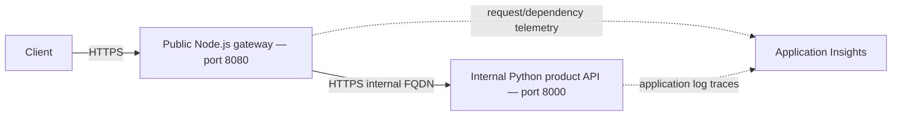

# İki Servisli Mikroservisler — Azure Container Apps

**Seviye:** Orta · **Süre:** Kurulum dahil 45–60 dakika

Bu öğrenme örneği, **Node.js API Ağ Geçidi** ve **salt okunur Python
Ürün Servisi** uygular. Kaynak, Docker dosyaları, Bicep ve azd yapılandırması dahil edilmiştir.
Bu bir üretim ortamı için sağlamlaştırılmış sistem değildir.

## Öğrenecekleriniz

- İki servisi bağımsız olarak dağıtma.
- Dahili bir backend FQDN'yi HTTPS üzerinden kullanma.
- Başarı, bulunamadı ve hizmet kullanılamıyor yanıtlarını doğrulama.
- Telemetriyi ve bağımsız ölçeklendirme sınırlarını anlama.



Ürün kataloğu bellekte beş sabit ürün içerir. **POST,
PUT veya DELETE işleyicileri**, veritabanı, Service Bus, sipariş/kullanıcı/bildirim servisi,
C# veya Go kodu yoktur. Bunlar gelecekteki geliştirme fikirleridir, dahil olmayan özelliklerdir.
Ağ geçidi kullanıcıları kimlik doğrulamaz; dahili giriş, uygulama yetkilendirmesinin yerini tutmaz.


## Önkoşullar

Öncelikle [tek Flask API](../../../../../examples/container-app/simple-flask-api) tamamlayın.
Güncel stabil bir azd (inceleme zamanında yayımlanmış sürüm: 1.37.2), Azure CLI
ve daemon çalışır durumdaki Docker'ı kurun. Bir Azure aboneliğine, kaynak
oluşturma izinlerine ve Container Apps bölgesel kota hakkına ihtiyacınız var.

```bash
azd version
az version
docker info
azd auth login
az login
```

Her iki CLI aracında aynı aboneliği kullanın. Aşağıdaki komutlar Bash kullanır.

## Yayınla ve doğrula

Depo kök dizininden:

```bash
cd examples/container-app/microservices
azd env new microservices-demo
azd up
GATEWAY_URL=$(azd env get-value API_GATEWAY_URL)
RG_NAME=$(azd env get-value AZURE_RESOURCE_GROUP)
GATEWAY_NAME=$(azd env get-value API_GATEWAY_NAME)
PRODUCT_NAME=$(azd env get-value PRODUCT_SERVICE_NAME)

curl --fail-with-body "${GATEWAY_URL}/health"
curl --fail-with-body "${GATEWAY_URL}/api/products"
curl --fail-with-body "${GATEWAY_URL}/api/products/1"
curl -i "${GATEWAY_URL}/api/products/999"
```

**Başarılı:** health 200; list 200 ve içinde **beş** ürün; ürün 1, fiyatı 999.99 olan ve stokta 50 adet bulunan bir Dizüstü Bilgisayar
; bilinmeyen ürün 404 döner.
Açıklamalar yanıtların içinde yer alır; zaman damgaları değişkendir.

İlk kurulumu, boş bir kayıt defterinden var olmayan görüntüleri çekmeye çalışmaması için port 80'de genel hello-world görüntüleri kullanır.
Hizmete özel Bicep modülleri
ve parametre dosyaları, bunları derlenmiş görüntüler ve uygulama portları/probları ile değiştirir
`azd deploy` sırasında. Ana parametreler, sonraki sağlama için yayınlanmış görüntü isimlerini korur.

## Servisler ve ağ oluşturma

| Servis | Açık uç noktalar | Varsayılan kaynaklar |
|---|---|---|
| Gateway | GET `/`, `/health`, `/api/products`, `/api/products/:id` | 1 vCPU, 2 GiB, 2–20 çoğaltma |
| Product | GET `/`, `/health`, `/products`, `/products/<id>` | 0.5 vCPU, 1 GiB, 1–10 çoğaltma |

Product ingress, `external: false` ve `allowInsecure: false` içerir. Bicep,
`PRODUCT_SERVICE_URL=https://<actual-internal-fqdn>` öğesini gateway'e enjekte eder. HTTP
yönlendirecektir; HTTPS, yapılandırılmış ingress ile eşleşir. Kısa bir DNS adı,
**gerçek Container App adıyla** uyumlu olmalıdır, mantıksal servis anahtarı `product-service` ile değil.
Dizüstü bilgisayarınızdan dahili URL'yi doğrudan aramaya çalışmayın.

Ağ geçidinin ürün çağrıları için beş saniyelik bir zaman aşımı vardır. Eksik ürün kimlikleri
404 olarak yayılır; taşıma hataları/diğer arka uç hataları 503 döndürür. Ağ geçidi
`/health` yalnızca ağ geçidini kontrol eder, arka uç kullanılabilirliğini değil.

## Dosyalar ve yapılandırma

```text
azure.yaml
infra/main.bicep
infra/main.parameters.json
infra/abbreviations.json
infra/core/container-apps-environment.bicep
infra/core/monitor.bicep
infra/app/api-gateway.bicep
infra/app/api-gateway.parameters.json
infra/app/product-service.bicep
infra/app/product-service.parameters.json
src/api-gateway/{app.js,package.json,Dockerfile}
src/product-service/{main.py,requirements.txt,Dockerfile}
```

Ölçeklendirme, CPU/bellek, portlar ve problar `infra/app/*.bicep` içinde ayarlanır. Bu
dosyaları değiştirin ve altyapıyı uygulamak ve yeniden dağıtmak için `azd up` çalıştırın.
Bu örnekte `GATEWAY_MAX_REPLICAS` ortam değişkeni parametresi yoktur.

Yalnızca kod değişiklikleri için:

```bash
azd deploy product-service
azd deploy api-gateway
```

Node görüntüsü Node 22'yi kullanır; Python görüntüsü Python 3.11 kullanır. Her ikisi de
`0.0.0.0`'ye bağlanır. Ingress/problar sırasıyla 8080 (ağ geçidi) ve 8000 (ürün) portlarını kullanır.

## Docker ile yerel geliştirme

Bu örnek dizinden çalıştırın. Bir konteynerden diğerine ulaşmak için kullanıcı tanımlı bir ağ kullanın, **`localhost` değil
**:

```bash
docker network create azd-microservices-demo
docker build -t local-product ./src/product-service
docker build -t local-gateway ./src/api-gateway
docker run -d --name azd-product --network azd-microservices-demo local-product
docker run -d --name azd-gateway --network azd-microservices-demo \
  -p 8080:8080 -e PRODUCT_SERVICE_URL=http://azd-product:8000 local-gateway
curl --fail-with-body http://localhost:8080/api/products
```

Beklenen: beş ürün. HTTP yalnızca bu yerel Docker ağı için kullanılır.

```bash
docker stop azd-product azd-gateway
docker rm azd-product azd-gateway
docker network rm azd-microservices-demo
```

## İzleme

```bash
az containerapp logs show --name "$GATEWAY_NAME" --resource-group "$RG_NAME" --follow
# In a separate terminal:
az containerapp logs show --name "$PRODUCT_NAME" --resource-group "$RG_NAME" --tail 100
```

`azd monitor --logs` bir portal görünümü açar; terminal günlüklerini akış halinde göstermez.
Node SDK ağ geçidi isteklerini/bağımlılıklarını toplar. Python'un `AzureLogHandler`
**günlük izlerini** dışa aktarır, otomatik Flask istekleri, SQL bağımlılıkları veya tam
dağıtılmış izler değil. OpenCensus eski bir SDK’dır; bu örneği genişletirken Azure Monitor OpenTelemetry’yi tercih edin.


Application Insights Günlüklerinde, istekler oluşturun ve inceleyin:

```kusto
requests
| where timestamp > ago(1h)
| where name contains "products"
| summarize RequestCount=count(), AvgDuration=avg(duration) by bin(timestamp, 5m)
```

Python uygulama mesajları için:

```kusto
traces
| where timestamp > ago(1h)
| where message contains "products"
| project timestamp, message, severityLevel
```

Veri alınmasında gecikme ve örnekleme olabilir; tam bir istek sayısı veya garanti edilen bir gecikme süresi beklemeyin.
Özel uyarılar veya panolar yapılandırılmamıştır.

## Pratik Egzersizler

### Egzersiz 1: Kataloğu Değiştirin

**Başlangıç noktası:** `src/product-service/main.py`.
**Hedef:** bağımsız servis dağıtımını doğrulamak.
Dizüstü bilgisayarın stok miktarını sabit `products` listesindeki 50'den 49'a değiştirin, çalıştırın
`azd deploy product-service`, ardından `${GATEWAY_URL}/api/products/1` isteyin.

**Başarı ölçütü / çözüm:** `"stock":49` ile HTTP 200. 50'yi geri yükleyin ve yeniden dağıtın.
**Yaygın sorun:** kataloğa sahip hizmet yerine ağ geçidinin düzenlenmesi.
Bu, kalıcı bir envanter veritabanı değil, kaynak verileri değiştirir.

### Alıştırma 2: Replika yapılandırmasını doğrula

**Başlangıç noktası:** `infra/app/product-service.bicep`.
**Hedef:** otomatik ölçeklendirmeyi tahmin etmeden bir altyapı değişikliğini gözlemlemek.
`minReplicas: 1` değerini `minReplicas: 2` olarak değiştir, `azd up` çalıştır, sonra:

```bash
az containerapp show --name "$PRODUCT_NAME" --resource-group "$RG_NAME" \
  --query properties.template.scale -o json
```

**Başarı kriterleri:** yapılandırılmış minimum 2 ve maksimum 10 olarak kalır.
Minimum 1'e geri al ve `azd up` çalıştır.
**Yaygın sorun:** yalnızca `azd deploy` ilgili olmayan paylaşılan
altyapıya değişiklik uygulamaz. Bir başarısızlık simülasyonu olarak `maxReplicas` değerini sıfıra ayarlamayın.
Bu, yük testi veya garanti edilen anlık kopya sayısı değil, yapılandırmayı doğrular.

### Egzersiz 3: Kullanılamayan hizmet işlemini yerel olarak test et

**Başlangıç noktası:** yukarıdaki her iki yerel Docker konteyneri çalışıyor.
**Amaç:** arka uç hatasını eksik bir ürünle ayırt etmek.
Sadece ürün konteynerini durdur:

```bash
docker stop azd-product
curl -i http://localhost:8080/api/products
docker start azd-product
curl --fail-with-body http://localhost:8080/api/products
```

**Başarı kriterleri:** durdurulduğunda, ağ geçidi
503 döner `"error":"Product service unavailable"`; yeniden başlatıldıktan sonra liste 200 döner.
Gerekirse kısa bir başlatma gecikmesinden sonra tekrar dene.
**Yaygın sorun:** ağ geçidini durdurmak farklı bir başarısızlığı test eder (HTTP yanıtı yok).

## Maliyetler ve üretim boşlukları

Varsayılan minimum kopyalar hesaplamayı çalışır durumda tutar. Kayıt defteri ve izleme de
ücretler oluşturur. Doğrulanmış sabit 50 $/ay toplamı yoktur: bölgesel CPU/bellek,
kopya saatleri, istekler, kayıt defteri ve günlük saklamayı
[Azure fiyat hesaplayıcısı](https://azure.microsoft.com/pricing/calculator/) içinde tahmin edin.
Öğrenme kaynaklarını derhal silin.

Üretim işi kimlik doğrulama/izin, kapsamlı yönetilen kimlikler,
kalıcı veri, giriş/yanıt doğrulaması, desteklenen gözlemlenebilirlik enstrümantasyonu,
yük/başarı testi, CI/CD, uyarılar ve kurtarma prosedürlerini içerir. Bir sipariş
servisi, kuyruğu veya veritabanı eklemek ayrı bir uygulama görevidir, burada tamamlanmış
bir egzersiz veya mevcut bir özellik değildir.

## Sorun giderme ve temizlik

- **İlk sağlama sırasında resim bulunamadı:** başlangıçta genel resim kullanılmalıdır;
  ana resim parametre varsayılanlarını ve dağıtım modülü eşlemelerini doğrulayın.
- **503 ürünler:** ürün günlüklerini, resim revizyonunu ve eklenen dahili HTTPS URL'sini kontrol edin.
- **404 beklenmeyen yol:** ürün API'si salt okunurdur; rotayı, var olmayan CRUD işleyicisini değil doğrulayın.
- **Hiç telemetri yok:** çalışma zamanı bağlantı dizelerini ifşa etmeden inceleyin ve
  alma gecikmesine izin verin. Python istek tabloları günlük işleyicisi tarafından doldurulmaz.

Bu örnek dizinden:

```bash
azd down
```

Silme istemlerini gözden geçirin ve ayrılmış kaynak grubunun kaldırıldığını doğrulayın.

[Önceki: Flask API](../../../../../examples/container-app/simple-flask-api) · [Sonraki: Veritabanı uygulaması](../../../../../examples/database-app) ·
[Yapay zeka geliştirme](../../../docs/chapter-02-ai-development/README.md) ·
[Kurs ana sayfası](../../../README.md) · [Sorun bildir](https://github.com/microsoft/AZD-for-beginners/issues)

---

<!-- CO-OP TRANSLATOR DISCLAIMER START -->
**Feragatname**:
Bu belge, AI çeviri hizmeti [Co-op Translator](https://github.com/Azure/co-op-translator) kullanılarak çevrilmiştir. Doğruluk için çaba sarf etsek de, otomatik çevirilerin hata veya yanlışlık içerebileceğini lütfen unutmayınız. Orijinal belge, kendi dilinde yetkili kaynak olarak kabul edilmelidir. Kritik bilgiler için profesyonel insan çevirisi önerilir. Bu çevirinin kullanımı sonucu ortaya çıkabilecek yanlış anlamalardan veya yanlış yorumlamalardan sorumlu değiliz.
<!-- CO-OP TRANSLATOR DISCLAIMER END -->