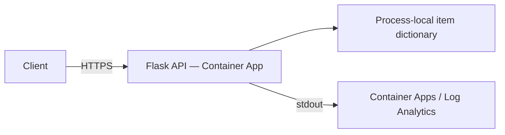

# Basit Flask API — Azure Container Apps

**Seviye:** Başlangıç · **Süre:** Kurulum dahil 30–45 dakika

Azure Developer CLI (azd) ile Python Flask CRUD API dağıtın. Kaynak, Dockerfile,
Bicep ve dağıtım parametreleri dahil edilmiştir. Bu bir **öğrenme örneğidir**, üretim hazır API
değildir.

## Neler öğreneceksiniz

- azd ile bir konteyner oluşturup yayınlama.
- Ingress ve liveness/readiness probe'larını yapılandırma.
- CRUD yanıtlarını doğrulama ve uygulama günlüklerini inceleme.
- Bellek içi verinin kalıcı uygulamalar için neden uygun olmadığını anlama.



**Önemli:** öğeler tek bir işlemde tutulur. Varsayılan, **bir Gunicorn işçisi,
0–1 replika**dır, bu da işçiler/replikalar arasında tutarsız verilerin önüne geçer.
Yeniden başlatma, revizyon değişikliği veya ölçek sıfıra düşürmede öğeler kaybolur.
Replika sayısını artırmak paylaşılan kalıcı depolama gerektirir. API'nin kimlik doğrulama veya yetkilendirmesi yoktur.

## Önkoşullar

- [Güncel kararlı azd](https://learn.microsoft.com/azure/developer/azure-developer-cli/install-azd)
  (inceleme sırasında yayınlanmış sürüm: 1.37.2).
- Doğrulama için [Azure CLI](https://learn.microsoft.com/cli/azure/install-azure-cli).
- Docker ve daemonu çalışır durumda; varsayılan yerel imaj oluşturma için gereklidir.
- Azure aboneliği, kaynak oluşturma izinleri ve Container Apps bölgesel kota.
- Aşağıdaki komutlar için Bash (veya eşdeğer PowerShell).
- İsteğe bağlı yerel geliştirme için Python 3.11.

```bash
azd version
az version
docker info
azd auth login
az login
```

CLI araçlarının ayrı oturumları vardır. İki ortamda da aynı aboneliği kullanın.

## Hızlı başlangıç

Depo kök dizininden:

```bash
cd examples/container-app/simple-flask-api
azd env new flask-demo
azd up
API_URL=$(azd env get-value API_ENDPOINT)
RG_NAME=$(azd env get-value AZURE_RESOURCE_GROUP)
API_NAME=$(azd env get-value API_NAME)
curl --fail-with-body "${API_URL}/health"
```

Beklenen: HTTP 200 ve `"status":"healthy"`, 
`"service":"simple-flask-api"` ve güncel UTC zaman damgası içeren JSON.
Sağlama ve imaj oluşturma genellikle birkaç dakika sürer; süreler değişiklik gösterebilir.

İlk sağlama, 80 numaralı portu dinleyen genel bir hello-world imajını kullanır.
`azure.yaml`, hizmet dağıtımı için `infra/app/api.bicep` ve eşleşen parametre dosyasını seçer, 
bu da imajı, ingress'i ve testleri 8000 numaralı porta geçirir.
Bu dağıtım parametrelerini silmeyin.

## CRUD Doğrulaması

Aynı replika aktifken aşağıdakileri sırasıyla çalıştırın:

```bash
# Create: HTTP 201; note the returned id (1 for a fresh process).
curl -i -X POST "${API_URL}/api/items" \
  -H "Content-Type: application/json" \
  -d '{"name":"Test Item","description":"My first item"}'

# Read list: HTTP 200, total 1 in a fresh process.
curl --fail-with-body "${API_URL}/api/items"

# Replace 1 if your create response returned another id.
curl --fail-with-body "${API_URL}/api/items/1"
curl -i -X PUT "${API_URL}/api/items/1" \
  -H "Content-Type: application/json" -d '{"name":"Updated Item"}'
curl -i -X DELETE "${API_URL}/api/items/1"
curl -i "${API_URL}/api/items/1"
```

Başarı: POST 201, okuma/PUT 200, gövdesiz DELETE 204 ve ardından eksik öğe 404.
Yanlış biçimlendirilmiş/nesne olmayan JSON veya boş bir isim 400 döner.
Bir öğe istekler arasında kaybolursa, yeniden başlatma veya sıfıra ölçekleme olup olmadığını kontrol edin;
bu, kalıcılık değil kasıtlı bir bellek içi sınırlamadır.

| Uç Nokta | Metodlar |
|---|---|
| `/` | GET — hizmet bilgisi |
| `/health` | GET — canlılık/hazırlık |
| `/api/items` | GET, POST |
| `/api/items/{id}` | GET, PUT, DELETE |

## Günlükler ve yapılandırma

```bash
az containerapp logs show --name "$API_NAME" --resource-group "$RG_NAME" --follow
```

Beklenen: Gunicorn başlatma, istek erişim günlükleri ve uygulama mesajları.
`azd monitor --logs` bir portal görünümü açar; terminale akış göndermez.
Application Insights sağlanmıştır ancak **bu Flask kodu tarafından enstrümente edilmemiştir**;
stdout günlükleri için Container Apps/Log Analytics kullanın.

CPU/bellek, replika sınırları veya ölçek kuralları için `infra/app/api.bicep` dosyasını düzenleyin, sonra
`azd up` çalıştırın. Varsayılanlar 0.5 vCPU, 1 GiB, minimum 0 / maksimum 1 replika ve
50 eşzamanlı istek için HTTP eşik değeridir. Sıfıra ölçekleme soğuk başlatma gecikmesi ekleyebilir.

Keyfi `azd env set MAX_REPLICAS`, `API_KEY`, `LOG_LEVEL` veya
`SCALE_TO_ZERO_TIMEOUT` değerleri **bu şablona veya uygulamaya bağlı değildir**.
Bir değer atamak, otomatik olarak onun çalışma zamanı ortam değişkeni olmasını sağlamaz.
Görüntü port 8000'i açıkça bağlar; port değiştiriliyorsa Dockerfile, Bicep giriş ve denetleyicileri
birlikte güncelleyin.

## Dosyalar

```text
azure.yaml
infra/main.bicep
infra/main.parameters.json
infra/app/container-apps.bicep       # Environment, registry, monitoring
infra/app/api.bicep                  # App, ingress, probes, scale settings
infra/app/api.parameters.json        # Image and resource values for azd deploy
src/app.py
src/Dockerfile
src/requirements.txt
```

## Yerel geliştirme

Bu örnek dizininden:

```bash
python -m venv .venv
source .venv/bin/activate  # PowerShell: .\.venv\Scripts\Activate.ps1
python -m pip install -r src/requirements.txt
python src/app.py
```

Başka bir terminalde, `http://localhost:8000/health` ve CRUD uç noktalarını test edin.
Ya da gerçek görüntüyü oluşturup çalıştırın:

```bash
docker build -t flask-api:local ./src
docker run --rm -p 8000:8000 flask-api:local
```

İlk dağıtımdan sonra sadece kod değişiklikleri için `azd deploy api` çalıştırın.
Bicep değişiklikleri için `azd up` çalıştırarak yeniden sağlama ve dağıtım yapın.

## Pratik alıştırmalar

### 1. Girdi reddini doğrula

**Başlangıç noktası:** yukarıdaki dağıtılmış API, `API_URL`.
**Amaç:** API'nin geçersiz JSON biçimlerini ve eksik isimleri reddettiğini doğrulamak.

```bash
curl -i -X POST "${API_URL}/api/items" \
  -H "Content-Type: application/json" -d '[]'
curl -i -X POST "${API_URL}/api/items" \
  -H "Content-Type: application/json" -d '{"name":""}'
```

**Başarı kriteri / çözüm:** ikisi de 500 yerine JSON hatası ile 400 döner.
**Yaygın sorun:** JSON içerik türü başlığının atlanması.

### 2. Salt okunur sürüm uç noktası ekle

**Başlangıç noktası:** `src/app.py`. **Amaç:** API'yi genişletip yeniden dağıtmak.
Bunu `if __name__ == '__main__':` bloğundan önce ekleyin:

```python
@app.route('/version', methods=['GET'])
def version():
    return jsonify({'version': '1.0.0'})
```

Önce `azd deploy api` sonra `curl --fail-with-body "${API_URL}/version"` çalıştırın.
**Başarı kriteri:** HTTP 200 ve `{"version":"1.0.0"}`.
**Yaygın sorun:** engelleyen `app.run()` çağrısından sonra rotayı koymak  
`python src/app.py` ile test ediliyor.

### Bilgi kontrol noktası

Kalıcı veri için neden tek bir işçi yetersizdir? Çünkü bir işlem bile yeniden başlatıldığında
sözlüğünü kaybeder. Üretim sürümü kalıcı paylaşılan depolama,
kimlik doğrulama, yetkilendirme, göçler, testler ve operasyonel izleme gerektirir.

## Maliyetler ve sorun giderme

Bu garantili $0 dağıtımı değildir: Temel kayıt defteri ve kayıt depolama/yutma
uygulama hesaplaması sıfır olduğunda bile ücretlendirmeye neden olabilir. Bölgeniz için
[fiyatlandırma hesaplayıcısını](https://azure.microsoft.com/pricing/calculator/) kullanın.

- **Docker derleme hatası:** `docker info`, ağ erişimi ve bağımlılıkları doğrulayın.
- **Sağlıksız uygulama:** konsol/sistem günlüklerini inceleyin ve görüntü portu, giriş ile
  denetlemelerin uyumlu olduğunu doğrulayın. Flask portunda yer tutucu denetlenmemelidir.
- **403/izinler:** abonelik ve kaynak oluşturma izinlerini doğrulayın.
- **Öğeler kayboluyor:** bellekteki durum yeniden başlatma/sıfıra ölçekleme sırasında sıfırlanır; kalıcı davranış için bir veritabanı ekleyin.


## Temizlik ve sonraki adımlar

```bash
azd down
```

Silme istemini inceleyin ve ayrılmış kaynak grubunun kaldırıldığını doğrulayın.
Alakasız veriler içeren bir kaynak grubuna karşı yıkıcı temizlik yapmayın.

[Sonraki: Veritabanı uygulaması](../../../../../examples/database-app) · [Mikroservisler](../../../../../examples/container-app/microservices) ·
[Kapsayıcı genel bakış](../README.md) · [Kurs ana sayfası](../../../README.md) ·
[Bir sorun bildir](https://github.com/microsoft/AZD-for-beginners/issues)

---

<!-- CO-OP TRANSLATOR DISCLAIMER START -->
**Feragatname**:
Bu belge, AI çeviri hizmeti [Co-op Translator](https://github.com/Azure/co-op-translator) kullanılarak çevrilmiştir. Doğruluk için çaba sarf etsek de, otomatik çevirilerin hata veya yanlışlık içerebileceğini lütfen unutmayınız. Orijinal belge, kendi dilinde yetkili kaynak olarak kabul edilmelidir. Kritik bilgiler için profesyonel insan çevirisi önerilir. Bu çevirinin kullanımı sonucu ortaya çıkabilecek yanlış anlamalardan veya yanlış yorumlamalardan sorumlu değiliz.
<!-- CO-OP TRANSLATOR DISCLAIMER END -->