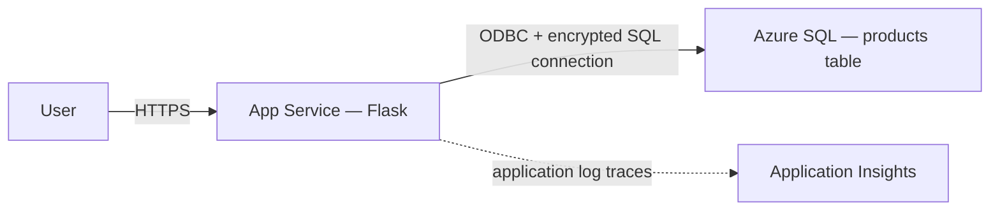

# App Service Üzerinde Flask ve Azure SQL

**Seviye:** Orta · **Süre:** Önkoşullarla birlikte 30–60 dakika

Bu örnek, bir Python Flask okuma API'sini **Linux App Service** ve Temel bir
Azure SQL veritabanına dağıtır. Kaynak kod, Bicep ve azd yapılandırması dahildir. Bu
bir öğrenme uygulamasıdır, üretim ortamına hazır bir veritabanı mimarisi değildir.

## Öğrenecekleriniz

- Bicep ile App Service, SQL ve izleme kaynaklarını sağlama.
- Kimlik bilgilerini göndermeden şifreli SQL bağlantısı yapılandırma.
- Gunicorn çalışanları başlamadan önce bir şema başlatma.
- Doldurulmuş verileri, bulunamama yanıtlarını ve veritabanı sağlığını doğrulama.



Kaynaklar: özel kaynak grubu, B1 Linux App Service planı, Python 3.11 Web
Uygulaması, SQL sunucusu ve Temel 2-GB veritabanı, Application Insights ve Log Analytics.
Web Uygulaması **kaynak/ZIP dağıtımı ve Oryx bağımlılık kurulumu** kullanır;
`azd deploy` isteğe bağlı Dockerfile'ı oluşturmaz veya dağıtmaz.

## Önkoşullar

- Geçerli kararlı [azd](https://learn.microsoft.com/azure/developer/azure-developer-cli/install-azd)
  (inceleme zamanında yayımlanmış sürüm: 1.37.2).
- Doğrulama için [Azure CLI](https://learn.microsoft.com/cli/azure/install-azure-cli).
- Azure aboneliği, listelenen kaynakları oluşturma izinleri ve bölgesel kota.
- Yerel geliştirme için Python **3.11**; taahhüt edilen `pyodbc==5.0.1` daha yeni Python sürümlerinde
  yerel oluşturma araçları gerektirebilir.
- Yerel makinelerde SQL Server için Microsoft ODBC Sürücüsü 18 (veya 17). `pip install
  pyodbc` sistem sürücüsünü kurmaz. Bkz.
  [ODBC kurulumu](https://learn.microsoft.com/sql/connect/odbc/download-odbc-driver-for-sql-server).
- İsteğe bağlı konteyneri yerel olarak test etmek için yalnızca Docker.

```bash
azd version
az version
azd auth login
az login
```

Her iki araçta da aynı aboneliği kullanın. Aşağıdaki komutlar Bash kullanır.

## Dağıtım

Depo kök dizininden:

```bash
cd examples/database-app
azd env new sql-demo
azd provision
azd deploy
WEB_URL=$(azd env get-value WEB_APP_URI)
WEB_NAME=$(azd env get-value WEB_APP_NAME)
RG_NAME=$(azd env get-value AZURE_RESOURCE_GROUP)
```

Desteklenen bir bölge seçin. `sqlAdminLogin` varsayılan olarak `sqladmin` kullanır; gereken
`sqlAdminPassword` güvenli bir parametredir. İstendiğinde güçlü bir şifre verin.
Dağıtım kimlik bilgilerini Git ve hata raporlarından uzak tutun. Mevcut bağlantı
dize yerleştirme, bağlantı dizesi sınırlandırıcıları olmayan bir parola bekler
örneğin `;`; bu tür değerleri kullanmadan önce kaçışı uyarlayın.

Bicep, `init_database()` **önce** Gunicorn çalıştıran bir başlangıç komutu ayarlar
çalışanları başlatır. Bu gereklidir çünkü `app:app` içe aktarmak
Python'un `if __name__ == '__main__'` bloğunu çalıştırmaz. Yeni bir veritabanında, başlatma
`products` oluşturur ve beş satır ekler. Bu basit bir öğretici veritabanıdır, 
eşzamanlı bir göç çerçevesi değildir; örnekleri ölçeklendirmeden önce uygun göçleri kullanın.

Uygulama, bağlantı dizesi açıkça bir sürücü adı belirtmiyorsa, kurulu Microsoft ODBC Sürücüsü 18'i, ardından 17'yi seçer.
Hiçbiri mevcut değilse, başlatma işlemi gerçekleştirilebilir bir kurulum hatasıyla başarısız olur.
Seçtiğiniz App Service çalışma zamanında sürücü kullanılabilirliğini varsaymak yerine doğrulayın.


## Doğrula

```bash
curl --fail-with-body "${WEB_URL}/"
curl --fail-with-body "${WEB_URL}/health"
curl --fail-with-body "${WEB_URL}/products"
curl --fail-with-body "${WEB_URL}/products/1"
curl -i "${WEB_URL}/products/999"
```

Beklenen:

- `/` uç nokta bilgisi döner.
- `/health` 200 ve `{"status":"healthy","database":"connected"}` döner.
- `/products` temiz bir veritabanında beş önceden eklenmiş ürün döner.
- `/products/1` fiyatı 1299.99 olan Dizüstü Bilgisayar döner.
- Var olmayan bir ürün 404 ve `{"error":"Product not found"}` döner.

API salt okunurdur. POST/PUT/DELETE rotası veya tarayıcı arayüzü yoktur.
Veritabanı bağlantı hatası `/health` tarafından 503 döner; bu başarılı değildir.

## Dosyalar ve yapılandırma

```text
azure.yaml                         # Python App Service source deployment
infra/main.bicep
infra/main.parameters.json
infra/abbreviations.json
infra/resources/sql-server.bicep
infra/resources/sql-database.bicep
infra/resources/app-service-plan.bicep
infra/resources/web-app.bicep       # Settings + initialization/startup command
infra/resources/app-insights.bicep
src/web/app.py
src/web/requirements.txt
src/web/Dockerfile                 # Optional local container, not the azd target
.env.sample
```

`SQL_CONNECTION_STRING` Web Uygulaması modülüne güvenli bir Bicep parametresi olarak geçirilir
ve dağıtım çıktılarına değil, Uygulama Hizmeti ayarlarında saklanır.
`APPLICATIONINSIGHTS_CONNECTION_STRING` günlük dışa aktarımı yapılandırır.
`SCM_DO_BUILD_DURING_DEPLOYMENT=true` sunucu tarafı bağımlılık yüklemeyi etkinleştirir.
Rastgele `azd env` değerleri ayarlamak uygulama ayarlarını otomatik olarak değiştirmez.

SQL güvenlik duvarının `0.0.0.0` kuralı, **Azure hizmetlerinden,
diğer müşterilerin abonelikleri dahil olmak üzere** bağlantılara izin verir, SQL kimlik doğrulamasına tabidir. Bu
yalnızca bu uygulama veya abonelikle sınırlı değildir. SQL genel ağ erişimi etkinleştirilmiştir.
Üretim öncesi sınırlandırılmış ağ kullanımı ve yönetici olmayan bir uygulama kimliği kullanın.

## Yerel geliştirme

Python 3.11 ve kurulu Microsoft SQL ODBC sürücüsü kullanın:

```bash
python -m venv .venv
source .venv/bin/activate  # PowerShell: .\.venv\Scripts\Activate.ps1
python -m pip install -r src/web/requirements.txt
export SQL_CONNECTION_STRING='Server=tcp:YOUR_SERVER.database.windows.net,1433;Database=YOUR_DATABASE;UID=YOUR_USER;PWD=YOUR_PASSWORD;Encrypt=yes;TrustServerCertificate=no;Connection Timeout=30;'
python src/web/app.py
```

Yer tutucuları güvenli bir şekilde değiştirin. Kopyalanan `.env` dosyası **otomatik olarak yüklenmez**
bu uygulama tarafından. Bunun yerine mevcut kabuğunuzda değişkenleri dışa aktarın.
Dizüstü bilgisayardan Azure SQL için geçici olarak yalnızca kendi genel IP adresinize izin verin:

```bash
SQL_SERVER=$(azd env get-value SQL_SERVER_NAME)
MY_IP=YOUR_PUBLIC_IP
az sql server firewall-rule create -g "$RG_NAME" -s "$SQL_SERVER" \
  -n AllowMyLearningIP --start-ip-address "$MY_IP" --end-ip-address "$MY_IP"
```

Testten sonra kuralı kaldırın:

```bash
az sql server firewall-rule delete -g "$RG_NAME" -s "$SQL_SERVER" -n AllowMyLearningIP
```

Bu örnek dizinden isteğe bağlı konteyner testi:

```bash
docker build -t sql-flask:local src/web
docker run --rm -p 8000:8000 -e SQL_CONNECTION_STRING sql-flask:local
```

Bu imaj, Debian 12 paket deposunu kullanarak Sürücü 18'i Bookworm tabanına uygun şekilde kurar, veritabanını bir kez başlatır ve ardından Gunicorn'u çalıştırır.


## İzleme ve sorun giderme

Başlangıçta teşhis yaparken Uygulama Hizmetleri dosya sistemi uygulama günlüklerini etkinleştirin/takip edin:

```bash
az webapp log config --name "$WEB_NAME" --resource-group "$RG_NAME" \
  --application-logging filesystem --level information
az webapp log tail --name "$WEB_NAME" --resource-group "$RG_NAME"
```

Bu kod, uygulama **kayıt izlerini** eski bir OpenCensus işleyicisi aracılığıyla dışa aktarır.
Otomatik Flask istek/bağımlılık izleme, Canlı Metrikler,
SQL denetimi, tanılama ayarları veya uyarılar yapılandırılmaz. Bunlar ayrı kurulum gerektirir.
Yeni enstrümantasyon için Azure Monitor OpenTelemetry tercih edin.

Application Insights Kayıtlarında, API isteklerinden sonra:

```kusto
traces
| where timestamp > ago(1h)
| where message contains "products" or message contains "Health check"
| project timestamp, message, severityLevel
```

İçeri alma gecikmesini göz önünde bulundurun. İstek tablosu veya Canlı Metrikler etkinliği tamamlanma değildir.
yalnızca günlük tutma enstrümantasyonu için kriter.

- **Eksik sürücü:** çalışma zamanında `pyodbc.drivers()` öğesini inceleyin ve desteklenen bir Microsoft ODBC sürücüsü yükleyin. Sadece bir Python paketi yeterli değildir.
- **Bağlantı hatası:** SQL ayarlarını, kimlik bilgilerini, güvenlik duvarını ve seçili aboneliği kontrol edin. Bir hatayı atlatmak için şifrelemeyi devre dışı bırakmayın.


- **Eksik ürünler tablosu:** Bicep başlatma komutunun dağıtıldığını doğrulayın;
  yalnızca `gunicorn app:app` başlatmak başlatmayı atlar.
- **Paket oluşturma hatası:** Python 3.11 kullanın veya yerel derleme önkoşullarını sağlayın.
- **Sıfır fiyat verisi:** sıfır geçerli bir ondalık fiyattır; 0.0 olarak serileştirilmelidir,
  `null` değil.

## Pratik Egzersizler

### Egzersiz 1: Eksik ürün davranışını doğrulayın

**Başlangıç noktası:** yukarıdaki dağıtılmış API ve `WEB_URL`.
**Amaç:** eksik bir satırı kırık bir veritabanından ayırt etmek.
Yukarıdaki komutları kullanarak `/health` ve `/products/999` isteyin.
**Başarı kriterleri / cevap:** sağlık 200, var olmayan ürün 404 (500 veya 503 değil).
**Yaygın sorun:** bulunamama yanıtının SQL bağlantısının kırık olduğunu kanıtladığını varsaymak.

### Egzersiz 2: Örneklenmiş bir değeri değiştirin

**Başlangıç noktası:** Örnek veritabanına bağlı Azure SQL Sorgu Düzenleyicisi.
**Amaç:** API verilerinin işlem belleği yerine SQL'de saklandığını göstermek.

```sql
UPDATE products SET price = 0 WHERE id = 1;
SELECT id, name, price FROM products WHERE id = 1;
```

`${WEB_URL}/products/1` isteyin. **Başarı kriteri:** fiyat `0.0`, `null` değil.
Değeri geri yükleyin:

```sql
UPDATE products SET price = 1299.99 WHERE id = 1;
```

**Yaygın sorun:** Python tohum listesi düzenlendiğinde zaten SQL'de olan satırlar güncellenmez.
Üretim veritabanına karşı şema/veri alıştırmaları çalıştırmayın.

### Alıştırma 3: Salt okunur bir sayma uç noktası ekleyin

**Başlangıç noktası:** `src/web/app.py`.
**Amaç:** parametresiz bir toplu sorgu kullanarak API'yi genişletmek.
Bunu `if __name__ == '__main__':` bloğundan önce ekleyin:

```python
@app.route('/product-count')
def product_count():
    from contextlib import closing
    with closing(get_db_connection()) as conn, closing(conn.cursor()) as cursor:
        cursor.execute("SELECT COUNT(*) FROM products")
        return jsonify({'count': cursor.fetchone()[0]})
```

`azd deploy web`'i çalıştırın, sonra `${WEB_URL}/product-count`'yı isteyin.
**Başarı kriteri:** Dokunulmamış tohumlanmış veritabanında `{"count":5}` ile 200.
**Yaygın sorun:** rotayı değiştirmek ama yeniden dağıtmayı unutmak.
Üretim için hata yönetimi/testler ekleyin; bu kısa alıştırma sorgu odaklıdır.

## Maliyetler, üretim boşlukları ve temizleme

B1 App Service ve Basic veritabanı, sağlandığı sürece faturalandırılır. Web App'i durdurmak,
App Service planının faturalandırmasını **durdurmaz**. Günlükler ve depolama maliyeti artırabilir.
Güncel bölgesel fiyatlandırma için [Azure fiyatlandırma hesaplayıcısını](https://azure.microsoft.com/pricing/calculator/)
kullanın. F1'e geçiş ayrıca `alwaysOn` devre dışı bırakılmasını gerektirir;
tek satırlık bir değiştirme değildir. SQL serverless otomatik olarak ücretsiz değildir.

Üretim çalışmaları, en az ayrıcalıklı uygulama kimliği (SQL yönetici değil),
kimlik doğrulama/ yetkilendirme, özel ağ, güvenli göçler, bağlantı havuzu/yaşam döngüsü incelemesi,
telemetri, denetim, uyarılar, testler ve kurtarma prosedürlerini içerir.
Redis önbellekleme ve ek tablolar geliştirme fikirleridir, uygulanmış alıştırmalar değildir.

Bu örnek dizininden:

```bash
azd down
```

Silme istemini gözden geçirin ve adanmış kaynak grubunun kaldırıldığını doğrulayın.
İlgisiz veriler içeren grupları silmeyin.

[Konteyner örnekleri](../../../../examples/container-app) ·
[Yapay zeka geliştirme](../../docs/chapter-02-ai-development/README.md) ·
[Kurs ana sayfası](../../README.md) · [Bir sorun bildir](https://github.com/microsoft/AZD-for-beginners/issues)

---

<!-- CO-OP TRANSLATOR DISCLAIMER START -->
**Feragatname**:
Bu belge, AI çeviri hizmeti [Co-op Translator](https://github.com/Azure/co-op-translator) kullanılarak çevrilmiştir. Doğruluk için çaba sarf etsek de, otomatik çevirilerin hata veya yanlışlık içerebileceğini lütfen unutmayınız. Orijinal belge, kendi dilinde yetkili kaynak olarak kabul edilmelidir. Kritik bilgiler için profesyonel insan çevirisi önerilir. Bu çevirinin kullanımı sonucu ortaya çıkabilecek yanlış anlamalardan veya yanlış yorumlamalardan sorumlu değiliz.
<!-- CO-OP TRANSLATOR DISCLAIMER END -->