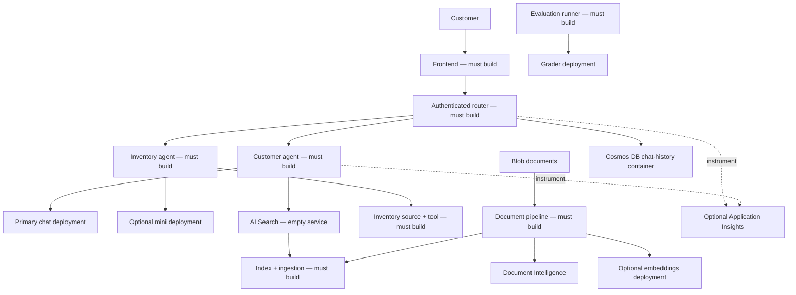

# Çoklu Ajan Müşteri Desteği — Perakende Mimari Taslağı

**Bölüm 5: Çoklu Ajan AI Çözümleri**

- [Kurs ana sayfası](../README.md)
- [Bölüm 5](../docs/chapter-05-multi-agent/README.md)
- [Önkoşul: AI entegrasyonu](../docs/chapter-02-ai-development/microsoft-foundry-integration.md)
- [Sonraki: Kapasite planlaması](../docs/chapter-06-pre-deployment/capacity-planning.md)
- [ARM altyapı iskeleti](retail-multiagent-arm-template/README.md)

> **Mimari rehber, çalışan bir uygulama değildir.** Tek perakende uygulama
> dosyaları `azuredeploy.json`, `azuredeploy.parameters.json` ve `deploy.sh`, bunlar
> `retail-multiagent-arm-template/` içindedir. Yönlendirici/ön uç konteynerleri hello-world
> yer tutuculardır. Yerel olarak perakende ajanı, kullanıcı arayüzü, içe aktarma hattı,
> değerlendirici, tarayıcı veya uygulama test seti yoktur.

## Genel Bakış

**Amaç:** bir müşteri destek sistemi tasarlamak; müşteri ajanı ve envanter
ajanı ile alt yapının sağladıklarını belirlemek ve eksik uygulama
sözleşmeleri ile doğrulamayı planlamak.

**Hedef Kitle:** yerel
[chat örneği](../../../examples/azure-openai-chat) ve [iki-servis konteyner örneği](../../../examples/container-app/microservices) tamamlamış geliştiriciler.
Mimari çalışma için 2–3 saat ayırın. Uygulamanın inşası ayrı bir
projedir: deneyimli geliştiriciler için 80–120 geliştirme saati, örnek bir planlama tahminidir,
**teslimat sözü değildir**; üretim sertleştirme, testler,
güvenlik incelemesi ve operasyonlar ilave işler gerektirir.

### Öğrenme çıktıları

- Yönlendirme, temel alma, araç izinleri ve konuşma sahipliğini açıklayın.
- Model kimlikleri, dağıtım isimleri, API sürümleri ve ARM sürümleri arasındaki farkı ayırt edin.
- Uyumlu vektör boyutları ile belge alma ve geri getirme tasarlayın.
- Doğrulanabilir fonksiyonel, değerlendirme ve hata kurtarma gereksinimlerini tanımlayın.
- İsteğe bağlı mimari hedefleri gerçek olarak sağlanan kaynaklardan ayırın.

## Çözüm Mimarisi



Bu, çalışan ajan servislerinin diyagramı değil, bir **hedef uygulama mimarisidir**.
ARM iskeleti sadece temel servisleri ve iki yer tutucu konteyner oluşturur.
Front Door, kayıt, yönetilen kimlikler, rol atamaları,
özel uç noktalar, yedekleme, uygulama enstrümantasyonu ve uyarılar dahil değildir.

### Sorumluluklar ve sözleşmeler

| Bileşen | Gerekli davranış | Tamamlanmadan önce delil |
|---|---|---|
| Ön Uç | Kullanıcıları doğrula, sohbeti görüntüle, belgeleri güvenle yükle | UI ve yükleme testleri, erişilebilir hatalar |
| Yönlendirici | İstekleri yetkilendir, ajan seç, bağlı araç çağrılarını/zaman aşımını denetle | Yönlendirme testleri, yetkilendirme kontrolleri, hata testleri |
| Müşteri ajan | Politika/ürün cevaplarını onaylı kaynaklara dayandır | Doğru atıflar, veri yoksa çekimser kalma |
| Envanter aracı | Yetkili stoğu kapsam izinleri ile oku | Kesin stok testleri; hayali bulunabilirlik yok |
| Belge hattı | Çıkar, parçalara ayır, göm, indeksle, güncelle/sil | İndekslenmiş doneler ve yeniden deneme/ölü-mektup davranışı |
| Konuşma depolama | Kullanıcıları izole et, saklama uygula | Kullanıcılar arası yetki ve TTL testleri |
| Değerlendirme koşucusu | Çıktıları doğruluk ve kriterlere karşı karşılaştır | Kapsam, hata sayısı, tekrarlanabilir raporlar |

Yönlendiriciyi bir resepsiyon masası, araçları ise kısıtlı iç sistemler olarak düşünün:
uzman seçmek, her müşterinin kayıtlarına erişim yetkisi değildir.
Kimlik ve izinleri uygulama kodunda ve veri servislerinde, istemlerde değil, zorlayın.

## Altyapı ve Uygulama

Sağlama öncesi [iskelet README](retail-multiagent-arm-template/README.md) okuyun.
Doğru kaynakları, modları, maliyetleri ve kısıtlamaları listeler.

| Mantıksal kullanım | ARM dağıtım adı | Model / sürüm | Varsayılan bölge |
|---|---|---|---|
| Müşteri sohbeti | `gpt-4.1-chat` | `gpt-4.1` / `2025-04-14` | `eastus2` |
| Envanter | `gpt-4.1-mini-inventory` | `gpt-4.1-mini` / `2025-04-14` | `westus2`, isteğe bağlı |
| Embeddingler | `text-embedding-ada-002` | `text-embedding-ada-002` / `2` | `francecentral`, isteğe bağlı |
| Değerlendirme | `gpt-4.1-grader` | `gpt-4.1` / `2025-04-14` | Varsayılan olarak birincil bölge |

Her **bölgede** model/sürüm/SKU kullanılabilirliğini ve kota durumunu kontrol edin. Sohbet/mini/grader,
`GlobalStandard` kullanır; embeddingler `Standard` kullanır. Kapasite birimi - TPM eşlemeleri
modele özgü. Evrensel bir kota garantisi olarak farklı kapasite birimleri eklemeyin.

Bir Azure OpenAI isteğinin `model` argümanı **dağıtım adı**dır, zorunlu olarak katalog model tanımlayıcısı değildir.
Veri düzlemi API sürümü `2024-10-21`
model sürümü `2025-04-14` ve ARM kaynağı `apiVersion` 'dan farklıdır.
Sadece veri düzlemi API sürümünü değiştirerek kullanılamayan bir modeli düzeltemezsiniz.

`--no-multi-region` ikincil ve embedding hesaplarını atlar. Birincil sohbet ve
bağımsız derecelendirici hesabı kalır. Ayrı model hesapları otomatik
otomatik yedekleme sağlamaz; bu, uygulama yönlendirmesi, uyumlu dağıtımlar, sağlık kontrolleri,
yeniden deneme limitleri ve veri yerleşimi incelemesini gerektirir.

## Uygulama Yol Haritası

### 1. Test edilmiş tek bir etkileşimle başlayın

Büyük iskeleti sağlamak yerine, yerel sohbet örneğini kullanarak çıkarım bağlantısını oluşturun.
Temsilci bir müşteri sorusu, onaylanmış
cevap kaynağı, beklenen alıntı ve o kaynağın eksik olduğu durumda hata davranışını tanımlayın.

### 2. Yönlendirme ve araç sınırlarını tanımlayın

Kendi yönlendirici kaynağınızı, bağımlılık manifestonuzu, Dockerfile'ınızı ve testlerinizi oluşturun. Bir
örnek sözleşme `POST /chat` ile `{"message":"...","conversation_id":"..."}` olabilir.
**O uç nokta bir tasarım önerisidir; ARM şablonu tarafından uygulanmamıştır.**

Gövde türlerini/limitlerini doğrulayın, kullanıcı kimliğini kimlik doğrulamadan çıkarın, 
sohbet sahipliğini uygulayın, istek zaman aşımını uygulayın ve anlamlı hata kodları döndürün.
HTTP hatalarını veya boş yanıtları başarılı ajan sonuçları olarak değerlendirmeyin.

### 3. Temellendirme ve alma işlemini uygulayın

ARM şablonu bir arama dizini oluşturmaz. Bu, **kendi dizin tanımınızda uyarlamak için bir referans JSON
parçasıdır**, repoda zaten bulunan bir dosya değildir:

```json
{
  "name": "retail-product-index",
  "fields": [
    {"name": "id", "type": "Edm.String", "key": true},
    {"name": "title", "type": "Edm.String", "searchable": true},
    {"name": "content", "type": "Edm.String", "searchable": true},
    {"name": "category", "type": "Edm.String", "filterable": true},
    {
      "name": "content_vector",
      "type": "Collection(Edm.Single)",
      "searchable": true,
      "dimensions": 1536,
      "vectorSearchProfile": "retail-profile"
    }
  ],
  "vectorSearch": {
    "algorithms": [{"name": "retail-hnsw", "kind": "hnsw"}],
    "profiles": [{"name": "retail-profile", "algorithm": "retail-hnsw"}]
  }
}
```

Profil, vektör alanını algoritmasına bağlar. Boyutlar,
gerçek gömme çıktısıyla eşleşmelidir (bu `ada-002` dağıtımı için 1536). Python ile getirme için,
Vektör sorgu türü eksik olan tamamlanmamış bir sözlük yerine `azure.search.documents.models.VectorizedQuery` kullanın:


```python
# Reference function only: supply an authenticated async SearchClient and an embedding.
from azure.search.documents.models import VectorizedQuery

async def retrieve(search_client, embedding):
    results = await search_client.search(
        search_text=None,
        vector_queries=[VectorizedQuery(
            vector=embedding,
            k_nearest_neighbors=5,
            fields="content_vector"
        )],
        select=["id", "title", "content"]
    )
    return [document async for document in results]
```

Aşağıdaki işlemleri yapan ayrı bir alım uygulaması oluşturun:

1. Yükleme erişimini yetkilendirir ve içerik türü ile boyutunu doğrular.
2. Kimlik doğrulamalı SDK çağrıları kullanarak özel blob'ları okur. Bir özel blob URL'si tek başına
   okunabilir bir Document Intelligence girişi **değildir**; indirilen baytları
   `AnalyzeDocumentRequest(bytes_source=...)` ile gönderin veya erişim gereksinimlerini inceledikten sonra uygun kapsamda,
   kısa ömürlü bir SAS kullanın.
3. Metni çıkarır, yerleştirme sınırlarına sığacak şekilde parçalara böler ve yerleştirmeler oluşturur.
4. Stabil geçerli belge anahtarları oluşturur ve eşleşen vektörlerle parçaları yükler.
5. Belge başına indeksleme sonuçlarını kontrol eder, yeniden denemeleri yönetir ve eski verileri günceller/siler.

OData filtrelerine rastgele kullanıcı anahtarlarını/değerlerini dahil etmeyin. Alanları izin listesine ekleyin,
değer türlerini doğrulayın ve dize tırnaklarını kaçırın. Boole ve sayısal filtreler
tırnak işaretli dizeler değil, yazı tipli literal değerler gerektirir.

### 4. Web dayanak

**Bing Search v7, 11 Ağustos 2025'te kullanımdan kaldırıldı.** Eski `Microsoft.Bing/accounts`
kaynağı ve `api.bing.microsoft.com/v7.0/search` örnekleri desteklenen
bir uygulama yolu değildir. Microsoft Foundry'de halihazırda desteklenen bir dayanak entegrasyonunu ve onun SDK'sını, izinlerini, faturalandırmasını ve atıf gereksinimlerini değerlendirin;
burada hiçbiri uygulanmamıştır. Bu, kullanımdan kaldırılan uç noktanın yerine doğrudan geçecek bir yedek değildir.


### 5. Telemetri ve değerlendirme ekleyin

Application Insights oluşturmak kodu otomatik olarak izleme altına almaz. Desteklenen Azure Monitor’u kullanın
Yeni bir uygulama oluştururken OpenTelemetry enstrümantasyonu kullanın, izleme bağlamını hizmetler arasında iletin ve müşteri istemlerini, belgeleri veya gizli bilgileri kaydetmekten kaçının.

Bir sorguyu kısaltmak onu **anonimleştirmez**.

İstek süresini, yönlendirme/araç hatalarını, geri getirme alakasını, atıf doğruluğunu, token kullanımını ve çekimser kalmayı ölçün. Değerlendirme vakalarının yanında gerçek envanter/politika gerçeklerini saklayın: bir değerlendirici yalnızca bir soru ve cevaptan gerçek doğruluğu güvenilir şekilde belirleyemez.


Bir değerlendirici dağıtımı bir değerlendirme koşucusu değildir. Sürüm numaralı bir rubrik, yapısal çıktı/şema doğrulaması, skor aralığı kontrolleri, taşıma hatası sayımları ve insan tarafından incelenmiş vakalar uygulayın. Eksik/hata içeren vakaları ayrı raporlayın; bunları başarılı notlara dönüştürmeyin veya sessizce sıfır kalite model yanıtları olarak dahil etmeyin.


Benzer şekilde, birkaç anahtar kelime kontrolü bir güvenlik sertifikası değildir. Başarısız bir HTTP isteği, eksik test stratejisi veya boş yanıt bir testi **sonuçsuz veya başarısız** yapmalıdır, “%100 güvenli” skor üretmemelidir. Herhangi bir üretime hazır olma iddiasından önce yetkili testleri uygun araç ve insan incelemesi ile gerçekleştirin.


### 6. Uygulamanızı dağıtın

Kendi kaynak dizinlerinizi, manifestolarınızı, testlerinizi, kayıt defterinizi ve görüntü çekme izinlerinizi oluşturun. Yer tutucuları oluşturulan görüntülerle değiştirin ve her uygulamanın dinleme portuna uyacak şekilde giriş/probe ayarlarını güncelleyin. Çalışma zamanı ortam değişkenlerini Bicep veya açıkça desteklenen bir azd ortam eşlemesi ile yapılandırın.


Bir azd hizmeti altında otomatik olarak çalışma zamanı ortam değişkenleri oluşturan genel bir `config` sözlüğü yoktur.
`azd env set` yalnızca bu değerleri açıkça kullanan kaynakları değiştirir. Bu iskelette herhangi bir kanarya, bölgeler listesi veya ince ayar kancası
uygulanmamıştır.


## Pratik tasarım egzersizleri

Bunlar **mimari egzersizlerdir**, çalıştırılabilir perakende başlangıç kodu iddiaları değildir.

### Egzersiz 1: Sınırı doğrula

**Başlangıç noktası:** `retail-multiagent-arm-template/` içindeki üç dosya.
**Hedef:** sağlama ile uygulama işlevselliğini ayırt etmek.
`azuredeploy.json` dosyasını aç, hem konteyner görüntülerini hem de `targetPort` değerlerini bul,
sonra depoda eksik olan uygulama bileşenlerini listele.

**Başarı kriteri / cevap:** her iki görüntü de dinleyen hello-world yer tutucularıdır
80 numaralı portta; ajanlar, sohbet UI'si, yönlendirici işleyicileri, indeksleme/aktarımı, değerlendirici ve tarayıcı yoktur.
Başarılı bir yer tutucu kök isteği `/chat` doğrulamaz.
**Yaygın sorun:** `retail-router` gibi kaynak adlarını çalışan kod olarak yorumlamak.

### Alıştırma 2: Vektör konfigürasyonunu izleyin

**Başlangıç noktası:** yukarıdaki index JSON.
**Amaç:** field → profile → algorithm ilişkisinin anlaşılması.
Gömme modeline geçerken hangi değerlerin değişmesi gerektiğini belirleyin
farklı çıktı boyutuysa, sonra `retrieve` fonksiyonunu inceleyin.

**Başarı kriterleri / cevap:** `dimensions` alanını gerçek vektör uzunluğuna değiştirin;
`vectorSearchProfile`'yi bildirilen bir profil ve algoritması ile hizalı tutun;
`fields` sorgusu vektör alanını adlandırmalıdır. Gömme modeli değiştiğinde mevcut belge vektörlerini yeniden oluşturun.

**Yaygın sorun:** uyumsuz vektörler korunurken sadece model adının değiştirilmesi.

### Egzersiz 3: Başarısızlık testi tanımlayın

**Başlangıç noktası:** sorumluluklar tablosu.
**Hedef:** yanlış başarıyı önlemek.
Kullanılamayan bir envanter API'si, eşleşen belge olmayan bir arama dizini ve HTTP 503 dönen bir değerlendirme isteği için beklenen davranışı yazın.


**Başarı kriterleri / cevap:** uydurulmuş envanter değerleri yok; açıkça çekimser kalma veya
bağlam eksik olduğunda yükseltme; değerlendirme, kalite veya güvenlik geçişi yerine bir taşıma hatası bildirir.
Uygulamayı oluştururken yürütülebilir testler ekleyin.
**Yaygın sorun:** her istisnayı yakalayıp boş bir cevapla devam etmek.

## Maliyetler, sorun giderme ve temizlik

- Altyapının boş arama dizinleri ve yer tutucu uygulamalarla bile devam eden ücretleri vardır.
  Güncel bölgesel fiyatları kullanın; ne “minimal” ne de çok bölgeli ücretsiz anlamına gelir.
- Jeton maliyetleri modele, önbelleğe alınmış/önbelleğe alınmamış girdiye, çıktıya ve dağıtım SKU'suna bağlıdır.
  Yönlendirme, ancak ölçülen iş yükü ve kalite sonuçları bunu haklı çıkarıyorsa para tasarrufu sağlar;
  sabit %60–80 tasarruf garanti edilmez.
- Provizyon öncesi model kullanılabilirliği ve kota kontrol edin; izin, dağıtım-adı, bölge,
  model-sürümü ve API sürümü hatalarını ayırt edin.
- Eksik `setup-data.sh`, değerlendirici CLI'ları veya `pytest tests/` komutlarını çalıştırmayın.
  Bunların uygulamaları geliştirme bekleme listenizin bir parçasıdır.
- İskelet sadece ARM içindir: onun
  [doğrulama ve temizlik talimatlarını](retail-multiagent-arm-template/README.md) takip edin.
  `azd down` bu kaynakları yönetmez.

## İlgili kaynaklar

- [Çalışan yerel sohbet örneği](../../../examples/azure-openai-chat)
- [Çalışan iki servisli kapsayıcı örneği](../../../examples/container-app/microservices)
- [AI Search vektör dizinleri](https://learn.microsoft.com/azure/search/vector-search-how-to-create-index)
- [Kapsayıcı Uygulamalar belgeleri](https://learn.microsoft.com/azure/container-apps/)
- [Sorun giderme](../docs/chapter-07-troubleshooting/common-issues.md)
- [Bir sorun bildir](https://github.com/microsoft/AZD-for-beginners/issues)

---

<!-- CO-OP TRANSLATOR DISCLAIMER START -->
**Feragatname**:
Bu belge, AI çeviri hizmeti [Co-op Translator](https://github.com/Azure/co-op-translator) kullanılarak çevrilmiştir. Doğruluk için çaba sarf etsek de, otomatik çevirilerin hata veya yanlışlık içerebileceğini lütfen unutmayınız. Orijinal belge, kendi dilinde yetkili kaynak olarak kabul edilmelidir. Kritik bilgiler için profesyonel insan çevirisi önerilir. Bu çevirinin kullanımı sonucu ortaya çıkabilecek yanlış anlamalardan veya yanlış yorumlamalardan sorumlu değiliz.
<!-- CO-OP TRANSLATOR DISCLAIMER END -->