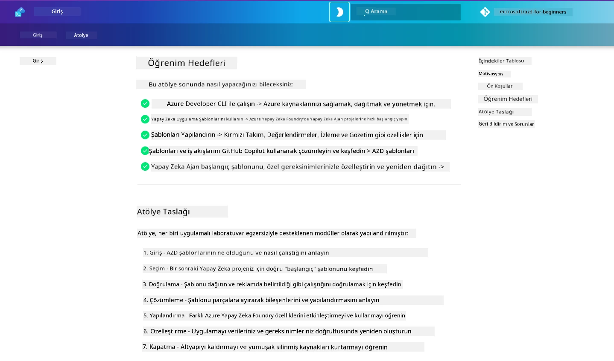

<div align="center">
  <div style="background: linear-gradient(135deg, #0078d4, #106ebe); border-radius: 10px; padding: 20px; margin: 20px 0; box-shadow: 0 4px 15px rgba(0, 120, 212, 0.3); border: 2px solid #005a9e;">
    <h2 style="color: white; margin: 0; font-size: 24px; text-shadow: 1px 1px 2px rgba(0,0,0,0.3);">
      🎯 AI Geliştiricileri için AZD Atölyesi
    </h2>
    <p style="color: white; margin: 10px 0 0 0; font-size: 16px; text-shadow: 1px 1px 2px rgba(0,0,0,0.3);">
      <strong>Azure Developer CLI ile AI uygulamaları oluşturmak için pratik bir atölye.</strong><br>
      AZD şablonlarını ve AI dağıtım iş akışlarını öğrenmek için 7 modülü tamamlayın.
    </p>
    <div style="margin-top: 15px;">
      <span style="background: rgba(255,255,255,0.2); padding: 5px 10px; border-radius: 15px; color: white; font-size: 14px;">
        📅 Kaynak rehberliği gözden geçirildi: Kasım 2026
      </span>
    </div>
  </div>
</div>

# AI Geliştiricileri için AZD Atölyesi

Azure Developer CLI (AZD) öğrenmek ve AI uygulaması dağıtımına odaklanmak için pratik atölyeye hoş geldiniz. Bu atölye, AZD şablonlarını 3 adımda uygulamalı olarak anlamanıza yardım eder:

1. **Keşif** - size uygun şablonu bulun.
1. **Dağıtım** - dağıtın ve çalıştığını doğrulayın
1. **Özelleştirme** - değiştirin ve kendinize özgü hale getirin!

Bu atölye boyunca, uçtan uca geliştirme yolculuğunuzu kolaylaştırmak için temel geliştirici araçları ve iş akışları da tanıtılacaktır.

<br/>

## Tarayıcı Tabanlı Rehber

Atölye dersleri Markdown formatındadır. Onları doğrudan GitHub üzerinde gezinebilir veya aşağıdaki ekran görüntüsünde gösterildiği gibi tarayıcı tabanlı önizlemeyi başlatabilirsiniz.



Bu seçeneği kullanmak için - depoyu profilinize fork edin ve GitHub Codespaces başlatın. VS Code terminali aktif olduğunda şu komutu yazın:

Bu tarayıcı önizlemesi GitHub Codespaces, geliştirici konteynerleri veya Python ve MkDocs kurulmuş yerel klonlarda çalışır.

```bash title="" linenums="0"
python -m pip install -r requirements-dev.txt
python -m mkdocs serve --config-file workshop/mkdocs.yml
```

Bu komutları **kurs deposunun kök dizininden** çalıştırın, ayrı olarak başlatılan AI örneğinden değil. Hatalar görünür kalsın diye önizlemeyi önde tutun; durdurmak için Ctrl+C kullanın. Siteyi sunmadan kontrol etmek için `python -m mkdocs build --strict --config-file workshop/mkdocs.yml` çalıştırın.

Birkaç saniye içinde bir açılır diyalog göreceksiniz. `Open in browser` seçeneğini işaretleyin. Web tabanlı rehber şimdi yeni bir tarayıcı sekmesinde açılacaktır. Bu önizlemenin bazı avantajları:

1. **Yerleşik arama** - anahtar sözcükleri veya dersleri hızlı bulun.
1. **Kopyalama simgesi** - kod bloklarının üzerine gelince görünür
1. **Tema değiştirici** - koyu ve açık temalar arasında geçiş yapın
1. **Yardım alın** - alt kısımdaki Discord simgesine tıklayarak katılın!

<br/>

## Atölye Genel Bakış

**Süre:** 3-4 saat  
**Seviye:** Başlangıçtan Orta seviyeye  
**Önkoşullar:** Azure, AI kavramları, VS Code & komut satırı araçlarına aşinalık.

Bu, yaparak öğrenilen bir pratik atölyedir. Egzersizleri tamamladıktan sonra, Güvenlik ve Verimlilik en iyi uygulamalarına yönelik öğrenme yolculuğunuza devam etmek için AZD Başlangıç müfredatını gözden geçirmenizi öneririz.

| Süre| Modül  | Amaç |
|:---|:---|:---|
| 15 dk | [Giriş](docs/instructions/0-Introduction.md) | Sahneyi hazırlayın, hedefleri anlayın |
| 30 dk | [AI Şablonu Seç](docs/instructions/1-Select-AI-Template.md) | Seçenekleri keşfedin ve başlangıç yapın | 
| 30 dk | [AI Şablonunu Doğrula](docs/instructions/2-Validate-AI-Template.md) | Varsayılan çözümü Azure'a dağıtın |
| 30 dk | [AI Şablonunu Parçala](docs/instructions/3-Deconstruct-AI-Template.md) | Yapıyı ve yapılandırmayı keşfedin |
| 30 dk | [AI Şablonunu Yapılandır](docs/instructions/4-Configure-AI-Template.md) | Mevcut özellikleri etkinleştirin ve deneyin |
| 30 dk | [AI Şablonunu Özelleştir](docs/instructions/5-Customize-AI-Template.md) | Şablonu ihtiyaçlarınıza göre uyarlayın |
| 30 dk | [Altyapıyı Kapat](docs/instructions/6-Teardown-Infrastructure.md) | Temizleme ve kaynakları serbest bırakma |
| 15 dk | [Kapanış & Sonraki Adımlar](docs/instructions/7-Wrap-up.md) | Öğrenme kaynakları, Atölye zorluğu |

<br/>

## Öğrenecekleriniz

AZD Şablonunu, Microsoft Foundry üzerinde uçtan uca geliştirme için çeşitli yetenekler ve araçları keşfetmek üzere bir öğrenme alanı olarak düşünün. Atölye sonunda bu bağlamdaki çeşitli araçlar ve kavramlar hakkında sezgisel bir anlayışa sahip olmalısınız.

| Kavram  | Amaç |
|:---|:---|
| **Azure Developer CLI** | Araç komutları ve iş akışlarını anlayın|
| **AZD Şablonları**| Proje yapısını ve yapılandırmasını anlayın|
| **Azure AI Agent**| Microsoft Foundry projesini sağlama ve dağıtma  |
| **Azure AI Search**| Ajanlarla bağlam mühendisliğini etkinleştirme |
| **Gözlemlenebilirlik**| İzleme, takip ve değerlendirmeleri keşfedin |
| **Kırmızı Takım Testi**| Saldırgan testler ve önlemleri keşfedin |

<br/>

## Atölye Yapısı

Atölye, resmi [AI Ajanlarla Başlama Kılavuzu](https://github.com/Azure-Samples/get-started-with-ai-agents) başlangıç şablonunu temel alarak, şablon keşfinden dağıtım, parçalama ve özelleştirmeye uzanan bir yolculuk olarak yapılandırılmıştır.

### [Modül 1: AI Şablonu Seç](docs/instructions/1-Select-AI-Template.md) (30 dk)

- AI Şablonları nedir?
- AI Şablonlarını nerede bulabilirim?
- AI Ajanları oluşturma nasıl başlarım?
- **Lab**: Codespaces veya geliştirme konteynerinde hızlı başlangıç

### [Modül 2: AI Şablonunu Doğrula](docs/instructions/2-Validate-AI-Template.md) (30 dk)

- AI Şablon Mimarisi nedir?
- AZD Geliştirme İş Akışı nedir?
- AZD Geliştirme konusunda nasıl yardım alabilirim?
- **Lab**: AI Ajanları şablonunu dağıt ve doğrula

### [Modül 3: AI Şablonunu Parçala](docs/instructions/3-Deconstruct-AI-Template.md) (30 dk)

- Çevrenizi `.azure/` içinde keşfedin 
- Kaynak kurulumunuzu `infra/` içinde keşfedin 
- AZD yapılandırmanızı `azure.yaml` içinde keşfedin
- **Lab**: Ortam Değişkenlerini Modifiye edin & Yeniden Dağıtın

### [Modül 4: AI Şablonunu Yapılandır](docs/instructions/4-Configure-AI-Template.md) (30 dk)
- Keşfet: Retrieval Augmented Generation
- Keşfet: Ajan Değerlendirmesi & Kırmızı Takım Testi
- Keşfet: İzleme & Takip
- **Lab**: AI Ajanı + Gözlemlenebilirliği keşfet

### [Modül 5: AI Şablonunu Özelleştir](docs/instructions/5-Customize-AI-Template.md) (30 dk)
- Tanımla: Senaryo Gereksinimleri ile PRD (Ürün Gereksinimleri Belgesi)
- Yapılandır: AZD için Ortam Değişkenleri
- Uygula: Ek görevler için Yaşam Döngüsü Kancaları
- **Lab**: Şablonu kendi senaryoma göre özelleştir

### [Modül 6: Altyapıyı Kapat](docs/instructions/6-Teardown-Infrastructure.md) (30 dk)
- Tekrarlar: AZD Şablonları nedir?
- Tekrarlar: Neden Azure Developer CLI kullanılır?
- Sonraki Adımlar: Farklı bir şablonu deneyin!
- **Lab**: Altyapıyı kaldır & temizle

<br/>

## Atölye Mücadelesi

Kendinize daha fazla meydan okumak ister misiniz? İşte bazı proje önerileri - ya da fikirlerinizi bizimle paylaşın!!

| Proje | Açıklama |
|:---|:---|
|1. **Karmaşık Bir AI Şablonunu Parçala** | İş akışını ve araçları kullanarak farklı bir AI çözüm şablonunu dağıtıp doğrulayın ve özelleştirmeye çalışın. _Ne öğrendiniz?_|
|2. **Senaryonuzla Özelleştirin**  | Farklı bir senaryo için PRD yazmayı deneyin. Sonra Agent Modelinde şablon deponuzda GitHub Copilot kullanarak bir özelleştirme iş akışı oluşturmasını isteyin. _Ne öğrendiniz? Bu önerileri nasıl geliştirebilirsiniz?_|
| | |

## Geri bildiriminiz var mı?

1. Bu depoda bir issue açın - kolaylık için `Workshop` etiketiyle işaretleyin.
1. Microsoft Foundry Discord'a katılın - akranlarınızla bağlantı kurun!


| | | 
|:---|:---|
| **📚 Kurs Ana Sayfası**| [AZD Yeni Başlayanlar İçin](../README.md)|
| **📖 Dokümantasyon** | [AI şablonları ile başlayın](https://learn.microsoft.com/en-us/azure/ai-foundry/how-to/develop/ai-template-get-started)|
| **🛠️AI Şablonları** | [Microsoft Foundry Şablonları](https://ai.azure.com/templates) |
|**🚀 Sonraki Adımlar** | [Atölyeyi Başlat](#workshop-overview) |
| | |

<br/>

---

**Navigasyon:** [Ana Kurs](../README.md) | [Giriş](docs/instructions/0-Introduction.md) | [Modül 1: Şablon Seç](docs/instructions/1-Select-AI-Template.md)

**AZD ile AI uygulamaları geliştirmeye hazır mısınız?**

[Atölyeyi Başlat: Giriş →](docs/instructions/0-Introduction.md)

---

<!-- CO-OP TRANSLATOR DISCLAIMER START -->
**Feragatname**:
Bu belge, AI çeviri hizmeti [Co-op Translator](https://github.com/Azure/co-op-translator) kullanılarak çevrilmiştir. Doğruluk için çaba sarf etsek de, otomatik çevirilerin hata veya yanlışlık içerebileceğini lütfen unutmayınız. Orijinal belge, kendi dilinde yetkili kaynak olarak kabul edilmelidir. Kritik bilgiler için profesyonel insan çevirisi önerilir. Bu çevirinin kullanımı sonucu ortaya çıkabilecek yanlış anlamalardan veya yanlış yorumlamalardan sorumlu değiliz.
<!-- CO-OP TRANSLATOR DISCLAIMER END -->