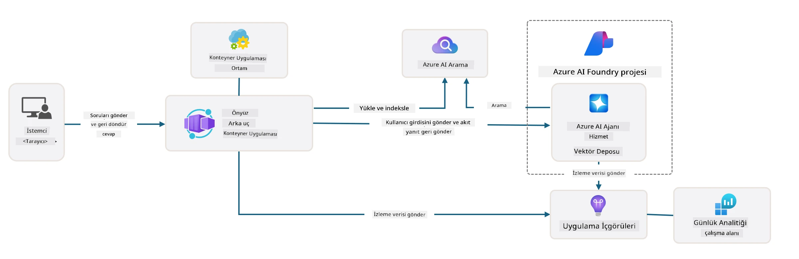

# 3. Bir Şablonu Parçalarına Ayırma

!!! tip "BU MODÜLÜN SONUNDA ŞUNLARI YAPABİLİRSİNİZ"

    - [ ] Use GitHub Copilot and optional MCP tools for Azure documentation and read-only exploration
    - [ ] Identify the template's application, infrastructure, configuration, and test entry points
    - [ ] Verify generated explanations against actual repository files
    - [ ] **Lab 3:** Trace one request and one configuration input through the project

---

## 1. GitHub Copilot'u Etkinleştirin

Başlatılan AI örneğini VS Code'da açın ve [GitHub Copilot](https://code.visualstudio.com/docs/copilot/chat/chat-agent-mode) etkinleştirin. Uygun bir plana sahip bir hesapla oturum açın; kullanım sınırları değişir. Copilot'tan değişiklikleri yetkilendirmeden önce depoyu açıklamasını isteyin.

### İsteğe bağlı MCP sunucuları

Bu hizmetler ek araçlar sağlayabilir:

- [Azure MCP Sunucusu](https://learn.microsoft.com/azure/developer/azure-mcp-server/overview)
- [Microsoft Learn MCP Sunucusu](https://learn.microsoft.com/training/support/mcp)

VS Code'da, [MCP yapılandırma rehberi](https://code.visualstudio.com/docs/copilot/chat/mcp-servers) gözden geçirin ve gerekirse `.vscode/mcp.json` oluşturun:

```json
{
  "servers": {
    "Azure MCP Server": {
      "type": "stdio",
      "command": "npx",
      "args": ["-y", "@azure/mcp@latest", "server", "start"]
    },
    "microsoft.docs.mcp": {
      "type": "http",
      "url": "https://learn.microsoft.com/api/mcp"
    }
  }
}
```

`npx` komutu desteklenen bir Node.js/npm kurulumu gerektirir ve çalıştırılabilir kod indirir. Paketi inceleyin ve tekrarlanabilir bir ekip kurulumu için onaylanmış bir sürüme sabitleyin. Sunucuları VS Code'un MCP kontrollerini kullanarak başlatın ve mevcut araçlarını inceleyin; isimler sürümler arasında değişebilir.

**Kimlik doğrulama ayrıdır.** AZD için `azd auth login` kullanın. Azure MCP'nin belgelenmiş kimlik doğrulama akışını araçları için takip edin; yalnızca AZD oturumu MCP oturumu oluşturmaz. Bir egzersiz veya kanca Azure CLI çağırdığında `az login` ayrı kullanılır.

Yalnızca okuma amaçlı istemleri deneyin:

1. “Microsoft Learn MCP'yi kullanarak Azure Developer CLI yapılandırma belgelerini bulun.”
2. “Bu deponun `azure.yaml`'unu açıklayın; her kancayı uygulayan dosyaları belirtin.”
3. “Mevcut Azure MCP araçlarını kullanarak konuşlandırılmış kaynaklarımı listeleyin, herhangi bir şeyi değiştirmeden.”

Seçili kiracı/abonelik ve önerilen her araç çağrısını kontrol edin. Mimarinin keşfi amacıyla kaynak oluşturma, silme veya erişim değişikliği onaylamayın.

## 2. Mimarini Anlayın

Örnek, Azure Container Apps içinde Python FastAPI arka ucu ve React/TypeScript ön ucu barındırır. Arka uç, Microsoft Foundry projesinde bir ajanla iletişim kurar. Alma ve gözlemlenebilirlik etkinleştirilmiş şablon özellikleri ve başarılı kurulumla ilgilidir; uygulamanın dağıtılması bunu garanti etmez.



Bu diyagramı [güncel yukarı akış dağıtım kılavuzu](https://github.com/Azure-Samples/get-started-with-ai-agents/blob/main/docs/deployment.md) ve gerçek kaynaklarınızla karşılaştırın. Yapılandırılmış model konuşlandırması, ajan araçları, yönetilen kimlik, rol atamaları ve isteğe bağlı AI Search/Uygulama İçgörü kaynaklarını kontrol edin.

**Egzersiz:** Copilot'tan, ön uçtan API'ye ve ordan Foundry’e bir sohbet isteğini dosya ve fonksiyon referanslarıyla izleyip anlatmasını isteyin. Bu referansları açın ve açıklamayı doğrulayın. Yalnızca diyagramdan uygulanan kimlik doğrulama, yönlendirme veya yetkilendirme çıkarımı yapmayın.

## 3. Depo yapısı

Aşağıdaki seçili yollar 4 Kasım 2026 tarihinde örnekle kontrol edilmiştir. Başlatılan revizyonunuz gerçek kaynaktır:

```text
get-started-with-ai-agents/
  azure.yaml
  docker-compose.yaml
  requirements-dev.txt
  .devcontainer/
  infra/
    main.bicep
    main.parameters.json
    api.bicep
    core/
  src/
    Dockerfile
    pyproject.toml
    requirements.txt
    api/
      main.py
      routes.py
      search_index_manager.py
    frontend/
      package.json
      src/
    files/
  scripts/
    validate_env_vars.sh
    validate_env_vars.ps1
    postdeploy.sh
    postdeploy.ps1
  tests/
    test_evaluation.py
    test_red_teaming.py
  docs/
    deployment.md
    deploy_customization.md
    ai_search.md
    observability.md
    local_development.md
    troubleshooting.md
```

### Altyapı ve yapılandırma

`infra/main.bicep` kaynakları düzenler; `main.parameters.json` şablon girişlerini AZD ortam değerlerine bağlar. `azure.yaml` uygulama hizmetini ve yaşam döngüsü kancalarını seçer. `USE_AZURE_AI_SEARCH_SERVICE` gibi bir girişi bu dosyalar üzerinden izleyerek aslında neyin değiştiğini bulun.

### Uygulama ve kimlik

`src/api/` ve `src/frontend/` dosyalarını birlikte okuyun. Ajanın nerede oluşturulduğunu veya alındığını, talimatların/araçların nerede yapılandırıldığını ve her Azure çağrısında hangi kimliğin kullanıldığını belirleyin. `src/files/` altındaki örnek dosyalar gösterim verileridir, üretim kataloğu veya yetkilendirme modeli değildir.

### Testler ve gözlemlenebilirlik

Mevcut değerlendirme ve kırmızı takım giriş noktaları `tests/` altında; daha eski `evals/` ve `airedteaming/` dizin referansları bu örnek için geçersizdir. Bulut testlerini çalıştırmadan önce ön koşullar ve maliyetler için `docs/observability.md` okunmalıdır. Bu Python testleri isteğe bağlı `azure.ai.evaluations` AZD uzantısından ayrıdır.

## 4. Bulgularınızı Doğrulayın

- Bir örnek soru için API yolu, ajan etkileşimi ve alma kodunu tanımlayın.
- Foundry'e hangi kimliğin eriştiğini ve hangi yapılandırmanın uç noktasını seçtiğini açıklayın.
- Gerçek pre-up ve post-deploy betiklerini ve hata işleme davranışlarını bulun.
- Dağıtımınızda eksik olan herhangi bir bağımlılık veya isteğe bağlı özelliği listeleyin.

Devam etmek için [Bir Şablonu Yapılandırın](4-Configure-AI-Template.md).

---

<!-- CO-OP TRANSLATOR DISCLAIMER START -->
**Feragatname**:
Bu belge, AI çeviri hizmeti [Co-op Translator](https://github.com/Azure/co-op-translator) kullanılarak çevrilmiştir. Doğruluk için çaba sarf etsek de, otomatik çevirilerin hata veya yanlışlık içerebileceğini lütfen unutmayınız. Orijinal belge, kendi dilinde yetkili kaynak olarak kabul edilmelidir. Kritik bilgiler için profesyonel insan çevirisi önerilir. Bu çevirinin kullanımı sonucu ortaya çıkabilecek yanlış anlamalardan veya yanlış yorumlamalardan sorumlu değiliz.
<!-- CO-OP TRANSLATOR DISCLAIMER END -->