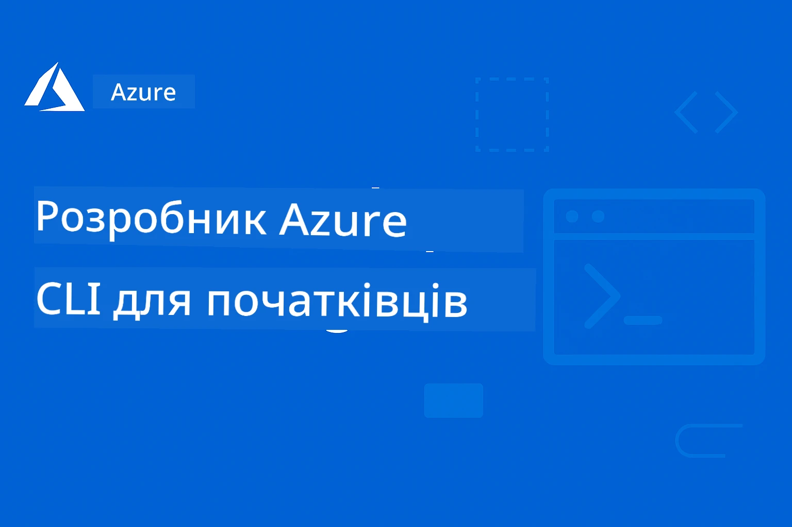

# AZD для початківців: Структурована навчальна подорож

 

[](https://GitHub.com/microsoft/azd-for-beginners/watchers/)
[](https://GitHub.com/microsoft/azd-for-beginners/network/)
[](https://GitHub.com/microsoft/azd-for-beginners/stargazers/)

[](https://discord.com/invite/nkVh3dp)
[](https://discord.gg/nTYy5BXMWG)

---

### Автоматичні переклади (завжди актуальні)

<!-- CO-OP TRANSLATOR LANGUAGES TABLE START -->
[Арабська](../ar/README.md) | [Бенгальська](../bn/README.md) | [Болгарська](../bg/README.md) | [Бирманська (М’янма)](../my/README.md) | [Китайська (спрощена)](../zh-CN/README.md) | [Китайська (традиційна, Гонконг)](../zh-HK/README.md) | [Китайська (традиційна, Макао)](../zh-MO/README.md) | [Китайська (традиційна, Тайвань)](../zh-TW/README.md) | [Хорватська](../hr/README.md) | [Чеська](../cs/README.md) | [Датська](../da/README.md) | [Нідерландська](../nl/README.md) | [Естонська](../et/README.md) | [Фінська](../fi/README.md) | [Французька](../fr/README.md) | [Німецька](../de/README.md) | [Грецька](../el/README.md) | [Іврит](../he/README.md) | [Гінді](../hi/README.md) | [Угорська](../hu/README.md) | [Індонезійська](../id/README.md) | [Італійська](../it/README.md) | [Японська](../ja/README.md) | [Каннада](../kn/README.md) | [Кхмерська](../km/README.md) | [Корейська](../ko/README.md) | [Литовська](../lt/README.md) | [Малайська](../ms/README.md) | [Малаялам](../ml/README.md) | [Маніпурі (Мейтей Майек)](../mni/README.md) | [Маратхі](../mr/README.md) | [Непальська](../ne/README.md) | [Нігерійський Піджин](../pcm/README.md) | [Норвезька](../no/README.md) | [Перська (Фарсі)](../fa/README.md) | [Польська](../pl/README.md) | [Португальська (Бразилія)](../pt-BR/README.md) | [Португальська (Португалія)](../pt-PT/README.md) | [Панджабі (Гурмухі)](../pa/README.md) | [Румунська](../ro/README.md) | [Російська](../ru/README.md) | [Сербська (кирилиця)](../sr/README.md) | [Словацька](../sk/README.md) | [Словенська](../sl/README.md) | [Іспанська](../es/README.md) | [Свахілі](../sw/README.md) | [Шведська](../sv/README.md) | [Тагальська (Філіппінська)](../tl/README.md) | [Тамільська](../ta/README.md) | [Телугу](../te/README.md) | [Тайська](../th/README.md) | [Турецька](../tr/README.md) | [Українська](./README.md) | [Урду](../ur/README.md) | [В’єтнамська](../vi/README.md)

> **Віддаєте перевагу клонуванню локально?**
>
> Цей репозиторій містить понад 50 перекладів, що значно збільшує розмір завантаження. Щоб клонувати без перекладів, використовуйте sparse checkout:
>
> **Bash / macOS / Linux:**
> ```bash
> git clone --filter=blob:none --sparse https://github.com/microsoft/AZD-for-beginners.git
> cd AZD-for-beginners
> git sparse-checkout set --no-cone '/*' '!translations' '!translated_images'
> ```
>
> **CMD (Windows):**
> ```cmd
> git clone --filter=blob:none --sparse https://github.com/microsoft/AZD-for-beginners.git
> cd AZD-for-beginners
> git sparse-checkout set --no-cone "/*" "!translations" "!translated_images"
> ```
>
> Це дає вам усе необхідне для проходження курсу з набагато швидшим завантаженням.
<!-- CO-OP TRANSLATOR LANGUAGES TABLE END -->

## 🆕 Що нового в azd сьогодні

> 📌 Цей курс перевірено на **`azd 1.27.1`** (липень 2026). Запустіть `azd version`, щоб перевірити вашу збірку, і `azd upgrade`, щоб отримати найновіше.

Azure Developer CLI вийшов за межі традиційних веб-додатків і API. Тепер azd — це єдиний інструмент для розгортання **будь-якого** додатка в Azure — включно з AI-додатками та інтелектуальними агентами.

Ось що це означає для вас:

- **AI-агенти тепер є першокласними робочими навантаженнями azd.** Ви можете ініціалізувати, розгортати та керувати проектами AI-агентів за допомогою знайомого вам робочого процесу `azd init` → `azd up`.
- **Повний життєвий цикл агента з CLI.** Розширення `azure.ai.agents` тепер охоплює весь шлях — `azd ai agent init` для створення шаблону, `azd ai agent invoke` для тестування (з виводом часу реакції), `azd ai agent eval generate` та `azd ai agent optimize` для вимірювання і покращення якості, а також `azd ai agent delete` для очищення.
- **Більше AI-компонентів.** Нові прев’ю-розширення — `azure.ai.skills` та `azure.ai.connections` — дозволяють керувати повторно використовуваними навичками агентів і підключеннями Foundry безпосередньо через azd.
- **Інтеграція з Microsoft Foundry** додає розгортання моделей, хостинг агентів та конфігурацію AI-сервісів безпосередньо в екосистему шаблонів azd.
- **Плавніші щоденні завдання.** Останні випуски зробили `azd init` ідемпотентним (безпечним для повторного запуску), автоматично очищують застарілі токени через `azd auth login` та додали дружнє покрокове налаштування при першому запуску `azd tool`.
- **Основний робочий процес не змінився.** Чи розгортаєте ви додаток todo, мікросервіс чи багатагентське AI-рішення — команди однакові.

> **Примітка для користувачів Aspire:** Компанія Microsoft тепер називає продукт просто **Aspire** (раніше ".NET Aspire"). Підтримка Aspire у azd не змінилася — оновлено тільки назву.

Якщо ви вже користувалися azd, підтримка AI — це природне розширення, а не окремий інструмент чи просунутий трек. Якщо ви починаєте з нуля, ви вивчите один робочий процес, який підходить для всього.

---

## 🚀 Що таке Azure Developer CLI (azd)?

**Azure Developer CLI (azd)** — це дружній до розробника інструмент командного рядка, який робить простим розгортання додатків в Azure. Замість того, щоб вручну створювати та підключати десятки ресурсів Azure, ви можете розгорнути цілі додатки однією командою.

### Магія `azd up`

```bash
# This single command does everything:
# ✅ Creates all Azure resources  
# ✅ Configures networking and security
# ✅ Builds your application code
# ✅ Deploys to Azure
# ✅ Gives you a working URL
azd up
```

**Ось і все!** Жодних кліків у порталі Azure, ніяких складних ARM-шаблонів для вивчення, ніяких ручних налаштувань — тільки робочі додатки на Azure.

---

## ❓ Azure Developer CLI проти Azure CLI: У чому різниця?

Це найпоширеніше запитання новачків. Ось проста відповідь:

| Особливість | **Azure CLI (`az`)** | **Azure Developer CLI (`azd`)** |
|---------|---------------------|--------------------------------|
| **Призначення** | Керування окремими ресурсами Azure | Розгортання повних додатків |
| **Мислення** | Орієнтоване на інфраструктуру | Орієнтоване на додаток |
| **Приклад** | `az webapp create --name myapp...` | `azd up` |
| **Крива навчання** | Необхідно знати сервіси Azure | Просто знати свій додаток |
| **Найкраще підходить для** | DevOps, інфраструктура | Розробники, прототипування |

### Простий аналог

- **Azure CLI** — це як мати всі інструменти для побудови будинку — молотки, пилки, цвяхи. Ви можете побудувати що завгодно, але треба знати будівництво.
- **Azure Developer CLI** — це як найняти підрядника — ви описуєте, чого хочете, а він робить будівництво.

### Коли використовувати кожен

| Сценарій | Використовуйте цей |
|----------|----------|
| "Хочу швидко розгорнути свій веб-додаток" | `azd up` |
| "Мені треба створити лише обліковий запис сховища" | `az storage account create` |
| "Я будую повний AI-додаток" | `azd init --template azure-search-openai-demo` |
| "Мені треба налагодити конкретний ресурс Azure" | `az resource show` |
| "Хочу готове до виробництва розгортання за лічені хвилини" | `azd up --environment production` |

### Вони працюють разом!

AZD використовує Azure CLI під капотом. Ви можете використовувати обидва:
```bash
# Deploy your app with AZD
azd up

# Then fine-tune specific resources with Azure CLI
az webapp config set --name myapp --always-on true
```

---

## 🌟 Знайдіть шаблони в Awesome AZD

Не починайте з нуля! **Awesome AZD** — це колекція спільноти готових до розгортання шаблонів:

| Ресурс | Опис |
|----------|-------------|
| 🔗 [**Awesome AZD Gallery**](https://azure.github.io/awesome-azd/) | Переглядайте понад 200 шаблонів з одною кнопкою розгортання |
| 🔗 [**Подати шаблон**](https://github.com/Azure/awesome-azd/issues) | Додайте власний шаблон до спільноти |
| 🔗 [**GitHub Репозиторій**](https://github.com/Azure/awesome-azd) | Зіркуйте та досліджуйте код |

### Популярні AI шаблони Awesome AZD

```bash
# RAG Chat with Microsoft Foundry Models + AI Search
azd init --template azure-search-openai-demo

# Quick AI Chat Application
azd init --template openai-chat-app-quickstart

# AI Agents with Foundry Agents
azd init --template get-started-with-ai-agents
```

---

## 🎯 Початок за 3 кроки

Перед початком переконайтеся, що ваша машина готова до шаблону, який ви хочете розгорнути:

**Windows:**
```powershell
.\validate-setup.ps1
```

**macOS / Linux:**
```bash
bash ./validate-setup.sh
```

Якщо якийсь із необхідних перевірок не пройшов, спочатку усуньте це, а потім продовжуйте швидкий старт.

### Крок 1: Встановіть AZD (2 хвилини)

**Windows:**
```powershell
winget install microsoft.azd
```

**macOS:**
```bash
brew tap azure/azd && brew install azd
```

**Linux:**
```bash
curl -fsSL https://aka.ms/install-azd.sh | bash
```

### Крок 2: Авторизація для AZD

```bash
# Optional if you plan to use Azure CLI commands directly in this course
az login

# Required for AZD workflows
azd auth login
```

Якщо не впевнені, який варіант потрібен, дотримуйтеся повного потоку налаштування в [Installation & Setup](docs/chapter-01-foundation/installation.md#authentication-setup).

### Крок 3: Розгорніть свій перший додаток

```bash
# Initialize from a template
azd init --template todo-nodejs-mongo

# Deploy to Azure (creates everything!)
azd up
```

**🎉 Ось і все!** Ваш додаток тепер живе в Azure.

### Очистка (Не забудьте!)

```bash
# Remove all resources when done experimenting
azd down --force --purge
```

---

## 📚 Як користуватися цим курсом

Цей курс розроблений для **поступового навчання** — починайте там, де вам комфортно, і рухайтеся далі:

| Ваш досвід | Почніть тут |
|-----------------|------------|
| **Повний новачок в Azure** | [Розділ 1: Основи](#-chapter-1-foundation--quick-start) |
| **Знаю Azure, новачок в AZD** | [Розділ 1: Основи](#-chapter-1-foundation--quick-start) |
| **Хочу розгорнути AI-додатки** | [Розділ 2: Розробка з акцентом на AI](#-chapter-2-ai-first-development-recommended-for-ai-developers) |
| **Хочу практичні навички** | [🎓 Інтерактивний семінар](workshop/README.md) — 3-4 години керованої лабораторії |
| **Потрібні шаблони для виробництва** | [Розділ 8: Виробництво та підприємства](#-chapter-8-production--enterprise-patterns) |

### Швидке налаштування

1. **Зробіть форк цього репозиторію**: [](https://GitHub.com/microsoft/azd-for-beginners/fork)
2. **Клонуйте його**: `git clone https://github.com/YOUR-USERNAME/azd-for-beginners.git`
3. **Отримайте допомогу**: [Спільнота Azure Discord](https://discord.com/invite/ByRwuEEgH4)

> **Віддаєте перевагу клонуванню локально?**

> Цей репозиторій містить понад 50 перекладів, що значно збільшує розмір завантаження. Щоб клонувати без перекладів, використовуйте sparse checkout:
> ```bash
> git clone --filter=blob:none --sparse https://github.com/microsoft/AZD-for-beginners.git
> cd AZD-for-beginners
> git sparse-checkout set --no-cone '/*' '!translations' '!translated_images'
> ```
> Це дає вам усе необхідне для проходження курсу з набагато швидшим завантаженням.


## Огляд курсу

Опануйте Azure Developer CLI (azd) через структуровані розділи, розроблені для поступового навчання. **Особливий акцент на розгортання AI-додатків з інтеграцією Microsoft Foundry.**

### Чому цей курс є необхідним для сучасних розробників

Згідно з даними спільноти Microsoft Foundry в Discord, **45% розробників хочуть використовувати AZD для AI-робочих навантажень**, але стикаються з проблемами:
- Складними багатосервісними AI-архітектурами  
- Кращими практиками розгортання AI у виробництві  
- Інтеграцією та конфігурацією AI-сервісів Azure  
- Оптимізацією вартості для AI-навантажень  
- Вирішенням проблем специфічних для AI розгортань  

### Цілі навчання

Завершивши цей структурований курс, ви:
- **Опануєте основи AZD**: Основні концепції, встановлення та конфігурація  
- **Розгортатимете AI-додатки**: Використання AZD із сервісами Microsoft Foundry  
- **Реалізуйте інфраструктуру як код**: керуйте ресурсами Azure за допомогою шаблонів Bicep
- **Усунення несправностей розгортань**: вирішуйте типові проблеми та налагоджуйте помилки
- **Оптимізація для продуктивного середовища**: безпека, масштабування, моніторинг і управління витратами
- **Створення рішень з кількома агентами**: розгортання складних архітектур ІІ

## Перш ніж почати: облікові записи, доступ і припущення

Перш ніж розпочати розділ 1, переконайтеся, що у вас є все необхідне. Кроки встановлення далі в цій інструкції передбачають, що ці базові умови вже виконані.

- **Підписка Azure**: ви можете використати існуючу підписку з роботи або власний акаунт, або створити [безкоштовну пробну версію](https://aka.ms/azurefreetrial) для початку.
- **Дозвіл на створення ресурсів Azure**: для більшості вправ вам потрібен доступ принаймні рівня **Contributor** до цільової підписки або групи ресурсів. У деяких розділах також передбачається можливість створення груп ресурсів, керованих ідентичностей і призначень RBAC.
- [**Обліковий запис GitHub**](https://github.com): корисний для форкування репозиторію, відстеження власних змін і використання GitHub Codespaces для майстер-класу.
- **Попередні умови для запуску шаблонів**: деякі шаблони потребують локальних інструментів, таких як Node.js, Python, Java або Docker. Запустіть валідатор установки перед початком, щоб виявити відсутні інструменти на ранній стадії.
- **Базове знайомство з терміналом**: вам не потрібно бути експертом, але слід упевнено виконувати команди такі як `git clone`, `azd auth login` і `azd up`.

> **Працюєте в корпоративній підписці?**
> Якщо ваше середовище Azure керується адміністратором, заздалегідь підтвердіть, що можете розгортати ресурси у підписці або групі ресурсів, які плануєте використовувати. Якщо ні, попросіть пісочницю або доступ Contributor перед початком.

> **Новачок в Azure?**
> Почніть з власної пробної або підписки з оплатою за користування на https://aka.ms/azurefreetrial, щоб мати змогу виконати вправи повністю без очікувань схвалень на рівні орендаря.

## 🗺️ Карта курсу: швидка навігація за розділами

Кожен розділ має окремий README з навчальними цілями, швидким стартом та вправами:

| Розділ | Тема | Уроки | Тривалість | Складність |
|---------|-------|---------|----------|------------|
| **[Розд 1: Основи](docs/chapter-01-foundation/README.md)** | Початок роботи | [Основи AZD](docs/chapter-01-foundation/azd-basics.md) &#124; [Встановлення](docs/chapter-01-foundation/installation.md) &#124; [Перший проєкт](docs/chapter-01-foundation/first-project.md) | 30-45 хв | ⭐ |
| **[Розд 2: Розробка ІІ](docs/chapter-02-ai-development/README.md)** | ІІ-перші додатки | [Інтеграція Foundry](docs/chapter-02-ai-development/microsoft-foundry-integration.md) &#124; [Агенти ІІ](docs/chapter-02-ai-development/agents.md) &#124; [Розгортання моделей](docs/chapter-02-ai-development/ai-model-deployment.md) &#124; [Майстер-клас](docs/chapter-02-ai-development/ai-workshop-lab.md) | 1-2 год | ⭐⭐ |
| **[Розд 3: Конфігурація](docs/chapter-03-configuration/README.md)** | Автентифікація і безпека | [Конфігурація](docs/chapter-03-configuration/configuration.md) &#124; [Автентифікація та безпека](docs/chapter-03-configuration/authsecurity.md) | 45-60 хв | ⭐⭐ |
| **[Розд 4: Інфраструктура](docs/chapter-04-infrastructure/README.md)** | IaC & розгортання | [Посібник з розгортання](docs/chapter-04-infrastructure/deployment-guide.md) &#124; [Провізія](docs/chapter-04-infrastructure/provisioning.md) | 1-1,5 год | ⭐⭐⭐ |
| **[Розд 5: Багатоагентні системи](docs/chapter-05-multi-agent/README.md)** | Рішення для агентів ІІ | [Сценарій роздрібної торгівлі](examples/retail-scenario.md) &#124; [Шаблони координації](docs/chapter-06-pre-deployment/coordination-patterns.md) | 2-3 год | ⭐⭐⭐⭐ |
| **[Розд 6: Перед розгортанням](docs/chapter-06-pre-deployment/README.md)** | Планування та перевірка | [Перевірки перед запуском](docs/chapter-06-pre-deployment/preflight-checks.md) &#124; [Планування потужностей](docs/chapter-06-pre-deployment/capacity-planning.md) &#124; [Вибір SKU](docs/chapter-06-pre-deployment/sku-selection.md) &#124; [App Insights](docs/chapter-06-pre-deployment/application-insights.md) | 1 год | ⭐⭐ |
| **[Розд 7: Вирішення проблем](docs/chapter-07-troubleshooting/README.md)** | Налагодження та виправлення | [Звичайні проблеми](docs/chapter-07-troubleshooting/common-issues.md) &#124; [Налагодження](docs/chapter-07-troubleshooting/debugging.md) &#124; [Проблеми ІІ](docs/chapter-07-troubleshooting/ai-troubleshooting.md) | 1-1,5 год | ⭐⭐ |
| **[Розд 8: Продуктивність](docs/chapter-08-production/README.md)** | Патерни для підприємств | [Практики продуктивності](docs/chapter-08-production/production-ai-practices.md) | 2-3 год | ⭐⭐⭐⭐ |
| **[🎓 Майстер-клас](workshop/README.md)** | Практична лабораторія | [Вступ](workshop/docs/instructions/0-Introduction.md) &#124; [Відбір](workshop/docs/instructions/1-Select-AI-Template.md) &#124; [Перевірка](workshop/docs/instructions/2-Validate-AI-Template.md) &#124; [Демонтаж](workshop/docs/instructions/3-Deconstruct-AI-Template.md) &#124; [Конфігурація](workshop/docs/instructions/4-Configure-AI-Template.md) &#124; [Налаштування](workshop/docs/instructions/5-Customize-AI-Template.md) &#124; [Закриття](workshop/docs/instructions/6-Teardown-Infrastructure.md) &#124; [Підсумок](workshop/docs/instructions/7-Wrap-up.md) | 3-4 год | ⭐⭐ |

**Загальна тривалість курсу:** ~10-14 год | **Прогрес навичок:** Початківець → Готовий до продуктивності

---

## 📚 Навчальні розділи

*Виберіть навчальний шлях відповідно до рівня досвіду та цілей*

### 🚀 Розділ 1: Основи та швидкий старт
**Преумови**: підписка Azure, базові знання командного рядка  
**Тривалість**: 30-45 хвилин  
**Складність**: ⭐

#### Чого ви навчитеся
- Основи інтерфейсу Azure Developer CLI
- Встановлення AZD на вашу платформу
- Перше успішне розгортання

#### Навчальні матеріали
- **🎯 Почніть тут**: [Що таке Azure Developer CLI?](#what-is-azure-developer-cli)
- **📖 Теорія**: [Основи AZD](docs/chapter-01-foundation/azd-basics.md) - Основні концепції та термінологія
- **⚙️ Налаштування**: [Встановлення і налаштування](docs/chapter-01-foundation/installation.md) - Посібники для платформ
- **🛠️ Практика**: [Ваш перший проєкт](docs/chapter-01-foundation/first-project.md) - Покрокове керівництво
- **📋 Швидка довідка**: [Шпаргалка команд](resources/cheat-sheet.md)

#### Практичні вправи
```bash
# Quick installation check
azd version

# Deploy your first application
azd init --template todo-nodejs-mongo
azd up
```

**💡 Результат розділу**: Успішне розгортання простого веб-додатка в Azure за допомогою AZD

**✅ Підтвердження успіху:**
```bash
# After completing Chapter 1, you should be able to:
azd version              # Shows installed version
azd init --template todo-nodejs-mongo  # Initializes project
azd up                  # Deploys to Azure
azd show                # Displays running app URL
# Application opens in browser and works
azd down --force --purge  # Cleans up resources
```

**📊 Час інвестиції:** 30-45 хвилин  
**📈 Рівень навичок після:** Можливість самостійно розгортати базові додатки
**📈 Рівень навичок після:** Можливість самостійно розгортати базові додатки

---

### 🤖 Розділ 2: Розробка ІІ-перших додатків (Рекомендовано для розробників ІІ)
**Преумови**: Розділ 1 завершено  
**Тривалість**: 1-2 год  
**Складність**: ⭐⭐

#### Чого ви навчитеся
- Інтеграція Microsoft Foundry з AZD
- Розгортання додатків з підтримкою ІІ
- Розуміння конфігурацій служб ІІ

#### Навчальні матеріали
- **🎯 Почніть тут**: [Інтеграція Microsoft Foundry](docs/chapter-02-ai-development/microsoft-foundry-integration.md)
- **🤖 Агенти ІІ**: [Посібник із агентів ІІ](docs/chapter-02-ai-development/agents.md) - Розгортання інтелектуальних агентів за допомогою AZD
- **📖 Шаблони**: [Розгортання моделей ІІ](docs/chapter-02-ai-development/ai-model-deployment.md) - Розгортання та управління моделями ІІ
- **🛠️ Майстер-клас**: [Лабораторія майстер-класу ІІ](docs/chapter-02-ai-development/ai-workshop-lab.md) - Підготуйте свої ІІ-рішення для AZD
- **🎥 Інтерактивне керівництво**: [Матеріали майстер-класу](workshop/README.md) - Навчання в браузері з MkDocs * середовище DevContainer
- **📋 Шаблони**: [Шаблони Microsoft Foundry](#featured-microsoft-foundry-templates)
- **📝 Приклади**: [Приклади розгортання AZD](examples/README.md)

#### Практичні вправи
```bash
# Deploy your first AI application
azd init --template azure-search-openai-demo
azd up

# Try additional AI templates
azd init --template openai-chat-app-quickstart
azd init --template agent-openai-python-prompty
```

**💡 Результат розділу**: Розгорніть і налаштуйте чат-додаток з ІІ з можливостями RAG

**✅ Підтвердження успіху:**
```bash
# After Chapter 2, you should be able to:
azd init --template azure-search-openai-demo
azd up
# Test the AI chat interface
# Ask questions and get AI-powered responses with sources
# Verify search integration works
azd monitor  # Check Application Insights shows telemetry
azd down --force --purge
```

**📊 Час інвестиції:** 1-2 год  
**📈 Рівень навичок після:** Можливість розгортання та налаштування готових до продуктивності ІІ-додатків  
**💰 Усвідомлення витрат:** Зрозумійте розхід на розробку $80-150/місяць, на продуктивність $300-3500/місяць

#### 💰 Урахування вартості для розгортань ІІ

**Середовище розробки (Оціночно $80-150/місяць):**
- Моделі Microsoft Foundry (оплата за використання): $0-50/місяць (залежно від використання токенів)
- AI Search (базовий рівень): $75/місяць
- Container Apps (споживання): $0-20/місяць
- Сховище (стандартне): $1-5/місяць

**Продуктивне середовище (Оціночно $300-3,500+/місяць):**
- Моделі Microsoft Foundry (PTU для стабільної продуктивності): $3,000+/місяць АБО оплата за використання при високому обсязі
- AI Search (стандартний рівень): $250/місяць
- Container Apps (виділені): $50-100/місяць
- Application Insights: $5-50/місяць
- Сховище (преміум): $10-50/місяць

**💡 Поради з оптимізації витрат:**
- Використовуйте **Безкоштовний рівень** Microsoft Foundry Models для навчання (Azure OpenAI включає 50 000 токенів/місяць)
- Запускайте `azd down` для деалокації ресурсів, коли не розробляєте активно
- Починайте з оплати за споживання, оновлюйте до PTU лише для продуктивних середовищ
- Використовуйте `azd provision --preview` для оцінки витрат перед розгортанням
- Увімкніть авто масштабування: платіть тільки за фактичне використання

**Моніторинг витрат:**
```bash
# Check estimated monthly costs
azd provision --preview

# Monitor actual costs in Azure Portal
az consumption budget list --resource-group <your-rg>
```

---

### ⚙️ Розділ 3: Конфігурація та автентифікація
**Преумови**: Розділ 1 завершено  
**Тривалість**: 45-60 хвилин  
**Складність**: ⭐⭐

#### Чого ви навчитеся
- Конфігурація та управління середовищем
- Кращі практики автентифікації і безпеки
- Іменування ресурсів і організація

#### Навчальні матеріали
- **📖 Конфігурація**: [Посібник з конфігурації](docs/chapter-03-configuration/configuration.md) - Налаштування середовища
- **🔐 Безпека**: [Шаблони автентифікації та керованих ідентичностей](docs/chapter-03-configuration/authsecurity.md) - Шаблони автентифікації
- **📝 Приклади**: [Приклад бази даних](examples/database-app/README.md) - Приклади баз даних AZD

#### Практичні вправи
- Налаштування кількох середовищ (розробка, тестування, продакшн)
- Налаштування автентифікації з керованими ідентичностями
- Впровадження середовищево-залежних конфігурацій

**💡 Результат розділу**: Управління багатьма середовищами з коректною автентифікацією та безпекою

---

### 🏗️ Розділ 4: Інфраструктура як код та розгортання
**Преумови**: Розділи 1-3 завершені  
**Тривалість**: 1-1,5 год  
**Складність**: ⭐⭐⭐

#### Чого ви навчитеся
- Розширені шаблони розгортання
- Інфраструктура як код з Bicep
- Стратегії провізії ресурсів

#### Навчальні матеріали
- **📖 Розгортання**: [Посібник з розгортання](docs/chapter-04-infrastructure/deployment-guide.md) - Повні робочі процеси
- **🏗️ Провізія**: [Управління ресурсами](docs/chapter-04-infrastructure/provisioning.md) - Управління ресурсами Azure
- **📝 Приклади**: [Приклад Container App](../../examples/container-app) - Контейнеризовані розгортання

#### Практичні вправи
- Створення власних шаблонів Bicep
- Розгортання додатків з кількома сервісами
- Впровадження стратегій blue-green розгортання

**💡 Результат розділу**: Розгортання складних додатків з багатьма сервісами за допомогою власних шаблонів інфраструктури

---

### 🎯 Розділ 5: Багатоагентні системи ІІ (Поглиблений рівень)
**Преумови**: Розділи 1-2 завершені  
**Тривалість**: 2-3 год  
**Складність**: ⭐⭐⭐⭐

#### Чого ви навчитеся
- Патерни багатоагентної архітектури
- Організація та координація агентів
- Розгортання готових до продуктивності ІІ-рішень

#### Навчальні матеріали
- **🤖 Основний проєкт**: [Багатоагентне роздрібне рішення](examples/retail-scenario.md) - Повна реалізація
- **🛠️ ARM шаблони**: [Пакет ARM шаблонів](../../examples/retail-multiagent-arm-template) - Розгортання в один клік
- **📖 Архітектура**: [Патерни координації багатьох агентів](docs/chapter-06-pre-deployment/coordination-patterns.md) - Шаблони

#### Практичні вправи
```bash
# Deploy the complete retail multi-agent solution
cd examples/retail-multiagent-arm-template
./deploy.sh

# Explore agent configurations
az deployment group show --resource-group <rg-name> --name <deployment-name>
```

**💡 Результат розділу**: Розгортання та управління багатоагентним ІІ-рішенням з агентами з обслуговування клієнтів та інвентаризації

---

### 🔍 Розділ 6: Перевірка та планування перед розгортанням
**Преумови**: Розділ 4 завершено  
**Тривалість**: 1 година  
**Складність**: ⭐⭐

#### Чого ви навчитеся
- Планування потужностей та перевірка ресурсів
- Стратегії вибору SKU
- Перевірки перед запуском та автоматизація

#### Навчальні матеріали
- **📊 Планування**: [Планування потужностей](docs/chapter-06-pre-deployment/capacity-planning.md) - Валідація ресурсів
- **💰 Вибір**: [Вибір SKU](docs/chapter-06-pre-deployment/sku-selection.md) - Економічно вигідні варіанти
- **✅ Валідація**: [Перевірки перед запуском](docs/chapter-06-pre-deployment/preflight-checks.md) - Автоматизовані скрипти

#### Практичні вправи
- Запустіть скрипти валідації потужностей
- Оптимізуйте вибір SKU для економії
- Впровадьте автоматизовані перевірки перед розгортанням

**💡 Результат розділу**: Валідуйте та оптимізуйте розгортання перед виконанням

---

### 🚨 Розділ 7: Усунення несправностей та відлагодження
**Вимоги**: Завершення будь-якого розділу з розгортання  
**Тривалість**: 1-1,5 години  
**Складність**: ⭐⭐

#### Чого ви навчитеся
- Систематичні підходи до відлагодження
- Поширені проблеми та їх вирішення
- Усунення несправностей, специфічних для ШІ

#### Навчальні ресурси
- **🔧 Поширені проблеми**: [Поширені проблеми](docs/chapter-07-troubleshooting/common-issues.md) - FAQ та рішення
- **🕵️ Відлагодження**: [Посібник з відлагодження](docs/chapter-07-troubleshooting/debugging.md) - Покрокові стратегії
- **🤖 Проблеми ШІ**: [Усунення несправностей ШІ](docs/chapter-07-troubleshooting/ai-troubleshooting.md) - Проблеми сервісів ШІ

#### Практичні вправи
- Діагностуйте збої розгортання
- Усуньте проблеми з аутентифікацією
- Відлагодьте підключення до сервісів ШІ

**💡 Результат розділу**: Самостійно діагностуйте та усувайте поширені проблеми розгортання

---

### 🏢 Розділ 8: Патерни для виробництва та підприємств
**Вимоги**: Завершені розділи 1-4  
**Тривалість**: 2-3 години  
**Складність**: ⭐⭐⭐⭐

#### Чого ви навчитеся
- Стратегії виробничого розгортання
- Патерни безпеки для підприємств
- Моніторинг та оптимізація витрат

#### Навчальні ресурси
- **🏭 Виробництво**: [Кращі практики Azure AI для виробництва](docs/chapter-08-production/production-ai-practices.md) - Патерни підприємства
- **📝 Приклади**: [Приклад мікросервісів](../../examples/microservices) - Складні архітектури
- **📊 Моніторинг**: [Інтеграція Application Insights](docs/chapter-06-pre-deployment/application-insights.md) - Моніторинг

#### Практичні вправи
- Впровадьте патерни безпеки для підприємств
- Налаштуйте комплексний моніторинг
- Розгорніть у виробництво з належним управлінням

**💡 Результат розділу**: Розгорніть додатки, готові для підприємства, з повним набором виробничих можливостей

---

## 🎓 Огляд воркшопу: Практичний досвід навчання

> **⚠️ СТАН ВОРКШОПУ: Активна розробка**  
> Матеріали воркшопу наразі розробляються і вдосконалюються. Основні модулі функціональні, але деякі розділи просунутого рівня ще незавершені. Ми активно працюємо над повним завершенням контенту. [Відстежити прогрес →](workshop/README.md)

### Інтерактивні матеріали воркшопу
**Комплексне практичне навчання з браузерними інструментами і покроковими вправами**

Наші матеріали воркшопу забезпечують структурований, інтерактивний досвід навчання, що доповнює роздільний навчальний план вище. Воркшоп розроблений як для самостійного навчання, так і для занять під керівництвом інструктора.

#### 🛠️ Особливості воркшопу
- **Інтерфейс у браузері**: Повний воркшоп на базі MkDocs з пошуком, копіюванням та можливостями теми
- **Інтеграція GitHub Codespaces**: Одноклікове налаштування середовища розробки
- **Структурований навчальний шлях**: 8 модулів із покроковими вправами (загалом 3-4 години)
- **Прогресивна методологія**: Вступ → Вибір → Валідація → Деконструкція → Конфігурація → Налаштування → Зняття → Підсумок
- **Інтерактивне DevContainer середовище**: Попередньо налаштовані інструменти та залежності

#### 📚 Структура модулів воркшопу
Воркшоп слідує за **8-модульною прогресивною методологією**, яка веде вас від відкриття до майстерності розгортання:

| Модуль | Тема | Що ви робитимете | Тривалість |
|--------|-------|----------------|----------|
| **0. Вступ** | Огляд воркшопу | Зрозуміти навчальні цілі, вимоги та структуру воркшопу | 15 хв |
| **1. Вибір** | Відкриття шаблонів | Ознайомитись з AZD шаблонами і обрати потрібний AI шаблон для вашого сценарію | 20 хв |
| **2. Валідація** | Розгортання та перевірка | Розгорнути шаблон за допомогою `azd up` і перевірити інфраструктуру | 30 хв |
| **3. Деконструкція** | Розуміння структури | Використати GitHub Copilot для дослідження архітектури шаблону, Bicep файлів та організації коду | 30 хв |
| **4. Конфігурація** | Глибоке вивчення azure.yaml | Опановувати конфігурацію `azure.yaml`, хуки життєвого циклу та змінні середовища | 30 хв |
| **5. Налаштування** | Зробіть шаблон своїм | Активувати AI Пошук, трасування, оцінювання та налаштувати під свій сценарій | 45 хв |
| **6. Зняття** | Прибирання | Безпечно деактивувати ресурси за допомогою `azd down --purge` | 15 хв |
| **7. Підсумок** | Подальші кроки | Переглянути досягнення, ключові концепції та продовжити навчання | 15 хв |

**Потік воркшопу:**
```
Introduction → Selection → Validation → Deconstruction → Configuration → Customization → Teardown → Wrap-up
     ↓            ↓           ↓              ↓               ↓              ↓            ↓           ↓
  Overview    Find the     Deploy &      Explore        Master         Customize     Clean up    Review &
             right        verify        code &        azure.yaml      for your      resources   next steps
             template                   structure                     scenario
```

#### 🚀 Початок роботи з воркшопом
```bash
# Option 1: GitHub Codespaces (Recommended)
# Click "Code" → "Create codespace on main" in the repository

# Option 2: Local Development
git clone https://github.com/microsoft/azd-for-beginners.git
cd azd-for-beginners/workshop
# Follow the setup instructions in workshop/README.md
```

#### 🎯 Очікувані результати навчання
Відвідувачі воркшопу зможуть:
- **Розгортати виробничі AI-додатки**: Використовувати AZD з сервісами Microsoft Foundry
- **Опановувати мультиагентські архітектури**: Впроваджувати скоординовані AI-агентські рішення
- **Впроваджувати найкращі практики безпеки**: Налаштовувати аутентифікацію та контроль доступу
- **Оптимізувати для масштабування**: Проєктувати економічні та продуктивні розгортання
- **Вирішувати проблеми розгортання**: Самостійно усувати поширені помилки

#### 📖 Ресурси воркшопу
- **🎥 Інтерактивний посібник**: [Матеріали воркшопу](workshop/README.md) - Навчальне середовище у браузері
- **📋 Інструкції по модулях**:
  - [0. Вступ](workshop/docs/instructions/0-Introduction.md) - Огляд та цілі воркшопу
  - [1. Вибір](workshop/docs/instructions/1-Select-AI-Template.md) - Пошук та вибір шаблонів AI
  - [2. Валідація](workshop/docs/instructions/2-Validate-AI-Template.md) - Розгортання і перевірка шаблонів
  - [3. Деконструкція](workshop/docs/instructions/3-Deconstruct-AI-Template.md) - Вивчення архітектури шаблону
  - [4. Конфігурація](workshop/docs/instructions/4-Configure-AI-Template.md) - Опанування azure.yaml
  - [5. Налаштування](workshop/docs/instructions/5-Customize-AI-Template.md) - Налаштування під ваш сценарій
  - [6. Зняття](workshop/docs/instructions/6-Teardown-Infrastructure.md) - Прибирання ресурсів
  - [7. Підсумок](workshop/docs/instructions/7-Wrap-up.md) - Підсумки та подальші кроки
- **🛠️ AI Workshop Lab**: [AI Workshop Lab](docs/chapter-02-ai-development/ai-workshop-lab.md) - Вправи з фокусом на AI
- **💡 Швидкий старт**: [Посібник з налаштування воркшопу](workshop/README.md#quick-start) - Конфігурація середовища

**Ідеально підходить для**: Корпоративного навчання, університетських курсів, самостійного опанування та курсів для розробників.

---

## 📖 Глибоке занурення: Можливості AZD

Поза базовими функціями, AZD надає потужні можливості для виробничих розгортань:

- **Розгортання на основі шаблонів** - Використовуйте попередньо створені шаблони для поширених патернів додатків
- **Інфраструктура як код** - Керуйте ресурсами Azure за допомогою Bicep або Terraform  
- **Інтегровані робочі процеси** - Безперебійне резервування, розгортання та моніторинг додатків
- **Дружній для розробника** - Оптимізовано для продуктивності та комфорту розробника

### **AZD + Microsoft Foundry: Ідеально для розгортання ШІ**

**Чому AZD для рішень ШІ?** AZD вирішує найважливіші виклики, з якими стикаються розробники ШІ:

- **Шаблони, готові для ШІ** - Попередньо налаштовані шаблони для моделей Microsoft Foundry, сервісів Azure AI та ML робочих навантажень
- **Безпечні розгортання ШІ** - Вбудовані патерни безпеки для сервісів ШІ, ключів API та кінцевих точок моделей  
- **Виробничі патерни ШІ** - Найкращі практики для масштабованих і економічно вигідних розгортань додатків ШІ
- **Повний цикл робочих процесів ШІ** - Від розробки моделей до виробничого розгортання з належним моніторингом
- **Оптимізація витрат** - Розумне розподілення ресурсів і стратегії масштабування для робочих навантажень ШІ
- **Інтеграція з Microsoft Foundry** - Безшовне підключення до каталогу моделей і кінцевих точок Microsoft Foundry

---

## 🎯 Бібліотека шаблонів та прикладів

### Рекомендуємо: Шаблони Microsoft Foundry
**Почніть тут, якщо ви розгортаєте AI-додатки!**

> **Примітка:** Ці шаблони демонструють різні патерни ШІ. Деякі - це зовнішні Azure Samples, інші - локальні реалізації.

| Шаблон | Розділ | Складність | Сервіси | Тип |
|----------|---------|------------|----------|------|
| [**Початок з AI чат**](https://github.com/Azure-Samples/get-started-with-ai-chat) | Розділ 2 | ⭐⭐ | AzureOpenAI + Azure AI Model Inference API + Azure AI Search + Azure Container Apps + Application Insights | Зовнішній |
| [**Початок з AI агентами**](https://github.com/Azure-Samples/get-started-with-ai-agents) | Розділ 2 | ⭐⭐ | Foundry Agents + AzureOpenAI + Azure AI Search + Azure Container Apps + Application Insights| Зовнішній |
| [**Демонстрація Azure Search + OpenAI**](https://github.com/Azure-Samples/azure-search-openai-demo) | Розділ 2 | ⭐⭐ | AzureOpenAI + Azure AI Search + App Service + Storage | Зовнішній |
| [**OpenAI Chat App Quickstart**](https://github.com/Azure-Samples/openai-chat-app-quickstart) | Розділ 2 | ⭐ | AzureOpenAI + Container Apps + Application Insights | Зовнішній |
| [**Agent OpenAI Python Prompty**](https://github.com/Azure-Samples/agent-openai-python-prompty) | Розділ 5 | ⭐⭐⭐ | AzureOpenAI + Azure Functions + Prompty | Зовнішній |
| [**Contoso Chat RAG**](https://github.com/Azure-Samples/contoso-chat) | Розділ 8 | ⭐⭐⭐⭐ | AzureOpenAI + AI Search + Cosmos DB + Container Apps | Зовнішній |
| [**Роздрібне мультиагентське рішення**](examples/retail-scenario.md) | Розділ 5 | ⭐⭐⭐⭐ | AzureOpenAI + AI Search + Storage + Container Apps + Cosmos DB | **Локальний** |

### Рекомендуємо: Повні навчальні сценарії
**Шаблони додатків, готових для виробництва, зіставлені з навчальними розділами**

| Шаблон | Навчальний розділ | Складність | Ключове навчання |
|----------|------------------|------------|--------------|
| [**openai-chat-app-quickstart**](https://github.com/Azure-Samples/openai-chat-app-quickstart) | Розділ 2 | ⭐ | Основні патерни розгортання ШІ |
| [**azure-search-openai-demo**](https://github.com/Azure-Samples/azure-search-openai-demo) | Розділ 2 | ⭐⭐ | Впровадження RAG з Azure AI Search |
| [**ai-document-processing**](https://github.com/Azure-Samples/ai-document-processing) | Розділ 4 | ⭐⭐ | Інтеграція інтелекту обробки документів |
| [**agent-openai-python-prompty**](https://github.com/Azure-Samples/agent-openai-python-prompty) | Розділ 5 | ⭐⭐⭐ | Агентська структура та виклики функцій |
| [**contoso-chat**](https://github.com/Azure-Samples/contoso-chat) | Розділ 8 | ⭐⭐⭐ | Оркестрація підприємницьких AI-рішень |
| [**retail-multi-agent-solution**](examples/retail-scenario.md) | Розділ 5 | ⭐⭐⭐⭐ | Мультиагентська архітектура із агентами Клієнтів та Інвентарю |

### Навчання за типом прикладів

> **📌 Локальні vs. Зовнішні приклади:**  
> **Локальні приклади** (у цьому репозиторії) = Готові до використання одразу  
> **Зовнішні приклади** (Azure Samples) = Клонування з пов'язаних репозиторіїв

#### Локальні приклади (готові до використання)
- [**Роздрібне мультиагентське рішення**](examples/retail-scenario.md) - Повна виробнича реалізація з ARM шаблонами
  - Мультиагентська архітектура (агенти Клієнтів + Інвентарю)
  - Комплексний моніторинг та оцінювання
  - Розгортання одним кліком через ARM шаблон

#### Локальні приклади - Контейнерні додатки (розділи 2-5)
**Повні приклади розгортання контейнерів у цьому репозиторії:**
- [**Приклади контейнерних додатків**](examples/container-app/README.md) - Повний посібник з розгортання контейнерів
  - [Простий Flask API](../../examples/container-app/simple-flask-api) - Основний REST API з масштабуванням до нуля
  - [Архітектура мікросервісів](../../examples/container-app/microservices) - Виробниче багатосервісне розгортання
  - Швидкий старт, виробництво та розширені патерни розгортання
  - Керівництво з моніторингу, безпеки та оптимізації витрат

#### Зовнішні приклади - Прості додатки (розділи 1-2)
**Клонуйте ці репозиторії Azure Samples для початку роботи:**
- [Простий веб-додаток - Node.js + MongoDB](https://github.com/Azure-Samples/todo-nodejs-mongo) - Основні патерни розгортання
- [Статичний сайт - React SPA](https://github.com/Azure-Samples/todo-csharp-sql-swa-func) - Розгортання статичного контенту
- [Контейнерний додаток - Python Flask](https://github.com/Azure-Samples/container-apps-store-api-microservice) - Розгортання REST API

#### Зовнішні приклади - Інтеграція бази даних (розділи 3-4)  
- [Додаток з базою даних - C# + SQL](https://github.com/Azure-Samples/todo-csharp-sql) - Патерни підключення до бази даних
- [Функції + Cosmos DB](https://github.com/Azure-Samples/todo-python-mongo-swa-func) - Безсерверний робочий процес даних

#### Зовнішні приклади - Розширені патерни (розділи 4-8)
- [Java мікросервіси](https://github.com/Azure-Samples/java-microservices-aca-lab) - Багатосервісні архітектури
- [Завдання контейнерних додатків](https://github.com/Azure-Samples/container-apps-jobs) - Фонове опрацювання  
- [Виробнича ML конвеєрна схема](https://github.com/Azure-Samples/mlops-v2) - Готові до виробництва ML патерни

### Зовнішні колекції шаблонів
- [**Офіційна галерея шаблонів AZD**](https://azure.github.io/awesome-azd/) - Відбірка офіційних і спільнотних шаблонів
- [**Шаблони Azure Developer CLI**](https://learn.microsoft.com/en-us/azure/developer/azure-developer-cli/azd-templates) - Документація шаблонів Microsoft Learn
- [**Каталог прикладів**](examples/README.md) - Локальні навчальні приклади з детальними поясненнями

---

## 📚 Ресурси для навчання та посилання

### Швидкі посилання
- [**Шпаргалка команд**](resources/cheat-sheet.md) - Основні команди azd, організовані за розділами
- [**Глосарій**](resources/glossary.md) - Терміни Azure та azd
- [**Часті запитання**](resources/faq.md) - Типові питання, організовані за главами навчання
- [**Посібник для навчання**](resources/study-guide.md) - Комплексні практичні вправи

### Практичні воркшопи
- [**Лабораторія AI Workshop**](docs/chapter-02-ai-development/ai-workshop-lab.md) - Зробіть свої AI-рішення готовими до розгортання через AZD (2-3 години)
- [**Інтерактивний воркшоп**](workshop/README.md) - 8 модулів керованих вправ з MkDocs та GitHub Codespaces
  - Послідовність: Вступ → Вибір → Валідація → Розбирання → Конфігурація → Налаштування → Демонтаж → Підсумок

### Зовнішні ресурси для навчання
- [Документація Azure Developer CLI](https://learn.microsoft.com/en-us/azure/developer/azure-developer-cli/)
- [Центр архітектури Azure](https://learn.microsoft.com/en-us/azure/architecture/)
- [Калькулятор цін Azure](https://azure.microsoft.com/pricing/calculator/)
- [Статус Azure](https://status.azure.com/)

### Навички AI-агента для вашого редактора
- [**Навички Microsoft Azure на skills.sh**](https://skills.sh/microsoft/github-copilot-for-azure) - 37 відкритих навичок агента для Azure AI, Foundry, розгортання, діагностики, оптимізації витрат та ін. Встановіть їх у GitHub Copilot, Cursor, Claude Code або будь-якому підтримуваному агенті:
  ```bash
  npx skills add microsoft/github-copilot-for-azure
  ```

---

## 🔧 Швидкий посібник з усунення неполадок

**Поширені проблеми початківців та негайні рішення:**

<details>
<summary><strong>❌ "azd: команда не знайдена"</strong></summary>

```bash
# Install AZD first
# Windows (PowerShell):
winget install microsoft.azd

# macOS:
brew tap azure/azd && brew install azd

# Linux:
curl -fsSL https://aka.ms/install-azd.sh | bash

# Verify installation
azd version
```
</details>

<details>
<summary><strong>❌ "Підписка не знайдена" або "Підписка не встановлена"</strong></summary>

```bash
# List available subscriptions
az account list --output table

# Set default subscription
az account set --subscription "<subscription-id-or-name>"

# Set for AZD environment
azd env set AZURE_SUBSCRIPTION_ID "<subscription-id>"

# Verify
az account show
```
</details>

<details>
<summary><strong>❌ "Недостатньо квоти" або "Вичерпано квоту"</strong></summary>

```bash
# Try different Azure region
azd env set AZURE_LOCATION "westus2"
azd up

# Or use smaller SKUs in development
# Edit infra/main.parameters.json:
{
  "sku": "B1"  // Instead of "P1V2"
}
```
</details>

<details>
<summary><strong>❌ "azd up" не виконується повністю</strong></summary>

```bash
# Option 1: Clean and retry
azd down --force --purge
azd up

# Option 2: Just fix infrastructure
azd provision

# Option 3: Check detailed status
azd show

# Option 4: Check logs in Azure Monitor
azd monitor --logs
```
</details>

<details>
<summary><strong>❌ "Помилка аутентифікації" або "Термін дії токена минув"</strong></summary>

```bash
# Re-authenticate for AZD
azd auth logout
azd auth login

# Optional: refresh Azure CLI too if you are running az commands
az logout
az login

# Verify authentication
az account show
```
</details>

<details>
<summary><strong>❌ "Ресурс вже існує" або конфлікти імен</strong></summary>

```bash
# AZD generates unique names, but if conflict:
azd down --force --purge

# Then retry with fresh environment
azd env new dev-v2
azd up
```
</details>

<details>
<summary><strong>❌ Шаблон розгортання займає забагато часу</strong></summary>

**Нормальний час очікування:**
- Проста веб-аплікація: 5-10 хвилин
- Аплікація з базою даних: 10-15 хвилин
- AI-додатки: 15-25 хвилин (Постачання OpenAI відбувається повільно)

```bash
# Check progress
azd show

# If stuck >30 minutes, check Azure Portal:
azd monitor --overview
# Look for failed deployments
```
</details>

<details>
<summary><strong>❌ "Доступ заборонено" або "Відмова в дозволі"</strong></summary>

```bash
# Check your Azure role
az role assignment list --assignee $(az account show --query user.name -o tsv)

# You need at least "Contributor" role
# Ask your Azure admin to grant:
# - Contributor (for resources)
# - User Access Administrator (for role assignments)
```
</details>

<details>
<summary><strong>❌ Немає URL розгорнутої аплікації</strong></summary>

```bash
# Show all service endpoints
azd show

# Or open Azure Portal
azd monitor

# Check specific service
azd env get-values
# Look for *_URL variables
```
</details>

### 📚 Повні ресурси для усунення неполадок

- **Посібник з поширених проблем:** [Детальні рішення](docs/chapter-07-troubleshooting/common-issues.md)
- **Проблеми, пов’язані з AI:** [Усунення неполадок AI](docs/chapter-07-troubleshooting/ai-troubleshooting.md)
- **Посібник з налагодження:** [Покрокове налагодження](docs/chapter-07-troubleshooting/debugging.md)
- **Отримати допомогу:** [Azure Discord](https://discord.gg/microsoft-azure) #azure-developer-cli

---

## 🎓 Завершення курсу та сертифікація

### Відстеження прогресу
Відстежуйте свій навчальний прогрес по кожному розділу:

- [ ] **Розділ 1**: Основи та швидкий старт ✅
- [ ] **Розділ 2**: Розробка AI-першого рівня ✅
- [ ] **Розділ 3**: Конфігурація та аутентифікація ✅
- [ ] **Розділ 4**: Інфраструктура як код та розгортання ✅
- [ ] **Розділ 5**: Багатоагентні AI-рішення ✅
- [ ] **Розділ 6**: Передрозгортна валідація та планування ✅
- [ ] **Розділ 7**: Усунення неполадок та налагодження ✅
- [ ] **Розділ 8**: Виробничі та корпоративні шаблони ✅

### Перевірка навчання
Після завершення кожного розділу перевірте свої знання за допомогою:
1. **Практична вправа**: Завершити розгортання розділу на практиці
2. **Перевірка знань**: Переглянути розділ Часті запитання для цього розділу
3. **Обговорення в спільноті**: Поділитися досвідом у Azure Discord
4. **Наступний розділ**: Перейти до наступного рівня складності

### Переваги завершення курсу
По завершенню всіх розділів ви отримаєте:
- **Досвід виробництва**: Розгорнуті реальні AI-додатки в Azure
- **Професійні навички**: Можливості розгортання, готові для підприємств
- **Визнання в спільноті**: Активний учасник спільноти розробників Azure
- **Кар'єрний розвиток**: Востаннє затребувані знання з AZD і розгортання AI

---

## 🤝 Спільнота та підтримка

### Отримання допомоги та підтримки
- **Технічні проблеми**: [Повідомляйте про помилки та запити функцій](https://github.com/microsoft/azd-for-beginners/issues)
- **Питання навчання**: [Спільнота Microsoft Azure Discord](https://discord.gg/microsoft-azure) та [](https://discord.gg/nTYy5BXMWG)
- **Допомога з AI**: Приєднуйтесь до [](https://discord.gg/nTYy5BXMWG)
- **Документація**: [Офіційна документація Azure Developer CLI](https://learn.microsoft.com/en-us/azure/developer/azure-developer-cli/)

### Інсайти спільноти з Microsoft Foundry Discord

**Останні результати опитування в каналі #Azure:**
- **45%** розробників хочуть використовувати AZD для AI-навантажень
- **Топ виклики**: Розгортання кількох сервісів, керування обліковими даними, готовність до продукції
- **Найчастіше запитуване**: AI-специфічні шаблони, посібники з усунення неполадок, кращі практики

**Приєднуйтесь до нашої спільноти, щоб:**
- Ділитися досвідом з AZD + AI та отримувати допомогу
- Отримати ранній доступ до нових AI-шаблонів
- Вносити свій внесок у кращі практики розгортання AI
- Впливати на майбутній розвиток функцій AI + AZD

### Внесок до курсу
Ми вітаємо внески! Будь ласка, прочитайте наш [Посібник для внеску](CONTRIBUTING.md) для деталей щодо:
- **Покращення контенту**: Удосконалення існуючих розділів та прикладів
- **Нові приклади**: Додавання реальних сценаріїв і шаблонів
- **Переклад**: Допомога в підтримці мультимовності
- **Звіти про помилки**: Покращення точності та ясності
- **Стандарти спільноти**: Дотримання наших інклюзивних правил спільноти

---

## 📄 Інформація про курс

### Ліцензія
Цей проєкт ліцензовано за MIT License - див. файл [LICENSE](../../LICENSE) для деталей.

### Пов’язані навчальні ресурси Microsoft

Наша команда створює інші комплексні навчальні курси:

<!-- CO-OP TRANSLATOR OTHER COURSES START -->
### LangChain
[](https://aka.ms/langchain4j-for-beginners)
[](https://aka.ms/langchainjs-for-beginners?WT.mc_id=m365-94501-dwahlin)
[](https://github.com/microsoft/langchain-for-beginners?WT.mc_id=m365-94501-dwahlin)
---

### Azure / Edge / MCP / Агенти
[](https://github.com/microsoft/AZD-for-beginners?WT.mc_id=academic-105485-koreyst)
[](https://github.com/microsoft/edgeai-for-beginners?WT.mc_id=academic-105485-koreyst)
[](https://github.com/microsoft/mcp-for-beginners?WT.mc_id=academic-105485-koreyst)
[](https://github.com/microsoft/ai-agents-for-beginners?WT.mc_id=academic-105485-koreyst)

---
 
### Серія про генеративний AI
[](https://github.com/microsoft/generative-ai-for-beginners?WT.mc_id=academic-105485-koreyst)
[-9333EA?style=for-the-badge&labelColor=E5E7EB&color=9333EA)](https://github.com/microsoft/Generative-AI-for-beginners-dotnet?WT.mc_id=academic-105485-koreyst)
[-C084FC?style=for-the-badge&labelColor=E5E7EB&color=C084FC)](https://github.com/microsoft/generative-ai-for-beginners-java?WT.mc_id=academic-105485-koreyst)
[-E879F9?style=for-the-badge&labelColor=E5E7EB&color=E879F9)](https://github.com/microsoft/generative-ai-with-javascript?WT.mc_id=academic-105485-koreyst)

---
 
### Основи навчання
[](https://aka.ms/ml-beginners?WT.mc_id=academic-105485-koreyst)
[](https://aka.ms/datascience-beginners?WT.mc_id=academic-105485-koreyst)
[](https://aka.ms/ai-beginners?WT.mc_id=academic-105485-koreyst)
[](https://github.com/microsoft/Security-101?WT.mc_id=academic-96948-sayoung)
[](https://aka.ms/webdev-beginners?WT.mc_id=academic-105485-koreyst)
[](https://aka.ms/iot-beginners?WT.mc_id=academic-105485-koreyst)
[](https://github.com/microsoft/xr-development-for-beginners?WT.mc_id=academic-105485-koreyst)

---
 
### Серія Copilot
[](https://aka.ms/GitHubCopilotAI?WT.mc_id=academic-105485-koreyst)
[](https://github.com/microsoft/mastering-github-copilot-for-dotnet-csharp-developers?WT.mc_id=academic-105485-koreyst)
[](https://github.com/microsoft/CopilotAdventures?WT.mc_id=academic-105485-koreyst)
<!-- CO-OP TRANSLATOR OTHER COURSES END -->

---

## 🗺️ Навігація по курсу

**🚀 Готові розпочати навчання?**

**Початківці**: Почніть з [Розділ 1: Основи та швидкий старт](#-chapter-1-foundation--quick-start)  
**AI розробники**: Перейдіть до [Розділ 2: Розробка AI-першого рівня](#-chapter-2-ai-first-development-recommended-for-ai-developers)  
**Досвідчені розробники**: Почніть з [Розділ 3: Конфігурація та аутентифікація](#️-chapter-3-configuration--authentication)

**Наступні кроки**: [Почати з Розділу 1 - Основи AZD](docs/chapter-01-foundation/azd-basics.md) →

---

<!-- CO-OP TRANSLATOR DISCLAIMER START -->
**Відмова від відповідальності**:
Цей документ було перекладено за допомогою сервісу штучного інтелекту для перекладу [Co-op Translator](https://github.com/Azure/co-op-translator). Хоча ми прагнемо до точності, будь ласка, майте на увазі, що автоматичні переклади можуть містити помилки або неточності. Оригінальний документ рідною мовою слід вважати авторитетним джерелом. Для критично важливої інформації рекомендується професійний людський переклад. Ми не несемо відповідальності за будь-які непорозуміння або неправильні тлумачення, що виникли внаслідок використання цього перекладу.
<!-- CO-OP TRANSLATOR DISCLAIMER END -->