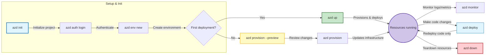
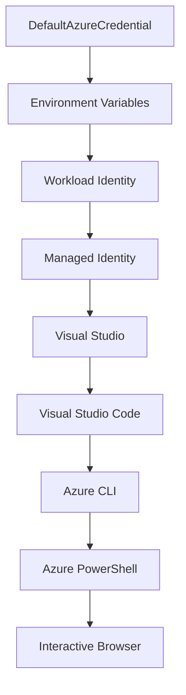

# Основи AZD - Основні поняття та фундаментальні знання

**Навігація по розділах:**
- **📚 Домашня сторінка курсу**: [AZD для початківців](../../README.md)
- **📖 Поточний розділ**: Розділ 1 - Основи та швидкий старт
- **⬅️ Попередній**: [Огляд курсу](../../README.md#-chapter-1-foundation--quick-start)
- **➡️ Наступний**: [Встановлення та налаштування](installation.md)
- **🚀 Наступний розділ**: [Розділ 2: AI-сперший розвиток](../chapter-02-ai-development/microsoft-foundry-integration.md)

## Вступ

> Перевірено за `azd 1.37.2` (листопад 2026). Команди Bash використовують цитовані замінники, які потрібно замінити. Шаблонні робочі процеси використовують `.` для ініціалізації поточної директорії; без аргументу директорії ініціалізація шаблону створює піддиректорію і не змінює робочий каталог оболонки. Розширені фрагменти показові, а не повні проекти.

Цей урок знайомить вас із Azure Developer CLI (azd) — потужним інструментом командного рядка, який прискорює ваш шлях від локальної розробки до розгортання в Azure. Ви дізнаєтеся основні концепції, ключові функції та зрозумієте, як azd спрощує розгортання хмарних нативних додатків.

## Цілі навчання

До кінця цього уроку ви:
- Зрозумієте, що таке Azure Developer CLI і яка його основна мета
- Вивчите основні поняття шаблонів, середовищ та сервісів
- Ознайомитесь із ключовими функціями, включно з розробкою на основі шаблонів та Інфраструктурою як Кодом
- Зрозумієте структуру проєкту azd та робочий процес
- Будете готові встановити та налаштувати azd для вашого середовища розробки

## Результати навчання

Після завершення цього уроку ви зможете:
- Пояснити роль azd у сучасних хмарних робочих процесах розробки
- Визначити компоненти структури проєкту azd
- Описати, як шаблони, середовища та сервіси працюють разом
- Зрозуміти переваги Інфраструктури як Коду з azd
- Розпізнати різні команди azd та їх призначення

## Що таке Azure Developer CLI (azd)?

Azure Developer CLI (azd) — інструмент командного рядка, призначений для прискорення переходу від локальної розробки до розгортання в Azure. Він спрощує процес створення, розгортання та керування хмарними нативними додатками в Azure.

### Що можна розгортати за допомогою azd?

azd підтримує широкий спектр навантажень — і цей список постійно зростає. Сьогодні ви можете використовувати azd для розгортання:

| Тип навантаження | Приклади | Те ж робоче середовище? |
|---------------|----------|----------------|
| **Традиційні додатки** | Веб-додатки, REST API, статичні сайти | ✅ `azd up` |
| **Послуги та мікросервіси** | Container Apps, Function Apps, багатосервісні бекенди | ✅ `azd up` |
| **Додатки з підтримкою ШІ** | Чат-додатки з Microsoft Foundry Models, RAG-рішення з AI Search | ✅ `azd up` |
| **Інтелектуальні агенти** | Агенти, розміщені в Foundry, багаточисельні агентські оркестровки | ✅ `azd up` |

Основна ідея полягає в тому, що **життєвий цикл azd залишається однаковим, незалежно від того, що ви розгортаєте**. Ви ініціалізуєте проект, створюєте інфраструктуру, розгортаєте код, моніторите додаток і прибираєте — чи то простий вебсайт, чи складний ШІ-агент.

Це постійність закладена у дизайн. azd розглядає можливості ШІ як ще один тип сервісу, який ваше застосування може використовувати, а не як щось принципово інше. Чат-ендпоінт на основі Microsoft Foundry Models з точки зору azd — це просто ще один сервіс для налаштування та розгортання.

### 🎯 Чому варто використовувати AZD? Порівняння на практиці

Порівняймо розгортання простого веб-додатку з базою даних:

#### ❌ БЕЗ AZD: Ручне розгортання в Azure (понад 30 хвилин)

**Ілюстративне порівняння Bash, а не стартовий додаток.** Припускається наявність коду додатку, унікальних імен ресурсів, автентифікації в Azure CLI та необхідних розширень CLI. Використовуйте вправу з шаблоном нижче для повного підтримуваного шляху.

```bash
# Step 1: Create resource group
az group create --name myapp-rg --location eastus

# Step 2: Create App Service Plan
az appservice plan create --name myapp-plan \
  --resource-group myapp-rg \
  --sku B1 --is-linux

# Step 3: Create Web App
az webapp create --name myapp-web-unique123 \
  --resource-group myapp-rg \
  --plan myapp-plan \
  --runtime "NODE:22-lts"

# Step 4: Create Cosmos DB account (10-15 minutes)
az cosmosdb create --name myapp-cosmos-unique123 \
  --resource-group myapp-rg \
  --kind MongoDB

# Step 5: Create database
az cosmosdb mongodb database create \
  --account-name myapp-cosmos-unique123 \
  --resource-group myapp-rg \
  --name tododb

# Step 6: Create collection
az cosmosdb mongodb collection create \
  --account-name myapp-cosmos-unique123 \
  --resource-group myapp-rg \
  --database-name tododb \
  --name todos

# Step 7: Get connection string
CONN_STR=$(az cosmosdb keys list \
  --name myapp-cosmos-unique123 \
  --resource-group myapp-rg \
  --type connection-strings \
  --query "connectionStrings[0].connectionString" -o tsv)

# Step 8: Configure app settings
az webapp config appsettings set \
  --name myapp-web-unique123 \
  --resource-group myapp-rg \
  --settings MONGODB_URI="$CONN_STR"

# Step 9: Enable logging
az webapp log config --name myapp-web-unique123 \
  --resource-group myapp-rg \
  --application-logging filesystem \
  --detailed-error-messages true

# Step 10: Set up Application Insights
az monitor app-insights component create \
  --app myapp-insights \
  --location eastus \
  --resource-group myapp-rg

# Step 11: Link App Insights to Web App
INSTRUMENTATION_KEY=$(az monitor app-insights component show \
  --app myapp-insights \
  --resource-group myapp-rg \
  --query "instrumentationKey" -o tsv)

az webapp config appsettings set \
  --name myapp-web-unique123 \
  --resource-group myapp-rg \
  --settings APPINSIGHTS_INSTRUMENTATIONKEY="$INSTRUMENTATION_KEY"

# Step 12: Build application locally
npm install
npm run build

# Step 13: Create deployment package
zip -r app.zip . -x "*.git*" "node_modules/*"

# Step 14: Deploy application
az webapp deployment source config-zip \
  --resource-group myapp-rg \
  --name myapp-web-unique123 \
  --src app.zip

# Step 15: Wait and pray it works 🙏
# (No automated validation, manual testing required)
```

**Проблеми:**
- ❌ Потрібно пам’ятати та виконати понад 15 команд у порядку
- ❌ Від 30 до 45 хвилин ручної роботи
- ❌ Легко зробити помилки (опечатки, неправильні параметри)
- ❌ Облікові дані потребують явного оброблення; логи налагодження і трасування оболонки можуть їх відкривати
- ❌ Відсутній автоматичний відкат у разі помилки
- ❌ Важко відтворити для членів команди
- ❌ Кожного разу по-різному (не відтворювально)

#### ✅ З AZD: Автоматизоване розгортання (5 команд, 10-15 хвилин)

```bash
# Step 1: Initialize from template
azd init --template todo-nodejs-mongo .

# Step 2: Authenticate
azd auth login

# Step 3: Select the environment created during init
azd env select dev

# Step 4: Preview changes (optional but recommended)
azd provision --preview

# Step 5: Deploy everything
azd up

# ✨ Done! Everything is deployed, configured, and monitored
```

**Переваги:**
- ✅ **5 команд** замість понад 15 ручних кроків
- ✅ **10-15 хвилин** загального часу (в основному очікування Azure)
- ✅ **Менше ручних помилок** — послідовний робочий процес на основі шаблонів
- ✅ **Безпечне зберігання секретів** — багато шаблонів використовують сховища секретів, керовані Azure
- ✅ **Повторюване розгортання** — однаковий робочий процес щоразу
- ✅ **Повторювані визначення інфраструктури** — з урахуванням квот, доступності регіонів і версій шаблонів
- ✅ **Підходить для команди** — будь-хто може розгорнути за тими ж командами
- ✅ **Інфраструктура як Код** — шаблони Bicep під контролем версій
- ✅ **Моніторинг, визначений у шаблоні** — Application Insights, коли включений у шаблон

### Час і надійність

Наведені оцінки часу є приблизними, а не еталонними показниками. azd зменшує кількість команд для координації, але не гарантує тривалість розгортання, не усуває помилки і не надає автоматичний відкат додатку/бази даних. Зберігайте робочі версії у системі контролю версій і тестуйте процедури відновлення.

## Основні поняття

### Шаблони
Шаблони — це основа azd. Вони містять:
- **Код додатку** — ваш вихідний код і залежності
- **Визначення інфраструктури** — ресурси Azure, описані в Bicep або Terraform
- **Конфігураційні файли** — налаштування та змінні середовища
- **Скрипти розгортання** — автоматизовані робочі процеси розгортання

### Середовища (Environments)
Середовища представляють різні цілі розгортання:
- **Розробка** — для тестування та розробки
- **Стадія** — пре-продукційне середовище
- **Продуктивне** — живе продукційне середовище

Кожне середовище зберігає власне:
- Ім’я середовища і значення; ізоляція ресурсів залежить від шаблону інфраструктури
- Конфігураційні налаштування
- Стан розгортання

### Служби
Служби в `azure.yaml` описують розгорнуті компоненти додатка:
- **Фронтенд** — веб-додатки, SPA
- **Бекенд** — API, мікросервіси

Бази даних і сховища зазвичай створюються як ресурси інфраструктури, а не як вигадані хости сервісів, як-от `host: postgres`.

## Ключові функції

### 1. Розробка на основі шаблонів
```bash
# Browse available templates
azd template list

# Initialize from a template
azd init --template "<template-name>" .
```

### 2. Інфраструктура як Код
- **Bicep** — предметно-орієнтована мова Azure
- **Terraform** — багатохмарний інструмент інфраструктури
- Bicep компілюється у ARM шаблони; сирий ARM JSON не є окремим вбудованим `infra.provider`.

### 3. Інтегровані робочі процеси
```bash
# Complete deployment workflow
azd up            # Provision + Deploy this is hands off for first time setup

# 🧪 NEW: Preview infrastructure changes before deployment (SAFE)
azd provision --preview    # Simulate infrastructure deployment without making changes

azd provision     # Create Azure resources if you update the infrastructure use this
azd deploy        # Deploy application code or redeploy application code once update
azd down          # Clean up resources
```

#### 🛡️ Безпечне планування інфраструктури з попереднім переглядом
Команда `azd provision --preview` — це прорив для безпечних розгортань:
- **Аналіз в режимі сухого запуску** — показує, що буде створено, змінено або видалено
- **Без застосування інфраструктури** — переглядає зміни провайдера; спочатку перевірте гачки проєкту, оскільки вони можуть запускати команди з побічними ефектами
- **Співпраця в команді** — діліться результатами попереднього перегляду до розгортання
- **Вхід для планування затрат** — перегляньте запропоновані SKU, потім розрахуйте їх у Azure Pricing Calculator; попередній перегляд не обчислює ціни

```bash
# Example preview workflow
azd provision --preview           # See what will change
# Review the output, discuss with team
azd provision                     # Apply changes with confidence
```

### 📊 Візуалізація: Робочий процес розробки AZD



**Пояснення робочого процесу:**
1. **Init** — починайте зі шаблону або нового проєкту
2. **Auth** — автентифікуйтесь в Azure
3. **Environment** — створіть ізольоване середовище розгортання
4. **Preview** — 🆕 Завжди спочатку переглядайте зміни інфраструктури (безпечна практика)
5. **Provision** — створіть/оновіть ресурси Azure
6. **Deploy** — завантажте код вашого додатку
7. **Monitor** — спостерігайте за продуктивністю додатку
8. **Iterate** — вносьте зміни та повторно розгортайте код
9. **Cleanup** — видаляйте ресурси, коли вони більше не потрібні

### 4. Управління середовищами
```bash
# Create and manage environments
azd env new "<environment-name>"
azd env select "<environment-name>"
azd env list
```

### 5. Розширення та команди для ШІ

azd використовує систему розширень для додавання можливостей поза основним CLI. Це особливо корисно для робочих навантажень ШІ:

```bash
# List available extensions
azd extension list

# Install the Foundry agents extension
azd extension install azure.ai.agents

# Initialize an AI agent project interactively
azd ai agent init

# Test a deployed agent (shows latency and time-to-first-byte)
azd ai agent invoke

# Start the MCP server for AI-assisted development (Alpha)
azd mcp start
```

**Життєвий цикл агента від початку до кінця.** Використовуйте `azure.ai.agents` для операцій життєвого циклу агента та встановіть `azure.ai.evaluations` окремо для оцінювання. Використовуйте `azd >= 1.37.0` для комбінованого робочого процесу. Не потрібно мати все це з першого дня:

| Етап | Команда | Що робить |
|-------|---------|--------------|
| **Стійтфорд** | `azd ai agent init --template <path-to-azure.yaml>` | Використовує шаблон поточного проєкту агента |
| **Тест** | `azd ai agent invoke` | Викликає агента і переглядає час відповіді |
| **Вимірювання** | `azd ai eval init`, `generate`, `run start` | Налаштовує, розгортає та запускає оцінки з використанням окремого розширення |
| **Поліпшення** | `azd ai agent optimize --eval <evaluation-name> --optimize-model <optimizer-deployment>` | Використовує сумісну оцінку для оптимізації агента |
| **Перевірка** | `azd ai agent endpoint show` | Переглядає конфігурацію живого ендпоінту |
| **Очищення** | `azd ai agent delete` | Видаляє розміщеного агента та всі його версії |

> Розширення детально розглядаються у [Розділі 2: AI-сперший розвиток](../chapter-02-ai-development/agents.md) та в довіднику [AZD AI CLI Commands](../chapter-08-production/production-ai-practices.md#azd-ai-cli-commands-and-extensions).

## 📁 Структура проєкту

Типова структура проєкту azd:
```
my-app/
├── .azure/                  # Local environments and selected-environment config
│   ├── config.json
│   └── dev/.env
├── .devcontainer/          # Development container config
├── .github/workflows/      # GitHub Actions
├── .vscode/               # VS Code settings
├── infra/                 # Infrastructure code
│   ├── main.bicep        # Main infrastructure template
│   ├── main.parameters.json
│   └── modules/          # Reusable modules
├── src/                  # Application source code
│   ├── api/             # Backend services
│   └── web/             # Frontend application
├── azure.yaml           # azd project configuration
└── README.md
```

## 🔧 Конфігураційні файли

### azure.yaml
Головний конфігураційний файл проєкту:
```yaml
name: my-awesome-app
metadata:
  template: my-template@1.0.0

services:
  web:
    project: ./src/web
    language: js
    host: appservice
  api:
    project: ./src/api
    language: js
    host: appservice

hooks:
  preprovision:
    shell: pwsh
    run: echo "Preparing to provision..."
```

### .azure/config.json
Локальний вибір за замовчуванням середовища (ілюстративно; керується azd):
```json
{
  "defaultEnvironment": "dev"
}
```

## 🎪 Загальні робочі процеси з практичними вправами

> **💡 Порада для навчання:** Виконуйте ці вправи послідовно, щоб поступово нарощувати навички AZD.

### 🎯 Вправа 1: Ініціалізація вашого першого проєкту

**Мета:** Створити проєкт AZD та дослідити його структуру

**Кроки:**
```bash
# Use a proven template
mkdir azd-basics-practice
cd azd-basics-practice
# Choose "dev" for the environment name when prompted
azd init --template todo-nodejs-mongo .

# Explore the generated files
ls -la  # View all files including hidden ones

# Key files created:
# - azure.yaml (main config)
# - infra/ (infrastructure code)
# - src/ (application code)
```

**✅ Успіх:** Ви маєте директорії azure.yaml, infra/, та src/

---

### 🎯 Вправа 2: Розгортання в Azure

**Мета:** Завершити повне розгортання від початку до кінця

**Кроки:**
```bash
# 1. Authenticate
azd auth login

# 2. Select the dev environment created in Exercise 1
azd env select dev
azd env set AZURE_LOCATION eastus

# 3. Preview changes (RECOMMENDED)
azd provision --preview

# 4. Deploy everything
azd up

# 5. Verify deployment
azd show    # View your app URL
```

**Очікуваний час:** 10-15 хвилин  
**✅ Успіх:** URL додатку відкривається у браузері

---

### 🎯 Вправа 3: Кілька середовищ

**Мета:** Розгорнути у dev та staging

**Кроки:**
```bash
# Already have dev, create staging
azd env new staging
azd env set AZURE_LOCATION westus2
azd up

# Switch between them
azd env list
azd env select dev
```

**✅ Успіх:** Дві окремі групи ресурсів у Azure Portal

**Прибирання:** Вправа 3 створює друге платне розгортання. Видаліть обидва по завершенню:

```bash
azd down --environment dev
azd down --environment staging
```

---

### 🛡️ Руйнувальне прибирання: `azd down --force --purge`

Коли ви навмисно хочете видалити ресурси Azure вибраного середовища:

```bash
azd down --force --purge
```

**Що робить:**
- `--force`: Без підтверджень
- `--purge`: Також остаточно видаляє підтримувані ресурси з режимом м’якого видалення (наприклад, Key Vaults), якщо дозволяє захист очистки. Не видаляє локальний каталог `.azure/`.

**Використовуйте коли:** завершили роботу з одноразовим середовищем. Не використовуйте руйнувальне прибирання як перший крок при помилках автентифікації, квотах чи конфігурації.

---

## 🎪 Посилання на оригінальний робочий процес

### Початок нового проєкту
```bash
# Method 1: Use existing template
azd init --template todo-nodejs-mongo .

# Method 2: Start from scratch
azd init

# Method 3: Use current directory
azd init .
```

### Цикл розробки
```bash
# Set up development environment
azd auth login
azd env new dev
azd env select dev

# Deploy everything
azd up

# Make changes and redeploy
azd deploy

# Clean up when done
azd down --force --purge # Deletes this environment's discovered Azure resources; review before forcing deletion.
```

## Розуміння `azd down --force --purge`
Команда `azd down --force --purge` — це потужний спосіб повністю зруйнувати ваше azd середовище та всі пов’язані ресурси. Ось роз’яснення, що робить кожен прапорець:
```
--force
```
- Пропускає запити на підтвердження.
- Корисно для автоматизації або скриптів, де ручний ввід неможливий.
- Не обходить права доступу, захист від очистки чи помилки видалення.

```
--purge
```
Назавжди видаляє підтримувані м'яко видалені ресурси Azure без додаткового підтвердження. Захист від очищення та дозволи все ще застосовуються. Це **не** видаляє локальні середовища або папку `.azure/`.


### Чому використовувати обидва?
Використовуйте обидва лише тоді, коли ви маєте намір видалити ресурси Azure вибраного середовища і очистити відновлювані ресурси. Це руйнівне очищення, а не загальний ремонт чи скидання локального стану.

Це особливо корисно після ручного видалення ресурсів у порталі Azure або при зміні шаблонів, середовищ чи конвенцій іменування груп ресурсів.


### Керування кількома середовищами
```bash
# Create staging environment
azd env new staging
azd env select staging
azd up

# Switch back to dev
azd env select dev

# Compare environments
azd env list
```

## 🔐 Аутентифікація та облікові дані

Розрізняйте аутентифікацію розгортання (`azd auth login`) від аутентифікації SDK програми (`DefaultAzureCredential`). Вони є окремими. azd за замовчуванням не використовує облікові дані Azure CLI.

### Аутентифікація Azure CLI (`az login`)

Запустіть `azd auth login` для azd. Наступні команди Azure CLI є необов’язковими і здійснюють аутентифікацію команд `az` окремо:

```bash
# Interactive login (opens browser)
az login

# Login with specific tenant
az login --tenant "<tenant-id>"

# Login with service principal
az login --service-principal -u "<app-id>" -p "<password>" --tenant "<tenant-id>"

# Check current login status
az account show

# List available subscriptions
az account list --output table

# Set default subscription
az account set --subscription "<subscription-id>"
```

### Потік аутентифікації
1. **Інтерактивний вхід**: Відкриває ваш браузер за замовчуванням для аутентифікації
2. **Потік коду пристрою**: Для середовищ без доступу до браузера
3. **Службовий принципал**: Для автоматизації та сценаріїв CI/CD
4. **Керована ідентичність**: Для додатків, розміщених в Azure

### Ланцюжок DefaultAzureCredential

`DefaultAzureCredential` – це тип облікових даних, який надає спрощений досвід аутентифікації, автоматично перевіряючи кілька джерел облікових даних у певному порядку:

#### Ланцюжок облікових даних SDK програми

Точний ланцюжок залежить від мови, версії, встановлених плагінів і опцій Azure Identity SDK. Ця діаграма є концептуальною, а не фіксованою послідовністю автентифікації azd; останні SDK також можуть включати облікові дані Azure Developer CLI.


#### 1. Змінні середовища
```bash
# Set environment variables for service principal
export AZURE_CLIENT_ID="<app-id>"
export AZURE_CLIENT_SECRET="<password>"
export AZURE_TENANT_ID="<tenant-id>"
```

#### 2. Ідентичність навантаження (Kubernetes/GitHub Actions)
Використовується автоматично у:
- Azure Kubernetes Service (AKS) із ідентичністю навантаження
- GitHub Actions з федерацією OIDC
- Інші сценарії федеративної ідентичності

#### 3. Керована ідентичність
Для ресурсів Azure, таких як:
- Віртуальні машини
- App Service
- Azure Functions
- Container Instances

```bash
# Inspect a deployed Container App's configured identity (requires az login)
az containerapp show --name "<app-name>" --resource-group "<rg-name>" --query identity
```

#### 4. Інтеграція з інструментами розробника
- **Visual Studio**: автоматично використовує обліковий запис, що увійшов
- **VS Code**: підтримка залежить від SDK та налаштувань підтримуваного брокера/плагіна
- **Azure CLI**: використовує облікові дані `az login` (найчастіше для локальної розробки)

### Налаштування автентифікації AZD

```bash
# Method 1: Direct azd authentication (recommended)
azd auth login

# Method 2: Direct azd authentication
azd auth login --use-device-code  # For headless environments

# Method 3: Check authentication status
azd auth login --check-status

# Method 4: Logout and re-authenticate
azd auth logout
azd auth login
```

### Практики автентифікації

#### Для локальної розробки
```bash
# 1. Log in to azd
azd auth login

# 2. Select the subscription for this initialized environment
azd env set AZURE_SUBSCRIPTION_ID "<subscription-id>"

# 3. Check azd sign-in details (read the status message)
azd auth login --check-status
```

#### Для CI/CD конвеєрів
```yaml
# Partial GitHub Actions steps: assumes checkout, azd installation,
# required AZURE_* environment values, and pipeline secret configuration.
- name: Deploy with azd
  run: |
    azd auth login --client-id ${{ secrets.AZURE_CLIENT_ID }} \
                    --client-secret ${{ secrets.AZURE_CLIENT_SECRET }} \
                    --tenant-id ${{ secrets.AZURE_TENANT_ID }}
    azd up --no-prompt
```

#### Для виробничих середовищ
- Використовуйте **Керовану ідентичність** при запуску на ресурсах Azure
- Використовуйте **Service Principal** для сценаріїв автоматизації
- Уникайте зберігання облікових даних у коді чи файлах конфігурації
- Використовуйте **Azure Key Vault** для чутливої конфігурації

### Поширені проблеми автентифікації та рішення

#### Проблема: "Підписка не знайдена"
```bash
# Solution: Set default subscription
az account list --output table
az account set --subscription "<subscription-id>"
azd env set AZURE_SUBSCRIPTION_ID "<subscription-id>"
```

#### Проблема: "Недостатньо дозволів"
```bash
# Solution: Check and assign required roles
az role assignment list --assignee $(az account show --query user.name --output tsv)

# Common required roles:
# - Contributor (for resource management)
# - User Access Administrator (for role assignments)
```

#### Проблема: "Термін дії токена минув"
```bash
# Solution: Re-authenticate
az logout
az login
azd auth logout
azd auth login
```

### Автентифікація в різних сценаріях

#### Локальна розробка
```bash
# Personal development account
az login
azd auth login
```

#### Командна розробка
```bash
# Use specific tenant for organization
az login --tenant contoso.onmicrosoft.com
azd auth login --tenant-id "<tenant-id>"
```

#### Багатоклієнтські сценарії
```bash
# Switch between tenants
az login --tenant tenant1.onmicrosoft.com
azd auth login --tenant-id "<tenant-1-id>"
# Select an environment configured with tenant 1's subscription
azd env select tenant1-dev
# Deploy to tenant 1
azd up

az login --tenant tenant2.onmicrosoft.com  
azd auth login --tenant-id "<tenant-2-id>"
azd env select tenant2-dev
# Deploy to tenant 2
azd up
```

### Міркування безпеки

1. **Зберігання облікових даних**: ніколи не зберігайте облікові дані в коді
2. **Обмеження областей**: використовуйте принцип найменших привілеїв для service principals
3. **Ротація токенів**: регулярно оновлюйте секрети service principal
4. **Аудит**: контролюйте автентифікаційні та розгортальні дії
5. **Мережева безпека**: використовуйте приватні кінцеві точки, якщо це можливо

### Вирішення проблем з автентифікацією

```bash
# Debug authentication issues
azd auth login --check-status
az account show
az account get-access-token

# Common diagnostic commands
whoami                          # Current user context
az ad signed-in-user show      # Microsoft Entra ID user details
az group list                  # Test resource access
```

## Виявлення команд

### Виявлення
```bash
azd template list              # Browse templates
azd template list --help       # Template discovery options
azd init --help               # Initialization options
```

### Керування проектом
```bash
azd show                     # Project overview
azd env list                # Available environments and selected default
azd config show            # Configuration settings
```

### Моніторинг
```bash
azd monitor                  # Open Azure portal monitoring
azd monitor --logs           # View application logs
azd monitor --live           # View live metrics
azd pipeline config          # Set up CI/CD
```

## Кращі практики

### 1. Використовуйте змістовні імена
```bash
# Good
azd env new production-east
azd init --template todo-nodejs-mongo .

# Avoid
azd env new env1
azd init --template template1 .
```

### 2. Використовуйте шаблони
- Починайте з наявних шаблонів
- Налаштовуйте під свої потреби
- Створюйте багаторазові шаблони для своєї організації

### 3. Ізоляція середовищ
- Використовуйте окремі середовища для розробки/тестування/продакшну
- Ніколи не розгортайте безпосередньо у продакшн з локальної машини
- Використовуйте CI/CD конвеєри для розгортання в продакшн

### 4. Керування конфігурацією
- Використовуйте керовану ідентичність і Key Vault для секретів; звичайні значення `azd env set` — це локальний відкритий текст
- Зберігайте конфігурації у системі контролю версій
- Документуйте налаштування, специфічні для середовищ

## Прогрес навчання

### Початківець (тиждень 1-2)
1. Встановити azd та пройти автентифікацію
2. Розгорнути простий шаблон
3. Зрозуміти структуру проєкту
4. Вивчити базові команди (up, down, deploy)

### Середній рівень (тиждень 3-4)
1. Налаштовувати шаблони
2. Керувати кількома середовищами
3. Розуміти інфраструктурний код
4. Налаштовувати CI/CD конвеєри

### Просунутий рівень (тиждень 5+)
1. Створювати власні шаблони
2. Просунуті патерни інфраструктури
3. Розгортання у кількох регіонах
4. Конфігурації корпоративного рівня

## Наступні кроки

**📖 Продовжуйте вивчення Розділу 1:**
- [Встановлення та налаштування](installation.md) - Встановіть та налаштуйте azd
- [Ваш перший проект](first-project.md) - Пройдіть практичний посібник
- [Посібник з конфігурації](../chapter-03-configuration/configuration.md) - Розширені параметри конфігурації

**🎯 Готові до наступного розділу?**
- [Розділ 2: Розробка з пріоритетом на AI](../chapter-02-ai-development/microsoft-foundry-integration.md) - Починайте створювати AI-додатки

## Додаткові ресурси

- [Огляд Azure Developer CLI](https://learn.microsoft.com/en-us/azure/developer/azure-developer-cli/)
- [Галерея шаблонів](https://azure.github.io/awesome-azd/)
- [Приклади спільноти](https://github.com/Azure-Samples)

---

## 🙋 Часті питання

### Загальні питання

**П: У чому різниця між AZD та Azure CLI?**

В: Azure CLI (`az`) призначений для керування окремими ресурсами Azure. AZD (`azd`) — для керування цілими додатками:

```bash
# Azure CLI - Low-level resource management
az webapp create --name myapp --resource-group rg
az sql server create --name myserver --resource-group rg
# ...many more commands needed

# AZD - Application-level management
azd up  # Deploys entire app with all resources
```

**Думайте так:**
- `az` = Операції з окремими цеглинками Lego
- `azd` = Робота з повними наборами Lego

---

**П: Чи потрібно знати Bicep або Terraform для використання AZD?**

В: Ні! Починайте з шаблонів:
```bash
# Use existing template - no IaC knowledge needed
azd init --template todo-nodejs-mongo .
azd up
```

Пізніше можна вивчити Bicep для налаштування інфраструктури. Шаблони надають робочі приклади для навчання.

---

**П: Скільки коштує запуск шаблонів AZD?**

В: Витрати залежать від регіону, SKU, часу роботи, режиму бази даних та використання моделей. Середовище розробки може викликати значні місячні витрати навіть у стані бездіяльності; не слід припускати універсальний діапазон $50-150:

```bash
# Preview resource changes (not prices)
azd provision --preview

# Always cleanup when not using
azd down --force --purge  # Removes all resources
```

**Професійна порада:** використовуйте безкоштовні рівні там, де доступно:
- App Service: рівень F1 (безкоштовний)
- Azure OpenAI: немає гарантованої безкоштовної місячної квоти токенів; перевіряйте актуальні моделі та ціни
- Cosmos DB: кваліфіковані облікові записи з provisioned throughput можуть обирати безкоштовний рівень; серверлесс шаблони не кваліфікуються автоматично

---

**П: Чи можна використовувати AZD із наявними ресурсами Azure?**

В: Так, але легше почати з нуля. AZD найкраще працює, коли керує повним циклом життя. Для існуючих ресурсів:

```bash
# Option 1: Import existing resources (advanced)
azd init
# Then modify infra/ to reference existing resources

# Option 2: Start fresh (recommended)
azd init --template "<verified-template-name>" .
azd up  # Creates new environment
```

---

**П: Як поділитися моїм проектом з колегами?**

В: Збережіть проект AZD у Git (але НЕ папку .azure):

```bash
# Already in .gitignore by default
.azure/        # Contains secrets and environment data
*.env          # Environment variables

# Team members then:
git clone "<your-repo>"
# Change into the cloned repository before running the remaining commands.
azd auth login
azd env new "<their-name>-dev"
azd up
```

Усі отримують однакову інфраструктуру з тих самих шаблонів.

---

### Питання з усунення несправностей

**П: Команда "azd up" не виконалась до кінця. Що робити?**

В: Перевірте помилку, виправте її і повторіть спробу:

```bash
# Capture detailed diagnostics (redact sensitive values before sharing)
azd up --debug

# Common fixes:

# 1. If quota exceeded:
azd env set AZURE_LOCATION "westus2"  # Try different region

# 2. If resource name conflict:
azd down --force --purge  # Clean slate
azd up  # Retry

# 3. If auth expired:
az login
azd auth login
azd up
```

**Найпоширеніша проблема:** обрана неправильна підписка Azure
```bash
az account list --output table
az account set --subscription "<correct-subscription>"
azd env set AZURE_SUBSCRIPTION_ID "<correct-subscription-id>"
```

---

**П: Як розгорнути лише зміни в коді без повторного створення інфраструктури?**

В: Використовуйте `azd deploy` замість `azd up`:

```bash
azd up          # First time: provision + deploy (slow)

# Make code changes...

azd deploy      # Subsequent times: deploy only (fast)
```

Порівняння швидкості:
- `azd up`: 10-15 хвилин (налаштовує інфраструктуру)
- `azd deploy`: 2-5 хвилин (тільки код)

---

**П: Чи можна налаштувати шаблони інфраструктури?**

В: Так! Редагуйте файли Bicep у `infra/`:

```bash
# After azd init
cd infra/
code main.bicep  # Edit in VS Code

# Preview changes
azd provision --preview

# Apply changes
azd provision
```

**Порада:** Починайте з маленького – спочатку змінюйте SKU:
```bicep
// infra/main.bicep
sku: {
  name: 'B1'  // Change to 'P1V2' for production
}
```

---

**П: Як видалити все, що створив AZD?**

В: Одна команда видаляє всі ресурси:

```bash
azd down --force --purge

# This deletes:
# - Azure resources/resource groups discovered for the selected environment
# - Supported soft-deleted resources, if purge protection allows
# Local .azure files remain; shared/external resources may remain too.
```

**Завжди виконуйте це, коли:**
- Закінчили тестування шаблону
- Переключаєтеся на інший проект
- Хочете почати з чистого аркуша

**Перевірка вартості:** Підтвердіть видалення в Azure і перевірте утримувані/спільні ресурси. Раніше нараховані витрати залишаються в силі.

---

**П: Що робити, якщо випадково видалив ресурси в Azure Portal?**

В: Стан AZD може не відповідати реальному. Почистіть ситуацію так:

```bash
# 1. Delete remaining resources only if that is your intent
azd down --force --purge

# 2. Start fresh
azd up

# Alternative: Let AZD detect and fix
azd provision  # Will create missing resources
```

---

### Просунуті питання

**П: Чи можна використовувати AZD у CI/CD конвеєрах?**

В: Так! Приклад для GitHub Actions:

```yaml
# .github/workflows/deploy.yml
name: Deploy with AZD

on:
  push:
    branches: [main]

jobs:
  deploy:
    runs-on: ubuntu-latest
    steps:
      - uses: actions/checkout@v4
      
      - name: Install azd
        run: curl -fsSL https://aka.ms/install-azd.sh | bash
      
      - name: Azure Login
        run: |
          azd auth login \
            --client-id ${{ secrets.AZURE_CLIENT_ID }} \
            --client-secret ${{ secrets.AZURE_CLIENT_SECRET }} \
            --tenant-id ${{ secrets.AZURE_TENANT_ID }}
      
      - name: Deploy
        env:
          AZURE_ENV_NAME: dev
          AZURE_LOCATION: ${{ vars.AZURE_LOCATION }}
          AZURE_SUBSCRIPTION_ID: ${{ vars.AZURE_SUBSCRIPTION_ID }}
        run: azd up --no-prompt
```

---

**П: Як працювати з секретами та чутливими даними?**

В: Використовуйте Key Vault явно. `azd env set` записує звичайні значення у локальний файл середовища; він не створює автоматично сховище, не призначає ролі й не впроваджує секрети у ваш додаток.

```bash
# Interactive: create/select a Key Vault secret and save its reference
azd env set-secret DATABASE_PASSWORD
```

Потрібні відповідні дозволи на сховище. Ваша інфраструктура/додаток повинен все одно зв’язати секрет із його споживачем і надати доступ ідентичності часу виконання. Не друкуйте розв’язані значення секретів у логах.

**Ніколи не комітьте:**
- Папку `.azure/` (містить дані середовища)
- Файли `.env` (локальні секрети)
- Рядки підключення

---

**П: Чи можна розгортати в кілька регіонів?**

В: Так, створюйте середовище для кожного регіону:

```bash
# East US environment
azd env new prod-eastus
azd env set AZURE_LOCATION eastus
azd up

# West Europe environment
azd env new prod-westeurope
azd env set AZURE_LOCATION westeurope
azd up

# Each environment is independent
azd env list
```

Для справжніх багаторегіональних додатків налаштуйте шаблони Bicep для одночасного розгортання в кілька регіонів.

---

**П: Де можна отримати допомогу, якщо застряг?**

1. **Документація AZD:** https://learn.microsoft.com/azure/developer/azure-developer-cli/
2. **GitHub Issues:** https://github.com/Azure/azure-dev/issues
3. **Discord:** [Azure Discord](https://discord.gg/microsoft-azure) - канал #azure-developer-cli
4. **Stack Overflow:** Тег `azure-developer-cli`
5. **Цей курс:** [Посібник з усунення несправностей](../chapter-07-troubleshooting/common-issues.md)

**Професійна порада:** Перед тим, як питати, виконайте:
```bash
azd show       # Shows current state
azd version    # Shows your version
```
 Включіть цю інформацію у ваше питання для швидшої допомоги.

---

## 🎓 Що далі?

Тепер ви розумієте основи AZD. Оберіть свій шлях:

### 🎯 Для початківців:
1. **Далі:** [Встановлення та налаштування](installation.md) - Встановіть AZD на свою машину
2. **Потім:** [Ваш перший проект](first-project.md) - Розгорніть свій перший додаток
3. **Практика:** Виконайте всі 3 вправи з цього уроку

### 🚀 Для розробників AI:
1. **Перейдіть до:** [Розділ 2: Розробка з пріоритетом на AI](../chapter-02-ai-development/microsoft-foundry-integration.md)
2. **Розгорніть:** У порожньому каталозі проекту почніть з `azd init --template get-started-with-ai-chat .`
3. **Вивчайте:** Створюйте під час розгортання

### 🏗️ Для досвідчених розробників:
1. **Перегляньте:** [Посібник з конфігурації](../chapter-03-configuration/configuration.md) - Розширені налаштування
2. **Дослідіть:** [Інфраструктура як код](../chapter-04-infrastructure/provisioning.md) - Детальний розбір Bicep
3. **Створюйте:** Створюйте власні шаблони для вашого стека

---

**Навігація по розділах:**
- **📚 Головна сторінка курсу**: [AZD для початківців](../../README.md)
- **📖 Поточний розділ**: Розділ 1 - Основи та швидкий старт  
- **⬅️ Попередній**: [Огляд курсу](../../README.md#-chapter-1-foundation--quick-start)
- **➡️ Наступний**: [Встановлення та налаштування](installation.md)
- **🚀 Наступний розділ**: [Розділ 2: Розробка з пріоритетом на AI](../chapter-02-ai-development/microsoft-foundry-integration.md)

---

<!-- CO-OP TRANSLATOR DISCLAIMER START -->
**Відмова від відповідальності**:
Цей документ було перекладено за допомогою сервісу штучного інтелекту для перекладу [Co-op Translator](https://github.com/Azure/co-op-translator). Хоча ми прагнемо до точності, будь ласка, майте на увазі, що автоматичні переклади можуть містити помилки або неточності. Оригінальний документ рідною мовою слід вважати авторитетним джерелом. Для критично важливої інформації рекомендується професійний людський переклад. Ми не несемо відповідальності за будь-які непорозуміння або неправильні тлумачення, що виникли внаслідок використання цього перекладу.
<!-- CO-OP TRANSLATOR DISCLAIMER END -->