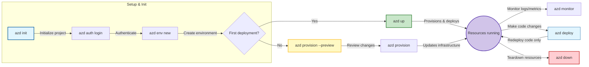
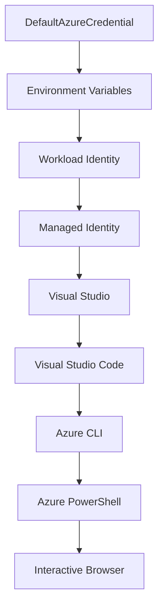

# Основи AZD - Основні концепції та фундаментальні поняття

**Навігація по розділах:**
- **📚 Головна сторінка курсу**: [AZD для початківців](../../README.md)
- **📖 Поточний розділ**: Розділ 1 - Основи і швидкий старт
- **⬅️ Попередній**: [Огляд курсу](../../README.md#-chapter-1-foundation--quick-start)
- **➡️ Наступний**: [Встановлення та налаштування](installation.md)
- **🚀 Наступний розділ**: [Розділ 2: Розробка з пріоритетом AI](../chapter-02-ai-development/microsoft-foundry-integration.md)

## Вступ

> Перевірено з використанням `azd 1.37.2` (листопад 2026). Bash-команди використовують позначки в лапках, які потрібно замінити. Шаблони робочих процесів використовують `.` для ініціалізації поточного каталогу; без аргументу каталогу ініціалізація шаблону створює підкаталог і не змінює робочий каталог оболонки. Розширені фрагменти є ілюстративними, а не повними проєктами.

У цьому уроці ви ознайомитесь із Azure Developer CLI (azd) — потужним інструментом командного рядка, який прискорює ваш шлях від локальної розробки до розгортання в Azure. Ви дізнаєтеся основні концепції, ключові функції та зрозумієте, як azd спрощує розгортання хмарних додатків.

## Мети навчання

До кінця уроку ви:
- Зрозумієте, що таке Azure Developer CLI і для чого він призначений
- Вивчите основні поняття шаблонів, середовищ і сервісів
- Ознайомитесь з ключовими можливостями, включаючи розробку на основі шаблонів і Infrastructure as Code
- Зрозумієте структуру проєкту azd та робочі процеси
- Будете готові встановити і налаштувати azd у вашому середовищі розробки

## Результати навчання

Після завершення уроку ви зможете:
- Пояснити роль azd у сучасних робочих процесах хмарної розробки
- Визначити компоненти структури проєкту azd
- Описати, як працюють шаблони, середовища та сервіси разом
- Зрозуміти переваги Infrastructure as Code з azd
- Розпізнати різні команди azd та їх призначення

## Що таке Azure Developer CLI (azd)?

Azure Developer CLI (azd) — інструмент командного рядка, розроблений для прискорення вашого шляху від локальної розробки до розгортання в Azure. Він спрощує процес створення, розгортання та управління хмарними нативними додатками в Azure.

### Що можна розгортати за допомогою azd?

azd підтримує широкий спектр робочих навантажень — і цей список постійно зростає. Сьогодні ви можете використати azd, щоб розгорнути:

| Тип навантаження | Приклади | Один робочий процес? |
|---------------|----------|----------------|
| **Традиційні додатки** | Веб-додатки, REST API, статичні сайти | ✅ `azd up` |
| **Сервіси та мікросервіси** | Container Apps, Function Apps, багатосервісні бекенди | ✅ `azd up` |
| **Додатки на основі ШІ** | Чат-додатки з Microsoft Foundry Models, RAG-рішення з AI Search | ✅ `azd up` |
| **Інтелектуальні агенти** | Агенти, що розгортаються на Foundry, багатокористувацькі оркестрації | ✅ `azd up` |

Ключова ідея полягає в тому, що **цикл життя azd залишається однаковим, незалежно від того, що ви розгортаєте**. Ви ініціалізуєте проєкт, забезпечуєте інфраструктуру, розгортаєте код, моніторите додаток і прибираєте — незалежно від того, чи це простий веб-сайт, чи складний AI-агент.

Це безперервність спланована заздалегідь. azd розглядає можливості AI як ще один вид сервісу, який ваш додаток може використовувати, а не щось принципово інше. Точка доступу для чату на основі Microsoft Foundry Models з точки зору azd — це просто ще один сервіс для налаштування і розгортання.

### 🎯 Чому варто використовувати AZD? Порівняння на практиці

Порівняймо розгортання простого веб-додатку з базою даних:

#### ❌ БЕЗ AZD: Ручне розгортання в Azure (понад 30 хвилин)

**Ілюстративне порівняння Bash, не запусковий стартовий додаток.** Передбачається наявність коду додатка, унікальних імен ресурсів, автентифікація в Azure CLI та всі необхідні розширення CLI. Використовуйте наведене нижче завдання з шаблоном для підтримуваного повного шляху.

```bash
# Step 1: Create resource group
az group create --name myapp-rg --location eastus

# Step 2: Create App Service Plan
az appservice plan create --name myapp-plan \
  --resource-group myapp-rg \
  --sku B1 --is-linux

# Step 3: Create Web App
az webapp create --name myapp-web-unique123 \
  --resource-group myapp-rg \
  --plan myapp-plan \
  --runtime "NODE:22-lts"

# Step 4: Create Cosmos DB account (10-15 minutes)
az cosmosdb create --name myapp-cosmos-unique123 \
  --resource-group myapp-rg \
  --kind MongoDB

# Step 5: Create database
az cosmosdb mongodb database create \
  --account-name myapp-cosmos-unique123 \
  --resource-group myapp-rg \
  --name tododb

# Step 6: Create collection
az cosmosdb mongodb collection create \
  --account-name myapp-cosmos-unique123 \
  --resource-group myapp-rg \
  --database-name tododb \
  --name todos

# Step 7: Get connection string
CONN_STR=$(az cosmosdb keys list \
  --name myapp-cosmos-unique123 \
  --resource-group myapp-rg \
  --type connection-strings \
  --query "connectionStrings[0].connectionString" -o tsv)

# Step 8: Configure app settings
az webapp config appsettings set \
  --name myapp-web-unique123 \
  --resource-group myapp-rg \
  --settings MONGODB_URI="$CONN_STR"

# Step 9: Enable logging
az webapp log config --name myapp-web-unique123 \
  --resource-group myapp-rg \
  --application-logging filesystem \
  --detailed-error-messages true

# Step 10: Set up Application Insights
az monitor app-insights component create \
  --app myapp-insights \
  --location eastus \
  --resource-group myapp-rg

# Step 11: Link App Insights to Web App
INSTRUMENTATION_KEY=$(az monitor app-insights component show \
  --app myapp-insights \
  --resource-group myapp-rg \
  --query "instrumentationKey" -o tsv)

az webapp config appsettings set \
  --name myapp-web-unique123 \
  --resource-group myapp-rg \
  --settings APPINSIGHTS_INSTRUMENTATIONKEY="$INSTRUMENTATION_KEY"

# Step 12: Build application locally
npm install
npm run build

# Step 13: Create deployment package
zip -r app.zip . -x "*.git*" "node_modules/*"

# Step 14: Deploy application
az webapp deployment source config-zip \
  --resource-group myapp-rg \
  --name myapp-web-unique123 \
  --src app.zip

# Step 15: Wait and pray it works 🙏
# (No automated validation, manual testing required)
```

**Проблеми:**
- ❌ Потрібно пам’ятати та виконувати понад 15 команд послідовно
- ❌ 30-45 хвилин ручної роботи
- ❌ Легко зробити помилку (опечатки, неправильні параметри)
- ❌ Обробка облікових даних потребує явного управління; журнали налагодження і трасування оболонки можуть їх розкрити
- ❌ Відсутній автоматичний відкат у разі помилки
- ❌ Важко відтворити для інших учасників команди
- ❌ Кожного разу по-різному (неможливо відтворити)

#### ✅ З AZD: Автоматизоване розгортання (5 команд, 10-15 хвилин)

```bash
# Step 1: Initialize from template
azd init --template todo-nodejs-mongo .

# Step 2: Authenticate
azd auth login

# Step 3: Select the environment created during init
azd env select dev

# Step 4: Preview changes (optional but recommended)
azd provision --preview

# Step 5: Deploy everything
azd up

# ✨ Done! Everything is deployed, configured, and monitored
```

**Переваги:**
- ✅ **5 команд** проти 15+ ручних кроків
- ✅ **10-15 хвилин** загальний час (здебільшого очікування Azure)
- ✅ **Менше ручних помилок** — послідовний, керований шаблонами робочий процес
- ✅ **Безпечне управління секретами** — багато шаблонів використовують сховище секретів, кероване Azure
- ✅ **Повторюване розгортання** — той самий робочий процес щоразу
- ✅ **Повторюване визначення інфраструктури** — залежить від квот, доступності регіону і версій шаблонів
- ✅ **Готовність для команди** — будь-хто може розгорнути однаковими командами
- ✅ **Infrastructure as Code** — шаблони Bicep під керуванням версій
- ✅ **Моніторинг, визначений у шаблоні** — Application Insights, якщо включений у шаблон

### Час і надійність

Вказані часи — це оцінки, а не еталони. azd зменшує кількість команд, які потрібно координувати, але не гарантує тривалість розгортання, не усуває помилки і не забезпечує автоматичний відкат додатка чи бази даних. Зберігайте робочі версії у системі контролю версій і тестуйте процедури відновлення.

## Основні поняття

### Шаблони
Шаблони становлять основу azd. Вони містять:
- **Код додатка** — ваш вихідний код та залежності
- **Визначення інфраструктури** — ресурси Azure, описані Bicep або Terraform
- **Файли конфігурації** — налаштування та змінні середовища
- **Сценарії розгортання** — автоматизовані робочі процеси розгортання

### Середовища
Середовища представляють різні цілі розгортання:
- **Розробка** — для тестування та розробки
- **Проміжне** — передвиробниче середовище
- **Виробниче** — робоче середовище

Кожне середовище підтримує власні:
- Назву та значення середовища; ізоляція ресурсів залежить від шаблону інфраструктури
- Настройки конфігурації
- Стан розгортання

### Сервіси
Сервіси в `azure.yaml` описують компоненти додатка, які можна розгорнути:
- **Фронтенд** — веб-додатки, SPA
- **Бекенд** — API, мікросервіси

Бази даних та сховища зазвичай забезпечуються як ресурси інфраструктури, а не як хости сервісів, наприклад `host: postgres`.

## Ключові функції

### 1. Розробка на основі шаблонів
```bash
# Browse available templates
azd template list

# Initialize from a template
azd init --template "<template-name>" .
```

### 2. Інфраструктура як код
- **Bicep** — специфічна мова Azure
- **Terraform** — інструмент для мультихмарної інфраструктури
- Bicep компілюється у ARM-шаблони; безпосередній ARM JSON не є окремим вбудованим `infra.provider`.

### 3. Інтегровані робочі процеси
```bash
# Complete deployment workflow
azd up            # Provision + Deploy this is hands off for first time setup

# 🧪 NEW: Preview infrastructure changes before deployment (SAFE)
azd provision --preview    # Simulate infrastructure deployment without making changes

azd provision     # Create Azure resources if you update the infrastructure use this
azd deploy        # Deploy application code or redeploy application code once update
azd down          # Clean up resources
```

#### 🛡️ Безпечне планування інфраструктури з попереднім переглядом
Команда `azd provision --preview` — це прорив для безпечного розгортання:
- **Аналіз dry-run** — показує, що буде створено, змінено або видалено
- **Без застосування інфраструктури** — переглядає зміни провайдера; спершу перевірте хуки проєкту, оскільки хуки можуть запускати команди з побічними ефектами
- **Співпраця в команді** — діліться результатами перегляду перед розгортанням
- **Вхідні дані для планування витрат** — перегляньте запропоновані SKU, потім порахуйте вартість в Azure Pricing Calculator; перегляд не обчислює ціни

```bash
# Example preview workflow
azd provision --preview           # See what will change
# Review the output, discuss with team
azd provision                     # Apply changes with confidence
```

### 📊 Візуалізація: Робочий процес розробки AZD



**Пояснення робочого процесу:**
1. **Init** — початок з шаблону або нового проєкту
2. **Auth** — автентифікація в Azure
3. **Environment** — створення ізольованого середовища розгортання
4. **Preview** — 🆕 Завжди спочатку переглядайте зміни інфраструктури (безпечна практика)
5. **Provision** — створення/оновлення ресурсів Azure
6. **Deploy** — розгортання коду додатка
7. **Monitor** — спостереження за продуктивністю додатка
8. **Iterate** — внесення змін і повторне розгортання коду
9. **Cleanup** — видалення ресурсів після завершення

### 4. Управління середовищами
```bash
# Create and manage environments
azd env new "<environment-name>"
azd env select "<environment-name>"
azd env list
```

### 5. Розширення та команди AI

azd використовує систему розширень для додавання можливостей поза основним CLI. Це особливо корисно для робочих навантажень AI:

```bash
# List available extensions
azd extension list

# Install the GA Foundry bundle (requires azd >= 1.37.0)
azd ext install microsoft.foundry

# Initialize an AI agent project interactively
azd ai agent init

# Test a deployed agent (shows latency and time-to-first-byte)
azd ai agent invoke

# Start the MCP server for AI-assisted development (Alpha)
azd mcp start
```

**Життєвий цикл агента від початку до кінця.** GA-бандл `microsoft.foundry` включає `azure.ai.agents` та ще шість інших основних розширень. Встановлюйте `azure.ai.evaluations` окремо для оцінки. Використовуйте `azd >= 1.37.0` для цього робочого процесу. Не потрібно всі з них одразу:

| Етап | Команда | Що робить |
|-------|---------|--------------|
| **Створення за шаблоном** | `azd ai agent init --template <path-to-azure.yaml>` | Використовує поточний шаблон агента |
| **Локальний запуск** | `azd ai agent run`, потім `azd ai agent invoke --local "Test prompt"` в іншому терміналі | Перевіряє локальну активність в Agent Inspector; виклики моделей все ще через Azure |
| **Розгортання** | `azd deploy` | Для агентів у кодовому режимі, завантажує вихідний код для віддаленої збірки Foundry |
| **Тестування** | `azd ai agent invoke` | Викликає агента і показує час відповіді |
| **Вимірювання** | `azd ai eval init`, `generate`, `run start` | Налаштовує, розгортає і виконує оцінки за допомогою окремого розширення |
| **Оптимізація** | `azd ai agent optimize --eval <evaluation-name> --optimize-model <optimizer-deployment>` | Повторно використовує сумісний тест для оптимізації агента |
| **Інспекція** | `azd ai agent endpoint show` | Перегляд конфігурації активної точки доступу |
| **Очищення** | `azd ai agent delete` | Видалення розміщеного агента та всіх його версій |

> Почніть з [покрокового підручника GA hosted-agent](../chapter-02-ai-development/microsoft-foundry-integration.md#hosted-agent-walkthrough-ga), який охоплює передумови, забезпечення та безпечне очищення. Розширення розглядаються докладніше в довіднику [AZD AI CLI Commands](../chapter-08-production/production-ai-practices.md#azd-ai-cli-commands-and-extensions).

## 📁 Структура проєкту

Типова структура проєкту azd:
```
my-app/
├── .azure/                  # Local environments and selected-environment config
│   ├── config.json
│   └── dev/.env
├── .devcontainer/          # Development container config
├── .github/workflows/      # GitHub Actions
├── .vscode/               # VS Code settings
├── infra/                 # Infrastructure code
│   ├── main.bicep        # Main infrastructure template
│   ├── main.parameters.json
│   └── modules/          # Reusable modules
├── src/                  # Application source code
│   ├── api/             # Backend services
│   └── web/             # Frontend application
├── azure.yaml           # azd project configuration
└── README.md
```

## 🔧 Файли конфігурації

### azure.yaml
Основний файл конфігурації проєкту:
```yaml
name: my-awesome-app
metadata:
  template: my-template@1.0.0

services:
  web:
    project: ./src/web
    language: js
    host: appservice
  api:
    project: ./src/api
    language: js
    host: appservice

hooks:
  preprovision:
    shell: pwsh
    run: echo "Preparing to provision..."
```

### .azure/config.json
Місцевий вибір стандартного середовища для проєкту (ілюстративно; керується azd):
```json
{
  "defaultEnvironment": "dev"
}
```

## 🎪 Поширені робочі процеси з практичними вправами

> **💡 Порада:** Виконуйте ці вправи по порядку, щоб поступово розвивати навички роботи з AZD.

### 🎯 Вправа 1: Ініціалізація вашого першого проєкту

**Мета:** Створити проєкт AZD і ознайомитися з його структурою

**Кроки:**
```bash
# Use a proven template
mkdir azd-basics-practice
cd azd-basics-practice
# Choose "dev" for the environment name when prompted
azd init --template todo-nodejs-mongo .

# Explore the generated files
ls -la  # View all files including hidden ones

# Key files created:
# - azure.yaml (main config)
# - infra/ (infrastructure code)
# - src/ (application code)
```

**✅ Успіх:** Ви маєте каталоги azure.yaml, infra/ і src/

---

### 🎯 Вправа 2: Розгортання в Azure

**Мета:** Виконати повне розгортання від початку до кінця

**Кроки:**
```bash
# 1. Authenticate
azd auth login

# 2. Select the dev environment created in Exercise 1
azd env select dev
azd env set AZURE_LOCATION eastus

# 3. Preview changes (RECOMMENDED)
azd provision --preview

# 4. Deploy everything
azd up

# 5. Verify deployment
azd show    # View your app URL
```

**Очікуваний час:** 10-15 хвилин  
**✅ Успіх:** URL додатка відкривається у браузері

---

### 🎯 Вправа 3: Кілька середовищ

**Мета:** Розгорнути в dev і staging

**Кроки:**
```bash
# Already have dev, create staging
azd env new staging
azd env set AZURE_LOCATION westus2
azd up

# Switch between them
azd env list
azd env select dev
```

**✅ Успіх:** Дві окремі групи ресурсів в Azure Portal

**Очищення:** Вправа 3 створює друге оплачуване розгортання. Видаліть обидва після завершення:

```bash
azd down --environment dev
azd down --environment staging
```

---

### 🛡️ Руйнувальне очищення: `azd down --force --purge`

Коли ви свідомо хочете видалити ресурси Azure вибраного середовища:

```bash
azd down --force --purge
```

**Що робить:**
- `--force`: Без підказок підтвердження
- `--purge`: Також назавжди видаляє підтримувані ресурси з пом’якшеним видаленням (наприклад, Key Vault), якщо дозволяє захист від очищення. Не видаляє локальний каталог `.azure/`.

**Використовуйте, коли:** завершили з використанням тимчасового середовища. Не використовуйте руйнувальне очищення як першу реакцію на помилки автентифікації, квот або конфігурації.

---

## 🎪 Посилання на оригінальний робочий процес

### Початок нового проєкту
```bash
# Method 1: Use existing template
azd init --template todo-nodejs-mongo .

# Method 2: Start from scratch
azd init

# Method 3: Use current directory
azd init .
```

### Цикл розробки
```bash
# Set up development environment
azd auth login
azd env new dev
azd env select dev

# Deploy everything
azd up

# Make changes and redeploy
azd deploy

# Clean up when done
azd down --force --purge # Deletes this environment's discovered Azure resources; review before forcing deletion.
```

## Розуміння `azd down --force --purge`
Команда `azd down --force --purge` — потужний спосіб повністю зруйнувати ваше середовище azd та всі пов’язані ресурси. Ось пояснення, що робить кожен прапорець:
```
--force
```
- Пропускає підказки підтвердження.
- Корисно для автоматизації або сценаріїв, де ручне введення неможливе.
- Не обходить права доступу, захист від очищення або помилки видалення.

```
--purge
```
Безповоротно видаляє підтримувані ресурси Azure, які були м’яко видалені, без додаткового підтвердження. Все одно діє захист від очищення та права доступу. Це **не** видаляє локальні середовища або папку `.azure/`.


### Чому використовувати обидва?
Використовуйте обидва лише якщо плануєте видалити ресурси Azure вибраного середовища та очистити ресурси, які можна відновити. Це руйнівне прибирання, а не загальний ремонт чи скидання локального стану.

Особливо корисно після ручного видалення ресурсів в Azure порталі або при перемиканні шаблонів, середовищ чи конвенцій найменування груп ресурсів.


### Управління кількома середовищами
```bash
# Create staging environment
azd env new staging
azd env select staging
azd up

# Switch back to dev
azd env select dev

# Compare environments
azd env list
```

## 🔐 Аутентифікація та облікові дані

Розрізняйте автентифікацію розгортання (`azd auth login`) та аутентифікацію SDK додатка (`DefaultAzureCredential`). Вони окремі. azd за замовчуванням не використовує облікові дані Azure CLI.

### Аутентифікація Azure CLI (`az login`)

Виконайте `azd auth login` для azd. Наступні команди Azure CLI є необов’язковими та автентифікують команди `az` окремо:

```bash
# Interactive login (opens browser)
az login

# Login with specific tenant
az login --tenant "<tenant-id>"

# Login with service principal
az login --service-principal -u "<app-id>" -p "<password>" --tenant "<tenant-id>"

# Check current login status
az account show

# List available subscriptions
az account list --output table

# Set default subscription
az account set --subscription "<subscription-id>"
```

### Процес аутентифікації
1. **Інтерактивний вхід**: Відкриває ваш браузер за замовчуванням для аутентифікації
2. **Потік коду пристрою**: для середовищ без доступу до браузера
3. **Сервісний принципал**: для сценаріїв автоматизації та CI/CD
4. **Керована ідентичність**: для застосунків, розміщених в Azure

### Ланцюжок DefaultAzureCredential

`DefaultAzureCredential` — це тип облікових даних, який забезпечує спрощений досвід аутентифікації, автоматично намагаючись кілька джерел облікових даних у визначеному порядку:

#### Ланцюжок облікових даних SDK застосунку

Точний ланцюжок залежить від мови SDK Azure Identity, версії, встановлених плагінів і налаштувань. Ця діаграма є концептуальною, а не фіксованою послідовністю аутентифікації azd; у новіших SDK також можуть бути облікові дані Azure Developer CLI.


#### 1. Змінні середовища
```bash
# Set environment variables for service principal
export AZURE_CLIENT_ID="<app-id>"
export AZURE_CLIENT_SECRET="<password>"
export AZURE_TENANT_ID="<tenant-id>"
```

#### 2. Ідентичність робочого навантаження (Kubernetes/GitHub Actions)
Використовується автоматично у:
- Azure Kubernetes Service (AKS) з ідентичністю робочого навантаження
- GitHub Actions з федерацією OIDC
- Інші сценарії федеративної ідентифікації

#### 3. Керована ідентичність
Для ресурсів Azure, таких як:
- Віртуальні машини
- App Service
- Azure Functions
- Container Instances

```bash
# Inspect a deployed Container App's configured identity (requires az login)
az containerapp show --name "<app-name>" --resource-group "<rg-name>" --query identity
```

#### 4. Інтеграція з інструментами розробника
- **Visual Studio**: автоматично використовує обліковий запис, що ввійшов
- **VS Code**: підтримка залежить від SDK та налаштувань брокера/плагінів
- **Azure CLI**: використовує облікові дані `az login` (найпоширеніше для локальної розробки)

### Налаштування автентифікації AZD

```bash
# Method 1: Direct azd authentication (recommended)
azd auth login

# Method 2: Direct azd authentication
azd auth login --use-device-code  # For headless environments

# Method 3: Check authentication status
azd auth login --check-status

# Method 4: Logout and re-authenticate
azd auth logout
azd auth login
```

### Кращі практики автентифікації

#### Для локальної розробки
```bash
# 1. Log in to azd
azd auth login

# 2. Select the subscription for this initialized environment
azd env set AZURE_SUBSCRIPTION_ID "<subscription-id>"

# 3. Check azd sign-in details (read the status message)
azd auth login --check-status
```

#### Для CI/CD конвеєрів
```yaml
# Partial GitHub Actions steps: assumes checkout, azd installation,
# required AZURE_* environment values, and pipeline secret configuration.
- name: Deploy with azd
  run: |
    azd auth login --client-id ${{ secrets.AZURE_CLIENT_ID }} \
                    --client-secret ${{ secrets.AZURE_CLIENT_SECRET }} \
                    --tenant-id ${{ secrets.AZURE_TENANT_ID }}
    azd up --no-prompt
```

#### Для продуктивного середовища
- Використовуйте **керовану ідентичність**, коли працюєте на ресурсах Azure
- Використовуйте **сервісний принципал** для сценаріїв автоматизації
- Уникайте зберігання облікових даних у коді або файлах конфігурації
- Використовуйте **Azure Key Vault** для конфіденційних налаштувань

### Поширені проблеми автентифікації та рішення

#### Проблема: «Підписка не знайдена»
```bash
# Solution: Set default subscription
az account list --output table
az account set --subscription "<subscription-id>"
azd env set AZURE_SUBSCRIPTION_ID "<subscription-id>"
```

#### Проблема: «Недостатньо прав»
```bash
# Solution: Check and assign required roles
az role assignment list --assignee $(az account show --query user.name --output tsv)

# Common required roles:
# - Contributor (for resource management)
# - User Access Administrator (for role assignments)
```

#### Проблема: «Термін дії токена минув»
```bash
# Solution: Re-authenticate
az logout
az login
azd auth logout
azd auth login
```

### Автентифікація в різних сценаріях

#### Локальна розробка
```bash
# Personal development account
az login
azd auth login
```

#### Командна розробка
```bash
# Use specific tenant for organization
az login --tenant contoso.onmicrosoft.com
azd auth login --tenant-id "<tenant-id>"
```

#### Багатокористувацькі сценарії
```bash
# Switch between tenants
az login --tenant tenant1.onmicrosoft.com
azd auth login --tenant-id "<tenant-1-id>"
# Select an environment configured with tenant 1's subscription
azd env select tenant1-dev
# Deploy to tenant 1
azd up

az login --tenant tenant2.onmicrosoft.com  
azd auth login --tenant-id "<tenant-2-id>"
azd env select tenant2-dev
# Deploy to tenant 2
azd up
```

### Вимоги безпеки

1. **Зберігання облікових даних**: ніколи не зберігайте облікові дані у вихідному коді
2. **Обмеження сфери дії**: використовуйте принцип мінімальних привілеїв для сервісних принципалів
3. **Ротація токенів**: регулярно оновлюйте секрети сервісного принципала
4. **Аудит**: відстежуйте дії автентифікації та розгортання
5. **Мережева безпека**: за можливості використовуйте приватні кінцеві точки

### Усунення неполадок автентифікації

```bash
# Debug authentication issues
azd auth login --check-status
az account show
az account get-access-token

# Common diagnostic commands
whoami                          # Current user context
az ad signed-in-user show      # Microsoft Entra ID user details
az group list                  # Test resource access
```

## Виявлення команд

### Виявлення
```bash
azd template list              # Browse templates
azd template list --help       # Template discovery options
azd init --help               # Initialization options
```

### Управління проектом
```bash
azd show                     # Project overview
azd env list                # Available environments and selected default
azd config show            # Configuration settings
```

### Моніторинг
```bash
azd monitor                  # Open Azure portal monitoring
azd monitor --logs           # View application logs
azd monitor --live           # View live metrics
azd pipeline config          # Set up CI/CD
```

## Кращі практики

### 1. Використовуйте значущі назви
```bash
# Good
azd env new production-east
azd init --template todo-nodejs-mongo .

# Avoid
azd env new env1
azd init --template template1 .
```

### 2. Використовуйте шаблони
- Починайте з наявних шаблонів
- Налаштовуйте під ваші потреби
- Створюйте повторно використовувані шаблони для вашої організації

### 3. Ізоляція середовища
- Використовуйте окремі середовища для розробки/тестування/продуктування
- Ніколи не розгортайте напряму до продуктивного середовища з локальної машини
- Використовуйте CI/CD конвеєри для розгортання в продуктив

### 4. Управління конфігурацією
- Використовуйте керовану ідентичність і Key Vault для секретів; звичайні `azd env set` значення зберігаються локально у відкритому вигляді
- Тримайте конфігурацію під контролем версій
- Документуйте налаштування для конкретного середовища

## Прогрес навчання

### Початковий рівень (тиждень 1-2)
1. Встановіть azd та авторизуйтесь
2. Розгорніть простий шаблон
3. Зрозумійте структуру проекту
4. Вивчіть базові команди (up, down, deploy)

### Середній рівень (тиждень 3-4)
1. Налаштуйте шаблони
2. Керуйте кількома середовищами
3. Зрозумійте інфраструктурний код
4. Налаштуйте CI/CD конвеєри

### Розширений рівень (тиждень 5+)
1. Створюйте власні шаблони
2. Складні шаблони інфраструктури
3. Розгортання в кількох регіонах
4. Конфігурації корпоративного рівня

## Наступні кроки

**📖 Продовжуйте вивчення розділу 1:**
- [Встановлення та налаштування](installation.md) - Встановіть і налаштуйте azd
- [Ваш перший проект](first-project.md) - Завершіть практичний урок
- [Посібник з конфігурації](../chapter-03-configuration/configuration.md) - Розширені налаштування

**🎯 Готові до наступного розділу?**
- [Розділ 2: Розробка з акцентом на штучний інтелект](../chapter-02-ai-development/microsoft-foundry-integration.md) - Почніть створювати AI-застосунки

## Додаткові ресурси

- [Огляд Azure Developer CLI](https://learn.microsoft.com/en-us/azure/developer/azure-developer-cli/)
- [Галерея шаблонів](https://azure.github.io/awesome-azd/)
- [Приклади спільноти](https://github.com/Azure-Samples)

---

## 🙋 Часті питання

### Загальні питання

**П: У чому різниця між AZD і Azure CLI?**

В: Azure CLI (`az`) призначений для управління окремими ресурсами Azure. AZD (`azd`) — для управління цілими застосунками:

```bash
# Azure CLI - Low-level resource management
az webapp create --name myapp --resource-group rg
az sql server create --name myserver --resource-group rg
# ...many more commands needed

# AZD - Application-level management
azd up  # Deploys entire app with all resources
```

**Уявіть це так:**
- `az` = Керування окремими кубиками Lego
- `azd` = Робота з повними наборами Lego

---

**П: Чи потрібно знати Bicep або Terraform, щоб використовувати AZD?**

В: Ні! Почніть з шаблонів:
```bash
# Use existing template - no IaC knowledge needed
azd init --template todo-nodejs-mongo .
azd up
```

Пізніше можна вивчити Bicep для налаштування інфраструктури. Шаблони дають працюючі приклади для навчання.

---

**П: Скільки коштує запуск шаблонів AZD?**

В: Вартість залежить від регіону, SKU, часу роботи, режиму бази даних і використання моделей. Навіть у стані бездіяльності середовище розробки може накопичувати значні щомісячні витрати; не вірте універсальному діапазону $50-150:

```bash
# Preview resource changes (not prices)
azd provision --preview

# Always cleanup when not using
azd down --force --purge  # Removes all resources
```

**Порада від професіоналів:** використовуйте безкоштовні рівні, де вони є:
- App Service: рівень F1 (безкоштовний)
- Azure OpenAI: немає гарантованої загальної щомісячної безкоштовної кількості токенів; перевіряйте поточні моделі та ціни
- Cosmos DB: кваліфіковані акаунти з provisioned throughput можуть увімкнути безкоштовний рівень; серверлес шаблони не завжди підходять автоматично

---

**П: Чи можна використовувати AZD з існуючими ресурсами Azure?**

В: Так, але легше почати з чистого аркуша. AZD найкраще працює, коли управляє повним життєвим циклом. Для існуючих ресурсів:

```bash
# Option 1: Import existing resources (advanced)
azd init
# Then modify infra/ to reference existing resources

# Option 2: Start fresh (recommended)
azd init --template "<verified-template-name>" .
azd up  # Creates new environment
```

---

**П: Як поділитися своїм проектом з колегами?**

В: Збережіть проект AZD у Git (але НЕ папку .azure):

```bash
# Already in .gitignore by default
.azure/        # Contains secrets and environment data
*.env          # Environment variables

# Team members then:
git clone "<your-repo>"
# Change into the cloned repository before running the remaining commands.
azd auth login
azd env new "<their-name>-dev"
azd up
```

Усі отримують однакову інфраструктуру з однакових шаблонів.

---

### Питання щодо усунення неполадок

**П: «azd up» не вдалося дійти до кінця. Що робити?**

В: Перевірте помилку, виправте і спробуйте знову:

```bash
# Capture detailed diagnostics (redact sensitive values before sharing)
azd up --debug

# Common fixes:

# 1. If quota exceeded:
azd env set AZURE_LOCATION "westus2"  # Try different region

# 2. If resource name conflict:
azd down --force --purge  # Clean slate
azd up  # Retry

# 3. If auth expired:
az login
azd auth login
azd up
```

**Найпоширеніша проблема:** Вибрана неправильна підписка Azure
```bash
az account list --output table
az account set --subscription "<correct-subscription>"
azd env set AZURE_SUBSCRIPTION_ID "<correct-subscription-id>"
```

---

**П: Як розгорнути лише зміни коду без повторного створення інфраструктури?**

В: Використовуйте `azd deploy` замість `azd up`:

```bash
azd up          # First time: provision + deploy (slow)

# Make code changes...

azd deploy      # Subsequent times: deploy only (fast)
```

Порівняння швидкості:
- `azd up`: 10-15 хвилин (створює інфраструктуру)
- `azd deploy`: 2-5 хвилин (тільки код)

---

**П: Чи можу я налаштовувати шаблони інфраструктури?**

В: Так! Редагуйте файли Bicep у `infra/`:

```bash
# After azd init
cd infra/
code main.bicep  # Edit in VS Code

# Preview changes
azd provision --preview

# Apply changes
azd provision
```

**Порада:** Починайте з малого — спершу змініть SKU:
```bicep
// infra/main.bicep
sku: {
  name: 'B1'  // Change to 'P1V2' for production
}
```

---

**П: Як видалити все, що створив AZD?**

В: Одна команда видаляє всі ресурси:

```bash
azd down --force --purge

# This deletes:
# - Azure resources/resource groups discovered for the selected environment
# - Supported soft-deleted resources, if purge protection allows
# Local .azure files remain; shared/external resources may remain too.
```

**Завжди запускайте її, коли:**
- Закінчили тестування шаблону
- Переходите до іншого проекту
- Бажаєте почати спочатку

**Перевірка вартості:** Підтвердіть видалення в Azure і перевірте наявність утримуваних/спільних ресурсів. Раніше нараховані витрати зберігаються.

---

**П: Що робити, якщо випадково видалив ресурси в Azure Portal?**

В: Стан AZD може бути несинхронним. Підхід чистого аркуша:

```bash
# 1. Delete remaining resources only if that is your intent
azd down --force --purge

# 2. Start fresh
azd up

# Alternative: Let AZD detect and fix
azd provision  # Will create missing resources
```

---

### Розширені питання

**П: Чи можна використовувати AZD у CI/CD конвеєрах?**

В: Так! Приклад GitHub Actions:

```yaml
# .github/workflows/deploy.yml
name: Deploy with AZD

on:
  push:
    branches: [main]

jobs:
  deploy:
    runs-on: ubuntu-latest
    steps:
      - uses: actions/checkout@v4
      
      - name: Install azd
        run: curl -fsSL https://aka.ms/install-azd.sh | bash
      
      - name: Azure Login
        run: |
          azd auth login \
            --client-id ${{ secrets.AZURE_CLIENT_ID }} \
            --client-secret ${{ secrets.AZURE_CLIENT_SECRET }} \
            --tenant-id ${{ secrets.AZURE_TENANT_ID }}
      
      - name: Deploy
        env:
          AZURE_ENV_NAME: dev
          AZURE_LOCATION: ${{ vars.AZURE_LOCATION }}
          AZURE_SUBSCRIPTION_ID: ${{ vars.AZURE_SUBSCRIPTION_ID }}
        run: azd up --no-prompt
```

---

**П: Як працювати з секретами та конфіденційними даними?**

В: Використовуйте Key Vault явно. `azd env set` записує звичайні значення у локальний файл середовища; автоматично він не створює сховище, не призначає ролі та не інжектує секрети у ваш застосунок.

```bash
# Interactive: create/select a Key Vault secret and save its reference
azd env set-secret DATABASE_PASSWORD
```

Вам потрібні відповідні дозволи на сховище. Ваша інфраструктура/застосунок повинні пов'язувати секрет із споживачем і надавати доступ ідентичності часу виконання. Не виводьте розкриті значення секретів у логах.

**Ніколи не комітіть:**
- Папку `.azure/` (містить дані середовища)
- Файли `.env` (локальні секрети)
- Рядки підключення

---

**П: Чи можна розгортати в кількох регіонах?**

В: Так, створюйте середовище для кожного регіону:

```bash
# East US environment
azd env new prod-eastus
azd env set AZURE_LOCATION eastus
azd up

# West Europe environment
azd env new prod-westeurope
azd env set AZURE_LOCATION westeurope
azd up

# Each environment is independent
azd env list
```

Для справжніх багаторегіональних застосунків налаштовуйте шаблони Bicep для одночасного розгортання в декількох регіонах.

---

**П: Де можна отримати допомогу, якщо застряг?**

1. **Документація AZD:** https://learn.microsoft.com/azure/developer/azure-developer-cli/
2. **GitHub Issues:** https://github.com/Azure/azure-dev/issues
3. **Discord:** [Azure Discord](https://discord.gg/microsoft-azure) — канал #azure-developer-cli
4. **Stack Overflow:** Тег `azure-developer-cli`
5. **Цей курс:** [Посібник з усунення неполадок](../chapter-07-troubleshooting/common-issues.md)

**Порада від професіоналів:** Перед тим як запитати, виконайте:
```bash
azd show       # Shows current state
azd version    # Shows your version
```
Включіть цю інформацію у запит для швидшої допомоги.

---

## 🎓 Що далі?

Ви тепер розумієте основи AZD. Оберіть свій шлях:

### 🎯 Для початківців:
1. **Наступне:** [Встановлення та налаштування](installation.md) — встановіть AZD на ваш комп’ютер
2. **Потім:** [Ваш перший проект](first-project.md) — розгорніть свій перший застосунок
3. **Практика:** Виконайте всі 3 вправи цього уроку

### 🚀 Для розробників AI:
1. **Перейдіть до:** [Розділ 2: Розробка з акцентом на штучний інтелект](../chapter-02-ai-development/microsoft-foundry-integration.md)
2. **Розгорніть:** У порожньому каталозі проекту почніть з `azd init --template get-started-with-ai-chat .`
3. **Вивчайте:** Працюйте, дублюючи розгортання

### 🏗️ Для досвідчених розробників:
1. **Огляньте:** [Посібник з конфігурації](../chapter-03-configuration/configuration.md) — розширені налаштування
2. **Досліджуйте:** [Інфраструктура як код](../chapter-04-infrastructure/provisioning.md) — глибоке занурення у Bicep
3. **Створюйте:** Власні шаблони для вашого стеку

---

**Навігація по розділах:**
- **📚 Головна сторінка курсу**: [AZD для початківців](../../README.md)
- **📖 Поточний розділ**: Розділ 1 — Основи та швидкий старт  
- **⬅️ Попередній**: [Огляд курсу](../../README.md#-chapter-1-foundation--quick-start)
- **➡️ Наступний**: [Встановлення та налаштування](installation.md)
- **🚀 Наступний розділ**: [Розділ 2: Розробка з акцентом на штучний інтелект](../chapter-02-ai-development/microsoft-foundry-integration.md)

---

<!-- CO-OP TRANSLATOR DISCLAIMER START -->
**Відмова від відповідальності**:
Цей документ було перекладено за допомогою сервісу штучного інтелекту для перекладу [Co-op Translator](https://github.com/Azure/co-op-translator). Хоча ми прагнемо до точності, будь ласка, майте на увазі, що автоматичні переклади можуть містити помилки або неточності. Оригінальний документ рідною мовою слід вважати авторитетним джерелом. Для критично важливої інформації рекомендується професійний людський переклад. Ми не несемо відповідальності за будь-які непорозуміння або неправильні тлумачення, що виникли внаслідок використання цього перекладу.
<!-- CO-OP TRANSLATOR DISCLAIMER END -->