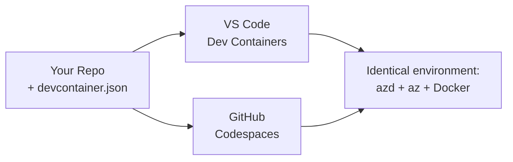

# Дев-контейнери та GitHub Codespaces для azd

**Орієнтація розділу:**
- **📚 Домашня сторінка курсу**: [AZD для початківців](../../README.md)
- **📖 Поточний розділ**: Розділ 1 - Основи та швидкий старт
- **⬅️ Попередній**: [Ваша власна апка](bring-your-own-app.md)
- **🚀 Наступний розділ**: [Розділ 2: Розробка з пріоритетом на ШІ](../chapter-02-ai-development/README.md)

> Мета перегляду команд і конфігурації: `azd 1.37.2` (листопад 2026). Збірки контейнерів і розгортання в Azure не виконувалися під час цього перегляду.

## Вступ

Встановлення azd, відповідного середовища виконання мови, Docker та Azure CLI на кожну машину — це клопітно, і це головна причина, чому навчальний посібник, який "працює на моїй машині", не працює в когось іншого. **Дев-контейнер** вирішує цю проблему, описуючи весь ваш інструментарій у файлі. Кожен, хто відкриває проект у VS Code або GitHub Codespaces, отримує точно таке ж середовище з уже встановленим azd. Цей урок покаже, як додати його.

## Цілі навчання

Наприкінці цього уроку ви:
- Зрозумієте, що таке дев-контейнер і чому він допомагає з azd
- Додасте мінімальний `.devcontainer/devcontainer.json` до проєкту
- Включите azd, Azure CLI та Docker через *фічі* дев-контейнера
- Відкриєте проект у GitHub Codespaces або VS Code

## Результати навчання

Після цього уроку ви зможете:
- Створити `devcontainer.json` для проєкту azd
- Додати azd і Azure інструменти без ручних встановлень
- Запустити `azd up` зсередини контейнера або Codespace

---

## Що таке дев-контейнер?

Дев-контейнер — це середовище розробки на базі Docker, визначене у файлі `.devcontainer/devcontainer.json` у вашому репозиторії. Коли ви відкриваєте проект:

- **VS Code** (з розширенням Dev Containers) збирає контейнер і підключається до нього.
- **GitHub Codespaces** збирає той самий контейнер у хмарі і дає редактор у браузері.

В будь-якому разі, кожен учасник отримує однакові інструменти — без проблем типу "ти встановив azd?".



---

## Крок 1: Створіть файл devcontainer

Створіть `.devcontainer/devcontainer.json` у корені вашого проєкту:

```json
{
  "name": "azd-project",
  "image": "mcr.microsoft.com/devcontainers/base:bookworm",
  "features": {
    "ghcr.io/devcontainers/features/azure-cli:1": {},
    "ghcr.io/azure/azure-dev/azd:0": { "version": "1.37.2" },
    "ghcr.io/devcontainers/features/docker-in-docker:2": {},
    "ghcr.io/devcontainers/features/node:1": {}
  },
  "customizations": {
    "vscode": {
      "extensions": [
        "ms-azuretools.azure-dev",
        "ms-azuretools.vscode-bicep"
      ]
    }
  },
  "forwardPorts": [3000],
  "postCreateCommand": "azd version"
}
```

Що робить кожна частина:

| Ключ | Призначення |
|-----|------------|
| `image` | Базова ОС для контейнера |
| `features` | Попередньо налаштовані інсталятори — тут: Azure CLI, **azd**, Docker і Node.js |
| `customizations.vscode.extensions` | Автоматично встановлює розширення azd та Bicep для VS Code |
| `forwardPorts` | Задає порт вашого додатку для доступу із браузера |
| `postCreateCommand` | Виконується один раз після побудови контейнера (тут — перевірка цілісності) |

> Версія фічі (`azd:0`) і встановлена версія CLI різні. Щоб зафіксувати CLI, виставте в опції `version` значення `"1.37.2"` для фічі; не використовуйте версію CLI як тег фічі.

---

## Крок 2: Підберіть фічу під мову вашого додатку

Замініть фічу `node` на ту, що відповідає мові вашої апки:

```jsonc
// Python project
"ghcr.io/devcontainers/features/python:1": {},

// .NET project
"ghcr.io/devcontainers/features/dotnet:2": {},

// Java project
"ghcr.io/devcontainers/features/java:1": {},

// Go project
"ghcr.io/devcontainers/features/go:1": {}
```

Залишайте `docker-in-docker` при локальній збірці образів. Налаштована віддалена збірка ACR (`docker.remoteBuild: true`) — альтернатива; тип хоста сам по собі не завжди вимагає локального Docker.

---

## Крок 3: Відкрийте контейнер

**У VS Code:**
1. Встановіть розширення **Dev Containers**.
2. Відкрийте папку проєкту.
3. Натисніть **Reopen in Container**, коли з’явиться запит (або виконайте *Dev Containers: Reopen in Container*).

**У GitHub Codespaces:**
1. Запуште репозиторій на GitHub.
2. Натисніть **Code → Codespaces → Create codespace on main**.
3. Чекайте, поки збере контейнер — azd уже готовий у терміналі.

---

## Крок 4: Розгорніть ізсередини контейнера

Контейнер має попередньо встановлений azd, тому звичайний робочий процес просто працює:

```bash
azd auth login --use-device-code   # device code is handy inside Codespaces
azd up
```

> **Чому `--use-device-code`?** У віддаленому контейнері чи Codespace немає локального браузера для редиректу, тому вхід за допомогою device-code — надійний шлях. Ви вставите код у вкладку браузера для завершення авторизації.

---

## Поширені помилки

| Помилка | Виправлення |
|---------|------------|
| `azd up` не може зібрати образ | Додайте фічу `docker-in-docker` |
| Вхід через браузер зависає в Codespaces | Використовуйте `azd auth login --use-device-code` |
| Інструменти відрізняються у членів команди | Зафіксуйте версію CLI через опцію `version` у фічі azd і зафіксуйте runtimes мови |
| Додаток недоступний у браузері | Додайте порт у `forwardPorts` |

---

## Підсумки

- Дев-контейнер робить ваш інструментарій azd відтворюваним для всіх.
- Додайте azd, Azure CLI та Docker через *фічі* дев-контейнера.
- Підберіть фічу мови під вашу апку і зберігайте `docker-in-docker` для хостів контейнера.
- Використовуйте device-code login при роботі в Codespaces.

---

## 🔗 Навігація

| Напрям | Ресурс |
|--------|---------|
| **Попередній** | [Ваша власна апка](bring-your-own-app.md) |
| **Домашня сторінка розділу** | [Розділ 1: Основи та швидкий старт](README.md) |
| **Наступний розділ** | [Розділ 2: Розробка з пріоритетом на ШІ](../chapter-02-ai-development/README.md) |

## 📖 Пов’язані ресурси

- [Встановлення та налаштування](installation.md)
- [Шпаргалка команд](../../resources/cheat-sheet.md)
- [Офіційна специфікація Dev Containers](https://containers.dev/)
- [Фіча azd для Dev Container](https://github.com/Azure/azure-dev/tree/main/ext/devcontainer)

---

<!-- CO-OP TRANSLATOR DISCLAIMER START -->
**Відмова від відповідальності**:
Цей документ було перекладено за допомогою сервісу штучного інтелекту для перекладу [Co-op Translator](https://github.com/Azure/co-op-translator). Хоча ми прагнемо до точності, будь ласка, майте на увазі, що автоматичні переклади можуть містити помилки або неточності. Оригінальний документ рідною мовою слід вважати авторитетним джерелом. Для критично важливої інформації рекомендується професійний людський переклад. Ми не несемо відповідальності за будь-які непорозуміння або неправильні тлумачення, що виникли внаслідок використання цього перекладу.
<!-- CO-OP TRANSLATOR DISCLAIMER END -->