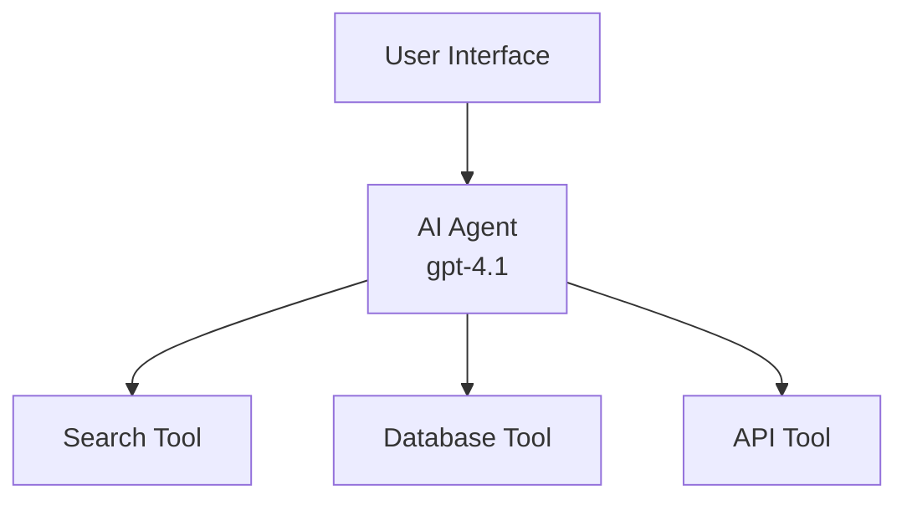
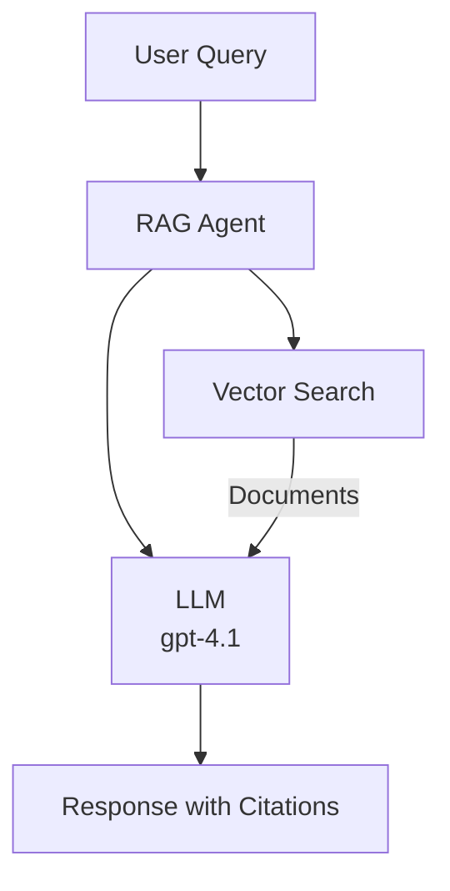
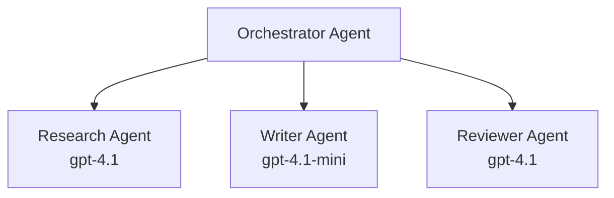

# AI-агенти з Azure Developer CLI

**Навігація по розділах:**
- **📚 Головна сторінка курсу**: [AZD для початківців](../../README.md)
- **📖 Поточний розділ**: Розділ 2 - AI-перший розвиток
- **⬅️ Попередній**: [Інтеграція Microsoft Foundry](microsoft-foundry-integration.md)
- **➡️ Наступний**: [Розгортання AI-моделі](ai-model-deployment.md)
- **🚀 Просунутий**: [Багатоагентні рішення](../../examples/retail-scenario.md)

---

## Вступ

AI-агенти — це автономні програми, які можуть сприймати своє середовище, приймати рішення та виконувати дії для досягнення конкретних цілей. На відміну від простих чатботів, які відповідають на запити, агенти можуть:

- **Використовувати інструменти** - Викликати API, шукати в базах даних, виконувати код
- **Планувати та міркувати** - Розбивати складні завдання на кроки
- **Навчатися з контексту** - Зберігати пам’ять і адаптувати поведінку
- **Співпрацювати** - Працювати з іншими агентами (багатоагентні системи)

Цей посібник показує, як розгортати AI-агентів у Azure за допомогою Azure Developer CLI (azd).

Використання контексту розмови — це не навчання моделі: постійну пам’ять, контроль доступу та збереження слід впроваджувати/налаштовувати в додатку.

> **Оновлення Foundry GA (2026-11-09):** Встановіть загальнодоступний пакунок `microsoft.foundry` 1.0 за допомогою `azd >= 1.37.0`. Оцінки встановлюються окремо; необов’язкові функції попереднього перегляду та класичний фрагмент SDK нижче не включені у GA за анонсом пакунка. Ця інструкція базується на [оголошенні GA](https://devblogs.microsoft.com/azure-sdk/microsoft-foundry-azure-developer-cli-ga/) та документації, а не на живому розгортанні Azure.

## Навчальні цілі

Виконавши цей посібник, ви:
- Зрозумієте, що таке AI-агенти і чим вони відрізняються від чатботів
- Розгорнете готові шаблони AI-агентів за допомогою AZD
- Налаштуєте Foundry Agents для власних агентів
- Реалізуєте базові патерни агентів (використання інструментів, RAG, багатоагентні системи)
- Відстежуватимете та налагоджуватимете розгорнуті агенти

## Очікувані результати навчання

Після завершення ви зможете:
- Розгортати AI-агентські додатки в Azure однією командою
- Налаштовувати інструменти та можливості агентів
- Реалізовувати генерацію з доповненням отриманням інформації (RAG) з агентами
- Проєктувати багатоагентні архітектури для складних робочих процесів
- Усувати типові проблеми при розгортанні агентів

---

## 🤖 Чим агент відрізняється від чатбота?

| Особливість | Чатбот | AI-агент |
|---------|---------|----------|
| **Поведінка** | Відповідає на запити | Виконує автономні дії |
| **Інструменти** | Може використовувати пошук або інструменти | Зазвичай використовує інструменти у циклі з ціллю |
| **Пам’ять** | Залежить від додатку | Постійна пам’ять лише якщо явно реалізована |
| **Планування** | Одна відповідь | Багатокрокове міркування |
| **Співпраця** | Одиночна сутність | Може співпрацювати з іншими агентами |

### Проста аналогія

- **Чатбот** = Допоміжна людина, що відповідає на питання за інформаційною стійкою
- **AI-агент** = Особистий асистент, який може дзвонити, записувати зустрічі та виконувати завдання замість вас

---

## 🚀 Швидкий старт: Розгорніть свого першого агента

Виберіть один варіант у **новому пустому робочому каталозі**. Команда `.` ініціалізує його там; без явного вказання цілі azd може створити підкаталог з ім’ям шаблону і не змінює каталог shell. Тримайте окремі шаблони/середовища в окремих каталогах.

Час і вартість наведені ілюстративно, не є підтвердженими оцінками. Перевірте поточні вимоги, ціни, квоти моделей і додаткові сервіси кожного зразка перед розгортанням.

### Варіант 1: Шаблон Foundry Agents (Рекомендовано)

```bash
# Initialize the AI agents template
azd init --template get-started-with-ai-agents .

# Deploy to Azure
azd up
```

**Що розгортається:** Поточна інфраструктура зразка й вибрані опції визначають модель, інструменти, хостинг та ресурси моніторингу. Перегляньте README та `infra/` перед провізіонуванням; не припускайте, що кожен шаблон агента містить Пошук або веб-інтерфейс.

**Час:** приблизно 15-20 хвилин
**Вартість:** близько 100-150 доларів США на місяць (розробка)

### Варіант 2: Креативні агенти письма з Prompty

```bash
# Initialize the Prompty-based agent template
azd init --template https://github.com/Azure-Samples/contoso-creative-writer .

# Deploy to Azure
azd up
```

**Що розгортається:** Зразок багатозаданого письменницького агента FastAPI/Prompty, що використовує Azure OpenAI, Bing Grounding та Azure AI Search. Раніший репозиторій `agent-openai-python-prompty` перенаправляє сюди; це не мінімальний шаблон агента погоди на Azure Functions. Дотримуйтесь поточного README для хостингу, квоти моделі і вимог Bing Grounding.

**Час:** приблизно 10-15 хвилин
**Вартість:** близько 50-100 доларів США на місяць (розробка)

### Варіант 3: RAG чат-агент

```bash
# Initialize RAG chat template
azd init --template azure-search-openai-demo .

# Deploy to Azure
azd up
```

**Що розгортається:**
- ✅ Моделі Microsoft Foundry
- ✅ Azure AI Search з прикладними даними
- ✅ Конвеєр обробки документів
- ✅ Інтерфейс чату з цитатами

**Час:** приблизно 15-25 хвилин
**Вартість:** близько 80-150 доларів США на місяць (розробка)

### Варіант 4: Хостингованний агент з GA Foundry Bundle

Використовуйте [повний покроковий посібник із хостингу агента](microsoft-foundry-integration.md#hosted-agent-walkthrough-ga) для основного зразка Python Agent Framework Responses API. Цей шлях розгортання коду вимагає Python 3.13+, поточний uv, дозвіли Foundry і регіональну квоту моделей. Автентифікація локальних викликів SDK необхідна окремо при використанні облікових даних Azure CLI.

```bash
azd auth login
azd ext install microsoft.foundry
```

Ініціалізуйте зразок у пустому каталозі:

```text
azd ai agent init --template https://github.com/microsoft-foundry/foundry-samples/blob/main/samples/python/hosted-agents/agent-framework/responses/01-basic/azure.yaml --deploy-mode code --src .
```

Виберіть новий або існуючий проєкт, перегляньте `azure.yaml` і запустіть `azd provision`. Використовуйте `azd ai agent run` для відкриття Agent Inspector та в іншому терміналі того ж каталогу запустіть `azd ai agent invoke --local "Explain how this agent is hosted."`. Після локальної перевірки використовуйте `azd deploy` і `azd ai agent invoke "Explain how this agent is hosted."` для порівняння відповідей. Foundry будує віддалено завантажене джерело коду; локальна збірка контейнера не потрібна.

**Коли використовувати `azd ai agent init` проти `azd init --template`:**

| Підхід | Найкраще для | Як працює |
|----------|----------|------|
| `azd init --template` | Початок з робочого зразка додатку | Клонує повний репозиторій шаблонів з кодом і інфраструктурою |
| `azd ai agent init --template` | Впровадження поточного проєкту Foundry агента | Використовує документ проєкту `azure.yaml` та його визначення |

> **Порада:** Варіанти 1-3 починаються з повних шаблонів застосунків; Варіант 4 навчає робочого процесу GA agent-хостингу. Жодна команда ініціалізації не мігрує старі маніфести агентів автоматично. Щоб додати безпосереднє визначення агента до існуючого проєкту, дивіться [інструкції з ініціалізації та міграції](../chapter-08-production/production-ai-practices.md#initializing-agent-projects-with-azd-ai-agent-init).

Встановіть `azure.ai.evaluations` окремо для генерації та перевірки тестових даних/критеріїв, налаштуйте оцінювання та запустіть його за допомогою `azd ai eval`. Оптимізація може повторно використовувати сумісну оцінку; огляньте кандидати перед явним впровадженням. Слідуйте [робочому процесу оцінки](../chapter-08-production/production-ai-practices.md#evaluation-migration-and-quality-checks) і [міграції оптимізації](../chapter-08-production/production-ai-practices.md#optimization-configuration-migration) перед повторним використанням старих прикладів. Для очищення ресурси повторно використаного проєкту Foundry залишаються після `azd down`; для новоствореного проєкту група ресурсів видаляється. Дивіться [інструкції з очищення покрокового посібника](microsoft-foundry-integration.md#7-clean-up-deliberately).

---

## 🏗️ Архітектурні патерни агентів

### Патерн 1: Один агент з інструментами

Найпростіший патерн агента — один агент, що може користуватися кількома інструментами.



**Найкраще підходить для:**
- Ботів підтримки клієнтів
- Наукових асистентів
- Агентів аналізу даних

**Пов’язаний зразок прикладу:** `azure-search-openai-demo` демонструє RAG, а не загальний цикл агента з будь-якими інструментами.

### Патерн 2: RAG агент (генерація з доповненням отриманням інформації)

Агент, який витягує релевантні документи перед формуванням відповідей.



**Найкраще підходить для:**
- Корпоративних баз знань
- Систем запитань-відповідей по документах
- Дотримання норм і юридичних досліджень

**Шаблон AZD:** `azure-search-openai-demo`

### Патерн 3: Багатоагентна система

Кілька спеціалізованих агентів, які працюють разом над складними завданнями.



**Найкраще підходить для:**
- Складного генерації контенту
- Багатокрокових робочих процесів
- Завдань, що потребують різної експертизи

**Дізнатись більше:** [Патерни координації багатоагентних систем](../chapter-06-pre-deployment/coordination-patterns.md)

---

## ⚙️ Налаштування інструментів агента

Агенти стають потужними, коли можуть користуватися інструментами. Ось як налаштувати поширені інструменти:

### Налаштування інструментів у Foundry Agents

Цей **класичний фрагмент SDK агентської служби** орієнтований на `azure-ai-projects==1.0.0` та `azure-ai-agents==1.1.0` з `azure-identity`. Це не новіший інтерфейс versioned-agent/Responses API, що використовується в деяких сучасних шаблонах Foundry, і не розширення `azure.ai.agents` AZD (інший пакет). Не змішуйте ці версії API. Встановіть `PROJECT_ENDPOINT` на пункт кінцевої точки класичного проєкту Foundry і `MODEL_DEPLOYMENT_NAME` — на існуюче підтримуване розгортання моделі; автентифікуйте за допомогою `az login` локально і надайте потрібні дозволи проєкту.

```python
# agent_config.py
import os
from azure.ai.projects import AIProjectClient
from azure.ai.agents.models import FunctionTool
from azure.identity import DefaultAzureCredential

def search_knowledge_base(query: str) -> str:
    """Search the demonstration knowledge base.

    :param query: Search text.
    :return: Matching demonstration information.
    """
    # Local fixture only, not a production search implementation.
    return "Demo policy: returns are accepted within 30 days."

project_client = AIProjectClient(
    endpoint=os.environ["PROJECT_ENDPOINT"],
    credential=DefaultAzureCredential(),
)
search_tool = FunctionTool(functions={search_knowledge_base})
project_client.agents.enable_auto_function_calls(search_tool)
agent = project_client.agents.create_agent(
    model=os.environ["MODEL_DEPLOYMENT_NAME"],
    name="Support Agent",
    instructions="Use search_knowledge_base for policy questions. Label results as demo data.",
    tools=search_tool.definitions,
)
```

Реєстрація схеми функції не призводить до виконання Python на службі. У цьому SDK `enable_auto_function_calls` разом із `agents.runs.create_and_process(...)` запускають зареєстровані callback-функції у вашому клієнтському процесі. Дивіться [опублікований приклад SDK](https://github.com/Azure/azure-sdk-for-python/blob/azure-ai-agents_1.1.0/sdk/ai/azure-ai-agents/samples/agents_tools/sample_agents_auto_function_call.py). Закривайте клієнта і видаляйте демонстраційних агентів/потоки після завершення.

### Конфігурація середовища

Наступні імена — це **ілюстративні вхідні дані користувацького шаблона**, а не вбудовані ключі AZD. Спершу прокидайте кожне значення через `infra/main.parameters.json`, інфраструктуру та код програми. Один `azd env set` не змінює інструменти чи інструкції агента.

```bash
# Set up agent-specific environment variables
azd env set AZURE_OPENAI_MODEL "gpt-4.1"
azd env set AGENT_INSTRUCTIONS "You are a helpful assistant..."
azd env set ENABLE_CODE_INTERPRETER "true"
azd env set ENABLE_FILE_SEARCH "true"

# Apply wired infrastructure and application changes
azd up
```

---

## 📊 Моніторинг агентів

### Інтеграція Application Insights

Якщо обраний шаблон забезпечує Application Insights та налаштовує інструментування:

```bash
# Open monitoring dashboard
azd monitor --overview

# Open the Application Insights logs view (not a streaming log tail)
azd monitor --logs

# View live metrics
azd monitor --live
```

### Ключові показники для моніторингу

| Показник | Опис | Ціль |
|--------|-------------|--------|
| Затримка відповіді | Час генерації відповіді | < 5 секунд |
| Використання токенів | Токени на запит | Контроль витрат |
| Успішність виклику інструменту | % успішного виконання інструментів | > 95% |
| Рівень помилок | Неуспішні запити агента | < 1% |
| Задоволеність користувачів | Оцінки відгуків | > 4.0/5.0 |

### Кастомний логінг для агентів

```python
import os
from azure.monitor.opentelemetry import configure_azure_monitor
from opentelemetry import trace

# Configure Azure Monitor with OpenTelemetry
configure_azure_monitor(
    connection_string=os.environ["APPLICATIONINSIGHTS_CONNECTION_STRING"]
)

tracer = trace.get_tracer(__name__)

def log_agent_interaction(user_query, agent_response, tools_used, latency_ms):
    with tracer.start_as_current_span("agent_interaction") as span:
        span.set_attributes({
            "query_length": len(user_query),  # Do not log raw prompts or personal data
            "response_length": len(agent_response),
            "tools_used": tools_used,
            "latency_ms": latency_ms
        })
```

> **Примітка:** Встановіть потрібний пакет: `pip install azure-monitor-opentelemetry`. Він містить залежності OpenTelemetry; простір імен імпорту не є обов’язковим для встановлення пакета з іменем `opentelemetry`.

---

## 💰 Вартість

### Орієнтовна місячна вартість за патернами

Це ілюстративні діапазони планування, не офіційні кошториси або ліміти витрат. Регіон, токени моделі, SKU пошуку/обчислень, сесії інструментів, сховище і трафік можуть їх перевищувати. Перед `azd up` ознайомтесь з рекомендаціями по вартості зразка і прайсингом Azure.

| Патерн | Середовище розробки | Виробництво |
|---------|-----------------|------------|
| Один агент | $50-100 | $200-500 |
| RAG агент | $80-150 | $300-800 |
| Багатоагентна система (2-3 агенти) | $150-300 | $500-1,500 |
| Корпоративна багатоагентна система | $300-500 | $1,500-5,000+ |

### Поради щодо оптимізації вартості

1. **Використовуйте gpt-4.1-mini для простих завдань** (лише якщо ваш шаблон споживає цей вхід)
   ```bash
   azd env set AZURE_OPENAI_MODEL "gpt-4.1-mini"
   ```

2. **Реалізуйте обмежене кешування для безпечних повторних запитів.** Включайте в ключ кешу авторизацію орендаря/користувача, розгортання моделі, інструкції і версію пошуку; встановлюйте термін дії. Не діліться приватними відповідями з розмов через глобальний кеш лише для запитів. Об’єкт агента SDK не має загального методу `agent.run()`.

3. **Встановлюйте ліміти токенів на запуск**
   ```python
   # Set max_completion_tokens when running the agent, not during creation
   run = project_client.agents.runs.create_and_process(
       thread_id=thread.id,
       agent_id=agent.id,
       max_completion_tokens=1000  # Budget across the run; may finish as incomplete
   )
   ```

4. **Масштабуйте підходящі Container Apps до нуля при незастосуванні**
   ```bash
   # Custom-template input: must map to template.scale.minReplicas
   azd env set MIN_REPLICAS "0"
   ```
   Застосуйте зміну інфраструктури за допомогою `azd provision` або `azd up`. Масштабування до нуля вимагає відповідного тригера і не зупиняє Пошук, зберігання або оплату моделей/інструментів.

---

## 🔧 Вирішення проблем з агентами

### Типові проблеми та рішення

<details>
<summary><strong>❌ Агент не відповідає на виклики інструментів</strong></summary>

```bash
# Inspect the application deployment (not the agent's registered tools)
azd show

# Verify OpenAI deployment
az cognitiveservices account deployment list \
  --name $AZURE_OPENAI_NAME \
  --resource-group $RG_NAME

# Check agent logs
azd monitor --logs
```

**Поширені причини:**
- Невідповідність сигнатури функції інструменту
- Відсутні потрібні дозволи
- Точка API недоступна
</details>

<details>
<summary><strong>❌ Велика затримка у відповідях агента</strong></summary>

```bash
# Check Application Insights for bottlenecks
azd monitor --live

# Consider using a faster model
azd env set AZURE_OPENAI_MODEL "gpt-4.1-mini"
azd up
```

**Поради з оптимізації:**
- Використовуйте поточкові відповіді
- Реалізуйте кешування відповідей
- Зменшіть розмір контекстного вікна
</details>

<details>
<summary><strong>❌ Агент повертає неправильну або галюцинуючу інформацію</strong></summary>

```python
# Improve with better system prompts
instructions = """
You are a helpful assistant. IMPORTANT:
- Only answer based on provided context
- If you don't know, say "I don't know"
- Always cite your sources
- Never make up information
"""

# Use these instructions in the agent definition.
# For classic file search, first upload/index documents in a vector store,
# then use FileSearchTool(vector_store_ids=[...]) and pass both its
# .definitions and .resources when creating the agent.
```
Інструкції та отримання інформації знизять ризик; жоден із методів не гарантує фактологічних відповідей. Перевіряйте запитання, що не входять у тему, та чи підкріплені їм відповіді.
</details>

<details>
<summary><strong>❌ Помилки перевищення ліміту токенів</strong></summary>

```python
# Implement context window management
def truncate_context(messages, max_tokens=8000, model="gpt-4.1"):
    """Approximate content-only budget for objects with .content strings."""
    import tiktoken
    encoding = tiktoken.encoding_for_model(model)
    total_tokens = 0
    truncated = []
    
    for msg in reversed(messages):
        msg_tokens = len(encoding.encode(msg.content))
        if total_tokens + msg_tokens > max_tokens:
            break
        truncated.insert(0, msg)
        total_tokens += msg_tokens
    
    return truncated
```
Цей помічник виключає схеми ролей/інструментів, системні інструкції, токени зображень і накладні витрати протоколу. Зарезервуйте простір для них і завершення; не розділяйте пари викликів інструментів/результатів і не ігноруйте потрібні системні інструкції. Встановіть `tiktoken` окремо. Це не загальний валідатор вікна контексту.
</details>

---

## 🎓 Практичні вправи

### Вправа 1: Розгорніть базового агента (20 хвилин)

**Мета:** Розгорнути вашого першого AI-агента за допомогою AZD

```bash
# Step 1: Initialize template
azd init --template get-started-with-ai-agents .

# Step 2: Login to Azure
azd auth login
# If you work across tenants, add --tenant-id <tenant-id>

# Step 3: Deploy
azd up

# Step 4: Test the agent
# Expected output after deployment:
#   Deployment Complete!
#   Endpoint: https://<app-name>.<region>.azurecontainerapps.io
# Open the URL shown in the output and try asking a question

# Step 5: View monitoring
azd monitor --overview

# Step 6: Review the listed resources and confirm cleanup
azd down
```

**Критерії успіху:**
- [ ] Агент відповідає на запитання
- [ ] Можливість доступу до панелі моніторингу через `azd monitor`
- [ ] Ресурси успішно очищені

### Вправа 2: Додайте власний інструмент (30 хвилин)

**Мета:** Розширити агента власним інструментом

**Початкова точка:** Використовуйте класичний клієнт SDK з [Tool Configuration](#tool-configuration-in-foundry-agents), а не довільний шаблон з іншим поколінням SDK.

1. Додайте цей детермінований фікстуру до `agent_config.py`:
   ```python
   def get_weather(location: str) -> str:
       """Return demonstration weather, not live conditions.

       :param location: City name.
       :return: A clearly labelled fixture.
       """
       print(f"TOOL_CALLED: {location}")
       return f"Demo weather in {location}: Sunny, 72°F (fixture, not live)"
   ```
2. Замініть блок реєстрації та створення search-tool на:
   ```python
   weather_tool = FunctionTool(functions={get_weather})
   project_client.agents.enable_auto_function_calls(weather_tool)
   agent = project_client.agents.create_agent(
       model=os.environ["MODEL_DEPLOYMENT_NAME"],
       name="Weather Agent",
       instructions="Call get_weather for weather questions; explain that it returns demo data.",
       tools=weather_tool.definitions,
   )
   thread = project_client.agents.threads.create()
   try:
       project_client.agents.messages.create(
           thread_id=thread.id, role="user", content="Use get_weather for Seattle."
       )
       run = project_client.agents.runs.create_and_process(
           thread_id=thread.id, agent_id=agent.id
       )
       if run.status != "completed":
           raise RuntimeError(f"Run status: {run.status}; error: {run.last_error}")
       for message in project_client.agents.messages.list(thread_id=thread.id):
           for text in message.text_messages:
               print(text.text.value)
   finally:
       project_client.agents.threads.delete(thread.id)
       project_client.agents.delete_agent(agent.id)
       project_client.close()
   ```
3. Запустіть локально (це викликає наявний проект Azure та призводить до нарахування моделей):
   ```bash
   python agent_config.py
   # Expected: TOOL_CALLED: Seattle, then a completed answer labelled demo data.
   ```

**Критерії успіху:**
- [ ] Агент розпізнає запити, пов’язані з погодою
- [ ] Інструмент викликається правильно
- [ ] Відповідь містить інформацію про погоду

### Вправа 3: Створіть агента RAG (45 хвилин)

**Мета:** Створити агента, який відповідає на запитання з ваших документів

```bash
# Step 1: Deploy RAG template
azd init --template azure-search-openai-demo .
azd up

# Step 2: Upload your documents
# For the sample's local ingestion path, place supported files in data/.
# Run from the sample root after following its Python environment setup:
./scripts/prepdocs.sh
# Windows PowerShell equivalent: .\\scripts\\prepdocs.ps1

# Step 3: Test with domain-specific questions
# Open the web app URL from the azd up output
# Ask questions about your uploaded documents
# Responses should include citation references like [doc.pdf]
```

**Критерії успіху:**
- [ ] Агент відповідає на основі завантажених документів
- [ ] Відповіді містять цитати
- [ ] Запитання поза межами сфери розглядаються без підтримки непідтверджених тверджень (не гарантія для кожного наступного запитання)

Якщо `USE_CLOUD_INGESTION=true`, використовуйте замість цього хмарний процес інґестування/завантаження з прикладу; локальний обгортка навмисно пропускає інґестування. Після тестування запустіть `azd down` у середовищі RAG і перегляньте ресурси для видалення.

---

## 📚 Наступні кроки

Тепер, коли ви розумієте AI агентів, вивчайте ці просунуті теми:

| Тема | Опис | Посилання |
|-------|-------------|------|
| **Системи з кількома агентами** | Створення систем з декількома співпрацюючими агентами | [Retail Multi-Agent Example](../../examples/retail-scenario.md) |
| **Патерни координації** | Вивчення шаблонів оркестрації і комунікації | [Coordination Patterns](../chapter-06-pre-deployment/coordination-patterns.md) |
| **Впровадження у виробництво** | Розгортання агентів, готових до підприємств | [Production AI Practices](../chapter-08-production/production-ai-practices.md) |
| **Оцінка агентів** | Тестування та оцінка продуктивності агента | [AI Troubleshooting](../chapter-07-troubleshooting/ai-troubleshooting.md) |
| **Лабораторія AI Workshop** | Практичні заняття: зробіть своє AI-рішення готовим до AZD | [AI Workshop Lab](ai-workshop-lab.md) |

---

## 📖 Додаткові ресурси

### Офіційна документація
- [Microsoft Foundry Agent Service](https://learn.microsoft.com/azure/ai-services/agents/)
- [Microsoft Foundry Agent Service Quickstart](https://learn.microsoft.com/azure/ai-services/agents/quickstart)
- [Semantic Kernel Agent Framework](https://learn.microsoft.com/semantic-kernel/)

### Шаблони AZD для агентів
- [Початок роботи з AI агентами](https://github.com/Azure-Samples/get-started-with-ai-agents)
- [Агенти для творчого письма з Prompty](https://github.com/Azure-Samples/contoso-creative-writer)
- [Демонстрація Azure Search OpenAI](https://github.com/Azure-Samples/azure-search-openai-demo)

### Ресурси спільноти
- [Awesome AZD - Шаблони агентів](https://azure.github.io/awesome-azd/?tags=ai-agents)
- [Discord Azure AI](https://discord.gg/microsoft-azure)
- [Discord Microsoft Foundry](https://discord.gg/nTYy5BXMWG)

### Навички агента для вашого редактора
- [**Microsoft Azure Agent Skills**](https://skills.sh/microsoft/github-copilot-for-azure) - Встановіть багаторазові AI навички агента для розробки Azure у GitHub Copilot, Cursor або будь-якому підтримуваному агенті. Включає навички для [Azure AI](https://skills.sh/microsoft/github-copilot-for-azure/azure-ai), [Microsoft Foundry](https://skills.sh/microsoft/github-copilot-for-azure/microsoft-foundry), [розгортання](https://skills.sh/microsoft/github-copilot-for-azure/azure-deploy) і [діагностики](https://skills.sh/microsoft/github-copilot-for-azure/azure-diagnostics):
  ```bash
  npx skills add microsoft/github-copilot-for-azure
  ```

---

**Навігація**
- **Попередній урок**: [Інтеграція Microsoft Foundry](microsoft-foundry-integration.md)
- **Наступний урок**: [Розгортання AI моделей](ai-model-deployment.md)

---

<!-- CO-OP TRANSLATOR DISCLAIMER START -->
**Відмова від відповідальності**:
Цей документ було перекладено за допомогою сервісу штучного інтелекту для перекладу [Co-op Translator](https://github.com/Azure/co-op-translator). Хоча ми прагнемо до точності, будь ласка, майте на увазі, що автоматичні переклади можуть містити помилки або неточності. Оригінальний документ рідною мовою слід вважати авторитетним джерелом. Для критично важливої інформації рекомендується професійний людський переклад. Ми не несемо відповідальності за будь-які непорозуміння або неправильні тлумачення, що виникли внаслідок використання цього перекладу.
<!-- CO-OP TRANSLATOR DISCLAIMER END -->