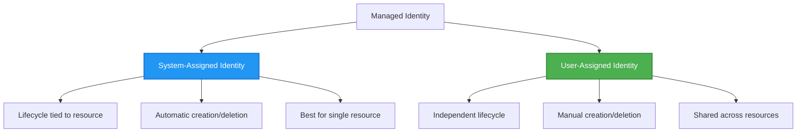

# Шаблони автентифікації та керовані облікові записи

⏱️ **Орієнтовний час**: 45-60 хвилин для читання; заплануйте додатковий час для інтеграції вправ | 💰 **Вплив на вартість**: Ідентичність/RBAC безкоштовні; обчислювальні ресурси, сховище та Key Vault оплачуються | ⭐ **Складність**: Середній рівень

> Перевірено відповідно до `azd 1.37.2` (листопад 2026). Цей урок містить **ілюстративні фрагменти інтеграції, а не повний завантажуваний шаблон `secure-app`**. Створіть посилальні файли, надайте відповідну інфраструктуру та замініть заповнювачі перед розгортанням. Під час перевірки ресурси Azure не були розгорнуті.

**📚 Навчальний маршрут:**
- ← Попередній: [Керування конфігураціями](configuration.md) - Керування змінними середовища та секретами
- 🎯 **Ви тут**: Автентифікація та безпека (керована ідентичність, Key Vault, безпечні шаблони)
- → Наступний: [Інфраструктура як код](../chapter-04-infrastructure/README.md) - Підготовка та розгортання ресурсів
- 🏠 [Головна сторінка курсу](../../README.md)

---

## Чого ви навчитеся

Завершивши цей урок, ви:
- Зрозумієте шаблони автентифікації Azure (ключі, рядки підключень, керована ідентичність)
- Впровадите **керовану ідентичність** для автентифікації без пароля
- Захистите секрети через інтеграцію з **Azure Key Vault**
- Налаштуєте **керування доступом на основі ролей (RBAC)** для розгортань AZD
- Застосуєте найкращі практики безпеки у Container Apps та сервісах Azure
- Виконаєте міграцію з автентифікації на основі ключів до автентифікації на основі ідентичності

## Чому керована ідентичність важлива

### Проблема: Традиційна автентифікація

**До керованої ідентичності:**
```javascript
// ❌ SECURITY RISK: Hardcoded secrets in code
const connectionString = "Server=mydb.database.windows.net;User=admin;Password=P@ssw0rd123";
const storageKey = "xK7mN9pQ2wR5tY8uI0oP3aS6dF1gH4jK...";
const cosmosKey = "C2x7B9n4M1p8Q5w3E6r0T2y5U8i1O4p7...";
```

**Проблеми:**
- 🔴 **Відкриті секрети** у коді, файлах конфігурації, змінних середовища
- 🔴 **Обертання облікових даних** вимагає змін коду та повторного розгортання
- 🔴 **Проблеми з аудитом** - хто і коли отримував доступ?
- 🔴 **Розкиданість** - секрети розпорошені по різних системах
- 🔴 **Ризики відповідності** - провали аудитів безпеки

### Рішення: Керована ідентичність

**Після керованої ідентичності:**
```javascript
// ✅ SECURE: No secrets in code
const credential = new DefaultAzureCredential();
const client = new BlobServiceClient(
  "https://mystorageaccount.blob.core.windows.net",
  credential  // Azure automatically handles authentication
);
```

**Переваги:**
- ✅ **Відсутність секретів** в коді чи конфігурації
- ✅ **Автоматичне обертання** - керує Azure
- ✅ **Повний журнал аудиту** у логах Microsoft Entra ID
- ✅ **Централізована безпека** - управління через портал Azure
- ✅ **Готовність до відповідності** - відповідає стандартам безпеки

**Аналогія**: Традиційна автентифікація — це як носити фізичні ключі від багатьох дверей. Керована ідентичність — це як пропуск безпеки, що автоматично дає доступ залежно від особи — без ключів, щоб їх втратити, копіювати чи змінювати.

---

## Огляд архітектури

### Потік автентифікації з керованою ідентичністю

```mermaid
sequenceDiagram
    participant App as Your Application<br/>(Container App)
    participant MI as Managed Identity<br/>(Microsoft Entra ID)
    participant KV as Key Vault
    participant Storage as Azure Storage
    participant DB as Azure SQL
    
    App->>MI: Request access token<br/>(automatic)
    MI->>MI: Verify identity<br/>(no password needed)
    MI-->>App: Return token for requested audience<br/>(lifetime varies)
    
    App->>KV: Get secret<br/>(using token)
    KV->>KV: Check RBAC permissions
    KV-->>App: Return secret value
    
    App->>Storage: Upload blob<br/>(using token)
    Storage->>Storage: Check RBAC permissions
    Storage-->>App: Success
    
    App->>DB: Query data<br/>(using token)
    DB->>DB: Check SQL permissions
    DB-->>App: Return results
    
    Note over App,DB: Request a separate token for each service audience;<br/>SDK credentials handle caching and renewal
```

### Види керованих ідентичностей



| Особливість | Призначено системою | Призначено користувачем |
|---------|----------------|---------------|
| **Життєвий цикл** | Пов’язаний з ресурсом | Незалежний |
| **Створення** | Автоматично під час створення ресурсу | Створюється вручну |
| **Видалення** | Видаляється разом з ресурсом | Зберігається після видалення ресурсу |
| **Спільне використання** | Один ресурс | Кілька ресурсів |
| **Використання** | Прості сценарії | Складні багаторесурсні сценарії |
| **Вибір шаблону** | Визначено в інфраструктурі | Визначено в інфраструктурі |

---

## Необхідні умови

### Необхідні інструменти

Ці інструменти ви вже мали встановити з попередніх уроків:

```bash
# Verify Azure Developer CLI
azd version
# ✅ Expected: azd version 1.0.0 or higher

# Verify Azure CLI
az --version
# ✅ Expected: azure-cli 2.50.0 or higher
```

### Вимоги до Azure

- Активна підписка Azure
- Дозволи на:
  - Створення керованих ідентичностей
  - Призначення ролей RBAC
  - Створення ресурсів Key Vault
  - Розгортання Container Apps

### Попередні знання

Ви повинні були завершити:
- [Посібник з встановлення](../chapter-01-foundation/installation.md) - Налаштування AZD
- [Основи AZD](../chapter-01-foundation/azd-basics.md) - Основні концепції
- [Керування конфігураціями](configuration.md) - Змінні середовища

---

## Урок 1: Розуміння шаблонів автентифікації

### Шаблон 1: Рядки підключень (Застарілий — уникати)

**Як це працює:**
```bash
# Connection string contains credentials
STORAGE_CONNECTION_STRING="DefaultEndpointsProtocol=https;AccountName=myaccount;AccountKey=xK7mN9pQ2wR5..."
COSMOS_CONNECTION_STRING="AccountEndpoint=https://myaccount.documents.azure.com:443/;AccountKey=C2x7..."
SQL_CONNECTION_STRING="Server=myserver.database.windows.net;User=admin;Password=P@ssw0rd..."
```

**Проблеми:**
- ❌ Секрети видимі у змінних середовища
- ❌ Логуються в системах розгортання
- ❌ Важко змінювати/обертати
- ❌ Відсутній аудит доступу

**Коли використовувати:** Коли цільовий сервіс вимагає автентифікації на основі ключа. Переважно використовуйте ідентичність, якщо підтримується; інакше зберігайте ключі безпечно та регулярно обертайте, в тому числі у виробництві.

---

### Шаблон 2: Посилання Key Vault (Краще)

**Як це працює:**
**Часткові фрагменти Bicep:** необхідні поля сховища, ідентичність Container App та її `configuration.secrets` пропущені. `secretRef` називає секрет Container App; це **не є** URI Key Vault. Щоб використовувати Key Vault, визначте цей названий секрет за допомогою `keyVaultUrl` та авторизованого `identity`.

```bicep
// Store secret in Key Vault
resource keyVault 'Microsoft.KeyVault/vaults@2023-02-01' = {
  name: 'mykv'
  properties: {
    enableRbacAuthorization: true
  }
}

// Reference in Container App
env: [
  {
    name: 'STORAGE_KEY'
    secretRef: 'storage-key'  // References Key Vault
  }
]
```

**Переваги:**
- ✅ Секрети зберігаються безпечно у Key Vault
- ✅ Централізоване керування секретами
- ✅ Обертання без змін коду

**Обмеження:**
- ⚠️ Продовжує використовувати ключі/паролі
- ⚠️ Потрібно керувати доступом до Key Vault

**Коли використовувати:** Крок переходу від рядків підключення до керованої ідентичності.

---

### Шаблон 3: Керована ідентичність (Найкраща практика)

**Як це працює:**
**Частковий Bicep:** об’єднайте блок ідентичності у повний Container App і вкажіть `storageAccount` та визначення ролі. Призначення ролі також потребує детермінованого `name`.

```bicep
// Enable managed identity
resource containerApp 'Microsoft.App/containerApps@2023-05-01' = {
  name: 'myapp'
  identity: {
    type: 'SystemAssigned'  // Automatically creates identity
  }
}

// Grant permissions
resource roleAssignment 'Microsoft.Authorization/roleAssignments@2022-04-01' = {
  name: guid(storageAccount.id, containerApp.id, storageBlobDataContributorRole)
  scope: storageAccount
  properties: {
    roleDefinitionId: storageBlobDataContributorRole
    principalId: containerApp.identity.principalId
    principalType: 'ServicePrincipal'
  }
}
```

**Код застосунку:**
```javascript
// No secrets needed!
const { DefaultAzureCredential } = require('@azure/identity');
const { BlobServiceClient } = require('@azure/storage-blob');

const credential = new DefaultAzureCredential();
const blobServiceClient = new BlobServiceClient(
  'https://mystorageaccount.blob.core.windows.net',
  credential
);
```

**Переваги:**
- ✅ Немає секретів у коді/конфігурації
- ✅ Автоматичне обертання облікових даних
- ✅ Повний журнал аудиту
- ✅ Дозволи на основі RBAC
- ✅ Готовність до відповідності

**Коли використовувати:** Переважно для додатків, розміщених в Azure, що звертаються до сервісів із підтримкою автентифікації Microsoft Entra.

---

### Шаблон 4: Службові облікові записи (CI/CD та автоматизація)

Керована ідентичність — золотий стандарт *для ресурсів, що працюють усередині Azure*. Але як бути з тим, що працює **поза межами** Azure — наприклад, CI/CD конвеєр на агенті збірки або скрипт на вашому ноутбуці, який не може використовувати інтерактивний вхід? Тут на допомогу приходить **службовий обліковий запис**: не людська ідентичність з власними обліковими даними, під якими автоматизований процес може увійти.

**Як це працює:**

Створіть службовий обліковий запис у межах групи ресурсів (найменший обсяг прав):

```bash
az ad sp create-for-rbac \
  --name "myapp-cicd" \
  --role contributor \
  --scopes "/subscriptions/<sub-id>/resourceGroups/<rg-name>"
```

Це виводить client ID, client secret і tenant ID. azd може виконати вхід неінтерактивно з ними:

```bash
azd auth login \
  --client-id "<appId>" \
  --client-secret "<password>" \
  --tenant-id "<tenant>"
```

**Перевагу надавайте федеративним обліковим даним (OIDC), а не секретам.** Замість довготривалого client secret, налаштуйте федеративну облікову довідку, щоб конвеєр обмінював короткоживучий токен — ніяких секретів для витоку або обертання:

```bash
azd auth login \
  --client-id "<appId>" \
  --federated-credential-provider "github" \
  --tenant-id "<tenant>"
```

> `azd pipeline config` налаштовує це для вас автоматично. Дивіться покрокові інструкції CI/CD у [Розділі 8](../chapter-08-production/production-ai-practices.md).

**Переваги:**
- ✅ Працює поза Azure (агенти збірки, локально, в інших хмарах)
- ✅ Можна обмежити до однієї групи ресурсів з однією роллю
- ✅ Федеративний (OIDC) варіант не зберігає секрет

**Компроміси:**
- ⚠️ Варіант зі секретом потребує ретельного зберігання та обертання
- ⚠️ Витік секрету відкриває всі можливості службового облікового запису — обмежуйте обсяг прав

**Коли використовувати:** CI/CD конвеєри та автоматизація, які не можуть використовувати керовану ідентичність. Завжди надавайте перевагу федеративному/OIDC варіанту замість client secret і керованій ідентичності, якщо робоче навантаження працює в Azure.

**Безпечне зберігання облікових даних:**
- Ніколи не додавайте секрети до коду — використовуйте сховище секретів вашого конвеєра (секрети GitHub Actions, змінні Azure DevOps / Key Vault).
- Обмежуйте службовий обліковий запис до мінімально необхідної ролі та групи ресурсів.
- Встановлюйте термін дії та обертайте секрет, або повністю відмовтеся від секрету з OIDC.

---

## Урок 2: Впровадження керованої ідентичності з AZD

### Крок за кроком

Наступні фрагменти показують, як інтегрувати керовану ідентичність у проект Container App. Це **не готовий до запуску стартовий шаблон**: модуль Storage, повна інфраструктура керованого середовища/реєстру, Dockerfile і параметричний файл не всі надані тут. Почніть із робочого шаблону Container Apps та інтегруйте ці шаблони, зберігаючи конфігурацію реєстру та теги сервісів.

### Структура проекту

```
secure-app/
├── azure.yaml                 # AZD configuration
├── infra/
│   ├── main.bicep            # Main infrastructure
│   ├── core/
│   │   ├── identity.bicep    # Managed identity setup
│   │   ├── keyvault.bicep    # Key Vault configuration
│   │   └── storage.bicep     # Storage with RBAC
│   └── app/
│       └── container-app.bicep
└── src/
    ├── app.js                # Application code
    ├── package.json
    └── Dockerfile
```

### 1. Налаштуйте AZD (azure.yaml)

```yaml
name: secure-app
metadata:
  template: secure-app@1.0.0

services:
  api:
    project: ./src
    language: js
    host: containerapp

# Managed identity must be enabled in the infrastructure, not by this YAML.
```

### 2. Інфраструктура: Увімкнення керованої ідентичності

**Файл: `infra/main.bicep`**

```bicep
targetScope = 'subscription'

param environmentName string
param location string = 'eastus'
param containerAppsEnvironmentId string
param containerImage string

var tags = { 'azd-env-name': environmentName }

// Resource group
resource rg 'Microsoft.Resources/resourceGroups@2021-04-01' = {
  name: 'rg-${environmentName}'
  location: location
  tags: tags
}

// Storage Account
module storage './core/storage.bicep' = {
  name: 'storage'
  scope: rg
  params: {
    name: 'st${uniqueString(rg.id)}'
    location: location
    tags: tags
  }
}

// Key Vault
module keyVault './core/keyvault.bicep' = {
  name: 'keyvault'
  scope: rg
  params: {
    name: 'kv-${uniqueString(rg.id)}'
    location: location
    tags: tags
  }
}

// Container App with Managed Identity
module containerApp './app/container-app.bicep' = {
  name: 'container-app'
  scope: rg
  params: {
    name: 'ca-${environmentName}'
    location: location
    tags: tags
    storageAccountName: storage.outputs.name
    keyVaultName: keyVault.outputs.name
    containerAppsEnvironmentId: containerAppsEnvironmentId
    containerImage: containerImage
  }
}

// Grant Container App access to Storage
module storageRoleAssignment './core/role-assignment.bicep' = {
  name: 'storage-role'
  scope: rg
  params: {
    principalId: containerApp.outputs.identityPrincipalId
    roleDefinitionId: 'ba92f5b4-2d11-453d-a403-e96b0029c9fe'  // Storage Blob Data Contributor
    targetResourceType: 'storage'
    targetResourceName: storage.outputs.name
  }
}

// Grant Container App access to Key Vault
module kvRoleAssignment './core/role-assignment.bicep' = {
  name: 'kv-role'
  scope: rg
  params: {
    principalId: containerApp.outputs.identityPrincipalId
    roleDefinitionId: '4633458b-17de-408a-b874-0445c86b69e6'  // Key Vault Secrets User
    targetResourceType: 'keyvault'
    targetResourceName: keyVault.outputs.name
  }
}

// Outputs
output AZURE_STORAGE_ACCOUNT_NAME string = storage.outputs.name
output AZURE_KEY_VAULT_NAME string = keyVault.outputs.name
output APP_URL string = containerApp.outputs.url
```

### 3. Container App із системною ідентичністю

**Файл: `infra/app/container-app.bicep`**

```bicep
param name string
param location string
param tags object = {}
param storageAccountName string
param keyVaultName string
param containerAppsEnvironmentId string
param containerImage string

resource containerApp 'Microsoft.App/containerApps@2023-05-01' = {
  name: name
  location: location
  tags: union(tags, { 'azd-service-name': 'api' })
  identity: {
    type: 'SystemAssigned'  // 🔑 Enable managed identity
  }
  properties: {
    managedEnvironmentId: containerAppsEnvironmentId
    configuration: {
      ingress: {
        external: true
        targetPort: 3000
      }
    }
    template: {
      containers: [
        {
          name: 'api'
          image: containerImage // Must exist; configure registry credentials for private images
          resources: {
            cpu: json('0.5')
            memory: '1Gi'
          }
          env: [
            {
              name: 'AZURE_STORAGE_ACCOUNT_NAME'
              value: storageAccountName
            }
            {
              name: 'AZURE_KEY_VAULT_NAME'
              value: keyVaultName
            }
            // 🔑 No secrets - managed identity handles authentication!
          ]
        }
      ]
    }
  }
}

// Output the identity for RBAC assignments
output identityPrincipalId string = containerApp.identity.principalId
output id string = containerApp.id
output url string = 'https://${containerApp.properties.configuration.ingress.fqdn}'
```

### 4. Модуль призначення ролей RBAC

**Файл: `infra/core/role-assignment.bicep`**

```bicep
param principalId string
param roleDefinitionId string  // Azure built-in role ID
@allowed(['storage', 'keyvault'])
param targetResourceType string
param targetResourceName string

// Typed existing resources give Bicep a valid resource scope, not a string ID.
resource storageTarget 'Microsoft.Storage/storageAccounts@2023-01-01' existing = {
  name: targetResourceName
}
resource vaultTarget 'Microsoft.KeyVault/vaults@2023-02-01' existing = {
  name: targetResourceName
}

resource storageAssignment 'Microsoft.Authorization/roleAssignments@2022-04-01' = if (targetResourceType == 'storage') {
  name: guid(storageTarget.id, principalId, roleDefinitionId)
  scope: storageTarget
  properties: {
    roleDefinitionId: subscriptionResourceId('Microsoft.Authorization/roleDefinitions', roleDefinitionId)
    principalId: principalId
    principalType: 'ServicePrincipal'
  }
}

resource vaultAssignment 'Microsoft.Authorization/roleAssignments@2022-04-01' = if (targetResourceType == 'keyvault') {
  name: guid(vaultTarget.id, principalId, roleDefinitionId)
  scope: vaultTarget
  properties: {
    roleDefinitionId: subscriptionResourceId('Microsoft.Authorization/roleDefinitions', roleDefinitionId)
    principalId: principalId
    principalType: 'ServicePrincipal'
  }
}

// This module assigns at the target resource scope, not the whole resource group.
```

### 5. Код застосунку з керованою ідентичністю

**Файл: `src/app.js`**

```javascript
const express = require('express');
const { DefaultAzureCredential } = require('@azure/identity');
const { BlobServiceClient } = require('@azure/storage-blob');
const { SecretClient } = require('@azure/keyvault-secrets');

const app = express();
const PORT = process.env.PORT || 3000;

// 🔑 Initialize credential (works automatically with managed identity)
const credential = new DefaultAzureCredential();

// Azure Storage setup
const storageAccountName = process.env.AZURE_STORAGE_ACCOUNT_NAME;
const blobServiceClient = new BlobServiceClient(
  `https://${storageAccountName}.blob.core.windows.net`,
  credential  // No keys needed!
);

// Key Vault setup
const keyVaultName = process.env.AZURE_KEY_VAULT_NAME;
const secretClient = new SecretClient(
  `https://${keyVaultName}.vault.azure.net`,
  credential  // No keys needed!
);

// Health check
app.get('/health', (req, res) => {
  res.json({ status: 'healthy', authentication: 'managed-identity' });
});

// Upload file to blob storage
app.post('/upload', async (req, res) => {
  try {
    const containerClient = blobServiceClient.getContainerClient('uploads');
    await containerClient.createIfNotExists();
    
    const blobName = `file-${Date.now()}.txt`;
    const blockBlobClient = containerClient.getBlockBlobClient(blobName);
    
    const content = 'Hello from managed identity!';
    await blockBlobClient.upload(content, Buffer.byteLength(content));
    
    res.json({
      success: true,
      blobName: blobName,
      message: 'File uploaded using managed identity!'
    });
  } catch (error) {
    console.error('Upload error:', error);
    res.status(500).json({ error: error.message });
  }
});

// Get secret from Key Vault
app.get('/secret/:name', async (req, res) => {
  try {
    const secretName = req.params.name;
    const secret = await secretClient.getSecret(secretName);
    
    res.json({
      name: secretName,
      retrieved: secret.value !== undefined, // Never return the secret value to callers
      message: 'Secret retrieved using managed identity!'
    });
  } catch (error) {
    console.error('Secret error:', error);
    res.status(500).json({ error: error.message });
  }
});

// List blob containers (demonstrates read access)
app.get('/containers', async (req, res) => {
  try {
    const containers = [];
    for await (const container of blobServiceClient.listContainers()) {
      containers.push(container.name);
    }
    
    res.json({
      containers: containers,
      count: containers.length,
      message: 'Containers listed using managed identity!'
    });
  } catch (error) {
    console.error('List error:', error);
    res.status(500).json({ error: error.message });
  }
});

app.listen(PORT, () => {
  console.log(`Secure API listening on port ${PORT}`);
  console.log('Authentication: Managed Identity (passwordless)');
});
```

**Файл: `src/package.json`**

```json
{
  "name": "secure-app",
  "version": "1.0.0",
  "dependencies": {
    "express": "^4.18.2",
    "@azure/identity": "^4.0.0",
    "@azure/storage-blob": "^12.17.0",
    "@azure/keyvault-secrets": "^4.7.0"
  },
  "scripts": {
    "start": "node app.js"
  }
}
```

### 6. Розгортання та тестування

Запускайте ці команди **лише після** завершення пропущеної інфраструктури, Dockerfile і відповідного `main.parameters.json` у вашому проекті. Аутентифікуйтеся в azd за допомогою `azd auth login`; окремо увійдіть через `az login` для перевірок в Azure CLI пізніше. Показані кінцеві точки є демонстраційними і потребують відповідних засобів контролю доступу перед публічним використанням.

```bash
# Initialize AZD environment
azd init

# Deploy infrastructure and application
azd up

# Get the app URL
APP_URL=$(azd env get-value APP_URL)

# Test health check
curl $APP_URL/health
```

**✅ Очікуваний результат:**
```json
{
  "status": "healthy",
  "authentication": "managed-identity"
}
```

**Перевірка завантаження об’єкта:**
```bash
curl -X POST $APP_URL/upload
```

**✅ Очікуваний результат:**
```json
{
  "success": true,
  "blobName": "file-1700404800000.txt",
  "message": "File uploaded using managed identity!"
}
```

**Перевірка переліку контейнерів:**
```bash
curl $APP_URL/containers
```

**✅ Очікуваний результат:**
```json
{
  "containers": ["uploads"],
  "count": 1,
  "message": "Containers listed using managed identity!"
}
```

---

## Загальні ролі RBAC Azure

### Вбудовані ID ролей для керованої ідентичності

| Сервіс | Назва ролі | ID ролі | Дозволи |
|---------|-----------|---------|-------------|
| **Storage** | Storage Blob Data Reader | `2a2b9908-6ea1-4ae2-8e65-a410df84e7d1` | Читання блобів та контейнерів |
| **Storage** | Storage Blob Data Contributor | `ba92f5b4-2d11-453d-a403-e96b0029c9fe` | Читання, запис, видалення блобів |
| **Storage** | Storage Queue Data Contributor | `974c5e8b-45b9-4653-ba55-5f855dd0fb88` | Читання, запис, видалення черг/повідомлень |
| **Key Vault** | Key Vault Secrets User | `4633458b-17de-408a-b874-0445c86b69e6` | Читання секретів |
| **Key Vault** | Key Vault Secrets Officer | `b86a8fe4-44ce-4948-aee5-eccb2c155cd7` | Читання, запис, видалення секретів |
| **Cosmos DB** | Cosmos DB Built-in Data Reader | `00000000-0000-0000-0000-000000000001` | Читання даних Cosmos DB |
| **Cosmos DB** | Cosmos DB Built-in Data Contributor | `00000000-0000-0000-0000-000000000002` | Читання, запис даних Cosmos DB |
| **SQL Database** | SQL DB Contributor | `9b7fa17d-e63e-47b0-bb0a-15c516ac86ec` | Керування ресурсами бази даних; не дає доступу до даних SQL |
| **Service Bus** | Azure Service Bus Data Owner | `090c5cfd-751d-490a-894a-3ce6f1109419` | Відправка, отримання, керування повідомленнями |

### Як знайти ID ролей

Два вказані вище ID Cosmos DB для NoSQL є **вбудованими визначеннями ролей рівня даних Cosmos**, а не ID ролей підписки Azure RBAC. Призначайте їх через `az cosmosdb sql role assignment create` (або `Microsoft.DocumentDB/databaseAccounts/sqlRoleAssignments`), а не `az role assignment create`. Доступ до даних SQL потребує користувача Entra бази даних та SQL-дозволів.

```bash
# List all built-in roles
az role definition list --query "[].{Name:roleName, ID:name}" --output table

# Search for specific role
az role definition list --query "[?contains(roleName, 'Storage Blob')].{Name:roleName, ID:name}" --output table

# Get role details
az role definition list --name "Storage Blob Data Contributor"
```

---

## Практичні вправи

**Передумови для інтеграції у всіх трьох вправах:** робочий шаблон Container App у вашому проекті, відповідні ресурси Bicep, вхід через Azure CLI/azd та повноваження для призначення необхідних ролей. Це керовані адаптації, а не окремі локальні стартери; замініть зразкові імена ресурсів на свої розгорнуті.

### Вправа 1: Увімкнення керованої ідентичності для існуючого додатка ⭐⭐ (Середній рівень)

**Мета**: Додати керовану ідентичність до існуючого розгортання Container App

**Сценарій**: У вас є Container App, який використовує рядки підключень. Перетворіть його на керовану ідентичність.

**Початкова точка**: Container App із такою конфігурацією:

```bicep
// ❌ Current: Using connection string
env: [
  {
    name: 'STORAGE_CONNECTION_STRING'
    secretRef: 'storage-connection'
  }
]
```

**Кроки**:

1. **Увімкніть керовану ідентичність у Bicep:**

```bicep
resource containerApp 'Microsoft.App/containerApps@2023-05-01' = {
  name: 'myapp'
  identity: {
    type: 'SystemAssigned'  // Add this
  }
  // ... rest of configuration
}
```

2. **Надайте доступ до сховища:**

```bicep
// Get storage account reference
resource storageAccount 'Microsoft.Storage/storageAccounts@2023-01-01' existing = {
  name: storageAccountName
}

// Assign role
resource roleAssignment 'Microsoft.Authorization/roleAssignments@2022-04-01' = {
  name: guid(containerApp.id, 'ba92f5b4-2d11-453d-a403-e96b0029c9fe', storageAccount.id)
  scope: storageAccount
  properties: {
    roleDefinitionId: subscriptionResourceId('Microsoft.Authorization/roleDefinitions', 'ba92f5b4-2d11-453d-a403-e96b0029c9fe')
    principalId: containerApp.identity.principalId
    principalType: 'ServicePrincipal'
  }
}
```

3. **Оновіть код застосунку:**

**До (рядок підключення):**
```javascript
const { BlobServiceClient } = require('@azure/storage-blob');

const blobServiceClient = BlobServiceClient.fromConnectionString(
  process.env.STORAGE_CONNECTION_STRING
);
```

**Після (керована ідентичність):**
```javascript
const { DefaultAzureCredential } = require('@azure/identity');
const { BlobServiceClient } = require('@azure/storage-blob');

const credential = new DefaultAzureCredential();
const blobServiceClient = new BlobServiceClient(
  `https://${process.env.STORAGE_ACCOUNT_NAME}.blob.core.windows.net`,
  credential
);
```

4. **Оновіть змінні середовища:**

```bicep
env: [
  {
    name: 'STORAGE_ACCOUNT_NAME'
    value: storageAccountName  // Just the name, no secrets!
  }
  // Remove STORAGE_CONNECTION_STRING
]
```

5. **Розгорніть і протестуйте:**

```bash
# Redeploy
azd up

# Test that it still works
APP_URL=$(azd show --output json | jq -er '.services.api.ingressUrl')
curl --fail -X POST "$APP_URL/upload"
```

**✅ Критерії успіху:**
- ✅ Додаток розгортається без помилок
- ✅ Операції із сховищем працюють (завантаження, перелік, завантаження)
- ✅ Рядки підключень відсутні у змінних середовища
- ✅ Ідентичність відображається у порталі Azure в розділі "Ідентичність"

**Перевірка:**

```bash
# Check managed identity is enabled
az containerapp show \
  --name myapp \
  --resource-group rg-myapp \
  --query "identity.type"
# ✅ Expected: "SystemAssigned"

# Check role assignment
az role assignment list \
  --assignee $(az containerapp show --name myapp --resource-group rg-myapp --query "identity.principalId" -o tsv) \
  --scope /subscriptions/{sub-id}/resourceGroups/rg-myapp/providers/Microsoft.Storage/storageAccounts/mystorageaccount
# ✅ Expected: Shows "Storage Blob Data Contributor" role
```

**Час**: 20-30 хвилин

---

### Вправа 2: Доступ багатьох сервісів з користувацькою призначеною ідентичністю ⭐⭐⭐ (Просунутий рівень)

**Мета**: Створити користувацьку ідентичність, спільну для кількох Container Apps

**Сценарій**: У вас є 3 мікросервіси, яким усім потрібен доступ до одного облікового запису сховища та Key Vault.

**Кроки**:

1. **Створіть користувацьку призначену ідентичність:**

**Файл: `infra/core/identity.bicep`**

```bicep
param name string
param location string
param tags object = {}

resource userAssignedIdentity 'Microsoft.ManagedIdentity/userAssignedIdentities@2023-01-31' = {
  name: name
  location: location
  tags: tags
}

output id string = userAssignedIdentity.id
output principalId string = userAssignedIdentity.properties.principalId
output clientId string = userAssignedIdentity.properties.clientId
```

2. **Призначте ролі користувацькій призначеній ідентичності:**

```bicep
// In main.bicep
module userIdentity './core/identity.bicep' = {
  name: 'user-identity'
  scope: rg
  params: {
    name: 'id-${environmentName}'
    location: location
    tags: tags
  }
}

// Grant Storage access
resource storageRoleAssignment 'Microsoft.Authorization/roleAssignments@2022-04-01' = {
  name: guid(storageAccount.id, environmentName, 'storage-contributor')
  scope: storageAccount
  properties: {
    roleDefinitionId: subscriptionResourceId('Microsoft.Authorization/roleDefinitions', 'ba92f5b4-2d11-453d-a403-e96b0029c9fe')
    principalId: userIdentity.outputs.principalId
    principalType: 'ServicePrincipal'
  }
}

// Grant Key Vault access
resource kvRoleAssignment 'Microsoft.Authorization/roleAssignments@2022-04-01' = {
  name: guid(keyVault.id, environmentName, 'kv-secrets-user')
  scope: keyVault
  properties: {
    roleDefinitionId: subscriptionResourceId('Microsoft.Authorization/roleDefinitions', '4633458b-17de-408a-b874-0445c86b69e6')
    principalId: userIdentity.outputs.principalId
    principalType: 'ServicePrincipal'
  }
}
```

3. **Призначення ідентичності кільком Container Apps:**

```bicep
resource apiGateway 'Microsoft.App/containerApps@2023-05-01' = {
  name: 'api-gateway'
  identity: {
    type: 'UserAssigned'
    userAssignedIdentities: {
      '${userIdentity.outputs.id}': {}
    }
  }
  // ... rest of config
}

resource productService 'Microsoft.App/containerApps@2023-05-01' = {
  name: 'product-service'
  identity: {
    type: 'UserAssigned'
    userAssignedIdentities: {
      '${userIdentity.outputs.id}': {}
    }
  }
  // ... rest of config
}

resource orderService 'Microsoft.App/containerApps@2023-05-01' = {
  name: 'order-service'
  identity: {
    type: 'UserAssigned'
    userAssignedIdentities: {
      '${userIdentity.outputs.id}': {}
    }
  }
  // ... rest of config
}
```

4. **Код програми (усі служби використовують однаковий патерн):**

```javascript
const { ManagedIdentityCredential } = require('@azure/identity');
const { BlobServiceClient } = require('@azure/storage-blob');

// For user-assigned identity, specify the client ID
const credential = new ManagedIdentityCredential(
  process.env.AZURE_CLIENT_ID  // User-assigned identity client ID
);

// Alternative (choose ONE credential declaration):
// const { DefaultAzureCredential } = require('@azure/identity');
// const credential = new DefaultAzureCredential({
//   managedIdentityClientId: process.env.AZURE_CLIENT_ID
// });

const blobServiceClient = new BlobServiceClient(
  `https://${process.env.STORAGE_ACCOUNT_NAME}.blob.core.windows.net`,
  credential
);
```

Встановіть для кожного Container App значення часу виконання `AZURE_CLIENT_ID` на `userIdentity.outputs.clientId` і `STORAGE_ACCOUNT_NAME` на ім’я вашого сховища в Bicep. Проста прив’язка ідентичності або запуск `azd env set` не налаштовують ці значення часу виконання.

5. **Розгортання та перевірка:**

```bash
azd up

# Test all services can access storage
# Replace with the actual ingress URLs reported for your three services
curl --fail -X POST "$API_GATEWAY_URL/upload"
curl --fail -X POST "$PRODUCT_SERVICE_URL/upload"
curl --fail -X POST "$ORDER_SERVICE_URL/upload"
```

**✅ Критерії успіху:**
- ✅ Одна ідентичність, спільна для 3 служб
- ✅ Всі служби можуть отримувати доступ до Storage і Key Vault
- ✅ Ідентичність зберігається, якщо видалити одну службу
- ✅ Централізоване управління правами доступу

**Переваги ідентичності, призначеної користувачем:**
- Одна ідентичність для керування
- Узгоджені права доступу між службами
- Залишається після видалення служби
- Краща для складних архітектур

**Час**: 30-40 хвилин

---

### Вправа 3: Реалізація ротації секретів Key Vault ⭐⭐⭐ (Просунутий рівень)

**Мета**: Зберігати ключі сторонніх API в Key Vault та отримувати доступ за допомогою керованої ідентичності

**Сценарій**: Вашому додатку потрібно викликати зовнішній API (OpenAI, Stripe, SendGrid), що вимагає ключів API.

**Кроки**:

1. **Створити Key Vault з RBAC:**

**Файл: `infra/core/keyvault.bicep`**

```bicep
param name string
param location string
param tags object = {}

resource keyVault 'Microsoft.KeyVault/vaults@2023-02-01' = {
  name: name
  location: location
  tags: tags
  properties: {
    enableRbacAuthorization: true  // Use RBAC instead of access policies
    sku: {
      family: 'A'
      name: 'standard'
    }
    tenantId: subscription().tenantId
    enableSoftDelete: true
    softDeleteRetentionInDays: 90
  }
}

// Allow Container App to read secrets
output id string = keyVault.id
output name string = keyVault.name
output uri string = keyVault.properties.vaultUri
```

2. **Зберегти секрети в Key Vault:**

```bash
# Get Key Vault name
KV_NAME=$(azd env get-value AZURE_KEY_VAULT_NAME)

# Store third-party API keys
az keyvault secret set \
  --vault-name $KV_NAME \
  --name "OpenAI-ApiKey" \
  --value "sk-proj-xxxxxxxxxxxxx"

az keyvault secret set \
  --vault-name $KV_NAME \
  --name "Stripe-ApiKey" \
  --value "sk_live_xxxxxxxxxxxxx"

az keyvault secret set \
  --vault-name $KV_NAME \
  --name "SendGrid-ApiKey" \
  --value "SG.xxxxxxxxxxxxx"
```

3. **Код додатку для отримання секретів:**

**Файл: `src/config.js`**

```javascript
const { DefaultAzureCredential } = require('@azure/identity');
const { SecretClient } = require('@azure/keyvault-secrets');

class Config {
  constructor() {
    this.credential = new DefaultAzureCredential();
    this.secretClient = new SecretClient(
      `https://${process.env.AZURE_KEY_VAULT_NAME}.vault.azure.net`,
      this.credential
    );
    this.cache = {};
  }

  async getSecret(secretName) {
    // Check cache first
    if (this.cache[secretName]) {
      return this.cache[secretName];
    }

    try {
      const secret = await this.secretClient.getSecret(secretName);
      this.cache[secretName] = secret.value;
      console.log(`✅ Retrieved secret: ${secretName}`);
      return secret.value;
    } catch (error) {
      console.error(`❌ Failed to get secret ${secretName}:`, error.message);
      throw error;
    }
  }

  async getOpenAIKey() {
    return this.getSecret('OpenAI-ApiKey');
  }

  async getStripeKey() {
    return this.getSecret('Stripe-ApiKey');
  }

  async getSendGridKey() {
    return this.getSecret('SendGrid-ApiKey');
  }
}

module.exports = new Config();
```

4. **Використовувати секрети в додатку:**

**Файл: `src/app.js`**

Цей **фрагмент заміни додатку** потребує `npm install openai`, реального ключа стороннього постачальника, доступної моделі та інфраструктури з вашого робочого проекту. Він викликає OpenAI напряму, а не через розгортання Azure OpenAI. Ключі-заповнювачі нижче не авторизують запит.

```javascript
const express = require('express');
const config = require('./config');
const { OpenAI } = require('openai');

const app = express();

// Initialize OpenAI with key from Key Vault
let openaiClient;

async function initializeServices() {
  const openaiKey = await config.getOpenAIKey();
  openaiClient = new OpenAI({ apiKey: openaiKey });
  console.log('✅ Services initialized with secrets from Key Vault');
}

app.post('/chat', async (req, res) => {
  try {
    const completion = await openaiClient.chat.completions.create({
      model: 'gpt-4.1',
      messages: [{ role: 'user', content: 'Hello!' }]
    });
    
    res.json({
      response: completion.choices[0].message.content,
      authentication: 'Key from Key Vault via Managed Identity'
    });
  } catch (error) {
    res.status(500).json({ error: error.message });
  }
});

// Start listening only after initialization succeeds.
initializeServices().then(() => {
  app.listen(3000, () => console.log('Key Vault demo running'));
}).catch(error => {
  console.error('Initialization failed:', error.message);
  process.exitCode = 1;
});
```

5. **Розгорнути та протестувати:**

```bash
azd up

# Test that API keys work
curl -X POST https://myapp.azurecontainerapps.io/chat \
  -H "Content-Type: application/json" \
  -d '{"message":"Hello AI"}'
```

**✅ Критерії успіху:**
- ✅ Немає ключів API в коді або змінних оточення
- ✅ Додаток отримує ключі з Key Vault
- ✅ Сторонні API працюють коректно
- ✅ Можливість обертати ключі без змін коду

**Ротація секрету:**

```bash
# Update secret in Key Vault
az keyvault secret set \
  --vault-name $KV_NAME \
  --name "OpenAI-ApiKey" \
  --value "sk-proj-NEW_KEY_HERE"

# Find the active revision name, then restart it to clear the in-process cache
az containerapp revision list --name myapp --resource-group rg-myapp --output table
az containerapp revision restart \
  --name myapp \
  --resource-group rg-myapp \
  --revision "<active-revision-name>"
```

**Час**: 25-35 хвилин

---

## Контроль знань

### 1. Патерни автентифікації ✓

Перевірте своє розуміння:

- [ ] **Питання 1**: Які три основні патерни автентифікації? 
  - **Відповідь**: Connection strings (застарілий), посилання на Key Vault (перехідний), керована ідентичність (найкращий)

- [ ] **Питання 2**: Чому керована ідентичність краща за connection strings?
  - **Відповідь**: Немає секретів у коді, автоматична ротація, повний журнал аудиту, права RBAC

- [ ] **Питання 3**: Коли краще використовувати ідентичність, призначену користувачем, ніж системну?
  - **Відповідь**: Коли потрібно поділитися ідентичністю між кількома ресурсами або життєвий цикл ідентичності незалежний від ресурсу

**Практична перевірка:**
```bash
# Check what type of identity your app uses
az containerapp show \
  --name myapp \
  --resource-group rg-myapp \
  --query "identity.type"

# List all role assignments for the identity
az role assignment list \
  --assignee $(az containerapp show --name myapp --resource-group rg-myapp --query "identity.principalId" -o tsv)
```

---

### 2. RBAC і дозволи ✓

Перевірте своє розуміння:

- [ ] **Питання 1**: Який ідентифікатор ролі для "Storage Blob Data Contributor"?
  - **Відповідь**: `ba92f5b4-2d11-453d-a403-e96b0029c9fe`

- [ ] **Питання 2**: Які права надає "Key Vault Secrets User"?
  - **Відповідь**: Доступ лише для читання секретів (неможливо створювати, оновлювати або видаляти)

- [ ] **Питання 3**: Як надати Container App доступ до Azure SQL?
  - **Відповідь**: Налаштувати автентифікацію Microsoft Entra, створити ідентичність як користувача бази даних і надати необхідні SQL-права. Роль "SQL DB Contributor" керує тільки ресурсами Azure, але не авторизує запити.

**Практична перевірка:**
```bash
# Find specific role
az role definition list --name "Storage Blob Data Contributor"

# Check what roles are assigned to your identity
PRINCIPAL_ID=$(az containerapp show --name myapp --resource-group rg-myapp --query "identity.principalId" -o tsv)
az role assignment list --assignee $PRINCIPAL_ID --output table
```

---

### 3. Інтеграція з Key Vault ✓

Перевірте своє розуміння:

- [ ] **Питання 1**: Як увімкнути RBAC для Key Vault замість політик доступу?
  - **Відповідь**: Встановити `enableRbacAuthorization: true` у Bicep

- [ ] **Питання 2**: Яка бібліотека Azure SDK обробляє автентифікацію керованою ідентичністю?
  - **Відповідь**: `@azure/identity` з класом `DefaultAzureCredential`

- [ ] **Питання 3**: Як довго секрети Key Vault зберігаються в кеші?
  - **Відповідь**: Залежить від додатку; реалізуйте власну стратегію кешування

**Практична перевірка:**
```bash
# Test Key Vault access
az keyvault secret show \
  --vault-name $KV_NAME \
  --name "OpenAI-ApiKey" \
  --query "{name:name,enabled:attributes.enabled}"

# Check RBAC is enabled
az keyvault show \
  --name $KV_NAME \
  --query "properties.enableRbacAuthorization"
# ✅ Expected: true
```

---

## Кращі практики безпеки

### ✅ РОБІТЬ:

1. **Завжди використовуйте керовану ідентичність у виробництві**
   ```bicep
   identity: {
     type: 'SystemAssigned'
   }
   ```

2. **Використовуйте RBAC ролі з найменшими правами**
   - Використовуйте ролі "Reader", коли можливо
   - Уникайте "Owner" або "Contributor", якщо не потрібні

3. **Зберігайте ключі сторонніх провайдерів у Key Vault**
   ```javascript
   const apiKey = await secretClient.getSecret('ThirdPartyApiKey');
   ```

4. **Увімкніть аудит логів** (фрагмент частини ресурсів; об'єднайте з вашими деклараціями vault і workspace)
   ```bicep
   resource vaultDiagnostics 'Microsoft.Insights/diagnosticSettings@2021-05-01-preview' = {
     name: 'vault-audit'
     scope: keyVault
     properties: {
       workspaceId: logAnalytics.id
       logs: [{ category: 'AuditEvent', enabled: true }]
     }
   }
   ```

5. **Використовуйте різні ідентичності для dev/staging/prod**
   ```bash
   azd env new dev
   azd env new staging
   azd env new prod
   ```

6. **Регулярно обертайте секрети**
   - Встановлюйте дати закінчення дії секретів Key Vault
   - Автоматизуйте ротацію за допомогою Azure Functions

### ❌ НЕ РОБІТЬ:

1. **Ніколи не хардкодьте секрети**
   ```javascript
   // ❌ BAD
   const apiKey = "sk-proj-xxxxxxxxxxxxx";
   ```

2. **Не використовуйте connection strings у виробництві**
   ```javascript
   // ❌ BAD
   BlobServiceClient.fromConnectionString(process.env.STORAGE_CONNECTION_STRING)
   ```

3. **Не надавайте надмірних прав**
   ```bicep
   // ❌ BAD - too much access
   roleDefinitionId: subscriptionResourceId('Microsoft.Authorization/roleDefinitions', '8e3af657-a8ff-443c-a75c-2fe8c4bcb635')
   
   // ✅ GOOD - least privilege
   roleDefinitionId: subscriptionResourceId('Microsoft.Authorization/roleDefinitions', '2a2b9908-6ea1-4ae2-8e65-a410df84e7d1')
   ```

4. **Не логайте секрети**
   ```javascript
   // ❌ BAD
   console.log('API Key:', apiKey);
   
   // ✅ GOOD
   console.log('API Key retrieved successfully');
   ```

5. **Не діліться ідентичностями виробництва між середовищами**
   ```bicep
   // ❌ BAD - same identity for dev and prod
   // ✅ GOOD - separate identities per environment
   ```

---

## Посібник з усунення несправностей

### Проблема: "Unauthorized" при доступі до Azure Storage

**Симптоми:**
```
Error: Unauthorized (403)
AuthorizationPermissionMismatch: This request is not authorized to perform this operation
```

**Діагностика:**

```bash
# Check if managed identity is enabled
az containerapp show \
  --name myapp \
  --resource-group rg-myapp \
  --query "identity.type"
# ✅ Expected: "SystemAssigned" or "UserAssigned"

# Check role assignments
PRINCIPAL_ID=$(az containerapp show --name myapp --resource-group rg-myapp --query "identity.principalId" -o tsv)
az role assignment list --assignee $PRINCIPAL_ID

# Expected: Should see "Storage Blob Data Contributor" or similar role
```

**Рішення:**

1. **Надайте правильну роль RBAC:**
```bash
STORAGE_ID=$(az storage account show --name mystorageaccount --resource-group rg-myapp --query "id" -o tsv)
az role assignment create \
  --assignee $PRINCIPAL_ID \
  --role "Storage Blob Data Contributor" \
  --scope $STORAGE_ID
```

2. **Зачекайте поширення (може зайняти 5-10 хвилин):**
```bash
# Check role assignment status
az role assignment list --assignee $PRINCIPAL_ID --scope $STORAGE_ID
```

3. **Перевірте, що код додатку використовує правильні облікові дані:**
```javascript
// Make sure you're using DefaultAzureCredential
const credential = new DefaultAzureCredential();
```

---

### Проблема: Відмовлено у доступі до Key Vault

**Симптоми:**
```
Error: Forbidden (403)
The user, group or application does not have secrets get permission
```

**Діагностика:**

```bash
# Check Key Vault RBAC is enabled
az keyvault show \
  --name $KV_NAME \
  --query "properties.enableRbacAuthorization"
# ✅ Expected: true

# Check role assignments
az role assignment list \
  --assignee $PRINCIPAL_ID \
  --scope /subscriptions/{sub-id}/resourceGroups/rg-myapp/providers/Microsoft.KeyVault/vaults/$KV_NAME
```

**Рішення:**

1. **Увімкніть RBAC для Key Vault:**
```bash
az keyvault update \
  --name $KV_NAME \
  --enable-rbac-authorization true
```

2. **Надайте роль Key Vault Secrets User:**
```bash
KV_ID=$(az keyvault show --name $KV_NAME --query "id" -o tsv)
az role assignment create \
  --assignee $PRINCIPAL_ID \
  --role "Key Vault Secrets User" \
  --scope $KV_ID
```

---

### Проблема: DefaultAzureCredential не працює локально

**Симптоми:**
```
Error: DefaultAzureCredential failed to retrieve a token
CredentialUnavailableError: No credential available
```

**Діагностика:**

```bash
# Check if you're logged in
az account show

# Check Azure CLI authentication
az ad signed-in-user show
```

**Рішення:**

1. **Увійдіть в Azure CLI:**
```bash
az login
```

2. **Встановіть підписку Azure:**
```bash
az account set --subscription "Your Subscription Name"
```

3. **Для локальної розробки використовуйте змінні оточення:**
```bash
export AZURE_TENANT_ID="your-tenant-id"
export AZURE_CLIENT_ID="your-client-id"
export AZURE_CLIENT_SECRET="your-client-secret"
```

4. **Або використовуйте інші облікові дані локально:**
```javascript
const { DefaultAzureCredential, AzureCliCredential } = require('@azure/identity');

// Use AzureCliCredential for local dev
const credential = process.env.NODE_ENV === 'production' 
  ? new DefaultAzureCredential()
  : new AzureCliCredential();
```

---

### Проблема: Призначення ролі занадто довго поширюється

**Симптоми:**
- Роль успішно призначена
- Продовжують виникати помилки 403
- Періодичний доступ (іноді працює, іноді ні)

**Пояснення:**
Зміни в Azure RBAC можуть поширюватися у світі 5-10 хвилин.

**Рішення:**

```bash
# Wait and retry
echo "Waiting for RBAC propagation..."
sleep 300  # Wait 5 minutes

# Test access
curl --fail -X POST "$APP_URL/upload"

# If still failing, restart the app
az containerapp revision restart \
  --name myapp \
  --resource-group rg-myapp \
  --revision "<active-revision-name>"
```

---

## Вартість

### Вартість керованої ідентичності

| Ресурс | Вартість |
|----------|------|
| **Керована ідентичність** | 🆓 **БЕЗКОШТОВНО** - без плати |
| **Призначення ролей RBAC** | 🆓 **БЕЗКОШТОВНО** - без плати |
| **Запити маркерів Microsoft Entra ID** | 🆓 **БЕЗКОШТОВНО** - включено |
| **Операції Key Vault** | $0.03 за 10 000 операцій |
| **Зберігання секретів Key Vault** | Перевірте поточні ціни; не припускайте щомісячну оплату за кожен секрет |

**Керована ідентичність економить гроші за рахунок:**
- ✅ Виключення операцій Key Vault для автентифікації між службами
- ✅ Зменшення інцидентів безпеки (відсутність витоків облікових даних)
- ✅ Зниження операційних витрат (відсутність ручної ротації)

Кількість запитів додатка не дорівнює кількості операцій Key Vault: патерни кешування й ротації визначають витрати на читання секретів. Ідентичність не усуває оплату за обчислення/зберігання. Перевірте [ціни Key Vault](https://azure.microsoft.com/pricing/details/key-vault/) та калькулятор Azure для вашого регіону замість того, щоб оцінювати щомісячну економію лише за кількістю запитів.

---

## Дізнатися більше

### Офіційна документація
- [Azure Managed Identity](https://learn.microsoft.com/entra/identity/managed-identities-azure-resources/overview)
- [Azure RBAC](https://learn.microsoft.com/azure/role-based-access-control/overview)
- [Azure Key Vault](https://learn.microsoft.com/azure/key-vault/general/overview)
- [DefaultAzureCredential](https://learn.microsoft.com/dotnet/api/azure.identity.defaultazurecredential)

### Документація SDK
- [@azure/identity (Node.js)](https://www.npmjs.com/package/@azure/identity)
- [Azure.Identity (C#)](https://www.nuget.org/packages/Azure.Identity/)
- [azure-identity (Python)](https://pypi.org/project/azure-identity/)

### Наступні кроки в цьому курсі
- ← Попередній: [Управління конфігурацією](configuration.md)
- → Наступний: [Інфраструктура як код](../chapter-04-infrastructure/README.md)
- 🏠 [Головна сторінка курсу](../../README.md)

### Пов’язані приклади
- [Приклад чату Microsoft Foundry Models](../../../../examples/azure-openai-chat) - Використання керованої ідентичності для Microsoft Foundry Models
- [Приклад мікросервісів](../../../../examples/microservices) - Патерни автентифікації для кількох служб

---

## Підсумок

**Ви дізналися:**
- ✅ Три патерни автентифікації (connection strings, Key Vault, керована ідентичність)
- ✅ Як увімкнути і налаштувати керовану ідентичність у AZD
- ✅ Призначення ролей RBAC для сервісів Azure
- ✅ Інтеграція з Key Vault для секретів сторонніх постачальників
- ✅ Ідентичність, призначена користувачем, проти системної
- ✅ Кращі практики безпеки та усунення несправностей

**Основні висновки:**
1. **Завжди використовуйте керовану ідентичність у виробництві** - Нема секретів, автоматична ротація
2. **Використовуйте RBAC ролі з найменшими правами** - Надавайте лише необхідні дозволи
3. **Зберігайте ключі сторонніх провайдерів у Key Vault** - Централізоване управління секретами
4. **Розділяйте ідентичності за оточеннями** - Ізоляція для dev, staging, prod
5. **Увімкніть аудит логування** - Відстежуйте, хто і що отримував доступ

**Наступні кроки:**
1. Виконайте практичні вправи вище
2. Міґруйте існуючий додаток з connection strings до керованої ідентичності
3. Повторно перегляньте початковий процес розгортання: [Перший проект](../chapter-01-foundation/first-project.md)

---

<!-- CO-OP TRANSLATOR DISCLAIMER START -->
**Відмова від відповідальності**:
Цей документ було перекладено за допомогою сервісу штучного інтелекту для перекладу [Co-op Translator](https://github.com/Azure/co-op-translator). Хоча ми прагнемо до точності, будь ласка, майте на увазі, що автоматичні переклади можуть містити помилки або неточності. Оригінальний документ рідною мовою слід вважати авторитетним джерелом. Для критично важливої інформації рекомендується професійний людський переклад. Ми не несемо відповідальності за будь-які непорозуміння або неправильні тлумачення, що виникли внаслідок використання цього перекладу.
<!-- CO-OP TRANSLATOR DISCLAIMER END -->