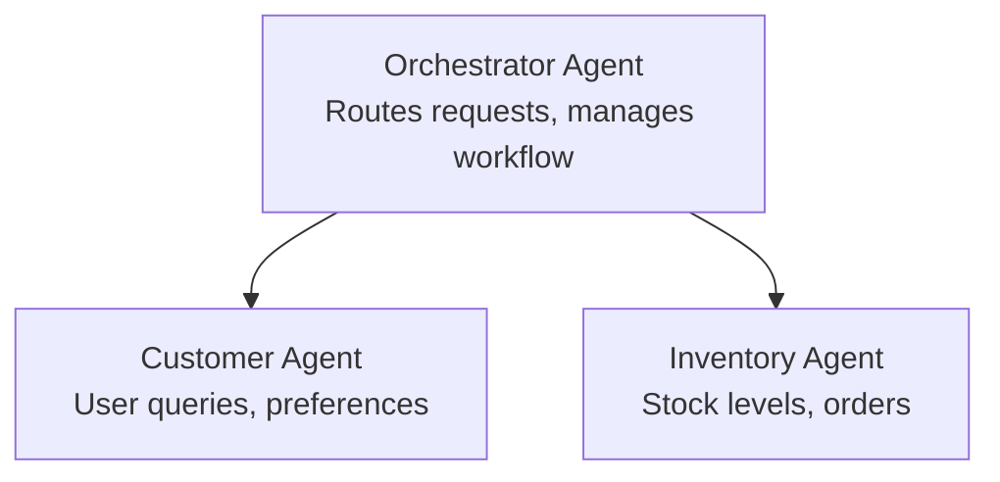

# Розділ 5: Багатоагентні рішення ШІ

**📚 Курс**: [AZD Для початківців](../../README.md) | **⏱️ Тривалість**: 2-3 години | **⭐ Складність**: Просунутий рівень

---

## Огляд

У цьому розділі розглядаються просунуті патерни архітектури багатоагентних систем, оркестрація агентів та готові до виробництва рішення ШІ для складних сценаріїв.

> Керівництво команд перевірено щодо опублікованого довідника `azd 1.37.2`. Хмарні розгортання не виконувалися.

## Цілі навчання

Завершивши цей розділ, ви:
- Зрозумієте патерни архітектури багатоагентних систем
- Розгорнете скоординовані системи агентів ШІ
- Реалізуєте комунікацію між агентами
- Побудуєте готові до виробництва багатоагентні рішення

---

## 📚 Уроки

| № | Урок | Опис | Час |
|---|----------|------------------------------|-------|
| 1 | [Основи багатоагентних систем](multi-agent-basics.md) | Практика: розгорнути робочий додаток багатоагентної системи з `azd up` | 45 хв |
| 2 | [Патерни координації](../chapter-06-pre-deployment/coordination-patterns.md) | Стратегії оркестрації агентів (продовжується в розділі 6) | 30 хв |
| 3 | [Розгортання ARM-шаблоном](../../examples/retail-multiagent-arm-template/README.md) | Приклад розгортання в один клік | 30 хв |

> **Починайте з уроку 1.** Це єдиний повністю практичний, розгортальний урок у цьому розділі. Урок 2 розміщено в Розділі 6 (він спільний із плануванням перед розгортанням), а [Роздрібне багатоагентне рішення](../../examples/retail-scenario.md) — це архітектурний план — референс дизайну, а не шаблон на одну команду.

---

## 🚀 Швидкий старт

```bash
# Option 1: Deploy the multi-agent template used in Lesson 1
azd init --template Azure-Samples/contoso-creative-writer .
azd up

# Option 2: Initialize a Foundry agent interactively (requires azure.ai.agents)
azd extension install azure.ai.agents
azd ai agent init
azd up
```

> **Який підхід обрати?** Використовуйте `azd init --template`, щоб почати з робочого зразка. Використовуйте `azd ai agent init` інтерактивно або `azd ai agent init --template <path-to-azure.yaml>`, щоб прийняти існуючий агентний проєкт. Дивіться [довідник AZD AI CLI](../chapter-08-production/production-ai-practices.md#azd-ai-cli-commands-and-extensions) для вимог до версій і міграції оцінок.

Запускайте ці варіанти в окремих порожніх папках. Розширення агентів `1.0.0-beta.23` вимагає `azd >= 1.37.0`; його інтерактивний потік не генерує кастомний конвеєр Service Bus у уроці координації.

---

## 🤖 Архітектура багатоагентних систем



---

## 🎯 Виділене рішення: Роздрібне багатоагентне

У [Retail Multi-Agent Solution](../../examples/retail-scenario.md) демонструється:

- **Агент клієнта**: Обробляє взаємодії з користувачем та вподобання
- **Агент інвентаризації**: Керує запасами та обробкою замовлень
- **Оркестратор**: Координує взаємодію між агентами
- **Спільна пам’ять**: Управління контекстом між агентами

### Використані служби

| Служба | Призначення |
|---------|---------|
| Microsoft Foundry Models | Розуміння мови |
| Azure AI Search | Каталог товарів |
| Cosmos DB | Стан агента та пам’ять |
| Container Apps | Хостинг агента |
| Application Insights | Моніторинг |

---

## 🔗 Навігація

| Напрямок | Розділ |
|-----------|---------|
| **Попередній** | [Розділ 4: Інфраструктура](../chapter-04-infrastructure/README.md) |
| **Наступний** | [Розділ 6: Перед розгортанням](../chapter-06-pre-deployment/README.md) |

---

## 📖 Пов’язані ресурси

- [Посібник з AI агентів](../chapter-02-ai-development/agents.md)
- [Практики AI у виробництві](../chapter-08-production/production-ai-practices.md)
- [Усунення неполадок AI](../chapter-07-troubleshooting/ai-troubleshooting.md)

---

<!-- CO-OP TRANSLATOR DISCLAIMER START -->
**Відмова від відповідальності**:
Цей документ було перекладено за допомогою сервісу штучного інтелекту для перекладу [Co-op Translator](https://github.com/Azure/co-op-translator). Хоча ми прагнемо до точності, будь ласка, майте на увазі, що автоматичні переклади можуть містити помилки або неточності. Оригінальний документ рідною мовою слід вважати авторитетним джерелом. Для критично важливої інформації рекомендується професійний людський переклад. Ми не несемо відповідальності за будь-які непорозуміння або неправильні тлумачення, що виникли внаслідок використання цього перекладу.
<!-- CO-OP TRANSLATOR DISCLAIMER END -->