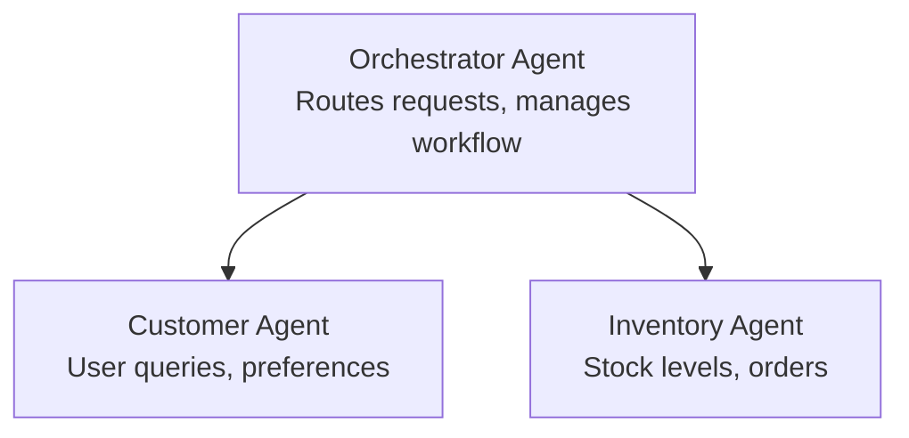

# Розділ 5: Багатокористувацькі AI-рішення

**📚 Курс**: [AZD для початківців](../../README.md) | **⏱️ Тривалість**: 2-3 години | **⭐ Складність**: Просунутий

---

## Огляд

Цей розділ охоплює складні архітектурні шаблони багатокористувацьких агентів, оркестрацію агентів та виробничі розгортання AI для складних сценаріїв.

> Команди перевірено відповідно до опублікованого `azd 1.37.2` референсу. Розгортання в хмарі не виконувались.

## Цілі навчання

Після проходження цього розділу ви зможете:
- Розуміти архітектурні шаблони багатокористувацьких агентів
- Розгортати скоординовані системи AI агентів
- Реалізувати комунікацію між агентами
- Створювати готові до виробництва багатокористувацькі AI-рішення

---

## 📚 Уроки

| # | Урок | Опис | Час |
|---|--------|-------------|------|
| 1 | [Основи багатокористувацьких агентів](multi-agent-basics.md) | Практично: розгорнути робочий додаток з багатокористувацькими агентами із `azd up` | 45 хв |
| 2 | [Шаблони координації](../chapter-06-pre-deployment/coordination-patterns.md) | Стратегії оркестрації агентів (продовжується у Розділі 6) | 30 хв |
| 3 | [Розгортання ARM Шаблону](../../examples/retail-multiagent-arm-template/README.md) | Приклад одно-клікового розгортання | 30 хв |

> **Почніть з уроку 1.** Це єдиний повністю практичний урок з можливістю розгортання в цьому розділі. Урок 2 знаходиться у Розділі 6 (він спільний з плануванням перед розгортанням), а [Роздрібне багатокористувацьке AI-рішення](../../examples/retail-scenario.md) є архітектурним планом — шаблоном проєкту, а не шаблоном у вигляді однієї команди.

---

## 🚀 Швидкий старт

```bash
# Option 1: Deploy the multi-agent template used in Lesson 1
azd init --template Azure-Samples/contoso-creative-writer .
azd up

# Option 2: Initialize a Foundry agent interactively with the GA bundle
azd ext install microsoft.foundry
azd ai agent init
azd up
```

> **Який підхід вибрати?** Використовуйте `azd init --template`, щоб почати з робочого прикладу. Використовуйте `azd ai agent init` інтерактивно або `azd ai agent init --template <path-to-azure.yaml>` для прийняття існуючого проєкту агента. Див. [AZD AI CLI референс](../chapter-08-production/production-ai-practices.md#azd-ai-cli-commands-and-extensions) для вимог до версії та міграції оцінювання.

Запускайте ці альтернативи в окремих порожніх папках. Потік роботи GA Foundry вимагає `azd >= 1.37.0`; його інтерактивний процес не створює власний конвеєр Service Bus у координаційному уроці. Для локального тестування, розгортання коду та очищення нових/перевикористаних проєктів дотримуйтеся [інструкцій з hosted-agent](../chapter-02-ai-development/microsoft-foundry-integration.md#hosted-agent-walkthrough-ga).

---

## 🤖 Архітектура багатокористувацьких агентів



---

## 🎯 Представлене рішення: роздрібний багатокористувацький агент

Приклад [Retail Multi-Agent Solution](../../examples/retail-scenario.md) демонструє:

- **Агент клієнта**: Обробляє взаємодію з користувачем та його вподобання
- **Агент інвентарю**: Керує запасами та обробкою замовлень
- **Оркестратор**: Координує взаємодію між агентами
- **Спільна пам’ять**: Управління контекстом між агентами

### Використані сервіси

| Сервіс | Призначення |
|---------|---------|
| Microsoft Foundry Models | Розуміння мови |
| Azure AI Search | Каталог товарів |
| Cosmos DB | Стан та пам’ять агента |
| Container Apps | Хостинг агента |
| Application Insights | Моніторинг |

---

## 🔗 Навігація

| Напрямок | Розділ |
|-----------|---------|
| **Попередній** | [Розділ 4: Інфраструктура](../chapter-04-infrastructure/README.md) |
| **Наступний** | [Розділ 6: Попереднє розгортання](../chapter-06-pre-deployment/README.md) |

---

## 📖 Пов’язані ресурси

- [Посібник з AI агентів](../chapter-02-ai-development/agents.md)
- [Практики виробничого AI](../chapter-08-production/production-ai-practices.md)
- [Вирішення проблем AI](../chapter-07-troubleshooting/ai-troubleshooting.md)

---

<!-- CO-OP TRANSLATOR DISCLAIMER START -->
**Відмова від відповідальності**:
Цей документ було перекладено за допомогою сервісу штучного інтелекту для перекладу [Co-op Translator](https://github.com/Azure/co-op-translator). Хоча ми прагнемо до точності, будь ласка, майте на увазі, що автоматичні переклади можуть містити помилки або неточності. Оригінальний документ рідною мовою слід вважати авторитетним джерелом. Для критично важливої інформації рекомендується професійний людський переклад. Ми не несемо відповідальності за будь-які непорозуміння або неправильні тлумачення, що виникли внаслідок використання цього перекладу.
<!-- CO-OP TRANSLATOR DISCLAIMER END -->